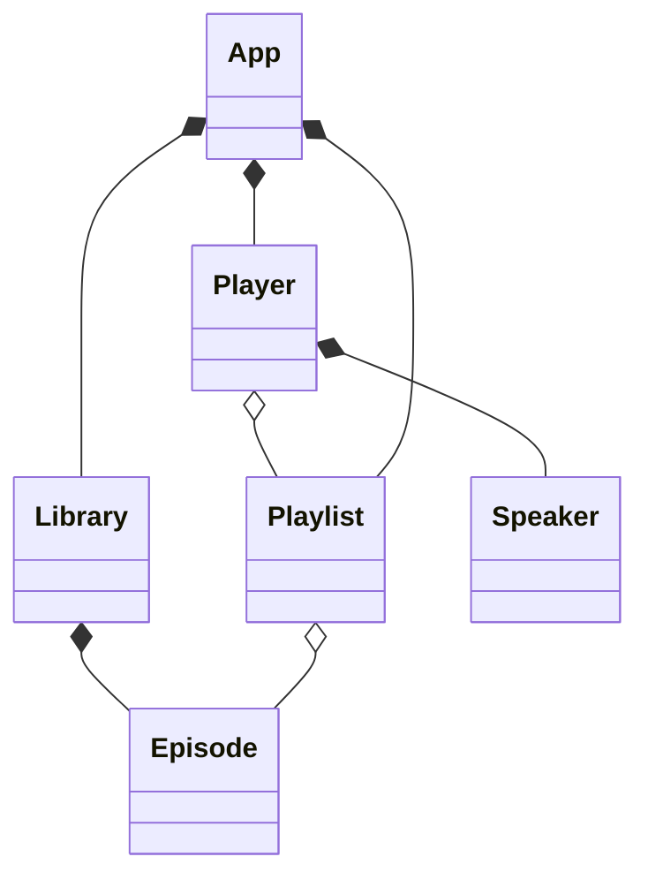

# L0.4/ladder/rung-1: Read a class diagram: who owns what

## Task
Below is the class diagram of a podcast app, and its code is in `tests/podcast.hpp`. Write `owners.txt`: for each class, the one class that owns it (the class whose lifetime ends it), or `none` if no class owns it.

## Files
`starter/owners.txt` has one line per class. Fill in the owner after the colon.

## Acceptance tests (in words)
- every owner named matches the `std::unique_ptr` and by-value members of the code
- a class that is only referred to (`o--`, a pointer or a reference) is not named as an owner
- the class that nobody owns is answered `none`

## How to work
    bash scripts/new_attempt.sh L0.4/ladder/rung-1
    # edit work/L0.4/ladder/rung-1/owners.txt
    bash exercises/L0.4/ladder/rung-1/test.sh work/L0.4/ladder/rung-1
The checker prints one line for each difference between your drawing and the code. Preview a diagram at mermaid.live or in any Mermaid-aware editor.
On the lab server: `bash scripts/labserver.sh kit L0.4/ladder/rung-1 work/L0.4/ladder/rung-1`
