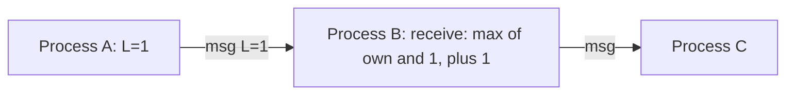

# H4.1 lab rung 1: solution

## Design
One counter behind a mutex. `Receive` takes the larger of the counter and the message's time and then adds 1. A process keeps a log of its stamps and returns a copy.

Files edited from the starter: 1 (clk.go). Lines added: about 70.

## Decision record
- Decision: One mutex around the counter and the log, and a receive rule of max plus one.
- Alternative and when it is better: The machine's wall clock as the timestamp: better when all events come from one machine and nothing is compared across machines.

## Three common wrong approaches
1. Receive without the max (just adding 1): `TestLamportRules` and the causality tests fail.
2. Receive that sets the counter to the max without adding 1: the receive equals the send time.
3. No lock in `Process.Local`: the race detector reports a data race in `TestConcurrentUse`.
