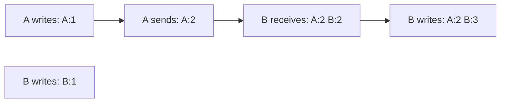

# H4.1 lab rung 2: solution

## Design
A vector clock is a map from process id to counter. `Inc` and `Merge` return new maps, so a clock inside a message can be shared safely. `Compare` looks for an entry where a is larger and an entry where b is larger.

Edit from rung 1: about 70 lines added to clk.go, 10 changed in `Process`.

## Decision record
- Decision: Immutable maps, compared entry by entry.
- Alternative and when it is better: Keep only the Lamport time: 8 bytes against 8 per writer, and enough when nobody has to tell concurrent from ordered.

## Three common wrong approaches
1. Comparing sums of the entries: `TestCompareCases` fails for `{A:3}` and `{B:1}`.
2. A receive that replaces the clock with the message's clock: a process's clock goes backwards.
3. `Inc` that changes the map in place: stamps already handed out change.
