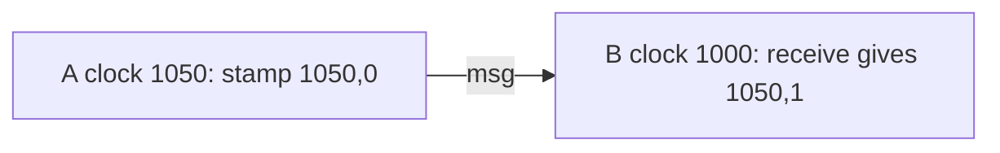

# H4.1 lab rung 4: solution

## Design
State is the last stamp. A local event moves to the physical time if that is ahead, otherwise bumps the counter. A receive takes the largest physical part and sets the counter by which of the three values shared it.

New file hlc.go; about 55 lines.

## Decision record
- Decision: Take the maximum of the three physical parts; counter by case.
- Alternative and when it is better: A Lamport time: 8 bytes and the same causal guarantee, but it has no relation to real time.

## Three common wrong approaches
1. No counter when the physical time does not advance: two events get the same stamp.
2. A receive that ignores the message's time: the receive can be earlier than the send.
3. No mutex: the race detector reports a race in `TestConcurrentStamps`.
