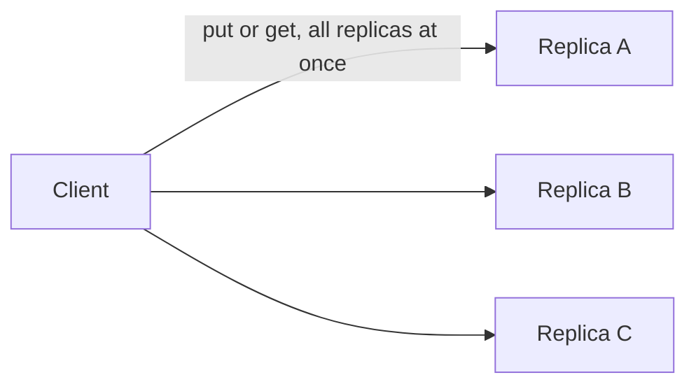

# H4.2 lab rung 1: solution

## Design
Every replica keeps the newest version per key behind a mutex. The client sends each Put to all three replicas at once and each Get to all three, and Get returns the reply with the highest version. In this rung any failed call is an error, so one down machine stops everything.

Files edited from the starter: 1 (kv.go, three function bodies). Lines added: about 30.

## Decision record
- Decision: Keep the strict rule only while all machines are up; rung 2 relaxes it.
- Alternative and when it is better: One map behind one mutex on one machine: better when 43 minutes of downtime a month is acceptable.

## Three common wrong approaches
1. No lock in Handle: the race detector reports a data race in TestConcurrentClients.
2. Taking the first reply instead of the highest version: TestGetReturnsNewestOfReplies fails.
3. Letting an older version overwrite a newer one: TestOlderVersionDoesNotOverwrite fails.
