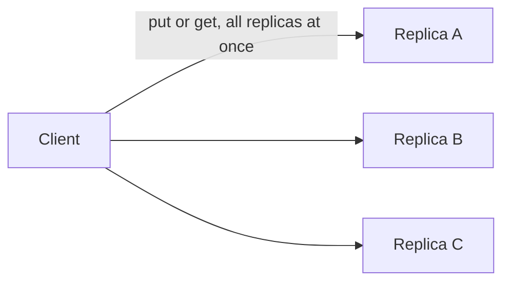

# H4.2 lab rung 2: solution

## Design
Count the replicas that answered. Put succeeds with at least W acknowledgements, Get with at least R replies; otherwise the error wraps ErrNoQuorum. With W = R = 2 of 3, one down machine changes nothing for the caller.

Edit from rung 1: two conditions changed in kv.go, about 10 lines.

## Decision record
- Decision: Counting acknowledgements instead of requiring all of them.
- Alternative and when it is better: Keep requiring all replicas: simpler, but write availability falls to 0.997 (129.5 minutes down a month).

## Three common wrong approaches
1. Counting the attempts instead of the acknowledgements: TestTwoDownMeansNoQuorum fails.
2. Requiring all replicas to read: TestOneReplicaDownStillWorks fails.
3. Returning an error that does not wrap ErrNoQuorum: errors.Is fails.
