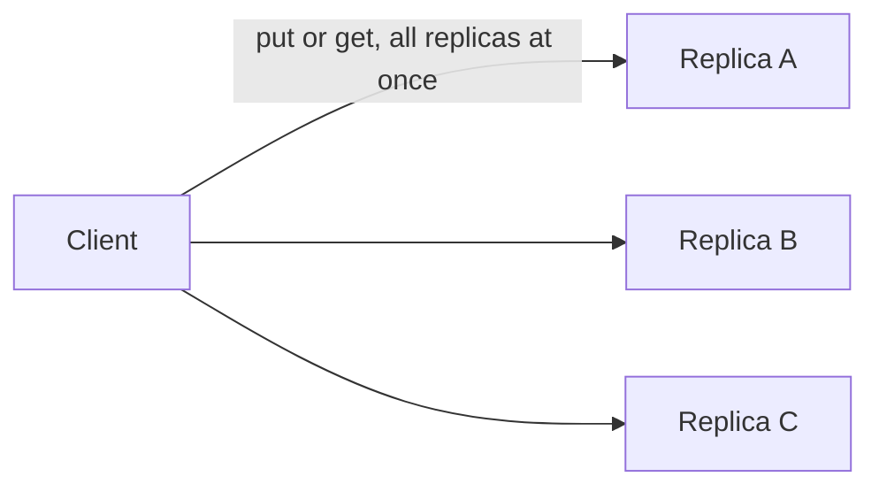

# H4.2 lab rung 3: solution

## Design
NewClient refuses W + R <= N unless the caller opts in with allowStale, and refuses W or R outside 1 to N. The check is the claim H4.2.1 turned into code.

Edit from rung 2: one new function, about 15 lines.

## Decision record
- Decision: Put the rule in a constructor so that the unsafe setting cannot be reached by accident.
- Alternative and when it is better: Document the rule and leave W and R free: less code, but W = 1, R = 1 reads stale data without warning.

## Three common wrong approaches
1. Using < instead of <=: W + R = N slips through, and TestNewClientRefusesUnsafeSettings fails.
2. Ignoring allowStale: the opt-in test fails.
3. No range check: W = 0 or W = 4 is accepted.
