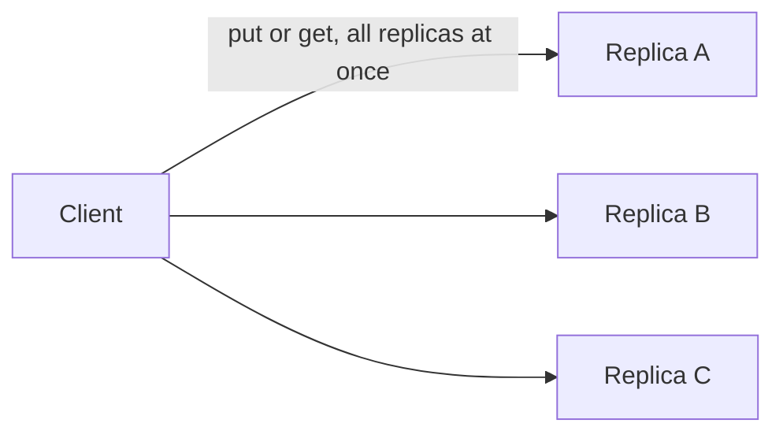

# H4.2 lab rung 4: solution

## Design
After picking the newest version, Get writes it to each replica that answered with an older one. A failed repair is ignored, a replica ignores older versions, and the flag defaults to off.

Edit from rung 3: one field and one loop in Get, about 12 lines.

## Decision record
- Decision: Repair on the read path, because the read already knows which replicas are behind.
- Alternative and when it is better: Wait for the next write of each key: fine for keys rewritten often, wrong for keys that are read much more than written.

## Three common wrong approaches
1. Writing back the old value: TestReadRepairHealsStaleReplica fails.
2. Failing the read when a repair fails: TestFailedRepairDoesNotFailTheRead fails.
3. Repairing even when the flag is off: TestWithoutReadRepairReplicaStaysStale fails.
