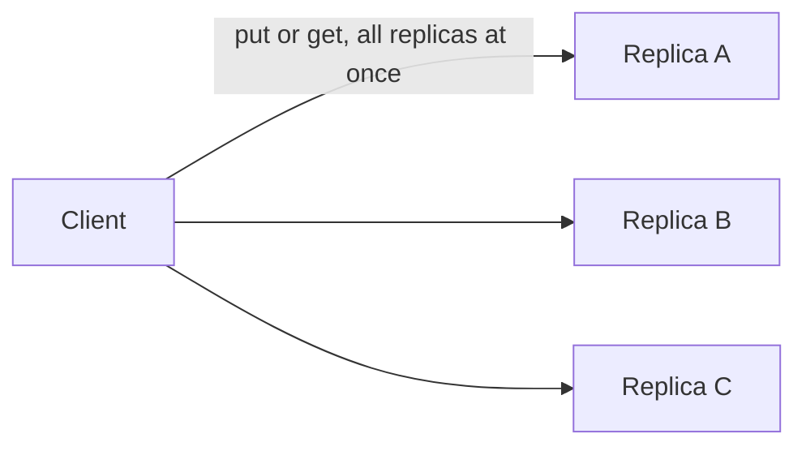

# H4.2 lab rung 5: solution

## Design
Choose is a setting: below 1000 ms W = 2, R = 2; at 1000 ms or more W = 2, R = 1 with read repair. No new structure: the client from rung 4 already supports both.

Edit from rung 4: one new file, about 15 lines; the client is untouched.

## Decision record
- Decision: Treat the staleness tolerance as configuration, not as code.
- Alternative and when it is better: Always use R = 2: simplest to reason about, and right when no reader tolerates staleness.

## Three common wrong approaches
1. Using > 1000 so 1000 ms is treated as strict: the boundary test fails.
2. Always returning the strict setting: the tolerant case fails.
3. Tolerant setting without read repair: replicas that missed a write are never repaired.
