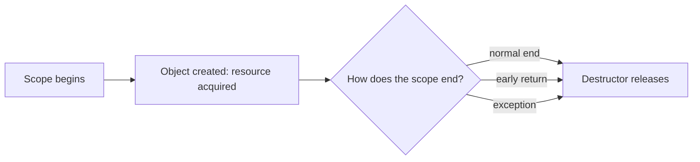

# L0.0 cp-1: solution

## Design
TempFile creates the file in its constructor (throwing if it cannot) and removes it in its destructor. Copying is deleted. A move takes the path and clears it in the old object, and the destructor removes the file only when the path is not empty, so the moved-from object leaves the new owner's file alone. The destructor uses the non-throwing form of remove, because a destructor must not throw.

About 30 lines in `temp_file.hpp`.

## Decision record
- Decision: Tie the file's life to an object, and make ownership move rather than copy.
- Alternative and when it is better: A `cleanup()` function called in a `finally`-style block: C++ has no `finally`, so every caller would write the same try/catch by hand.

## Three common wrong approaches
1. Deleting in a function the caller must call: an exception skips it.
2. A move that copies the path: the old object deletes the file the new owner is using.
3. Creating the file only on the first write: a name in a missing directory does not throw at construction.
