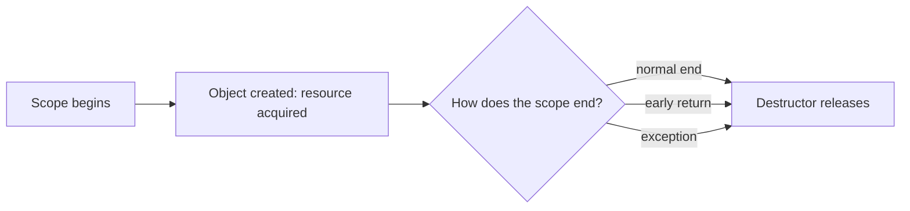

# L0.0 ladder/rung-1: solution

## Design
Connection counts an open in its constructor and a close in its destructor. The destructor runs on every way out of the scope that owns the object, so the close happens once whether the function returns normally, returns early or throws. Copying is deleted (two owners would close twice); moving transfers the right to close by leaving a null pointer in the moved-from object.

About 20 lines in `kit.hpp`; one class.

## Decision record
- Decision: Own the resource in an object whose destructor releases it.
- Alternative and when it is better: A `close()` function the caller must remember to call: simpler to read, and wrong the first time a throw or an early return skips it.

## Three common wrong approaches
1. Calling `close()` by hand at the end: an early return or a throw skips it (the closed count stays 0).
2. Leaving the compiler-made copy in place: two objects close one connection (closed becomes 2).
3. A move that copies the pointer instead of clearing the source: the moved-from object closes too.
