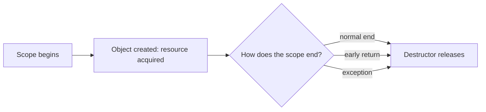

# L0.0 ladder/rung-2: solution

## Design
make_report builds the Report inside a std::unique_ptr (std::make_unique) and returns it by value. The caller receives sole ownership; the Report is destroyed when that pointer goes away. The check for n below 1 comes before any allocation, so a throw leaves nothing behind.

Edit from rung 1: one function body, about 8 lines.

## Decision record
- Decision: Return `std::unique_ptr` by value from a factory.
- Alternative and when it is better: Return a plain reference or raw pointer to a Report held somewhere else: fine when the factory does not create the object, wrong here because someone must own the new one.

## Three common wrong approaches
1. Allocating with `new` first and checking the argument afterwards: the throw leaks the Report.
2. Returning a raw pointer: the caller must remember to delete it.
3. Calling `new` for a scratch object and forgetting it: `Report::live()` stays above 0.
