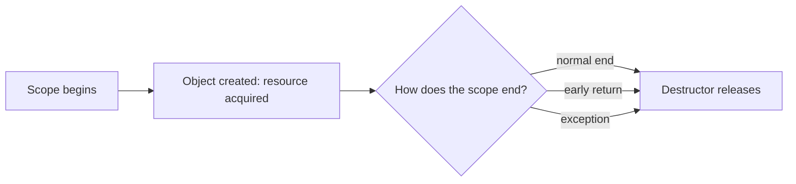

# L0.0 ladder/rung-3: solution

## Design
ImageCache keeps a std::weak_ptr to each image it handed out. get() asks the weak pointer for an owner with lock(); if one exists, the same image is shared, otherwise a new one is made with std::make_shared. Callers own the image jointly; the last one to let go destroys it; the cache never keeps it alive.

Edit from rung 2: one class, about 12 lines.

## Decision record
- Decision: Shared ownership with a non-owning observer in the cache.
- Alternative and when it is better: A cache that holds `std::shared_ptr` and so keeps every image for ever: simpler, and right when the images should live as long as the program.

## Three common wrong approaches
1. Storing `std::shared_ptr` in the map: the image outlives its last user (live stays at 1).
2. Creating a new image every call: callers do not share (use count 1, two images alive).
3. Handing out a raw pointer from the map: it dangles when the last owner lets go.
