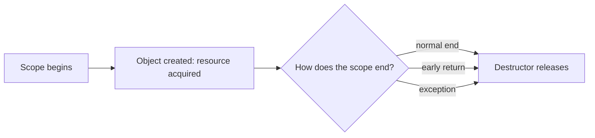

# L0.0 ladder/rung-4: solution

## Design
name_length takes `const Image&`: a reference means "use this, I do not own it", const means "I will not change it". A temporary can bind to a const reference, so `name_length(Image("abc"))` works; no copy is made and no use count changes.

Edit from rung 3: one function, one line.

## Decision record
- Decision: A const reference for a parameter that is only read.
- Alternative and when it is better: Pass `std::shared_ptr<Image>` by value: right when the function keeps the image after it returns (it then needs to be an owner), wrong when it only reads.

## Three common wrong approaches
1. Taking `Image&` (non-const): a temporary or a const image cannot be passed.
2. Taking `Image` by value: copying is deleted here, so it does not compile (and for a copyable type it would copy for nothing).
3. Taking a `shared_ptr` just to read: every call touches the reference count.
