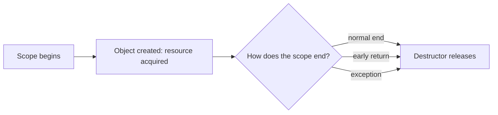

# L0.0 ladder/rung-5: solution

## Design
Point is a plain struct of two ints. It is copied freely: copies are independent, nothing needs an owner, and there is no pointer to dangle. midpoint takes and returns Points by value; integer division truncates toward zero.

Edit from rung 4: one struct and one function, about 8 lines.

## Decision record
- Decision: No smart pointer, no reference: a value.
- Alternative and when it is better: Hold a Point behind a `std::unique_ptr` or a `std::shared_ptr`: adds an allocation and an owner to think about for 8 bytes of data.

## Three common wrong approaches
1. Writing `>> 1` for the average: rounds down for negative numbers (-3 gives -2 instead of -1).
2. Adding a destructor to Point: it stops being trivially copyable for no reason.
3. Forgetting one coordinate.
