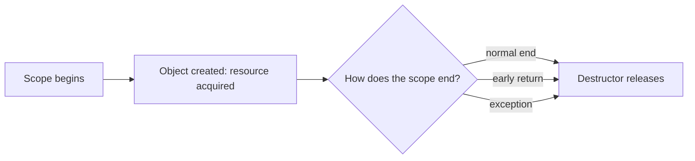

# L0.0 rev-1-1: solution

## Design
Put the Image in a std::unique_ptr (std::make_unique). Every path out of the function, including both throws, destroys it. The function body gets shorter: the delete disappears.

Edit from the starter: 5 lines changed, one removed.

## Decision record
- Decision: Replace the raw `new` and `delete` pair by an owner object.
- Alternative and when it is better: Keep `new` and add a `delete` before each throw: works today, and breaks again on the next early exit someone adds.

## Three common wrong approaches
1. Adding `delete img;` before only one of the throws: the other path leaks.
2. Using a unique_ptr and also deleting by hand: a double delete.
3. Moving the `new` after the checks and forgetting the success path: still leaks on success.
