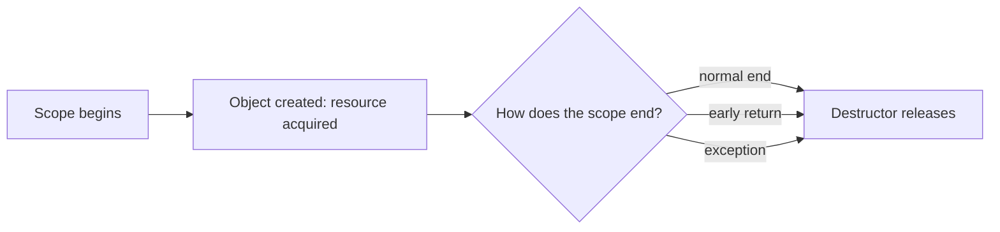

# L0.0 rev-2-1: solution

## Design
ScopedTimer reads the clock in its constructor and, in its destructor, appends now() minus start. The destructor runs on every way out, so early returns and exceptions record too. A move leaves a null output pointer in the old timer so it records nothing.

About 15 lines in `scoped_timer.hpp`.

## Decision record
- Decision: Record in the destructor.
- Alternative and when it is better: Call a `stop()` function before each return: it works for one return and fails with the next one someone adds.

## Three common wrong approaches
1. Recording in the constructor: the elapsed time is not known yet.
2. Recording the clock reading instead of the difference.
3. A move that copies the output pointer: both timers record.
