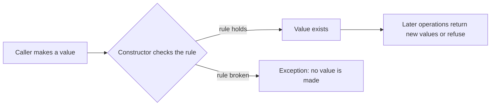

# L0.1 cp-1: solution

## Design
Percentage checks 0..100 in its constructor and Discount checks the minimum spend in its; both keep their fields private and never change after construction. apply is const: it computes a result and changes nothing.

About 35 lines in `discount.hpp`.

## Decision record
- Decision: Two small classes, each protecting one rule.
- Alternative and when it is better: Plain ints with checks scattered at every call site: shorter per class, and the check is forgotten at the first new call site.

## Three common wrong approaches
1. Checking only the upper bound: a negative percentage passes.
2. Rounding the discount up: customers pay too little.
3. Treating the minimum spend as exclusive.
