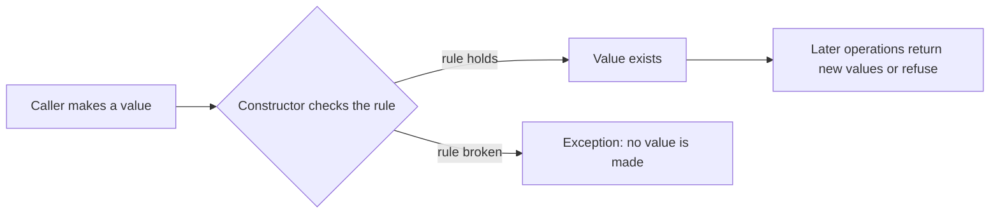

# L0.1 ladder/rung-1: solution

## Design
The constructor checks both parts and the fields are private, so every Money that exists passed the check and nothing outside the class can write to its fields. The rule is stated once, in the constructor, and every later function can rely on it.

About 15 lines in `kit.hpp`.

## Decision record
- Decision: Private fields and a checking constructor.
- Alternative and when it is better: A plain `struct` with public fields: fine for data with no rule, and wrong here because any code can write `-5`.

## Three common wrong approaches
1. Public fields: any caller can write a negative amount.
2. Checking in a setter but not in the constructor: the first Money can already be bad.
3. Silently clamping to zero instead of refusing: the caller never learns the input was wrong.
