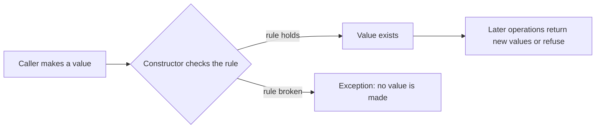

# L0.1 ladder/rung-2: solution

## Design
add checks the currency, checks the sum against the largest long long before adding, and builds a new Money through the checking constructor. The operands are untouched.

Edit from rung 1: one function, 5 lines.

## Decision record
- Decision: Compare before adding, so the overflow is never computed.
- Alternative and when it is better: Use a wider integer type for the sum: avoids the check for small ranges, but only moves the limit.

## Three common wrong approaches
1. Adding first and checking after: signed overflow is undefined behaviour in C++.
2. Skipping the currency check: the sum of euros and dollars is meaningless.
3. Throwing the wrong exception type: the caller cannot tell the cases apart.
