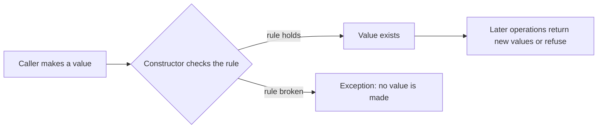

# L0.1 ladder/rung-3: solution

## Design
DateRange sets its fields once, in a constructor that checks start <= end. with_start and with_end build a new DateRange through the same constructor, so a change that would break the rule throws and the original is never touched.

Edit from rung 2: one class, about 14 lines.

## Decision record
- Decision: Immutable value: change means a new value.
- Alternative and when it is better: A mutable range with `set_start` and `set_end`: needs each setter to compare with the other end, and a two-step change leaves a broken range in between.

## Three common wrong approaches
1. A setter that checks only the new value, not the other end.
2. Changing a field first and throwing afterwards: the object is left changed.
3. Forgetting to check in `with_start` because the constructor 'already does it' (it does, if with_start goes through it).
