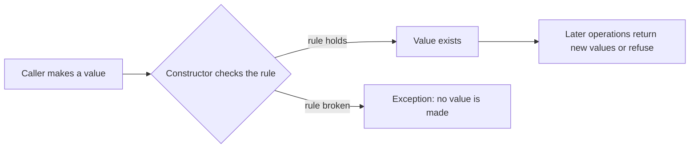

# L0.1 ladder/rung-4: solution

## Design
Address is immutable (const members, with_street builds a new one). Order holds a std::shared_ptr to a const Address, so two orders share one object, and change_address replaces the pointer instead of editing the shared object.

Edit from rung 3: two small classes, about 18 lines.

## Decision record
- Decision: Share an immutable value instead of copying it.
- Alternative and when it is better: Give each order its own copy of the Address: always safe, and costs a copy per order.

## Three common wrong approaches
1. A non-const shared Address: one order edits it and the other sees the change.
2. `with_street` that modifies this and returns it: the shared object changes.
3. Handing out a non-const reference from `address()`.
