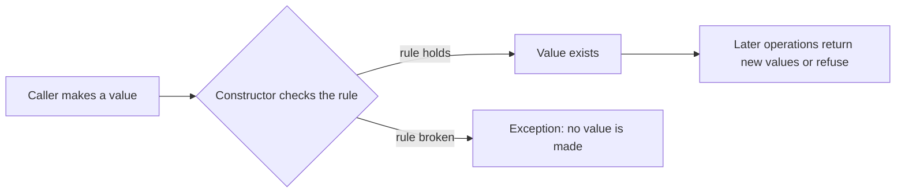

# L0.1 ladder/rung-5: solution

## Design
Settings is a plain struct: four fields, any combination valid, so there is nothing for a class to protect. describe only reads it.

Edit from rung 4: one function, 3 lines.

## Decision record
- Decision: No class: a struct is the right size when there is no rule.
- Alternative and when it is better: A class with getters and setters: 4 fields become about 20 lines for no gain (see the mistake catalogue).

## Three common wrong approaches
1. Turning Settings into a class with private fields: no rule to protect, only more code.
2. Forgetting a field in describe.
3. Adding a constructor that rejects some combination that is actually valid.
