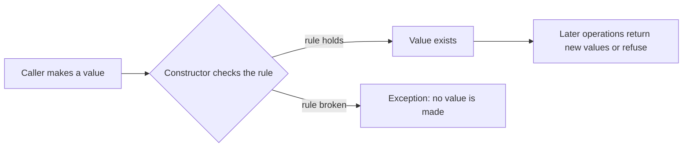

# L0.1 rev-1-3: solution

## Design
Make `size` private and rename it, check before changing in push and pop, and add a read-only size(). A refused call returns before it touches the state.

Edit from the starter: about 10 lines.

## Decision record
- Decision: Private state and checked operations.
- Alternative and when it is better: Keep the struct and add a comment asking callers to be careful: costs nothing, and the first caller who forgets breaks the stack.

## Three common wrong approaches
1. Incrementing the size before the capacity check.
2. Checking `size_ > 4` after the write: the array was already overrun.
3. Leaving `size` public next to the new function.
