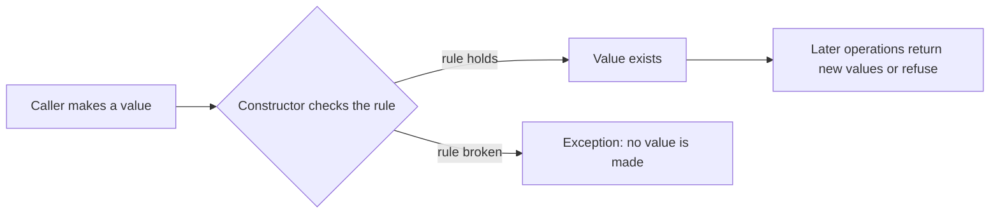

# L0.1 rev-2-1: solution

## Design
Duration stores whole seconds behind a private constructor and builds every instance through from_seconds or from_minutes, which refuse negatives. minutes is integer division by 60; plus builds a new Duration.

About 18 lines.

## Decision record
- Decision: Store the unit that loses nothing (seconds) and derive the coarser one (minutes).
- Alternative and when it is better: Store minutes and seconds as two public fields: simple, and the pair can disagree (90 seconds and 1 minute).

## Three common wrong approaches
1. Rounding minutes to nearest instead of down.
2. Allowing negative durations.
3. Storing minutes and seconds separately so the two can disagree.
