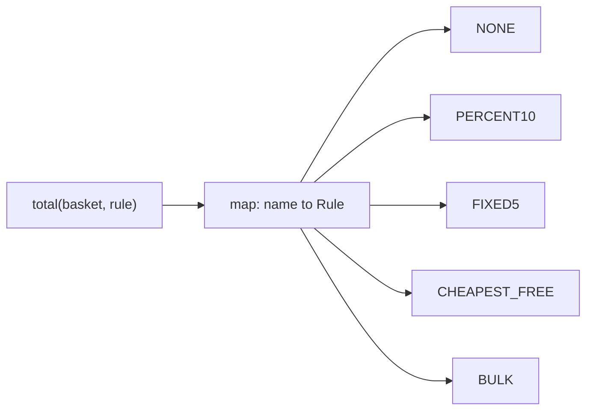

# L2.1/cp-1: reference design

**The design.** `Checkout` owns a map from rule name to `Rule`, a `std::function<long long(const std::vector<Item>&)>`. Each rule is one lambda that takes the basket and returns the total. `total` validates prices, finds the rule and calls it. A new rule is one line in the constructor; the other rules are not touched.

**Decision record.** Chosen: Strategy as `std::function` per rule. Why: five rules (two expected to grow), all fit `total(basket)`, each is a few lines, no rule needs state of its own. Rejected: a class per rule, longer than the logic here; an `if` chain, whose blast radius is 4 other rules per edit.

**Alternative, and when it is better.** A class per rule behind an interface. Better when rules get names, descriptions, validation or their own tests, or when a rule needs several functions.

**Three common wrong approaches.**
1. One long function with an `if` per rule and a "BULK" branch added at the end: works, but the extension edits the function that holds every rule.
2. Rounding the 10 per cent discount to nearest instead of down.
3. Making CHEAPEST_FREE free the first item instead of the cheapest, or free every item when fewer than three.
