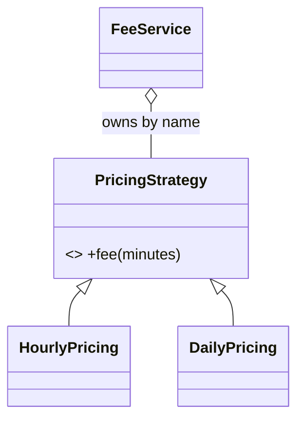

# L2.1/ladder/rung-1: reference design

**The design.** One interface, `PricingStrategy`, with the single function `fee(minutes)`. One final class per plan (`HourlyPricing`, `DailyPricing`). `FeeService` owns the plans in a `std::map<std::string, std::unique_ptr<PricingStrategy>>`, fills it in its constructor, validates the input and delegates. `FeeService` never names a plan class except in the one place where the map is filled.

**Decision record.** Chosen: Strategy. Why: two plans now, more expected (the ladder says so), every plan fits `fee(minutes)`. Honest cost: for two plans the plain function would be shorter (the lesson measured +4 files and +39 lines). Rung 1 pays that price early so that rungs 2 to 4 are cheap.

**Alternative, and when it is better.** A single `if` chain in `fee`. Better when the plans are fixed and nothing will be added: fewer files, nothing to learn.

**Three common wrong approaches.**
1. Rounding down with `minutes / 60 * 20`: 1 minute costs 0; the plan says started hours are charged.
2. Validating nowhere: negative minutes give negative fees.
3. Caller code that checks the plan class (`dynamic_cast`): every plan added later must be added there too (Claim L2.1.2 stops holding).
