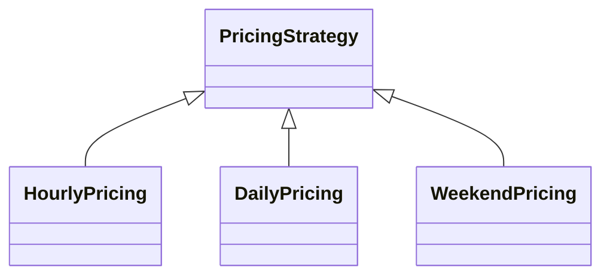

# L2.1/ladder/rung-2: reference design

**The design.** Add `WeekendPricing` (7 lines, a new file) and one `add_plan("WEEKEND", ...)` line plus one `#include` in `parking.hpp`. Between the rung-1 and rung-2 references: 2 lines added in 1 existing file, 7 lines in 1 new file, nothing removed, `HourlyPricing` and `DailyPricing` untouched.

**Decision record.** Chosen: a new class, not a new branch. Why: this is the change Strategy exists for. Blast radius 0, against 2 in the plain design (the lesson's measurement for the same request). Cost: 9 lines against about 1.

**Alternative, and when it is better.** One more line in an `if` chain: 1 line, but it sits in the function that holds the other plans. Better if you will never touch the plans again.

**Three common wrong approaches.**
1. Editing `HourlyPricing` to take a rate and reusing it: now the hourly plan and the weekend plan can break each other.
2. Copying `HourlyPricing` and changing `20` to `40` in a way that also changes the hourly rate by accident (a mutant of this kit does exactly that).
3. Adding the plan name to a switch in the caller: the caller now has to change for every plan.
