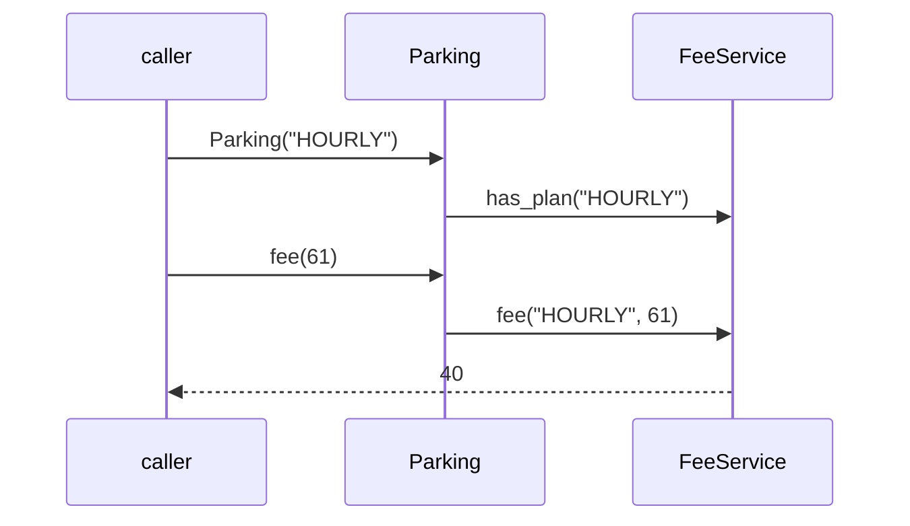

# L2.1/ladder/rung-3: reference design

**The design.** `Parking` holds a `FeeService` and the chosen plan name. The constructor checks the name with `has_plan` (a one-line addition to `FeeService`) and throws at once, so a bad configuration is found when the program starts, not on the first customer. `fee(minutes)` forwards. Between references: 13 lines added in `parking.hpp`, nothing else touched.

**Decision record.** Chosen: reuse `FeeService` and choose by name. Why: the selection is data (a setting), the plans are already isolated. Cost: one small class and a lookup.

**Alternative, and when it is better.** Hand the strategy object itself to `Parking` (`Parking(std::unique_ptr<PricingStrategy>)`). Better when the caller builds plans in code or tests with a fake plan; worse when the choice arrives as text from a file, which is this rung.

**Three common wrong approaches.**
1. Checking the name only when `fee` is first called: a typo in the configuration surfaces on the first customer.
2. Ignoring the name and always using the hourly plan (a mutant of this kit).
3. A second `if` chain in `Parking` that repeats the plan names: the list of plans now lives in two places.
