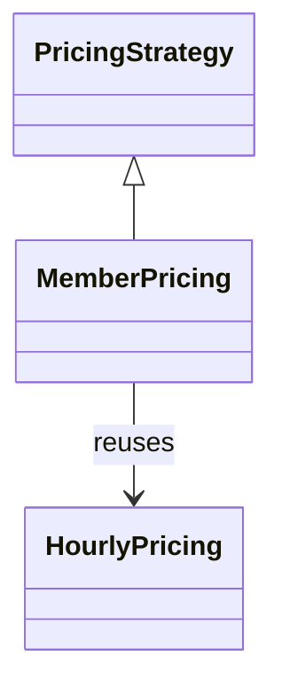

# L2.1/ladder/rung-4: reference design

**The design.** `MemberPricing` implements the same `fee(minutes)` and receives the extra input, the discount percentage, **through its constructor**. The shared signature does not change. `Parking` creates the `MemberPricing` with the discount and registers it under "MEMBER". Between references: 14 lines in a new file, 5 added and 2 removed in `parking.hpp`.

**Decision record.** Chosen: constructor injection of the extra input. Why: only one plan needs it, and widening the shared signature would force every other plan to accept an input it ignores (the "god signature" mistake of the lesson). Rejected: adding the discount to `fee`.

**Alternative, and when it is better.** Put the discount in the signature. Better only if most plans need it; then it is no longer an "extra input of one plan".

**Three common wrong approaches.**
1. Subtracting the percentage as a number of cents (`fee - discount`).
2. Rounding to nearest instead of down: 33 per cent off 40 gives 27, the tests want 26.
3. Not validating the range: 150 per cent gives a negative fee.
