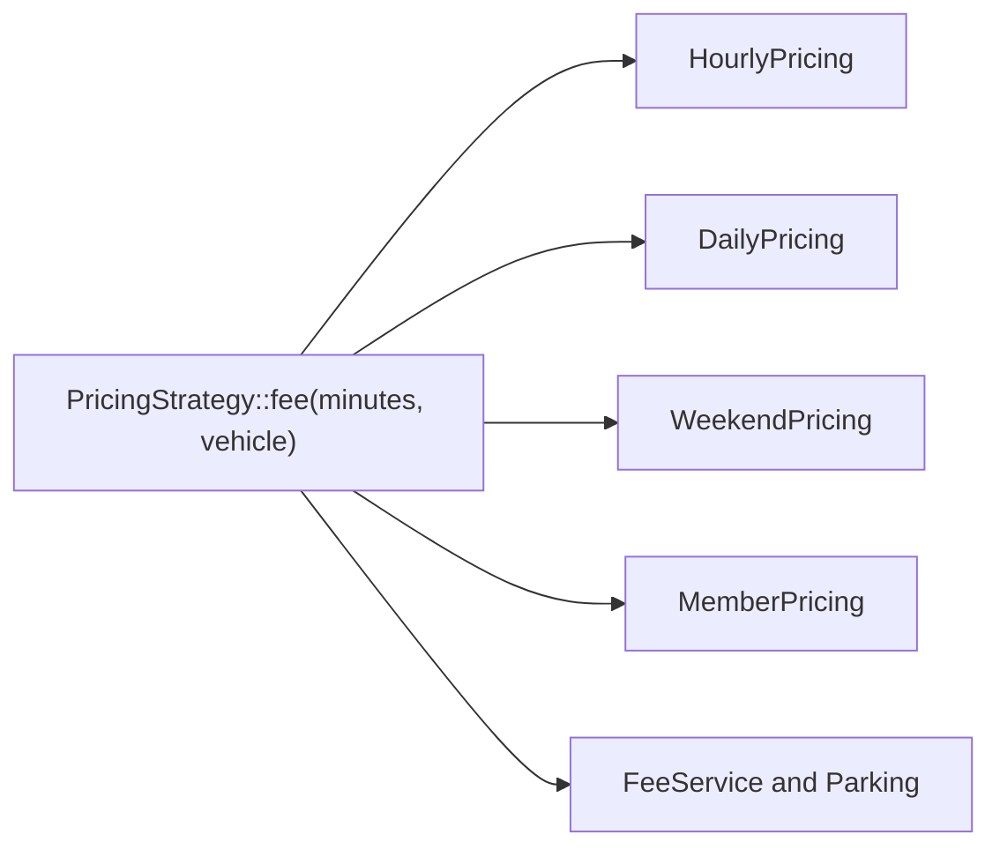

# L2.1/ladder/rung-5: reference design

**The design.** `Vehicle` joins the interface: `fee(minutes, vehicle)`. Every plan class, `FeeService` and `Parking` change. Between the rung-4 and rung-5 references: 6 files edited, 11 lines added and 9 removed..

**Decision record.** Chosen: change the shared signature. Why: every plan really depends on the vehicle now (the weekend plan ignores it, but must accept it). This is the case where Strategy is **no better** than the plain design: the lesson measured 6 or 7 files edited against 3, and the same blast radius. The plain design would edit one function and the tests.

**When did Strategy pay in this ladder?** In rungs 2 to 4, in blast radius: a new or changed plan touched 0 other plans. It never paid in lines, and at rung 5 it cost more.

**Alternative, and when it is better.** A parameter object (`struct Request { minutes; vehicle; }`) so that the next input does not change the signature again. Better when more inputs are expected; worse when it becomes a bag of unrelated fields (the god signature).

**Three common wrong approaches.**
1. Giving trucks the weekend surcharge too (a mutant doubles the weekend fee).
2. Charging the 50 once per stay instead of once per started day.
3. Applying the member discount to the car fee while the truck fee is computed separately.
