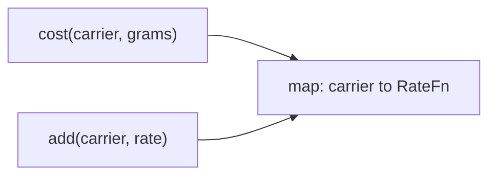

# L2.1/rev-1-3: reference design

**The design.** The four `if` lines become four `add` calls in the constructor, filling a `std::map<std::string, RateFn>`. `cost` looks the name up and calls the stored function. `add` rejects an empty function and stores the rest, replacing any earlier rate for that name.

**Decision record.** Chosen: the `std::function` form of Strategy. Why: each carrier is one expression; four now, more added at run time; a class per carrier would be longer than its logic.

**Alternative, and when it is better.** An interface and a class per carrier: better when a carrier needs a name to show, several functions or its own tests.

**Three common wrong approaches.**
1. Keeping the `if` chain and adding a second map for new carriers: two places to look, two ways to be wrong.
2. Using `rates_[carrier]` in `cost`: a missing name quietly inserts an empty function that throws `std::bad_function_call` later.
3. Letting `add` ignore an existing name instead of replacing its rate.
