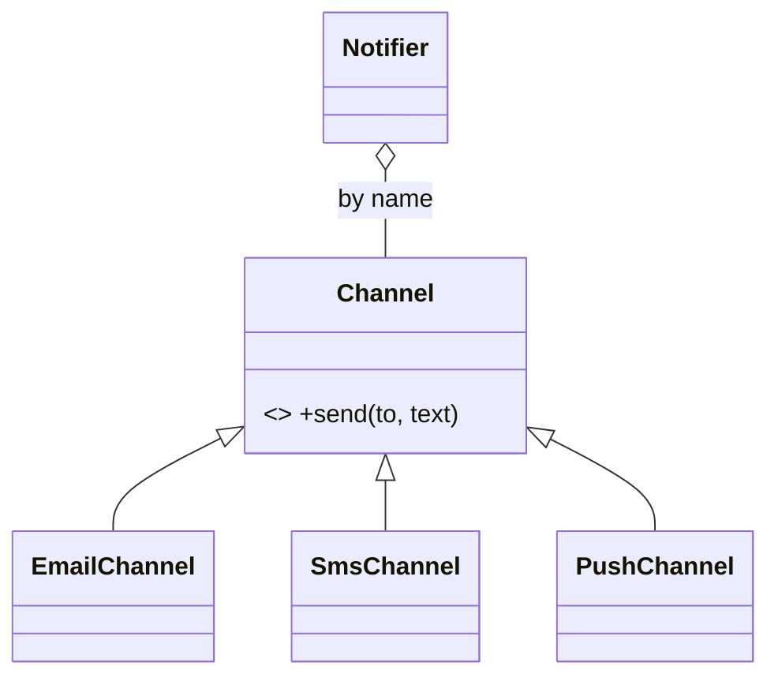

# L2.1/rev-2-1: reference design

**The design.** Each `case` of the `switch` becomes a class that implements `Channel` (`EmailChannel`, `SmsChannel`, `PushChannel`). `Notifier` owns them in a map by name, created in its constructor. `send` looks the name up and delegates. The caller's own channel (`FaxChannel` in the tests) is added with `add_channel` without any edit to existing code.

**Decision record.** Chosen: classes behind `Channel`. Why: each channel has its own formatting and limit, they are added and tested one by one, and callers must be able to supply their own. Counting edits: converting the `switch` costs about 25 lines, and every later channel then costs one class and one `add_channel`, with 0 other channels touched.

**Alternative, and when it is better.** A `std::function` per channel: better if each channel were a one-line format. Here the channels will grow, so a class is clearer.

**Three common wrong approaches.**
1. Keeping the `switch` and adding a default branch that calls a registered channel: two mechanisms for one job.
2. Storing raw pointers to channels the caller owns: they dangle when the caller's object goes away.
3. Forgetting the virtual destructor on `Channel`: deleting a derived channel through the base pointer is undefined behaviour (the lesson's first mistake).
