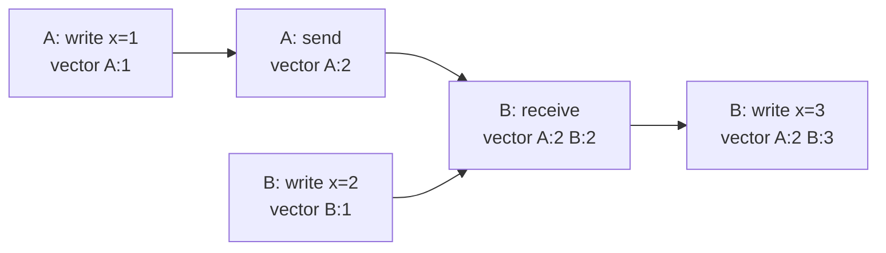
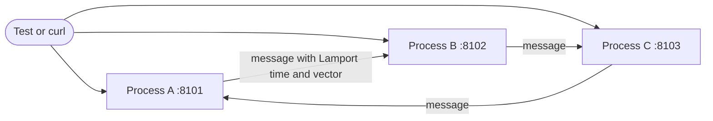

import { Code } from '@astrojs/starlight/components';
import TopicHeader from '../../../../components/TopicHeader.astro';
import WhatYouNeed from '../../../../components/WhatYouNeed.astro';
import ClaimEvidence from '../../../../components/design/ClaimEvidence.astro';
import TradeOffTable from '../../../../components/design/TradeOffTable.astro';
import LabRunner from '../../../../components/design/LabRunner.astro';
import ExperimentResult from '../../../../components/design/ExperimentResult.astro';
import Cards from '../../../../components/Cards.astro';
import Exercises from '../../../../components/design/Exercises.tsx';
import Drill from '../../../../components/Drill.tsx';
import LookalikePairs from '../../../../components/LookalikePairs.astro';
import SelfTest from '../../../../components/SelfTest.astro';
import Checkpoint from '../../../../components/Checkpoint.tsx';
import DecisionMapUpdate from '../../../../components/DecisionMapUpdate.astro';
import clocks from '../../../../../code/H4.1/lab-clocks/clocks.go?raw';
import httpx from '../../../../../code/H4.1/lab-clocks/httpx.go?raw';
import clocksTest from '../../../../../code/H4.1/lab-clocks/clocks_test.go?raw';
import execs from '../../../../../code/H4.1/execs/execs.go?raw';
import claim1 from '../../../../../code/H4.1/claim-1/main.go?raw';
import claim1Out from '../../../../../code/H4.1/claim-1/expected.txt?raw';
import claim2 from '../../../../../code/H4.1/claim-2/main.go?raw';
import claim2Out from '../../../../../code/H4.1/claim-2/expected.txt?raw';
import claim4 from '../../../../../code/H4.1/claim-4/main.go?raw';
import claim4Out from '../../../../../code/H4.1/claim-4/expected.txt?raw';
import calc from '../../../../../code/H4.1/calc-clock-sizes/main.go?raw';
import calcOut from '../../../../../code/H4.1/calc-clock-sizes/expected.txt?raw';

<TopicHeader topic="H4.1" />

## 1. Why this topic exists

Start with the simplest design there is: stamp every write with the time on the machine that made it, and let the newest stamp win. Here it is in the lab (`code/H4.1/lab-clocks`, the test `TestWallClockInvertsCausalOrder`). Machine A has a correct clock and writes `x=1`. Five milliseconds later, machine B, whose clock runs 20 ms behind, receives that write and writes `x=2` because of what it just read. The second write is caused by the first. The output of the test (run 2026-10-23):

```
x=1 stamped 0 ms, then x=2 (made after reading x=1) stamped -15 ms; newest timestamp wins, and keeps x=1
```

The write that happened later, and knew about the first one, carries the smaller timestamp, so the store throws it away. Nothing crashed and no error appeared: a user's change just disappeared.

How often does that happen? Say each of two machines has a clock that is wrong by an amount spread evenly between -10 ms and +10 ms, and the second write follows the first by 5 ms. The calc program below gives the answer: **28.125%** of such pairs are misordered, and a seeded simulation of 200 000 pairs gives 28.19%. Clocks that are "synchronised to within 10 ms" are not a safe source of order when events depend on each other within 5 ms.

What is needed is a way to order events by what could have influenced what, using only the messages that were actually sent. The key idea of this topic is small. Give every event a **logical timestamp**: a counter that is carried in every message and pushed forward when a message arrives. A single counter (a **Lamport clock**) never puts an effect before its cause. One counter per writer (a **vector clock**) also says exactly when two events could not have known about each other. A **hybrid logical clock** keeps a number close to real time and still never puts an effect before its cause. The costs are small and exact: 8 bytes for a Lamport time, 8 bytes per writer for a vector (160 bytes for 20 writers).

## 2. Prerequisites and scope

### What you need

<WhatYouNeed topic="H4.1" />

### What this topic does not cover

- Using these stamps to decide what a store keeps when two writes conflict: newest-timestamp-wins pitfalls, version vectors on stored values, and mergeable data types (H4.3).
- Choosing how many replicas must answer a read or a write (H4.2 comes after this topic and uses the version numbers that this topic explains).
- Precise names for what reads may return while writes are in flight: linearizability, eventual consistency, and the CAP theorem (H4.4).
- Agreeing on one order of all events with a majority of machines: consensus (H4.5).
- Keeping machine clocks synchronised (network time protocols, clock hardware). This topic assumes clocks can be wrong and shows what to do about it.

## 3. Definitions

**Event.** Something that happens at one process: a local step, sending a message, or receiving one.

**Process.** One machine or program with its own sequence of events. Processes share no memory and no clock; they only exchange messages.

**Happened before** (written a → b). Event a happened before event b if (1) both are at one process and a came first, or (2) a is the sending of a message and b is its receipt, or (3) there is a chain of events c where a → c and c → b. This is the only meaning of "before" that the machines can agree on, because it is defined by messages and not by clocks.

**Concurrent.** Two events are concurrent when neither happened before the other: neither could have known about the other.

**Wall-clock time and clock skew.** Wall-clock time is the reading of a machine's own clock. **Clock skew** is the difference between two machines' readings at the same real instant. Skew of tens of milliseconds is ordinary on machines that synchronise over a network.

**Lamport clock.** One counter per process. A local or send event adds 1. A receive sets the counter to the larger of its own value and the value in the message, then adds 1.

**Vector clock.** One counter per process that has had events, kept as a list of (process, counter). A receive takes the entry-wise larger of the two vectors and then adds 1 to the receiver's own entry. Two vectors are compared entry by entry.

**Hybrid logical clock.** A timestamp of a physical part (the machine's clock reading) and a counter. It follows the physical clock when that moves forward and uses the counter otherwise.

A Go example of the Lamport receive rule, the whole idea in four lines:

```go
func (l *Lamport) Receive(remote uint64) uint64 {
	if remote > l.t { l.t = remote } // never go backwards, and jump past what the sender had
	l.t++                            // the receive is itself an event
	return l.t
}
```



In the picture the writes `x=1` and `x=2` have no arrow path between them, so they are concurrent; `x=3` is after both.

## 4. Principles and claims

#### Claim H4.1.1: if a happened before b, the Lamport time of a is smaller than that of b

**Statement.** In any execution of processes that exchange messages, if event a happened before event b, the Lamport time of a is smaller than the Lamport time of b. The converse is false: two concurrent events can have Lamport times in order.

:::tip[In plain words]
Each message carries the sender's counter and the receiver jumps past it, so every step along a chain of causes increases the number. Two events that never heard of each other can still have ordered numbers, so a smaller number does not prove a cause.
:::

**A tiny instance with real numbers.** A has time 1 after a local event; it sends a message with time 2. B is at 0 and receives it: B's time becomes max(0, 2) + 1 = 3. The send (2) is before the receive (3). Meanwhile B's earlier local events had times 1 and 2 and were concurrent with A's first event (time 1) although time 1 is smaller than time 2.

**Reasoning.**
1. Take a → b. By the definition there is a chain of single steps, each either "next event at the same process" or "send, then its receive".
2. A next event at the same process adds at least 1 to the counter (a local or send step adds 1; a receive sets it to at least its own value plus 1).
3. A receive sets the counter to at least the message's value plus 1, and the message carries the send's time.
4. So each step of the chain increases the time by at least 1.
5. A chain of increases from a to b means time(a) < time(b).
6. For the converse, two events at different processes with no chain between them can be given times 1 and 2 by three plain local events (a local event at A, and two at B).

:::note[This claim needs]
1. Every message carries the sender's Lamport time at the send, and the receive rule is applied to every message.
2. Counters never decrease and a receive always adds at least 1.
3. Processes do not forget their counter (a restart must continue from a saved value).
:::

The claim program lists every execution of 3 processes with up to 6 events (local steps, sends, and receives of any pending message in any order) and uses the lab's real clock code on each. It prints how many cases break the rule and the length of the shortest execution that shows the converse failing. The expected output was worked out first: 0 cases, and 3 events (one local event at A, two at B).

<Code code={claim1} lang="go" title="code/H4.1/claim-1/main.go" />
<Code code={claim1Out} lang="text" title="expected.txt (the program's output)" />

The execution lister that both claim programs use:

<Code code={execs} lang="go" title="code/H4.1/execs/execs.go" />

<ClaimEvidence claim="H4.1.1" />

**Cost.** One 8-byte counter per process and 8 bytes on every message. Lamport times give a total order that agrees with cause and effect but also orders pairs that have no relation, which hides concurrency (`TestLamportCannotTellConcurrent`).

#### Claim H4.1.2: comparing vector clocks gives exactly the happens-before relation

**Statement.** In any execution, for two events a and b with vector clocks V(a) and V(b): V(a) is entry-wise at most V(b) with at least one smaller entry exactly when a happened before b; V(b) is below V(a) exactly when b happened before a; and the clocks are incomparable exactly when a and b are concurrent.

:::tip[In plain words]
A vector clock counts the events seen from each process. One event is before another exactly when the second has seen everything the first saw; when each has seen something the other has not, they are concurrent.
:::

**A tiny instance with real numbers.** A writes (vector `A:1`) and B writes (vector `B:1`). Entry A is larger in the first, entry B is larger in the second: concurrent. After A sends to B, B's next event has `A:2 B:2` or more, which is at least `A:1` in every entry and larger in one: the first write is before it.

**Reasoning.**
1. The entry for process P in a vector counts the events of P that the event has (directly or through messages) seen.
2. If a → b, everything a has seen, b has seen as well, and b has seen a itself, so every entry of V(a) is at most the same entry of V(b) and the entry of a's own process is larger.
3. If V(a) is at most V(b) in every entry and smaller in one, let P be a's process: the entry for P in V(b) is at least the one in V(a), which is a's own count, so b has seen a's event and a → b.
4. If neither vector is below the other, each has seen an event the other has not, so neither event is in the other's past: concurrent.

:::note[This claim needs]
1. Every event increments its own process's entry, and a receive takes the entry-wise maximum with the message's vector.
2. The set of processes is known; a process that is missing from a vector is read as 0.
3. Vectors are never edited in place after they have been sent or stored.
:::

The claim program checks every pair of events in every execution of 3 processes with up to 6 events against the happens-before relation computed from the messages alone:

<Code code={claim2} lang="go" title="code/H4.1/claim-2/main.go" />
<Code code={claim2Out} lang="text" title="expected.txt (the program's output)" />

<ClaimEvidence claim="H4.1.2" />

**Cost.** 8 bytes per process in every stamp. The vector grows with the number of writers (160 bytes for 20, 400 for 50) and travels with every message.

#### Claim H4.1.3: a vector clock costs 8 bytes per writer, and skew above the gap misorders writes

**Statement.** With 8-byte counters a vector clock for w writers takes 8w bytes; 20 writers take 160 bytes against 8 for a Lamport time. Two causally ordered writes a gap g apart in real time can be given timestamps in the wrong order by wall clocks only if the second machine's clock is behind the first by more than g. If clock errors are independent and evenly spread from -s to +s, the probability is (2s - g)² / (2 × (2s)²) for g below 2s.

:::tip[In plain words]
A vector clock holds one 8-byte counter per writer, so 20 writers cost 160 bytes on every value, 20 times a Lamport time. Two causally ordered writes 5 ms apart are misordered by wall clocks whenever the second machine's clock is more than 5 ms behind the first.
:::

**A tiny instance with real numbers.** Clocks off by -10 ms and +10 ms, writes 5 ms apart: the second write is stamped 5 - 20 = -15 ms relative to the first, so it is misordered.

**Reasoning (units on every line).**
1. Vector clock size = 20 writers × 8 bytes = 160 bytes. With 8-byte ids as well: 20 × 16 = 320 bytes.
2. For 1 000 000 values: 1 000 000 × 160 bytes = 160 MB, against 1 000 000 × 8 bytes = 8 MB for Lamport times.
3. The second write's stamp is its real time plus its clock error e₂; the first is its real time plus e₁. The second stamp is smaller when g + e₂ - e₁ < 0, that is, when e₂ - e₁ < -g.
4. The difference e₂ - e₁ of two errors evenly spread on [-s, s] has a triangular spread on [-2s, 2s].
5. The area of the triangle below -g is (2s - g)² / 2 and the whole area is (2s)², giving (2s - g)² / (2 (2s)²).
6. With s = 10 ms and g = 5 ms: (20 - 5)² / (2 × 20²) = 225 / 800 = 0.28125.

:::note[This claim needs]
1. Counters and ids are fixed-size; a real encoding may compress small counters.
2. Clock errors are independent and evenly spread: real clocks drift and step, so this is a model of the shape, not a prediction for any fleet.
3. The gap is measured in real time and the two writes are on different machines.
:::

The calc program prints every figure of this lesson:

<Code code={calc} lang="go" title="code/H4.1/calc-clock-sizes/main.go" />
<Code code={calcOut} lang="text" title="expected.txt (the program's output)" />

<ClaimEvidence claim="H4.1.3" />

**Cost.** The vector is the price of knowing about concurrency; the misorder probability is the price of trusting wall clocks.

#### Claim H4.1.4: a hybrid logical clock never misorders causally related writes; wall clocks do, about 28% of the time in the model

**Statement.** With two machines whose clocks are off by independent amounts evenly spread from -10 ms to +10 ms, and a second write made 5 ms after the machine read the first, wall-clock timestamps put the second write first in about 28.125% of trials (within 0.005 over 200 000 seeded trials). A hybrid logical clock that applies its receive rule puts the second write after the first in every trial.

:::tip[In plain words]
Give two machines clocks that are wrong by independent amounts up to 10 ms. A write made 5 ms after reading another gets the smaller timestamp in more than one case in four. A hybrid clock that also takes the larger of the received stamp never inverts the order.
:::

**A tiny instance with real numbers.** B's clock is 20 ms behind. A sends the stamp (1 050 ms, counter 0); B's clock reads 1 000 ms. B's receive takes max(1 050, 1 000) = 1 050 and sets the counter to 1: the stamp (1 050, 1) is larger than the one received. B's next event is (1 050, 2) or later.

**Reasoning.**
1. A hybrid receive sets the physical part to the largest of the last stamp, the message, and the local clock.
2. If the physical part ties with the message, the counter becomes at least the message's counter plus 1; if it exceeds both, the counter restarts at 0 but the physical part is larger.
3. Either way the new stamp is larger than the message in the order (physical part, counter).
4. A local event is larger than the last stamp the same way.
5. So along a chain of events every step increases the stamp.
6. The simulation checks it on 200 000 seeded trials with clocks skewed as stated: 0 trials where the stamp order is inverted, against the 28.125% of the wall-clock model.

:::note[This claim needs]
1. Every message carries the hybrid stamp, and the receive rule is applied on every receive.
2. The physical clock never goes wildly wrong (a clock stepped years ahead would drag every stamp with it).
3. Counters do not overflow (a 32-bit counter is plenty unless a clock stands still for billions of events).
:::

<Code code={claim4} lang="go" title="code/H4.1/claim-4/main.go" />
<Code code={claim4Out} lang="text" title="expected.txt (the program's output)" />

<ClaimEvidence claim="H4.1.4" />

**Cost.** A hybrid stamp is 12 bytes (8 for the physical part, 4 for the counter) against 8 for a plain timestamp. It orders concurrent events too, so it cannot say that two writes were concurrent.

## 5. Recognition Cards

<Cards topic="H4.1" />

## 6. Reference designs

Always the simplest alternative first. Here it is the wall-clock timestamp of Section 1: no extra bytes, no message changes, and a lost write in 28.125% of the model's pairs at 10 ms skew and 5 ms gap. The designed versions are the Lamport clock (8 bytes), the vector clock (8 bytes per writer), and the hybrid logical clock (12 bytes). Which one to choose is decided by the question asked, as the cards say.

<LabRunner unit="H4.1/lab-clocks" />



Every process stamps each of its events with a Lamport time and a vector. In the tests the processes run on the simulated network's asynchronous mode: messages go into a queue ordered by a virtual clock, their delays are drawn from a seeded random source (1 to 30 ms), and the test moves time forward. The same seed gives the same delivery order (`TestSameSeedSameStamps`).

The clocks and the process, with the two designs the cards compare:

<Code code={clocks} lang="go" title="code/H4.1/lab-clocks/clocks.go" />

The HTTP version (`httpx.go`) wraps the same process in a small server and gives it a `Sender` that posts messages, with a timeout on every call:

<Code code={httpx} lang="go" title="code/H4.1/lab-clocks/httpx.go" />

**Go details explained.**
- `type VC map[string]uint64`: a map from process id to counter. A missing key reads as 0, which is why `Compare` can look at the keys of both clocks.
- Methods on a map type (`func (v VC) Inc(...)`): a method can be attached to any type you define. `Inc` and `Merge` build a new map and leave the old one alone, so a clock inside a message cannot be changed by the receiver.
- `interface` (`Sender`, `Clock`): a list of methods. The process only needs "something that can send", so the tests pass the simulated network and `cmd/node` passes the HTTP sender.
- `sync.Mutex` and `defer`: `mu.Lock()` lets one goroutine at a time into the code below it; `defer mu.Unlock()` runs the unlock when the function returns. Without it two goroutines could change the log at once (mistake 4).
- `max(a, b, c)`: the built-in that returns the largest of its arguments (Go 1.21 and later).
- A struct literal `Stamp{p.ID, label, l, v.Copy()}`: values in field order. `v.Copy()` gives the stamp its own copy of the map.
- `context.WithTimeout`: makes a context that is cancelled after a time limit; the HTTP request carries it, so a dead peer costs one timeout and not forever.
- `net.RunFor(d)` and `net.RunUntilIdle(n)`: these belong to the simulated network, not to Go. `RunFor` moves the virtual clock forward by d, delivering every message due in that time; `RunUntilIdle` delivers until nothing is queued.

**Tests (all run with the race detector).** The property holds in `TestLamportRespectsCausality` (30 seeds, 40 random steps each, vector clocks as the ground truth), `TestVectorClocksDetectConcurrentWrites`, `TestHybridClockOrderAgreesWithCausality` (20 seeds, clocks 0, -30 and +50 ms apart) and `TestSingleWriterSequenceIsEnough` (reordered messages sort back into write order). It breaks in `TestLamportCannotTellConcurrent` (concurrent events with ordered Lamport times) and `TestWallClockInvertsCausalOrder` (the lost write of Section 1). `TestProcessClocksNeverGoBackwards`, `TestVectorClockCompareCases`, `TestMergeDoesNotChangeInputs`, `TestHLCCounterBreaksTies`, `TestSameSeedSameStamps`, `TestConcurrentUse` and `TestOverHTTP` cover the rest.

<details>
<summary>The full test file</summary>
<Code code={clocksTest} lang="go" title="code/H4.1/lab-clocks/clocks_test.go" />
</details>

**Run it.** The commands start three processes, write on two of them without a message, then send a message and write again. The recorded output, run on 2026-10-23 on the author's machine:

```
--- A and B each write, no messages
{"event":"x=1","lamport":1,"proc":"A","vector":"{A:1}"}
{"event":"x=2","lamport":1,"proc":"B","vector":"{B:1}"}
--- A sends to B, then B writes again
{"event":"send m1","lamport":2,"proc":"A","vector":"{A:2}"}
{"event":"x=3","lamport":4,"proc":"B","vector":"{A:2 B:3}"}
```

The two first writes have the same Lamport time (1) and the vectors `{A:1}` and `{B:1}`, which are concurrent. The third write has `{A:2 B:3}`, after both.

**Event path.**
1. A local event adds 1 to the Lamport counter and to the process's own entry in its vector, and is appended to the log.
2. A send does the same, then queues the message with both stamps (a copy of the vector).
3. A receive sets the Lamport counter to the larger of its own and the message's, plus 1; takes the entry-wise larger of the two vectors; adds 1 to its own entry; and appends the event.

**Data model.** Each process holds one Lamport counter, one vector, and a log of stamped events. A hybrid clock holds one stamp (physical part, counter).

**Capacity table** (from the calc program, Claim H4.1.3):

| Stamp | Bytes per value | 1 000 000 values | Can say "concurrent" | Agrees with cause and effect |
|---|---|---|---|---|
| Wall-clock timestamp | 8 | 8 MB | No | No (28.125% inverted at 10 ms skew, 5 ms gap) |
| Lamport time | 8 | 8 MB | No | Yes (cause implies smaller) |
| Hybrid logical clock | 12 | 12 MB | No | Yes |
| Vector clock, 20 writers | 160 | 160 MB | Yes | Yes, and exact |
| Vector clock, 50 writers | 400 | 400 MB | Yes | Yes, and exact |

**Failure table.**

| What fails | How it is detected | What the user sees | Test or run that shows it |
|---|---|---|---|
| A machine's clock is behind by more than the gap | not detected by the machine | the causally later write loses | `TestWallClockInvertsCausalOrder` |
| Two machines write without hearing from each other | vector comparison | the writes are reported concurrent | `TestVectorClocksDetectConcurrentWrites` |
| A message is late or out of order | the receive rule | stamps still increase at the receiver | `TestLamportRespectsCausality`, `TestSingleWriterSequenceIsEnough` |
| A physical clock is stepped back | the hybrid rule | stamps do not go back | `TestHybridClockOrderAgreesWithCausality` |
| A peer is dead or hangs | the send times out (500 ms in `cmd/node`) | the send returns; the message is lost | `TestOverHTTP`; Run it, stop process C |
| Many goroutines use one process | the race detector | nothing, with the lock; a data race without it | `TestConcurrentUse` |

## 7. Mistake catalogue

Every wrong version below is a copy of the lab with one change. The runner `notes/design/H4.1-mistakes/run.sh` applies each change and prints which test fails (recorded 2026-10-23). Each doubles as a mutant of the rung kits.

### Mistake: a receive that forgets the larger of the two clocks

The wrong change: `Lamport.Receive` only adds 1 and ignores the value in the message. Symptom:

```
--- FAIL: TestLamportRespectsCausality (0.00s)
    clocks_test.go:64: seed 1: A send m30 (L=16) happened before C recv m31 (L=16)
```

A receive gets the same time as its send. **Fix.** `if remote > l.t { l.t = remote }` before the increment.

### Mistake: a vector clock replaced instead of merged

The wrong change: on a receive the process sets its vector to the message's vector plus 1, forgetting what it knew. Symptom:

```
--- FAIL: TestProcessClocksNeverGoBackwards (0.00s)
    clocks_test.go:112: seed 1: A event 2 has {A:1 B:2} after {A:1 C:3}
```

The process's own clock jumps backwards, losing the knowledge of C. **Fix.** Entry-wise maximum of both vectors, then add 1.

### Mistake: comparing vectors by the sum of their entries

The wrong change: `Compare` first compares the totals and calls the smaller total "before". Symptom: the vector-based ground truth of the other tests breaks and the direct test fails:

```
--- FAIL: TestLamportCannotTellConcurrent (0.00s)
    clocks_test.go:81: vector clocks say before, want concurrent
```

A sum is a Lamport-like number: it orders pairs that have no relation. **Fix.** Compare entry by entry.

### Mistake: a process without its lock

The wrong change: `Process.Local` does not lock before it changes the vector and the log. Symptom, from `go test -race`:

```
==================
WARNING: DATA RACE
...
[exit 1]
```

Without the race detector this passes most of the time, which is why `-race` is always on. **Fix.** `p.mu.Lock(); defer p.mu.Unlock()` at the top.

### Mistake: wall-clock timestamps to order dependent writes

Not a coding slip: the code is correct and the design is wrong. `TestWallClockInvertsCausalOrder` is the failing guarantee, shown in Section 1: the write made after reading the first gets the smaller timestamp and is discarded. **Fix.** Order by cause and effect (a hybrid or vector clock), or accept loss knowingly. The rung 3 kit asks you to write the detector that finds these pairs.

### Mistake: a hybrid clock with no counter

The wrong change: `HLC.Now` does not add to the counter when the physical clock did not advance. Symptom:

```
--- FAIL: TestHybridClockOrderAgreesWithCausality (0.00s)
    clocks_test.go:256: seed 1: A stamp went backwards: {1050000000 1} after {1050000000 1}
--- FAIL: TestHLCCounterBreaksTies (0.00s)
    clocks_test.go:283: got {1000000000 0} then {1000000000 0}
```

Two events get the same stamp. **Fix.** Increase the counter when the physical part stays the same.

### Mistake: a hybrid receive that ignores the message

The wrong change: `Receive` takes the larger of the last stamp and the local clock, but not the message's time. Symptom:

```
--- FAIL: TestHybridClockOrderAgreesWithCausality (0.00s)
    clocks_test.go:265: seed 1: receive stamp {1009207009 0} is not after send stamp {1050000000 0}
```

This is the wall-clock bug again, inside a hybrid clock. **Fix.** The physical part is the largest of three values.

### Mistake: vector clocks where a Lamport time is enough (over-engineered)

A chat log of 1 000 000 messages from 20 senders only has to be displayed so that no reply appears above its question. A Lamport time (8 bytes per message, 8 MB in total) already guarantees that (Claim H4.1.1). A team stamps every message with a vector clock instead "in case we need concurrency later": 160 bytes per message, 160 MB in total, 152 MB more, a larger payload on every message, and a comparison nobody calls. **Fix.** Lamport time now; move to a vector the day a feature needs to know that two messages were concurrent. The honest cost of the technique is in the capacity table of Section 6.

## 8. Worked examples

### Example 1: Metadata for a million keys

A store keeps 1 000 000 items, each writable by 20 writers and carrying a vector clock of 8-byte counters. How much memory do the clocks use, and is it worth it against a Lamport time per item?

#### Step 1: Numbers

1 000 000 items, 20 writers, 8 bytes per counter. A Lamport time is one counter.

#### Step 2: Wording → candidate structures

Candidates: (a) the simplest thing that could work, a wall-clock timestamp per item (8 bytes); (b) a Lamport time per item (8 bytes); (c) a vector clock per item (8 bytes per writer).

#### Step 3: Property check → decision

The question is whether two writes could have been concurrent and must both be kept. Only (c) answers it. If the question were only "which write is later without contradicting cause and effect", (b) or a hybrid clock would do.

#### Step 4: Design

A vector of 20 counters stored with every item, copied into every message that carries the item.

#### Step 5: Code or calculation

The calc program prints `vc_metadata_1m_keys_20_writers = 160 MB` and `lamport_metadata_1m_keys = 8 MB`. The vector costs 152 MB more.

#### Step 6: Decision record

Choose vectors if the product must keep both versions of concurrent edits: 160 MB for 1 000 000 items is small next to the values themselves. Choose a Lamport or hybrid stamp if only an order is needed: it saves 152 MB and 152 bytes per message. Assumption: the 20 writers are known and fixed; growth in writers grows the cost linearly.

### Example 2: Two devices editing one note

A notes app lets a user edit a note from a phone and a laptop. The phone clock can be 30 ms behind the laptop's. An edit made on the laptop right after a sync must replace the phone's edit. Edits arrive about 5 ms after the sync. How should the edits be ordered?

#### Step 1: Numbers

Clock spread 30 ms, gap 5 ms. At 10 ms skew and 5 ms gap the model gives 28.125% inversions; with 30 ms skew it is higher still, so a plain timestamp is not safe.

#### Step 2: Wording → candidate structures

(a) The simplest thing: the device's wall-clock timestamp, newest wins. (b) A vector clock with two entries. (c) A hybrid logical clock.

#### Step 3: Property check → decision

The order needed must agree with cause and effect; the question "were they concurrent" is not asked. A hybrid clock satisfies the first for 12 bytes. A vector also would, at 16 bytes, and answers a question the app does not ask.

#### Step 4: Design

Each device keeps a hybrid clock. Every sync message carries its stamp; the receive rule runs on arrival; every edit is stamped with `Now`; the larger stamp wins.

#### Step 5: Code or calculation

`TestHybridClockOrderAgreesWithCausality` runs 20 seeds with clocks 0, -30 and +50 ms apart and finds no receive stamp that is not after its send stamp. The claim program for Claim H4.1.4 prints `hybrid clock: later write stamped earlier in 0 of 200000 trials`.

#### Step 6: Decision record

Decision: hybrid logical clock. Cost: 12 bytes per edit. Not covered: truly concurrent edits (two devices edited offline) get an order that means nothing; if both must be kept, use the vector of card Lamport and vector clocks. Assumption: the physical clocks are within seconds of the real time.

## 9. Exercise ladder

<Exercises topic="H4.1" client:load />

## 10. Recognition drill

<Drill topic="H4.1" client:load />

## 11. Look-alike pairs

<LookalikePairs topic="H4.1" />

## 12. Self-test questions

<SelfTest topic="H4.1" />

## 13. Checkpoint

<Checkpoint topic="H4.1" client:load />

## 14. Decision map update

<DecisionMapUpdate topic="H4.1" />
