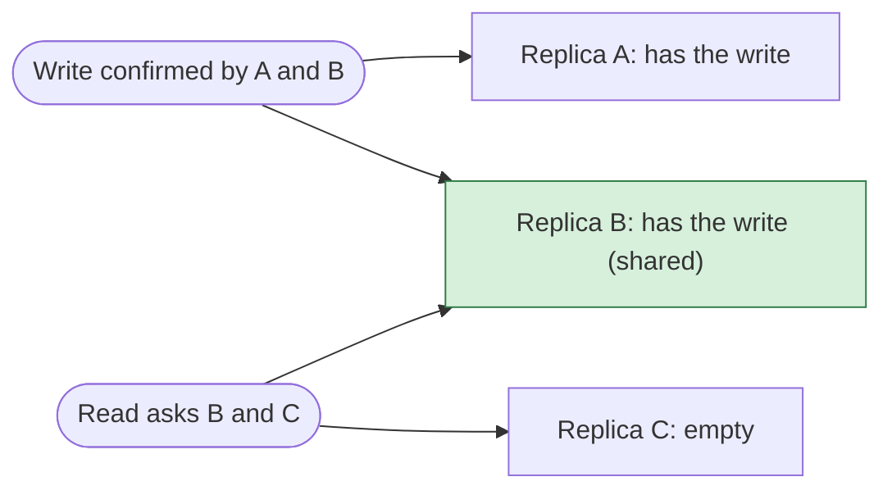
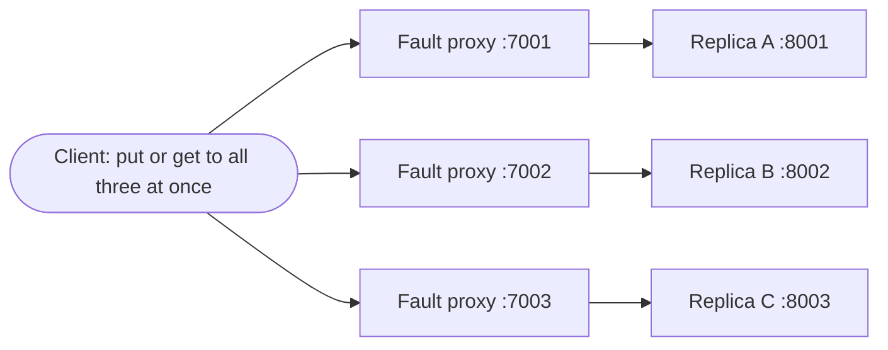

import { Code } from '@astrojs/starlight/components';
import TopicHeader from '../../../../components/TopicHeader.astro';
import WhatYouNeed from '../../../../components/WhatYouNeed.astro';
import ClaimEvidence from '../../../../components/design/ClaimEvidence.astro';
import TradeOffTable from '../../../../components/design/TradeOffTable.astro';
import LabRunner from '../../../../components/design/LabRunner.astro';
import ExperimentResult from '../../../../components/design/ExperimentResult.astro';
import Cards from '../../../../components/Cards.astro';
import Exercises from '../../../../components/design/Exercises.tsx';
import Drill from '../../../../components/Drill.tsx';
import LookalikePairs from '../../../../components/LookalikePairs.astro';
import SelfTest from '../../../../components/SelfTest.astro';
import Checkpoint from '../../../../components/Checkpoint.tsx';
import DecisionMapUpdate from '../../../../components/DecisionMapUpdate.astro';
import quorumkv from '../../../../../code/H4.2/lab-quorumkv/quorumkv.go?raw';
import httpx from '../../../../../code/H4.2/lab-quorumkv/httpx.go?raw';
import quorumkvTest from '../../../../../code/H4.2/lab-quorumkv/quorumkv_test.go?raw';
import claim1 from '../../../../../code/H4.2/claim-1/main.go?raw';
import claim3 from '../../../../../code/H4.2/claim-3/main.go?raw';
import calc from '../../../../../code/H4.2/calc-quorum-table/main.go?raw';
import calcOut from '../../../../../code/H4.2/calc-quorum-table/expected.txt?raw';

<TopicHeader topic="H4.2" />

## 1. Why this topic exists

Start with the simplest store there is: one machine holding a map from keys to values. It works until the machine stops. Here it is in the lab (`code/H4.2/lab-quorumkv`), with the client pointed at a single node. The first two lines run while the node is up; the last two run after the node process was killed (recorded 2026-10-18):

```
put ok
get k = "v1" (version 1)
put failed: quorumkv: not enough replicas answered: 0 of 1 acks
get failed: quorumkv: not enough replicas answered: 0 of 1 replies
```

How bad is that? Say each machine is up 99.9% of the time. A 30-day month has 43 200 minutes, so 0.1% of it is **43.2 minutes** in which every read and write fails. A session store that must stay up 99.999% of the time may be down only about 0.43 minutes a month, a hundred times less.

The obvious fix is more copies. Put the same data on three machines and the failure of one is no longer the end. But three copies bring new questions. A write has reached one machine and the next read asks another: does the read see the write? If a machine is down during a write and comes back later, it holds an old value: who notices? And what does this cost? A store taking 20 000 writes a second of 1 KB each receives 20 MB of data a second from its clients, and with three copies it moves **60 MB a second** between machines.

The key idea of this topic is small. Choose three numbers: **N**, the number of copies of each key, **W**, how many copies must confirm a write before it is acknowledged, and **R**, how many copies a read asks. If W + R is greater than N, every read asks at least one machine that confirmed the latest acknowledged write. That one inequality is what the rest of the page tests, measures and breaks.

## 2. Prerequisites and scope

### What you need

<WhatYouNeed topic="H4.2" />

### What this topic does not cover

- Choosing which machines hold a key (H3.2 placed the copies on a fixed set of nodes; here the set is given).
- Ordering writes that happen at the same time on different machines: last-write-wins, version vectors and CRDTs (H4.3). In this topic the caller supplies versions that grow for each key.
- Precise names for what reads may return while writes are in flight: linearizability, eventual consistency, and the CAP theorem (H4.4).
- Agreeing on one leader or one log with a majority: consensus (H4.5).
- Changes to several keys at once: transactions (H1.3).
- Keeping the set of replicas itself up to date when machines are added or removed.

## 3. Definitions

**Replica.** One copy of the data for a key, held by one machine. The set of N replicas of a key is fixed in this topic.

**Version.** A number stored with each value. A larger version means a newer write of the same key. The lab assumes the caller supplies versions that grow for each key; two machines' clocks cannot be trusted to do this (H4.1).

**Quorum.** A group of replicas that is large enough: a write quorum is any W replicas, a read quorum is any R replicas.

**N, W, R.** N is the number of replicas of each key. A write is acknowledged to the caller once **W** replicas have stored it. A read asks replicas and waits for **R** answers, then returns the answer with the highest version.

**Write quorum and read quorum.** The write quorum is the set of W replicas that stored an acknowledged write. The read quorum is the set of R replicas that answered a read.

**Availability.** The fraction of time an operation can go ahead. 0.999 means 0.1% of the time is lost, which is 43.2 minutes in a 30-day month.

**Read repair.** After a read, the client looks at the replies. Every replica that answered with an older version is sent the newest version.

**Anti-entropy.** A scheduled job that compares two replicas and copies whatever one has and the other lacks. It covers keys that nobody reads.

**Sloppy quorum.** A write counts acknowledgements from stand-in nodes outside the key's N replicas when some of the N cannot be reached. Writes stay available, but a later read of the N replicas may miss a write that went to the stand-ins.

A tiny Go example, three replicas and the check that matters:

```go
n, w, r := 3, 2, 2
fmt.Println(w+r > n) // true: any 2 replicas that confirmed a write overlap any 2 asked by a read
```



## 4. Principles and claims

#### Claim H4.2.1: with W + R > N, a read after an acknowledged write contacts a replica that has the write

**Statement.** Suppose a write to a key is acknowledged after W of that key's N replicas have stored it durably, and a read of the key that **starts after the acknowledgement** contacts R of the same N replicas. If W + R > N, at least one replica the read contacts holds that write.

:::tip[In plain words]
If the group that confirmed the write and the group that answers the read together have more members than the whole replica set, they share a member, and that member has the write.
:::

**A tiny instance with real numbers.** N = 3, W = 2, R = 2. The write reached `{A, B}`. Any 2 of `{A, B, C}` that a read picks includes A or B.

**Reasoning.**
1. The write set has W members.
2. The read set has R members.
3. If they shared no member, they would need W + R different replicas.
4. Only N exist, and W + R > N, so that is impossible.
5. So some replica is in both sets.
6. That replica stored the write before the acknowledgement, and the read started later, so it holds the write when the read asks.

:::note[This claim needs]
1. A fixed set of N replicas for the key, the same for the write and the read.
2. A write is acknowledged only after W replicas have stored it durably.
3. The read starts after the write was acknowledged.
4. No replica outside the set stands in for a missing one (no sloppy quorums).
:::

**What the claim does not give.** Returning the write also needs the read to pick the newest of the R replies, which needs versions totally ordered per key (the lab assumes the caller supplies growing versions). It says nothing about writes still in flight, or about a failed write that reached fewer than W replicas: one read may see it and a later read may not.

The claim program checks the statement for every N from 1 to 5 and every W and R from 1 to N, by listing every write set and every read set:

<Code code={claim1} lang="go" title="code/H4.2/claim-1/main.go" />

<ClaimEvidence claim="H4.2.1" />

**Cost.** Every write goes to all N replicas and waits for W answers; every read waits for R. The lab test `TestW1R1CanReturnStale` shows what happens when the inequality fails.

#### Claim H4.2.2: three replicas with W = R = 2 turn 99.9% machines into 99.9997% operations

**Statement.** If each replica is up with probability 0.999 and replicas fail independently, then with N = 3, W = R = 2 an operation can go ahead whenever at least 2 of 3 replicas are up, which has probability 0.999997.

:::tip[In plain words]
An operation can go ahead when at least 2 of 3 machines are up. With each machine up 99.9% of the time, that is about 8 seconds of trouble a month instead of 43 minutes. You pay with three machines and three times the write traffic.
:::

**A tiny instance with real numbers.** Both of two specific machines being down at the same moment has probability 0.001 × 0.001 = 0.000001. There are three pairs, so about 0.000003 for "at least two down", and an operation fails then.

**Reasoning (units on every line).**
1. P(a machine is up) = 0.999.
2. P(all 3 up) = 0.999³ = 0.997002999.
3. P(exactly 2 up) = 3 × 0.999² × 0.001 = 0.002994003.
4. P(at least 2 up) = 0.997002999 + 0.002994003 = 0.999997002.
5. Downtime per 30-day month = (1 − 0.999997002) × 43 200 minutes = 0.1295 minutes, about 8 seconds.
6. Traffic: 20 000 writes/s × 1 000 bytes = 20 MB/s from clients; × 3 copies = 60 MB/s between machines.

:::note[This claim needs]
1. Replicas fail independently. Two replicas in one rack or one zone fail together, and the figure is then too high.
2. A machine is either up or down; slow machines are not counted.
3. Operations touch one key.
:::

The calc program prints one line for every quantity of the lesson (its output is shown below the code):

<Code code={calc} lang="go" title="code/H4.2/calc-quorum-table/main.go" />
<Code code={calcOut} lang="text" title="expected.txt (the program's output)" />

<ClaimEvidence claim="H4.2.2" />

**Cost.** The write traffic is three times the traffic from clients, and each write waits for the second fastest of three replies.

#### Claim H4.2.3: read repair leaves every replica that answered holding the newest version

**Statement.** Suppose a read contacts every replica, with read repair on, and the repair messages are delivered. Then afterwards every replica holds the newest version among the replies.

:::tip[In plain words]
A replica that missed a write is behind. The next read of that key sees it answered with an older version and sends it the newest one. Without repair it stays behind until some later write reaches it.
:::

**A tiny instance with real numbers.** Three replicas hold version 1. Version 2 reaches A and B while C is down. C returns. A read of all three gets versions 2, 2 and 1, picks 2, and sends it to C. Now A, B, C all hold version 2.

**Reasoning.**
1. The read gets one reply from each replica.
2. The newest reply has the highest version, call it v.
3. Every reply with a version below v belongs to a replica that is behind.
4. Repair sends v to each of those replicas.
5. A replica keeps the newer of what it holds and what it receives, so after the repair it holds v.
6. Replicas that already held v are not touched, so all hold v.

:::note[This claim needs]
1. The read contacts every replica that should be repaired, and each one answers.
2. Versions are totally ordered per key (the caller supplies them).
3. The repair messages are delivered. A repair that is lost leaves the replica behind until the next read.
:::

The claim program covers the four cases of a three-replica set (nobody missed the write, or A, B or C missed it) and prints whether the replicas agree with and without repair:

<Code code={claim3} lang="go" title="code/H4.2/claim-3/main.go" />

<ClaimEvidence claim="H4.2.3" />

**Cost.** A read that finds a stale replica does one extra write to it. Keys that are never read are never repaired.

## 5. Recognition Cards

<Cards topic="H4.2" />

## 6. Reference designs

Always the simplest alternative first. Here that is one node with one copy (Section 1): 43.2 minutes down a month, no replication traffic, nothing to configure. The designed version keeps N copies and uses W and R. The difference is computed in Claim H4.2.2: 8 seconds down a month at 3 times the write traffic.

<LabRunner unit="H4.2/lab-quorumkv" />



The mechanism is in one file. The client and the replicas depend only on two small interfaces, `Caller` and `Registrar`, so the same code runs on the simulated network in the tests and over HTTP in the real processes.

<Code code={quorumkv} lang="go" title="code/H4.2/lab-quorumkv/quorumkv.go" />

The HTTP version (`httpx.go`) wraps the same replica in a small server and the same client in a `Caller` that sends JSON, with a timeout on every call:

<Code code={httpx} lang="go" title="code/H4.2/lab-quorumkv/httpx.go" />

**Go details explained.**
- `interface`: a list of methods. `Caller` says "anything with a `Call` method will do", so the tests pass the simulated network and `cmd/client` passes the HTTP sender. The mechanism never learns which.
- `go func() { ... }()`: starts a **goroutine**, a function that runs at the same time as the code that started it. `fanOut` starts one goroutine per replica so that all replicas are asked together and a slow one does not delay the others.
- `sync.WaitGroup`: a counter. `wg.Add(1)` before starting a goroutine, `wg.Done()` when it ends, `wg.Wait()` blocks until the counter is 0.
- `sync.Mutex` and `defer`: `mu.Lock()` lets one goroutine at a time into the code below it; `defer mu.Unlock()` runs the unlock when the function returns, however it returns. Without the lock two goroutines can change the replica's map at the same time and corrupt it (mistake 1).
- type switch, `switch m := req.(type)`: choose the branch by the real type of `req`; inside `case PutReq`, `m` has that type.
- `errors.Is(err, ErrNoQuorum)` and `%w`: `fmt.Errorf("%w: ...", ErrNoQuorum)` wraps the error with extra text; `errors.Is` still recognises it.
- `context.WithTimeout`: makes a context that is cancelled after a time limit. The HTTP request carries it, so a node that never answers costs one timeout, not forever.
- `sort.Slice`: sorts replies by sender so tests see the same order every run.
- The `mu` in `fanOut` guards the slice that the goroutines append their replies to; two goroutines appending at once would lose a reply.

**Tests (all run with the race detector).** The property holds in `TestSurvivesOneReplicaDown`, `TestReadMeetsAcknowledgedWrite` and `TestReadRepairHealsStaleReplica`. It breaks in `TestW1R1CanReturnStale` (a read misses an acknowledged write), `TestSloppyQuorumBreaksOverlap` (W + R > N by count, but no shared replica) and `TestWithoutReadRepairReplicaStaysStale`. `TestNoQuorumWithTwoDown`, `TestConcurrentClients`, `TestGetReturnsNewestOfReplies`, `TestOlderVersionDoesNotOverwrite` and the two HTTP tests (`TestOverHTTP`, `TestBlackholedNodeCountsAsDown`) cover the rest.

<details>
<summary>The full test file</summary>
<Code code={quorumkvTest} lang="go" title="code/H4.2/lab-quorumkv/quorumkv_test.go" />
</details>

**Run it.** The commands above start three node processes, put a fault proxy in front of each, and write and read with N = 3, W = 2, R = 2. The recorded output, run on 2026-10-18 on the author's machine (the numbers of milliseconds are not part of the claim):

```
put ok
get k = "v1" (version 1)
--- kill node C
put ok
get k = "v2" (version 2)
--- kill node B too
put failed: quorumkv: not enough replicas answered: 1 of 2 acks
get failed: quorumkv: not enough replicas answered: 1 of 2 replies
--- restart B, blackhole A
put failed: quorumkv: not enough replicas answered: 1 of 2 acks
get failed: quorumkv: not enough replicas answered: 1 of 2 replies
```

**Write path.**
1. The client sends the write (key, value, version) to all N replicas at once.
2. Each replica keeps it only if the version is higher than what it holds, and answers.
3. The client counts answers. With at least W it returns success; otherwise it returns an error wrapping `ErrNoQuorum`.

**Read path.**
1. The client asks all N replicas for the key at once.
2. It counts answers. With fewer than R it returns an error wrapping `ErrNoQuorum`.
3. It returns the reply with the highest version.
4. With read repair on, it sends that version to every replica that answered with a lower one.

**Data model.** Each replica holds a map from key to (value, version). No other state.

**Capacity table** (from the calc program, `Claim H4.2.2`):

| Setup | Operation can go ahead | Down per 30-day month | Write traffic for 20 000 writes/s of 1 KB |
|---|---|---|---|
| 1 machine | 0.999 | 43.2 minutes | 20 MB/s |
| N = 3, W = R = 2 | 0.999997002 | 0.1295 minutes | 60 MB/s |
| N = 5, W = R = 3 | 0.99999999 | 0.0004314 minutes | 100 MB/s |
| N = 3, W = 3 (writes need all) | 0.997002999 for writes | 129.5 minutes for writes | 60 MB/s |

The last row shows that more replicas do not always help: with W = N a write needs every machine, so writes are less available than on one machine. The independence assumption (Claim H4.2.2) applies to every row.

**Failure table.**

| What fails | How it is detected | What the caller sees | Test or run that shows it |
|---|---|---|---|
| One replica down, W = R = 2 | the call returns an error | nothing: writes and reads succeed | `TestSurvivesOneReplicaDown`; Run it, kill node C |
| Two replicas down | fewer than W or R answers | an error wrapping `ErrNoQuorum` | `TestNoQuorumWithTwoDown`; Run it, kill node B too |
| A replica hangs (accepts, never answers) | the per-call timeout (500 ms in `cmd/client`) | like a down replica, after one timeout | `TestBlackholedNodeCountsAsDown`; Run it, blackhole |
| A link is cut between one client and one replica | the call returns an error | nothing if W and R can still be reached | `TestReadMeetsAcknowledgedWrite` |
| W = R = 1 on three replicas | not detected | a read can return an old value | `TestW1R1CanReturnStale` |
| A replica missed a write and then returned | the next read sees an older version | nothing; the replica is repaired by that read | `TestReadRepairHealsStaleReplica` |
| A key is never read after a replica missed its write | not detected | nothing; the replica stays stale | `TestWithoutReadRepairReplicaStaysStale` |
| Stand-in nodes accept a write for a missing replica | not detected by the reader | a read of the home replicas can miss it | `TestSloppyQuorumBreaksOverlap` |

## 7. Mistake catalogue

Every wrong version below is a copy of the lab with one change. The runner `notes/design/H4.2-mistakes/run.sh` applies each change and prints which test fails (recorded 2026-10-18). Each doubles as a mutant of the rung kits.

### Mistake: no lock in the replica

The wrong change: `Handle` does not lock before reading and writing its map. Symptom, from `go test -race`:

```
==================
WARNING: DATA RACE
...
[exit 1]
```

Without the race detector this passes most of the time, which is why `-race` is always on. **Fix.** `r.mu.Lock(); defer r.mu.Unlock()` at the top of `Handle`.

### Mistake: taking the first reply

The wrong change: the client keeps the first reply with a version instead of the highest. Symptom:

```
--- FAIL: TestGetReturnsNewestOfReplies (0.00s)
    quorumkv_test.go:150: got {v1 1}, <nil>; want v2
```

**Fix.** Compare versions across all the replies and return the highest. Having W + R > N only promises that the newest write is among the replies, not that it is the first one.

### Mistake: an older write overwrites a newer one

The wrong change: the replica stores every write it receives. Symptom:

```
--- FAIL: TestOlderVersionDoesNotOverwrite (0.00s)
    quorumkv_test.go:165: got {v1 1}, <nil>; want v2
```

**Fix.** Keep a write only if its version is higher than the stored one. Messages arrive late and out of order, so this rule is what makes repairs and retries safe to repeat.

### Mistake: counting attempts instead of acknowledgements

The wrong change: `Put` treats the number of replicas it tried as the number that acknowledged. Symptom:

```
--- FAIL: TestNoQuorumWithTwoDown (0.00s)
    quorumkv_test.go:73: got <nil>, want ErrNoQuorum
```

A write that reached one replica is reported as a success and may be lost. **Fix.** Count only the replies that came back.

### Mistake: a call with no timeout

The wrong change: `HTTPCaller` builds its request without a time limit. A node that accepts the connection and never answers (a blackholed node) now blocks the client for ever; the test is killed:

```
panic: test timed out after 5s
	running tests:
		TestBlackholedNodeCountsAsDown (5s)
```

**Fix.** `context.WithTimeout` on every call. Then a hung node counts as down after one timeout.

### Mistake: W = 1, R = 1 chosen for speed

The wrong choice is not a coding slip: the code is correct and the setting is wrong. With three replicas, W + R = 2 is not greater than 3. `TestW1R1CanReturnStale` shows the result: the write reached only A, the read asked only C, and the read returned the empty value. The rung 3 kit turns this into a rule: `NewClient` refuses the setting unless the caller opts in. **Fix.** Choose W + R > N, or accept staleness knowingly.

### Mistake: a quorum for a tool that does not need one (over-engineered)

An admin tool receives 50 requests a day in one region, and one hour of downtime a month is acceptable. One machine gives 43.2 minutes down a month, within the target. A three-replica quorum store gives 0.1295 minutes, which nobody needs, and adds two machines, three times the write traffic, a client that must handle `ErrNoQuorum`, and one more thing to operate. **Fix.** One database. The honest cost of the technique is in the capacity table of Section 6: it pays when the availability target is above what one machine gives.

## 8. Worked examples

### Example 1: Five replicas, three needed

A store keeps five replicas, each up 99.9% of the time and failing independently, with W = R = 3. How many minutes a 30-day month can an operation not go ahead, and are five replicas worth it against three?

#### Step 1: Numbers

A 30-day month is 43 200 minutes. Machines are up 0.999 of the time. Operations need at least 3 of 5 machines.

#### Step 2: Wording → candidate structures

Candidates: (a) the simplest thing that could work, N = 3, W = R = 2, which needs 2 of 3; (b) N = 5, W = R = 3, which needs 3 of 5; (c) one machine.

#### Step 3: Property check → decision

Both quorum settings satisfy W + R > N (4 > 3 and 6 > 5), so reads meet writes. The remaining question is the cost. The decision depends on the availability target: if 0.99999 is enough, three replicas already give 0.999997.

#### Step 4: Design

N = 5, W = R = 3 tolerates 2 failures, N = 3, W = R = 2 tolerates 1.

#### Step 5: Code or calculation

The calc program prints `availability_n5w3r3 = 0.99999999` and `downtime_n5w3r3 = 0.0004314 minutes per 30-day month`, against `0.1295` for three replicas. Write traffic grows from 60 MB/s to 100 MB/s for 20 000 writes/s of 1 KB.

#### Step 6: Decision record

Choose N = 3 unless the target is above 0.999997: the gain from five replicas is 0.13 minutes a month, and it costs two more machines and 40 MB/s more traffic. Choose N = 5 if the target is above that or if two failures at once must be survived. Assumption: independent failures.

### Example 2: Replicas that fell behind during a deploy

A session store has N = 3, W = 2, R = 2. During a deploy one node was down for ten minutes and missed about 12 000 writes. Sessions are read every few seconds while a user is active. What, if anything, should be added?

#### Step 1: Numbers

12 000 writes missed by one node. Active sessions are read every 5 seconds. W + R = 4 > 3, so reads already meet writes: the stale node is not making reads wrong right now.

#### Step 2: Wording → candidate structures

(a) Nothing, the simplest thing: wait for the next write of each key. (b) Read repair. (c) Anti-entropy, a scheduled comparison of the replicas.

#### Step 3: Property check → decision

Read repair needs reads that contact several replicas, versions that order the writes, and replicas that ignore older versions. All three hold. Without repair, a second failure on another node could leave a quorum made of one good and one stale copy for keys that were read but not rewritten.

#### Step 4: Design

Turn read repair on in the client.

#### Step 5: Code or calculation

The lab test `TestReadRepairHealsStaleReplica` shows the stale replica holding `v1` after one read; `TestWithoutReadRepairReplicaStaysStale` shows it staying empty without the flag. The claim program for Claim H4.2.3 prints `missed=C: agree_without_repair=false agree_with_repair=true`.

#### Step 6: Decision record

Decision: read repair on. Cost: one extra write per stale answer. Not covered: keys that nobody reads keep a stale copy, so run anti-entropy for them if they matter. Assumption: versions are supplied and order the writes of a key.

## 9. Exercise ladder

<Exercises topic="H4.2" client:load />

## 10. Recognition drill

<Drill topic="H4.2" client:load />

## 11. Look-alike pairs

<LookalikePairs topic="H4.2" />

## 12. Self-test questions

<SelfTest topic="H4.2" />

## 13. Checkpoint

<Checkpoint topic="H4.2" client:load />

## 14. Decision map update

<DecisionMapUpdate topic="H4.2" />
