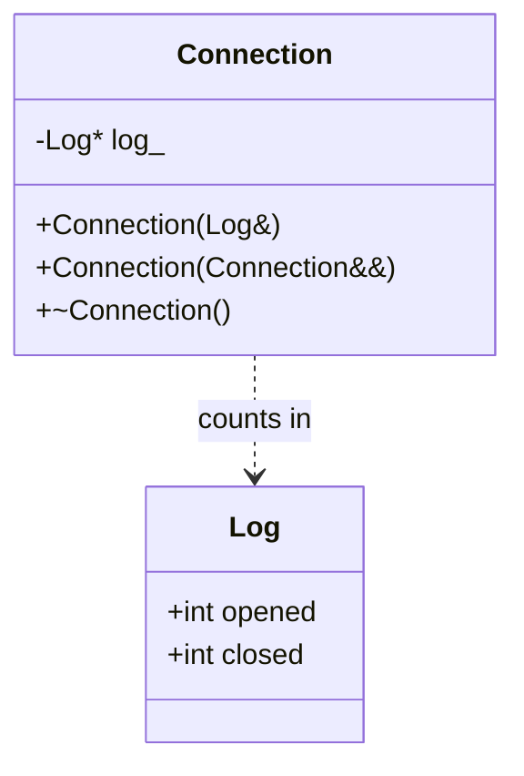
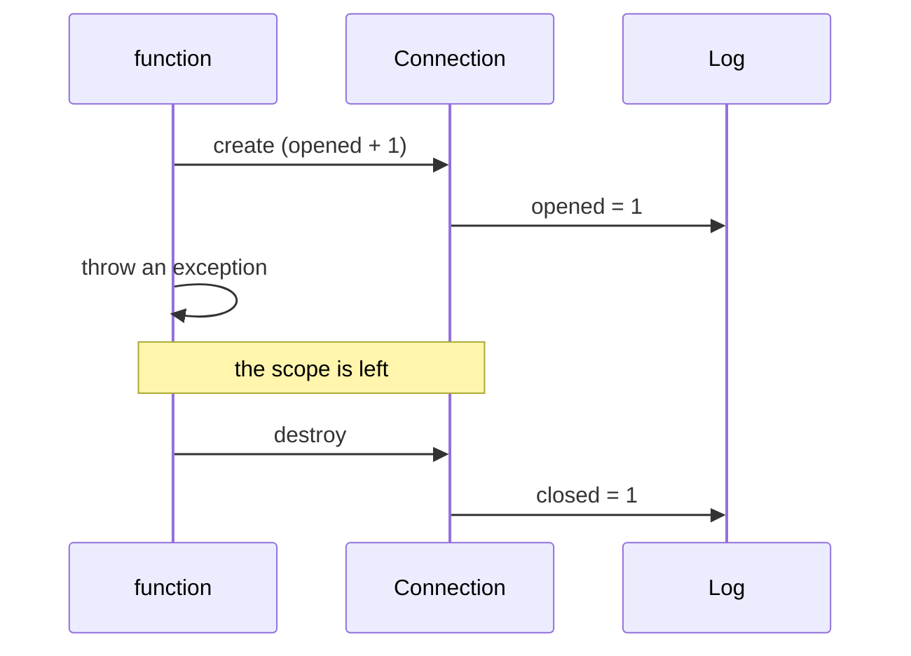

import { Code } from '@astrojs/starlight/components';
import TopicHeader from '../../../../components/TopicHeader.astro';
import WhatYouNeed from '../../../../components/WhatYouNeed.astro';
import ClaimEvidence from '../../../../components/design/ClaimEvidence.astro';
import TradeOffTable from '../../../../components/design/TradeOffTable.astro';
import LabRunner from '../../../../components/design/LabRunner.astro';
import ExperimentResult from '../../../../components/design/ExperimentResult.astro';
import Cards from '../../../../components/Cards.astro';
import Exercises from '../../../../components/design/Exercises.tsx';
import Drill from '../../../../components/Drill.tsx';
import LookalikePairs from '../../../../components/LookalikePairs.astro';
import SelfTest from '../../../../components/SelfTest.astro';
import Checkpoint from '../../../../components/Checkpoint.tsx';
import DecisionMapUpdate from '../../../../components/DecisionMapUpdate.astro';
import checkHpp from '../../../../../code/shared/cpp/check.hpp?raw';
import connectionHpp from '../../../../../code/L0.0/raii-once/connection.hpp?raw';
import reportHpp from '../../../../../code/L0.0/unique-owner/report.hpp?raw';
import imageHpp from '../../../../../code/L0.0/shared-owners/image.hpp?raw';
import scopedLock from '../../../../../code/L0.0/ex-1-scoped-lock/scoped_lock.hpp?raw';
import pointHpp from '../../../../../code/L0.0/ex-2-point/point.hpp?raw';
import m1 from '../../../../../notes/design/L0.0-mistakes/m1_leak_on_a_throw.cpp?raw';
import m2 from '../../../../../notes/design/L0.0-mistakes/m2_two_owners_delete_twice.cpp?raw';
import m3 from '../../../../../notes/design/L0.0-mistakes/m3_dangling_reference.cpp?raw';
import m3b from '../../../../../notes/design/L0.0-mistakes/m3b_stored_reference_to_temporary.cpp?raw';
import m4 from '../../../../../notes/design/L0.0-mistakes/m4_copyable_handle.cpp?raw';
import m5 from '../../../../../notes/design/L0.0-mistakes/m5_shared_ptr_cycle.cpp?raw';
import m6 from '../../../../../notes/design/L0.0-mistakes/m6_shared_ptr_for_everything.cpp?raw';

<TopicHeader topic="L0.0" />

## 1. Why this topic exists

Here is a working C++ program (14 non-blank lines with its `main`). It makes a record that needs 4 KB of memory, reads one byte of it and gives back a number. It also checks that a negative input is refused with an exception. It compiles and returns the right answers.

<Code code={m1} lang="cpp" title="m1_leak_on_a_throw.cpp (a working program with a flaw)" />

Run it with the course's compiler flags and the address sanitizer (a tool built into the compiler that watches every memory access and every allocation). The report is:

```
==1862976==ERROR: LeakSanitizer: detected memory leaks

Direct leak of 4096 byte(s) in 1 object(s) allocated from:
    #0 ... in operator new(unsigned long)
    #1 ... in parse(int) m1_leak_on_a_throw.cpp:6

SUMMARY: AddressSanitizer: 4096 byte(s) leaked in 1 allocation(s).
```

The flaw: `parse(-1)` allocates the record with `new`, then throws. The `delete` on the last line is never reached, so 4096 bytes are lost every time the function is called with a bad argument. If a server calls it 1000 times a minute with 1% bad requests, that is 10 leaks a minute, 40 KB a minute, 57 MB a day. Nothing fails in a test. The server just grows until it is killed.

Memory is one kind of **resource**: something a program must get and later give back. Files, locks, network connections and database transactions are others. The same flaw appears with every one of them: the code that gives the resource back sits on one path, and the program leaves by another.

The key idea of this topic: **tie giving the resource back to the end of a scope, by making it the destructor of an object.** The language runs destructors on every way out of a scope. That idea is called RAII, and the rest of this topic teaches it with C++'s own tools: constructors, destructors, references, `const`, copying and moving, `std::unique_ptr` and `std::shared_ptr`. It also introduces the tiny test helper `check.hpp` that every later topic uses.

## 2. Prerequisites and scope

### What you need

<WhatYouNeed topic="L0.0" />

This is the first topic of the LLD track, so it needs no earlier topic. You should be able to read a short function with `if`, loops and `return`; everything else is explained when it first appears.

### What this topic does not cover

- Protecting rules that must always hold for an object's data (a class invariant) and objects that never change after they are built (an immutable object): L0.1.
- Interfaces, virtual functions, how a virtual call is found at run time (dynamic dispatch, the vtable): L0.2.
- Relationships between classes, composition over inheritance and aggregation: L0.3.
- Drawing classes and calls as diagrams: L0.4. (The diagrams on this page are small examples only.)
- The Single Responsibility, Open/Closed, Liskov, Interface Segregation and Dependency Inversion principles, code smells, refactoring steps and test doubles: L0.5 to L0.8.
- Threads and sharing data between them: L6.

## 3. Definitions

**Header file.** A file, usually ending in `.hpp`, that holds declarations (and, for small classes, the whole class) so that several `.cpp` files can use them. `#include "connection.hpp"` pastes its text in. `#pragma once` at the top makes sure one file includes it only once.

**Scope.** The region of code between `{` and `}` in which a name exists. An object declared in a scope is created when execution reaches the declaration and destroyed when execution leaves the scope, however it leaves.

**Constructor and destructor.** A **constructor** is the function that runs when an object is created; it has the class's name. A **destructor** is the function that runs when the object is destroyed; it has the class's name with a `~` in front.

```cpp
struct Door {
    Door()  { /* runs when a Door is created */ }
    ~Door() { /* runs when a Door goes out of scope */ }
};
```

**Exception.** A way of leaving a function without returning: `throw x;` ends the current function, and the one that called it, and so on, until some `catch` block takes it. Leaving a scope this way is called **unwinding**; every object created in the scopes that are left is destroyed on the way.

**Stack and heap.** An object declared in a scope lives on the **stack**: it is destroyed automatically at the end of the scope. An object made with `new` lives on the **heap**: it lives until someone runs `delete` on it. Forgetting `delete` leaks the object; running it twice corrupts memory.

**Resource.** Anything the program must get and later give back: heap memory, a file, a lock, a connection.

**RAII** (Resource Acquisition Is Initialization). Acquire the resource in a constructor and release it in the destructor of an object that owns it. The name is awkward; the idea is that the object's life is the resource's life.

**Copying and moving.** Copying an object makes a second, independent object with the same contents. **Moving** hands the contents of one object to another and leaves the first one empty or unspecified. The function `std::move(x)` does not move anything by itself: it only says "x may be moved from", so that a move constructor can be chosen. Types designed around this idea are said to follow **move semantics**.

```cpp
std::unique_ptr<int> a = std::make_unique<int>(7);
std::unique_ptr<int> b = std::move(a);   // b owns the int; a is now empty
```

**Reference.** A second name for an existing object: `int& r = x;` means `r` and `x` are the same object. A reference to a `const` type (`const int& r`) can read the object but not change it, and it can also bind to a temporary value.

**Value semantics and reference semantics.** With **value semantics**, copying a variable makes an independent copy: change one and the other stays. With **reference semantics**, two names refer to one object: change through one and the other sees it.

**Smart pointer.** An object that behaves like a pointer and also decides when the object it points to is destroyed. `std::unique_ptr<T>` has exactly one owner. `std::shared_ptr<T>` has several owners, counted, and the last one out destroys the object. `std::weak_ptr<T>` points to an object owned by `shared_ptr`s without being an owner.

**Ownership.** The answer to "who destroys this object?". Exactly one party owns each heap object, or the owners are counted.

## 4. Principles and claims

#### Claim L0.0.1: a destructor runs once on every way out of the scope that owns the object

**Statement.** An object declared in a scope is destroyed exactly once when execution leaves the scope, whether the scope ends at its closing brace, at a `return`, or because an exception is passing through. If the object's destructor releases a resource, the resource is released on every one of those exits, once.

:::tip[In plain words]
Put the "give it back" code in a destructor and it runs by itself at every exit. You cannot forget it on one path, because there is no path-specific code.
:::

**A tiny instance with real numbers.** A function creates a `Connection` and then has 3 ways out: a return when its argument is 0, a return when it is 1, and a throw when it is negative. After calling it once for each case, the log shows 3 opens and 3 closes. With a `close()` call written by hand before each return, the throw would give 3 opens and 2 closes.

**Reasoning.**
1. An object that lives in a scope is created when execution reaches its declaration.
2. Leaving the scope in any way destroys, in reverse order of creation, the objects the scope has already created.
3. For a normal end and for `return` this is the ordinary end of the scope.
4. For an exception, the language unwinds each scope it leaves and does the same destruction.
5. The destructor of the `Connection` counts one close, so it counts one on each exit.
6. An object that is moved from holds nothing, so its destructor counts nothing, and the connection is closed once by its new owner.

:::note[This claim needs]
1. The object is declared in the scope (not made with `new`): a heap object is destroyed only by `delete`.
2. The destructor does not throw.
3. Copying is deleted or defined, so no second object also closes the same resource.
4. The program does not end the process in between (`std::exit`, a crash): destructors of local objects do not run then.
:::

<ClaimEvidence claim="L0.0.1" />

**Cost.** One small class per kind of resource (about 15 lines, written once), and a destructor that cannot tell the caller about a failure to release.

#### Claim L0.0.2: a std::unique_ptr has exactly one owner at a time

**Statement.** A `std::unique_ptr` cannot be copied, only moved. After a move the source is empty, so exactly one pointer can destroy the object, and it does so once: when it goes out of scope, is reset, or is assigned another object.

:::tip[In plain words]
One owner means one place that deletes. Handing the object to someone else is a move: afterwards the old pointer is empty and cannot delete anything.
:::

**A tiny instance with real numbers.** `make_report(4)` builds a report with total 10 and returns it to the caller. The count of live reports goes 0, 1, 0: one while the caller's pointer exists, and 0 after the pointer's scope ends.

**Reasoning.**
1. A `unique_ptr` has no copy constructor, so a program that copies one does not compile.
2. A move constructor copies the raw pointer into the new `unique_ptr` and sets the old one to null.
3. At any time at most one `unique_ptr` holds a given pointer.
4. The destructor of a non-null `unique_ptr` runs `delete` on what it holds.
5. A null pointer's destructor does nothing, so the moved-from object deletes nothing.
6. So the object is deleted exactly once, by whichever pointer holds it last.

:::note[This claim needs]
1. The pointer came from `new` or `std::make_unique` and nobody else holds a raw pointer that they will `delete`.
2. The program does not use `release()` and then forget to delete: `release()` gives up ownership.
3. No two `unique_ptr`s are made from the same raw pointer by hand.
:::

<ClaimEvidence claim="L0.0.2" />

**Cost.** None at run time beyond a plain pointer (8 bytes, no extra allocation). The price is that sharing is not allowed: a second user needs a reference or a different pointer type.

#### Claim L0.0.3: a std::shared_ptr destroys the object when the last owner lets go

**Statement.** Every `std::shared_ptr` that points to an object adds one to a shared count; every one that is destroyed or reset subtracts one. The object is destroyed when the count reaches 0. A `std::weak_ptr` does not count, and its `lock()` function returns an owner if the object still exists, or an empty `shared_ptr` if it does not.

:::tip[In plain words]
Many owners: the last one out turns off the light. A weak pointer is a way to find the object without keeping the light on.
:::

**A tiny instance with real numbers.** Two widgets ask a cache for `logo.png`. Both get the same image: the use count is 2 and one image is alive. After both widgets let go, the count is 0 and no image is alive; a third request makes a new one with count 1.

**Reasoning.**
1. Copying a `shared_ptr` adds 1 to the shared count; destroying one subtracts 1.
2. When the count reaches 0 the object is destroyed, once, by whichever owner made it 0.
3. A `weak_ptr` is created from a `shared_ptr` and does not change the count.
4. `lock()` returns a `shared_ptr` (count + 1) if the count is above 0, otherwise an empty one.
5. If parent and child each own the other with `shared_ptr`, neither count can reach 0 (each is held by the other): a leak.
6. With a `weak_ptr` for the back pointer the count of the parent stays 1 and the pair is destroyed.

:::note[This claim needs]
1. Every owner is a `shared_ptr` made from another `shared_ptr` or from `std::make_shared`, not from the same raw pointer twice.
2. No cycle of owners: any pointer that goes back up the structure is a `weak_ptr`.
3. The count updates are not raced by other threads on the same pointer (threads are L6).
:::

<ClaimEvidence claim="L0.0.3" />

**Cost.** Each `shared_ptr` is 16 bytes against 8 for a `unique_ptr` (measured, see Section 7), the count lives in a separate block, and the count is updated on every copy.

#### Claim L0.0.4: a small plain value is copied freely

**Statement.** A struct made only of numbers is copied by copying its bytes. Each copy is independent of the original, nothing has to be released, and passing it by value to a function leaves the caller's object unchanged.

:::tip[In plain words]
Numbers, not pointers: a copy is a photocopy. You can scribble on it without touching the original.
:::

**A tiny instance with real numbers.** `Point a{1, 2}; Point b = a; b.x = 99;` leaves `a.x` equal to 1. The midpoint of `{4, 6}` and `{8, 2}` is `{6, 4}`, and neither input changes.

**Reasoning.**
1. A `Point` holds two `int` values and no pointer.
2. Copying it copies the 8 bytes (the compiler checks that it is trivially copyable).
3. The copy lives at another address, so writing to it does not touch the original.
4. A function that takes `Point` by value receives such a copy.
5. There is nothing to release, so no owner is needed.

:::note[This claim needs]
1. The type holds no pointers or references to things it does not own.
2. The type is small enough that copying is cheaper than an indirection (a few machine words).
:::

<ClaimEvidence claim="L0.0.4" />

**Cost.** Copying a large value costs time and memory in proportion to its size; this claim is only for small ones.

## 5. Recognition Cards

<Cards topic="L0.0" />

## 6. Reference designs

**The plain design first.** The program of Section 1 is the plain design: `new` in the middle, `delete` on the last line. It is the shortest correct code for the path where nothing goes wrong, and it is what the sanitizer rejected.

**The designed version: the object owns the resource.** The class is 11 lines. `Log` is a tiny struct that counts what happened so the tests can see it.

<Code code={connectionHpp} lang="cpp" title="connection.hpp" />





**How it works.** `Connection(Log& log)` stores the address of the log and counts one open. The destructor counts one close if `log_` is not null. The copy functions are deleted, so a second `Connection` can never close the same connection. The move constructor takes the address and leaves null in the old object, so the old object's destructor does nothing. Every function that creates a `Connection` in a local variable gets the close for free, on all exits.

For heap objects the same idea is in the standard library. A factory returns the owner by value:

<Code code={reportHpp} lang="cpp" title="report.hpp" />

Several owners at once, with a cache that does not keep the object alive:

<Code code={imageHpp} lang="cpp" title="image.hpp" />

**C++ details explained** (every construct beyond what Section 3 defined):
- `struct` and `class`: both declare a type. In a `struct` the members are public unless stated; in a `class` they are private. `public:` and `private:` switch which part follows.
- `explicit`: before a one-argument constructor, it forbids using the constructor for silent conversions: `Connection c = log;` does not compile, `Connection c(log);` does.
- `= delete`: the function does not exist; a program that calls it does not compile. `Connection(const Connection&) = delete;` forbids copying.
- `Connection&&` (an rvalue reference) in `Connection(Connection&& other)`: the parameter of a move constructor. It binds to a value that may be moved from, such as the result of `std::move(a)`.
- `noexcept`: promises that the function does not throw. Containers such as `std::vector` use a move only when it is `noexcept`; otherwise they copy, and a type that cannot copy would not compile in the container.
- `std::exchange(x, v)`: returns the old value of `x` and stores `v` in it. `std::exchange(other.log_, nullptr)` takes the pointer and leaves null behind in one step.
- `log_(&log)` after the colon: a member initialiser list. It sets `log_` to the address of `log` when the object is created.
- `Log* log_`: a pointer, a variable that holds an address. `*` marks the type, `&log` takes an address, `->` reaches a member through a pointer (`log_->opened`).
- `inline static int live_ = 0;`: one counter shared by all objects of the class (`static`), defined in the header without causing duplicate definitions (`inline`).
- `std::make_unique<Report>(sum)`: allocates a `Report` with `new`, passing `sum` to its constructor, and returns it inside a `std::unique_ptr`. It never leaves a raw pointer lying around.
- `std::unique_ptr<Report>` is a template: `<Report>` says which type it points to.
- `r->total()` and `*r`: a `unique_ptr` is used like a pointer.
- `std::make_shared<Image>(name)`: like `make_unique`, for `shared_ptr`; it allocates the object and the count together.
- `std::weak_ptr<Image>` and `.lock()`: see Section 3. `if (auto alive = it->second.lock())` declares `alive` and tests it: the branch runs only if it is not empty.
- `std::unordered_map<std::string, ...>`: a table from names to values; `find` looks a name up, and `images_[name] = fresh;` stores a value.
- `const` after a function's parameter list (`int total() const`): the function does not change the object.
- A macro is text pasted by the preprocessor before compilation. The three macros of `check.hpp` are explained next.

**The test helper `check.hpp`, line by line.** Every unit and kit of this course is tested with it. Here it is in full:

<Code code={checkHpp} lang="cpp" title="code/shared/cpp/check.hpp" />

- `#pragma once`: include this file once per `.cpp`.
- `namespace check { ... }`: a named group, so `failures` and `fail` cannot clash with other names.
- `inline int failures = 0;`: one shared counter for all files (`inline` on a variable, C++17).
- `fail(file, line, text)`: prints `FAIL file:line: text` and adds one to the counter.
- `report()`: prints `all checks passed` and returns 0 if there were no failures, otherwise returns 1. A test program returns this from `main`, so a failing check makes the program, and the script, fail.
- `#define CHECK(expr) ...`: a macro. Writing `CHECK(a == b)` pastes `do { if (!(a == b)) check::fail(__FILE__, __LINE__, "a == b"); } while (0)`. `#expr` turns the expression's text into a string; `__FILE__` and `__LINE__` are the current file and line. A normal function cannot capture the text of its argument or its caller's line, which is the only reason `CHECK` is a macro.
- `do { ... } while (0)`: makes the macro behave like one statement, so `if (x) CHECK(y); else ...` still compiles.
- `CHECK_THROWS(expr)`: runs `expr` in a `try`, records whether anything was thrown, and fails if nothing was. `(void)(expr)` discards the result.
- `RUN(test_function)`: prints the function's name (`#test_function`) and calls it.

**Tested.** Each unit builds with `g++ -std=c++23 -Wall -Wextra -Wpedantic -Werror` and the address and undefined-behaviour sanitizers, with `-fno-sanitize-recover=all`, so any report fails the run (recorded 2026-10-19):

```
bash code/L0.0/raii-once/test.sh code/L0.0/raii-once       # all checks passed (6 tests)
bash code/L0.0/unique-owner/test.sh code/L0.0/unique-owner  # all checks passed (6 tests)
bash code/L0.0/shared-owners/test.sh code/L0.0/shared-owners  # all checks passed (6 tests)
```

## 7. Mistake catalogue

Each wrong program is in `notes/design/L0.0-mistakes/`. The runner `run.sh` builds each one with the course flags and prints what the tools say (recorded 2026-10-19).

### Mistake: a raw `new` and a `delete` on the last line

The program of Section 1. Symptom: `LeakSanitizer: detected memory leaks`, 4096 bytes. **Fix.** `auto img = std::make_unique<Image>();` and no `delete`: the destructor of the `unique_ptr` runs on the throw as well.

### Mistake: two owners delete the same object

<Code code={m2} lang="cpp" title="m2_two_owners_delete_twice.cpp" />

Symptom: `AddressSanitizer: attempting double-free`. Two raw pointers to one object, and each side believes it owns it. **Fix.** One `std::unique_ptr` owns the object; the other side takes a reference.

### Mistake: returning a reference to a local

<Code code={m3} lang="cpp" title="m3_dangling_reference.cpp" />

With the course flags the compiler refuses: `error: reference to local variable 'label' returned`. A **dangling reference** is a reference to an object that no longer exists. **Fix.** Return the `std::string` by value.

### Mistake: storing a reference to a temporary

<Code code={m3b} lang="cpp" title="m3b_stored_reference_to_temporary.cpp" />

This compiles. Symptom:

```
ERROR: AddressSanitizer: stack-use-after-scope on address 0x7a610d3f0128 ...
READ of size 8 at 0x7a610d3f0128 thread T0
    #1 Label::size() const m3b_stored_reference_to_temporary.cpp:6
```

The temporary string dies at the end of the statement that created it, and the `Label` still points to it. **Fix.** Store a `std::string` by value in the class, since the class must outlive the argument.

### Mistake: a handle that can be copied

<Code code={m4} lang="cpp" title="m4_copyable_handle.cpp" />

Symptom: `attempting double-free` inside `fclose`. The compiler made a copy that copies the `FILE*`, so two objects close one file. **Fix.** `TempFile(const TempFile&) = delete;` and a move constructor that leaves null behind.

### Mistake: a cycle of shared owners

<Code code={m5} lang="cpp" title="m5_shared_ptr_cycle.cpp" />

Symptom: `LeakSanitizer: detected memory leaks`, an indirect leak of the child. Each object keeps the other's count at 1. **Fix.** The back pointer is a `std::weak_ptr`; the test `a_weak_back_pointer_lets_a_pair_be_destroyed` shows the pair being destroyed.

### Mistake: `shared_ptr` everywhere "to be safe" (over-engineered)

<Code code={m6} lang="cpp" title="m6_shared_ptr_for_everything.cpp" />

The program works and prints:

```
unique_ptr: 8 bytes, shared_ptr: 16 bytes
use_count of the shared one: 1; the unique one has no count to read
```

An object with one owner pays 8 more bytes per pointer, a shared count that is updated on every copy, and the risk of the cycle above, for a count that nobody reads. It is also less clear: a reader must assume anybody may hold the object. **Fix.** Use `std::unique_ptr` until a second owner exists, and a reference for code that only reads. This is the honest cost of the technique: shared ownership is the most expensive of the three and should be chosen only when the lesson's cards ask for it.

## 8. Worked examples

### Example 1: A lock that must be released on every return path

A 25-line function takes a lock, then has three return statements and one call that can throw. How do you make sure the lock is released every time?

#### Step 1: Numbers

Exits after the lock is taken: 3 returns + 1 throw = 4. A hand-written unlock must appear 3 times (before each return) and still misses the throw. One more return added later makes 5 exits.

#### Step 2: Wording → candidate structures

Candidates: (a) the simplest thing that could work: call `unlock()` before each return; (b) an object whose constructor locks and whose destructor unlocks.

#### Step 3: Property check → decision

RAII needs: acquire in a constructor, release in the destructor, and no copying. A hold on a lock can be all three. Candidate (a) fails on the throw, so the decision is (b).

#### Step 4: Design

A class `ScopedHold` that stores a reference to the door (it uses it, it does not own it), locks in its constructor, unlocks in its destructor, and deletes copying.

#### Step 5: Code or calculation

<Code code={scopedLock} lang="cpp" title="scoped_lock.hpp" />

The tests show 3 locks and 3 unlocks over the three returns, and 1 unlock for the throw. `bash code/L0.0/ex-1-scoped-lock/test.sh code/L0.0/ex-1-scoped-lock` prints `all checks passed`.

#### Step 6: Decision record

Decision: a scoped hold, created on the first line after the lock is needed. Cost: one class of 8 lines. Rejected: a manual unlock before every return (misses the throw and needs an edit for every new return). Assumption: the unlock does not throw.

### Example 2: A pair of numbers passed to a function 100 times a second

Someone suggests wrapping a struct of two ints in a smart pointer "so it is never copied". Decide.

#### Step 1: Numbers

The struct is 8 bytes. 100 calls a second copy 800 bytes a second. A `shared_ptr` would add a heap allocation of at least 24 bytes for the object and its count (one `make_shared` per point) and a count update on every copy.

#### Step 2: Wording → candidate structures

Candidates: (a) the simplest thing that could work, pass `Point` by value; (b) `std::shared_ptr<Point>`; (c) `const Point&`.

#### Step 3: Property check → decision

Does the point need an owner? It holds no pointers, so there is nothing to release. By value is a photocopy of 8 bytes; nothing can dangle. Decision: (a). A `const Point&` would also work, but it saves nothing at 8 bytes.

#### Step 4: Design

`struct Point { int x; int y; };` and `Point midpoint(Point a, Point b)`.

#### Step 5: Code or calculation

<Code code={pointHpp} lang="cpp" title="point.hpp" />

The `static_assert` lines check at compile time that `Point` is trivially copyable. The tests show that changing a copy leaves the original alone.

#### Step 6: Decision record

Decision: a plain value, no pointer. Not chosen: a smart pointer (an allocation and a count for 8 bytes of data). Revisit if the type grows to hundreds of bytes or gains a member that owns memory.

## 9. Exercise ladder

<Exercises topic="L0.0" client:load />

## 10. Recognition drill

<Drill topic="L0.0" client:load />

## 11. Look-alike pairs

<LookalikePairs topic="L0.0" />

## 12. Self-test questions

<SelfTest topic="L0.0" />

## 13. Checkpoint

<Checkpoint topic="L0.0" client:load />

## 14. Decision map update

<DecisionMapUpdate topic="L0.0" />
