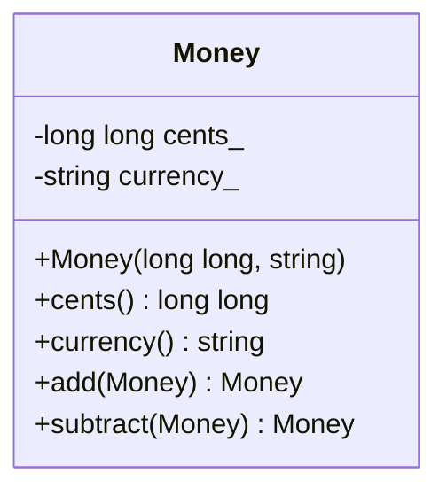
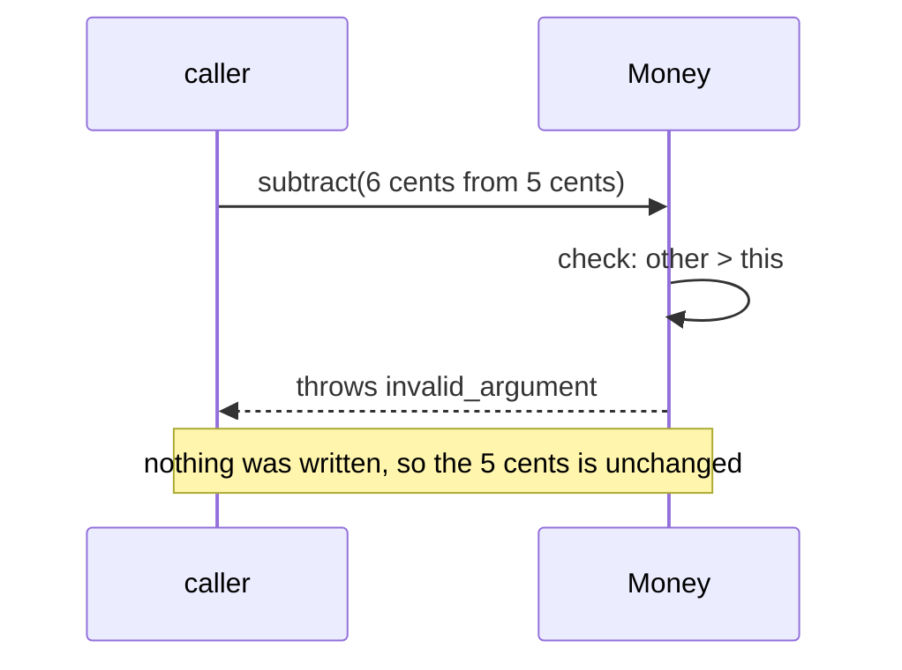

import { Code } from '@astrojs/starlight/components';
import TopicHeader from '../../../../components/TopicHeader.astro';
import WhatYouNeed from '../../../../components/WhatYouNeed.astro';
import ClaimEvidence from '../../../../components/design/ClaimEvidence.astro';
import TradeOffTable from '../../../../components/design/TradeOffTable.astro';
import LabRunner from '../../../../components/design/LabRunner.astro';
import ExperimentResult from '../../../../components/design/ExperimentResult.astro';
import Cards from '../../../../components/Cards.astro';
import Exercises from '../../../../components/design/Exercises.tsx';
import Drill from '../../../../components/Drill.tsx';
import LookalikePairs from '../../../../components/LookalikePairs.astro';
import SelfTest from '../../../../components/SelfTest.astro';
import Checkpoint from '../../../../components/Checkpoint.tsx';
import DecisionMapUpdate from '../../../../components/DecisionMapUpdate.astro';
import moneyHpp from '../../../../../code/L0.1/money-invariant/money.hpp?raw';
import seatsHpp from '../../../../../code/L0.1/seat-count/seats.hpp?raw';
import addressHpp from '../../../../../code/L0.1/shared-value/address.hpp?raw';
import settingsHpp from '../../../../../code/L0.1/ex-1-settings/settings.hpp?raw';
import coordinateHpp from '../../../../../code/L0.1/ex-2-coordinate/coordinate.hpp?raw';
import m1 from '../../../../../notes/design/L0.1-mistakes/m1_public_field.cpp?raw';
import m2 from '../../../../../notes/design/L0.1-mistakes/m2_setter_checks_one_side.cpp?raw';
import m3 from '../../../../../notes/design/L0.1-mistakes/m3_partial_update_on_failure.cpp?raw';
import m4 from '../../../../../notes/design/L0.1-mistakes/m4_constructor_does_not_check.cpp?raw';
import m5 from '../../../../../notes/design/L0.1-mistakes/m5_getter_returns_a_writable_reference.cpp?raw';
import m6 from '../../../../../notes/design/L0.1-mistakes/m6_shared_mutable_object.cpp?raw';
import m7 from '../../../../../notes/design/L0.1-mistakes/m7_class_for_a_bag_of_settings.cpp?raw';
import m7b from '../../../../../notes/design/L0.1-mistakes/m7b_the_same_as_a_struct.cpp?raw';

<TopicHeader topic="L0.1" />

## 1. Why this topic exists

Here is a working program (11 non-blank lines). A shop keeps balances in cents; a refund subtracts an amount from a balance.

<Code code={m1} lang="cpp" title="m1_public_field.cpp (a working program with a flaw)" />

It compiles, runs and prints:

```
balance = -300 cents
```

The shop's rule is that a balance is never negative. Nothing in this program knows the rule. `refund` trusts its caller, the field is public, and so any of the lines that touch `cents`, in this file or in any file that includes the struct, can break the rule without the compiler or a test noticing. In a real program there are hundreds of such lines. If a customer is shown "-300 cents" on an invoice, nobody can tell which line wrote it: every line is a suspect.

The fix of this topic is small. Put the rule **inside** the type, make the data private, and let only the type's own functions change it, each one checking the rule before it writes. Then a negative balance cannot exist, because there is no path to create one. And for values that are shared and must not change at all, a second idea: build them once and never change them.

## 2. Prerequisites and scope

### What you need

<WhatYouNeed topic="L0.1" />

### What this topic does not cover

- Interfaces, virtual functions, how a call is chosen at run time (dynamic dispatch, the vtable): L0.2.
- How classes relate to each other, composition over inheritance and aggregation: L0.3.
- Drawing classes and calls as diagrams: L0.4 (the small diagrams here are examples only).
- The Single Responsibility and Open/Closed principles, and measuring change cost with a blast radius: L0.5.
- Liskov substitution, Interface Segregation and Dependency Inversion: L0.6.
- Code smells and safe refactoring steps: L0.7; test doubles: L0.8.
- Sharing data between threads: L6. (Immutable values are safe to read from several threads, but this topic does not show it.)

## 3. Definitions

**Class and member.** A `class` is a type that bundles data (its **data members**, or fields) with the functions that work on it (its **member functions**). `struct` is the same with every member public by default.

**Access: `public` and `private`.** Members after `public:` can be used by any code. Members after `private:` can be used only by the class's own member functions. The compiler enforces it: code outside that writes `m.cents_` does not compile.

**Encapsulation.** Keeping a class's data private and offering only functions that keep it consistent. The data and the code that guards it live in one place.

**Class invariant.** A rule about an object's own fields that must be true whenever no member function is running: after the constructor finishes and after every call returns. For `Money`: `cents >= 0`.

```cpp
class Percentage {
public:
    explicit Percentage(int v) : value_(v) { if (v < 0 || v > 100) throw std::invalid_argument("0 to 100"); }
    int value() const { return value_; }
private:
    int value_;   // the invariant: 0 <= value_ <= 100, for every Percentage that exists
};
```

**Getter and `const` member function.** A **getter** returns a field's value without letting the caller change it. A function marked `const` after its parameter list promises not to change the object, so it can be called on a `const` object.

**Exception and refusal.** A function **refuses** a call that would break the rule by throwing an exception (`std::invalid_argument` for a bad argument, `std::overflow_error` for a number too large). The caller can catch it.

**Immutable object, and value object.** An **immutable object** has all its state set in its constructor and nothing changes it afterwards: its fields are `const` or private with no function that writes them. A **value object** is a small immutable object whose identity is its content: two with equal fields are interchangeable (an amount, a date range, a coordinate, an address). A "change" builds a new one.

**Holder.** A variable or field that holds an object, or a pointer to it. Several holders can hold the same object.

## 4. Principles and claims

#### Claim L0.1.1: private fields and checked entry points mean no object can break the rule

**Statement.** If a class's data members are private and every function that creates or changes the object checks the rule before it stores anything, then no object of that class can ever break the rule.

:::tip[In plain words]
Count the ways a value can get into the object. If there are only a few, and each one has a guard, nothing bad gets in.
:::

**A tiny instance with real numbers.** `Money` has one constructor and two operations that make a new Money (`add`, `subtract`). Each ends in the constructor, which throws for a negative amount. Trying `Money(-1, "USD")` throws. Trying `Money(5, "EUR").subtract(Money(6, "EUR"))` throws. The exhaustive test tries every pair of amounts from 0 to 30: whatever `add` and `subtract` accept has `cents >= 0`.

**Reasoning.**
1. The fields are private, so only the class's member functions can write them.
2. The only functions that create a `Money` are the constructor and the operations that call it.
3. The constructor checks `cents >= 0` and the currency before it stores anything, and throws if either fails.
4. `add` and `subtract` check their own preconditions (currencies equal, no overflow, result not negative) and then build the result through the constructor.
5. The copy that the compiler writes copies fields that already satisfy the rule.
6. So there is no path that stores a value outside the rule.

:::note[This claim needs]
1. Every data member is private (or `const` with no way to change it): no public field, no function that returns a non-const reference to one.
2. Every constructor and every function that changes the fields checks before it writes.
3. The rule uses only the object's own fields: it does not depend on other objects that can change behind its back.
:::

<ClaimEvidence claim="L0.1.1" />

**Cost.** Each rule costs a constructor check and a decision for every operation; the class is longer than a struct (about 15 lines for one rule), and readers must call getters.

#### Claim L0.1.2: an operation that checks first and writes last leaves the object unchanged when it refuses

**Statement.** If an operation checks everything that could make it refuse before it changes any field, then when it refuses by throwing, the object is exactly as it was before the call.

:::tip[In plain words]
Look before you leap. If you refuse before you touch anything, there is nothing to undo.
:::

**A tiny instance with real numbers.** `Seats s(5); s.book(3);` then `s.book(3)` throws because only 2 are free. Afterwards `s.booked()` is still 3. If `book` added first (`booked_ += 3`) and checked afterwards, it would show 6 of 5 after the throw (the mistake program `m3`).

**Reasoning.**
1. In `book(n)` the check `n > free()` comes before `booked_ += n`.
2. If the check fails, the function throws and never reaches the write.
3. A throw ends the function: no later line runs.
4. So `booked_` has the value it had at the start of the call.
5. `transfer` checks both sides before it changes either, so a refused transfer leaves both as they were.
6. The test runs every sequence of 4 operations from a small set (256 of them) and checks that `0 <= booked <= capacity` after each step.

:::note[This claim needs]
1. All checks come before the first write in the function.
2. The operation changes more than one field only after all checks have passed, with no step in between that can throw.
3. The checks read only state that the operation itself will not change.
:::

<ClaimEvidence claim="L0.1.2" />

**Cost.** The operation must be written as "check, then change", and operations that change several things need all their checks up front.

#### Claim L0.1.3: an immutable value can be shared and no holder sees another's change

**Statement.** If a value cannot be changed after it is built, any number of holders can hold the same object, and no holder can change what another holder sees. A "change" builds a new value and replaces only that holder's reference.

:::tip[In plain words]
If nobody can write on the page, nobody can mess up the page for the others. To edit, you write a new page and keep that one for yourself.
:::

**A tiny instance with real numbers.** Two orders hold one `Address("1 Main St", "Oslo")`; the use count is 3 (the variable and two orders). A clerk changes order 1's street: a new `Address("9 Side St", "Oslo")` is built and order 1 points to it. Order 2 still reads `1 Main St`.

**Reasoning.**
1. All fields of `Address` are `const` and set in the constructor.
2. No member function writes a field; `with_street` builds a new `Address`.
3. `Order` holds a `std::shared_ptr<const Address>`: a pointer through which nothing can be changed.
4. Two orders holding one pointer therefore hold one object that nobody can alter.
5. `change_address` replaces the pointer of that order only.
6. A map key that is an immutable `Coordinate` cannot be changed while it sits in the map, so lookups keep working.

:::note[This claim needs]
1. No member function writes a field after construction, and no function returns a non-const reference to one.
2. The holders access the object only through const views (`const Address&`, a pointer to const).
3. The lifetime of the object is managed (here by `shared_ptr`, from L0.0).
:::

<ClaimEvidence claim="L0.1.3" />

**Cost.** Every change builds a new value; for a small value that is cheap, for a large one it is not.

#### Claim L0.1.4: fields with no rule between them need no class

**Statement.** If every combination of the field values is valid, a plain struct with public fields accepts exactly the valid combinations, with no constructor and no setters.

:::tip[In plain words]
If nothing can go wrong, there is nothing to guard. A guard where there is nothing to guard is just extra code.
:::

**A tiny instance with real numbers.** Four display preferences (dark mode, font size, language, tips). The test tries 12 combinations of the flags and sizes and all are valid. The struct is 9 non-blank lines for five fields; the class with getters and setters for the same five fields is 21 (measured, Section 7).

**Reasoning.**
1. The rule would be "these fields satisfy some relation".
2. Here there is no relation: each field is independent of the others.
3. So no assignment to a field can produce an invalid object.
4. A struct lets callers read and write each field directly.
5. A class would add a getter and a setter per field and enforce nothing.

:::note[This claim needs]
1. No combination of values is invalid now.
2. No rule between the fields is expected soon: if one arrives ("the font size must be 8 to 72"), the card for class invariants applies.
:::

<ClaimEvidence claim="L0.1.4" />

**Cost.** None now. The price of being wrong is a later change from struct to class, which touches every place that wrote a field directly.

## 5. Recognition Cards

<Cards topic="L0.1" />

## 6. Reference designs

**The plain design first.** The program of Section 1 is the plain design: a struct with a public field and a function that trusts its caller. It is the shortest code and it is right when nothing can go wrong (Claim L0.1.4).

**The designed version: the class guards its own rule.**

<Code code={moneyHpp} lang="cpp" title="money.hpp" />





**How it works.** The fields `cents_` and `currency_` are private. The constructor checks both and throws before it stores anything useful to anyone: if it throws, no `Money` object exists. `add` checks the currency and the overflow and builds its result with `Money(...)`, which checks again. `subtract` refuses a result below zero. Every function that makes or changes a `Money` is in this class, so the rule is in one place.

A class whose objects change over time needs Claim L0.1.2: check first, write last.

<Code code={seatsHpp} lang="cpp" title="seats.hpp" />

A value that is shared: an immutable `Address` held through a pointer to `const`.

<Code code={addressHpp} lang="cpp" title="address.hpp" />

**C++ details explained** (beyond L0.0):
- `class` with `public:` and `private:` sections, and `m.cents_` not compiling from outside: see Section 3.
- `const std::string& currency() const`: returns a read-only reference to the private string, so callers can read it but not change it; the trailing `const` says the function does not change the object.
- `std::numeric_limits<long long>::max()`: the largest value a `long long` can hold. `cents_ > max - other.cents_` is the overflow test written so that it never overflows itself.
- `static bool valid_currency(...)`: a `static` member function belongs to the class and does not need an object; it is private, so only the class uses it.
- `for (char ch : c)`: a range-based loop over the characters of a string.
- `std::invalid_argument`, `std::overflow_error`: standard exception types in `<stdexcept>`; both derive from `std::exception`, so `catch (const std::exception&)` takes either.
- `explicit Seats(int capacity)`: forbids silent conversion from `int` to `Seats`.
- `static void transfer(Seats& from, Seats& to, int n)`: a static function that takes two objects by reference; being a member, it may touch their private fields.
- `const std::string street_;` as a member: a `const` data member can be set only in the constructor's initialiser list and never again; that is what makes `Address` immutable.
- `bool operator==(const Address&) const = default;`: asks the compiler to write an equality that compares all fields.
- `std::shared_ptr<const Address>`: a shared pointer whose target cannot be changed through it (from L0.0, with `const`).
- `std::make_shared<const Address>(...)`: builds the object and the pointer together.
- `static_assert(cond, "message")`: a check the compiler runs; if `cond` is false the program does not compile. The tests use `std::is_aggregate_v<Money>` to be sure `Money` is not a plain struct.
- `decltype(expr)`: the type of an expression; used in a test to check that `address()` returns `const Address&`.

**Tested.** Each unit builds with `g++ -std=c++23 -Wall -Wextra -Wpedantic -Werror` and the address and undefined-behaviour sanitizers; every one prints `all checks passed` (recorded 2026-10-19):

```
bash code/L0.1/money-invariant/test.sh code/L0.1/money-invariant   # 9 tests, includes every pair of amounts from 0 to 30
bash code/L0.1/seat-count/test.sh code/L0.1/seat-count             # 8 tests, includes all 256 sequences of 4 operations
bash code/L0.1/shared-value/test.sh code/L0.1/shared-value         # 6 tests
```

## 7. Mistake catalogue

The wrong programs are in `notes/design/L0.1-mistakes/`; `run.sh` builds and runs each one (recorded 2026-10-19). None of these is caught by a sanitizer: the program is valid C++ and simply does the wrong thing, so the symptom is a wrong value.

### Mistake: a public field

The program of Section 1. Symptom: `balance = -300 cents`, exit code 1. **Fix.** Make the field private and give the type a constructor and operations that check the rule.

### Mistake: a setter that checks only the new value

<Code code={m2} lang="cpp" title="m2_setter_checks_one_side.cpp" />

Symptom: `range = 50..20`. `set_start` checks that the new start is not negative but never compares it with the end. **Fix.** In a rule between two fields, every change looks at both; or build a new immutable range through the constructor.

### Mistake: changing first and checking afterwards

<Code code={m3} lang="cpp" title="m3_partial_update_on_failure.cpp" />

Symptom: `booked after a refused booking = 8 of 5`. The exception is thrown, but the count was already changed. **Fix.** Check first, write last (Claim L0.1.2).

### Mistake: a constructor that does not check

<Code code={m4} lang="cpp" title="m4_constructor_does_not_check.cpp" />

Symptom: `250% of 1000 = 2500`. The class has private data and still lets a bad value in at the door. **Fix.** The constructor throws for values outside 0 to 100.

### Mistake: a getter that returns a writable reference

<Code code={m5} lang="cpp" title="m5_getter_returns_a_writable_reference.cpp" />

Symptom: `balance = -999`. The field is private but the getter hands out a non-const reference, so the "private" field is written from outside. **Fix.** Return by value or `const&`.

### Mistake: sharing a mutable object

<Code code={m6} lang="cpp" title="m6_shared_mutable_object.cpp" />

Symptom: `order b ships to: 9 Side St`. The edit meant for order a changed order b. **Fix.** An immutable `Address` held through a pointer to const; an edit builds a new one.

### Mistake: a class for a bag of unrelated settings (over-engineered)

<Code code={m7} lang="cpp" title="m7_class_for_a_bag_of_settings.cpp (21 non-blank lines)" />

The same five fields as a struct:

<Code code={m7b} lang="cpp" title="m7b_the_same_as_a_struct.cpp (9 non-blank lines)" />

Both programs behave the same, and nothing in the class protects anything, because no combination of the five values is invalid. The class is 21 lines against 9, and every reader must learn ten functions that do nothing. **Fix.** A plain struct. This is the honest cost of the technique: a class that guards an invariant is worth its lines only when there is an invariant.

## 8. Worked examples

### Example 1: Display preferences with no rule between them

A settings screen keeps four preferences: dark mode, a font size, a language code and whether tips are shown. Any combination is allowed. A colleague proposes a `Settings` class with private fields, getters and setters.

#### Step 1: Numbers

4 fields. As a class with a getter and a setter each: about 20 non-blank lines. As a struct: 7 lines. Combinations that are invalid: 0.

#### Step 2: Wording → candidate structures

Candidates: (a) the simplest thing that could work, a struct with public fields; (b) a class with private fields, getters and setters.

#### Step 3: Property check → decision

The card for classes that protect an invariant needs a rule that some values would break. There is none: "any combination is allowed". Decision: (a).

#### Step 4: Design

`struct Settings` with default values, and a function that reads it.

#### Step 5: Code or calculation

<Code code={settingsHpp} lang="cpp" title="settings.hpp" />

The tests try 12 combinations of the flags and font sizes and all are valid, and `static_assert(std::is_aggregate_v<Settings>)` keeps it a plain struct.

#### Step 6: Decision record

Decision: a plain struct. Not chosen: a class with getters and setters (about 3 times the lines, no rule). Revisit when a rule appears, for example "the font size must be 8 to 72": then the font size becomes a small class that protects that rule.

### Example 2: A grid position used as a key

A game stores the item on each grid position in a map keyed by the position (x and y). A position is sometimes shifted by one step. How should a position be represented?

#### Step 1: Numbers

2 integers per position; a board of 100 x 100 has 10 000 keys. A key that changes after insertion sits in the wrong place of the map's ordering.

#### Step 2: Wording → candidate structures

Candidates: (a) the simplest thing that could work, a struct with public `x` and `y`; (b) an immutable `Coordinate` whose `moved` builds a new one.

#### Step 3: Property check → decision

Shared and used as a key; two coordinates with the same x and y are interchangeable: it is a value. A public `x` lets someone edit a key in place. Decision: (b).

#### Step 4: Design

Const members set in the constructor, `moved(dx, dy)` returning a new `Coordinate`, equality and ordering.

#### Step 5: Code or calculation

<Code code={coordinateHpp} lang="cpp" title="coordinate.hpp" />

The test `a_key_cannot_be_changed_after_insertion` shows that `moved` leaves the key in the map alone and that the shifted value is a different key.

#### Step 6: Decision record

Decision: an immutable value. Not chosen: a struct with public fields (editable while it is a key). Cost: a new 8-byte object per move, negligible here. Revisit if profiling shows the copies matter, which for 8 bytes it will not.

## 9. Exercise ladder

<Exercises topic="L0.1" client:load />

## 10. Recognition drill

<Drill topic="L0.1" client:load />

## 11. Look-alike pairs

<LookalikePairs topic="L0.1" />

## 12. Self-test questions

<SelfTest topic="L0.1" />

## 13. Checkpoint

<Checkpoint topic="L0.1" client:load />

## 14. Decision map update

<DecisionMapUpdate topic="L0.1" />
