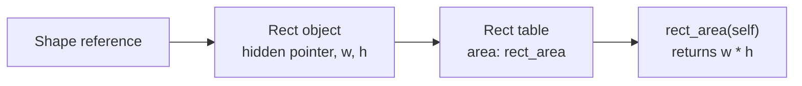
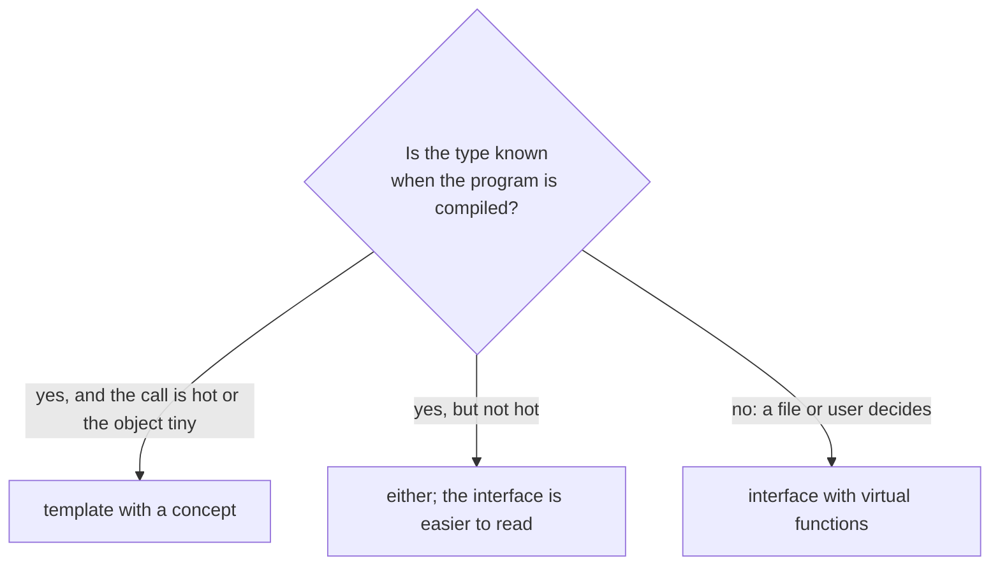
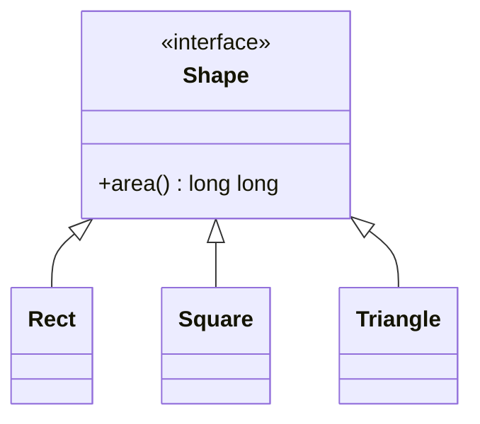
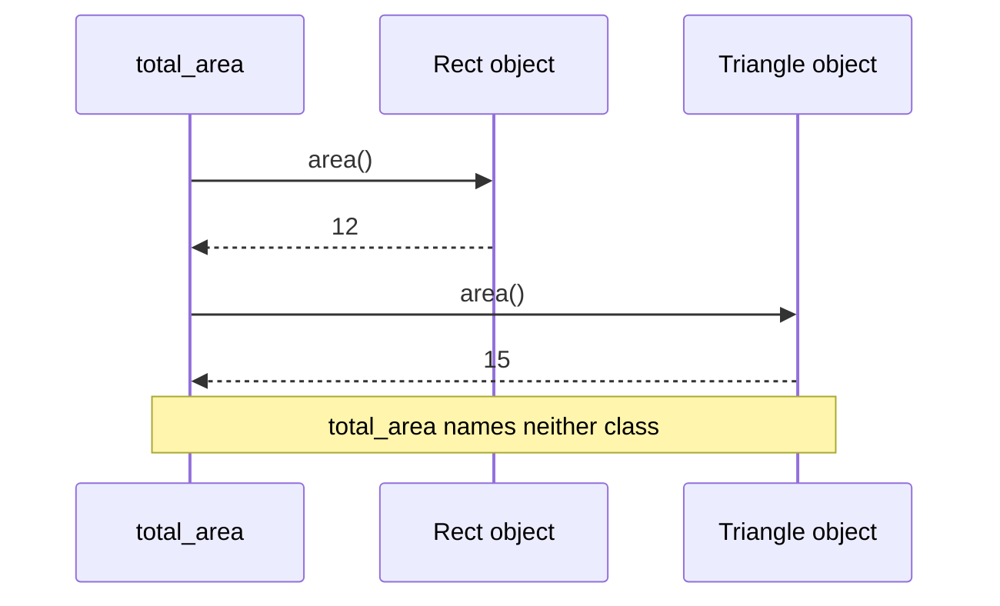

import { Code } from '@astrojs/starlight/components';
import TopicHeader from '../../../../components/TopicHeader.astro';
import WhatYouNeed from '../../../../components/WhatYouNeed.astro';
import ClaimEvidence from '../../../../components/design/ClaimEvidence.astro';
import TradeOffTable from '../../../../components/design/TradeOffTable.astro';
import LabRunner from '../../../../components/design/LabRunner.astro';
import ExperimentResult from '../../../../components/design/ExperimentResult.astro';
import Cards from '../../../../components/Cards.astro';
import Exercises from '../../../../components/design/Exercises.tsx';
import Drill from '../../../../components/Drill.tsx';
import LookalikePairs from '../../../../components/LookalikePairs.astro';
import SelfTest from '../../../../components/SelfTest.astro';
import Checkpoint from '../../../../components/Checkpoint.tsx';
import DecisionMapUpdate from '../../../../components/DecisionMapUpdate.astro';
import shapeHpp from '../../../../../code/L0.2/virtual-shapes/shape.hpp?raw';
import triangleHpp from '../../../../../code/L0.2/virtual-shapes/triangle.hpp?raw';
import ownerHpp from '../../../../../code/L0.2/virtual-destructor/owner.hpp?raw';
import vtableHpp from '../../../../../code/L0.2/manual-vtable/vtable.hpp?raw';
import staticHpp from '../../../../../code/L0.2/static-shapes/static.hpp?raw';
import loggerHpp from '../../../../../code/L0.2/ex-1-logger/logger.hpp?raw';
import codecHpp from '../../../../../code/L0.2/ex-2-codec-list/codec.hpp?raw';
import m0 from '../../../../../notes/design/L0.2-mistakes/m0_switch_on_a_kind.cpp?raw';
import m1 from '../../../../../notes/design/L0.2-mistakes/m1_base_destructor_not_virtual.cpp?raw';
import m2 from '../../../../../notes/design/L0.2-mistakes/m2_missing_override_hides_instead_of_overrides.cpp?raw';
import m3 from '../../../../../notes/design/L0.2-mistakes/m3_slicing_by_value.cpp?raw';
import m4 from '../../../../../notes/design/L0.2-mistakes/m4_virtual_call_in_the_constructor.cpp?raw';
import m5 from '../../../../../notes/design/L0.2-mistakes/m5_interface_for_one_implementation.cpp?raw';
import m5b from '../../../../../notes/design/L0.2-mistakes/m5b_the_same_as_a_class.cpp?raw';
import m6 from '../../../../../notes/design/L0.2-mistakes/m6_template_with_a_list_loaded_at_run_time.cpp?raw';

<TopicHeader topic="L0.2" />

## 1. Why this topic exists

Here is a working program (26 non-blank lines). A drawing tool keeps shapes as a tag and two numbers. Last month someone added a third kind, the triangle.

<Code code={m0} lang="cpp" title="m0_switch_on_a_kind.cpp (a working program with a flaw)" />

It compiles with every warning on, runs, and prints:

```
total area = 12 (expected 27), total perimeter = 32
```

The triangle was added to the enum and to `perimeter`, and forgotten in `area`, where the `default:` branch quietly returns 0. Nothing complains. The cause is not carelessness; it is the shape of the code. Every operation on a shape (area, perimeter, and the drawing and saving functions that come next) has its own `switch` on the kind, so a new kind means finding and editing every one of them. Miss one and the program is wrong without any message.

The fix of this topic turns the code around. Each kind of shape becomes a class that carries its own area and its own perimeter, and the caller says only "tell me your area" to whatever shape it holds. A new kind is a new class in a new file, and no caller changes. That is an **interface** with **virtual functions**. The topic also shows what the compiler does to make this work (one hidden pointer and a table), what it costs, and the other tool, **templates**, that gives the same answers when the choice can be made earlier.

## 2. Prerequisites and scope

### What you need

<WhatYouNeed topic="L0.2" />

### What this topic does not cover

- How classes relate to each other, composition over inheritance and aggregation: L0.3. Here a class derives from another only to implement an interface.
- Drawing classes and calls as diagrams: L0.4 (the small diagrams here are examples only).
- The Single Responsibility and Open/Closed principles, and measuring change cost: L0.5.
- Liskov substitution (when a derived class may stand in for its base), Interface Segregation and Dependency Inversion: L0.6.
- Test doubles (a fake class behind an interface for tests): L0.8.
- Multiple inheritance, virtual inheritance, and `dynamic_cast`: not needed to design with interfaces and not covered.
- Template details beyond the one concept and two function templates shown here.

## 3. Definitions

**Inheritance, base class and derived class.** `class Rect : public Shape` says that `Rect` is derived from the base class `Shape`: a `Rect` has everything a `Shape` has and can be used wherever a `Shape` is expected. In this topic inheritance is used for one thing only, to implement an interface.

**Virtual function.** A member function marked `virtual` in the base class. When it is called through a base reference or pointer, the function that runs is chosen by the **real class of the object**, not by the type of the variable. Without `virtual` the variable's type decides.

**Override.** A function in a derived class with the same name, parameters and `const`-ness as a base virtual function, which replaces it for objects of the derived class. Writing `override` after the parameter list asks the compiler to check that it really does replace one; if it does not, the program does not compile.

**Pure virtual function and abstract class.** `virtual long long area() const = 0;` declares a function with no body in the base. A class with at least one pure virtual function is **abstract**: no object of it can be created, only of a derived class that overrides every pure function. An abstract class with no data and only pure virtual functions (and a destructor) is an **interface**.

**Virtual destructor.** A destructor marked `virtual`. It makes `delete base_pointer` run the derived class's destructor first and then the base's. Every class meant to be used through a base pointer needs one.

**Dynamic dispatch.** Choosing which function runs while the program runs, from the real class of the object. A virtual call is dynamic dispatch.

**Vtable ("virtual table").** What the compiler builds to do dynamic dispatch: for each class with virtual functions, one table of the addresses of its virtual functions; and in each object, one hidden pointer to its class's table. Section 4 shows it written by hand.

**Static polymorphism.** The same source line working for several types, with the choice made when the program is compiled. In C++ this is a **template**: `template <class S> long long area_of(const S& s)` is a pattern from which the compiler writes one function per type that is used. A **concept** names what a type must offer: `HasArea` below means "has a member `area()` that returns something convertible to `long long`".

```cpp
class Shape {                                   // an interface
public:
    virtual ~Shape() = default;                 // virtual destructor
    virtual long long area() const = 0;         // pure virtual: no body here
};
class Rect final : public Shape {               // final: nothing derives from Rect
public:
    long long area() const override { return w * h; }
    long long w = 0, h = 0;
};
```

## 4. Principles and claims

#### Claim L0.2.1: a virtual call runs the real class's function, so a new class needs no change in the caller

**Statement.** If a function is virtual in a base class, then a call through a base reference or pointer runs the function of the object's real class; so code that is written against the base works, unchanged, with any class derived later.

:::tip[In plain words]
The caller says "tell me your area" to something it knows only as a `Shape`. The object itself decides how to answer. Add a new kind of object and the caller never needs to hear about it.
:::

**A tiny instance with real numbers.** `Rect(3, 4)` and `Square(5)` are put in one list of shapes. `total_area` knows only `Shape` and returns 37 (12 + 25). A third class, `Triangle(6, 5)`, is written in its own file `triangle.hpp`; `shape.hpp`, which holds `total_area`, is not edited, and the list of the three gives 12 + 15 + 4 = 31 for `Rect(3, 4)`, `Triangle(6, 5)`, `Square(2)`.

**Reasoning.**
1. The caller holds `Shape` references or pointers and calls `area()`; it never names `Rect` or `Triangle`.
2. `area()` is virtual, so the call is decided by the real class of each object.
3. Every derived class overrides `area()` with its own formula.
4. A class written later also overrides `area()`; the caller's code already says "call whatever `area()` this object has".
5. So the caller's source text does not mention, and does not need to change for, any particular class.

:::note[This claim needs]
1. The function is virtual in the base and every derived class overrides it with the same signature (write `override` so the compiler checks this).
2. The objects are reached through references or pointers to the base: a base-class variable holding a copy would hold only the base part (the mistake "slicing" below).
3. The classes keep the promise of the base. Section 6 of this topic shows the promise as a written contract test; L0.6 states the rule in general.
:::

<ClaimEvidence claim="L0.2.1" />

**Cost.** Objects must be held by pointer or reference (usually `std::unique_ptr<Shape>`), so each is a separate allocation; and a call is not resolved until it runs (Claim L0.2.3).

#### Claim L0.2.2: delete through a base pointer needs a virtual base destructor

**Statement.** If a derived object is deleted through a pointer to its base, then the derived class's destructor runs if and only if the base's destructor is virtual; without it the behaviour is undefined.

:::tip[In plain words]
When the only thing you hold is a `Shape*`, the compiler must be told, with `virtual`, to look at the real object before it cleans up. Otherwise it cleans up a `Shape` and leaks or breaks the rest.
:::

**A tiny instance with real numbers.** `BufferedHandler` owns a 1024-byte buffer and counts itself in `live_buffers`. With `virtual ~Handler()`, `delete h` on a `Handler*` takes the count from 1 back to 0, and so does a `std::unique_ptr<Handler>` going out of scope, for 1 object and for 2. The test also asserts `std::has_virtual_destructor_v<Handler>`.

**Reasoning.**
1. `delete p` where `p` is `Handler*` calls `p`'s destructor.
2. If the destructor is virtual, that call is a virtual call (Claim L0.2.1): it runs the destructor of the real class, which then runs its base destructors in turn.
3. If it is not virtual, the call is decided by the type of `p`, `Handler`; only `~Handler` runs, and the language says the whole program then has undefined behaviour.
4. So the cleanup of the derived part (here the `--live_buffers` and the buffer) happens only with `virtual`.

:::note[This claim needs]
1. The class is deleted through a base pointer (including by a `std::unique_ptr<Base>`).
2. The base destructor is declared `virtual` (or the base is never deleted that way and the destructor is `protected` and non-virtual; not shown here).
:::

<ClaimEvidence claim="L0.2.2" />

**Cost.** One more entry in the table and the pointer that Claim L0.2.3 describes; a class with a virtual destructor can no longer be a plain aggregate of its fields.

#### Claim L0.2.3: a virtual call is a pointer read, a table look-up and a call

**Statement.** The compiler implements a virtual call by storing in every object of the class one hidden pointer to a table of that class's virtual functions; a call reads the pointer, finds the function in the table, and calls it. The cost is one pointer per object.

:::tip[In plain words]
There is no magic. Each object carries a note saying "my class's functions are over there". The call follows the note.
:::

**A tiny instance with real numbers.** The unit writes the mechanism by hand with plain structs: `ManualRect` is a table pointer followed by `w` and `h`; `rect_table` holds the address of `rect_area`; `call_area` reads the first pointer of any such object and calls the function it finds. For every width and height from 0 to 12, the hand-made call and the language's own virtual call give the same area. And `sizeof(VRect) == sizeof(PlainRect) + sizeof(void*)`: 16 bytes against 8 on this machine.

**Reasoning.**
1. For a class with virtual functions the compiler builds one table, with one entry per virtual function, holding that class's version of each.
2. Every object of the class starts with a hidden pointer to that table; the constructor sets it.
3. A call `p->area()` becomes: read the pointer at the start of `*p`, take the entry for `area`, call it with `p`.
4. Two objects of the same class share one table, so the extra cost per object is one pointer, 8 bytes on this machine.
5. The compiler cannot know at compile time which entry will be read, so it usually cannot replace the call by the function's body (inline it).



:::note[This claim needs]
1. The class has at least one virtual function; classes with none have no hidden pointer.
2. The sizes stated are for this machine (64-bit pointers); the layout is the compiler's business, and the test asserts only the size relationship.
:::

<ClaimEvidence claim="L0.2.3" />

**Cost.** 8 bytes per object, an indirect call per use, and calls that cannot be expanded in place. For most code this is invisible; it matters in a loop of millions of calls on tiny functions.

#### Claim L0.2.4: a template gives the same answers with the choice made when compiled, and holds one type per container

**Statement.** A function template constrained by a concept gives the same results as a virtual call for types known at compile time, with no base class and no hidden pointer; but a container of such a template holds elements of one type, so a list of different types chosen while the program runs needs an interface.

:::tip[In plain words]
If you can name the type in your source, let the compiler write the call directly. If a file or a user decides the type while the program runs, the compiler cannot, and you need the virtual interface.
:::

**A tiny instance with real numbers.** `SRect{3, 4}` is 2 × 8 = 16 bytes with no hidden pointer (asserted). `total_area` of 20 rectangles `{i, i+1}` for `i = 1 to 20` is 3080 with the template and with the virtual version. `area_of(7)` for an `int` does not compile, because `int` has no `area()`: `static_assert(!HasArea<int>)`. A `std::variant` over the three shape types holds a mixed list, but it is a closed set: a fourth type means editing the `using AnyShape` line.

**Reasoning.**
1. `area_of(s)` is a template: for each type it is used with, the compiler writes a function that calls that type's `area()`.
2. The type is known at the call, so the call is direct and may be expanded in place.
3. A `std::vector<S>` has one `S`: every element has the same type.
4. A list whose element types are chosen while running (read from a file) cannot be written as one `S`, because `S` must be fixed when the program is compiled.
5. So the template replaces the interface only when the set of types is fixed at compile time.



:::note[This claim needs]
1. Every use names its type (or the type follows from an argument) when the program is compiled.
2. No container needs to hold two of these types at once, chosen while running (or the closed set of types is acceptable in a `std::variant`).
:::

<ClaimEvidence claim="L0.2.4" />

**Cost.** One copy of the compiled function per type used, long error messages when a type does not fit, and the template's source must be visible to every file that uses it.

## 5. Recognition Cards

<Cards topic="L0.2" />

## 6. Reference designs

**The plain design first.** The program of Section 1 is the plain design: a kind tag and a `switch` in every function. It is the shortest code for two kinds and the right one when the set of kinds never grows and there are one or two operations. Its weakness is that every new kind edits every function.

**The designed version: an interface and one class per kind.**

<Code code={shapeHpp} lang="cpp" title="shape.hpp" />

The third shape lives in its own file and `shape.hpp` is not edited:

<Code code={triangleHpp} lang="cpp" title="triangle.hpp" />





**How it works.** `Shape` has one pure virtual function and a virtual destructor, so no `Shape` can be made and any derived object can be deleted through it. `Rect`, `Square` and `Triangle` each override `area()`; `final` says nothing derives from them. `total_area` loops over `std::unique_ptr<Shape>` and calls `area()`; it contains no class name besides `Shape`. The contract test `check_contract` is a plain function that takes a `const Shape&` and checks the promise (not negative, the same answer twice); every class, new ones included, is run through it.

**Cleanup through the base:**

<Code code={ownerHpp} lang="cpp" title="owner.hpp" />

**The mechanism written by hand:**

<Code code={vtableHpp} lang="cpp" title="vtable.hpp" />

**The compile-time version:**

<Code code={staticHpp} lang="cpp" title="static.hpp" />

**C++ details explained** (beyond L0.1):
- `class Rect final : public Shape`: `: public Shape` makes `Rect` derived from `Shape`; `final` forbids further derivation.
- `virtual ~Shape() = default;`: a virtual destructor whose body the compiler writes.
- `long long area() const override`: `override` makes the compiler check that a base function with this exact signature exists.
- `= 0` after a virtual function: pure virtual, makes the class abstract.
- `std::vector<std::unique_ptr<Shape>>`: a list of owning pointers to the base type; each element may point to a different derived class. The vector must hold pointers (or references wrapped in `std::reference_wrapper`), not `Shape` objects, so that nothing is cut off.
- `std::make_unique<Rect>(3, 4)`: builds a `Rect` on the heap and returns the owning pointer (L0.0); it converts to `std::unique_ptr<Shape>` automatically.
- `s->area()`: `->` on a pointer calls the member of the object it points to.
- `static_assert(std::is_abstract_v<Shape>)`, `std::has_virtual_destructor_v<Handler>`: compile-time checks from `<type_traits>`.
- `inline int live_buffers = 0;`: one shared variable across all files that include the header (C++17).
- `static_cast<const ManualRect*>(self)`: converts a `const void*` back to the type the programmer knows it to be; used only in the hand-made table.
- `template <class S> concept HasArea = requires(const S& s) { { s.area() } -> std::convertible_to<long long>; };`: a named requirement. `template <HasArea S>` before a function says it accepts only types that satisfy it.
- `std::variant<SRect, SSquare, STriangle>` and `std::visit`: a value that holds exactly one of the listed types, and a call that runs a function on whichever it holds.

**Tested.** Each unit builds with `g++ -std=c++23 -Wall -Wextra -Wpedantic -Werror` and the address and undefined-behaviour sanitizers; every one prints `all checks passed` (recorded 2026-10-19):

```
bash code/L0.2/virtual-shapes/test.sh code/L0.2/virtual-shapes         # 6 tests
bash code/L0.2/virtual-destructor/test.sh code/L0.2/virtual-destructor # 4 tests
bash code/L0.2/manual-vtable/test.sh code/L0.2/manual-vtable           # 4 tests, 13 x 13 sizes
bash code/L0.2/static-shapes/test.sh code/L0.2/static-shapes           # 5 tests
```

## 7. Mistake catalogue

The wrong programs are in `notes/design/L0.2-mistakes/`; `run.sh` builds and runs each one with the course flags (recorded 2026-10-19). This topic has an unusual result: the course's own warning flags catch three of the mistakes before they run, and the lesson shows both outcomes.

### Mistake: a tag and a switch in every function

The program of Section 1. Symptom: `total area = 12 (expected 27)`, exit code 1. The compiler said nothing, because the `default:` branch is legal. **Fix.** One class per kind with its own `area()`; a missing operation then fails to compile (a pure virtual function must be overridden).

### Mistake: the base destructor is not virtual

<Code code={m1} lang="cpp" title="m1_base_destructor_not_virtual.cpp" />

With the course flags it does not compile: `deleting object of abstract class type 'Handler' which has non-virtual destructor will cause undefined behavior [-Werror=delete-non-virtual-dtor]`. With that one warning silenced (`m1b_same_with_the_warning_silenced.cpp`), the address sanitizer stops the run: `AddressSanitizer: new-delete-type-mismatch ... size of the allocated type: 32 bytes; size of the deallocated type: 8 bytes.` **Fix.** `virtual ~Handler() = default;`. Build with warnings on, and keep them as errors.

### Mistake: an override that is not one

<Code code={m2} lang="cpp" title="m2_missing_override_hides_instead_of_overrides.cpp" />

The derived `area()` lacks `const`, so it is a different function that hides the base one. With the course flags: `'virtual long long int Shape::area() const' was hidden [-Werror=overloaded-virtual=]`. With that warning silenced the program runs and prints `through the base: 0 (expected 12)`. Writing `override` (`m2b_the_same_with_override.cpp`) gives `marked 'override', but does not override`. **Fix.** Always write `override`.

### Mistake: slicing, a base-class value in a container

<Code code={m3} lang="cpp" title="m3_slicing_by_value.cpp" />

Symptom: `area = 0 (expected 12)`, exit code 1. `std::vector<Shape>` stores `Shape` objects, so `push_back(Rect(3, 4))` copies only the base part and the `Rect` is cut off. The compiler accepts it because this `Shape` is not abstract. **Fix.** Hold `std::unique_ptr<Shape>`; making `Shape` abstract also turns this into a compile error.

### Mistake: a virtual call in a constructor

<Code code={m4} lang="cpp" title="m4_virtual_call_in_the_constructor.cpp" />

Symptom: `constructing, name = Base`, then `after construction, name = Derived`. While the `Base` part is being built the object is only a `Base`, so the virtual call runs the base version. **Fix.** Do not call virtual functions from constructors or destructors; give the base the data it needs as a constructor argument instead.

### Mistake: a template with a list loaded at run time

<Code code={m6} lang="cpp" title="m6_template_with_a_list_loaded_at_run_time.cpp" />

It does not compile: `no matching function for call to 'std::vector<Upper>::push_back(Reverse)'`. A `std::vector<C>` holds one type. **Fix.** An interface with `std::vector<std::unique_ptr<Step>>`, as in Example 2.

### Mistake: an interface for one implementation (over-engineered)

<Code code={m5} lang="cpp" title="m5_interface_for_one_implementation.cpp (22 non-blank lines)" />

The same logger as one concrete class:

<Code code={m5b} lang="cpp" title="m5b_the_same_as_a_class.cpp (15 non-blank lines)" />

Both print `1 line(s)`; the object size is 32 bytes with the interface and 24 without, the 8 extra being the hidden pointer. The interface adds a class and a file and enables nothing that the concrete class cannot do. **Fix.** A concrete class; introduce an interface the day a second implementation is real (Example 1).

## 8. Worked examples

### Example 1: A logger that is never replaced

Every module of a program writes its messages through one `Logger` class. It always writes into the same list of lines and nobody has asked for a second kind of logger or a fake one for tests. A colleague proposes an `ILogger` interface with a `LoggerImpl` class.

#### Step 1: Numbers

1 implementation, 0 planned. As one class: 15 non-blank lines in the comparison program, 24 bytes per object. With an interface: 22 lines and 32 bytes.

#### Step 2: Wording → candidate structures

Candidates: (a) the simplest thing that could work, a concrete `Logger`; (b) an `ILogger` interface with `LoggerImpl`.

#### Step 3: Property check → decision

The card for interfaces needs at least two implementations (or one now and one expected) and a choice made at run time. There is one, and no choice. Decision: (a).

#### Step 4: Design

A concrete class with `info`, `error` and `lines`.

#### Step 5: Code or calculation

<Code code={loggerHpp} lang="cpp" title="logger.hpp (the concrete class, and the interface version for comparison)" />

The test runs the same calls on both and gets the same lines, and asserts `sizeof(LoggerImpl) == sizeof(Logger) + sizeof(void*)`: the interface changes no behaviour and adds a pointer.

#### Step 6: Decision record

Decision: a concrete class. Not chosen: an interface with one implementation (an extra class, an extra file, 8 bytes per object, no behaviour gained). Revisit when the first real second implementation appears (a file logger next to the console one): then the interface is added in one small refactor, with the existing tests unchanged.

### Example 2: Codecs named in a configuration file

A program reads a list of codec names (for example `upper`, `reverse`) from a configuration file at start-up and applies the codecs to a text in the order listed. More codecs will be added over the year. How should the codecs be represented?

#### Step 1: Numbers

2 codecs now, 1 to 3 added per quarter; the list is 0 to 10 names per file; each codec is called once per input line.

#### Step 2: Wording → candidate structures

Candidates: (a) the simplest thing that could work, a `switch` on the name inside the loop; (b) an abstract `Codec` with a virtual `encode`, one class per codec, built from the names; (c) a template over the codec type.

#### Step 3: Property check → decision

The file decides which classes run, while the program runs. A template (c) cannot do that: one vector holds one type. A switch (a) is edited for each new codec. The interface (b) has more than one implementation, a caller that needs only `encode`, and a run-time choice. Decision: (b).

#### Step 4: Design

`Codec` interface with a virtual destructor; `Upper` and `Reverse`; `load_codecs(names)` builds a `std::vector<std::unique_ptr<Codec>>` and refuses an unknown name; `run_all` applies them in order.

#### Step 5: Code or calculation

<Code code={codecHpp} lang="cpp" title="codec.hpp" />

The tests show that `{"upper", "reverse"}` turns "abc" into "CBA", that the order of the list is the order of use, and that an unknown name is refused.

#### Step 6: Decision record

Decision: an interface with one class per codec. Not chosen: a switch in the loop (edited per codec); a template (cannot be chosen from a file). Cost: one 8-byte pointer per codec and one indirect call per codec per line, about 2 per input line, negligible here. Revisit if profiling shows the call itself is the cost, which for text processing it will not be.

## 9. Exercise ladder

<Exercises topic="L0.2" client:load />

## 10. Recognition drill

<Drill topic="L0.2" client:load />

## 11. Look-alike pairs

<LookalikePairs topic="L0.2" />

## 12. Self-test questions

<SelfTest topic="L0.2" />

## 13. Checkpoint

<Checkpoint topic="L0.2" client:load />

## 14. Decision map update

<DecisionMapUpdate topic="L0.2" />
