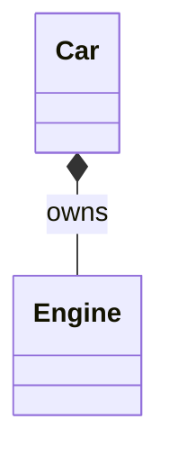
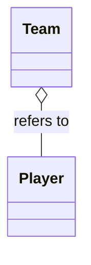
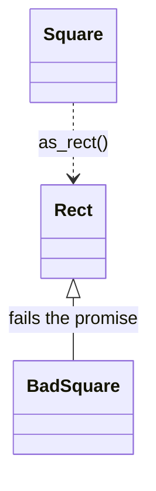

import { Code } from '@astrojs/starlight/components';
import TopicHeader from '../../../../components/TopicHeader.astro';
import WhatYouNeed from '../../../../components/WhatYouNeed.astro';
import ClaimEvidence from '../../../../components/design/ClaimEvidence.astro';
import TradeOffTable from '../../../../components/design/TradeOffTable.astro';
import LabRunner from '../../../../components/design/LabRunner.astro';
import ExperimentResult from '../../../../components/design/ExperimentResult.astro';
import Cards from '../../../../components/Cards.astro';
import Exercises from '../../../../components/design/Exercises.tsx';
import Drill from '../../../../components/Drill.tsx';
import LookalikePairs from '../../../../components/LookalikePairs.astro';
import SelfTest from '../../../../components/SelfTest.astro';
import Checkpoint from '../../../../components/Checkpoint.tsx';
import DecisionMapUpdate from '../../../../components/DecisionMapUpdate.astro';
import partsHpp from '../../../../../code/L0.3/owned-engine/parts.hpp?raw';
import teamHpp from '../../../../../code/L0.3/team-players/team.hpp?raw';
import shapesHpp from '../../../../../code/L0.3/square-rectangle/shapes.hpp?raw';
import stackHpp from '../../../../../code/L0.3/stack-by-composition/stack.hpp?raw';
import documentHpp from '../../../../../code/L0.3/ex-1-document/document.hpp?raw';
import birdsHpp from '../../../../../code/L0.3/ex-2-birds/birds.hpp?raw';
import m0 from '../../../../../notes/design/L0.3-mistakes/m0_inheritance_for_reuse.cpp?raw';
import m1 from '../../../../../notes/design/L0.3-mistakes/m1_square_derives_from_rect.cpp?raw';
import m2 from '../../../../../notes/design/L0.3-mistakes/m2_penguin_must_fly.cpp?raw';
import m3 from '../../../../../notes/design/L0.3-mistakes/m3_part_deleted_while_the_whole_still_refers_to_it.cpp?raw';
import m4 from '../../../../../notes/design/L0.3-mistakes/m4_owned_part_never_released.cpp?raw';
import m5 from '../../../../../notes/design/L0.3-mistakes/m5_copying_the_whole_shares_the_part.cpp?raw';
import m6 from '../../../../../notes/design/L0.3-mistakes/m6_shared_ptr_for_parts_nobody_else_holds.cpp?raw';
import m6b from '../../../../../notes/design/L0.3-mistakes/m6b_the_same_with_the_parts_by_value.cpp?raw';
import m7 from '../../../../../notes/design/L0.3-mistakes/m7_a_getter_hands_out_the_part.cpp?raw';

<TopicHeader topic="L0.3" />

## 1. Why this topic exists

Here is a working program (22 non-blank lines). A stack of numbers needs storage, and `std::vector` already has it, so the stack inherits from the vector and gets everything for free. A helper written elsewhere keeps only the first two elements of any vector.

<Code code={m0} lang="cpp" title="m0_inheritance_for_reuse.cpp (a working program with a flaw)" />

It compiles with every warning on, runs, and prints:

```
popped 2 (expected 3), then 1 (expected 2)
```

Three numbers were pushed, and the stack gave back the second one first. Nothing complained, because a `Stack` *is* a `std::vector` as far as the compiler is concerned, so the helper was allowed to cut the stack's contents. The stack has a rule, "the next pop returns the last push", and that rule was safe only as long as nobody called an operation that the stack never meant to offer.

The cause is a choice made on the first line of the class: the stack was written in terms of the vector by **inheritance**, which makes every vector operation a stack operation. The fix of this topic is to decide, for every pair of classes, which of four relationships they have, and to write it in the code: **association** (one uses the other), **aggregation** (it refers to a part that lives on its own), **composition** (it owns a part that lives and dies with it) and **inheritance** (it can be used wherever the other is). Most of the time the right word is not inheritance, which is why the advice "prefer composition over inheritance" exists. The topic gives a test for each word, so that the choice is made by checking, not by feel.

## 2. Prerequisites and scope

### What you need

<WhatYouNeed topic="L0.3" />

### What this topic does not cover

- Drawing these relationships as diagrams, and reading class and sequence diagrams: L0.4. The small diagrams here are examples only.
- The Single Responsibility and Open/Closed principles and measuring the cost of change: L0.5.
- The full statement of the Liskov Substitution Principle, Interface Segregation and Dependency Inversion: L0.6. This topic gives the working test (a contract test) and the two plainest cases.
- Smart-pointer details beyond `std::unique_ptr` and the one rule that shared ownership is for parts that really have several owners: L0.0 and the Memory Safety lessons.
- Multiple inheritance, virtual inheritance and private or protected inheritance: not needed to choose between the four relationships and not covered.
- Patterns built from these relationships (Decorator, Composite, Strategy): the pattern phases.

## 3. Definitions

**Association.** One class uses another: it calls it, or keeps a way to reach it. It is the weakest and most common relationship, and the other three are special cases of it.

**Aggregation.** A whole **refers to** parts that exist on their own. The whole does not create them and never deletes them. A `Team` that lists `Player` objects built elsewhere, and a `Cart` that is given a `Logger`, are aggregations. In C++ the whole holds a reference, a pointer to `const`, or an id.

**Composition (object composition).** A whole **owns** its parts: they are created with it, destroyed with it, and held by nothing else. A `Car` and its `Engine`, and an `Order` and its lines, are compositions. In C++ the whole holds the part as a member by value, or by `std::unique_ptr`.

**Ownership.** The answer to "who destroys it?". An object has one owner or is shared by several; a reference or a pointer to `const` is not ownership. Every design decision in this topic is a decision about who owns what.

**Inheritance (an is-a relationship).** `class B : public A` says that a `B` can be used wherever an `A` is expected. That is a promise, and it is true only if `B` keeps every promise that `A` makes. If it does not, `B` is not an `A`, whatever the words in the problem statement say.

**Composition over inheritance.** The rule of thumb that when the only goal is to reuse the code or the storage of another class, a private member does the job and inheritance does not, because inheritance also hands the whole public interface of the other class to the users.

```cpp
class Car {
public:
    void start() { engine_.start(); }   // forwards: the car decides what is offered
private:
    Engine engine_;                      // composition: built with the car, destroyed with it
};
class Team {
    std::vector<const Player*> members_; // aggregation: addresses of players that live elsewhere
};
class SavingsAccount : public Account {}; // inheritance: only if every Account promise holds
```

## 4. Principles and claims

#### Claim L0.3.1: a part held by value lives exactly as long as the whole

**Statement.** If a class holds another object as a member by value, then the member is constructed before the body of the whole's constructor runs and destroyed after the body of the whole's destructor, the member needs no pointer and no allocation, and no other object can hold it or delete it.

:::tip[In plain words]
A car with an engine inside it: the engine is made first, goes wherever the car goes, and is scrapped last. Nobody else can sell the engine, because it is not a separate thing.
:::

**A tiny instance with real numbers.** `Car` has a member `Engine engine_`. Both record events in a list. For `{ Car car; }` the list is `engine built, car built, car destroyed, engine destroyed` (4 events, in that order). `sizeof(Car) == sizeof(Engine)`: the car adds no pointer. `Engine` cannot be copied, so `Car` cannot be copied either (asserted), and two cars have two engines: starting one leaves the other not running. The same holds through `std::make_unique<Car>`: 4 events, the last one `engine destroyed`.

**Reasoning.**
1. Members are constructed in the order they are declared, before the body of the constructor of the class that holds them, so the engine exists before the car's body runs.
2. Destruction is the reverse: the body of the car's destructor runs, then the members are destroyed, so the engine outlives the car's own code.
3. A member by value is stored inside the object, so there is no pointer to it and no separate allocation; the size of the car is the size of its parts.
4. Nothing outside the class can name the member, so nothing outside can hold its address safely or delete it.

:::note[This claim needs]
1. The part is a member by value (or an owning `std::unique_ptr`), not a raw pointer made with `new` and left to a destructor.
2. The whole is not given a way to give the part out: a getter that returns the part by non-const reference lets any caller change it (the mistake "a getter hands out the part" in Section 7).
:::

<ClaimEvidence claim="L0.3.1" />

**Cost.** The whole is as large as its parts, cannot exist without them, and can be copied only if the parts can.

#### Claim L0.3.2: a whole that refers to a part never destroys it, and that is safe only while the part outlives the whole

**Statement.** If a class holds only the address of an object (a reference, a pointer to `const`, or an id), then destroying the class does not destroy the object, a change made to the object is seen through the class, and several classes can refer to the same object; the references are valid only while the object exists.

:::tip[In plain words]
A team's list of players is a list of names on a sheet. Tearing up the sheet does not make the players disappear, and if a player changes, the sheet shows the new player. But if a player leaves town, the name on the sheet points at nobody.
:::

**A tiny instance with real numbers.** `Team` keeps `const Player*`. Two players, `ann` (score 7) and `bo` (score 5), are added to a team in a block: `size()` is 2 and `total_score()` is 12. After the block, `live_players` is still 2 and `ann.name` is still `"ann"`. After `ann.score = 10` the team's total counts 10 for her. Adding three players makes `player_copies == 0`. Two teams that refer to the same player both show her new score of 9. A temporary player cannot be added: `static_assert(!CanAddTemporary<Team>)`.

**Reasoning.**
1. The team stores addresses; its destructor destroys the vector of addresses and nothing it points to.
2. So every player is still alive, with the same value, after the team is gone.
3. Reading through an address reads the object itself, so a change to the player is seen.
4. Several teams can store the same address; none of them owns it.
5. The address is valid only while the object lives. A team used after its player is destroyed reads freed memory; the type system does not prevent this, so the rule belongs in the design: the part must outlive every use of the whole.

:::note[This claim needs]
1. Somebody else creates and destroys the parts, and the parts are alive whenever the whole is used.
2. The whole does not delete what it refers to; `Team::add(Player&&)` is deleted so that a temporary, which would be gone at the end of the statement, is refused when compiled.
:::

<ClaimEvidence claim="L0.3.2" />

**Cost.** A lifetime rule that the compiler cannot check, and a whole that is copied still refers to the same parts.

#### Claim L0.3.3: a derived class stands in for its base only if it keeps every promise of the base

**Statement.** If code is written for a base class and relies on a promise that the base makes, then it gives correct results with a derived class only if the derived class keeps that promise; a function that checks the promise, run on the base and on each derived class, finds the classes that break it.

:::tip[In plain words]
"A square is a rectangle" is true in geometry and false for this class. A rectangle promises that changing its width leaves its height alone. A square cannot keep that promise, so code that trusts it goes wrong for squares.
:::

**A tiny instance with real numbers.** `Rect` promises: after `set_width(5)` the height is unchanged, after `set_height(7)` the width is unchanged, and the area is the product. `keeps_rect_promise(r)` checks that. For `Rect(3, 4)` it returns true. For `BadSquare(4)`, which derives from `Rect` and changes both sides, it returns false. A function that sets the width to 10 and returns the area gets 40 from `Rect(3, 4)` and 100 from `BadSquare(4)`, where its author expected 10 × 4 = 40. The separate `Square` is not derived from `Rect`; `Square(2).scaled(3)` is a new square of side 6 and area 36 and the original keeps side 2; `Square(5).as_rect()` is a `Rect` of 25 that passes the same contract. The birds unit shows the same at the level of design: `fly()` lives in `FlyingBird`, so `CanFly<Sparrow>` is true and `CanFly<Penguin>` is false.

**Reasoning.**
1. Code written against `Rect` may use anything `Rect` promises, and cannot know which derived class it holds.
2. If a derived class changes what an operation does to the object's state (here, `set_width` also changing the height), the code's reasoning is wrong for that class.
3. The promise can be written as a function over a base reference, so it can be run on every derived class.
4. A class that fails it is not an is-a of the base. Either the promise is wrong for the base (move it to a narrower base, as `FlyingBird` does) or the class must be separate, with a conversion where one is needed.

:::note[This claim needs]
1. The promises are written down as a test, not left to the name of the class.
2. The test is run on every class that derives, including future ones. L0.6 states the general rule (the Liskov Substitution Principle) and what a promise may and may not be.
:::

<ClaimEvidence claim="L0.3.3" />

**Cost.** A narrower base (`Bird`, `FlyingBird`) means more classes, and a conversion function instead of the convenience of inheriting.

#### Claim L0.3.4: a private member offers only the operations written; inheritance offers all of them

**Statement.** If a class holds another as a private member and forwards the operations it chooses, then a call that would break the class's rule has no way in; if it inherits publicly, every public operation of the other class is also an operation of this one.

:::tip[In plain words]
Putting the vector inside the stack and handing out only `push`, `pop` and `top` is like giving someone a key to the front door only. Inheriting from the vector gives them the keys to every room.
:::

**A tiny instance with real numbers.** Two stacks store ints in a `std::vector`. Pushing 1, 2, 3 and popping gives 3, 2 on both. For the inheriting `VecStack`, `erase(begin() + 2)` compiles and removes the 3; the next `pop()` returns 2 though the last push was 3. For the composed `Stack`, `erase` and `operator[]` do not exist (`static_assert(!CanErase<Stack>)`, `static_assert(!CanIndex<Stack>)`), so that line does not compile. The price of composing is 5 short forwarding functions (`pop`, `top`, `size`, `empty` and `push`) that the inherited version got for free.

**Reasoning.**
1. A public base class makes every public member of the base a public member of the derived class, and lets the derived object be passed as the base.
2. Some of those members change the contents in ways the derived class's rule does not allow (`erase`, `insert`, `operator[]` for a stack).
3. With a private member, only the functions the class writes can reach the part, so each can keep the rule (L0.1).
4. The cost is writing the forwarders that are wanted.

:::note[This claim needs]
1. The new class does not need to be passed where the old one is expected.
2. The rule of the new class is a rule about the part's contents (an invariant in the sense of L0.1).
:::

<ClaimEvidence claim="L0.3.4" />

**Cost.** One forwarding function for each operation that is wanted; that is a few lines, and the price of choosing exactly what is offered.

## 5. Recognition Cards

<Cards topic="L0.3" />

## 6. Reference designs

**The plain design first.** The program of Section 1 is the plain design: the stack inherits from the vector and gets all of it. It is the shortest code and is right when every operation of the base is one the derived class also wants and keeps true. Its weakness is that it also gives away the operations that break the rule.

**Composition: the car and its engine.**

<Code code={partsHpp} lang="cpp" title="parts.hpp" />



**How it works.** `Car` holds `Engine engine_` as a member by value. The engine is built first and destroyed last (events), costs no pointer (`sizeof(Car) == sizeof(Engine)`), and cannot be copied, so a car cannot either.

**Aggregation: the team and its players.**

<Code code={teamHpp} lang="cpp" title="team.hpp" />



**How it works.** `Team` stores `const Player*` and never deletes. `Player` counts itself in `live_players` and `player_copies`, so the tests can see that nothing was destroyed or copied. `add(Player&&) = delete` refuses a temporary, and the concept `CanAddTemporary` lets a test check that when compiled.

**A true is-a, and a false one.**

<Code code={shapesHpp} lang="cpp" title="shapes.hpp" />



**How it works.** `keeps_rect_promise` is the contract written as a function on a `Rect&`. `BadSquare` derives from `Rect` and fails it; `Square` is a separate class that builds a new square for a change (as in the immutable values of L0.1) and converts to a `Rect` on request.

**Reuse by composition.**

<Code code={stackHpp} lang="cpp" title="stack.hpp" />

**How it works.** `VecStack` inherits and gets `erase` and `operator[]`; `Stack` holds `items_` privately and offers five operations. The concepts `CanErase` and `CanIndex` let the tests check, when compiled, which operations exist.

**C++ details explained** (beyond L0.2):
- `Engine engine_;` in a class: a member by value; the compiler builds it before the constructor body and destroys it after the destructor body, in reverse order of declaration.
- `Engine(const Engine&) = delete;`: forbids copying; a class with such a member cannot be copied either.
- `std::vector<const Player*>`: a list of addresses of players that are not owned; `const` means the team cannot change them through the pointer.
- `void add(Player&&) = delete;`: a function that accepts a temporary and is deleted, so the call does not compile. `const Player&` takes named objects.
- `template <class T> concept CanAddTemporary = requires(T t) { t.add(Player{"tmp", 0}); };`: true if the expression compiles for `T`; used with `static_assert` to check that something does not compile.
- `std::is_base_of_v<Rect, Square>`: true if `Square` derives from `Rect`; `static_assert(!std::is_base_of_v<...>)` checks that it does not.
- `using Bird::Bird;` (in the birds unit): the derived class takes over the constructors of the base.
- `std::map<std::string, Font>`: its nodes keep their address as the map grows, so a pointer to a stored font stays valid; a `std::vector` does not promise that.
- `class Stack : public std::vector<int>`: public inheritance from a class that is not meant to be a base (it has no virtual destructor); the topic uses it to show the problem.

**Tested.** Each unit builds with `g++ -std=c++23 -Wall -Wextra -Wpedantic -Werror` and the address and undefined-behaviour sanitizers; every one prints `all checks passed` (recorded 2026-10-19):

```
bash code/L0.3/owned-engine/test.sh code/L0.3/owned-engine               # 5 tests
bash code/L0.3/team-players/test.sh code/L0.3/team-players               # 5 tests
bash code/L0.3/square-rectangle/test.sh code/L0.3/square-rectangle       # 6 tests
bash code/L0.3/stack-by-composition/test.sh code/L0.3/stack-by-composition # 5 tests
```

## 7. Mistake catalogue

The wrong programs are in `notes/design/L0.3-mistakes/`; `run.sh` builds and runs each one with the course flags (recorded 2026-10-19). The sanitizers are part of the flags, so memory mistakes stop the program with a report.

### Mistake: inheriting to reuse storage

The program of Section 1. Symptom: `popped 2 (expected 3), then 1 (expected 2)`, exit code 1. Nothing was reported, because every call was legal. **Fix.** Hold the vector as a private member and forward only `push`, `pop`, `top`, `size` and `empty` (Claim L0.3.4).

### Mistake: a square that derives from a rectangle

<Code code={m1} lang="cpp" title="m1_square_derives_from_rect.cpp" />

Symptom: `rect: 40 (expected 40), square: 100 (expected 40)`, exit code 1. `area_when_10_wide` is written for `Rect` and trusts that `set_width` leaves the height alone. **Fix.** A separate `Square` class that converts to a `Rect` when one is needed (Claim L0.3.3).

### Mistake: a derived class that refuses what the base promises

<Code code={m2} lang="cpp" title="m2_penguin_must_fly.cpp" />

Symptom: `terminate called after throwing an instance of 'std::logic_error'` with `what(): penguins cannot fly`, exit code 134. The loop is correct for every `Bird` until the penguin arrives. **Fix.** Put `fly()` in a narrower base, `FlyingBird`, that only flying birds derive from (the birds unit).

### Mistake: a part destroyed while the whole still refers to it

<Code code={m3} lang="cpp" title="m3_part_deleted_while_the_whole_still_refers_to_it.cpp" />

Symptom: `AddressSanitizer: heap-use-after-free ... READ of size 4`, with the free at line 22 and the read at line 11, exit code 1. Without the sanitizer the program would print a number, possibly even the right one. **Fix.** Make the part outlive the whole (declare it before, destroy it after), or let the whole own it, or hold an id that is checked on use.

### Mistake: an owned part that nothing releases

<Code code={m4} lang="cpp" title="m4_owned_part_never_released.cpp" />

Symptom: `LeakSanitizer: detected memory leaks`, `Direct leak of 768 byte(s) in 3 object(s)`, exit code 1. The car owns the engine but nothing deletes it. **Fix.** Hold the engine by value (`Engine engine_;`) or in a `std::unique_ptr<Engine>`.

### Mistake: copying the whole shares the part

<Code code={m5} lang="cpp" title="m5_copying_the_whole_shares_the_part.cpp" />

Symptom: `AddressSanitizer: attempting double-free`, exit code 1. The destructor deletes the engine, and the default copy copied only the address, so two cars delete one engine. **Fix.** Hold the part by value, which copies the engine too, or follow the rule of zero from L0.0 with a smart pointer.

### Mistake: a getter that hands out the part

<Code code={m7} lang="cpp" title="m7_a_getter_hands_out_the_part.cpp" />

Symptom: `total = -500 (expected 1000 or a refused line)`, exit code 1. `add` checks every line, and `lines()` returns the vector so any caller can skip the check. **Fix.** Return a `const` reference or a copy, or offer only the operations the order should have (L0.1 and Claim L0.3.1).

### Mistake: shared ownership for parts nobody else holds (over-engineered)

<Code code={m6} lang="cpp" title="m6_shared_ptr_for_parts_nobody_else_holds.cpp (23 non-blank lines)" />

The same order with the lines by value:

<Code code={m6b} lang="cpp" title="m6b_the_same_with_the_parts_by_value.cpp (22 non-blank lines)" />

Both print `total = 200`. With a shared pointer per line there are 101 allocations and 16 bytes of pointer per line held; with values there is 1 allocation and no pointer. The shared version enables nothing: no line is ever held by anything but the order. **Fix.** Composition by value; use `std::shared_ptr` the day two owners really exist.

## 8. Worked examples

### Example 1: A document, its paragraphs and its fonts

A `Document` holds paragraphs of text. Each paragraph is shown in a font, and the fonts come from a font table that the program builds once at start-up and that several documents use. Which relationship does each pair have?

#### Step 1: Numbers

2 documents, about 100 paragraphs each, 4 fonts in 1 table. A paragraph belongs to 1 document; a font is used by up to 200 paragraphs of 2 documents.

#### Step 2: Wording → candidate structures

Candidates: (a) the simplest thing that could work, every paragraph copies its font (`Font` by value); (b) the document owns the fonts as well; (c) the document owns its paragraphs, and a paragraph refers to a font in a table the document does not own.

#### Step 3: Property check → decision

The card for owned parts needs "cannot exist before, cannot outlive, nothing else holds it". A paragraph satisfies that; a font does not (200 paragraphs and 2 documents use it, and the table was built before them). Copying the font into each paragraph (a) works but stores 200 copies of 4 fonts and a rename in the table reaches none of them. Decision: (c).

#### Step 4: Design

`Document` holds `std::vector<Paragraph>` (composition) and a `const FontTable*` (aggregation); `Paragraph` holds the text and a `const Font*`. `add_paragraph` refuses an unknown font name and stores nothing.

#### Step 5: Code or calculation

<Code code={documentHpp} lang="cpp" title="document.hpp" />

The tests show: `render()` gives `[Serif 12] Hello` and `[Mono 10] x = 1` lines; an unknown font throws and leaves 0 paragraphs; the font table is valid after the document is gone; two documents point at the same font object; a copied document has its own paragraphs (1 in the original, 2 in the copy) but the same fonts.

#### Step 6: Decision record

Decision: the document owns its paragraphs and refers to fonts. Not chosen: copying the font into each paragraph (200 copies, no shared change), and owning the table in the document (copies it into every document and deletes it under the others). Rule to keep: the font table must outlive every document that uses it. Revisit if documents must outlive the table (then fonts need shared ownership, 16 bytes per holder).

### Example 2: A bird that cannot fly

A `Bird` class has `eat()` and `fly()`. A `Sparrow` derives from it. Now a `Penguin` is needed. A colleague suggests deriving it from `Bird` and making `fly()` throw. How should the classes be arranged?

#### Step 1: Numbers

2 species now, about 10 later, 1 `migrate` function that takes every bird that flies, and at least 1 species that does not fly.

#### Step 2: Wording → candidate structures

Candidates: (a) the simplest thing that could work, `Penguin::fly` throws; (b) `fly()` returns a flag saying whether the bird could fly; (c) `fly()` lives in a narrower class `FlyingBird` derived from `Bird`, and `Penguin` derives from `Bird` only.

#### Step 3: Property check → decision

The card for true subtypes asks whether every promise of the base holds for the derived class. `Bird` promises `fly()`, and `Penguin` cannot keep it; (a) breaks the loop (the mistake program) and (b) makes every caller check a flag. In (c) each class keeps all promises of the class it derives from. Decision: (c).

#### Step 4: Design

`Bird` with `name()` and `eat()`; `FlyingBird : Bird` with `fly()`; `Sparrow : FlyingBird`; `Penguin : Bird` with `swim()`. `migrate(const FlyingBird&)` takes only birds that fly.

#### Step 5: Code or calculation

<Code code={birdsHpp} lang="cpp" title="birds.hpp" />

The tests show that `migrate(Sparrow)` gives `sparrow flaps and flies south`, that `CanFly<Sparrow>` is true and `CanFly<Penguin>` is false, that a mixed flock of a sparrow and a penguin is fed through `Bird`, and that `Penguin` is not derived from `FlyingBird`.

#### Step 6: Decision record

Decision: a narrower base for flying. Not chosen: a `fly()` that throws (breaks the loop over every bird), and a flag (every caller must check it). Cost: 1 more class and 1 more level. Revisit if a second ability (swimming) splits the hierarchy again; then the abilities become interfaces and the birds implement the ones they have (L0.2, and L0.6 for Interface Segregation).

## 9. Exercise ladder

<Exercises topic="L0.3" client:load />

## 10. Recognition drill

<Drill topic="L0.3" client:load />

## 11. Look-alike pairs

<LookalikePairs topic="L0.3" />

## 12. Self-test questions

<SelfTest topic="L0.3" />

## 13. Checkpoint

<Checkpoint topic="L0.3" client:load />

## 14. Decision map update

<DecisionMapUpdate topic="L0.3" />
