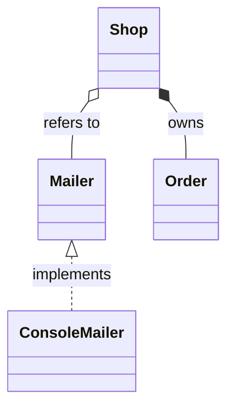
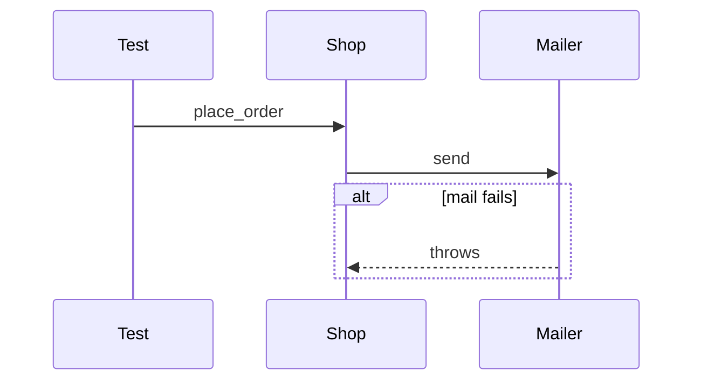
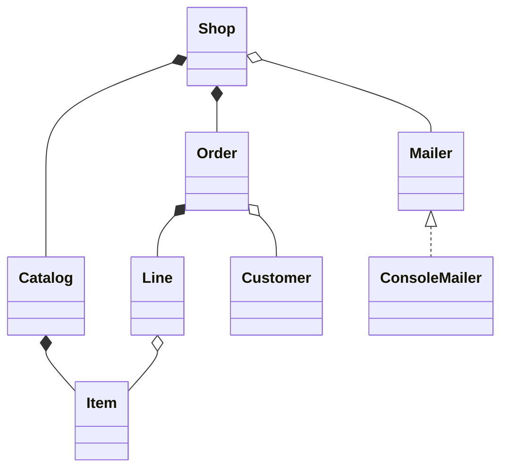
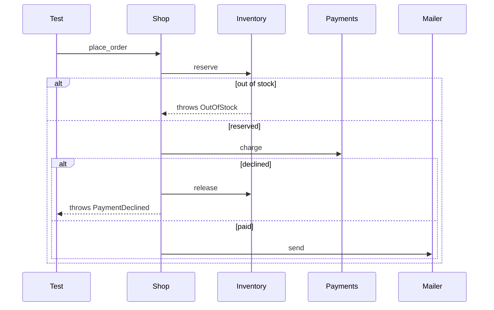

import { Code } from '@astrojs/starlight/components';
import TopicHeader from '../../../../components/TopicHeader.astro';
import WhatYouNeed from '../../../../components/WhatYouNeed.astro';
import ClaimEvidence from '../../../../components/design/ClaimEvidence.astro';
import TradeOffTable from '../../../../components/design/TradeOffTable.astro';
import LabRunner from '../../../../components/design/LabRunner.astro';
import ExperimentResult from '../../../../components/design/ExperimentResult.astro';
import Cards from '../../../../components/Cards.astro';
import Exercises from '../../../../components/design/Exercises.tsx';
import Drill from '../../../../components/Drill.tsx';
import LookalikePairs from '../../../../components/LookalikePairs.astro';
import SelfTest from '../../../../components/SelfTest.astro';
import Checkpoint from '../../../../components/Checkpoint.tsx';
import DecisionMapUpdate from '../../../../components/DecisionMapUpdate.astro';
import shopHpp from '../../../../../code/L0.4/shop-model/shop.hpp?raw';
import shopDiagram from '../../../../../code/L0.4/shop-model/diagram.mmd?raw';
import modelHpp from '../../../../../code/L0.4/place-order-trace/model.hpp?raw';
import orderMmd from '../../../../../code/L0.4/place-order-trace/place-order.mmd?raw';
import checkedFirst from '../../../../../code/L0.4/same-classes-different-order/checked_first.hpp?raw';
import mailedFirst from '../../../../../code/L0.4/same-classes-different-order/mailed_first.hpp?raw';
import m0 from '../../../../../notes/design/L0.4-mistakes/m0_trusting_a_diagram_that_says_owns.cpp?raw';
import m1 from '../../../../../notes/design/L0.4-mistakes/m1_diagram_not_updated_after_a_change.sh?raw';
import m2 from '../../../../../notes/design/L0.4-mistakes/m2_diamond_on_the_wrong_end.sh?raw';
import m3 from '../../../../../notes/design/L0.4-mistakes/m3_diagram_says_refers_but_code_owns.cpp?raw';
import m4 from '../../../../../notes/design/L0.4-mistakes/m4_mailing_before_reserving.cpp?raw';
import m5 from '../../../../../notes/design/L0.4-mistakes/m5_sequence_without_the_error_branch.sh?raw';
import m6 from '../../../../../notes/design/L0.4-mistakes/m6_every_method_in_the_class_diagram.mjs?raw';
import m7 from '../../../../../notes/design/L0.4-mistakes/m7_a_diagram_for_two_classes.mjs?raw';
import m8 from '../../../../../notes/design/L0.4-mistakes/m8_one_class_diagram_for_two_different_shops.sh?raw';

<TopicHeader topic="L0.4" />

## 1. Why this topic exists

Here is a working program (22 non-blank lines). A team lead drew a class diagram of the shop with a filled diamond from `Shop` to `Order`, which means "the shop owns its orders", and a developer who trusted it wrote the cleanup of the program on that basis.

<Code code={m0} lang="cpp" title="m0_trusting_a_diagram_that_says_owns.cpp (a working program with a flaw)" />

It compiles with every warning on, runs, and prints:

```
orders alive after the shop is gone: 2 (the diagram promised 0)
```

and the leak checker then reports `2 byte(s) leaked in 2 allocation(s)`. Nothing was wrong with the code as such. The `Shop` of this program holds raw pointers, so it refers to its orders and never deletes them. The diagram was wrong about the code, and the developer believed the diagram, because it was shorter to read.

A diagram is a claim about the code, and a claim that nobody checks goes out of date. The topic has two parts. The first is to know **which question each of the two common diagrams can answer**: a class diagram answers "what exists and who holds what", and a sequence diagram answers "what happens, in order, in one run". The second is to **draw them so that a program can check them against the code**, so that the diagram of the lead and the code of the developer cannot drift apart without a line of output saying so.

## 2. Prerequisites and scope

### What you need

<WhatYouNeed topic="L0.4" />

### What this topic does not cover

- Other kinds of diagram (state, activity, component, deployment, use case). Only class and sequence diagrams are used by the later topics.
- Tools that generate diagrams from any C++ program. The checker of this topic reads the member forms the course uses and says so when it cannot read one.
- Choosing the classes themselves (L1.2), the principles that say how big a class should be (L0.5), and the patterns whose diagrams are drawn in the pattern phases.
- Diagrams in a drawing tool. Every diagram here is Mermaid text in a file, so it is versioned, reviewed and checked like code.

## 3. Definitions

**Class diagram.** A drawing of the classes of a program and the relationships between them. It shows what exists and what holds what. It does not show what happens, or in which order.

**Relationship arrow.** The line between two classes. In Mermaid, and in this course:

| Written | Name | Means in the code |
|---|---|---|
| `Whole *-- Part` | composition (owned part) | `Part` is a member by value, in a `std::vector`, or behind a `std::unique_ptr` |
| `Whole o-- Part` | aggregation (referred part) | `Part` is behind a pointer, a reference or a `std::shared_ptr`: the whole does not destroy it |
| `Base <\|-- Derived` | inheritance | `Derived` derives from `Base` |
| `Interface <\|.. Impl` | realization | `Impl` derives from an interface (a class with a pure virtual function) |
| `A ..> B` | dependency | `A` uses `B` in a function, without holding it. The checker does not compare it |

The words are those of L0.3. The diamond is always on the side of the whole.

**Sequence diagram.** A drawing of one run of the program: the objects involved, as vertical lines, and the calls between them, as arrows from top to bottom in the order they happen.

**Participant.** One object (or class) in a sequence diagram. **Message.** One call from a participant to another, drawn `A->>B: name`. **Return.** A dashed arrow `B-->>A: text`; it is for the reader and is not compared with the code.

**Branch.** A block `alt condition` … `else condition` … `end` for the cases of a run that differ, `opt` for a step that may be skipped, `loop` for a repeated step. A diagram with a branch describes several runs, one for each way through it.

**Trace.** The list of calls between objects that one run really made, recorded by the code itself, one line per call in the form `Caller->Callee: function`.

**Drift.** The state in which the diagram and the code say different things. A **checker** is a program that reads the diagram and the code (or a trace) and prints one line for each difference.





## 4. Principles and claims

#### Claim L0.4.1: the arrows of a class diagram can be read from the member declarations, and lifetimes confirm them

**Statement.** In the course's style, a member held by value, in a standard container, or by `std::unique_ptr` is an owned part (`*--`), a pointer, a reference or a `std::shared_ptr` is a referred part (`o--`), a base class is inheritance, and a base class with a pure virtual function is realization. Destroying the whole destroys the parts drawn with a filled diamond and no others.

:::tip[In plain words]
The line in the header that declares the member already says who owns it. Drawing the diagram is a matter of reading those lines, and the program can show that the diagram is true by destroying the whole and counting what is left.
:::

**A tiny instance with real numbers.** The shop has 8 classes and 7 relationships (the diagram is 17 lines). The `Shop` holds a `Catalog` by value, a `std::vector<std::unique_ptr<Order>>` and a `Mailer&`. The test builds one catalog item and one order, then lets the shop go out of scope: `live_items` goes from 1 to 0 and `live_orders` from 1 to 0, while `live_customers` stays at 1 and the mailer still has its 1 sent message. The customer is referred to by `Order` (`o--`) and was not the shop's to destroy. `Order` and `Customer` cannot be copied; `Line`, which holds an address and a number, can.

**Reasoning.**
1. A member by value is stored inside the whole and is destroyed with it, as in L0.3, so it is an owned part. A `std::unique_ptr` or a standard container of values destroys what it holds when it is destroyed, so those are owned too.
2. A pointer or a reference has no destructor that touches the object it points to, so the whole does not destroy it: the part is only referred to.
3. A base class is written `class D : public B` and nothing else, so it can be read without running anything.
4. Therefore the list of arrows can be produced by reading members, and the lifetime test (count the live objects after the whole is gone) is an independent check of the same list.

:::note[This claim needs]
1. The members are declared in the style above. A raw owning pointer with a hand-written `delete` looks like a referred part to the reader, and to the checker (this is the mistake of Section 7 that begins the topic).
2. The names of the classes in the diagram are the names in the headers.
:::

<ClaimEvidence claim="L0.4.1" />

**Cost.** A convention (what counts as owned), and a diagram that is only as good as the member style of the code.

#### Claim L0.4.2: a sequence diagram is correct when the recorded calls of each run are a path through it

**Statement.** If the code records every call between objects, then each run of the program is a list of lines `Caller->Callee: function`. A sequence diagram with `alt` blocks allows a set of lists, one for each way through its branches. The diagram is correct for a set of runs when each recorded list is one of the allowed lists, and it is wrong when a recorded list has a call the diagram lacks, has the calls in another order, or when the diagram allows a list with a call that no run makes.

:::tip[In plain words]
The test runs the order three times and writes down every call. The diagram is right if each of the three lists of calls can be read off it from top to bottom, choosing one branch at each `alt`.
:::

**A tiny instance with real numbers.** An order is placed through `Shop`, `Inventory`, `Payments` and `Mailer`, called by the test. Three runs are recorded: a paid order has 4 calls (place_order, reserve, charge, send), an order out of stock has 2 (place_order, reserve), and a declined payment has 4 (place_order, reserve, charge, release). The diagram is 15 lines with two `alt` blocks. Each of the three lists is a path through it. If the declined branch is left out, the declined run has a fourth call, `Shop->Inventory: release`, that the diagram lacks, and the checker reports it.

**Reasoning.**
1. The recorder writes each call at the place the call is made, so the list is the real order and not a description of it.
2. A branch block is a choice between lists. Enumerating the choices gives every list the diagram allows, so "is a path through the diagram" is a finite check.
3. A recorded list equal to one allowed list shows that the diagram contains exactly those calls in exactly that order for that run.
4. A diagram that offers a path no run takes is reported in the same way (it is a promise the code has not been seen to keep).

:::note[This claim needs]
1. A recorder in the code: one line at each call between objects. Calls inside one object are not recorded.
2. A test for each way through the branches that matters. A run that is never recorded is a path nobody has checked, and the checker does not read the words of the condition, so a swapped label goes unnoticed.
:::

<ClaimEvidence claim="L0.4.2" />

**Cost.** One recorder line for each call that is drawn, and one test for each branch.

#### Claim L0.4.3: a diagram that a program compares with the headers cannot disagree with them unnoticed

**Statement.** For the member forms of the course, a checker that reads the headers reports a class that is added to or removed from the code, an arrow whose kind differs from the member that gives it, a relationship drawn that no member gives, and a relationship in the code that is not drawn. For sequence diagrams it reports a call that is missing, extra or out of order.

:::tip[In plain words]
When the header changes and the picture does not, the check prints a line. A picture that is checked is a picture you can trust until the next check.
:::

**A tiny instance with real numbers.** The test of the checker has 15 cases. A diagram that matches 3 classes and 3 relationships gives no line. The other spelling of the same arrows (`Order --* Shop`) gives no line. Changing `std::vector<std::unique_ptr<Order>>` to `std::vector<Order*>` in the header makes the checker say `Shop and Order: the headers say "Shop o-- Order" but the diagram says "Shop *-- Order"`. Adding `Audit` to the code without the diagram gives `class Audit is in the headers but not in the diagram`. In the sequence part, a diagram of 2 calls against a run of 3 gives `call 3`, and the same calls in the wrong order give `call 1`.

**Reasoning.**
1. The checker derives the set of relationships from the headers with the rules of Claim L0.4.1, and the set drawn from the diagram, and compares the two sets.
2. Two sets that differ have an element in one and not the other, and the checker prints that element, so a difference cannot pass without a line of output.
3. The check ends with a nonzero exit code when there is a line, so a build or a kit can fail on it.

:::note[This claim needs]
1. The code is in the style the checker reads. A member it cannot read, such as an owning raw pointer, is read as a referred part (see the first mistake of Section 7). The checker also leaves out classes derived from a `std::` class (exception types), and it compares neither dependencies nor the words of conditions.
:::

<ClaimEvidence claim="L0.4.3" />

**Cost.** A small script (about 170 lines for both diagrams), and a limit on the member forms it understands.

#### Claim L0.4.4: two programs can have the same class diagram and behave differently

**Statement.** The class diagram is made of classes, members and bases. A change to the order of two statements inside a function leaves all of them as they are, so two programs can produce the same class diagram and different behaviour.

:::tip[In plain words]
A shop that checks stock and then mails the customer, and a shop that mails first and checks after, are drawn by the same boxes and lines. Only a picture of the order of calls shows the difference, and the difference matters: one of them confirms orders it cannot fill.
:::

**A tiny instance with real numbers.** `checked_first` and `mailed_first` have the same 3 classes and the same members; the checker's `extract` prints the same 2 lines for both (`Shop o-- Inventory`, `Shop o-- Mailer`). For an order that fits, both leave the inventory at the same level and send 1 mail. For an order of 5 with 1 in stock, both throw, but `checked_first` has sent 0 mails and `mailed_first` has sent 1. The two traces are `reserve, send` and `send, reserve`.

**Reasoning.**
1. The relationships are read from member declarations only (Claim L0.4.1), and the two programs declare the same members.
2. The two functions have the same statements in a different order, so the behaviour differs when the first statement of one can throw.
3. The traces differ, so a sequence diagram of the failing run tells the two apart where the class diagram cannot.

:::note[This claim needs]
1. A real case in which the order matters, here an operation that can fail between two effects. When the order does not matter, the class diagram is enough.
:::

<ClaimEvidence claim="L0.4.4" />

**Cost.** Two diagrams for one design, one for structure and one for each flow that matters.

## 5. Recognition Cards

<Cards topic="L0.4" />

## 6. Reference designs

**The plain way first.** The plain way to know who owns what is to read the headers, and the plain way to know the order of calls is to read the function. For 8 classes that is 94 lines of header, and for the flow of one order 57 lines of model. It is exact, it never goes out of date, and for a reader who needs one answer it is slow. The diagrams are worth drawing when several people need the same answer, and worth keeping when a program checks them.

**The class diagram of the shop.**

<Code code={shopHpp} lang="cpp" title="shop.hpp" />

<Code code={shopDiagram} lang="text" title="diagram.mmd" />



**How it works.** Each line of the diagram is one member. `Shop` holds `Catalog catalog_` (by value), `std::vector<std::unique_ptr<Order>> orders_` (owned) and `Mailer& mailer_` (referred to). `Catalog` owns its items through `unique_ptr`; `Line` and `Order` refer to an `Item` and a `Customer` by pointer. `ConsoleMailer` implements the interface `Mailer`, so its arrow is the dashed realization. `live_customers`, `live_items` and `live_orders` count the objects alive, so the test can destroy a shop and see what went with it. The test that runs the diagram check is the last line of the unit's `test.sh`.

**The sequence diagram of an order.**

<Code code={modelHpp} lang="cpp" title="model.hpp" />

<Code code={orderMmd} lang="text" title="place-order.mmd" />



**How it works.** `call("Shop", "Inventory", "reserve")` puts one line into `trace` just before the call is made. The test runs the shop three times, with a helper that records `Test->Shop: place_order` first, and writes each trace to a file. The unit's `test.sh` then runs the checker on `place-order.mmd` against each of the three files. `Shop::place_order` returns the stock if the payment is declined (`release`), and rethrows. The dashed arrows are returns for the reader.

**The checker.** `code/shared/uml/uml_check.mjs` has four modes: `classes` (a diagram against headers), `sequence` (a diagram against a trace), `owners` (a list of `Part: Owner` lines against headers) and `extract` (prints the relationships found in headers). Its rules are those of Claim L0.4.1. Its output is one line for each difference and the exit code 1, or `ok`.

**Two shops with one class diagram.**

<Code code={checkedFirst} lang="cpp" title="checked_first.hpp" />

<Code code={mailedFirst} lang="cpp" title="mailed_first.hpp (only place_order differs)" />

**How it works.** The two files differ in the two statements of `place_order`. The unit's `test.sh` diffs the output of `extract` for both files and fails if it is different.

#### What each way costs

| Way | What it gives | What it costs |
|---|---|---|
| Read the headers | exact and always current | 94 lines for the shop, repeated by every new reader |
| Class diagram of the structure, checked | 17 lines; ownership and inheritance at a glance; drift is reported | says nothing about order or failure |
| Class diagram with every method | complete on the day it is drawn | 60 lines for 8 classes, stale at the next edit, and the checker does not read it |
| Sequence diagram, checked against runs | order and failure paths, each path a recorded run | a recorder line per call and a test per branch |
| One sentence | 2 classes and 1 relationship in 15 words | stops being enough at about 4 classes or 2 branches |

**C++ details explained** (beyond L0.3):
- `inline std::vector<std::string> trace;` at namespace level: one shared variable, defined in a header without breaking the one-definition rule.
- `struct OutOfStock : std::runtime_error { using std::runtime_error::runtime_error; };`: a new exception type that takes over the constructors of its base, so `OutOfStock("text")` works.
- `try { ... } catch (const PaymentDeclined&) { ...; throw; }`: handle the failure (give the stock back) and then throw the same exception again; the plain `throw;` rethrows the one being handled.
- `std::map<std::string, int>`: keys kept in order, looked up by `find`; `have_[sku] += n` creates the entry with 0 if it is missing.
- `Notifier& mailer_;` as a member: a reference member must be set in the constructor's initializer list and cannot be re-seated; a class that holds one cannot be assigned.
- `virtual void send(...) = 0;`: a pure virtual function; a class that has one cannot be built and is read by the checker as an interface (`<|..`).
- `explicit Order(const Customer& customer)`: forbids an implicit conversion from a `Customer`.
- `std::make_unique<Order>(customer)`: builds an `Order` on the heap and returns the `std::unique_ptr` that owns it.

**Tested.** The units build with `g++ -std=c++23 -Wall -Wextra -Wpedantic -Werror` and the address and undefined-behaviour sanitizers, and the diagram checks use Node (recorded 2026-10-19):

```
bash code/L0.4/shop-model/test.sh code/L0.4/shop-model                           # 4 tests, then the class diagram check
bash code/L0.4/place-order-trace/test.sh code/L0.4/place-order-trace             # 3 tests, then 3 sequence checks
bash code/L0.4/drift-check/test.sh code/L0.4/drift-check                         # 15 cases of the checker
bash code/L0.4/same-classes-different-order/test.sh code/L0.4/same-classes-different-order  # 3 tests, identical class diagrams
```

## 7. Mistake catalogue

The wrong programs and scripts are in `notes/design/L0.4-mistakes/`; `run.sh` builds and runs each one with the course flags (recorded 2026-10-19). The sanitizers are part of the flags.

### Mistake: trusting a diagram that says "owns"

The program of Section 1. Symptom: `orders alive after the shop is gone: 2 (the diagram promised 0)`, then `LeakSanitizer: 2 byte(s) leaked in 2 allocation(s)`, exit code 1. **Fix.** Hold the orders in `std::vector<std::unique_ptr<Order>>` and run the checker, which would have read the raw pointers as `o--` and told the author that the diagram was wrong.

### Mistake: a diagram that nobody updated

<Code code={m1} lang="bash" title="m1_diagram_not_updated_after_a_change.sh" />

Symptom: `class Audit is in the headers but not in the diagram` and `missing from the diagram: Shop *-- Audit`, exit code 1. A member was added to `Shop` and the picture still showed the old shape. **Fix.** Run the class check in the same test run as the code, so that the header cannot change without the check failing.

### Mistake: the diamond on the wrong end

<Code code={m2} lang="bash" title="m2_diamond_on_the_wrong_end.sh" />

Symptom: `Car and Engine: the headers say "Car *-- Engine" but the diagram says "Engine *-- Car"`. Read aloud, the drawing says that the engine owns the car. **Fix.** The diamond is on the side of the owner, the whole. Say the arrow aloud as "owns" before you draw it.

### Mistake: a diagram that says "refers to" for a part the code owns

<Code code={m3} lang="cpp" title="m3_diagram_says_refers_but_code_owns.cpp" />

Symptom: `AddressSanitizer: attempting double-free`, exit code 1. The header holds `std::unique_ptr<Order>`, the diagram said `o--`, and the developer deleted the order "because someone else owns it". The shop deleted it a second time. **Fix.** Read the member declaration before deleting anything, and keep the checked diagram.

### Mistake: the class diagram cannot show the order of calls

<Code code={m4} lang="cpp" title="m4_mailing_before_reserving.cpp" />

Symptom: `order refused: out of stock`, then `confirmations sent: 1`. The shop mailed a confirmation for an order it then refused. **Fix.** Draw the sequence of the failing run: `Shop->Mailer: send` before `Shop->Inventory: reserve` is visible at once (Claim L0.4.4).

<Code code={m8} lang="bash" title="m8_one_class_diagram_for_two_different_shops.sh" />

It prints the same two relationship lines for both shops and then `=> identical class diagrams`.

### Mistake: a sequence diagram that leaves out the failure branch

<Code code={m5} lang="bash" title="m5_sequence_without_the_error_branch.sh" />

Symptom: the run of the declined payment has 4 calls, and the checker says `call 4 of the run is "Shop->Inventory: release" but the diagram shows "Shop->Mailer: send"`, exit code 1. The happy-path diagram shows a mail for an order that was declined. **Fix.** One `alt` block for each failure whose cleanup matters (the unit of Claim L0.4.2).

### Mistake: every method in the class diagram (over-engineered)

<Code code={m6} lang="js" title="m6_every_method_in_the_class_diagram.mjs" />

It prints `classes: 8`, `structure only (arrows between classes): 17 lines`, `with every method and member listed: 60 lines (30 methods, 13 members)` and `the header itself: 94 lines`. A diagram of 60 lines is two thirds of the header it summarises, the checker does not read the methods, and it goes out of date at the next edit. **Fix.** Draw the structure and let the reader open the header for a signature.

### Mistake: a diagram for two classes (over-engineered)

<Code code={m7} lang="js" title="m7_a_diagram_for_two_classes.mjs" />

It prints `header: 24 lines`, `diagram: 2 lines, and it still needs the sentence to say what the diamond means` and `sentence: 15 words, and it says everything the diagram says`. **Fix.** For two classes and one relationship, write the sentence.

## 8. Worked examples

### Example 1: Who owns the orders in the shop

A shop has a catalog of items, a list of orders and a mailer that is shared with other parts of the program. A new developer asks which of them the shop owns, which it only refers to, and what happens to each when the shop is destroyed. Decide how to answer.

#### Step 1: Numbers

8 classes, 94 lines of header, 7 relationships. The question must be answered in about 5 minutes, and the answer must still be true next month.

#### Step 2: Wording → candidate structures

Candidates: (a) point at the header and let the developer read; (b) a class diagram of the structure; (c) a class diagram with every method; (d) a sequence diagram of an order.

#### Step 3: Property check → decision

The card for class diagrams needs "a question about structure that the member declarations answer". Ownership is exactly that, so (b) fits. (d) fails the property: a sequence of calls says nothing about who deletes the orders. (c) is 60 lines against 17 and the checker does not read the extra lines. (a) works for one reader and is repeated for each. Decision: (b), checked against the header.

#### Step 4: Design

The diagram of Section 6, written by reading the members: `Shop *-- Catalog`, `Shop *-- Order`, `Shop o-- Mailer`, and so on. The answer to the question: the shop owns the catalog (and through it the items) and the orders; it only refers to the mailer; and an order refers to its customer without owning it.

#### Step 5: Code or calculation

The unit's test destroys a shop that holds 1 item and 1 order, and counts: items 1 → 0, orders 1 → 0, customers still 1, mailer still holding its 1 message. Then the checker compares the diagram with `shop.hpp` and prints `ok`.

#### Step 6: Decision record

Decision: a structure-only class diagram, checked in the test run. Not chosen: reading the header each time (94 lines repeated), and a diagram with every method (60 lines and stale after the next edit). Cost: one checked file of 17 lines. Revisit if the shop grows past about 12 classes (the diagram then needs splitting into one per group of classes).

### Example 2: What happens when the card is declined

An order reserves stock, charges the card and mails a confirmation. When the card is declined, the stock must be given back and no mail sent. A new developer must be shown what happens, in order, in each case. Decide how to show it.

#### Step 1: Numbers

4 objects, 3 runs (paid, out of stock, declined) with 4, 2 and 4 calls, and 2 failure paths. 57 lines of model code.

#### Step 2: Wording → candidate structures

Candidates: (a) a class diagram; (b) a paragraph; (c) a sequence diagram with branches, checked against recorded runs.

#### Step 3: Property check → decision

The card for sequence diagrams needs "a question about one run, with the order of the calls and the failure paths, and calls that a test can record". All three hold. (a) has the same lines for a shop that mails before it reserves (Claim L0.4.4). (b) cannot be checked against the code. Decision: (c).

#### Step 4: Design

`Test->>Shop: place_order`, then `Shop->>Inventory: reserve`; an `alt` for out of stock; in the other branch `Shop->>Payments: charge` and a second `alt` for a declined payment, whose branch has `Shop->>Inventory: release`, and for a paid order `Shop->>Mailer: send`.

#### Step 5: Code or calculation

The test records the three traces. The paid trace is `place_order, reserve, charge, send`; out of stock is `place_order, reserve`; declined is `place_order, reserve, charge, release`. All three are paths of the diagram and the checker prints `ok` for each. If the `release` call is deleted from the code, the declined trace has 3 calls, the diagram allows 4, and the checker says `the diagram has 1 more call(s) than the run`.

#### Step 6: Decision record

Decision: one sequence diagram with two `alt` blocks, checked against three recorded runs. Not chosen: a class diagram (it does not change when the order of the calls does) and prose (not checked). Cost: a recorder line at each of the 5 calls and one test per branch. Rule to keep: the checker does not read the words of a condition, so name the runs in the test, not only in the diagram. Revisit if a retry loop is added (a `loop` block).

## 9. Exercise ladder

<Exercises topic="L0.4" client:load />

## 10. Recognition drill

<Drill topic="L0.4" client:load />

## 11. Look-alike pairs

<LookalikePairs topic="L0.4" />

## 12. Self-test questions

<SelfTest topic="L0.4" />

## 13. Checkpoint

<Checkpoint topic="L0.4" client:load />

## 14. Decision map update

<DecisionMapUpdate topic="L0.4" />
