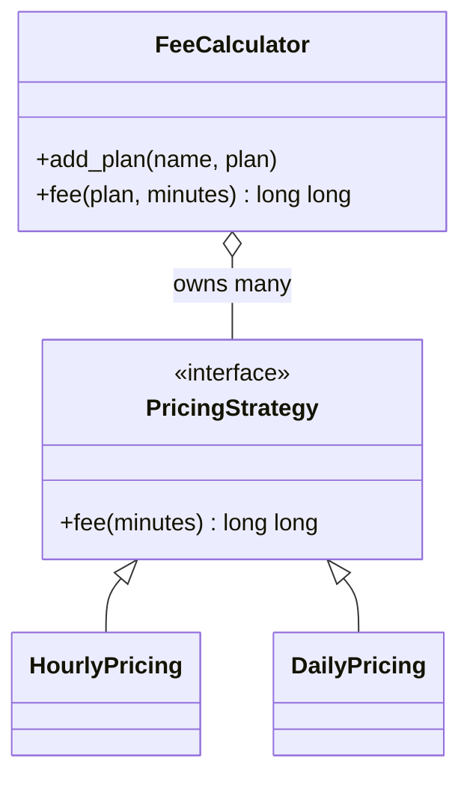
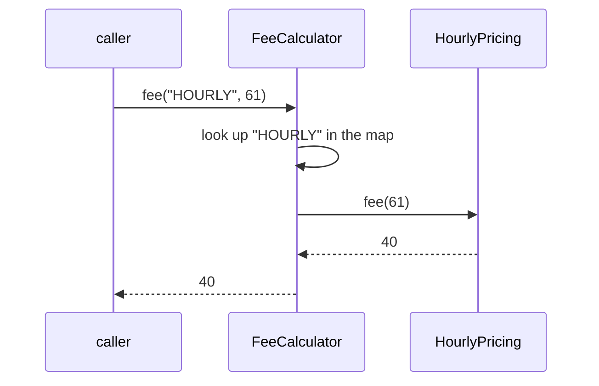
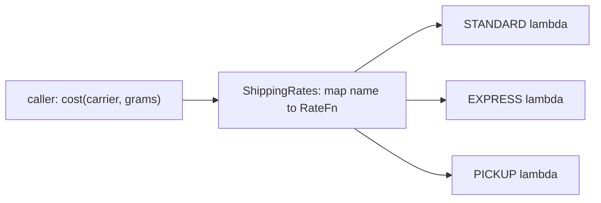

import { Code } from '@astrojs/starlight/components';
import TopicHeader from '../../../../components/TopicHeader.astro';
import WhatYouNeed from '../../../../components/WhatYouNeed.astro';
import ClaimEvidence from '../../../../components/design/ClaimEvidence.astro';
import TradeOffTable from '../../../../components/design/TradeOffTable.astro';
import LabRunner from '../../../../components/design/LabRunner.astro';
import ExperimentResult from '../../../../components/design/ExperimentResult.astro';
import Cards from '../../../../components/Cards.astro';
import Exercises from '../../../../components/design/Exercises.tsx';
import Drill from '../../../../components/Drill.tsx';
import LookalikePairs from '../../../../components/LookalikePairs.astro';
import SelfTest from '../../../../components/SelfTest.astro';
import Checkpoint from '../../../../components/Checkpoint.tsx';
import DecisionMapUpdate from '../../../../components/DecisionMapUpdate.astro';
import naiveFee from '../../../../../code/L2.1/strategy-fee/naive/base/fee_calculator.hpp?raw';
import patchNaiveFree30 from '../../../../../code/L2.1/strategy-fee/naive/scenarios/02-free30.patch?raw';
import pricingStrategy from '../../../../../code/L2.1/strategy-fee/patterned/base/pricing_strategy.hpp?raw';
import hourlyPricing from '../../../../../code/L2.1/strategy-fee/patterned/base/hourly_pricing.hpp?raw';
import dailyPricing from '../../../../../code/L2.1/strategy-fee/patterned/base/daily_pricing.hpp?raw';
import feeCalculator from '../../../../../code/L2.1/strategy-fee/patterned/base/fee_calculator.hpp?raw';
import makeCalculator from '../../../../../code/L2.1/strategy-fee/patterned/base/make_calculator.hpp?raw';
import patchWeekend from '../../../../../code/L2.1/strategy-fee/patterned/scenarios/01-weekend.patch?raw';
import patchFree30 from '../../../../../code/L2.1/strategy-fee/patterned/scenarios/02-free30.patch?raw';
import patchTruck from '../../../../../code/L2.1/strategy-fee/patterned/scenarios/03-truck.patch?raw';
import feeBook from '../../../../../code/L2.1/function-plan/fee_book.hpp?raw';
import shipping from '../../../../../code/L2.1/ex-1-shipping/shipping.hpp?raw';
import tax from '../../../../../code/L2.1/ex-2-tax/tax.hpp?raw';

<TopicHeader topic="L2.1" />

## 1. Why this topic exists

Here is a working C++ program. It prices a parking stay by plan: the hourly plan charges 20 for each hour that has been started, the daily plan charges 100 for each day that has been started.

<Code code={naiveFee} lang="cpp" title="fee_calculator.hpp (plain design, 13 lines)" />

With its test file and a short `main.cpp` demo it is 47 non-blank lines in 3 files. For two plans it is hard to beat. Now the requests arrive, one at a time. The measured edits to this program, from the script `change_cost.sh`, are:

1. **Add a weekend plan** at double the hourly rate: 3 files edited, 8 lines added.
2. **The first 30 minutes of the hourly plan are free.** The change is one line, but that line sits in the function `fee`, which also holds the daily and the weekend plan. Here is the whole edit, as the tool saw it, tests included:

<Code code={patchNaiveFree30} lang="diff" title="02-free30.patch (plain design)" />

3. **Trucks pay more.** The signature of `fee` gains a vehicle, and every plan line is edited.

A term used here: the **blast radius** of a change is the number of *other* existing behaviours whose code sits in the same function or class body as any edited line. For request 2 it is 2: the daily plan and the weekend plan share the function `fee` with the hourly plan that was edited. Nothing is wrong yet. But each future change to one plan is made in a function that holds every other plan, so each change is a chance to break a plan nobody meant to touch.

<TradeOffTable unit="L2.1/strategy-fee" />

The key idea of this topic: **put each way of doing the thing in its own class, all behind one shared function signature, so a change to one way cannot touch the code of another.** That structure is called Strategy. It is not free. The table above shows the plain design at its best (small), and the rest of this page shows what Strategy costs, measured, so you can tell when the price is worth paying and when it is not.

## 2. Prerequisites and scope

### What you need
<WhatYouNeed topic="L2.1" />

This topic builds on three earlier topics that are not written yet, so their links show as "coming soon". Until they exist, the page defines in a line or two each idea it borrows from them: what a blast radius is (above), what an interface is (Section 3), and why one class should have one reason to change (Section 4).

### What this topic does not cover
- Template Method, which also varies behaviour but by inheritance, fixing the variant when the object is created (L2.2).
- State, where the variant changes by itself as the object moves through its life (L2.3).
- Command with undo and redo (L2.4), Observer and event models (L2.5), and the creational patterns, including Factory Method and the registries that replace a long conditional when choosing which class to create (L3.1).
- Threads and locks: every example here is single-threaded.

## 3. Definitions

**Variant.** One of several ways to do the same job: the hourly plan, the daily plan and the weekend plan are three variants of "work out the parking fee".

**Shared signature.** The one function header that every variant fits, so that code can call any of them without knowing which one it has. For plans it is "minutes in, fee out".

**Interface (abstract class).** A C++ class whose functions have no body of their own and exist only to be filled in by other classes. Here is the shared signature of the parking plans as an interface:

```cpp
class PricingStrategy {
public:
    virtual ~PricingStrategy() = default;
    virtual long long fee(long long minutes) const = 0;   // "= 0": no body here; every plan must supply one
};
```

**Strategy.** A structure with three parts: an interface for the shared signature, one class per variant that implements it, and the code that uses the variants but sees only the interface. The variant to use is chosen by whoever sets the program up, not by `if` statements inside the code that uses it.

**Wiring.** The one small piece of code that creates the variant objects and hands them over. It is the only place that names every variant. In this page it is the function `make_calculator`.

**Callable.** Anything that can be called with parentheses, like `f(3)`: a function, a lambda (a function written inline) or an object whose class defines `operator()`. `std::function<long long(long long)>` is a standard-library type that can hold any callable taking and returning a `long long`. It gives Strategy without writing a class per variant:

```cpp
std::function<long long(long long)> plan = [](long long m) { return (m + 59) / 60 * 20; };
long long f = plan(61);   // 40
```

**Change cost.** The files and lines edited to satisfy a change request, counted by the tool `change_cost.sh` in this repository, never by hand.

## 4. Principles and claims

Each claim below is numbered, says what it needs before it holds, and points to the code or measurement that backs it. Each claim names its price.

#### Claim L2.1.1: variants are isolated, and isolation costs files and lines

**Statement.** When each variant of a behaviour is its own class behind one shared signature, adding a variant or changing one variant touches no other variant's code, and the total edit is **larger** in lines than the same change in a single function that holds all variants; a change to the shared signature touches every variant class and costs the most.

:::tip[In plain words]
A new plan is a new class and one wiring line. Changing one plan means opening only that plan's class. But the whole thing needs more files and more lines than a function with an `if` per plan, and when every plan needs a new input, the many small classes all have to be edited.
:::

**A tiny instance with real numbers.** Add a weekend plan to the parking program. Plain design: 8 lines edited in 3 files, and the weekend line goes into the function that holds the hourly and daily plans (2 other plans share it). Strategy design: 16 lines (9 edited in 3 files, 7 in 1 new file), and the 2 other plans are not touched.

**Reasoning.**
1. Two programs in different areas were written twice: parking fees and message channels (email, SMS, push).
2. In each, the plain design is one class with an `if` per variant; the Strategy design is one interface, one class per variant, a map from name to variant, and a wiring function.
3. The same three change requests were applied to both designs in order: add a variant, change one variant, change what every variant is given.
4. The tests were extended with each request and passed after every step on both designs. Without that, the numbers would compare nothing.
5. `change_cost.sh` counted files and lines for every step, tests and `main.cpp` included, so both designs are counted the same way.
6. The blast radius of each step was counted by the rule in Section 1 and recorded in the unit's `unit.yaml`.

:::note[This claim needs]
1. The variants really have one shared signature at the start (both programs do).
2. The measured requests are the ones listed in the tables; other requests can give other numbers.
3. Only two programs were measured, so the numbers are examples of a shape, not a law of nature.
:::

<TradeOffTable unit="L2.1/strategy-fee" />
<TradeOffTable unit="L2.1/strategy-notify" />

What the tables show, in both programs:
- **Overhead.** Parking: 7 files and 86 lines against 3 files and 47 lines (+4 files, +39 lines). Channels: 7 files and 86 lines against 3 files and 40 lines (+4 files, +46 lines).
- **Adding a variant.** Parking: 16 lines against 8. Channels: 19 against 8. Strategy costs two to two and a half times the lines.
- **Changing one variant.** Parking: 15 lines against 15. Channels: 6 against 6. Equal, as long as the change stays inside one variant.
- **Blast radius of adding or changing a variant.** 0 against 2 in both programs. This is what Strategy buys.
- **Changing the shared signature.** Parking: 55 lines in 7 files against 46 lines in 3 files. Channels: 47 lines in 7 files against 38 lines in 3 files. Strategy is clearly worse here, and the blast radius is no better (1 against 1 for parking, 0 against 0 for channels, because every variant changes anyway).

<ClaimEvidence claim="L2.1.1" />

**Cost.** Strategy never needed fewer lines in these measurements. You pay 4 more files and 39 to 46 more lines up front, and you pay again whenever the shared signature changes.

#### Claim L2.1.2: callers that use only the shared signature never change when a variant is added

**Statement.** If the calling code is written only against the interface, then adding a new class that implements the interface requires **no edit** to the calling code.

:::tip[In plain words]
The caller never writes the name of any variant, so a new variant cannot make the caller stop compiling or behave differently.
:::

**A tiny instance with real numbers.** A function `total_area` adds up the areas of a list of shapes. A square of side 2 (area 4) and a rectangle 2 by 3 (area 6) give 10. A triangle added later in the test, with base 4 and height 3 (area 6), is added to a square of side 1 (area 1) and gives 7. The function `total_area` is the same text throughout.

**Reasoning.**
1. `total_area` takes `std::vector<std::unique_ptr<Shape>>` and calls `s->area()` on each element. `Shape` is the interface.
2. A function call through a base-class pointer goes to the function of the object's real class (a virtual call, explained in Section 6).
3. A new class that derives from `Shape` and defines `area()` can therefore be stored in the vector and summed without `total_area` knowing its name.
4. The compiler checks only what `total_area` mentions: `Shape` and `area`. The new class changes neither.
5. The tests in the unit demonstrate it, including a `Triangle` defined inside a test, after `total_area.hpp` was written.

:::note[This claim needs]
1. The caller depends on the interface only: no variant names, no `dynamic_cast`, no `if` on a kind code.
2. The interface already has a virtual destructor, so objects can be deleted through the base pointer.
3. The new variant fits the existing signature. A variant needing a new input is a change to the interface, which is the case of Claim L2.1.1.
:::

<ClaimEvidence claim="L2.1.2" />

**Cost.** The caller must be written against the interface from the start, which is more indirection to read (one more hop to find the code that runs) and one virtual call per use.

#### Claim L2.1.3: a std::function holds any callable with the shared signature

**Statement.** A `std::function<long long(long long)>` can hold a lambda, a plain function, or an object with `operator()`, and calling it behaves the same for all three.

:::tip[In plain words]
When each variant is one short expression, you can store the expressions themselves in a map and skip writing a class for each.
:::

**A tiny instance with real numbers.** Store `[](long long m){ return (m+59)/60*20; }` under the name HOURLY: calling it with 61 gives 40. Store the plain function `flat_ten` under FLAT: any input gives 10. Store an object `PerHour{40}` under WEEKEND: 61 minutes gives 80.

**Reasoning.**
1. `std::function<R(Args)>` is a standard-library type that stores a copy of any callable that can be called with those arguments and returns something convertible to `R`.
2. Calling the stored function calls the stored callable. A lambda that copies its settings keeps its own copy: the test changes the original variable after storing and the stored plan does not change.
3. The wiring is a map from name to `std::function`, and the caller calls the stored function with the shared arguments.
4. An empty `std::function` throws `std::bad_function_call` when called, so the code that stores plans rejects an empty one when it is added.

:::note[This claim needs]
1. The variants share one call signature.
2. Each lambda copies the settings it uses, or the object it refers to outlives every call (Section 7 shows what happens otherwise).
3. Each variant is small enough that a class would be longer than the logic.
:::

<ClaimEvidence claim="L2.1.3" />

**Cost.** A `std::function` has no name, no description and no place to hang a second function or a test of its own, and a call through it goes through one extra jump. When a variant grows past an expression, it should become a class.

## 5. Recognition Cards

<Cards topic="L2.1" />

## 6. Reference designs

#### The plain design, then the Strategy design

The plain design is the 13-line class in Section 1. The Strategy design for the same two plans has five files. First the interface, the shared signature:

<Code code={pricingStrategy} lang="cpp" title="pricing_strategy.hpp" />

One plan per class, each a few lines:

<Code code={hourlyPricing} lang="cpp" title="hourly_pricing.hpp" />
<Code code={dailyPricing} lang="cpp" title="daily_pricing.hpp" />

The code that uses the plans, which sees only the interface:

<Code code={feeCalculator} lang="cpp" title="fee_calculator.hpp" />

And the wiring, the one place that names every plan:

<Code code={makeCalculator} lang="cpp" title="make_calculator.hpp" />





**How it works.** `main` asks the `FeeCalculator` for the fee of a named plan. The calculator finds the plan object in its map and calls `fee` on it through the interface. Which class's `fee` runs depends on which object is in the map. `make_calculator` is the only function that creates plan objects, so it is the only place edited to add one.

#### C++ details explained
- **`#pragma once`.** The first line of every header: if the compiler meets this file a second time in one build, it skips it.
- **`virtual long long fee(long long minutes) const = 0;`.** `virtual` means "the version that runs is chosen by the real class of the object, at run time". `= 0` means "this class has no body for it", which makes the class abstract: you cannot create an object of it, only of a class that fills the function in. `const` after the parameter list means the function does not change the object, so it can be called through a `const` reference.
- **`virtual ~PricingStrategy() = default;`.** A destructor is the function that cleans up an object. It must be `virtual` so that deleting a plan through a `PricingStrategy` pointer runs the destructor of the real class; without it the cleanup is wrong (Section 7, first mistake). `= default` means "do the usual cleanup, nothing special".
- **`class HourlyPricing final : public PricingStrategy`.** `: public PricingStrategy` says "this is a kind of PricingStrategy and fills in its functions". `final` says "nobody may derive from this class", which fits a leaf class and lets the compiler skip the run-time lookup in some places.
- **`override`.** Written after a function that replaces a base function. The compiler checks that a base function with that exact signature really exists, so a typo in the name or a missing `const` is an error, not a new unrelated function.
- **`std::unique_ptr<PricingStrategy>`.** A pointer that owns the object it points to and deletes it when the pointer itself goes away. Only one `unique_ptr` can own an object, so it cannot be copied, only moved. The map owns the plans, so plans are cleaned up when the calculator is.
- **`std::make_unique<HourlyPricing>()`.** Creates an `HourlyPricing` on the heap and returns the `unique_ptr` that owns it. This is how objects are created in this course instead of writing `new`.
- **`std::move(plan)`.** Hands the ownership inside a `unique_ptr` to another place. After the move the old variable is empty. It does not copy anything.
- **`std::map<std::string, std::unique_ptr<PricingStrategy>>`.** A sorted table from plan name to plan object. `find(name)` returns an iterator, an object that points at one entry or equals `end()` when the name is missing.
- **`inline` on a function in a header.** Tells the compiler that the function may be defined in several `.cpp` files that include the header, as long as all copies are identical. Without it the linker would complain about duplicates.
- **`const std::string&`.** A reference to a string that the function promises not to change. It avoids copying the string.

#### The same idea with std::function

When each plan is one expression, a class per plan is longer than the plan. This is the same shape with `std::function`:

<Code code={feeBook} lang="cpp" title="fee_book.hpp" />

**C++ details explained.**
- **`using FeeFn = std::function<long long(long long)>;`.** Gives a short name to a long type. `long long(long long)` reads "a function taking a `long long` and returning a `long long`".
- **A lambda** like `[](long long m) { return (m + 59) / 60 * 20; }` is a function written where it is used. The square brackets are the capture list: what the lambda copies or refers to from the surrounding code. Empty brackets mean "nothing".
- **Capturing by copy: `[rate]`.** The lambda keeps its own copy of `rate`. **By reference: `[&rate]`** refers to the original variable, which must still exist when the lambda is called (Section 7).
- **`if (!plan) throw …`.** A `std::function` is empty if nothing was stored in it; `!plan` is true then. Calling an empty one throws `std::bad_function_call`.

#### Which form to choose
| | Class per variant | `std::function` per variant |
|---|---|---|
| Best when | a variant has a name, several functions, state worth naming, or its own tests | each variant is one short expression |
| Extra files per variant | 1 header (about 7 lines) | 0, one wiring line |
| Can you list or describe a variant? | yes, it is a class | no, it is only a callable |

**Tested.** `bash scripts/test_design.sh code/L2.1` builds every unit with `g++ -std=c++23 -Wall -Wextra -Wpedantic -Werror` and the address and undefined-behaviour sanitizers, and runs the tests, the measured scenarios and the demos. All pass.

For the other two shared-signature scenarios, the exact edits (generated with `git diff`, never by hand) for the Strategy design are below. The first adds a plan, the second changes one plan, the third changes the signature:

<Code code={patchWeekend} lang="diff" title="01-weekend.patch (Strategy design)" />
<Code code={patchFree30} lang="diff" title="02-free30.patch (Strategy design)" />
<Code code={patchTruck} lang="diff" title="03-truck.patch (Strategy design)" />

Compare the third patch with the plain design's: the signature change reaches every class.

## 7. Mistake catalogue

Each wrong program below is in `notes/design/L2.1-mistakes/`; `bash notes/design/L2.1-mistakes/run.sh` builds and runs them with the course flags. The output quoted is real.

### Mistake: the base class has no virtual destructor
```cpp
class PricingStrategy {            // the destructor is not virtual
public:
    virtual long long fee(long long minutes) const = 0;
};
// ... a derived class that owns a std::string, stored in std::unique_ptr<PricingStrategy> ...
```
**Symptom.** The address sanitizer stops the program:
```
ERROR: AddressSanitizer: new-delete-type-mismatch
  object passed to delete has wrong type:
  size of the allocated type:   40 bytes;
  size of the deallocated type: 8 bytes.
```
**Fix.** Declare `virtual ~PricingStrategy() = default;` in the interface. Deleting through a base pointer then runs the derived destructor, and the 40 bytes are released as 40 bytes.

### Mistake: the caller asks which class it was given
```cpp
long long bill(const PricingStrategy& plan, long long minutes) {
    if (dynamic_cast<const HourlyPricing*>(&plan)) return plan.fee(minutes);
    if (dynamic_cast<const WeekendPricing*>(&plan)) return plan.fee(minutes);
    return -1;   // a plan added later falls through here
}
```
**Symptom.** A `DailyPricing` added later gets `-1` instead of its fee; the demo program exits with status 1. This breaks Claim L2.1.2: the caller names variants, so every new variant means editing the caller too, and you have all the cost of Strategy with none of the isolation.
**Fix.** Call `plan.fee(minutes)` and nothing else. If the caller seems to need to know the kind, the signature is missing an input; change the interface (Claim L2.1.1 says what that costs) instead of peeking at the class.

### Mistake: a lambda captures a local variable by reference
```cpp
FeeFn make_hourly(long long rate) {
    return [&rate](long long minutes) { return (minutes + 59) / 60 * rate; };   // rate dies when make_hourly returns
}
```
**Symptom.**
```
ERROR: AddressSanitizer: stack-use-after-return
READ of size 8 ... in operator() ... m3_dangling_lambda_capture.cpp:7
```
**Fix.** Capture by copy: `[rate]`. The stored lambda then owns its own copy and outlives the function that made it.

### Mistake: the user of a plan stores a raw pointer to an object it does not own
```cpp
class FeeCalculator {
public:
    explicit FeeCalculator(const PricingStrategy* plan) : plan_(plan) {}   // stores a pointer it does not own
    ...
};
FeeCalculator make() { HourlyPricing plan; return FeeCalculator(&plan); }   // plan is destroyed on return
```
**Symptom.** `ERROR: AddressSanitizer: stack-use-after-return` when `calc.fee(60)` runs.
**Fix.** Give the calculator ownership with `std::unique_ptr<PricingStrategy>`, as the reference design does, so the plan lives as long as the calculator.

### Mistake: an empty std::function is called
```cpp
std::map<std::string, FeeFn> plans;
plans["HOURLY"] = [](long long m) { return (m + 59) / 60 * 20; };
plans["WEEKEND"](60);   // operator[] quietly inserted an empty std::function for the missing key
```
**Symptom.**
```
terminate called after throwing an instance of 'std::bad_function_call'
  what():  bad_function_call
```
**Fix.** Look the name up with `find`, as the reference design does, and report an unknown plan with a clear error. Reject an empty `std::function` when it is added.

### Mistake: a signature that tries to fit every variant by carrying everything
```cpp
struct Context { long long minutes; bool is_truck; bool is_member; int hour_of_day; std::string promo_code; };
class PricingStrategy { public: virtual long long fee(const Context&) const = 0; ... };
// HourlyPricing::fee reads one field and ignores four.
```
**Symptom.** It compiles and the tests pass: the program exits with status 0. The problem shows later: every variant receives data it never uses, every new input means editing `Context` and re-reading every variant, and nobody can tell from a plan's signature what it depends on. It is the stable-signature condition of the card failing quietly.
**Fix.** Keep the signature to what *all* variants need. If one variant needs extra data, pass it through that variant's constructor (ladder rung 4) instead of widening the shared signature.

### Mistake (the over-engineered version): Strategy for two plans that never change
This is the whole Strategy design of Section 6 applied to hourly and daily plans that regulation fixes for the life of the product.
**Symptom.** It works and passes its tests. The cost is in the table of Claim L2.1.1: 4 more files and 39 more non-blank lines than the 13-line class, protecting two plans that nobody will edit.
**Fix.** Write the plain function. Come back to Strategy when the third plan or the first real change request arrives.

## 8. Worked examples

### Example 1: Shipping rates for three carriers, more coming

#### Step 1: Numbers
A shop ships with STANDARD (500 cents plus 100 for each started kilogram), EXPRESS (1200 plus 200 per started kilogram) and PICKUP (free). Two more carriers are expected this year. Each rate is a single arithmetic expression of the weight in grams. Expected edits to shipping rates: at least 3 this year. Weights of 1 gram to 30 000 grams.

#### Step 2: Wording → candidate structures
- **The simplest thing that could work:** one function with an `if` per carrier. With 3 carriers it is 5 lines.
- **Strategy with a class per carrier:** an interface `Rate` and 3 classes of about 7 lines each.
- **Strategy with `std::function`:** a map from carrier name to a lambda, one wiring line per carrier.

#### Step 3: Property check → decision
Write the shared signature: `long long cost(long long grams)`. All three carriers fit it, and nothing planned adds an input, so the property holds. The simplest option's blast radius would be 2 other carriers per edit, and 3 or more edits are expected. Each carrier is one expression with no name to show and no state, so a class per carrier would be longer than the logic. Decision: Strategy with `std::function`.

#### Step 4: Design


#### Step 5: Code or calculation
<Code code={shipping} lang="cpp" title="shipping.hpp (tested in code/L2.1/ex-1-shipping)" />

Check by hand: STANDARD with 1001 grams: 2 started kilograms, 500 + 2 × 100 = 700. The test asserts 700. EXPRESS with 2500 grams: 3 started kilograms, 1200 + 3 × 200 = 1800. The test asserts 1800. A new SAMEDAY carrier is one `add` line, and the test adds one and checks that STANDARD is unchanged.

#### Step 6: Decision record
- **Decision.** A map of name to `std::function`, with the wiring in `make_rates`.
- **Why.** Every carrier fits `cost(grams)`, more are expected, each is one expression.
- **Rejected.** A class per carrier: longer than the logic. A function with an `if` per carrier: each edit would sit next to every other carrier.
- **Revisit when.** A carrier needs a name to show, a validity check, or its own tests. Then promote it to a class implementing the same signature.

### Example 2: Two tax rules that are fixed by law

#### Step 1: Numbers
Food is taxed at 5 per cent, everything else at 20 per cent, in cents, rounded half up. The law has not changed these rates in the product's lifetime and no change is expected. Expected edits per year: 0.

#### Step 2: Wording → candidate structures
- **The simplest thing that could work:** one function with a conditional on a flag.
- **Strategy with a class per rate:** an interface, two classes, a wiring function.

#### Step 3: Property check → decision
The signature check passes: both rules fit `tax(amount)`. The force is missing, though: no variant is expected to be added or changed, so there is nothing for isolation to protect. From Section 4, the price of Strategy for two plans was 4 more files and 39 or more lines. Decision: the plain function.

#### Step 4: Design
One function, one flag, one expression.

#### Step 5: Code or calculation
<Code code={tax} lang="cpp" title="tax.hpp (tested in code/L2.1/ex-2-tax)" />

Check by hand: 1000 cents of food: 1000 × 5 = 5000, plus 50, divided by 100 is 50. The test asserts 50. 10 cents of food: 10 × 5 = 50, plus 50, divided by 100 is 1: half a cent rounds up. The test asserts 1.

#### Step 6: Decision record
- **Decision.** A plain function with a conditional.
- **Why.** Two fixed rules, no expected change. Strategy would add files and lines to protect nothing.
- **Rejected.** Strategy: costs 4 files and about 39 lines for no benefit.
- **Revisit when.** A third rule is announced, or the rates start changing. Then the conversion is small, because the function is 4 lines.

## 9. Exercise ladder

<Exercises topic="L2.1" client:load />

## 10. Recognition drill

<Drill topic="L2.1" client:load />

## 11. Look-alike pairs

<LookalikePairs topic="L2.1" />

## 12. Self-test questions

<SelfTest topic="L2.1" />

## 13. Checkpoint

<Checkpoint topic="L2.1" client:load />

## 14. Decision map update

<DecisionMapUpdate topic="L2.1" />
