import TopicHeader from '../../../components/TopicHeader.astro';
import Ladder from '../../../components/Ladder.astro';

<TopicHeader topic="0.1" />

## What this note covers

Debugging in CP (competitive programming) → verdicts (CE, RTE, TLE, WA, MLE), kya kya cause hota hai har ek ka, aur test cases kaise banane hain jisse bug pakda jaye: extreme values, code coverage, common themes, stress testing. Uske saath tools: assert, sanitizers, debug macro.

- Debugging: the 4 things
- Verdicts
- CE
- MLE
- TLE
- RTE
- WA
- Test cases
- i) Extreme values
- ii) Code coverage
- iii) Common themes
- iv) Stress testing
- Finding the bug fast (binary search, assert, sanitizers, debug macro)
- Quick revision
- Practice problems

## Debugging: the 4 things

→ Debugging:

i) Process → need to have a process to debug. [Learn]

ii) Time → check for time left in the contest. [exp]

iii) Language → be better at the programming language. [Learn]

iv) Thinking of good testcases [where the problem fails] [Practice]

Process matlab random changes nahi karne. Ek loop follow karo, aur ek baar mein sirf ek cheez change karo.

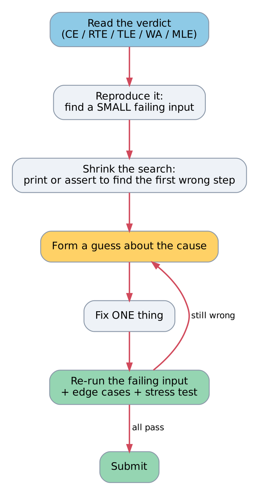

*Debugging loop. One change at a time.*

## Verdicts

After submitting we get a verdict.

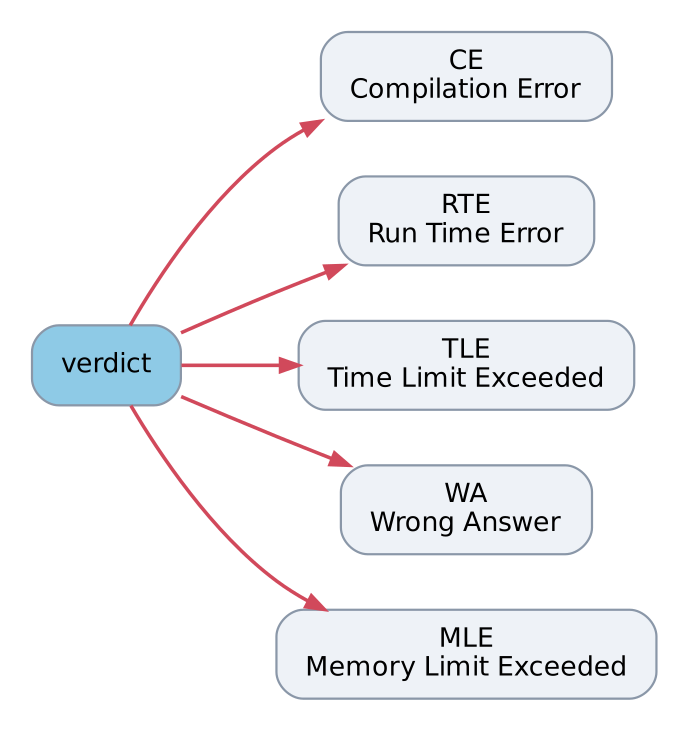

*5 bad verdicts.*

CE = Compilation Error, RTE = Run Time Error, TLE = Time Limit Exceeded, WA = Wrong Answer, MLE = Memory Limit Exceeded.

A test case can come from two places: by yourself, or the computer.

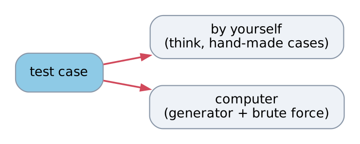

*Test case: by yourself / computer.*

## CE

CE (Compilation Error) : easiest to solve.
Some syntax error.

Dekho, pehla error message padho aur wahi fix karo. Baaki errors aksar usi ke side effect hote hain. Compile with `-Wall` toh silly mistakes (unused variable, variable used before value) submit se pehle hi pakad mein aa jaate hain.

## MLE

MLE (Memory limit exceeded) : array size /
collection of data structure size

![max array size: global 5x10^7 [200 MB], inside func 2x10^6 ints](../../../assets/notes/0-1-cpp-for-cp/fig04_array_size.png)

*Max array size.*

int → 4 bytes
10^7 ints → 40 mb.

So 5x10^7 ints = 5x10^7 × 4 bytes = 200 MB. And 2x10^6 ints = 8 MB.

Why inside func is so small? Local variables stack pe rehte hain. Stack chhota hota hai (Linux pe aksar 8 MB) aur function calls bhi usi mein jaate hain. Global alag, bada area hai.

Note: ye numbers rule of thumb hain. Actual limit problem statement mein hoti hai, aur kuch judges stack bada dete hain.

Memory = no. of elements × size of one element. `long long` is 8 bytes, so 10^6 long longs = 8 MB.

## TLE

TLE (Time limit exceeded) ──> TC is beyond 10^8 limit

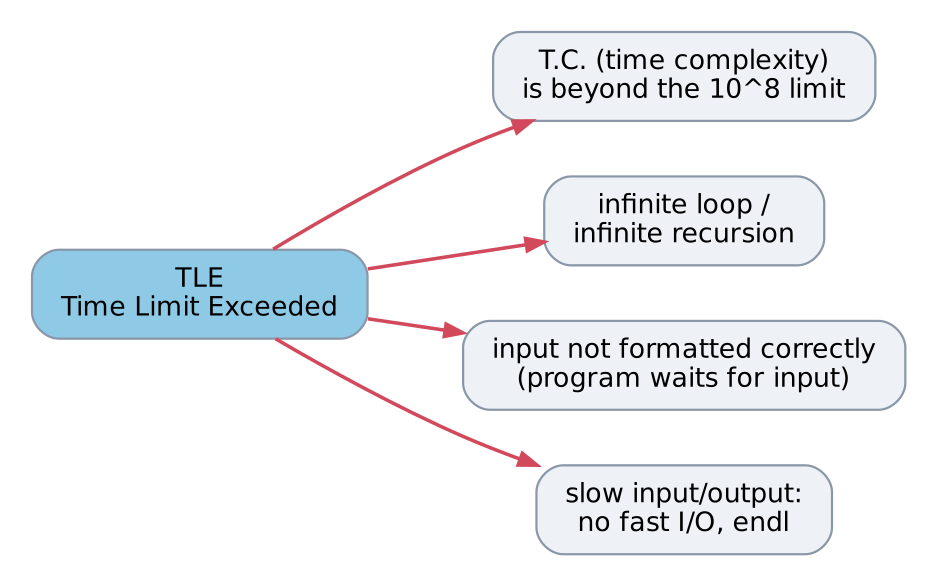

*TLE causes.*

- TC (time complexity) is beyond 10^8 limit
- inf loop/recursion
- input not formatted correctly. [waits for input]
- fast io & endl.

Check 1: T.C. kitna hai? n = 10^5 pe $O(n^2)$ matlab 10^10 operations, infeasible. $O(n \log n)$ matlab ~1.7 x 10^6, easy.

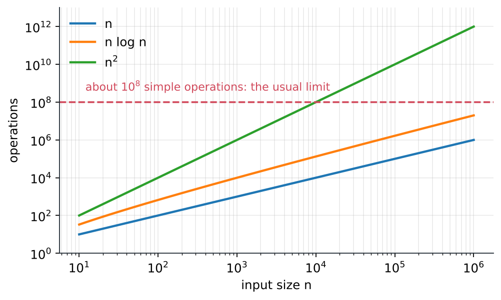

*n, n log n, n^2 vs 10^8.*

"Input not formatted correctly" → program zyada numbers padhne ki koshish karta hai jitne input mein hain, ya galat order mein padhta hai. Local pe terminal wait karta rehta hai.

fast io & endl: `endl` newline bhi print karta hai aur buffer flush bhi karta hai (output turant bahar). Bahut baar kiya toh slow. `'\n'` sirf newline. Plus `cin`/`cout` by default C ke `scanf`/`printf` ke saath sync mein chalte hain, wo bhi time leta hai. Neeche wali function ek baar start mein call karo:

```cpp
// Problem: make cin/cout fast. Call this once at the start of main.
// sync_with_stdio(false): stop keeping C++ streams in step with C's scanf/printf.
// cin.tie(nullptr): do not flush cout every time cin is used.
void fastIo() {
    ios::sync_with_stdio(false);
    cin.tie(nullptr);
}
```

Aur print `'\n'` se karo. Tere files mein ye already ek line se ho jata hai, `#define endl "\n"`. A macro is text replacement before compiling, so every `endl` becomes `"\n"`. (Fabricator/Prefix-Partial-Sums/LRSumQuery.cpp)

```cpp
#define endl "\n"
```

Note: `sync_with_stdio(false)` ke baad `cin/cout` aur `scanf/printf` mix mat karo.

## RTE

RTE (Run time error)

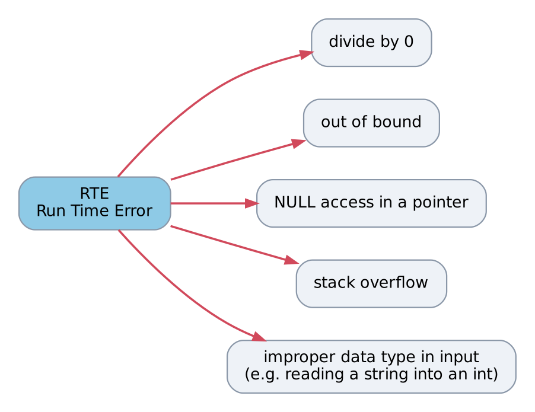

*RTE causes.*

- divide by 0
- out of bound
- NULL access in pointer
- stack overflow
- improper datatype (inputs). [eg: take string in int].

Out of bound: valid index 0 to n-1, `a[n]` galat hai. Note: ye hamesha crash nahi karta. Kabhi kabhi garbage padh leta hai aur WA aa jata hai. Sanitizer se dikhega (neeche).

Stack overflow: recursion bahut deep, ya bada local array.

Improper datatype: "abc" ko int mein padho toh read fail ho jata hai. Value 0 ho jati hai, stream "failed" state mein chali jati hai, aur uske baad ke saare reads kuch nahi karte. Matlab aage ka program galat values pe chalega. Check `if (cin >> x)` or `cin.fail()`.

## WA

WA → hardest to debug.

i) silly mistake
ii) logic is wrong.
iii) 1-2 edge case
iv) garbage value
v) overflow in MOD.

overflow & garbage → easy to detect.

silly mistake
logic          \} very hard to detect.
edge case

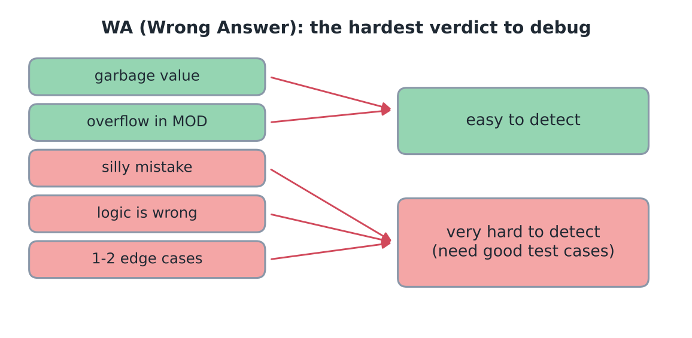

*WA: easy vs very hard to detect.*

Hard wale sirf achhe test cases se pakde jaate hain, isliye aage ka sab test cases ke baare mein hai.

Overflow in MOD: `int` max 2147483647 hai. MOD = 10^9 + 7. Do numbers &lt; MOD multiply karo toh ~10^18, `int` mein nahi aayega. Fix → multiply se PEHLE 64 bit bana lo (`long long`).

```cpp
// Problem: compute (a * b) % MOD for a, b < MOD = 10^9 + 7.
const int MOD = 1000000007;

// Wrong: the product (about 10^18) does not fit in 32 bits.
// uint32_t (unsigned 32-bit number) is used so the wrap-around is well defined.
uint32_t mulModWrong(int a, int b) {
    uint32_t product = (uint32_t)a * (uint32_t)b;
    return product % MOD;
}

// Right: widen to 64 bits BEFORE multiplying, then take the remainder.
long long mulMod(long long a, long long b) {
    return a * b % MOD;
}
```

Let's say a = b = MOD - 1. MOD - 1 is -1 mod MOD, toh answer (-1)(-1) = 1. `mulMod(MOD - 1, MOD - 1)` gives 1, and `mulModWrong(MOD - 1, MOD - 1)` gives 923446813. (Real `int` overflow is undefined behaviour, isliye `uint32_t` use kiya taaki wrap-around defined rahe.)

Negative values ke saath bhi MOD ka dhyan: `-5 % MOD` negative aata hai C++ mein. Isliye `(x + MOD) % MOD`. Ye tere LRSumQuery mein hai, sample pe expected output `4556 999911007 999905655 ...` deta hai:

```cpp
// Fabricator/Prefix-Partial-Sums/LRSumQuery.cpp
/*
Given an array of N integers and Q queries.
In each query two integers L, R are given,
you have to find the value of (A[L]+A[L+1]+A[L+2]+...+A[R])%10^9+7.
*/
const int MOD = 1000000007;

void solve() {
    long long n, q;
    cin>>n>>q;

    vector<long long> arr(n);
    for(auto &ele: arr) cin>>ele;

    vector<long long> pref(n);
    pref[0] = arr[0];
    for(int i=1; i<n; i++){
        pref[i] = pref[i-1] + arr[i];

        pref[i] = (pref[i] + MOD) % MOD;
    }

    while(q--){
        int l, r;
        cin>>l>>r;

        long long ans = l == 1 ? pref[r-1] : pref[r-1] - pref[l-2];

        ans = (ans + MOD) % MOD;

        cout<<ans<<endl;
    }
}
```

Garbage value: local variable ko starting value nahi di toh garbage.

```cpp
int count;   // never given a value
count++;     // reads garbage
```

`-Wall` ye pakad leta hai (`'count' is used uninitialized`). Zero se start hone wale: global variables, `vector<int> v(3)` ke elements, `int x{}`, `int raw[3] = {}`. Plain local `int x;` nahi. Rule: local ko hamesha value do.

## Test cases

- Test cases

i) Extreme values.

eg:
n → size                          1 ≤ N ≤ 10^5
arr = [      ]                    1 ≤ arr[i] ≤ 10^9

```
  1  |  10^5
  1  |  1  1  1 ......  1 } → 10^5 1s.

  1  |  10^5
 10^9|  10^9 10^9 10^9 ...... 10^9 } 10^5 10^9s
```

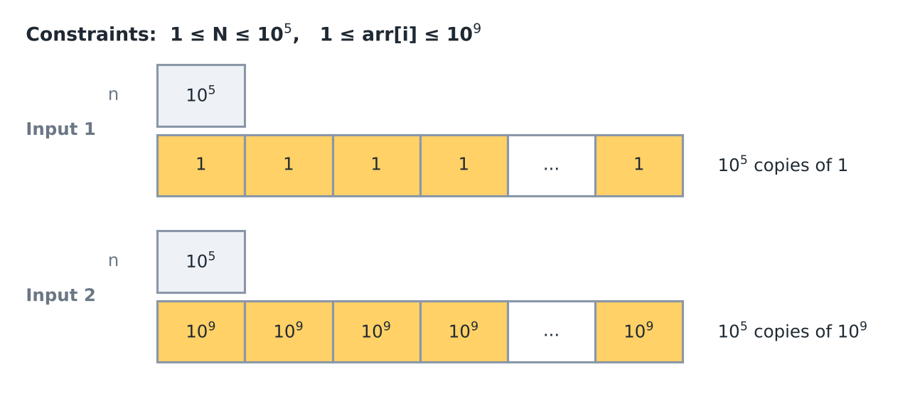

*Extreme inputs: all 1s, all 10^9.*

** Hard code the inputs.

```cpp
int n                      int n
cin >> n             }     n = 10^5
vector<int> arr      }     vector<int> arr(10^5, 10^9);
```

Note: C++ mein `^` XOR hota hai, power nahi. Toh `n = 100000` aur `arr(100000, 1000000000)` likhna hai.

Even if the answers of the extreme test cases is not known, just run the code on it, and just think if the output **looks** right or not.

Example: array sum with this input. Real sum = 10^5 × 10^9 = 10^14. `int` mein rakha toh 32 bit mein wrap hoke 276447232 aata hai, ye clearly galat dikhta hai. `long long` mein 100000000000000. Time bhi dekho in inputs pe.

ii) Code coverage:

```cpp
if (n % 2) {
    for (i<n)
        for (j<m)
}
else {
    for (i<n)
        for (j<n)      // mistake here  (the second "n" is circled)
}
```

```
  i/p:      m
          ┌────┐
        n │    │
          └────┘
```

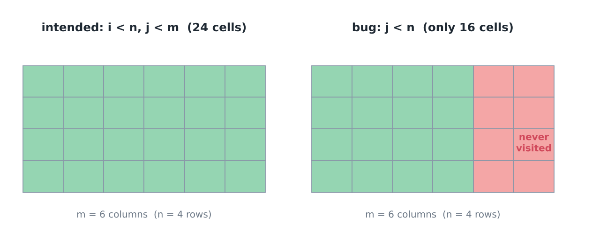

*n = 4, m = 6: bug visits only 16 of 24.*

- may be the input in test case only had equal n & m as input.
- may be it only had odd n.

But on submitting at some test case 'else' part ran & gave weird answer.

Same idea function mein (answer n × m hona chahiye, bug copy kiya hai):

```cpp
// Problem: visit every cell of an n x m grid and count the visits (answer: n * m).
// The else branch copies his mistake: j goes up to n instead of m.
long long countCellsBuggy(int n, int m) {
    long long visits = 0;
    if (n % 2) {
        for (int i = 0; i < n; i++)
            for (int j = 0; j < m; j++) visits++;
    } else {
        for (int i = 0; i < n; i++)
            for (int j = 0; j < n; j++) visits++;  // BUG: should be j < m
    }
    return visits;
}
```

| (n, m) | countCellsBuggy | n × m |
|---|---|---|
| (3, 5) | 15 | 15 |
| (5, 5) | 25 | 25 |
| (4, 4) | 16 | 16 |
| (4, 6) | 16 | 24 |

Notice that sirf last test mein n even hai AND n ≠ m, bas wahi bug pakadta hai.

Rule: manually create test cases so that every line of code runs exist at least once.
[also catches silly mistake]

Kaunsi line nahi chali ye `gcov` batata hai (g++ ke saath aata hai). Test file mein sirf (3, 5) aur (5, 5) call kiye:

```bash
g++ -std=c++17 -O0 --coverage coverage_odd.cpp -o cov_bin
./cov_bin > /dev/null
gcov cov_bin-coverage_odd > /dev/null
grep -E "visits\+\+|for \(int" cells.inc.gcov
```

```
       10:    6:        for (int i = 0; i < n; i++)
       48:    7:            for (int j = 0; j < m; j++) visits++;
    #####:    9:        for (int i = 0; i < n; i++)
    #####:   10:            for (int j = 0; j < n; j++) visits++;  // BUG: should be j < m
```

`#####` matlab line kabhi chali hi nahi → us path ka test missing hai. (Number = kitni baar chali.)

iii) Common themes:

array i/p: → sorted array
           → reverse sorted array.

tree i/p:

```
        o
   /  / | \  \
  o  o  o  o  o   } branched
```

```
   o
   |
   o
   |
   o        } linear          o } single node.
   |
   o
```

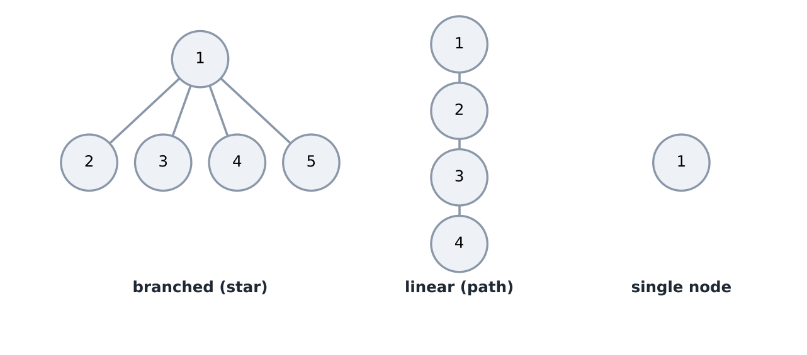

*Branched, linear, single node.*

Kyu sorted? Sorted array kuch algorithms ko unke slowest case mein daal deta hai. Example: quicksort jo hamesha pehla element pivot (split karne wali value) lega. Sorted pe har split lopsided → ~ n(n-1)/2 comparisons.

```cpp
// Problem: count the comparisons of a quicksort whose pivot (the value that
// splits the array in two) is always the FIRST element of the range.
// Sorted input makes every split lopsided: about n*(n-1)/2 comparisons.
void quickSortCount(vector<int>& a, int lo, int hi, long long& comparisons) {
    if (lo >= hi) return;
    int pivot = a[lo];
    int mid = lo;  // a[lo+1..mid] hold values smaller than the pivot
    for (int i = lo + 1; i <= hi; i++) {
        comparisons++;
        if (a[i] < pivot) swap(a[++mid], a[i]);
    }
    swap(a[lo], a[mid]);
    quickSortCount(a, lo, mid - 1, comparisons);
    quickSortCount(a, mid + 1, hi, comparisons);
}

long long comparisonsFor(vector<int> a) {
    long long comparisons = 0;
    quickSortCount(a, 0, (int)a.size() - 1, comparisons);
    return comparisons;
}
```

n = 2000 → n(n-1)/2 = 1999000. Sorted: 1999000, reversed: 1999000, shuffled: 24540. Matlab ~80 times zyada.

Kyu linear tree? Recursive DFS (depth first search: jitna deep ja sako jao) ki depth n ho jati hai. 10^5 nodes → 10^5 calls deep. Stack overflow ka risk, isliye full size pe test karo.

```cpp
// Problem: build test trees with nodes 1..n as lists of edges.
using Edges = vector<pair<int, int>>;

// Star (branched): node 1 is joined to every other node.
Edges makeStar(int n) {
    Edges edges;
    for (int v = 2; v <= n; v++) edges.push_back({1, v});
    return edges;
}

// Path (linear): 1 - 2 - 3 - ... - n.
Edges makePath(int n) {
    Edges edges;
    for (int v = 2; v <= n; v++) edges.push_back({v - 1, v});
    return edges;
}

// Height = number of edges on the longest path down from v.
// Recursive DFS (depth first search: go as deep as possible first).
int heightDfs(int v, int parent, const vector<vector<int>>& adj) {
    int best = 0;
    for (int next : adj[v])
        if (next != parent) best = max(best, 1 + heightDfs(next, v, adj));
    return best;
}
```

(`using Edges = ...` long type ko chhota naam deta hai.) `makeStar(5)` → edges 1-2, 1-3, 1-4, 1-5, height 1. `makePath(5)` → height 4. Single node → height 0. `makePath(100000)` → height 99999 (mere machine pe chal gaya, par judge ka stack chhota ho toh crash).

eg:
n = 5

```
  1  0  1  1  0         Σ (run length of 1)^2
  ‿     ‿‿
  1^2   2^2
        = 5
```

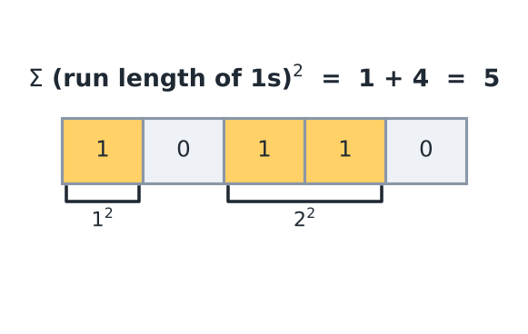

*1^2 + 2^2 = 5.*

Note: array mein 5 elements hain, 1 + 4 = 5.

```
  1 1   0   1 1 1 1   0   1 1   0
  ‿‿        ‿‿‿‿‿‿‿       ‿‿
  2^2        4^2           2^2    = 24
```

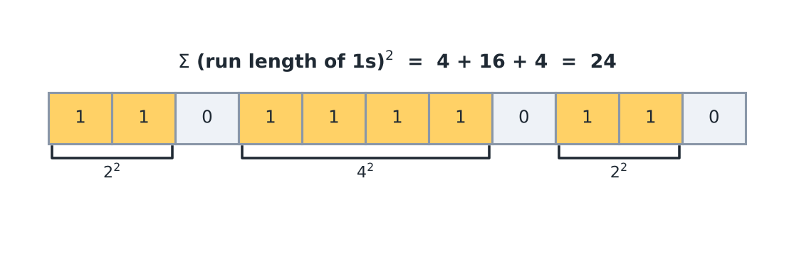

*2^2 + 4^2 + 2^2 = 24.*

```cpp
int ans = 0;
int cur = 0;

for (int i=0 ; i<n; i++){
    if (arr[i] == 1) {
        cur++;
    }
    else {
        ans += cur * cur;
        cur = 0;
    }
}
```

might give WA
─────────
overflow
is one
reason.

Overflow kaise: 10^5 ones ek saath → cur = 10^5, `cur * cur` = 10^10 > 2147483647 (int max). 32 bit mein wrap hoke 1410065408 ban jata hai. `ans` aur `cur` dono `long long` chahiye.

Note: ek aur reason hai. Run tab add hota hai jab 0 aata hai. Agar array 1 pe khatam hua toh last run kabhi add nahi hoga. Array `1 1` pe trace karo: i=0 → cur=1, i=1 → cur=2, loop khatam, ans = 0 but answer 2^2 = 4. Loop ke baad `ans += cur * cur;` chahiye. Dhyan do, uske dono examples 0 pe khatam hote hain, isliye ye bug samples mein dikhta hi nahi.

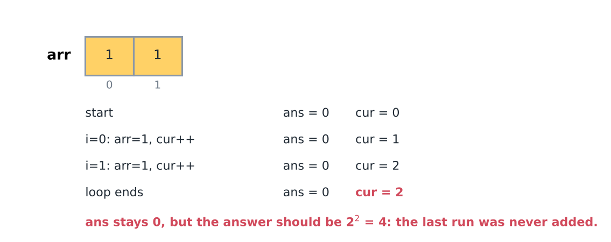

*Array 1 1: last run add hi nahi hua.*

Fixed version, T.C. $O(n)$, extra memory $O(1)$:

```cpp
// Problem: sum of (length of each run of 1s)^2 in a binary array.
// Fix 1: long long, because cur * cur can reach 10^10.
// Fix 2: add the last run after the loop, in case the array ends with a 1.
long long sumOfSquaredRuns(const vector<int>& arr) {
    long long ans = 0;
    long long cur = 0;  // length of the current run of 1s
    for (int x : arr) {
        if (x == 1) {
            cur++;
        } else {
            ans += cur * cur;
            cur = 0;
        }
    }
    ans += cur * cur;
    return ans;
}
```

| array | original loop | fixed |
|---|---|---|
| 1 0 1 1 0 | 5 | 5 |
| 1 1 0 1 1 1 1 0 1 1 0 | 24 | 24 |
| 1 1 | 0 (expected 4) | 4 |
| 10^5 ones | wraps (overflow) | 10000000000 |

iv) Stress testing:

```
                       (eg. arr)
                      ┌──────────┐
               ┌─────>│ solve()  │────> output
 ┌───────────┐ │      └──────────┘         │
 │ Generator │─┤                    Compare these
 └───────────┘ │      ┌──────────┐         ↑
               └─────>│  brute   │────> output
                      └──────────┘
```

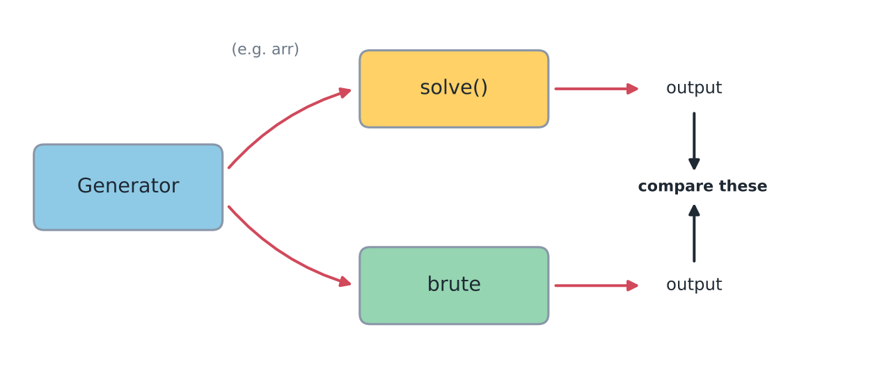

*Stress testing.*

if we find different output then
we find the test case where the solve() is wrong.

Idea: brute force chhota aur simple likho (slow chalega, par obviously correct). Generator chhote random inputs banata hai (n ≤ 8, taaki failing case padhna easy ho). Same seed → same test, toh failure replay ho sakta hai.

Yaha pe solve() = uska original loop, aur brute = "string banao, har '0' pe kaato, har piece ka length square karo" (alag idea, toh same bug share nahi karega). `mt19937` is C++ ka standard random number engine. `stressTest` ko do function pointers milte hain (function pointer = aisa variable jo function hold kare, toh kisi bhi function ko pass kar sakte ho).

```cpp
// Problem: his loop wrapped in a function, so the stress test can
// check it. The loop itself is unchanged.
long long solveOriginal(const vector<int>& arr) {
    int n = arr.size();
    int ans = 0;
    int cur = 0;
    for (int i = 0; i < n; i++) {
        if (arr[i] == 1) {
            cur++;
        } else {
            ans += cur * cur;
            cur = 0;
        }
    }
    return ans;
}

// Brute force: slowest and simplest idea. Build a string, cut it at every
// '0', and square the length of each piece. (A different idea from the
// solution above, so it does not share its bug.)
long long bruteSumOfSquaredRuns(const vector<int>& arr) {
    string s;
    for (int x : arr) s += char('0' + x);
    long long ans = 0;
    size_t start = 0;
    while (true) {
        size_t zero = s.find('0', start);  // next '0', or npos if none
        size_t end = (zero == string::npos) ? s.size() : zero;
        long long len = (long long)(end - start);
        ans += len * len;
        if (zero == string::npos) break;
        start = zero + 1;
    }
    return ans;
}

// Generator: a random binary array of length 1..maxN. A fixed seed gives
// the same test again, so a failure can be replayed.
vector<int> randomBinaryArray(mt19937& rng, int maxN) {
    int n = uniform_int_distribution<int>(1, maxN)(rng);
    vector<int> arr(n);
    for (int& x : arr) x = uniform_int_distribution<int>(0, 1)(rng);
    return arr;
}

// Stress test. `solve` and `brute` are function pointers: variables that hold
// a function, so we can pass either function in. Prints the first array on
// which they disagree and returns false; returns true if all tests agree.
bool stressTest(long long (*solve)(const vector<int>&),
                long long (*brute)(const vector<int>&), int tests) {
    mt19937 rng(12345);
    for (int t = 1; t <= tests; t++) {
        vector<int> arr = randomBinaryArray(rng, 8);
        long long got = solve(arr), expected = brute(arr);
        if (got != expected) {
            cout << "DIFFERENT on test " << t << ", array:";
            for (int x : arr) cout << ' ' << x;
            cout << "\nsolution says " << got << ", brute says " << expected << "\n";
            return false;
        }
    }
    cout << "all " << tests << " tests passed\n";
    return true;
}
```

`stressTest(solveOriginal, bruteSumOfSquaredRuns, 1000)` prints:

```
DIFFERENT on test 1, array: 1 0 0 0 0 0 1 1
solution says 1, brute says 5
```

Last run (1 1) missing → 1 + 4 = 5. Wahi bug jo upar mila. Dono fix ke baad `stressTest(sumOfSquaredRuns, bruteSumOfSquaredRuns, 1000)` → `all 1000 tests passed`.

Contest mein usually alag programs hote hain: `gen` (seed lekar random input print kare), `sol`, `brute`. Loop (`cmp -s` do files quietly compare karta hai):

```bash
for i in $(seq 1 1000); do
  ./gen $i > in.txt
  ./sol < in.txt > out_sol.txt
  ./brute < in.txt > out_brute.txt
  cmp -s out_sol.txt out_brute.txt || { echo "DIFFERENT on seed $i"; cat in.txt; break; }
done
```

Author wale solution ke saath ye `DIFFERENT on seed 2` pe rukta hai, input `4` / `0 0 1 1`.

Bade n ka generator bhi chalao TLE ke liye, aur values ki range badlo (chhoti values → edge cases, bahut badi → overflow).

## Finding the bug fast

Binary search the bug: pura code dobara padhne ki jagah beech mein state print karo. Agar wahi galat hai → bug usse pehle. Sahi hai → bug uske baad. Phir range aadhi. 16 steps ke liye sirf ~4 prints.

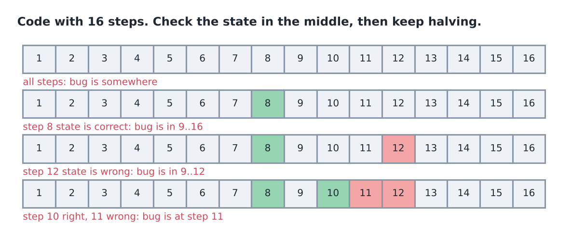

*Step 8 sahi, 12 galat, 10 sahi, 11 galat → bug step 11.*

assert: `assert(cond)` false ho toh program line number ke saath ruk jata hai. Jo cheez hamesha true honi chahiye uspe lagao. Quiet wrong answer ki jagah bug ke paas hi loud error.

```cpp
// Problem: sum of squared runs of 1s, with assert checks on what we believe.
// assert(cond) stops the program and names the line if cond is false.
// Compile with -DNDEBUG to switch asserts off (only for the final submit).
long long sumOfSquaredRunsChecked(const vector<int>& arr) {
    long long ans = 0, cur = 0;
    for (int x : arr) {
        assert(x == 0 || x == 1);  // input check: the array must be binary
        if (x == 1) cur++;
        else { ans += cur * cur; cur = 0; }
    }
    ans += cur * cur;
    long long n = arr.size();
    assert(ans >= 0 && ans <= n * n);  // a run of length L adds L*L, total <= n*n
    return ans;
}
```

`sumOfSquaredRunsChecked({1, 0, 1, 1, 0})` → 5. `sumOfSquaredRunsChecked({1, 2, 1})` → stops with ``Assertion `x == 0 || x == 1' failed.`` (real message mein file, line, function bhi aata hai.)

Sanitizers: compiler extra checking code daal deta hai. `-fsanitize=address,undefined` → AddressSanitizer out of bound memory pakadta hai, UndefinedBehaviorSanitizer signed overflow jaisi cheezein. `-D_GLIBCXX_DEBUG` → `vector` har index check karta hai. Slow hote hain, sirf local pe.

```cpp
// Problem: two classic bugs that a plain build hides.
// 1) off-by-one: i == 5 writes outside a vector of size 5.
int writeOneTooFar() {
    vector<int> a(5, 0);
    for (int i = 0; i <= 5; i++) a[i] = i;
    return a[0];
}

// 2) signed overflow: INT_MAX + extra does not fit in an int.
int addToIntMax(int extra) {
    int x = INT_MAX;
    x += extra;
    return x;
}
```

Ek chhoti test file mein inko call karo (`addToIntMax(2)` overflow wala hai):

```bash
g++ -std=c++17 -O2 -Wall test.cpp -o test_plain && ./test_plain
g++ -std=c++17 -O1 -g -Wall -fsanitize=address,undefined test.cpp -o test_san && ./test_san
g++ -std=c++17 -O1 -g -Wall -D_GLIBCXX_DEBUG test.cpp -o test_dbg && ./test_dbg
```

Plain build mein `writeOneTooFar()` chupchaap 0 return karta hai, jabki array ke bahar likh chuka hai. Checks ke saath (addresses shortened):

```
ERROR: AddressSanitizer: heap-buffer-overflow on address ...
WRITE of size 4 at ... thread T0
    #0 ... in writeOneTooFar() oob.inc:5
oob.inc:12:7: runtime error: signed integer overflow: 2 + 2147483647 cannot be represented in type 'int'
Error: attempt to subscript container with out-of-bounds index 5, but
container only holds 5 elements.
```

Har message line batata hai.

Debug macro: tere files mein debug block already hai. Jo part yaha use hua (poora block mein set, map, queue ke printers bhi hain):

```cpp
// ================= DEBUGGING UTILITIES =================
#ifndef ONLINE_JUDGE
    #define debug(x) cerr << #x << " = "; _print(x); cerr << endl;
#else
    #define debug(x)
#endif

void _print(int t) { cerr << t; }
void _print(long long t) { cerr << t; }
void _print(string t) { cerr << "\"" << t << "\""; }
void _print(char t) { cerr << "'" << t << "'"; }
void _print(double t) { cerr << t; }
void _print(bool t) { cerr << (t ? "true" : "false"); }

template <class T, class V> void _print(pair<T, V> p);
template <class T> void _print(vector<T> v);

template <class T, class V> void _print(pair<T, V> p) {
    cerr << "{"; _print(p.first); cerr << ","; _print(p.second); cerr << "}";
}
template <class T> void _print(vector<T> v) {
    cerr << "[ "; for (T i : v) { _print(i); cerr << " "; } cerr << "]"; cerr << endl;
}
// =======================================================
```

(Fabricator/Prefix-Partial-Sums/LRSumQuery.cpp)

So basically:

- `#x` argument ko text bana deta hai, toh `debug(n)` print karega `n = 5`.
- `#ifndef ONLINE_JUDGE` = "agar ye naam defined nahi hai". Online judges compile karte time `ONLINE_JUDGE` define karte hain, toh judge pe `debug(x)` kuch nahi bana, aur local pe print hota hai.
- `cerr` (error stream) pe print hota hai, toh asli output (`cout`) mein mix nahi hota.
- `_print` alag alag parameter types ke saath kai baar likha hai (overloading). Compiler jo fit ho wo chunta hai. `template <class T>` wale kisi bhi element type ke liye chalte hain: vector har element ke liye `_print` dobara call karta hai.
- `template <...> void _print(...);` jo `;` pe khatam hote hain wo forward declarations hain, promise ki function aage hai, taaki printers ek dusre ko call kar sake.

`n = 5`, `arr = {1, 0, 1, 1, 0}`, `p = pair<int,string>(3, "x")` pe `debug(n)`, `debug(arr)`, `debug(p)`:

```
n = 5
arr = [ 1 0 1 1 0 ]

p = {3,"x"}
```

Vector ke baad blank line vector printer ke `endl` aur macro ke `endl` dono se aati hai.

Note: macro mein kai statements hain. `if (cond) debug(x);` sirf pehle statement ko guard karega. Hamesha alag line pe ya braces mein likho.

Off-by-one checklist: loop `<` hai ya `<=`? Last valid index n-1? Empty / 1 element input chalta hai? `[l, r)` aur `[l, r]` mix toh nahi?

Overflow checklist: sum/product 2 x 10^9 se upar jata hai? → `long long`. Multiply se pehle cast: `(long long)a * b`, `(long long)(a * b)` nahi.

| Symptom | Likely cause | First action |
|---|---|---|
| Samples pass, WA on test 2 | edge case or overflow | n = 1, all equal, biggest values |
| RTE only on big tests | stack overflow / array too small | linear tree, biggest n |
| TLE only on some tests | worst case (sorted, all equal) | sorted and reverse sorted |
| Different answers each run | uninitialised variable | `-Wall`, starting values |
| Many test cases in one input | globals not reset | reset arrays/counters per case |

## Quick revision

- Debugging = process + time + language + good test cases.
- CE (easiest) · RTE · TLE · WA (hardest) · MLE.
- MLE: bytes = elements × size. int = 4 B, 10^7 ints = 40 MB. global ~5x10^7 ints (200 MB), local ~2x10^6.
- TLE: T.C. > 10^8, inf loop/recursion, input mismatch, slow io (`'\n'`, fast io).
- RTE: divide by 0, out of bound, NULL pointer, stack overflow, wrong input type.
- WA: silly mistake, logic, edge case, garbage, overflow in MOD. Garbage + overflow easy; rest very hard.
- Tests: extreme values (hard code, check output **looks** right) → coverage (every line once) → themes (sorted, reverse, branched, linear, single node) → stress (generator, solve(), brute).
- Runs of 1s: `long long`, add last run after loop.
- `^` is XOR → write 100000.
- `(x + MOD) % MOD` for negatives; widen to 64 bit before multiply.
- Tools: `-Wall`, `-fsanitize=address,undefined`, `-D_GLIBCXX_DEBUG`, `assert`, `debug(x)`, gcov.
- Binary search the bug: print in middle, halve.

## Practice problems

- [LR Sum Query](https://maang.in/problems/LR-Sum-Query-18)

### Problem ladder

<Ladder topic="0.1" />
