import TopicHeader from '../../../components/TopicHeader.astro';
import Ladder from '../../../components/Ladder.astro';

<TopicHeader topic="0.2" />

## What this note covers

A solution can be correct and still fail, because it is too slow or uses too much memory. Correctness asks "does the program give the right answer?". This note is about efficiency: T.C. (time complexity) and M.C. (memory complexity).

A judge runs every solution against a fixed time limit (TL), often 1 second. A correct program that needs 100 seconds on the largest input gets no credit. Complexity analysis lets us predict this before writing any code.

The note covers these topics:

- the steps of solving a problem, and counting instructions
- O, Theta, Omega
- loops in sequence and loops nested in each other
- how big n can be when the time limit (TL) is 1 second
- amortized complexity (the average cost over a whole run)
- memory layout
- Master Theorem
- classic loop questions
- online judge verdicts
- counting subarrays and subsequences, the contribution technique, and palindrome anagram queries

## Table of contents

- Steps of solving a problem
- Time complexity
- Counting instructions and asymptotic analysis
- Order notations
- Loops: nesting and sequence
- Limits on input size
- Amortized complexity
- Memory complexity
- Dominant term, NP
- Master Theorem
- Loop questions (sqrt, log, harmonic, power)
- Online judges
- Subsequence vs subarray
- Sum of all subarray sums, contribution technique
- Sum of all subsequence sums
- Property maintenance while scanning
- Stable sorting
- Comparing strings with a+b &lt; b+a
- Palindrome anagram queries
- Quick revision
- Practice problems

---

## Steps of solving a problem

i) Read the problem.

ii) Understand it.

iii) Ideate: think of an idea for the solution.

iv) Implement the idea in code.

v) Debug the code.

vi) Get AC (Accepted: the judge says the solution is correct).

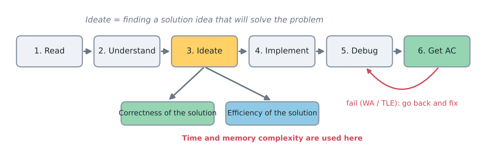
*The order is read, understand, ideate, implement, debug, AC. The efficiency check belongs to the ideate step.*

The first three steps are about finding a solution idea that will solve the problem. We need to think about the following:

- Correctness of the solution
- Efficiency of the solution

This is where time and memory complexity are used.

Think about efficiency before implementing. If the idea is too slow, no amount of debugging will fix it. Only a better idea will. For example, with n = $10^5$ an idea that checks every pair of elements needs about $5 \times 10^9$ pair checks (n(n-1)/2). Even a clean implementation of it runs far longer than 1 second, so all the time spent writing and debugging it is lost.

---

## Time complexity

We generally count the number of instructions the program runs.

The same program can run for different times on different inputs. So there are three types of case:

- Best case: the input on which the program runs most efficiently.
- Average case: the input on which the program runs for an average time.
- Worst case: the input on which the program takes the most time to run.

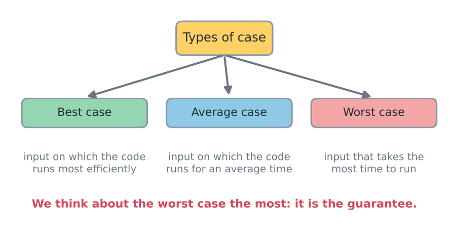
*Best, average and worst case. The worst case needs the most attention.*

The worst case is the one we need to think about the most.

Why? If the worst input finishes within the TL, every other input finishes within it too. The judge's tests will include inputs close to the worst case, so a solution that is fast only on easy inputs will fail.

Small example: searching for a value v in an array, from left to right.
- Best case: v is found at the first position, so it takes 1 check.
- Worst case: v is at the last position or is not present at all, so it takes n checks.
- Average case: it takes about n/2 checks (assuming v can be at any position with equal chance; exactly (1+2+...+n)/n = (n+1)/2)

---

## Counting instructions and asymptotic analysis

Example: count the instructions of this nested loop. The comments show how often each part runs.

```cpp
cnt = 0;
for (int i = 0; i<N; i++) {          // i=0 -> 1, i<N -> N : "1+N"
    for (j = 0; j<i; j++) {          // j=0 -> 1 ; j<i -> i
        cnt++;                       // 1+2+3+......N
    }
}
```

Instruction by instruction:

- `cnt++` runs $1+2+3+\dots+N = \frac{N(N+1)}{2}$ times.
- `j++` runs $\frac{N(N+1)}{2}$ times.
- `j=0` and `i++` run $N + N$ times together.
- `i=0` runs $1$ time.

$\frac{N(N+1)}{2} + \frac{N(N+1)}{2} + N + N + 1$

Adding these gives $N^2 + 3N + 1$, which is cumbersome to calculate.

The exact count also depends on the machine and the compiler, so it is not even a stable number. We only need to know how the cost grows when the input grows.

Hence we use asymptotic analysis (looking at the cost for a very large input) based on the input.

The notation $O(f(n))$ (read as "big-oh of f of n") is used for this. We check how the time taken changes with the size of the input.

It means $c \cdot f(n) + $ some lower order terms.

In $N^2 + 3N + 1$, the term $N^2$ grows faster than the others.

Why the lower terms can be dropped: for N = 10 the exact count is 131 and $N^2$ is 100. For N = 1000 the exact count is 1,003,001 and $N^2$ is 1,000,000, a difference of 0.3%. The larger N is, the less the small terms matter.

Note: the exact count of `cnt++` is $0+1+\dots+(N-1) = \frac{N(N-1)}{2}$ (the inner condition is j &lt; i, so for i=0 it runs zero times). This differs slightly from the count above, but both are about $N^2/2$, so the order is the same.

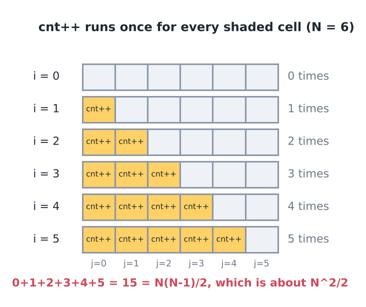
*N = 6: each shaded cell is one run of cnt++. 0+1+2+3+4+5 = 15 = N(N-1)/2.*

Running the code for N = 10, 100, 1000, 10000 gives cnt = N(N-1)/2 exactly:

| N | cnt |
|---|---|
| 10 | 45 |
| 100 | 4950 |
| 1000 | 499500 |
| 10000 | 49995000 |

When N grows 10 times, the work grows about 100 times. That is the signature of $O(N^2)$.

To get a feel for how different growth rates behave:

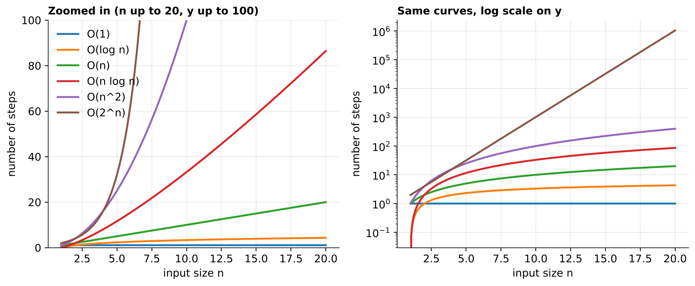
*left: zoomed in. right: same curves, log scale.*

From the slowest-growing to the fastest-growing, the common classes are ordered like this:

$1 < \log n < \sqrt{n} < n < n \log n < n^2 < n^3 < 2^n < n! < n^n$

The gaps are large. For n = $10^6$, n log n is about $2 \times 10^7$ steps, but $n^2$ is $10^{12}$ steps.

---

## Order notations

$O(N^2)$ is big-oh notation. It means that the cost is some constant c times $N^2$, plus some lower order terms: $cN^2 + \dots$

Formally, three notations compare the actual cost of a program with a simple function.

The three order notations are written as follows. Here g(n) is the actual cost of the program, and f(n) is a simple function.

$O(f(n))$      $g(n) \le cf(n)$ \} $n \to \infty$
$\Theta(f(n))$     $c_1 f(n) \le g(n) \le c_2 f(n)$
$\Omega(f(n))$     $c f(n) \le g(n)$

Here f(n) is a simple function like $n^2$, and c is some constant.

O: for all $x > x_0$,  $cf(n) \ge g(n)$.

Θ: for all $x > x_0$,  $c_1 f(n) \le g(n) \le c_2 f(n)$.

Ω: for all $x > x_0$,  $c f(n) \le g(n)$.

In words: after some point $x_0$, the curve g(n) stays below $c \cdot f(n)$ for O, between two multiples of f(n) for Θ, and above $c \cdot f(n)$ for Ω.

Worked check for g(n) = $n^2+3n+1$ and f(n) = $n^2$ (the figure below uses the same pair). Take c = 2. For n = 3, g = 19 is more than 2·9 = 18, so the inequality fails. For n = 4, g = 29 is at most 2·16 = 32, and it stays true for every larger n. So $x_0 = 4$ and $g(n) \le 2 f(n)$ for all n ≥ 4, which proves $O(n^2)$. Also $g(n) \ge 1 \cdot f(n)$ for all n, so g is $\Omega(n^2)$ too. Both hold, so g is $\Theta(n^2)$ with $c_1 = 1$ and $c_2 = 2$.

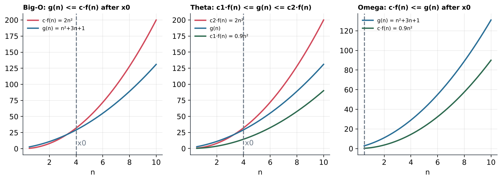
*O: g(n) stays below c·f(n) after x0. Θ: g(n) stays between the two multiples. Ω: g(n) stays above. (g = n²+3n+1, f = n²)*

Examples. A constant factor such as the 2 in $2N^2$ does not change the order, so $N^2 + N$ and $2N^2$ are both $O(N^2)$.

Both $N^2 + N$ and $2N^2$ are $O(N^2)$. They are also $O(N^3)$. That is correct too, because O is only an upper bound, but it is not tight.

For $N^3 + N^2$, all three notations apply:

- $N^3 + N^2$ is $O(N^3)$.
- $N^3 + N^2$ is $\Omega(N^2)$.
- $N^3 + N^2$ is $\Theta(N^3)$.

O gives an upper bound, $\Omega$ gives a lower bound, and $\Theta$ gives the exact class.

In general, for a cost $aN^c$ plus lower order terms $B(\dots)$, where c is the highest power:

The cost $aN^c + B(\dots)$ is $O(N^c)$ and also $O(N^{c+1})$. It is $\Omega(N^c)$ and also $\Omega(N^{c-1})$. It is $\Theta(N^c)$, which is the exact class, so this is the one to state.

In competitive programming (CP), when people say "O(n²)" they usually mean the tightest bound, which is technically Θ.

---

## Loops: nesting and sequence

A program is built from loops that are nested (one inside another) or placed in sequence (one after another). Three examples show how to count their cost.

i) A single loop with constant work in the body. The loop runs 2n + 7 times.
```cpp
for (i=1; i <= 2*n+7; i++) {
    // constant work.
}
```
The loop runs $2 \times n + 7$ times, so the total is $(2 \times n + 7) \times k$, where k is the constant work of the body
↳ for all jobs.
(assignment, comparison)

$[(2k) \times n + (7k)]$
↳ $O(n)$.

Here k is the number of basic jobs (assignment, comparison) in one round. It is a constant, so it disappears inside the O.

ii) Two loops nested. For each of the n values of i, the inner loop runs n times.
```cpp
for (i=0; i<n; i++)
{
    for (j=0; j<n; j++)
    {
        // constant work.
    }
}
```
The inner loop costs $O(n)$, so the whole nested block costs $O(n^2)$.

Now a single loop comes after the nested block, so the two are in sequence:

```cpp
for (i=0; i < 2*n+5; i++) {     // → O(n)
    // O(1).
}
```

$O(n^2) + O(n) = O(n^2)$, because the larger term decides the order.

The rule, in short:

- Loops nested in each other: multiply the costs.
- Loops in a sequence: add the costs.

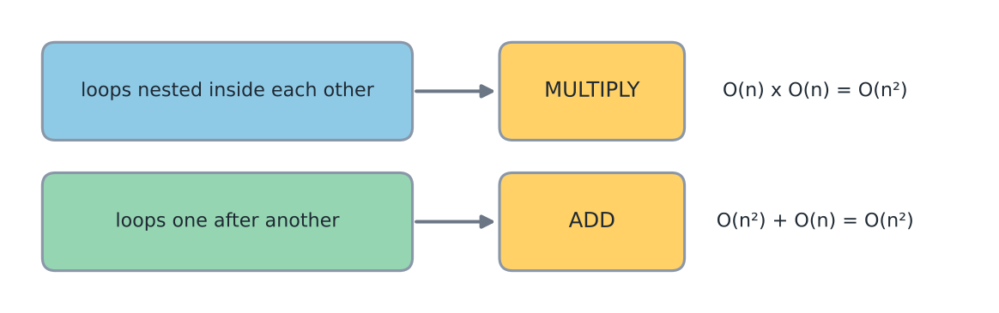
*Nesting means multiply. Sequence means add.*

Why: in a nested loop, the inner loop finishes completely for every round of the outer loop, so the counts multiply (n rounds of n work is n·n). In a sequence, the first loop ends before the second begins, so the counts add, and the larger one decides the order.

iii) Two nests one after another, with two different sizes N and M. (The pseudocode uses an arrow to give the range of each loop.)
```
for (i → 1 to N)
    for (j → 1 to N)          ] O(N^2)
        O(1)

for (i → 1 to N)
    for (j → 1 to M)          ] O(M)
        O(1)                  ] O(N.M)
```

$O(N^2 + NM) = O(N(N+M))$.

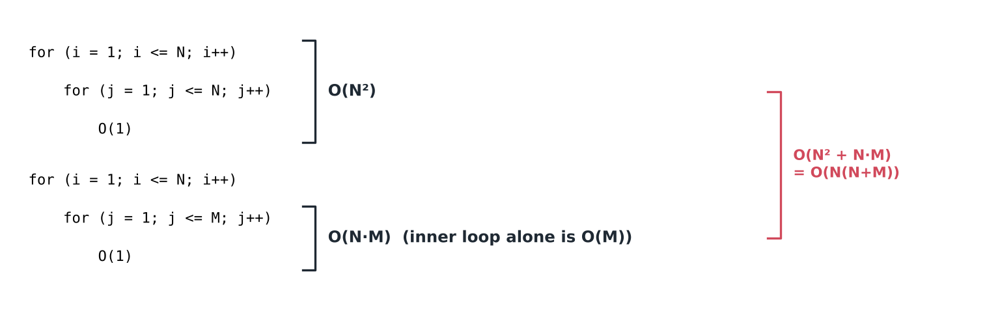
*N and M are different variables, so both must stay in the answer.*

Counting the steps by running the code confirms all three: (i) for n=10 the count is 27, which is 2n+7, (ii) for n=10 the count is 100, which is n², (iii) for N=10 and M=3 the count is 130, which is N(N+M).

Common mistakes:
- Do not add for nested loops. Multiply.
- Do not multiply for loops that run one after another. Add.
- Do not turn $O(N \cdot M)$ into $O(N^2)$ unless it is known that M ≤ N. For N = 1000 and M = 3, N·M is 3000 but $N^2$ is 1,000,000.
- The appearance of a loop does not matter. Count how many rounds it runs.

---

## Limits on input size

The problem statement gives the largest n. Together with the TL, it tells us which complexity is fast enough. Example: an idea has cost $O(n^2)$, the statement gives $n \le 10^5$, and TL = 1 sec. In general, write the cost of an idea as $O(f(n,m))$, where n and m are the input sizes. Here the cost is $O(n^2)$, the limit is $n \le 10^5$ and TL = 1 sec.

For n = 10^5, an $O(n^2)$ solution needs $10^{10}$ steps. This is far too many.

A judge machine runs roughly $10^8$ to $10^9$ simple steps per second. At $10^8$ steps per second, $10^{10}$ steps need about 100 seconds, which is 100 times the limit.

The rule of thumb is:

- If $O(f(n,m)) \le 10^8$, the solution passes.
- If it is at most $5 \times 10^7$, it is safer.
- If it is at least $10^9$, the verdict is TLE (Time Limit Exceeded).

Between $10^8$ and $10^9$ steps the result depends on how heavy each step is.

Using this rule, the table below gives, for each largest n, the complexity that fits in about one second.

| Input size | Complexity |
|---|---|
| $n \le 10$ | $O(n!)$, $O(n^7)$, $O(n^6)$ |
| $n \le 20$ | $O(2^n \cdot n)$, $O(n^5)$ |
| $n \le 80$ | $O(n^4)$ |
| $n \le 400$ | $O(n^3)$ |
| $n \le 7500$ | $O(n^2)$ |
| $n \le 10^5$ | $O(n\sqrt{n})$ |
| $n \le 5 \times 10^5$ | $O(n \log n)$ |
| $n \le 5 \times 10^6$ | $O(n)$ |
| $n \le 10^{12}$ | $O(\sqrt{n})$, $O(\sqrt{n} \log n)$ |
| $n \le 10^{18}$ | $O(\log^2 n)$, $O(1)$, $O(\log n)$ |

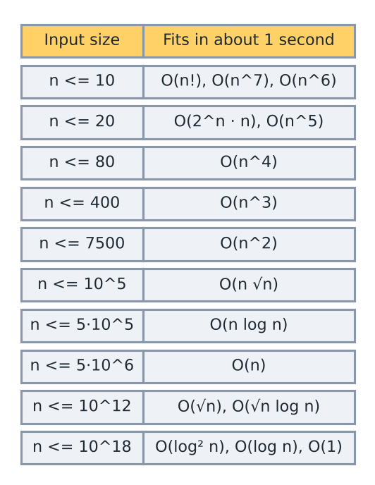
*For each input size, the complexity that fits in the time limit.*

How the table is built: for the largest n of each row, compute the number of steps (logarithms in base 2):

| Row | steps |
|---|---|
| $n=10$, $n!$ | 3.6 million |
| $n=10$, $n^7$ | 10 million |
| $n=20$, $2^n \cdot n$ | 21 million |
| $n=20$, $n^5$ | 3.2 million |
| $n=80$, $n^4$ | 41 million |
| $n=400$, $n^3$ | 64 million |
| $n=7500$, $n^2$ | 56 million |
| $n=10^5$, $n\sqrt{n}$ | 32 million |
| $n=5\times10^5$, $n \log n$ | 9.5 million |
| $n=5\times10^6$, $n$ | 5 million |
| $n=10^{12}$, $\sqrt{n}$ | 1 million |
| $n=10^{12}$, $\sqrt{n}\log n$ | 40 million |
| $n=10^{18}$, $\log^2 n$ | ~3600 |

Every row stays within $10^8$. So the habit is: read the limits first, find the row, and if the idea is slower than that row allows, do not write the code. Look for a better idea.

Example of use: a problem has $n \le 2 \times 10^5$. The row for $5 \times 10^5$ allows $O(n \log n)$, which is about $2 \times 10^5 \times 17.6 \approx 3.5 \times 10^6$ steps, so it is fast. An $O(n^2)$ idea needs $4 \times 10^{10}$ steps, about 400 seconds at $10^8$ steps per second, so the idea must change.

Note: this is a rule of thumb. The real speed depends on the judge's machine and on how heavy each step is. Constants also matter ($5n$ and $500n$ are both $O(n)$, but they run very differently).

---

## Amortized complexity

Question: what is the time complexity of this code? It has a loop inside a loop, so it looks quadratic (like $N^2$).

```cpp
int ans = 0;
int i = 0;
while (i<N) {                          // i<N
    while (i<N && arr[i] != v) i++;    // i<N
    if (i<N) {                         // i<N.
        ans++;
        i++;
    }
}
```
The array arr has size N.
The inner while, the if (O(1)) and the outer while all check i&lt;N. It looks $O(N^2)$ but it is not.

Everything runs only if i&lt;N.
In every iteration of the outer while, the value of i increases, and i stays below N.

So i only ever moves forward.

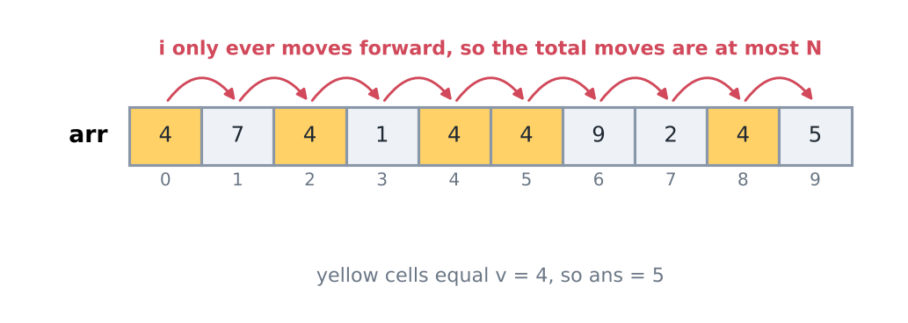
*The pointer i only moves forward, so the total number of moves is at most N.*

The total number of executions that the inner while and the if can have is $O(N)$, because i can increase only up to N. Every iteration of the loops increments i.

The code is nothing but a linear count.
↳ It counts the number (#) of times v appears in arr.

It looks $O(N^2)$ but the instruction run count is $O(N)$
↳ This is called amortization (the cost is averaged over the whole run).

The idea: do not count the cost of one loop in isolation. Count the total work of the whole run. Here the pointer i is a shared budget of N moves, and both loops draw from the same budget.

Dry run: arr = \{4, 7, 4, 1, 4, 4, 9, 2, 4, 5\}, v = 4, N = 10.
i goes from 0 to 10 exactly once. Each move is either "skipped a non-v element" or "counted a v and moved on". Result: ans = 5, and the total number of moves of i is 10 = N.

Step by step: outer round 1: arr[0] = 4 is v, so ans = 1 and i = 1. Round 2: the inner while skips 7 (i = 2), then arr[2] = 4 counts, ans = 2, i = 3. Round 3: it skips 1, then arr[4] counts, ans = 3, i = 5. Round 4: arr[5] = 4 counts, ans = 4, i = 6. Round 5: it skips 9 and 2 (i = 8), then arr[8] counts, ans = 5, i = 9. Round 6: it skips 5, i becomes 10 and both loops stop. The pointer made 5 skip moves and 5 count moves, which is 10 = N, although there were 6 outer rounds.

The same loop as a function, so that it can be called on any array:

```cpp
/*
   New function: the loop above wrapped so it can be called with any array and value.
   Counts how many elements of arr equal v. i never goes backward, so O(N).
*/
int amortizedCount(const vector<int>& arr, int v) {
    int N = arr.size();
    int ans = 0;
    int i = 0;
    while (i < N) {
        while (i < N && arr[i] != v) i++;
        if (i < N) {
            ans++;
            i++;
        }
    }
    return ans;
}
```

Calling it with the array above and v = 4 returns 5. It also matched a plain `count` on 300 random arrays.

Cost: time $O(N)$, memory $O(1)$ (only ans and i). The typical mistake is to multiply the outer count by the inner count. That is wrong here because the inner loop never restarts i from the beginning.

Other places where amortized analysis appears:
- Two pointers and sliding window: each pointer only moves forward.
- `push_back`: one push is sometimes slow (the vector grows and copies its data), but the average cost is $O(1)$. The capacity doubles, so the copies cost 1 + 2 + 4 + ... which is less than 2n for n pushes.
- Monotonic stack: each element is pushed once and popped at most once.

---

## Memory complexity

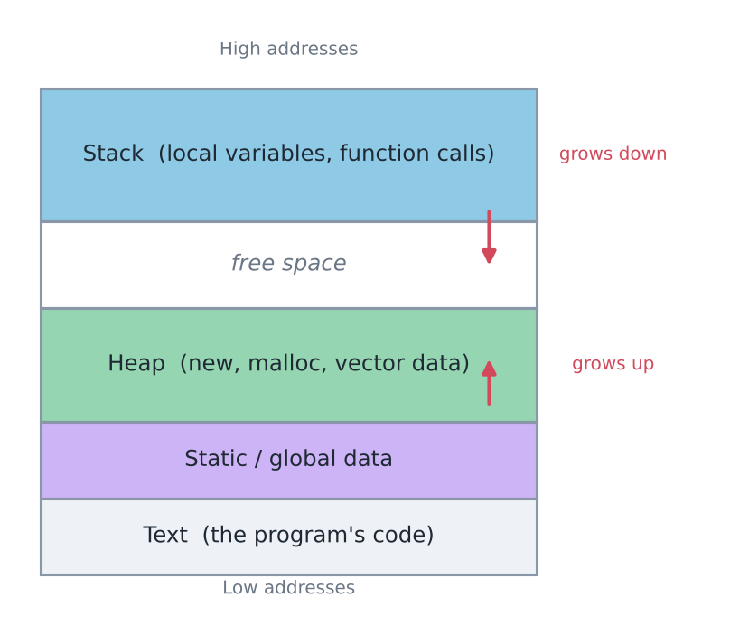
*The stack grows down, the heap grows up. Below them sit the static and global data, and the text.*

- The stack holds local variables and function calls.
- The heap holds memory from `new`, `malloc` and the data of a vector.
- The static and global area holds global variables.
- The text area holds the program's code.

The same order notation is used for memory. For example, a two-dimensional array:

A table `arr[n][n]` has $N^2$ cells, so its M.C. is $O(N^2)$.

The M.C. is the size of the variables. It should depend on n, so count only the memory that depends on n.

As a rule of thumb for the number of cells:

An array `int arr[`$10^8$`]` is safe. An array of $5 \times 10^7$ cells is safer, so try to stay within this limit.

Note: this is a limit on cells, not on bytes. memory = cells × bytes per cell. An `int` is 4 bytes, so $10^8$ ints ≈ 381 MB (here 1 MB = 1,048,576 bytes), which is more than a typical memory limit (ML) of 256 MB. $5 \times 10^7$ ints ≈ 191 MB, which fits. Always read the problem's own ML.

Sizes of some arrays (cells × bytes per cell):

| Container | Size |
|---|---|
| `int` array $10^8$ | 381.47 MB |
| `int` array $5 \times 10^7$ | 190.73 MB |
| `long long` array $5 \times 10^7$ | 381.47 MB |
| `char` array $10^8$ | 95.37 MB |
| `int` grid $5000 \times 5000$ | 95.37 MB |

The table above comes from one small function:

```cpp
/*
   New function: turns "cells x bytes per cell" into megabytes, to check a memory limit before coding.
   1 MB = 1,048,576 bytes, as in the table.
*/
double sizeInMB(double elementCount, int bytesPerElement) {
    return elementCount * bytesPerElement / (1024.0 * 1024.0);
}
```

Calls and results: `sizeInMB(1e8, 4)` = 381.47, `sizeInMB(5e7, 4)` = 190.73, `sizeInMB(5e7, 8)` = 381.47, `sizeInMB(1e8, 1)` = 95.37 and `sizeInMB(5000.0 * 5000, 4)` = 95.37. Cost: $O(1)$ time and memory. Common mistake: dividing by 1,000,000 instead of 1,048,576 gives 400 MB for the first row, which is a small but real difference when a limit is tight.

Hidden memory:
- Recursion uses the stack. A recursion n levels deep uses $O(n)$ stack, even if no array is declared.
- Very deep recursion (around $10^6$ levels, or fewer when each call keeps much data) can overflow the stack, which the judge reports as RTE (runtime error). For example, $10^6$ levels × 32 bytes per call = 32 MB, much more than a typical stack of a few MB.
- Large local arrays are placed on the stack. Keep large arrays global or in a `vector` (heap).
- Copying a `vector` or `string` doubles the memory. Pass it by reference instead.

---

## Dominant term, NP

When a function has many terms, the fastest-growing term decides the order.

$f(n) = 2^n + \log n + n^2 + n^n + c$

$O(f(n)) = O(2^n + \log n + n^2 + n^n + c)$
$= O(n^n)$.

Check with n = 10: $2^n = 1024$, $n^2 = 100$, and $n^n = 10^{10}$. So $n^n$ is already far larger than the others.

A related term is NP-hard (and NP-completeness):

NP-Hard:
↳ non-polynomial. | NP-Completeness.

Note: NP stands for "nondeterministic polynomial time". For NP-hard problems, no polynomial-time solution is known. The best known solutions take times such as $2^n$ or $n!$, so remembering "non-polynomial" is a useful shortcut. It is also not proved that no polynomial-time solution exists. This is the famous P versus NP question.

---

## Master Theorem

Recursive code has a cost that is defined in terms of itself, for example the code below. The Master Theorem solves one common family of such recurrences quickly.

```cpp
fib (n)
    if (n==0 || n==1)
        return 1;                     // O(1)
    return fib(n-1) + fib(n-2)  → ??
```

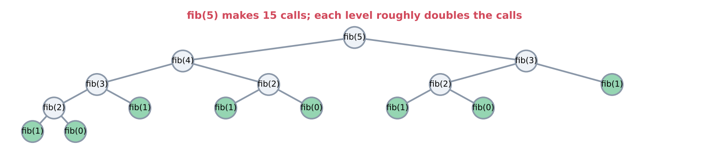
*fib(5) → 15 calls. The number of calls roughly doubles at every level.*

Note: fib does not fit the Master Theorem, because the size is not divided, it is reduced by subtraction (n-1, n-2). Its T.C. ≈ $1.618^n$ ($\Theta(\varphi^n)$, where $\varphi$ is the golden ratio), which is a little less than $O(2^n)$. Its M.C. = $O(n)$ (the recursion depth). The tree shows why it is slow: in fib(5), fib(3) is computed twice and fib(2) three times, and the repeated work grows at every level. For n = 30 the number of calls is 2,692,537, while $2^{30} \approx 10^9$.

The family has this form (T(n) is the time for an input of size n):

$T(n) = a\, T\left(\frac{n}{b}\right) + c$

- a is how many sub-problems there are.
- b is how much the size shrinks (each sub-problem has size n/b).
- c is the extra work done outside the recursive calls.

Merge sort:
$T(n) = 2\, T\left(\frac{n}{2}\right) + O(N)$

Merge sort splits the array into 2 halves (a = 2, b = 2), sorts each half, and then merges them in $O(N)$ (c).

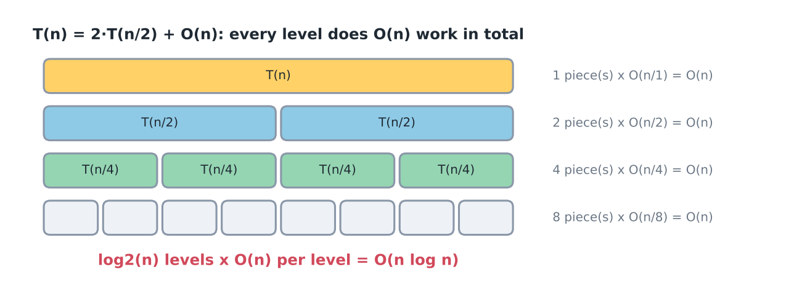
*Every level does O(n) work in total, and there are log2(n) levels.*

Check with n = 8: level 0 merges 8 elements, level 1 does two merges of 4, and level 2 does four merges of 2. Each level does 8 steps, and there are log2(8) = 3 levels, so about 24 = 8·log2(8) steps.

The Master Theorem applies to a lot of problems, but not to all of them.

Intuition: the recursion tree has two competing amounts of work. The leaves (the smallest sub-problems) cost about $n^{\log_b a}$ in total. The top level costs c. If one is larger, it dominates. If they are equal, every level costs about the same, so the total is that cost times the number of levels, $\log n$.

To apply it, follow these steps:

Step 1: Write down a, b and c.

Step 2: Calculate the pair $\left(n^{\log_b a},\ c\right)$.

Step 3: If $O(n^{\log_b a})$ and c are the same, the answer is c log n. Otherwise, if $O(n^{\log_b a}) > c$, the answer is $O(n^{\log_b a})$. Otherwise, the answer is $O(c)$.

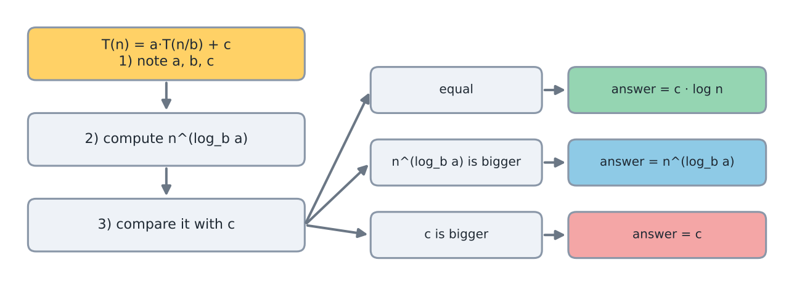
*Compare n^(log_b a) with c, then choose the result.*

Applying the steps to merge sort:

The recurrence is $T(n) = a\,(T(\frac{n}{b})) + c$, with a = 2, b = 2 and c = O(n). The pair is $(O(n^{\log_2 2}), O(n))$, which is $(O(n), O(n))$. The two are equal, so T.C. = $O(n \log n)$.

Examples: i) $T(n) = 27 \times T\left(\frac{n}{3}\right) + O(n^3)$

$a = 27,\ b = 3,\ c = O(n^3)$

$O(n^{\log_3 27}) = O(n^{3\log_3 3}) == c$

Since $\log_3 27 = 3$, the leaves cost $O(n^3)$, the same as c. To see why every level costs the same: level k has $27^k$ sub-problems of size $n/3^k$, and each costs $(n/3^k)^3$, so the level costs $27^k \cdot n^3 / 27^k = n^3$. There are $\log_3 n$ levels.

$\therefore$ T.C. = $O(n^3 \log n)$.

ii) $T(n) = 2 \times T\left(\frac{n}{2}\right) + O(n^2)$.

$a=2,\ b=2,\ c = O(n^2)$

$O(n^{\log_2 2}) = O(n) < c$.

Here the cost of level k is $2^k (n/2^k)^2 = n^2 / 2^k$, which halves at every level: $n^2 + n^2/2 + n^2/4 + \dots < 2n^2$. The top level dominates.

$\therefore$ T.C. = $O(n^2)$.

iii) $T(n) = 8\, T\left(\frac{n}{2}\right) + O\left(\frac{n^3}{\log n}\right)$.

$a = 8,\ b = 2,\ c = O\left(\frac{n^3}{\log n}\right)$.

$O(n^{\log_2 8}) = O(n^3) > O\left(\frac{n^3}{\log n}\right)$

Here c has a log factor, which is not a polynomial term (a power of n). The Master Theorem as stated does not cover it:

The Master Theorem ignores the log n part. There are two ways to deal with this:

- Say that the Master Theorem does not apply, because it does not apply on non-polynomial parts such as log n.
- If we really need an answer, ignore the non-polynomial part.

Following the second way, we treat $O\left(\frac{n^3}{\log n}\right)$ as $O(n^3)$, so the log n is ignored. The two sides are equal, so T.C. = $O(n^3 \log n)$.

Note: $O(n^3 \log n)$ is a correct upper bound, but it is not tight. The exact order is $\Theta(n^3 \log\log n)$. The reason: the work at level k is $n^3/(\log n - k)$, so the total is $n^3 (\frac{1}{\log n} + \frac{1}{\log n - 1} + \dots + \frac{1}{1})$. This is a harmonic sum, which is about $n^3 \ln(\log n)$. Evaluating the recurrence directly (with $n = 2^p$) agrees:

| $p$ | $T(n)/n^3$ | $\ln p$ |
|---|---|---|
| 20 | 4.60 | 3.00 |
| 40 | 5.28 | 3.69 |

From p = 20 to p = 40 the ratio grew by 0.68 and $\ln p$ grew by 0.69. So the cost grows like $\ln\log n$, not like $\log n$ (which would have grown by 20).

Steps 1-3 as one function (for $c = n^k$, a plain power):

```cpp
/*
   Master Theorem for T(n) = a*T(n/b) + n^k, returns the answer as text.
   e = log base b of a. Compare e with k.
*/
string masterTheoremCase(double a, double b, double k) {
    double e = log(a) / log(b);
    auto pretty = [](double x) {   // lambda = small unnamed function; cuts trailing zeros of to_string
        string s = to_string(x);
        while (s.back() == '0') s.pop_back();
        if (s.back() == '.') s.pop_back();
        return s;
    };
    if (fabs(e - k) < 1e-9) return "n^" + pretty(k) + " * log n";  // same → c * log n
    if (e > k) return "n^" + pretty(e);                            // sub-problems win
    return "n^" + pretty(k);                                       // c wins
}
```

Output: $2T(n/2)+n$ → `n^1 * log n`, $27T(n/3)+n^3$ → `n^3 * log n`, $2T(n/2)+n^2$ → `n^2`, $T(n/2)+1$ → `n^0 * log n`, $2T(n/2)+1$ → `n^1`, $4T(n/2)+n$ → `n^2`.

How to make fib fast? Brute force: plain recursion, $\approx 1.618^n$. Better: a loop, $O(n)$ time, $O(1)$ memory. The loop keeps only the last two values, because each new value needs nothing older.

```cpp
// fib(0) = fib(1) = 1, same as above
long long fibIterative(int n) {
    long long a = 1, b = 1;
    for (int i = 2; i <= n; i++) {
        long long next = a + b;
        a = b;
        b = next;
    }
    return b;
}
```

Trace for n = 5: (a, b) starts as (1, 1), then becomes (1, 2), (2, 3), (3, 5), (5, 8), so the result is 8.

fibIterative(30) = 1346269 (the same value as the recursion, but without 2.7 million calls). fibIterative(40) = 165580141.

A second fix keeps the recursion but remembers every answer it has already computed (this is called memoization):

```cpp
/*
   New function: keeps the recursive shape of fib, but each value is computed only once.
   Idea: fib(3) is needed by many callers, so store it the first time.
   memo starts filled with -1, which means "not computed yet".
   O(n) time, O(n) memory (the memo table plus the recursion depth).
*/
long long fibMemo(int n, vector<long long>& memo) {
    if (n == 0 || n == 1) return 1;
    if (memo[n] != -1) return memo[n];
    return memo[n] = fibMemo(n - 1, memo) + fibMemo(n - 2, memo);
}
```

With `memo` of size 31 filled with -1, fibMemo(30, memo) = 1346269 and fibMemo(5, memo) = 8, the same as the loop. Common mistake: forgetting to fill memo with -1 (a zero fill would make "not computed" look like a real answer of 0).

---

## Loop questions (sqrt, log, harmonic, power)

The next questions ask for the time complexity of a loop. The method is to count how many rounds it runs.

Question:
```cpp
for (i=0; i*i <= N; i++) {
    // O(1)
}
```
The loop runs while $i^2 \le N$, which means $i \le \sqrt{N}$. So the time is $O(\sqrt{N})$.

For N = 100, i takes the values 0 to 10, which is 11 rounds.

Question:
```cpp
for (i=1; i*i <= N; i++) {        // i^2 <= N, i <= sqrt(N)
    for (j=1; j<=i; j++) {        // → O(i).
        // O(1)
    }
}
```
The inner loop does $O(i)$ work for each i, so the total is $O(1) + O(2) + O(3) + \dots + O(\sqrt{N})$.

This is $O(1+2+\dots+\sqrt{N})$.

$O\left(\frac{\sqrt{N}(\sqrt{N}+1)}{2}\right) = O(N)$.

A common mistake is to say "the outer loop runs $\sqrt{N}$ times and the inner loop runs up to $\sqrt{N}$ times, so $O(N)$" and stop there. The answer happens to be right, but the reasoning only gives an upper bound. Summing the inner counts (1, 2, 3, ..., $\sqrt{N}$) shows the work is about $N/2$, so $O(N)$ is also tight. For N = 100 the outer loop runs for i = 1 to 10, and the inner loop does 1 + 2 + ... + 10 = 55 steps, close to N/2 = 50.

Question:
```cpp
for (int i=1; i<=N; i++) {
    for (int j=1; j<=i; j*=2) {
        // O(1)
    }
}
```
In the inner loop, j takes the values 1, 2, 4, 8, 16, and so on. So the inner loop costs $O(\log i)$.

The value of j doubles in each round, so it needs about $\log_2 i$ rounds to pass i.

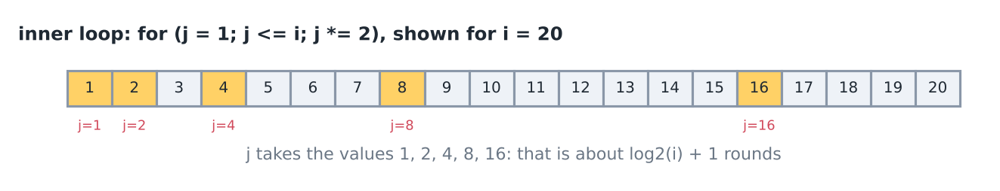
*For i = 20, j takes the values 1, 2, 4, 8, 16. That is about log2(i)+1 rounds.*

$\sum_{i=1}^{N} O(\log i)$     $O(\log i) \le O(\log N)$.

$\therefore \sum_{i=1}^{N} O(\log i) \le \sum_{i=1}^{N} O(\log N)$   (Big O we focus on **upper bound**.)

$= O(\log N) \sum_{i=1}^{N} 1$

$= O(N \log N)$ ✓

This bound is also tight. For the last half of the values (i ≥ N/2), the inner loop runs at least about $\log_2 (N/2)$ times, so the total is at least about $(N/2)(\log_2 N - 1)$.

Question:
```cpp
for (int i=1; i<=N; i++) {
    for (int j=i; j<=N; j+=i) {
        // O(1)
    }
}
```

The inner loop visits j = i, 2i, 3i, ... up to N. For i = 1 it visits 1, 2, 3, 4, ... up to N. For i = 2 it visits 2, 4, 6, 8, ... up to N. For i = 3 it visits 3, 6, 9, 12, ... up to N. The grid figure below shows this for N = 12.

For a fixed i, the values of j form an AP (arithmetic progression, a list with a constant gap between neighbours): i, 2i, 3i, ... up to N. Here a is the first value, l is the last value and d is the gap. The number of terms (called n here) of an AP is $\frac{l-a}{d}+1$.

$a = i,\ l = N,\ d = i$

$n = \left(\frac{l-a}{d} + 1\right) = \left(\frac{N-i}{i} + 1\right)$
This simplifies to $\frac{N}{i} - 1 + 1 = \frac{N}{i}$, so the inner loop costs $O\left(\frac{N}{i}\right)$.

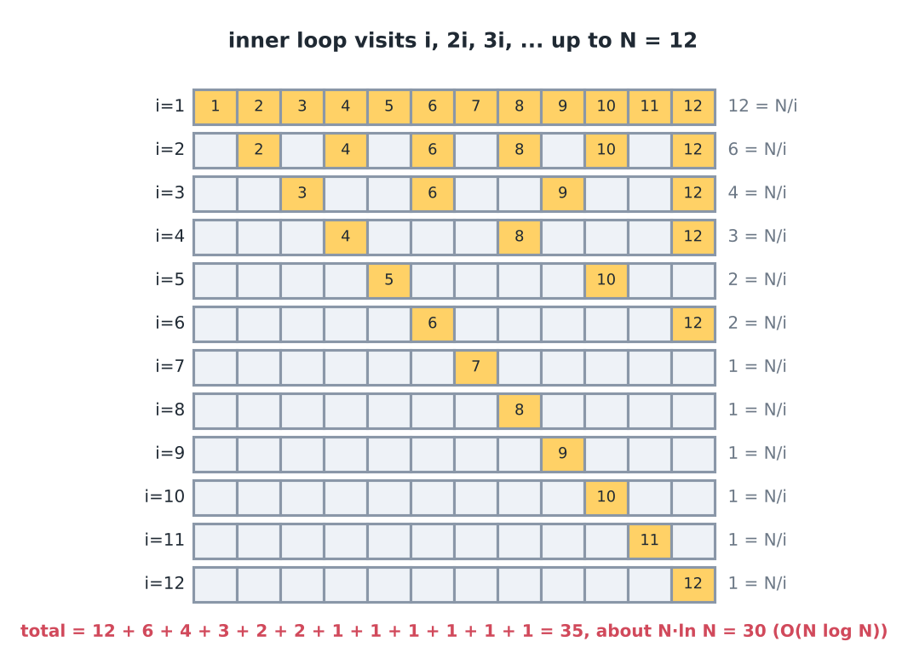
*For N = 12, row i shows the multiples of i. The total is 35, close to N·ln N.*

Outer: $\sum_{i=1}^{N} O\left(\frac{N}{i}\right)$

$= O\left(\frac{N}{1}\right) + O\left(\frac{N}{2}\right) + \dots\dots + O\left(\frac{N}{N}\right)$

$= O\left(N\left(1 + \frac{1}{2} + \dots\dots + \frac{1}{N}\right)\right)$

$= O(N \log N)$

The summation of harmonics is approximated by $O(\log n)$. It is a summation of the type $1 + \frac{1}{2} + \frac{1}{3} + \dots\dots + \frac{1}{n}$. Its exact value is about $\ln n + 0.58$. For n = 1000 it is about 7.5, so the loop does about 7.5·N steps.

Check with N = 12: for i = 1 to 12 the inner loop runs 12, 6, 4, 3, 2, 2, 1, 1, 1, 1, 1, 1 times. The total is 35, close to $12 \ln 12 \approx 30$.

All four loops were run and their steps counted:

| Loop | N = 1000 | N = 100000 | predicted |
|---|---|---|---|
| `i*i <= N` | 32 | 317 | $\sqrt{N}$ = 31.6, 316.2 |
| nested till $\sqrt{N}$ | 496 | 50086 | $N/2$ = 500, 50000 |
| `j *= 2` | 8987 | 1568946 | $N \log_2 N$ = 9965, 1660964 |
| `j += i` | 7069 | 1166750 | $N \ln N$ = 6907, 1151292 |

Loops that run up to $\sqrt{N}$ appear everywhere in number theory. Here are three examples from the Fabricator repository (a collection of ready-made solutions):

```cpp
// Fabricator/Maths/PrimalityCheck.cpp
bool is_prime(long long x){
    for(long long i=2; i*i<=x; i++){
        if(x % i == 0){
            return false;
        }
    }

    return true;
}
```

T.C. = $O(\sqrt{x})$. If x has a divisor larger than $\sqrt{x}$, it also has a matching divisor smaller than $\sqrt{x}$, so checking up to $\sqrt{x}$ is enough. The worst case is a prime x, because then no divisor stops the loop early. For the prime x = 999,999,999,989 (just below $10^{12}$) the loop runs 999,998 times, about $10^6$. (For x = $10^{12}$ itself it stops at i = 2, because the number is even.) This is why the limits table shows $O(\sqrt{n})$ next to $10^{12}$. is_prime(1000000007) → true, is_prime(1000000008) → false. Edge case: this function returns true for x = 1, so a caller must treat x &lt; 2 separately.

```cpp
// Fabricator/Maths/Divisors.cpp (loop from solve(), n is the input)
vector<long long> div;
for(long long i=1; i*i<=n; i++){
    if(n % i == 0){
        div.push_back(i);
        if(i*i != n){
            div.push_back(n/i);
        }
    }
}
// number of divisors = div.size()
```

Divisors come in pairs (i and n/i), so it is enough to look up to $\sqrt{n}$. For example 12 has 6 divisors, 5 has 2, and 9 has 3 (here i = 3 is its own pair, which is why the code checks `i*i != n`). Trace for n = 12: i = 1 adds 1 and 12, i = 2 adds 2 and 6, i = 3 adds 3 and 4, and i = 4 stops because 16 &gt; 12. That gives 6 divisors. Time $O(\sqrt{n})$.

```cpp
// Fabricator/Maths/SieveOfEratosthenes.cpp
vector<bool> sieve_of_eratosthenes(){
    vector<bool> is_prime(DEF_ARR_SIZE, true);
    is_prime[0] = is_prime[1] = false;
    for(int i=2; i<DEF_ARR_SIZE; i++){
        if(is_prime[i]){
            for(long long j=1ll*i*i; j<DEF_ARR_SIZE; j+=i){
                is_prime[j] = false;
            }
        }
    }

    return is_prime;
}
```

`DEF_ARR_SIZE` = `1'000'100` (a constant of the repository; the `'` is only a digit separator). With two nested loops it looks like $n^2$. But for each prime i, only the multiples of i are crossed out, which is the harmonic idea from the `j += i` loop above. Measured: 78504 primes below 1000100, and the inner loop ran 2,122,257 times in total for $n \approx 10^6$, which is about 2 steps per element. The known result is $O(n \log\log n)$. Here it was only counted, not proved.

The inner loop starts at i·i because a smaller multiple k·i (with k &lt; i) has a prime factor smaller than i, so it was already crossed out earlier. Small trace for n = 30 (all numbers below 31): i = 2 crosses out 4, 6, ..., 30 (14 numbers), i = 3 crosses out 9, 12, ..., 30 (8 numbers), i = 5 crosses out 25 and 30 (2 numbers), and the primes from 7 on start at 49, which is already past 30. That is 24 crossings for 30 numbers, and the 10 numbers left are the primes up to 30. The memory is $O(n)$, one bit for each number in `vector<bool>`.

Question: the function power computes $a^b$ (a to the power b). What is its time complexity?
```cpp
int power (int a, int b){
    if (!b) return 1;
    int temp = power (a, b/2) * power (a, b/2);
    if (b%2 == 1) temp *= a;
    return temp;
}
```
$T(b) \Longrightarrow$ power (a, b).

$T(b) = 2T\left(\frac{b}{2}\right) + O(1)$.

A=2          c = O(1)
B=2

$\left(b^{\log_B A}\right) = \left(b^{\log_2 2}\right) = b$.

$O(b) > O(1)$  $\therefore$ T.C. = $O(b)$.

Question: the same function, but now the half power is computed only once and reused.
```cpp
int power (int a, int b) {
    if (!b) return 1;
    int temp = power (a, b/2);
    temp *= temp;
    if (b%2 == 1) temp *= a;
    return temp;
}
```

$T(b) = T\left(\frac{b}{2}\right) + O(1)$
A=1, B=2 , c = O(1)

$\left(b^{\log_B A}\right) = b^{\log_2 1} = b^0 = 1$

$O\left(b^{\log_2 1}\right) = O(1) = c = O(1)$

$\therefore$ T.C. = $O(1 \cdot \log b)$

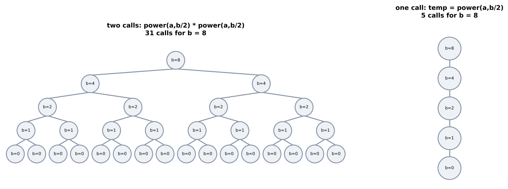
*left: two calls per level → 31 calls. right: one call per level → 5 calls. (b = 8)*

The only difference is that in the first version power(a, b/2) is computed twice, and in the second version it is computed once and the result is reused. That one change turns $O(b)$ into $O(\log b)$. For b = $10^9$ this is the difference between about two billion calls and about 30 calls. Both versions go $\log_2 b$ levels deep, so both use $O(\log b)$ stack memory.

Calls counted:

| b | two-call | one-call |
|---|---|---|
| 10 | 31 | 5 |
| 20 | 63 | 6 |
| 30 | 63 | 6 |
| 40 | 127 | 7 |

power(3, 13) = 1594323 in both versions. Trace of the one-call version: the calls go b = 13, 6, 3, 1, 0. Then power(3, 0) = 1, power(3, 1) = 1·1·3 = 3, power(3, 3) = 3·3·3 = 27, power(3, 6) = 27·27 = 729, and power(3, 13) = 729·729·3 = 1594323.

Note: `int` overflows quickly: $3^{20} = 3{,}486{,}784{,}401$ is already larger than the largest 32-bit int, 2,147,483,647. Use `long long` or a modulus. The complexity stays the same.

```cpp
// Fabricator/Maths/Exponentiation.cpp
long long bin_exp(long long base, long long pow, long long mod){
    if(base == 1 || pow == 0) return 1;

    long long res = 1;
    while(pow){
        if(pow & 1){
            res = (res * base) % mod;
        }

        base = (base * base) % mod;
        pow >>= 1;
    }

    return res;
}
```

Same $O(\log b)$ time, but there is no recursion, so the memory is $O(1)$. `pow & 1` tests whether the last bit is 1, and `pow >>= 1` halves pow. bin_exp(3, 13, 1000000007) = 1594323, and even for an exponent of $10^{12}$ it needs only about 40 rounds. The loop reads pow bit by bit. For 13 = 1101 in binary, base takes the values 3, 9, 81, 6561 and the bits 1, 0, 1, 1 select 3, 81 and 6561, whose product is 3·81·6561 = 1,594,323. Each product must fit in `long long`, so mod must be below about $3 \times 10^9$, and a base larger than mod should be reduced first.

---

## Online judges

Online judges (OJs) check our solutions against tests.

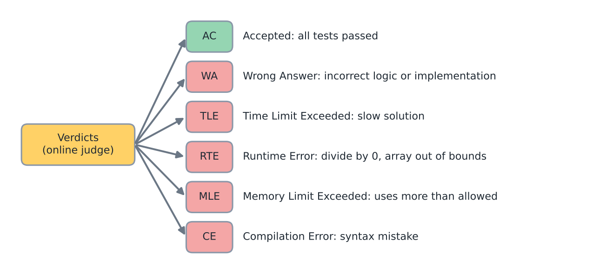
*The possible verdicts.*

Verdicts:
- AC (Accepted)
- WA (Wrong Answer): the logic or the implementation is incorrect.
- TLE (Time Limit Exceeded): the solution is slow.
- RTE (Runtime Error): for example, division by 0 or an out of bound access on an array.
- MLE (Memory Limit Exceeded): the program uses more memory than allowed.
- CE (Compilation Error): there is a syntax error.

A test suite is made of test files, and a test file is made of test cases.

Many problems give the input in the format below. T is the number of test cases. Then, for each test case, N (the size of the array) is given, followed by the N numbers.

```
T
N
1 2 .... N
```

Here is a test file with two test cases (T = 2):

A test file looks like this:
```
2
4
1 2 3 4
3
1 2 3
```
`4 / 1 2 3 4` is one test case.

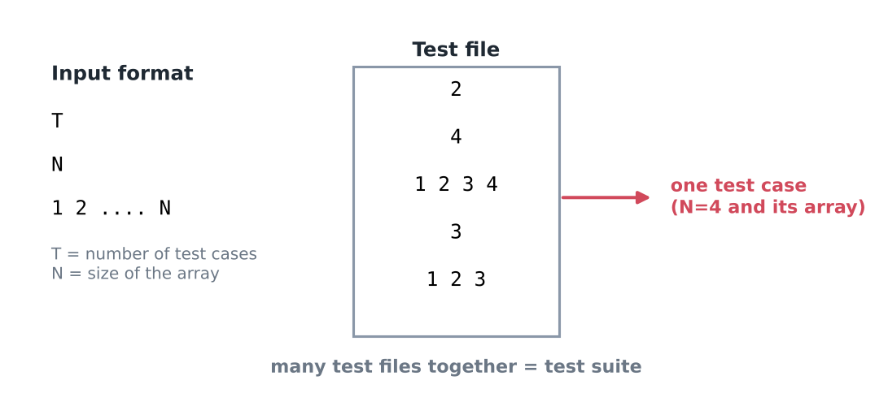
*T is the number of test cases. The highlighted part is one test case.*

A collection of test files is called a test suite.

The time limit given in the question is for a whole test file. Every test file is given the same number of seconds, which is the given time limit.

This means that if a file contains T test cases, the work of all T cases together must fit in the TL, not each case separately. This is why statements often contain a line such as "sum of N over all test cases ≤ ...". Read that line carefully. For example, T = $10^4$ test cases with n = $10^5$ each would mean $10^9$ numbers, so the statement limits the total, such as "the sum of n is at most $2 \times 10^5$". A typical mistake is to reset a whole array of size $10^6$ for every test case: with T = $10^4$ that is $10^{10}$ steps. Reset only the part that was used.

Habits before submitting: think about the worst-case input (maximum size, and all values equal, sorted or reversed). If the verdict is RTE, check array bounds, division by zero and very deep recursion first.

---

## Subsequence vs subarray

Question: Given an array, find the number (#) of subsequences.

Take n = 3 and arr = [1, 2, 5].

All the non-empty subsequences are listed below:

```
1
2
5
1 2
1 5
1 2 5
2 5
```

So the count is $2^n - 1$

(each element is either taken or not taken, so there are $2^n$ choices, and we subtract the empty one to get $2^n - 1$)

![The 7 non-empty subsequences of [1, 2, 5]](../../../assets/notes/0-2-complexity/fig19_subsequences.png)
*Yellow marks the element that is taken. The original order is kept.*

A subsequence is not the same as a subset: a subsequence is ordered (it keeps the original order of the elements), but a subset is unordered.

A subsequence is any sequence of elements that can be generated by deleting some elements.

How can we generate them? For each element there are two choices: take or not take. In the repository this is a recursion:

```cpp
// Fabricator/Recursion-Bactracking-Kth-Fractals/Generate-Subset.cpp
int n;
vector<int> v;
vector<int> subsequence;

void rec(int level){
    if(level == n){
        _print(subsequence);
        return;
    }

    // take
    subsequence.push_back(v[level]);
    rec(level + 1);
    subsequence.pop_back();

    // not take
    rec(level + 1);
}
```

`_print` is a debug printer from the repository that prints a vector. Note: this code also prints the empty subsequence, so for [1, 2, 5] it prints 8 lines ($2^3$), not 7. The calls form a binary tree of depth n with $2^n$ leaves, so the time is $O(2^n \cdot n)$ when printing a subsequence costs $O(n)$. The memory is $O(n)$ (the recursion depth and the vector).

The mask version:

```cpp
// Fabricator/BitManipulation/SubSets.cpp (loop from solve(), arr has n elements)
for(int mask = 0; mask < (1 << n); mask++){
    for(int bit=0; bit<n; bit++){
        if(mask & (1<<bit)){
            cout<<arr[bit]<<" ";
        }
    }

    cout<<endl;
}
```

Each bit of mask tells whether that element is taken. There are $2^n$ masks and each does $n$ work, so the time is $O(2^n \cdot n)$. This is why it works only for $n \le 20$ (see the limits table). mask = 0 is the empty subsequence. For n = 3, mask = 5 (binary 101) prints arr[0] and arr[2].

Note: subsequences are counted by position, not by value. The array [2, 2] has two different subsequences that consist of a single 2.

Note: the formula $2^n - 1$ leaves out the empty subsequence. Some problems include it and then the count is $2^n$, so read the statement. For a large n the number $2^n$ is huge, and problems usually ask for it modulo $10^9+7$.

Question: Given an array, find the number (#) of subarrays.

Take n = 5 and the array below.

```
| 1 | 3 | 2 | 5 | 7 |
```

Some examples of subarrays:

```
2 ✓
3 2 5 ✓
1 3 2 5 7 ✓
```

The pair 3, 5 is not a subarray, because the element 2 between them is skipped.

A subarray is a continuous piece of the sequence.

![Array 1 3 2 5 7: [3 2 5] is a subarray, [3, 5] is not](../../../assets/notes/0-2-complexity/fig21_subarray_vs_not.png)
*[3, 5] skips the element 2, so it is not a subarray. It is a subsequence.*

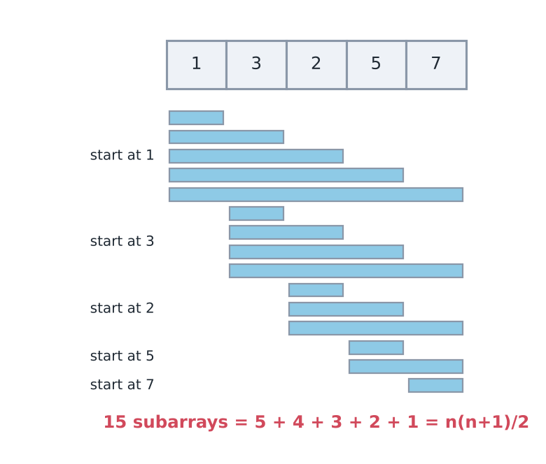
*Starting at 1 gives 5 subarrays, at 3 gives 4, at 2 gives 3, at 5 gives 2, and at 7 gives 1.*

Count the subarrays by their first element. The subarrays starting at 1 are 5, at 3 are 4, and so on:

The total is $5 + 4 + 3 + 2 + 1 = 15$, which is $\frac{n \times (n+1)}{2}$.

Note: a common slip is to write $n \times (n-1)/2$. For n = 5 that gives 10, but there are 15 subarrays. The correct formula is $n(n+1)/2$.

Another way is to count by length:

- 5 subarrays of length 1
- 4 subarrays of length 2
- 3 subarrays of length 3
- 2 subarrays of length 4
- 1 subarray of length 5

Another way: there are $n+1$ vertical lines (borders) around and between the cells. Choose any two lines and we get a subarray between them.

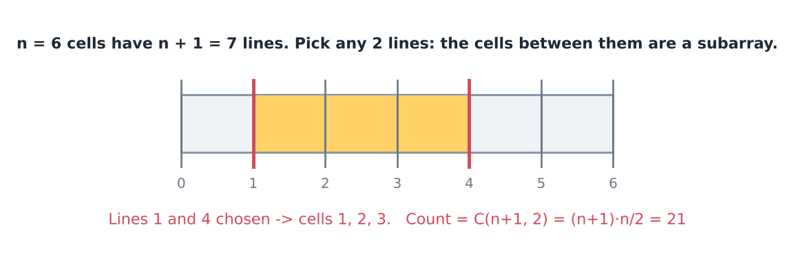
*Seven lines and six cells. Choosing line 1 and line 4 gives cells 1, 2 and 3.*

$^{N+1}C_2 = \frac{(N+1) \times N}{2}$ ✓

For n = 5 there are 6 lines and $^{6}C_2 = 15$, the same as before.

The same choice of a start and an end, as a function that lists the subarrays:

```cpp
/*
   New function: lists every subarray by choosing a start st and an end en with st <= en.
   Count is n(n+1)/2. Copying each subarray out costs up to O(n), so listing all of them is O(n^3).
*/
vector<vector<int>> allSubarrays(const vector<int>& a) {
    vector<vector<int>> result;
    for (size_t st = 0; st < a.size(); st++)
        for (size_t en = st; en < a.size(); en++)
            result.push_back(vector<int>(a.begin() + st, a.begin() + en + 1));
    return result;
}
```

`allSubarrays({1, 3, 2, 5, 7})` returns 15 subarrays, the count we derived. Common mistake: counting subsequences with the subarray formula, or the reverse. For [1, 3, 2, 5, 7] there are 15 subarrays but 31 non-empty subsequences.

---

## Sum of all subarray sums, contribution technique

Question: Given an array of size n, find the sum of all subarray sums.

Take n = 3 and arr = | 1 | 3 | 2 |.

The six subarrays and their sums:

| Subarray | Sum |
|---|---|
| [1] | 1 |
| [3] | 3 |
| [2] | 2 |
| [1, 3] | 4 |
| [3, 2] | 5 |
| [1, 3, 2] | 6 |
| Total | 21 |

![All six subarrays of [1, 3, 2] with their sums and the total 21](../../../assets/notes/0-2-complexity/fig23_subarray_sums.png)
*All 6 subarrays with their sums. Total 21.*

The limit on n can be one of these cases:

Cases:  n ≤ 100
        n ≤ 1000
        n ≤ $10^5$

The size of n decides which method is needed. A method with $n^3$ steps is fine for 100, an $n^2$ method for 1000, and only a linear method for $10^5$.

Every subarray has a start and an end.
Brute force:
    Iterate over all subarrays and find the sum of each.

```cpp
for (int st=0; st <n; st++)
    for (int en = st; en <n; en++){
        int sum = 0;
        for (int i = st; i<=en; i++)
            sum += arr[i];
    }
```
$O(n^3)$

Note: this code computes `sum` for every subarray but never adds it to the answer. The line `ans += sum;` must be placed after the innermost loop. With that line, running this version on [1, 3, 2] gives 21.

Cost: the number of (st, en, i) combinations is about $n^3/6$. For n = 1000 that is about $1.7 \times 10^8$ steps, already at the limit.

A bit optimized (the sum of each subarray is built from the previous one):

```cpp
for (int st = 0; st <n; st++){
    int curr_sum = 0;
    for (int en = st; en <n; en++){
        curr_sum += arr[en];
        ans += curr_sum;
    }
}
```
For every st, we keep checking new ends as we go.
$O(n^2)$.

(The sum of [st..en] equals the previous sum plus one element, so there is no need to add everything again.)

Trace on [1, 3, 2]: st = 0 gives curr_sum 1, 4, 6 (ans = 11). st = 1 gives 3, 5 (ans = 19). st = 2 gives 2 (ans = 21).

Cost: $n(n+1)/2$ steps. For n = 1000 that is 500,500, but for $n = 10^5$ it is about $5 \times 10^9$, which is too slow.

Contribution Technique: a third method, which looks at one element at a time instead of one subarray at a time.

![Each element of [1, 3, 2] shown in the subarrays that contain it: 3, 4 and 3 subarrays, giving 1x3 + 3x4 + 2x3 = 21](../../../assets/notes/0-2-complexity/fig24_contribution_grid.png)
*1 is in 3 subarrays, 3 is in 4, 2 is in 3. 1x3 + 3x4 + 2x3 = 21.*

Idea: instead of finding the sum of each subarray, ask how much each element adds to the final answer. An element adds its value once for every subarray that contains it. So the answer is $\sum$ (value × number of subarrays containing it).

For example, take an array of 4 cells with the value 4 in the second cell. Then 6 subarrays contain 4.

Any subarray that starts at or before 4 and ends at or after 4 contains 4 in it.

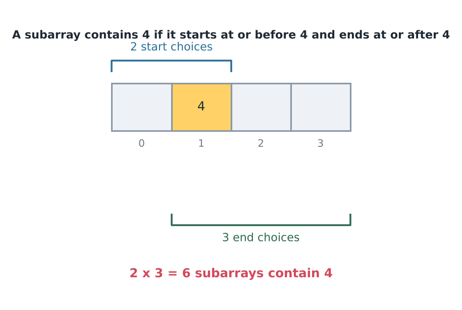
*The element has 2 start choices and 3 end choices.*

So the number of subarrays that contain this element is 2 × 3 = 6.

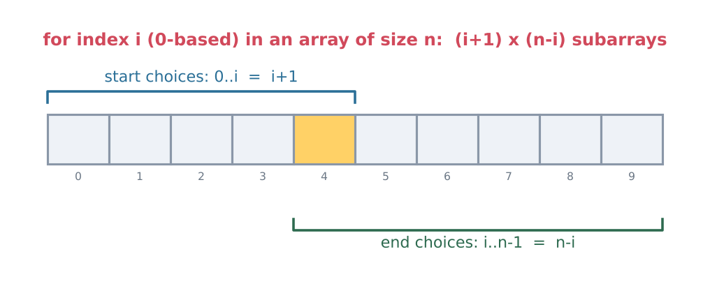
*The start can be 0 to i, which is i+1 choices. The end can be i to n-1, which is n-i choices.*

So for the element at index i (indices go from 0 to n-1), the number of subarrays that contain it is $(i+1) \times (n-i)$. Multiplying each element by its count and adding gives the answer:

```cpp
for (int i=0; i<n; i++){
    ans += arr[i] * (i+1) * (n-i);
}
```
$O(n)$.

Note: arr[i], i+1 and n-i are all int, so the product can overflow. If n = $10^5$ and the values go up to $10^9$, write `(long long)arr[i] * (i+1) * (n-i)`. Even then, the total can be as large as about $10^9 \cdot n^3/6 \approx 1.7 \times 10^{23}$, which does not fit in `long long` (about $9.2 \times 10^{18}$), so such problems ask for the answer modulo a number like $10^9+7$.

Check: $1 \cdot (0+1)(3-0) + 3 \cdot (1+1)(3-1) + 2 \cdot (2+1)(3-2) = 3 + 12 + 6 = 21$. Every subarray is counted once for each of its elements, so the method is correct. All three versions were run on [1, 3, 2] (result 21) and on 300 random arrays (including negative numbers), and all three gave the same answer.

The contribution technique is also used in the repository. Task: the sum of $|a_i - a_j|$ over all pairs. After sorting, the element at index i is the larger one in `i` pairs and the smaller one in `n-i-1` pairs.

```cpp
// Fabricator/ContributionTechnique/SumOfDifference.cpp (loop from solve(), after sort)
sort(arr_sorted, arr_sorted + n);

long long sol = 0;
for(int i=0; i<n; i++){
    long long smaller_than_current = i;
    long long larger_than_current = n - i - 1;

    sol += (smaller_than_current - larger_than_current) * (long long)(arr_sorted[i]);
}
```

Trace for \{1, 3, 2\}: sorted = 1, 2, 3. Index 0 gives (0 − 2)·1 = −2, index 1 gives (1 − 1)·2 = 0, and index 2 gives (2 − 0)·3 = 6. The total is 4. The time is $O(n \log n)$ because of the sort.

\{1, 3, 2\} → 4 (2+1+1), \{4, 1, 7\} → 12 (3+6+3). Matches a brute force on 300 random arrays.

---

## Sum of all subsequence sums

Question: Given an array, find the sum of all subsequence sums.

For [1, 3, 2], the seven non-empty subsequences and their sums are:

| Subsequence | Sum |
|---|---|
| [1] | 1 |
| [3] | 3 |
| [2] | 2 |
| [1, 3] | 4 |
| [3, 2] | 5 |
| [1, 2] | 3 |
| [1, 3, 2] | 6 |
| Total | 24 |

The total is 24 (1+3+2+4+5+3+6). A total of 27 is an addition slip. The reasoning below also gives 24.

![All 7 non-empty subsequences of [1, 3, 2] with sums, total 24](../../../assets/notes/0-2-complexity/fig27_subsequence_sums.png)
*Each element is in 4 subsequences. 4 × (1+3+2) = 24.*

Each element is in 4 subsequences, so the sum can be grouped by element:

$1 \times 4 + 3 \times 4 + 2 \times 4$
$4\,(1+3+2)$
$2^{n-1} \times (\sum arr[i])$.

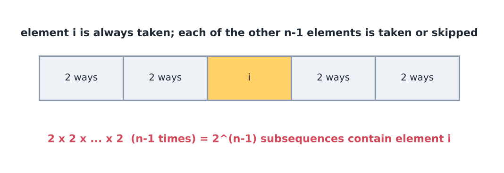
*Each of the other n-1 elements has 2 choices.*

For the $i^{th}$ element (always taken), we can choose or not choose each of the other elements.
$(n-1)$ elements
↳ $2^{n-1}$ ways

$2^{n-1} * \left(\sum arr[i]\right)$.

```cpp
/*
   Sum of the sums of all non-empty subsequences.
   Every element is in 2^(n-1) subsequences, so answer = 2^(n-1) * (sum of arr).
   O(n). For big n the answer is huge, usually asked modulo 10^9+7.
*/
long long sumOfSubsequenceSums(const vector<int>& a) {
    long long total = 0;
    for (int x : a) total += x;
    return (1LL << (a.size() - 1)) * total;     // 1LL << k = 2^k as long long
}
```

To trust the formula, here is a brute force that tries every mask:

```cpp
/*
   New function: brute force to check the formula above.
   Try every non-empty mask and add the chosen elements. O(2^n * n).
*/
long long sumOfSubsequenceSumsBrute(const vector<int>& a) {
    int n = a.size();
    long long ans = 0;
    for (int mask = 1; mask < (1 << n); mask++)
        for (int i = 0; i < n; i++)
            if (mask & (1 << i)) ans += a[i];
    return ans;
}
```

Both functions return 24 for \{1, 3, 2\} and 240 for \{5, -2, 7, 1, 4\}, and they agreed on 300 random arrays. The shift needs 1 ≤ n ≤ 63 (for an empty array, a.size() - 1 would wrap around). For a larger n, compute $2^{n-1}$ with the modular power from the earlier section.

---

## Property maintenance while scanning

A pattern that appeared several times so far is called property maintenance:

We go through an array and maintain some property (variables, info, data structure) and extend the property when we move ahead and see new element.

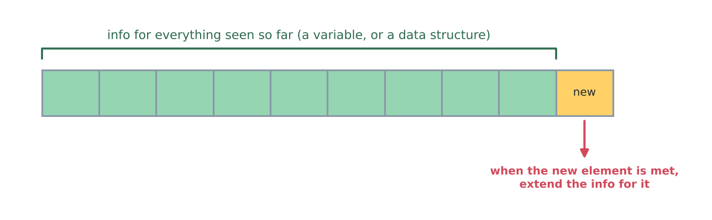
*Keep some info for the part already seen, probably a data structure. When a new element arrives, extend the info.*

In this note: `curr_sum` (subarray code), the pointer `i` (amortized), the prefix parity mask (below).

Other examples: running max/min, prefix sums, a frequency table or a set of seen elements.

Why it is fast: each element is handled once with O(1) work to extend the info, so the scan costs O(n). Recomputing the info from scratch at every position would cost O(n) each time, O(n²) in total. For example, the running max of [3, 1, 4, 1, 5] is 3, 3, 4, 4, 5, and each value comes from the previous max and the new element.

---

## Stable sorting

Go through the sorting algorithms and check whether they are stable or not (Hacker Earth has a list).

Stable means: equal elements keep their original order. Example: sort pairs by score. If (2,"a") was before (2,"c") in the input, then in a stable sort "a" stays before "c".

| Sort | Stable? |
|---|---|
| Bubble | yes |
| Insertion | yes |
| Merge | yes |
| Selection | no (usual version) |
| Quick | no (usual version) |
| Heap | no |

In C++, `std::sort` is not stable. `std::stable_sort` is. Sorting \{2a, 1b, 2c, 1d, 2e\} by score with `stable_sort` gives `1b 1d 2a 2c 2e`. Stability matters when there are two sort keys: to sort by score and keep the names in alphabetical order inside each score, sort by name first and then stable-sort by score.

---

## Comparing strings with a+b &lt; b+a

The comparison function below orders strings by their concatenations:

```cpp
bool cmp (string a, string b){
    return a+b < b+a;
}
```
This is used to compare strings where the sizes of a and b are different, and logically we cannot compare them directly.

Idea: place a before b if the text `a+b` is smaller than `b+a`.

Plain comparison does not work here. Sorting \{3, 30, 34, 5, 9\} as ordinary strings gives 3, 30, 34, 5, 9, and the join 3303459 is larger than 3033459.

Example: 3, 30, 34, 5, 9. Here `"3"+"30" = "330"` and `"30"+"3" = "303"`. Since `"303" < "330"`, 30 comes before 3. Sort everything this way and join the strings to get the smallest result: `3033459`.

Why this order is consistent, for strings of digits: a+b &lt; b+a means $a \cdot 10^{|b|} + b < b \cdot 10^{|a|} + a$, which is the same as $\frac{a}{10^{|a|}-1} < \frac{b}{10^{|b|}-1}$. So each string has its own number, and the rule just compares these numbers. That is a proper order, so `sort` can use it.

Note: `cmp` takes the strings by value, so every call makes copies. Using `const string&` avoids the copies. Also `a+b` creates a new string, so one comparison costs $O(|a|+|b|)$. The sort makes $O(n \log n)$ comparisons.

```cpp
// Fabricator/STL/SmallestStringConcatenation.cpp (sort and glue from solve(), v has n strings)
sort(v.begin(), v.end(), cmp);

string ans = "";
for(int i=0; i<n; i++){
    ans += v[i];
}
```

`ans += v[i]` appends in place, which is cheap. `ans = ans + v[i]` would copy the whole string every time.

For the largest number, reverse the comparison (`a+b > b+a`). As a function:

```cpp
/*
   New function: the same idea with the comparison reversed, to build the largest glued number.
   a goes before b when a+b is bigger than b+a.
*/
string largestNumber(vector<string> nums) {
    auto goesFirst = [](const string& a, const string& b) { return a + b > b + a; };   // lambda = small unnamed function
    sort(nums.begin(), nums.end(), goesFirst);
    string ans;
    for (const string& s : nums) ans += s;
    return ans;
}
```

`largestNumber({"3","30","34","5","9"})` returns `9534330`. Common mistake: sorting the numbers as integers, which gives 9 5 34 30 3 and the glued number 9534303, which is smaller than 9534330.

---

## Palindrome anagram queries

Question: Given a string s and q queries, each containing l and r. For each query, print whether s[l......r] is an anagram of some palindrome.

An anagram is a rearrangement of the same letters. A palindrome reads the same forwards and backwards.

Example: the string s = "abcabaca" has 8 letters at positions 1 to 8. Take one query with l = 1 and r = 5. The part s[1..5] is "abcab" (underlined in the figure below), and the answer is yes.

The queries come with three different sets of limits:

i) n and q are at most $10^3$.

ii) n and q are at most $10^5$.

iii) Each query must be answered in O(1).

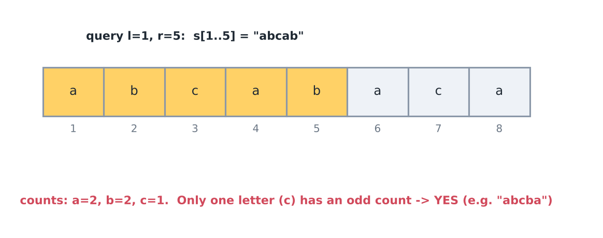
*In abcab, a occurs 2 times, b occurs 2 times and c occurs 1 time. Only c is odd, so the answer is yes (abcba).*

Observation: a palindrome can be formed if at most one letter has an odd count. In a palindrome every letter appears in a pair, one on each side, and only the middle letter can be alone. The number of letters with an odd count has the same parity as the length of the substring, so for an even length the allowed number is 0 and for an odd length it is 1.

i) For $n, q \le 10^3$: for each query, count the letters of s[l..r] directly. $O(n)$ per query, total $10^6$.
ii) For $n, q \le 10^5$: $n \cdot q = 10^{10}$, which is TLE. Use prefix counts: `freq[i][c]` = how many times letter c occurs in the first i letters. For a query, subtract two rows. That is 26 steps per query, a constant.
iii) For O(1) per query: only odd or even is needed, so instead of 26 counts, keep one integer with 26 bits (a bitmask) and use XOR (`^`, which flips bits).

The repository version uses prefix counts. Its code reads l and r as 0-indexed, so the example above (l=1, r=5) becomes l=0, r=4 here.

```cpp
// Fabricator/STL/PalindromeAnagramQuery.cpp (from solve(), s is the string)
int n = s.size();
vector<vector<int>> freq(n+1, vector<int>(26, 0));
for(int i=0; i<n; i++){
    for (int c = 0; c < 26; ++c) {
        freq[i + 1][c] = freq[i][c];
    }
    freq[i + 1][s[i] - 'a']++;
}
```

and for each query:

```cpp
// Fabricator/STL/PalindromeAnagramQuery.cpp (per query, l and r read from input)
int odd_count = 0;

for (int c = 0; c < 26; ++c) {
    int cnt = freq[r + 1][c] - freq[l][c];
    if (cnt % 2 != 0) {
        odd_count++;
    }
}

if(odd_count <= 1){
    cout<<"YES\n";
}
else{
    cout<<"NO\n";
}
```

Memory is $O(26 \cdot n)$. For $n = 10^5$ that is $2.6 \times 10^6$ ints.

Bitmask version, memory $O(n)$:

```cpp
/*
   prefix[i] has bit c set if letter c appears odd number of times in first i letters.
   O(n) build.
*/
vector<int> buildPrefixParity(const string& s) {
    vector<int> prefix(s.size() + 1, 0);
    for (size_t i = 0; i < s.size(); i++)
        prefix[i + 1] = prefix[i] ^ (1 << (s[i] - 'a'));   // flip this letter's bit
    return prefix;
}

/*
   Query with 1-based l, r. XOR of two prefixes keeps only letters with odd count inside [l, r].
   mask & (mask - 1) clears the lowest set bit → result 0 iff mask has 0 or 1 bits set.
   O(1) per query.
*/
bool canFormPalindrome(const vector<int>& prefix, int l, int r) {
    int mask = prefix[r] ^ prefix[l - 1];
    return (mask & (mask - 1)) == 0;
}
```

Why XOR works: a letter that appears an even number of times in the first r letters and an even number in the first l-1 letters appears an even number of times in between, and the same holds for odd minus odd. Only odd minus even (or the reverse) leaves an odd count, and that is exactly what XOR keeps.

For s = "abcabaca" the prefix masks (a = bit 0, b = bit 1, c = bit 2) are prefix[0..8] = 0, 1, 3, 7, 6, 4, 5, 1, 0. For the query (1, 5): prefix[5] ^ prefix[0] = 4, which has one bit (the letter c), so YES. For (1, 3): prefix[3] ^ prefix[0] = 7, which has three bits, so NO.

s = "abcabaca", both methods give the same answers: (1,5) abcab → YES, (1,3) abc → NO, (2,8) bcabaca → YES, (1,8) abcabaca → YES, (4,4) a → YES.

---

## Quick revision

- steps: read, understand, ideate, implement, debug, AC. Complexity belongs to ideate (correctness + efficiency)
- T.C. = number of instructions. Pay the most attention to the worst case
- $N^2 + 3N + 1 \to O(N^2)$: keep the largest term, drop constants
- O → upper, Ω → lower, Θ → exact. $aN^c + \dots$ → $\Theta(N^c)$
- $1 < \log n < \sqrt n < n < n\log n < n^2 < n^3 < 2^n < n! < n^n$
- nesting → multiply, sequence → add. Keep N and M separate
- $\le 10^8$ pass, $5 \times 10^7$ safer, $\ge 10^9$ TLE
- limits: 10 → $n!$, 20 → $2^n n$, 80 → $n^4$, 400 → $n^3$, 7500 → $n^2$, $10^5$ → $n\sqrt n$, $5\times10^5$ → $n\log n$, $5\times10^6$ → $n$, $10^{12}$ → $\sqrt n$, $10^{18}$ → $\log n$
- amortized: the pointer only moves forward, so a loop that looks nested is still $O(N)$
- memory: stack ↓, heap ↑, static/global, text. cells × bytes ($10^8$ ints ≈ 381 MB, $5 \times 10^7$ ints ≈ 190.73 MB). Recursion depth uses the stack
- Master: $T(n) = aT(n/b) + c$ → compare $n^{\log_b a}$ with c. Equal → c log n, otherwise the larger one
- merge sort $O(n\log n)$. power with two calls $O(b)$, with one call $O(\log b)$. Naive fib ≈ $1.618^n$
- `i*i <= N` → $O(\sqrt N)$. Nested up to $\sqrt N$ → $O(N)$. `j *= 2` → $O(N\log N)$. `j += i` → $O(N\log N)$ (harmonic)
- primality: check divisors up to $\sqrt x$, worst case is a prime ($10^{12}$ → about $10^6$ rounds). x = 1 needs a special case. Sieve: $O(n \log\log n)$ time, start crossing at i·i
- power: halve and compute once → $O(\log b)$ time. `int` overflows at $3^{20}$. Iterative `bin_exp` → $O(1)$ memory
- verdicts: AC, WA, TLE, RTE, MLE, CE. The TL applies to a whole test file
- subsequences: $2^n - 1$. subarrays: $n(n+1)/2$
- sum of subarray sums: $\sum arr[i] (i+1)(n-i)$ ([1,3,2] → 21, may need a modulus). Subsequence sums: $2^{n-1} \sum arr[i]$ ([1,3,2] → 24)
- contribution technique: count how many times each element is used
- a+b &lt; b+a compares strings of different lengths
- palindrome anagram: at most one letter with an odd count. Prefix parity mask → $O(1)$ per query
- stable: merge, insertion, bubble. `stable_sort` is stable, `sort` is not

---

## Practice problems

Codeforces
- [The Smallest String Concatenation (632C)](https://codeforces.com/problemset/problem/632/C)

CSES
- [Exponentiation](https://cses.fi/problemset/task/1095)

AtCoder
- [ABC186 D, Sum of Difference](https://atcoder.jp/contests/abc186/tasks/abc186_d)

LeetCode
- [Total Appeal of A String](https://leetcode.com/problems/total-appeal-of-a-string/)
- [Count Unique Characters of All Substrings of a Given String](https://leetcode.com/problems/count-unique-characters-of-all-substrings-of-a-given-string/)

maang.in
- [Number of Divisors](https://maang.in/problems/Number-of-Divisors-AZ101-322)
- [Prime Check](https://maang.in/problems/Prime-Check-AZ101-323)
- [Exponentiation](https://maang.in/problems/Exponentiation-AZ101-387)
- [Inefficient Program](https://maang.in/problems/Inefficient-Program-80)
- [Primes from 1 to n](https://maang.in/problems/Primes-from-1-to-n-1208)
- [Sieve of Eratosthenes Revisited](https://maang.in/problems/Sieve-of-Eratosthenes-Revisited-234)
- [Count Distinct Char in Substrings](https://maang.in/problems/Count-Distinct-Char-in-Substrings-62)
- [Count Unique Char in Substrings](https://maang.in/problems/Count-Unique-Char-in-Substrings-63)

### Problem ladder

<Ladder topic="0.2" />
