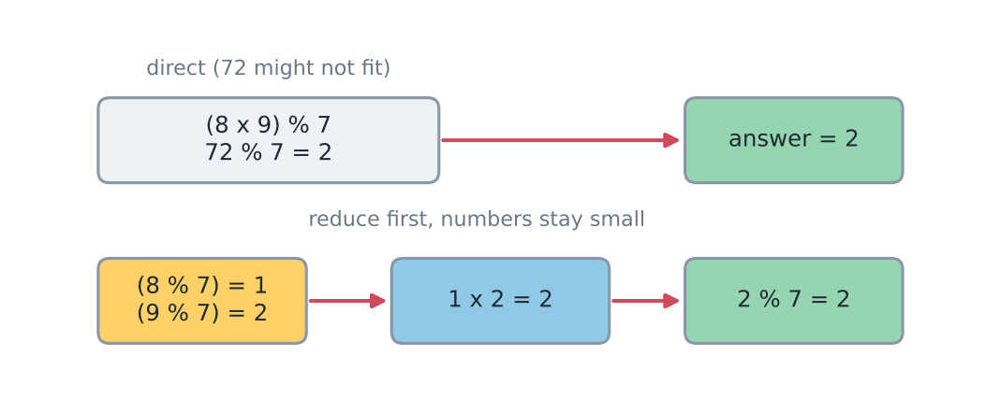
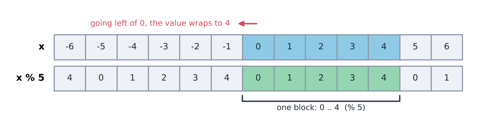
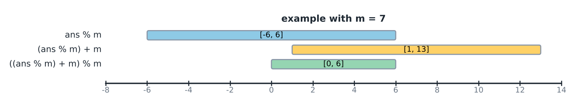
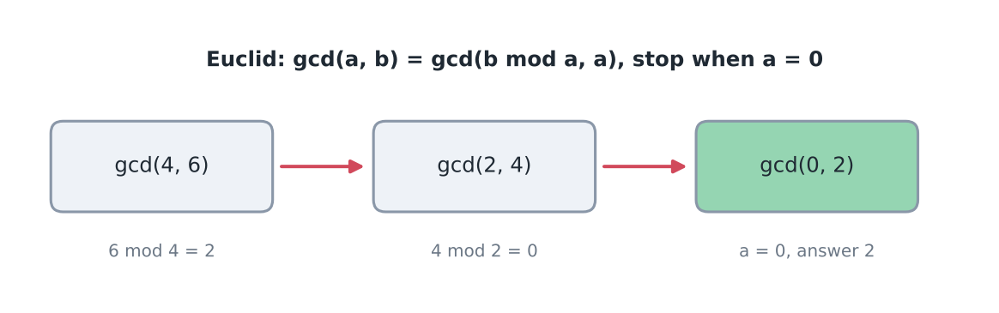

import TopicHeader from '../../../components/TopicHeader.astro';
import Ladder from '../../../components/Ladder.astro';
import TheoremCode from '../../../components/TheoremCode.astro';
import CodeSnippet from '../../../components/CodeSnippet.astro';
import WhatYouNeed from '../../../components/WhatYouNeed.astro';
import Cards from '../../../components/Cards.astro';
import Drill from '../../../components/Drill.astro';
import LookalikePairs from '../../../components/LookalikePairs.astro';
import SelfTest from '../../../components/SelfTest.astro';
import Checkpoint from '../../../components/Checkpoint.astro';
import DecisionMapUpdate from '../../../components/DecisionMapUpdate.astro';

<TopicHeader topic="0.4" />

## What this note covers

In competitive programming (CP), answers are often far too large for any integer type, so the problem asks for the answer "modulo" a fixed number. Modulo (written mod, or `%` in C++) means the remainder left after division.

A concrete case: the number of subsets of 1000 items is $2^{1000}$, which has 302 digits. A `long long` holds at most 19 digits (about $9.2 \times 10^{18}$). The problem therefore asks for $2^{1000}$ mod $10^9+7$, a number below $10^9+7$ that always fits.

This note covers:

- Why we use mod, which mod value is chosen, and the mod of a negative number.
- The rules of modular arithmetic: use long long, multiply two numbers at a time, and follow the printing rule.
- GCD (greatest common divisor) by Euclid's algorithm, and LCM (least common multiple).

Division under a mod (the modular inverse) and fast power are not covered here. They come in topic 2.2.

Besides the mod rules and the GCD, the note states the small facts that go with them. Each is a numbered theorem: division with remainder (0.4.1), counting multiples (0.4.2), parity (0.4.3), reducing under a mod (0.4.4), Euclid's algorithm (0.4.5) and the LCM (0.4.6). They answer questions such as: is this number even or odd, does $k$ divide it, what is left after dividing, and what do two numbers share.

### What you need

<WhatYouNeed topic="0.4" />

### What this note does not cover

- Listing all primes up to $N$ (the sieve), splitting numbers into primes, and the smallest prime factor table. These are in topic 2.1.
- Solving $ax + by = \gcd(a, b)$ for integers $x$ and $y$ (extended Euclid). This is in topic 2.1.
- Division modulo $m$ (the modular inverse), raising to huge powers modulo $m$, and Fermat's little theorem. These are in topic 2.2.
- Counting the numbers divisible by at least one of many values (inclusion-exclusion). This is in topic 2.3. Here only two values appear, and Theorem 0.4.6 proves that case directly.

### Terms used in this lesson

- A number $a$ **divides** $b$, written $a \mid b$, if $b = ka$ for some integer $k$. Then $b$ is a **multiple** of $a$. Example: $3 \mid 12$, $3 \nmid 13$, and $0$ is a multiple of every integer.
- Two integers $a$ and $b$ are **congruent modulo $m$**, written $a \equiv b \pmod m$, if $m \mid (a - b)$. This is the same as having equal remainders. Example: $17 \equiv 2 \equiv -3 \pmod 5$.
- The **parity** of an integer is whether it is **even** (divisible by 2) or **odd**. Example: $-3$ is odd and $0$ is even.
- An **invariant** of a process is a quantity that no step changes. Example: when two coins are flipped at a time, the parity of the number of heads never changes.

GCD, coprime, LCM and the Euclidean algorithm are defined where they first appear, in the section "GCD & LCM".

## Table of contents

- Modulo Arithmetic → what mod is, which mod value, negative mod, rules
  - Counting multiples → how many multiples of k lie in a range
  - Parity and invariants → what a step can never change
- GCD & LCM → Euclid's algorithm, LCM
  - Worked example → Monsters Battle Royale
- Recognition cards → how to spot each tool
- Quick revision, Check yourself, Practice problems

## Modulo Arithmetic

The meaning of mod, in words and as a formula:

n mod m = remainder when n is divided by m

$n \bmod m = n - \lfloor \frac{n}{m} \rfloor \cdot m$.

($\lfloor x \rfloor$ = floor, which means rounding x down to the nearest integer. For example $\lfloor 3.9 \rfloor = 3$.)

Dry run on small numbers: $17 \bmod 5$. Here $\lfloor 17/5 \rfloor = 3$, so $17 \bmod 5 = 17 - 3 \cdot 5 = 2$.

Why mod? Some operations like counting, adding and multiplying can yield a result so big that it is impossible to store in a computer.

Hence we use mod to compute a result that can be handled by the computer.

The types int_32, int_64 and int_128 (integers of 32, 64 and 128 bits) all have limited capacity.

The limits are: a 32-bit integer holds up to about $2.1 \times 10^9$, a 64-bit integer up to about $9.2 \times 10^{18}$, and a 128-bit integer up to about $1.7 \times 10^{38}$. Even 128 bits is small next to $2^{1000}$.

A small example of the idea, with numbers that are easy to check by hand:

(8 x 9) % 7 = 72 % 7 = 2

If they overflow, we cannot store 72, but we can do the following.

((8 % 7) x (9 % 7)) % 7 = (1 x 2) % 7 = 2

This is why mod is used: the reduced numbers stay small, so nothing overflows.

Why does this work? A remainder only records "how far past the last multiple of 7" a number is. Replacing 8 by 1 (8 = 7 + 1) and 9 by 2 (9 = 7 + 2) removes whole multiples of 7, and those never change the final remainder. So we may reduce every number before multiplying, and the numbers stay small.



*Reduce first, then multiply. The numbers stay small.*

### Which mod value?

We generally use primes in the $10^9$ range for mod. The two most common are 1000000007 ($10^9+7$) and 998244353. Both are prime.

Why a number near $10^9$?

$10^9 + 10^9 \le 2 \times 10^9$

The sum of two numbers near $10^9$ can be stored in an int (largest value about $2.1 \times 10^9$). With m = $10^9+7$, two reduced numbers add up to at most 2000000012, which still fits.

$10^9 \times 10^9 \le 10^{18}$

The product of two numbers near $10^9$ can be stored in a long long (largest value about $9.2 \times 10^{18}$). With m = $10^9+7$, two reduced numbers multiply to at most about $1.000000012 \times 10^{18}$, which fits.

Why prime? So that inverses can be calculated. (The inverse is the mod-world way of dividing. It is explained in topic 2.2.)

Why large primes? The chance that a correct answer and a wrong answer collide (come out equal) becomes smaller.

For example, compare $2^{(n-1)}$ % 3 and $3^{(n-1)}$ % 7. The results of these two expressions collide (are equal) for a lot of values of n. This can cause wrong logic to look correct.

Why a large mod helps: an answer taken mod m is one of only m possible values. If a wrong formula gives a random value, the chance that it equals the right value is about 1/m. For m = 3 that chance is 1/3 (very high). For m = $10^9+7$ it is about $10^{-9}$.

Quick check: for n from 1 to 1000, $2^{(n-1)}$ % 3 and $3^{(n-1)}$ % 7 are equal 167 times (checked by running a program). So with such small mods, even a wrong formula can pass many tests.

The program is short. Each step keeps only the remainders, so it multiplies the previous remainder by 2 (or by 3) and reduces again.

```cpp
// New function (not from the Fabricator repo): it reproduces the count of 167 quoted above.
/*
  Problem: for n = 1..total, count how often 2^(n-1) % 3 equals 3^(n-1) % 7.
  Shows that tiny moduli let different formulas agree by luck.
*/
int countAgreements(int total) {
    int same = 0;
    long long left = 1, right = 1;            // 2^0 % 3 and 3^0 % 7
    for (int n = 1; n <= total; n++) {
        if (left == right) same++;
        left = left * 2 % 3;                  // next power of 2, reduced
        right = right * 3 % 7;                // next power of 3, reduced
    }
    return same;
}
```

Compiled and run: `countAgreements(1000)` returns 167. Cost: $O(\text{total})$ time and $O(1)$ memory, because only two remainders are stored.

### Mods of negative numbers

For a negative number, the same expression gives different answers in C++ (cpp) and Python (py):

(-3) % 7 = -3 in C++, and 4 in Python.

Why the difference? C++ divides and drops the fractional part, so $-3 / 7$ becomes 0, and $-3 \bmod 7 = -3 - 0 \cdot 7 = -3$. Python rounds the quotient down (floor), so $-3 / 7$ becomes $-1$, and $-3 \bmod 7 = -3 - (-1) \cdot 7 = 4$. The mathematical definition above uses the floor, so Python matches it and C++ does not.

A negative divisor is a different case:

(-3) % (-7) gives -3. A negative divisor is not a valid modulus, so this case is ignored: the negative sign of the quotient is disregarded.

A subtraction shows how the problem appears inside a real calculation:

(9 - 7) % 8 = 2.
((9 % 8) - (7 % 8)) % 8 = (1 - 7) % 8 = -6

The direct answer is 2, but reducing first in C++ gives -6. The two differ by 8, so they are the same value on the wrapped number line below. Only the C++ representation is negative.

**\*Modulo wraps the space.** The figure below lists x from -6 to 6 in the top row and x % 5 (the true mathematical remainder, always from 0 to 4) in the bottom row.



*The block 0 to 4 repeats in both directions. Going left from 0, the value wraps to 4.*

The value at -6 wraps around to 4. Reading the figure from left to right, the value at -6 is 4, and each step to the right adds 1 until it wraps from 4 back to 0.

Adding the divisor does not change the remainder:

(x % 5) == (x + 5) % 5
-2 % 5 = (2 + 5) % 5 = 3

C++ does not handle the modulo of negative numbers correctly.

Note: the line above has a typo. (2 + 5) % 5 gives 2. The correct step is (-2 + 5) % 5 = 3. Adding m moves a negative value one block to the right, and the answer is unchanged because m is a whole multiple of itself.

Because C++ fails to handle negative values this way, we need to handle them in our code.

```cpp
/*
  Problem: x % m in the range [0, m-1], even if x is negative.
*/
long long normalize(long long x, long long m) {
    return ((x % m) + m) % m;
}
```

Checked: normalize(-3, 7) = 4, normalize(-6, 5) = 4, normalize(-2, 5) = 3, and (1 - 7) from above with m = 8 gives 2.

How it works for x = -6, m = 5: x % m = -1 (C++ result), then -1 + 5 = 4, then 4 % 5 = 4. For x = 7, m = 5: x % m = 2, then 2 + 5 = 7, then 7 % 5 = 2. The final `% m` removes the extra m that was added to a value that was already non-negative.

Why does `normalize` always land in $[0, m)$, and is the answer unique? The next theorem says exactly that.

**Theorem 0.4.1 (division with remainder).** Let $m > 0$.

1. For every integer $a$ there are unique integers $q$ and $r$ with $a = qm + r$ and $0 \le r < m$. Here $q = \lfloor a/m \rfloor$ and $r = a \bmod m$.
2. In C++, `a % m` equals $a \bmod m$ when $a \ge 0$. When $a < 0$, `a % m` lies in $(-m, 0]$, and `((a % m) + m) % m` equals $a \bmod m$ for every $a$.

Small example first: $a = -7$, $m = 5$. Since $-7 = (-2) \cdot 5 + 3$, we get $q = -2$ and $a \bmod m = 3$. C++ computes `-7 / 5 = -1` and `-7 % 5 = -2`. Then $(-2 + 5) \% 5 = 3$.

Why it works:
1. Existence. Let $q = \lfloor a/m \rfloor$, so $q \le a/m < q + 1$. Multiplying by $m$ gives $qm \le a < qm + m$. So $r = a - qm$ satisfies $0 \le r < m$.
2. Uniqueness. If also $a = q'm + r'$ with $0 \le r' < m$, then $(q - q')m = r' - r$.
3. Since $|r' - r| < m$, the multiple $(q - q')m$ must be 0. So $q = q'$ and $r = r'$.
4. Part 2. C++ rounds $a / m$ toward zero and defines `a % m` as $a - (a / m) \cdot m$ (Theorem 0.1.4). For $a \ge 0$ the quotient is the floor, so `a % m` $= a \bmod m$.
5. For $a < 0$ the quotient is rounded up, so `a % m` $= a - \lceil a/m \rceil m$, which lies in $(-m, 0]$.
6. In both cases `a % m` $\equiv a \pmod m$. Adding $m$ gives a value in $(0, 2m)$ that is still congruent to $a$. The last `% m` brings it into $[0, m)$, which by part 1 is $a \bmod m$.

This proof needs: (1) the divisor $m$ is positive; (2) `a % m + m` does not overflow. Since $|a \% m| < m$, it is enough that $2m$ fits in the type.

<TheoremCode unit="0.4/thm-1" />

The first two examples show `a % m` agreeing with $a \bmod m$ for $a = 7$ and for the exact multiple $a = -5$. The third is the small example above: `a % m` is $-2$, and adding $m$ and reducing again gives 3, which is step 6 of the proof.

### Counting multiples

Question: how many multiples of 7 are there in $1, 2, \dots, 100$?

Brute force: test every number. That is 100 steps here, but for a range up to $10^{18}$ it is $10^{18}$ steps, far too many.

Look at the multiples: $7, 14, \dots, 98$. The 14th is $14 \cdot 7 = 98$ and the 15th, 105, is above 100. So the count is $\lfloor 100/7 \rfloor = 14$. Up to 19 there are $\lfloor 19/7 \rfloor = 2$ (7 and 14). So in $20 \dots 100$ there are $14 - 2 = 12$.

**Theorem 0.4.2 (counting multiples).** Let $k \ge 1$. For $n \ge 0$, the number of multiples of $k$ in $\{1, \dots, n\}$ is $\lfloor n/k \rfloor$. For $1 \le l \le r$, the number of multiples of $k$ in $\{l, \dots, r\}$ is $\lfloor r/k \rfloor - \lfloor (l-1)/k \rfloor$.

Why it works:
1. The positive multiples of $k$ are $k, 2k, 3k, \dots$, and $jk \le n$ exactly when $j \le n/k$, that is $j \le \lfloor n/k \rfloor$. So there are $\lfloor n/k \rfloor$ of them up to $n$.
2. The multiples in $\{l, \dots, r\}$ are those in $\{1, \dots, r\}$ minus those in $\{1, \dots, l - 1\}$.

This proof needs: $k \ge 1$ and $l \ge 1$, so that $l - 1 \ge 0$ and C++ division equals the floor (Theorem 0.1.4). If $l$ can be 0 or negative, use the floor rule of Theorem 0.1.4, or count the multiple 0 separately.

<TheoremCode unit="0.4/thm-2" />

The first example is the small example above. In the second, no multiple of 5 lies below 5. In the third, the range $\{3\}$ is itself a multiple of 3.

For any sign of $l$ and $r$, the template below writes out the floor:

<CodeSnippet unit="0.4/count-multiples" />

How it works: for integers $a \le b$, the multiples $jk$ with $a < jk \le b$ are those with $\lfloor a/k \rfloor < j \le \lfloor b/k \rfloor$. With $a = l - 1$ and $b = r$ this is Theorem 0.4.2. `floorDiv` rounds down also for negative numbers, because C++ rounds toward zero, which for a negative `a` that `b` does not divide gives a quotient one too large.

Alternative: for $l \ge 1$ the plain `r / k - (l - 1) / k` is enough, because both numerators are non-negative. Another correct form: the first multiple at least $l$ is $f = \lceil l/k \rceil k$, and the count is $\lfloor (r - f)/k \rfloor + 1$ if $f \le r$, else 0.

Common mistake: truncating instead of rounding down. With `a / b` in place of `floorDiv`, the input $l = -15$, $r = -7$, $k = 8$ gives 2. The right answer is 1, because only $-8$ lies in $[-15, -7]$. The program computes $\lfloor -7/8 \rfloor$ as 0 instead of $-1$, so the count becomes $0 - (-2) = 2$. Fix: use `floorDiv`.

Common mistake: subtracting the multiples up to $l$ instead of $l - 1$. For $l = 18$, $r = 39$, $k = 3$ the program prints $13 - 6 = 7$. The right answer is 8 (18, 21, ..., 39), because 18 itself is a multiple and was removed. Fix: subtract the count up to $l - 1$, which is $13 - 5 = 8$.

### Parity and invariants

Question: five coins show heads. One move flips exactly two coins. Can all five show tails?

Try small cases. Each move changes the number of heads by $-2$, $0$ or $+2$: flipping two heads gives $-2$, a head and a tail gives $0$, two tails gives $+2$. We start with 5 heads, an odd number. All tails means 0 heads, an even number. The number of heads stays odd after every move, so the answer is no, whatever the moves.

**Theorem 0.4.3 (parity).**

1. A sum of integers is odd exactly when an odd number of its terms are odd. In particular $a + b$ and $a - b$ are even exactly when $a$ and $b$ have the same parity.
2. If every step of a process changes an integer quantity $Q$ by an even amount, the parity of $Q$ is an invariant. A state where $Q$ has the other parity can never be reached.

Small example: a walker on a grid starts at $(0, 0)$, where $x + y = 0$. Each step changes $x + y$ by exactly 1. After 1, 2, 3, 4 steps the sum is odd, even, odd, even. So $(0, 0)$ cannot be reached in exactly 7 steps, but it can in 6.

Why it works:
1. Part 1. Even terms are multiples of 2 and do not change the parity of a sum.
2. Each odd term is $2j + 1$, so $t$ odd terms add up to an even number plus $t$. The sum is odd exactly when $t$ is odd.
3. $a - b = a + b - 2b$ has the parity of $a + b$.
4. Part 2. Base case: the parity of $Q$ at the start is given. Step: if $Q$ has this parity after $i$ steps, one more change by an even amount $2j$ leaves $Q \bmod 2$ unchanged.
5. So the parity never changes, and a state with the other parity is never reached.

This proof needs: for part 2, every allowed step changes $Q$ by an even amount. Or every step flips the parity, and then the parity depends only on the number of steps.

<TheoremCode unit="0.4/thm-3" />

The code adds the second necessary condition: the target must be within $t$ steps, $d \le t$. The walker reaches $(1, 2)$, at distance $d = 3$, in 5 steps: the 3 direct steps plus one step away and one back.

Another example: a chess knight starts at $(0, 0)$. Each move changes $x + y$ by $\pm 1$ or $\pm 3$, always an odd amount. So after $t$ moves $x + y$ has the parity of $t$, and after exactly 7 moves the knight can never be back at $(0, 0)$.

Template for the grid walker:

<CodeSnippet unit="0.4/exact-steps" />

How it works: the fewest steps is $d = |t_x - s_x| + |t_y - s_y|$, because each step changes one coordinate by 1. Each step also flips the parity of $x + y$, so $t$ must have the parity of $d$. Both conditions are enough: walk a shortest path ($d$ steps), then step away and back $(t - d)/2$ times. Cost: $O(1)$.

Alternative: compare $(s_x + s_y + t) \bmod 2$ with $(t_x + t_y) \bmod 2$. This is the same condition, but with negative coordinates you must use the normalised remainder.

Common mistake: checking parity but not distance. For start $(0, 0)$, target $(1, -3)$ and $t = 0$, the test `(t - d) % 2 == 0` gives YES, because $d = 4$ and $-4$ is even. The right answer is NO, since zero steps cannot cover distance 4. Fix: also require $d \le t$. Parity rules targets out; it does not prove the rest are reachable.

Common mistake: comparing the parities of negative numbers with `%`. For start $(-3, 1)$, target $(-2, -1)$ and $t = 5$, the distance is $d = 3$ and $t - d = 2$ is even, so the answer is YES. The test `(sx + sy + t) % 2 == (tx + ty) % 2` gives `3 % 2 = 1` on the left but `-3 % 2 = -1` on the right (Theorem 0.4.1), so it says NO. Fix: test `(t - d) % 2 == 0` with $t \ge d$, or normalise both remainders first.

### Rules

Five rules keep modular answers correct. They are numbered i to v.

i) Use long long everywhere.

Common mistake: declaring the answer as `long long` but the inputs or a loop variable as `int`. A product such as `a * b` is computed in `int` first and overflows before it is stored.

ii) Multiply two numbers at a time.

Suppose we want ans = (x * y * z) % m. Reducing all three numbers first and then multiplying them is wrong, because $10^9 \times 10^9 \times 10^9$ overflows:

((x % m) * (y % m) * (z % m)) % m   (wrong)

The correct way multiplies two numbers at a time and reduces after each product:

((x * y) % m) x z) % m
= (((x % m) * (y % m)) % m) x (z % m)) % m

The only thing to check is that every multiplication has exactly 2 numbers, and both are below m. Then each product is below $10^{18}$, which fits in long long. Checked: x = 999999999, y = 999999998, z = 999999997, m = $10^9+7$ gives 999999287 (same as a 128-bit calculation).

As a function (two factors at a time, as the rule says):

```cpp
// New function (not from the Fabricator repo): the rule "multiply two numbers at a time" written as code.
/*
  Problem: compute (x * y * z) % m safely for x, y, z up to about 1e9 and m up to about 1e9+7.
  Rule: multiply two numbers at a time and reduce after each product.
*/
long long productOfThree(long long x, long long y, long long z, long long m) {
    long long xy = (x % m) * (y % m) % m;   // two factors below m: the product fits in long long
    return xy * (z % m) % m;                // again only two factors
}
```

Compiled and run: `productOfThree(999999999, 999999998, 999999997, 1000000007)` returns 999999287, the same value as the 128-bit calculation above. Cost: three remainders and two multiplications, so $O(1)$ time and memory.

The same idea applies to addition: reduce after each addition when many terms are summed, so the running total never grows past about $2 \times 10^9$.

iii) Never use the built-in pow(), and never use float or double for integer problems.

A double keeps only about 15 to 16 significant digits, so large integers come out wrong. For example `pow(10, 18) + 1` cannot be told apart from `pow(10, 18)`. This is why we write our own binary exponentiation (fast power).

iv) Never divide.

$\left(\frac{a^b}{c}\right)$ % M

Take a = 2, b = 4, c = 4 and M = 11.

$\frac{2^4}{4}$ = 4 % 11 = 4

$\left(\frac{a^b}{c}\right)$ % M = $\left(\frac{a^b \% m}{c \% m}\right)$ % m     (wrong)

= $\left(\frac{2^4 \% 11}{4 \% 11}\right)$ % 11

= $\frac{(16 \% 11) \% 11}{4}$

= $\frac{5}{4}$ % 11, which is wrong.

The correct value is 4, but the reduced version gives 5/4, which is not even an integer. Reducing the top number discards whole multiples of 11, and the division by 4 needed those multiples.

**\*** We cannot take the modulo of the top and bottom numbers separately inside a division.

**\*** We can do division by using modular inverses.

The inverse (the mod-world way of dividing) and binary exponentiation (fast power) are covered in detail in topic 2.2. As a preview: 5 is the inverse of 3 modulo 7, because $(3 \cdot 5) \bmod 7 = 1$. So dividing by 3 under mod 7 means multiplying by 5: $6 / 3 = 2$, and $(6 \cdot 5) \bmod 7 = 30 \bmod 7 = 2$.

The fifth rule:

v) Printing. Never print (ans % m) directly. If ans goes negative, the judge gives WA (Wrong Answer, the verdict a judge gives when the output differs). Always print ((ans % m) + m) % m instead.

Why does ((ans % m) + m) % m work? Follow the range of the value through each step:

- ans can be any integer, in $(-\infty, \infty)$.
- ans % m is in [-(m-1), (m-1)].
- (ans % m) + m is in [1, (2m-1)].
- ((ans % m) + m) % m is in [0, m-1].



*m = 7: adding m makes the range positive, and the last % m brings it to [0, 6].*

Dry run with m = 7: ans = -10. Then ans % 7 = -3, then -3 + 7 = 4, then 4 % 7 = 4. With ans = 10: 10 % 7 = 3, then 3 + 7 = 10, then 10 % 7 = 3. Both land in [0, 6].

**\*** The printing rule is to be used only while printing the answer. The intermediate calculation steps can contain negative numbers.

**\*** mod (%) has the same precedence as multiplication.

This means `a + b * c % m` is read as `a + ((b * c) % m)`, and `a * b % m` is read left to right as `(a * b) % m`. When unsure, add brackets.

**Theorem 0.4.4 (sums and products modulo $m$).** Let $m > 0$. If $a \equiv a' \pmod m$ and $b \equiv b' \pmod m$, then $a + b \equiv a' + b'$, $a - b \equiv a' - b'$ and $ab \equiv a'b' \pmod m$. So $(a + b) \bmod m$ and $(ab) \bmod m$ can be computed from $a \bmod m$ and $b \bmod m$, reducing after every operation.

Small example: $123 \cdot 456 \bmod 7$. Here $123 \bmod 7 = 4$ and $456 \bmod 7 = 1$, so the answer is $4 \cdot 1 \bmod 7 = 4$. The exact product is $56\,088 = 7 \cdot 8012 + 4$.

Why it works:
1. Write $a = a' + km$ and $b = b' + lm$ for integers $k$ and $l$. That is what $a \equiv a'$ and $b \equiv b'$ mean.
2. Then $a + b = a' + b' + (k + l)m$ and $a - b = a' - b' + (k - l)m$.
3. For the product, $ab = a'b' + (a'l + kb' + klm)m$.
4. In each case the difference between the two sides is a multiple of $m$, so they are congruent.

This proof needs: (1) only addition, subtraction and multiplication. Division is not covered: $10 / 2 = 5$, but with $m = 6$, $(10 \bmod 6) / 2 = 2 \ne 5$. (2) Every intermediate value must fit in its type. With both factors in $[0, m)$ the product is below $m^2$, which fits in `long long` when $m \le 3 \cdot 10^9$. (3) After a subtraction the result can be negative, so add $m$ before taking `%` again (Theorem 0.4.1).

<TheoremCode unit="0.4/thm-4" />

The last example is the point of the rule. $20!$ has 19 digits, but when it is reduced after every multiplication the running value stays below $10^9 + 7$. The same rule gives $n! \bmod (10^9 + 7)$ for $n = 10^6$ in $10^6$ multiplications, although $n!$ itself has more than 5 million digits.

For a whole sum of products, the loop is:

<CodeSnippet unit="0.4/mod-sum-product" />

How it works: every input is first brought into $[0, m)$ by `norm` (Theorem 0.4.1), so negative inputs are handled. The product of two reduced values is below $m^2 \le 4 \cdot 10^{18}$, which fits in `long long`, and the running sum is reduced after every addition. By Theorem 0.4.4 the result is the remainder of the exact sum, which could be as large as $10^{41}$. Cost: $O(n)$.

Alternative: with `__int128` the product of two unreduced values up to $10^{18}$ can be taken exactly. Reducing first works on every 64-bit compiler and is the habit to keep.

Common mistake: forgetting that `%` can be negative. With `norm(x) = x % m` and $m = 1463659931$, the sum $-243 + 228 - 182 = -197$ prints as $-197$. The right answer is $m - 197 = 1463659734$. Fix: `(x % m + m) % m`.

#### Example: Repsept

[AtCoder Beginner Contest (ABC) 174, problem C: Repsept](https://atcoder.jp/contests/abc174/tasks/abc174_c). In short: for the sequence $7, 77, 777, \dots$, print the position of the first term that is a multiple of $K$ ($K \le 10^6$), or $-1$ if no term is.

Idea. The budget: the millionth term has a million digits, so computing the terms themselves is about $10^{12}$ digit operations. We need $O(K)$ steps with small numbers. "Is a multiple of $K$" depends only on the remainder modulo $K$, so arithmetic modulo $m$ applies (Theorem 0.4.4). Each term is the previous one times 10 plus 7, which uses only $\times$ and $+$. So the remainder of the next term is $(10 r + 7) \bmod K$, where $r$ is the remainder of the current one. There are only $K$ possible remainders, so we follow at most $K$ steps and otherwise print $-1$.

Why $-1$ is right after $K$ steps: let $r_i$ be the remainder of the $i$-th term. Suppose 0 is not among $r_1, \dots, r_K$. These $K$ values take only the $K - 1$ values $1, \dots, K - 1$, so two are equal (pigeonhole principle). Each remainder depends only on the previous one (Theorem 0.3.1), so from the repeat on, the remainders cycle through values already seen, none of them 0.

Trace for $K = 101$: $r_1 = 7$, $r_2 = 77$, $r_3 = 777 \bmod 101 = 70$, $r_4 = (700 + 7) \bmod 101 = 0$. The answer is 4 (indeed $7777 = 101 \cdot 77$). Trace for $K = 6$: $r = 1, 5, 3, 1$. It repeats without 0, so the answer is $-1$.

<CodeSnippet unit="0.4/example-2" />

Cost: at most $K$ steps with numbers below $10K + 7$, so $O(K)$ time and $O(1)$ memory.

Common mistake: storing the real term in a `long long`. The 20th term, 77777777777777777777, is above $9.2 \cdot 10^{18}$, so it overflows. Keep only the remainder.

Alternative: mark the remainders already seen in an array of size $K$ and stop at the first repeat. It stops earlier on inputs like $K = 2$, but needs the extra array.


## GCD & LCM

Two small examples first:

GCD stands for Greatest Common Divisor. Here gcd(4,8) = 4 and gcd(4,5) = 1. If gcd(a,b) = 1 then a and b are coprime (they share no factor except 1).

The GCD of a and b is the largest positive integer that divides both. For 4 and 8 the common divisors are 1, 2 and 4, and the largest is 4.

Finding GCD with the Euclidean algorithm (also called Euclid's algorithm):

It uses the identity gcd (a,b) = gcd (b mod a, a). If a == 0, the answer is b.

Why not test every divisor? If a and b are near $10^{18}$, trying each candidate up to min(a, b) needs $10^{18}$ steps, which is about 300 years at $10^8$ operations per second. Euclid's algorithm needs fewer than 120 steps for the same input.

Trying only $d \le \sqrt{b}$ in pairs (topic 0.2) needs $10^9$ steps for $b = 10^{18}$. It still does not give the largest common divisor directly, because the largest one may be above $\sqrt{b}$.

A short example of the steps is gcd (4,6) → gcd (2,4) → gcd (0,2) = 2.


*Each step moves to the pair (remainder, old a).*

```cpp
int gcd (int a, int b){
    if (a == 0) return b;
    return gcd (b%a, a);
}
```

Dry run with a = 12, b = 18: gcd(12, 18) → gcd(18 % 12, 12) = gcd(6, 12) → gcd(12 % 6, 6) = gcd(0, 6) → a is 0, so return 6.

If a is larger than b, the first step swaps them. For a = 18, b = 12: gcd(18, 12) → gcd(12 % 18, 18) = gcd(12, 18), and the run continues as above.

The T.C. (time complexity) is $O(\log \min(a,b))$, the best known for GCD.

(Time complexity means the number of steps as a function of the input size. The memory used is $O(\log \min(a,b))$ as well, because the recursion goes that many calls deep, one call per step.)

Why does it work? Any number that divides both $a$ and $b$ also divides $b - k \cdot a$ for every whole number $k$, so it divides $b \bmod a$ too. In the other direction, any common divisor of $b \bmod a$ and $a$ divides $b = (b \bmod a) + k \cdot a$. So the pair $(a, b)$ and the pair $(b \bmod a, a)$ have exactly the same common divisors, and therefore the same greatest one. The common divisors never change.

Why is it fast? Take $a \le b$. The new pair is $(b \bmod a, a)$, and the remainder $b \bmod a$ is always smaller than $b/2$. If $a \le b/2$, then $b \bmod a < a \le b/2$. If $a > b/2$, then $b \bmod a = b - a < b/2$. After one step the pair is $(r, a)$ with $r < b/2$. After the next step the pair is $(a \bmod r, r)$, and both numbers are now below $b/2$. So every two steps the larger number at least halves, and the number of steps is at most about $2 \cdot \log_2 b$. For $b = 10^{18}$ that bound is about 120.

The worst case is two consecutive Fibonacci numbers, because every quotient is 1 and each step removes as little as possible. The Fibonacci numbers just below $10^{18}$ need only about 85 steps, so in practice the bound of 120 is never reached. Example: gcd(13,21) → (8,13) → (5,8) → (3,5) → (2,3) → (1,2) → (0,1) = 1.

Edge cases: gcd(0, b) = b by the base case, and gcd(0, 0) = 0. The function above uses `int`, so for values up to $10^{18}$ change the types to `long long` (or use `__gcd` as in the LCM code below). Since C++17 the library also has `std::gcd` in the header `<numeric>`, which does the same job. A common mistake is to keep `int` and get a wrong answer from an overflowed input.

**Theorem 0.4.5 (Euclid).**

1. For integers $a$ and $b > 0$: $\gcd(a, b) = \gcd(b, a \bmod b)$. Also $\gcd(a, b) = \gcd(a, b - a)$.
2. The loop "while $b \ne 0$: $(a, b) \leftarrow (b, a \bmod b)$; answer $a$", started with $a, b \ge 0$, returns $\gcd(a, b)$. The first number at least halves every two steps.

His function above writes the same step as $(b \bmod a, a)$, with the roles swapped.

Small example: $\gcd(1071, 462)$.

| step | $a$ | $b$ | $a \bmod b$ |
|---|---|---|---|
| 1 | 1071 | 462 | 147 |
| 2 | 462 | 147 | 21 |
| 3 | 147 | 21 | 0 |
| 4 | 21 | 0 | stop |

So $\gcd(1071, 462) = 21$. Indeed $1071 = 51 \cdot 21$ and $462 = 22 \cdot 21$.

Why it works:
1. Let $r = a \bmod b = a - qb$. If $d \mid a$ and $d \mid b$, then $d \mid a - qb = r$.
2. If $d \mid b$ and $d \mid r$, then $d \mid qb + r = a$. So the pairs $(a, b)$ and $(b, r)$ have exactly the same common divisors, hence the same greatest one.
3. The same argument with $b - a$ in place of $r$ gives $\gcd(a, b) = \gcd(a, b - a)$. This subtraction form is the one used in the worked example below.
4. Part 2. Each loop step keeps the GCD (steps 1 and 2), and the loop ends with $(g, 0)$, whose GCD is $g$. The halving is the paragraph "Why is it fast?" above.

This proof needs: (1) $a, b \ge 0$. For negative inputs, use $|a|$ and $|b|$. (2) If the answer must be positive, the numbers are not both 0, because $\gcd(0, 0)$ is returned as 0.

<TheoremCode unit="0.4/thm-5" />

The first example is the table above. For $\gcd(0, 9)$ the loop turns $(0, 9)$ into $(9, 0)$ in one step and returns 9.

GCD of an array. Fold from the left: $g \leftarrow \gcd(g, a_i)$, starting with $g = 0$. This works because $\gcd(0, x) = x$, and because the common divisors of $a_1, \dots, a_i$ are the common divisors of $\gcd(a_1, \dots, a_{i-1})$ and $a_i$. That is step 1 and 2 applied once more, by induction on $i$.

Common mistake: starting the fold at 1. For the array `24` the program prints 1, because $\gcd(1, x) = 1$ for every $x$. Fix: start at 0. The neutral start for a GCD is the value that leaves the first element unchanged.

LCM stands for Least Common Multiple. It is defined below and computed from the GCD.

The LCM of a and b is the smallest positive integer that both divide. For 4 and 6 it is 12.

$lcm (a,b) = \frac{a \cdot b}{gcd(a,b)}$.

Check: $\gcd(4,6) = 2$, so $\text{lcm} = 4 \cdot 6 / 2 = 12$.

Why this formula works: write each number as primes. 4 = $2^2$ and 6 = $2 \cdot 3$. The GCD takes the smaller power of each prime (here 2), and the LCM takes the larger power of each prime ($2^2 \cdot 3 = 12$). For each prime, smaller power plus larger power equals the sum of both powers, so $\gcd \cdot \text{lcm} = a \cdot b$.

Note: $a \cdot b$ can overflow even if the lcm fits. Divide first: `a / gcd * b`. For example, $\text{lcm}(10^9, 10^9 - 1) = 999999999000000000$ fits only this way.

Correction: for this pair the gcd is 1, so $a \cdot b$ is the same number, 999999999000000000, and it also fits in long long (maximum about $9.2 \cdot 10^{18}$). Dividing first does not matter here. It matters in the next example.

A case where the product really overflows: $a = 4000000000$ and $b = 3999999996$. Their gcd is 4, so the lcm is 3999999996000000000, which fits in long long (maximum about $9.2 \cdot 10^{18}$). But $a \cdot b$ is about $1.6 \cdot 10^{19}$, which overflows. Computing a / gcd first gives 1000000000, and then multiplying by b stays in range. Dividing first is exact, because the gcd always divides a. The cost is one GCD call, $O(\log \min(a,b))$ time, and $O(1)$ extra memory apart from the recursion inside it.

```cpp
// Problem:
// Least common multiple. Divide before multiplying so the product does not
// overflow when the answer itself still fits in long long.
long long lcm_safe(long long a, long long b) {
    return a / __gcd(a, b) * b;
}
```


**Theorem 0.4.6 (LCM).** Let $a, b \ge 1$ and $L = \operatorname{lcm}(a, b)$.

1. Every common multiple of $a$ and $b$ is a multiple of $L$.
2. $L \cdot \gcd(a, b) = ab$, so $L = (a / \gcd(a, b)) \cdot b$.
3. For $n \ge 0$, the numbers in $\{1, \dots, n\}$ divisible by $a$ or by $b$ (or both) number $\lfloor n/a \rfloor + \lfloor n/b \rfloor - \lfloor n/L \rfloor$.

Small example: $\operatorname{lcm}(12, 18) = 12 / 6 \cdot 18 = 36$. Among $1, \dots, 100$ there are $\lfloor 100/12 \rfloor = 8$ multiples of 12, $\lfloor 100/18 \rfloor = 5$ of 18, and $\lfloor 100/36 \rfloor = 2$ of both (36 and 72). So $8 + 5 - 2 = 11$ numbers.

Why it works:
1. Part 1. Let $M$ be a common multiple and $r = M \bmod L = M - qL$ with $q = \lfloor M/L \rfloor$. Both $M$ and $qL$ are multiples of $a$ and of $b$, so $r$ is too.
2. Since $0 \le r < L$ and $L$ is the smallest positive common multiple, $r = 0$. So $L \mid M$.
3. Part 2 is the prime-power argument given above: for each prime, smaller power plus larger power is the sum of both powers.
4. Part 3. $\lfloor n/a \rfloor + \lfloor n/b \rfloor$ counts every number divisible by exactly one of $a, b$ once, and every number divisible by both twice (Theorem 0.4.2).
5. By part 1, a number is divisible by both exactly when it is a multiple of $L$. There are $\lfloor n/L \rfloor$ of those. Subtracting them once leaves each number counted once.

This proof needs: (1) $a, b \ge 1$. (2) In code, divide before multiplying: `a / g * b` is at most the LCM itself, while `a * b` can overflow even when the LCM fits. (3) The LCM of several numbers grows fast, so check it against the bound you care about after every step.

<TheoremCode unit="0.4/thm-6" />

The first two examples are the small example and a second pair. In the third, the count 11 includes 36 and 72 only once.

LCM of an array. Fold from the left: $L \leftarrow \operatorname{lcm}(L, a_i)$, starting with $L = 1$. By part 1, a number is a common multiple of $a_1, \dots, a_i$ exactly when it is a multiple of $\operatorname{lcm}(a_1, \dots, a_{i-1})$ and of $a_i$.

Template for both folds, with a cap on the LCM:

<CodeSnippet unit="0.4/gcd-lcm" />

How it works: `g` starts at 0 and `L` at 1. Before multiplying, the code compares `q` with `C / a`, because for positive integers $q \cdot a > C$ exactly when $q > \lfloor C/a \rfloor$. Once the LCM is too big it stays too big, so the flag is final. Cost: $O(n \log \max a)$.

Alternative: `__int128` can hold the product exactly before comparing with `C`.

### Worked example: Monsters Battle Royale

[AtCoder Beginner Contest (ABC) 118, problem C: Monsters Battle Royale](https://atcoder.jp/contests/abc118/tasks/abc118_c). In short: $N$ monsters ($2 \le N \le 10^5$) have healths $A_i \le 10^9$. Repeatedly, an alive monster attacks another alive one and lowers its health by the attacker's current health. A monster at 0 or below dies. What is the smallest health the last monster can have?

Idea. Budget: $N = 10^5$, so $O(N \log \max A)$ is fine. The number of attack orders is astronomically large, so the answer must come from a property of the healths. Simulation (topic 0.3) does not fit, because we choose the attacker and the target. But an attack replaces $b$ by $b - a$, which is the subtraction form of Euclid (Theorem 0.4.5, step 3). So the GCD of the healths may be invariant.

Lower bound: $g = \gcd(A_1, \dots, A_N)$ divides every health. If $g \mid a$ and $g \mid b$ then $g \mid b - a$, so after every attack all healths are still multiples of $g$. The last monster has a positive health that is a multiple of $g$, so it is at least $g$.

Reaching $g$: let the smallest alive monster attack every other one until that one's health is below the attacker's. This turns $b$ into $b \bmod a$, a Euclid step. The GCD of the alive set does not change, and each round lowers the smallest health, so one monster is left with health $g$.

Trace for healths $6, 10, 15$: the 6 attacks 10 once (10 becomes 4) and 15 twice (15 becomes 3). Alive: $6, 4, 3$. The 3 kills the 6 and turns 4 into 1. Alive: $3, 1$. The 1 kills the 3. The answer is 1 $= \gcd(6, 10, 15)$.

<CodeSnippet unit="0.4/example-1" />

Cost: one `gcd` per number, $O(N \log \max A)$ time and $O(1)$ memory.

Common mistake: answering the smallest health. For $6, 10, 15$ that prints 6, but the answer is 1. Another: starting the fold at 1 (see the common mistake above).

Alternative: simulate the strategy with `b %= a` and remove zeros. It gives the same value with more code, so the single `gcd` fold is the shortest.

## Recognition cards

A card names one tool, the property that decides it, and how to test that property on a new problem.

<Cards topic="0.4" />

## Quick revision

- $n \bmod m = n - \lfloor n/m \rfloor \cdot m$. Mod is used so that huge answers stay small enough to avoid overflow.
- Mod value: a prime near $10^9$ (a sum fits in int, a product fits in long long, an inverse exists, a wrong answer rarely matches by chance).
- The C++ `%` keeps the sign of the left number: (-3) % 7 = -3. Fix: ((x % m) + m) % m gives a value in [0, m-1].
- Rules: use long long; multiply two numbers at a time and reduce after each product; no pow() and no double; never divide, use the modular inverse instead; print ((ans % m) + m) % m. The `%` operator has the same precedence as `*`.
- $\gcd(a,b) = \gcd(b \bmod a, a)$, stop when `a == 0`, $O(\log \min(a,b))$; the remainder at least halves the larger number every two steps. Use long long for big inputs.
- $\text{lcm}$ = `a / gcd * b`, dividing first to avoid overflow. $\gcd \cdot \text{lcm} = a \cdot b$.
- Theorem 0.4.1: $a = qm + r$ with unique $0 \le r < m$. For negative $a$, `a % m` is in $(-m, 0]$, so add $m$ and reduce again.
- Theorem 0.4.2: multiples of $k$ in $[l, r]$ number $\lfloor r/k \rfloor - \lfloor (l-1)/k \rfloor$ for $l \ge 1$.
- Theorem 0.4.3: if every step changes $Q$ by an even amount, the parity of $Q$ never changes. Reaching distance $d$ in exactly $t$ steps needs $d \le t$ and $t - d$ even.
- Theorem 0.4.4: sums, differences and products can be reduced modulo $m$ at any time. Division cannot.
- Theorem 0.4.5: $\gcd(a, b) = \gcd(b, a \bmod b) = \gcd(a, b - a)$. Fold an array from 0.
- Theorem 0.4.6: every common multiple is a multiple of the LCM. Numbers divisible by $a$ or $b$ number $\lfloor n/a \rfloor + \lfloor n/b \rfloor - \lfloor n/L \rfloor$. Fold an array from 1, with a cap check.

## Check yourself

### Identification drill

<Drill topic="0.4" />

### Look-alike pairs

<LookalikePairs topic="0.4" />

### Self-test

<SelfTest topic="0.4" />

### Checkpoint

<Checkpoint topic="0.4" />

### Decision map update

<DecisionMapUpdate topic="0.4" />

## Practice problems

**Maang (AlgoZenith)**

- [Can You Make C](https://maang.in/problems/Can-You-Make-C-66)
- [Inefficient Program](https://maang.in/problems/Inefficient-Program-80)
- [Recurring Fractions](https://maang.in/problems/Recurring-Fractions-72)

AtCoder
- [3-smooth Numbers](https://atcoder.jp/contests/abc324/tasks/abc324_b)

### Problem ladder

<Ladder topic="0.4" />
