import TopicHeader from '../../../components/TopicHeader.astro';
import Ladder from '../../../components/Ladder.astro';
import TheoremCode from '../../../components/TheoremCode.astro';
import CodeSnippet from '../../../components/CodeSnippet.astro';
import WhatYouNeed from '../../../components/WhatYouNeed.astro';
import Cards from '../../../components/Cards.astro';
import Drill from '../../../components/Drill.astro';
import LookalikePairs from '../../../components/LookalikePairs.astro';
import SelfTest from '../../../components/SelfTest.astro';
import Checkpoint from '../../../components/Checkpoint.astro';
import DecisionMapUpdate from '../../../components/DecisionMapUpdate.astro';

<TopicHeader topic="0.6" />

## What this note covers

STL (Standard Template Library) is a ready-made C++ library. It contains algorithms (such as sorting and searching) and data structures, which are called containers.

Why learn it? The STL gives tested, fast building blocks. A `set` keeps numbers sorted and finds, inserts and erases in O(log n). With n = 10^5 numbers that is about 17 steps per operation (log2 of 100000 is about 17), instead of up to 100000 steps on an unsorted array. The applications below show how choosing the right container turns an O(n²) idea into an O(n log n) one.

Here is a small problem. You get $q = 2 \cdot 10^5$ queries. Each one either adds a number $x$ (up to $10^9$) to a collection, or asks whether $x$ is already in it.

The first idea keeps the numbers in a `vector` and scans it for every question. One scan is up to $2 \cdot 10^5$ steps and there are up to $2 \cdot 10^5$ questions, so that is $4 \cdot 10^{10}$ steps. At about $10^8$ steps per second (topic 0.2) this takes about 400 seconds.

The second idea is an array indexed by $x$. It answers in one step, but $x$ goes up to $10^9$, so the array needs $10^9$ cells. That is 4 GB of `int`.

A `set` does both jobs in about $\log_2 (2 \cdot 10^5) \approx 18$ steps per query, so all queries take about $4 \cdot 10^6$ steps.

So the skill of this note is to pick the container whose fast operations are exactly the ones the problem asks for. Then we need the cost of each operation. With those costs, the step-budget check of topic 0.2 (number of operations times cost per operation, compared with about $10^8$) is done before any code is written.

The lesson goes in this order: a map of the STL, then `sort()` and ranges, then applications:

- balanced brackets (depth, stack)
- min of every k-window (multiset, monotone deque)
- shop + budget (sort, prefix sum, upper_bound)
- algorithmic design (bag with insert / remove)
- card game (sort by A_i + B_i)
- subarrays with sum = X (prefix sum + map)
- top K elements (priority queue, two multisets)
- median with insert / remove
- range maintenance (segments, fill / clear)
- histogram problem (Hacker Cup)

What you need before this note:

<WhatYouNeed topic="0.6" />

What this note does not cover: building your own range-query trees, the segment tree and the Fenwick tree (Phase 5). This note only uses the trees that the STL already provides.

Terms used in this lesson:

- T.C. = time complexity, M.C. = memory complexity.
- DS = data structure, PQ = priority queue, CP = competitive programming.
- pointer = a variable that stores an address. iterator = a pointer-like object that points to one element of a container. `v.begin()` points to the first element, and `v.end()` points just after the last one.
- lambda = small function written in place, `[](int a, int b){ return a < b; }`.
- macro = text replacement done before compiling. In the code of this lesson `#define endl "\n"` is used, so `endl` just prints a newline.
- amortized O(1) = O(1) on average per operation, when we look at many operations together.
- Short forms that may appear in the code comments: Q = question, soln = solution, ans = answer, ops = operations. The symbol # means "the number of", Σ means "sum of", and n+1 C 2 is read "n+1 choose 2" and equals (n+1) × n / 2.
- **ordered set** (`set`) = distinct values kept in increasing order. Inserting 3, 1, 3 gives 1, 3. A **multiset** allows repeats: 1, 3, 3. A **map** = (key, value) pairs with distinct keys, ordered by key: `mp["apple"] = 2`.
- **hash table** (`unordered_set`, `unordered_map`) = elements placed in buckets chosen by a hash function (a rule that turns a value into a bucket number). It keeps no order, so there is no "smallest element" to ask for.
- **queue** = first in, first out, like a line at a shop: push 1, 2, 3 and `front()` is 1. A **stack** is last in, first out: push 1, 2, 3 and `top()` is 3. A **deque** adds and removes at both ends.

## Table of contents

- STL: algorithms and containers
- sort() and ranges
- STL Applications-1: balanced brackets
- STL Applications-2: window maintenance
- STL Applications-3: shop and budget
- Algorithmic design
- Achieve target sum: card game
- Subarrays with sum = X
- Top K elements in priority queue
- Median with insert and remove
- Range maintenance: segments covering a point
- Range maintenance: fill, clear, check
- Histogram problem (Hacker Cup)
- Recognition cards
- Quick revision
- Check yourself
- Practice problems

## STL: algorithms and containers

STL stands for Standard Template Library. It has two parts: algorithms and containers (data structures).

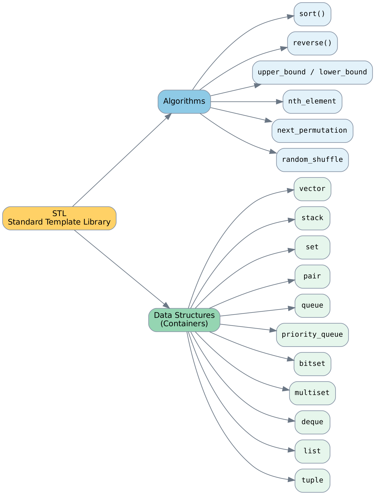

*The STL is made of algorithms and data structures (containers).*

The algorithms:

- sort()
- reverse()
- upper_bound / lower_bound
- nth_element
- next_permutation
- random_shuffle

Note: `random_shuffle` is removed in C++17. Use `shuffle(first, last, rng)` with `mt19937 rng(seed)`.

Containers:

- vector
- stack
- set
- pair
- queue
- priority_queue
- bitset
- multiset
- deque
- list
- tuple

Note: `map` is missing in this list but it is used everywhere below (key → value, sorted by key). `pair` and `tuple` are just small bundles of 2 / many values.

A short example for each algorithm:

```cpp
vector<int> v = {1, 3, 3, 3, 5, 8};                         // sorted, binary search needs this
auto lo = lower_bound(v.begin(), v.end(), 3) - v.begin();   // 1 → first element >= 3
auto hi = upper_bound(v.begin(), v.end(), 3) - v.begin();   // 4 → first element > 3
reverse(v.begin(), v.end());                                // 8 5 3 3 3 1

vector<int> w = {9, 4, 7, 1, 8, 2};
nth_element(w.begin(), w.begin() + 2, w.end());             // w[2] = 4, the 3rd smallest

vector<int> p = {1, 2, 3};
do { /* use p */ } while (next_permutation(p.begin(), p.end()));  // 123 132 213 231 312 321

mt19937 rng(12345);
shuffle(p.begin(), p.end(), rng);                           // replacement of random_shuffle
```

Tested: `lo = 1`, `hi = 4`, `w[2] = 4`, 6 permutations.

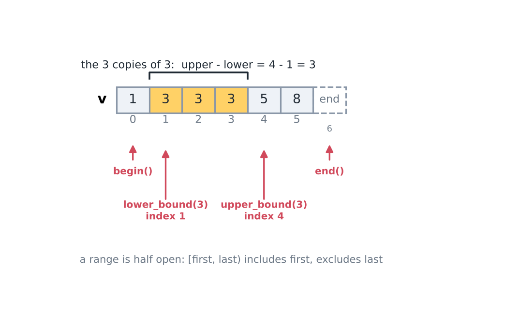

*upper_bound minus lower_bound gives the number of copies of 3. A range is written [first, last), which means the first position is included and the last position is not.*

| Algo | T.C. |
|---|---|
| sort | O(n log n) |
| lower_bound / upper_bound | O(log n) |
| nth_element | O(n) on average |
| next_permutation | O(n) per call |
| reverse | O(n) |

Note: on a `set`, use `st.lower_bound(x)` and not `lower_bound(st.begin(), st.end(), x)`. The second form walks step by step through the set, so it takes O(n).

How containers sit in memory:

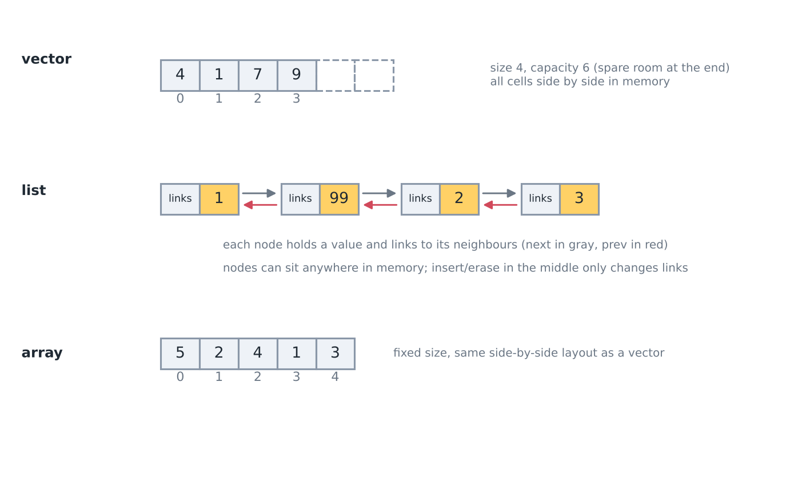

*A vector keeps its cells side by side. A list keeps separate nodes joined by links.*

```cpp
vector<int> vec = {4, 1, 7};  vec.push_back(9);        // size 4, vec[2] = 7
stack<int> st;  st.push(1); st.push(2); st.push(3);    // st.top() = 3
queue<int> q;   q.push(1);  q.push(2);  q.push(3);     // q.front() = 1, q.back() = 3
deque<int> dq;  dq.push_back(2); dq.push_front(1); dq.push_back(3);   // 1 2 3
list<int> li = {1, 2, 3};  li.insert(next(li.begin()), 99);          // 1 99 2 3
set<int> se = {5, 1, 5, 3};            // 1 3 5, size 3 (no duplicates)
multiset<int> ms = {5, 1, 5, 3};       // 1 3 5 5, ms.count(5) = 2
map<string, int> mp;  mp["apple"] += 2;                // key → value
pair<int, string> pr = {7, "seven"};   // pr.first, pr.second
tuple<int, char, double> tp = {1, 'x', 2.5};           // get<0>(tp), get<1>(tp), ...
bitset<8> bs;  bs[1] = 1;  bs[4] = 1;  // 00010010, bs.count() = 2
```

`set`, `multiset` and `map` are built on a balanced search tree. Every operation costs O(log n), and the elements are always kept sorted.

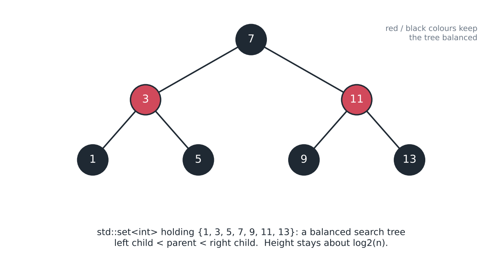

*A set of 7 numbers. In every node, the left child is smaller than the parent and the right child is larger. The height stays close to log n.*

A `deque` is stored as several blocks plus a small table of block addresses. So both ends take O(1), and `dq[i]` is also O(1): the index gives the block, and then the cell inside that block.

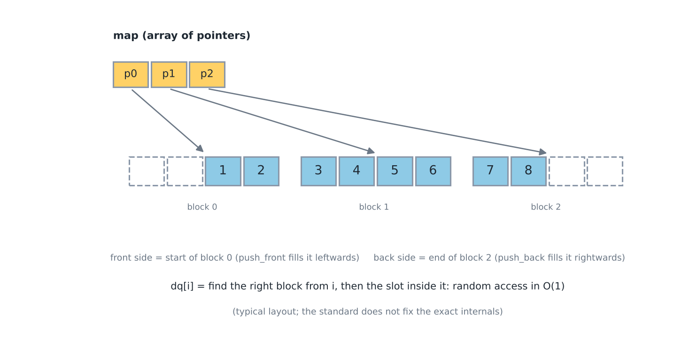

*The blocks of a deque. The exact layout depends on the compiler.*

| Container | add / remove | find |
|---|---|---|
| vector | end: amortized O(1), middle: O(n) | by index O(1) |
| deque | both ends O(1) | by index O(1) |
| list | O(1) if you have the iterator | by position O(n) |
| set / map / multiset | O(log n) | O(log n) |
| priority_queue | push, pop O(log n) | top O(1) |

More fast operations, for the same table. `set`, `multiset` and `map` also do `find`, `count` and `erase` in $O(\log n)$. `stack`, `queue` and `deque` do `push`, `pop` and `top` or `front` in $O(1)$.

Slow operations to avoid: searching a `vector` for a value is $O(n)$ (up to 100000 steps for $n = 10^5$). A `priority_queue` gives nothing but its largest element, so it cannot find or remove any other value.

Costs of a whole solution. $q$ operations of $O(\log n)$ each cost $O(q \log n)$. For $q = n = 2 \cdot 10^5$ that is about $4 \cdot 10^6$ steps. Tree containers follow pointers in memory, so their constant is large. A safer estimate is $10^6$ to $10^7$ such operations per second, not $10^8$. Do the 0.2 budget check with that.

Hash tables. A hash table spreads the values over buckets, and it is fast only when they spread evenly. Inputs built on purpose to collide put many values in one bucket, and then one operation scans that bucket, up to $O(n)$. This rule holds for every use of a hash table: where other people can send tests against your solution, the ordered `set` and `map` are the safe choice.

**Theorem 0.6.1 (amortised `push_back`).** If a vector doubles its capacity whenever it is full, then $n$ calls of `push_back` from an empty vector copy fewer than $2n$ elements in total, so each call costs $O(1)$ on average.

Small example first: 5 calls. The vector is full before the 2nd, 3rd and 5th call, and it copies 1, 2 and 4 elements: $1 + 2 + 4 = 7 < 10 = 2 \cdot 5$. For $n = 8$ the copies are also $1 + 2 + 4 = 7$. For $n = 1000$ they are $1 + 2 + \dots + 512 = 1023 < 2000$.

Why it works:
1. Copies happen only when the capacity grows from $c$ to $2c$, and then $c$ elements are copied.
2. The capacities that occur are $1, 2, 4, \dots, 2^k$ with $2^k < n$. So the total number of copies is at most $1 + 2 + 4 + \dots + 2^k = 2^{k+1} - 1$.
3. Since $2^k < n$, we get $2^{k+1} - 1 < 2n$.
4. Each call also writes one element, so the total work is less than $3n$.

This proof needs: (1) the capacity grows by a constant factor (here 2). Growing by a constant amount, say 10 cells, would cost $O(n^2)$ in total. (2) The bound is for the whole sequence of calls. One call that triggers a copy still costs $O(n)$.

<TheoremCode unit="0.6/thm-1" />

## sort() and ranges

The basic form of `sort()`, on a plain array of 5 numbers:

```
int arr[5];     sort(arr, arr+5); // O(nlogn)
```

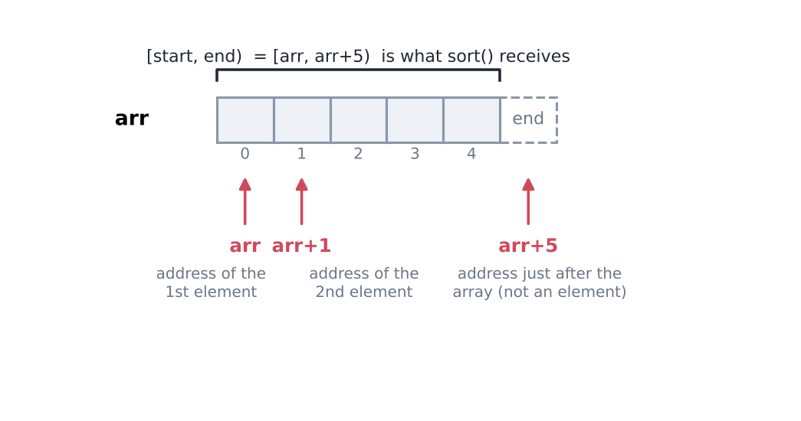

*The name arr is a pointer to the address of the first element. The range [start, end) is what we pass to sort.*

- `arr` is a pointer to the address of the first element.
- `arr+1` is the address of the 2nd element.
- `arr+5` is the address of the position just after the array.
- `[start, end)` is the range that is passed to sort.

Indexing is the same as pointer arithmetic: `arr[2]` means `*(arr+2)`.

Note: `sort` internally uses intro sort (quick sort + heap sort + insertion sort mixed). The worst case is also O(n log n). For n = 10^6 numbers that is about 10^6 × 20 = 2 × 10^7 steps, which finishes in well under a second.

Sorting only a part of the array: `sort(arr+1, arr+4)` sorts the range [1,4), which means indexes 1, 2 and 3.

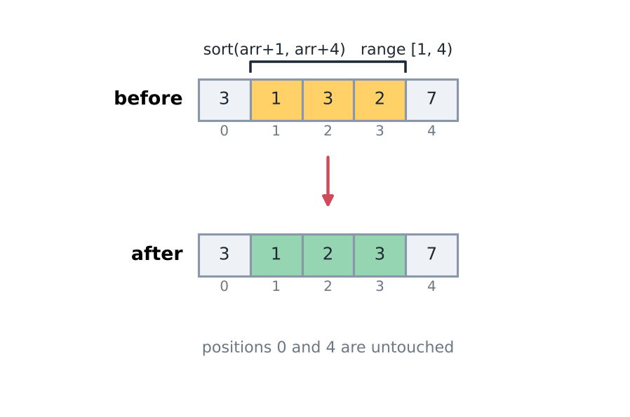

*The array [3,1,3,2,7] after sort(arr+1, arr+4) becomes [3,1,2,3,7].*

The same thing on a vector, with iterators:

```cpp
vector<int> v = {3, 1, 3, 2, 7};
sort(v.begin() + 1, v.begin() + 4);        // 3 1 2 3 7
sort(v.begin(), v.end(), greater<int>());  // 7 3 3 2 1  (greater<int>() means "a > b")

vector<pair<int, int>> p = {{2, 9}, {1, 5}, {7, 0}};
sort(p.begin(), p.end(), [](const pair<int, int>& x, const pair<int, int>& y) {
    return x.second < y.second;            // (7,0) (1,5) (2,9)
});
```

A comparator is a function that answers "should a come before b?". It must be strict: `comp(x, x)` must be false. Writing `<=` or `>=` gives undefined behaviour (a crash, an infinite loop or a wrong order), because `sort` may compare an element with itself or with an equal copy, and "a before b" and "b before a" must never both be true. The same point appears in the card game below: never write equality in a comparator.

Another comparator example: find the smallest string that can be made by concatenating (joining) all the given strings. Observation: string a goes before string b if `a + b < b + a`. For example a = "9", b = "91": a + b = "991" and b + a = "919". "919" is smaller, so "91" goes first.

```cpp
// Fabricator/STL/SmallestStringConcatenation.cpp
bool cmp(string a, string b){    
    return a + b < b + a;
}

void solve() {
    int n;
    cin>>n;

    vector<string> v;
    for(int i=0; i<n; i++){
        string s;
        cin>>s;
        v.push_back(s);
    }

    sort(v.begin(), v.end(), cmp);

    string ans = "";
    for(int i=0; i<n; i++){
        ans += v[i];
    }

    cout<<ans<<endl;
}
```

Tested: `abba abacaba bcd er` → `abacabaabbabcder`.

## STL Applications-1: balanced brackets

Question: check whether a string of parentheses is balanced.

The string `(()())()` is valid (balanced).

The string `)(` is invalid (not balanced).

The string `(( )` is invalid.

A stack is overkill for this problem (a stack is a last-in, first-out list).

We can use a number called depth instead. Initially the depth is 0.

When an open bracket is met, we do depth++.

When a close bracket is met, we do depth--.

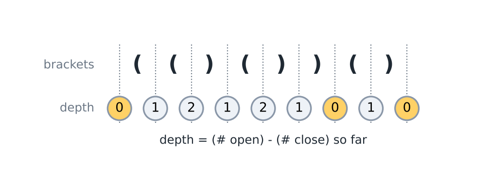

*The depth before the string and after each character: [0 1 2 1 2 1 0 1 0].*

At any point, depth = (the number of open brackets so far) - (the number of close brackets so far).

For the brackets to be balanced, two conditions must hold:

i) The depth must be 0 at the end.

ii) The depth must be at least 0 at every step.

Depth means "how many open brackets are not closed yet". If it goes negative, some close bracket has no open bracket to match. If it is above 0 at the end, some open brackets were never closed. Example: `(()` has depths 1, 2, 1 → ends at 1, not balanced. `)(` has depths -1, 0 → goes negative at the first step, so it is not balanced even though it ends at 0.

```cpp
// Fabricator/STL/BalancedParenthesis.cpp
/*
Given a string of parenthesis, check if all the parenthesis are balanced
*/

void solve(){
    string s;
    getline(cin, s);
    int depth = 0, is_balanced = 1;
    for(auto c: s){
        if(c == '('){
            depth++;
        }
        else{
            depth--;
        }

        if(depth < 0){
            is_balanced = 0;
            break;
        }
    }

    if(depth != 0) is_balanced = false;

    if(is_balanced)cout<<"Is Balanced\n";
    else cout<<"Not Balanced\n";
}
```

Tested: `(()())()` → Is Balanced. `)(` and `(()` → Not Balanced.

T.C. = O(n), M.C. = O(1).

Question: what if we have multiple types of brackets?

The string `[()]{}` is valid.

The string `[{]}` is invalid, but `[{}]` is valid.

A single depth variable cannot be used here, because the order of the bracket types matters.

We can use a stack for this. Reason: the most recent unclosed bracket must be the first one to close (last in, first out).

Steps: add every opening bracket to the stack. When a closing bracket comes, check the top of the stack. If the top and the closing bracket form a valid pair, pop the top. Otherwise the sequence is invalid.

To test a pair quickly, we can give a number to each type of bracket: a positive number to the opening one and the same number with a negative sign to the closing one. If the sum of two numbers is 0, they are a valid pair of brackets.

Note: sum == 0 is for (top of stack + current closing bracket), e.g. +2 and -2. Not the sum of the whole string.

![Brackets [ ( \{ \} ) ] with numbers +1 +2 +3 -3 -2 -1 and arcs joining matching pairs](../../../assets/notes/0-6-stl-toolbox/fig06_bracket_signs.png)

*The opening [ gets +1, ( gets +2 and \{ gets +3. Each closing bracket gets the same number with a negative sign. The numbers are only labels: the code below uses ( = 1, \{ = 2, [ = 3 and works the same way.*

Dry run, `[()]{}` valid, `[{]}` invalid:

![Stack trace of [()]\{\} ending empty, and of [\{]\} where ] arrives while the top is \{ and does not match](../../../assets/notes/0-6-stl-toolbox/fig07_bracket_stack_trace.png)

*If the stack is empty at the end, the string is balanced. If the top does not match the closing bracket, the string is not balanced.*

```cpp
// Fabricator/STL/BalancedBrackets.cpp
/*
Given a string of brackets, check if all the brackets are balanced
*/

void solve(){
    string s;
    getline(cin, s);
    map<char, int> mp;
    mp['('] = 1;
    mp[')'] = -1;
    mp['{'] = 2;
    mp['}'] = -2;
    mp['['] = 3;
    mp[']'] = -3;

    bool is_balanced = true;
    stack<int> st;
    for(auto c: s){
        int val = mp[c];
        if(val > 0){
            st.push(val);
        }
        else{
            if(!st.empty() && (st.top() + val == 0)){
                st.pop();
            }
            else{
                is_balanced = false;
                break;
            }
        }
    }

    if(!st.empty()) is_balanced = false;

    if(is_balanced) cout<<"Is Balanced\n";
    else cout<<"Not Balanced\n";
}
```

Tested: `[()]{}` and `[{}]` → Is Balanced. `[{]}` and `(()` → Not Balanced.

Trace of `[{]}`: `[` is pushed (stack: 3). `{` is pushed (stack: 3 2). `]` has value -3 and the top is 2, and 2 + (-3) is not 0, so the answer is Not Balanced at once. A string that starts with a closing bracket fails the `!st.empty()` test in the same way. The case that is easy to forget is a string that only opens, such as `(()`: nothing fails inside the loop, and only the final `!st.empty()` check rejects it.

T.C. = O(n), M.C. = O(n) (in the worst case, for example `((((`, the stack holds every bracket).

**Theorem 0.6.6 (last in, first out).** Read a string of `(` and `)` from left to right. Push the position of each `(` on a stack, and at each `)` pop the top position. If the stack is never empty at a `)` and is empty at the end, every `)` is matched with the nearest unmatched `(` before it, and the pairs are properly nested.

Small example first: `(())`. Positions 0 and 1 are pushed. The `)` at position 2 pops 1, and the `)` at position 3 pops 0. The pairs are $(1, 2)$ and $(0, 3)$. They are nested, and the stack ends empty.

Why it works:
1. The top of the stack is always the most recent `(` not yet matched. Each push puts the newest `(` on top, and each pop removes the top.
2. So each `)` is matched with the nearest unmatched `(` before it.
3. Take two pairs $(p, q)$ and $(p', q')$ with $p < p' < q$. The `(` at $p'$ was pushed after $p$, so it is above $p$ in the stack when the `)` at $q$ is read.
4. So $p'$ must already be popped, by a `)` at some $q' < q$. Pairs never cross.

This proof needs: (1) the process uses only the newest unfinished item (a stack) or only the oldest waiting item (a queue). (2) Check that the container is not empty before `top()` or `pop()` on a stack, and before `front()` or `pop()` on a queue. On an empty container they are undefined behaviour.

<TheoremCode unit="0.6/thm-6" />

The code above keeps values on the stack. To also record which position closes which, push positions and compare the kind of bracket at the top:

<CodeSnippet unit="0.6/bracket-partners" />

Dry run on `([]{})`, positions 0 to 5. Push 0 for `(` and 1 for `[`. The `]` at 2 meets the top, position 1, a `[`, so they are partners and 1 is popped. Push 3 for `{`. The `}` at 4 pops 3. The `)` at 5 pops 0. The stack is empty. The partner array is 5 2 1 4 3 0.

Cost: $O(n)$ time, $O(n)$ memory. An alternative is a `vector<int>` with `push_back`, `back` and `pop_back` as the stack. It also lets you read the elements below the top.

A queue is the same idea for "first come, first served". Elements leave in the order they arrived, so we push at the back and pop at the front, $O(1)$ each. Example: 3 tasks need 3, 1 and 4 units of work, and a worker gives each task at most $Q = 2$ units per turn. An unfinished task goes to the back with its remaining work.

Dry run: the queue is (1:3) (2:1) (3:4). Task 1 gets 2 units, 1 is left, back of the line: (2:1) (3:4) (1:1). Task 2 finishes. Task 3 gets 2, goes back: (1:1) (3:2). Task 1 finishes, then task 3 finishes. The finishing order is 2 1 3.

<CodeSnippet unit="0.6/round-robin" />

Cost: each pass of the loop is $O(1)$. A pass either finishes a task (at most $n$ times) or hands out exactly $Q$ units (at most $\sum t_i / Q$ times). So there are at most $\sum t_i / Q + n$ passes. Here that is $8/2 + 3 = 7$, and the dry run used 5. A `deque` can play the same role with `push_back`, `front` and `pop_front`.

Common mistake: calling `q.pop()` before reading `q.front()`. For tasks 3 1 4 with $Q = 2$ the first pass then works on task 2 instead of task 1. Read `front()` into variables first, then pop.

Now look at the depth as a graph, to see which parts of a string are balanced: an open bracket goes up, a close bracket goes down.

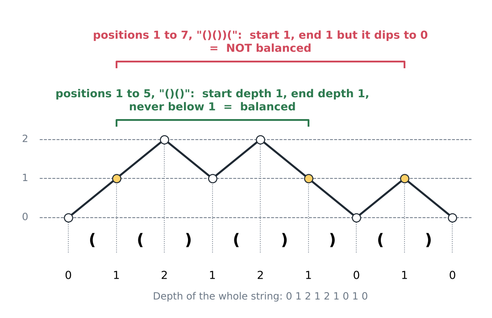

*The green part "()()" is balanced. The red part "()())(" is not balanced.*

To check whether one part (a block of consecutive characters) of the string is balanced, we compare the depth at the start of the part and the depth at its end.

Note: having the same depth at the start and at the end is not enough. The depth must also never go below the starting depth in between. The red piece in the figure starts at depth 1 and ends at depth 1, but it touches 0 in between, so it is not balanced.

The two conditions (same depth at both ends, never below it) as a function. Here `depth[i]` is the depth before character i, with `depth[0] = 0`, and the piece is the characters from position l up to r - 1:

```cpp
/*
   New function: the depth-graph rule above, written as code so it can be tested on any piece.
   Is the piece s[l..r-1] balanced on its own? O(r - l) time, no extra memory.
*/
bool pieceBalanced(const vector<int>& depth, int l, int r) {
    if (depth[l] != depth[r]) return false;          // must end where it started
    for (int i = l; i <= r; i++)
        if (depth[i] < depth[l]) return false;       // must never dip below the start
    return true;
}
```

For `(()())()` the depth array is `0 1 2 1 2 1 0 1 0`. The piece from 1 to 5 (`()()`) gives true. The piece from 1 to 7 (`()())(`) gives false, because depth[6] = 0 is below depth[1] = 1. The whole string, from 0 to 8, gives true. It agreed with a stack check on 2000 random bracket strings. Common mistake: testing only `depth[l] == depth[r]`, which wrongly accepts the red piece.

## STL Applications-2: window maintenance

There are two kinds of problems on arrays here:

- Window maintenance: keep track of some property of a window while it moves.
- Subarray finding: find a subarray that has some property.

A subarray is a block of consecutive elements.

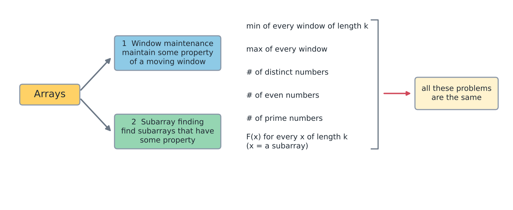

*Window maintenance and subarray finding. All the listed problems are the same problem with a different property.*

Question: find the minimum of every k-window of an array (a k-window is a block of k consecutive elements).

All the problems below are the same problem with a different property:

- min
- max
- the number of distinct values
- the number of even numbers
- the number of prime numbers
- F(X) for every X of length k, where X is a subarray and F is any function of its elements

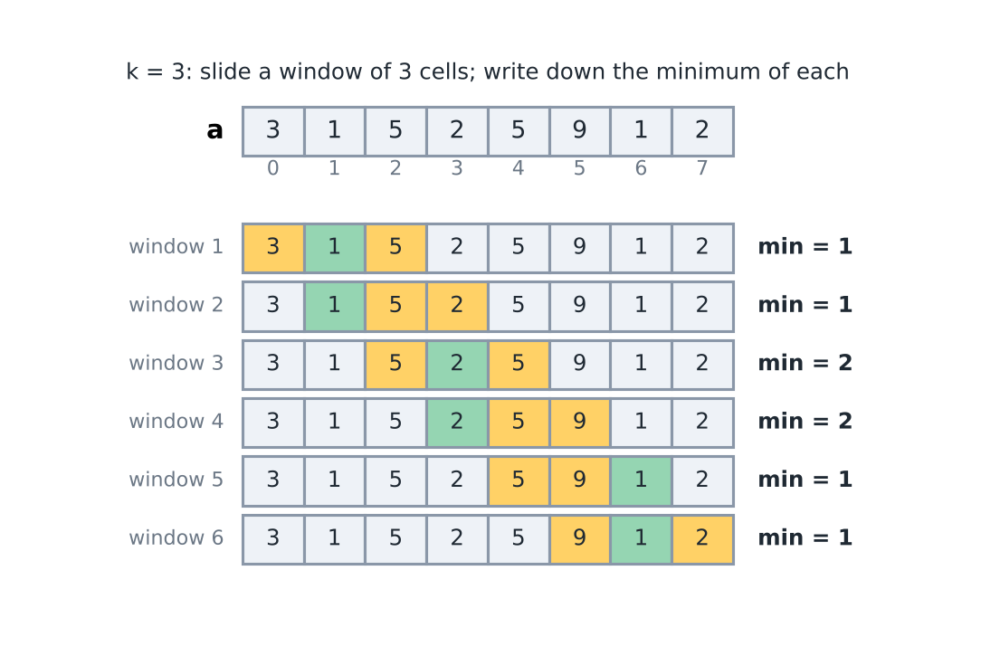

*With k = 3 the answers are 1, 1, 2, 2, 1, 1.*

Brute force: for each of the n-k+1 windows, call `min_element(arr+i, arr+i+k)`, which costs O(k). The total is O(n × k).

In DSA (data structures and algorithms) overall, a solution becomes faster in one of two ways:

- by making some observation about the problem, or
- by sharing information: building or precomputing something once and reusing it.

In the problem above, look at two neighbouring windows:

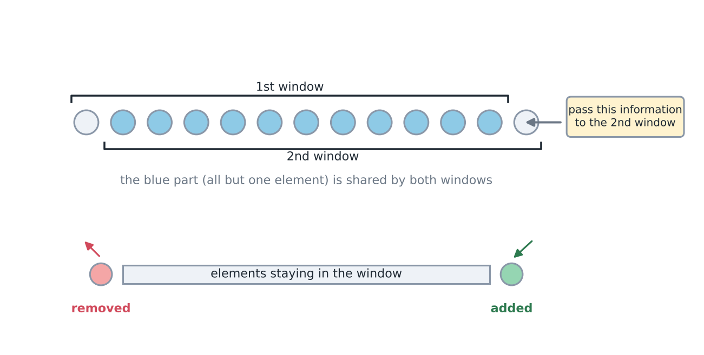

*The 1st window and the 2nd window share all but one element.*

If we could pass the information about this shared segment on to the 2nd window, the work would be reduced.

This means the next window only removes one element (the one that leaves) and adds one new element. Everything else is the same, so there is no reason to look at it again.

The cost of repeating work: with n = 10^5 and k = 5 × 10^4 there are about 5 × 10^4 windows and each costs 5 × 10^4 steps, so brute force does about 2.5 × 10^9 steps, which is too slow. Sharing work between windows brings it down to about 10^5 × 16 steps.

We need a data structure (DS) that helps us maintain the answer. It must support these three operations:

- erase(): remove an element
- insert(): add an element
- get(): return the current answer

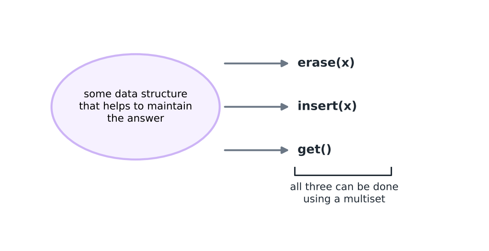

*Some DS helps us maintain the answer. It can be built with a multiset.*

We can use a multiset (a sorted container that allows duplicates), and the time is O(n log k).

Only the k elements of the current window are in the multiset, so every operation costs O(log k), and there are n steps → O(n log k).

```cpp
// Fabricator/STL/MinInKWindowSubarray.cpp
/*
Given an array of size n, find minimum of every window of size k.
*/

void solve(){
    int n, k;
    cin>>n>>k;
    int arr[n];
    for(auto &x: arr) cin>>x;

    multiset<int> mt;
    for(int i=0; i<n; i++){
        mt.insert(arr[i]); // O(log k)
        if((i-k) > 0) mt.erase(mt.find(arr[i-k])); // O(log k)
        if(i >= (k-1)) cout<<*mt.begin()<<" "; // O(1)
    }
}
```

Tested: `8 3` / `3 1 5 2 5 9 1 2` → `1 1 2 2 1 1`.

Note: `(i-k) > 0` should be `(i-k) >= 0`, otherwise arr[0] never leaves the window. `4 3` / `1 5 5 5` gives `1 1`, should be `1 5`. Also `erase(find(x))` removes one copy, `erase(x)` removes all copies.

Now consider the following observation. It makes the solution even faster than O(n log k).

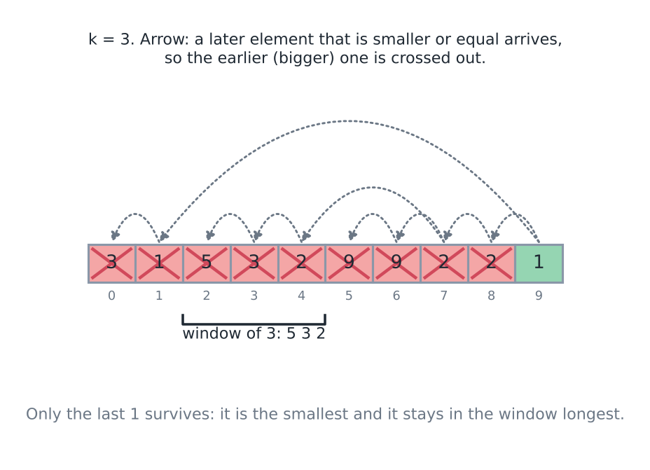

*Here k = 3. When a later element is smaller (or equal), the earlier bigger one is crossed out.*

If we find a small element, then all the bigger elements found before it are irrelevant.

The smaller element came later, so it also stays in the window longer. Whenever the bigger element is in the window, the smaller one is in it too, so the bigger element can never be the minimum again.

This is called a monotone deque. (A deque is a queue where elements can be added or removed at both ends.)

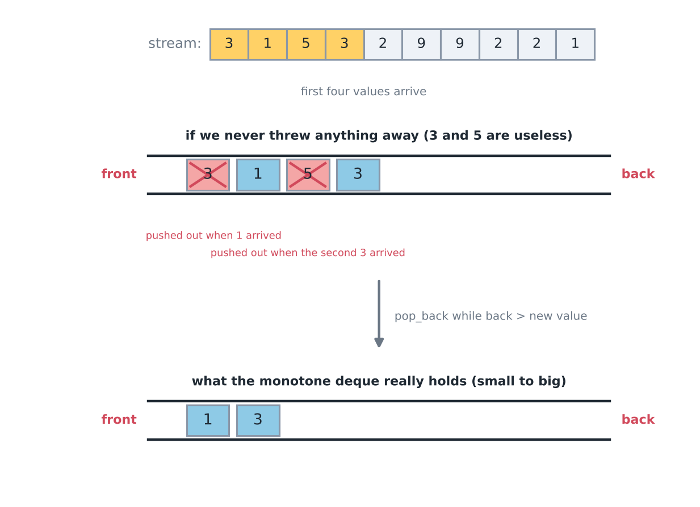

*The first 3 and the 5 are crossed out, so the deque keeps only 1 and 3.*

The three operations of the monotone deque, in pseudocode:

```
insert (x)
   while (dq.back() > x)
       dq.pop_back();
   dq.push_back(x)

get_min()
   return dq.front();

remove(x){
   if (dq.front() == x)
      dq.pop_front();
}
```

"Monotone" means the elements in the deque are always sorted: from the front to the back they never decrease.

Note: in the code, add `!dq.empty() &&` before `dq.back() > x`, because calling `back()` on an empty deque is undefined. The strict `>` is used so that equal copies stay in the deque; only then does remove(x) work with duplicates.

```cpp
// Fabricator/STL/MinInKWindow-MonotoneDequeue.cpp
/*
Given an array of size n, find minimum of every window of size k.
*/

// This solution uses monotonic deque to optimise the solution to O(n).
// This solution works for min of every window.

struct monotone_deque{
    deque<int> dq;
    void insert(int x){
        while(!dq.empty() && dq.back() > x)
            dq.pop_back();

            dq.push_back(x);
    }

    void erase(int x){
        if(!dq.empty() && dq.front() == x)
            dq.pop_front();
    }

    int get_min(){
        return dq.front();
    }
};

void solve(){
    int n, k;
    cin>>n>>k;
    int arr[n];
    for(auto &x: arr) cin>>x;

    monotone_deque mt;
    for(int i=0; i<n; i++){
        mt.insert(arr[i]); // O(1) --> Amortized
        if((i-k) > 0) mt.erase(arr[i-k]); // O(1)
        if(i >= (k-1)) cout<<mt.get_min()<<" "; // O(1)
    }
}
```

Tested: `8 3` / `3 1 5 2 5 9 1 2` → `1 1 2 2 1 1`. `10 3` / `3 1 5 3 2 9 9 2 2 1` → `1 1 2 2 2 2 2 1`.

Note: this code has the same `(i-k) > 0` bug. Change it to `>= 0` (the input `4 3` / `1 5 5 5` gives `1 1`, but the answer should be `1 5`).

Dry run, array 3 1 5 2 5 9 1 2, k = 3 (with the removal test written as `i-k >= 0`):

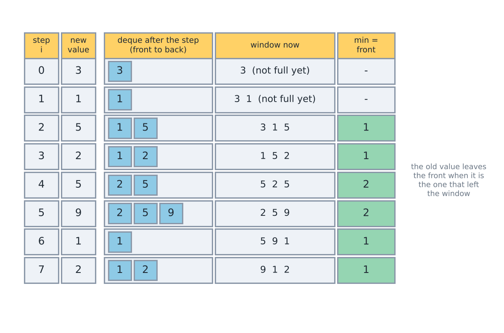

*The minimum of the window is always the front of the deque.*

In words, the deque after each step is: `[3]`, `[1]` (3 is thrown out because 1 came later and is smaller), `[1 5]` (window 3 1 5, min 1), `[1 2]` (5 is thrown out; window 1 5 2, min 1), `[2 5]` (the 1 leaves the window; min 2), `[2 5 9]` (min 2), `[1]` (9, 5 and 2 are all thrown out; min 1), `[1 2]` (min 1). The printed answers are 1 1 2 2 1 1.

T.C. = O(n) amortized. Each element is pushed once and popped at most once, so the total is at most 2n operations (for n = 10^5, at most 2 × 10^5). M.C. = O(k).

For the maximum, reverse the comparison (pop while the back is smaller than x).

The repository code removes by value, which is why it needs the strict `>` and the `(i-k) >= 0` fix. A version that stores positions instead removes by position, so it needs neither trick:

```cpp
/*
   New function: the corrected monotone deque. It stores indices, so we know exactly when the front
   has left the window (index <= i - k). The values at these indices grow from front to back.
   O(n) time, O(k) memory.
*/
vector<int> windowMinIndexDeque(const vector<int>& a, int k) {
    vector<int> result;
    deque<int> idx;
    for (int i = 0; i < (int)a.size(); i++) {
        while (!idx.empty() && a[idx.back()] >= a[i]) idx.pop_back();   // later and not bigger: the old one can never win
        idx.push_back(i);
        if (idx.front() <= i - k) idx.pop_front();                      // front fell out of the window
        if (i >= k - 1) result.push_back(a[idx.front()]);
    }
    return result;
}
```

Results: `3 1 5 2 5 9 1 2` with k = 3 gives `1 1 2 2 1 1`. `3 1 5 3 2 9 9 2 2 1` with k = 3 gives `1 1 2 2 2 2 2 1`. The input that broke the repository code, `1 5 5 5` with k = 3, gives `1 5`, which is correct. It matched a brute force with `min_element` on 2000 random arrays. Common mistake: forgetting the `!idx.empty()` check, which reads the back of an empty deque.

## STL Applications-3: shop and budget

Question: a shop has n items. The ith item has price p_i. A budget B is given. Find the maximum number of items that can be bought.

First idea: push the prices into a multiset or a priority queue, then take the cheapest item each time and subtract its price from B.

A simpler way: sort the array, go over it from the smallest price, and keep a count of the items that can be bought.

Reason: if t items can be afforded, then the t cheapest items can also be afforded. So buy the cheapest first. Example: prices 7 2 5 4, B = 11. Sorted: 2 4 5 7. Buy 2 (9 left), buy 4 (5 left), buy 5 (0 left). The price 7 does not fit, so the answer is 3 items.

```cpp
// Fabricator/STL/ShopMaximiseItems.cpp
/*
Suppose a shop has n items, ith item has price p_i. Given a budget b, find max number of items that can be bought
*/

// o(nlogn + n)
void solve(){
    int n, b;
    cin>>n>>b;

    int arr[n];
    for(auto &x: arr) cin>>x;

    sort(arr, arr+n);
    int sol = 0;
    for(int i=0; i<n; i++){
        if(arr[i] <= b){
            sol++;
            b -= arr[i];
        }
        else{
            break;
        }
    }

    cout<<sol<<endl;
}
```

Tested: `4 11` / `7 2 5 4` → `3` (2 + 4 + 5 = 11).

Question: the same shop has n items with prices p_i, but now there are m queries. Each query gives a budget b_1, b_2, ..... b_m. For every query, find the maximum number of items that can be bought.

Solution: sort the prices, build the prefix sum array (each cell holds the sum of all prices up to it), and then use upper_bound for each query.

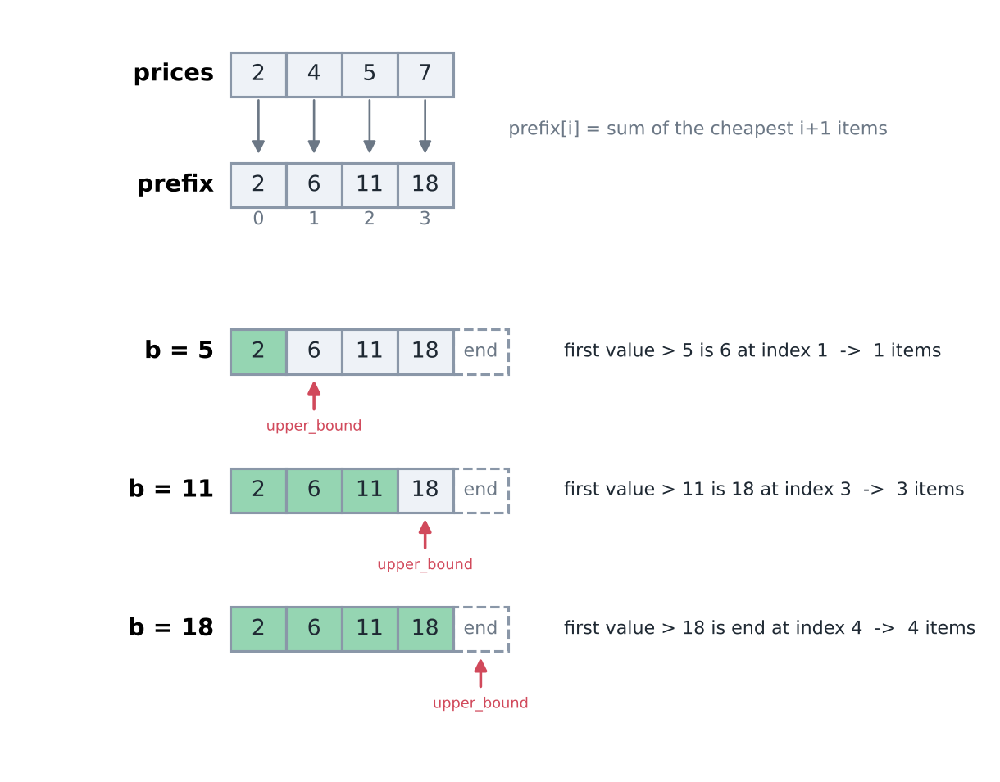

*The prefix sum array. The budget 5 gives upper_bound at 6, the budget 11 gives 18, and the budget 18 gives end (past the last cell).*

For the prefix sums 2 6 11 18, upper_bound returns:

- for the budget 5, the position of 6
- for the budget 11, the position of 18
- for the budget 18, the end (no prefix sum is larger than 18)

upper_bound(x) points to the first element in the array that is > x. So the index it gives is:

- the number of elements ≤ x,
- and the position just after the last element ≤ x.

The prefix sums are sorted (prices are positive), so binary search is allowed. The index of upper_bound = the number of prefix sums ≤ b = the number of items.

Why not repeat the first method for every query? With n = m = 10^5 that is about 10^5 × 10^5 = 10^10 steps. Sorting and building prefix sums once, then one binary search per query, costs about 10^5 × 17 steps.

```cpp
// Fabricator/STL/ShopMaximiseItemsQueries.cpp
/*
Suppose a shop has n items, ith item has price p_i. Given m budgets, find max number of items that can be bought for each budget.
*/

// O(qlogn + nlogn + n)
void solve(){
    int n;
    cin>>n;

    int arr[n];
    for(int i=0; i<n; i++) cin>>arr[i];

    sort(arr, arr+n);

    for(int i=1; i<n; i++){
        arr[i] += arr[i-1];
    }

    int q;
    cin>>q;
    while(q--){
        int b;
        cin>>b;

        auto it = upper_bound(arr, arr+n, b);
        int sol = it - arr;

        cout<<sol<<endl;
    }
}
```

Tested: prices `7 2 5 4`, budgets `1 5 11 18 100` → `0 1 3 4 4`.

Note: sums can pass 2 × 10^9 (the limit of `int`), so use long long. `lower_bound` is wrong here: an exact fit (sum == b) would be missed. Example: prefix sums 2 6 11 18 and b = 11. `upper_bound` points to 18 (index 3 → 3 items), but `lower_bound` would point to 11 itself (index 2 → 2 items).

## Algorithmic design

Algorithmic design means: create a data structure that supports some given operations.

For instance, we have to design a data structure that supports inserts and gives the sum when requested.

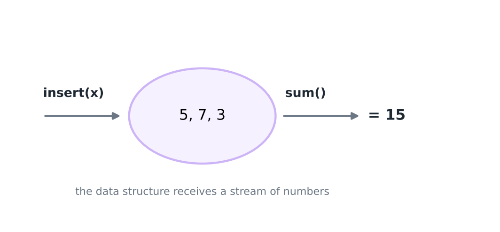

*The data structure takes a stream of data.*

```cpp
struct bag {
    int cur_sum= 0;
    void insert (int x){
        cur_sum+= x;
    }
    int sum() {
        return cur_sum;
    }
};
```

Note: for now we do not need the numbers themselves, so we do not store them.

Now, extending the requirement, we need to find the maximum number.

We can simply use another variable, cur_max, and keep the maximum value in it.

Now we need the number of distinct numbers seen until now.

We can use a set and store the numbers in it. The size of the set is the number of distinct elements.

Now we also have to remove elements.

A set cannot be used anymore, because we cannot delete an element directly: it may have occurred more than once in the stream.

A multiset cannot be used either, because it does not give the number of distinct elements cheaply.

A map works best. We use it as a frequency map: each number is a key, and its value is how many times it is present.

The two operations on the map are:

```cpp
insert (int x) {
    mp[x]++;
}
```

```cpp
remove (int x){
    mp[x]--;
}
```

Note: when mp[x] becomes 0, erase the entry. Otherwise mp.size() still counts it, and the distinct count is wrong.

Summary, what to store:

| need | store | remove possible? |
|---|---|---|
| sum | 1 variable | yes (subtract) |
| max | 1 variable | no (the next maximum is unknown) |
| distinct | set | no |
| distinct + remove | map (value → count) | yes |
| max + remove | same map, `rbegin()` = max | yes |

```cpp
// Fabricator/STL/AlgorithmicDesign.cpp
/*
We need to design a data structure that provides some sort of insert function and a func that returns sum of inserted nums
Secondly, we also want a func to fetch max number encountered till now.
Third, we need number of distinct numbers till now.
Fourth, we need to provide functionality of remove.
*/

struct Bag{
    int curr_sum = 0;
    //int curr_max = INT_MIN;
    //vector<int> store;
    //set<int> st;
    map<int, int> mp;

    void insert(int x){ //O(log n)
        curr_sum += x;
        //curr_max = max(curr_max, x);
        //store.push_back(x);
        //st.insert(x);
        mp[x]++;
    }

    int get_sum(){ // O(1)
        return curr_sum;
    }

    int get_max(){ // O(1)
        //return (*mp.rbegin()).first;
        return mp.rbegin()->first;
    }

    int get_distinct(){ // O(1)
        //return st.size();
        return mp.size();
    }

    void remove(int x){
        auto it = mp.find(x);
        if(it != mp.end()){
            curr_sum -= x;
            mp[x]--;
            if(mp[x] <= 0){    
                mp.erase(it);
            }
        }
    }
}
```

Note: the `;` is missing after the closing `}` of the struct, which is a compile error. With the `;` added: insert 5 7 5 3 → sum 20, max 7, distinct 3. remove(5) → sum 15, distinct 3. remove(5) again → sum 10, distinct 2. remove(7) → max 3. get_max() on an empty map will crash.

Cost: insert and remove are O(log n) because they update the map. get_sum, get_max (the last key of the map) and get_distinct (the size of the map) are O(1). M.C. = O(n) for the map.

## Achieve target sum: card game

Question: two players P_A and P_B are playing a card game. There are n cards placed on a table. Each card has two scores (A_i / B_i).

A_i is the score of P_A for card i, and B_i is the score of P_B for card i.

The players play alternately. Each player picks a card and takes it.

At the end of the game, the scores of P_A and P_B are S_A and S_B respectively.

The goal is to maximise (S_A - S_B).

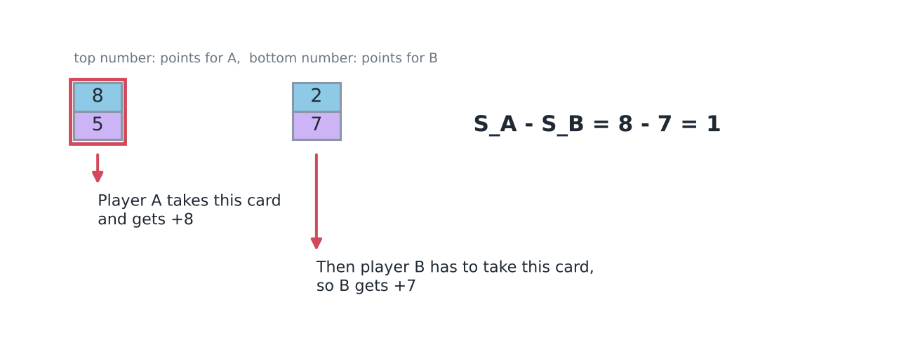

*Player A grabs (8,5) and gets +8. Then B has to pick (2,7) and gets +7. So S_A - S_B = 1.*

Trying all orders of play costs n! steps (for n = 20 that is about 2.4 × 10^18), so a rule is needed. The rule we want is a sort order. Here are four candidates for the sort key:

a) (A_i - B_i)

b) A_i

c) (A_i + B_i)

d) max(A_i, B_i)

In each case the cards are taken with the biggest key first, which means we sort in decreasing order of the key.

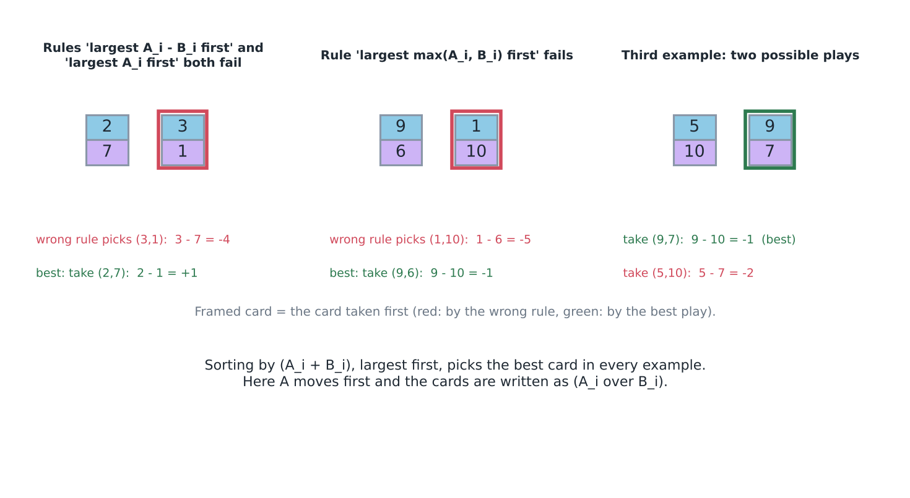

*Rules a), b) and d) fail. The example (2,7),(3,1) kills a) and b). The example (9,6),(1,10) kills d).*

We could also have used symmetry to find how to sort. The game looks the same from both sides, so any rule that works for A must also work for B. A rule that prefers A or B is therefore wrong.

A_i - B_i, A_i alone and max(A_i, B_i) treat A and B differently. A_i + B_i treats them equally.

Let us think logically.

There are n cards.

Suppose all the cards are with P_B. Then S_A = 0 and S_B = Σ B_i (the sum for i = 1 to n).

So initially S_A - S_B = -ΣB. Call this Δ_i (the initial difference).

Now P_A takes the j-th card from P_B. Then S_A = A_j and S_B = (ΣB_i) - B_j.

The new difference is S_A - S_B = A_j - (ΣB - B_j) = A_j + B_j - ΣB. Call this Δ_f (the final difference).

Therefore, moving one card from P_B to P_A changes the score difference by (A_j + B_j).

So the potential shift (the change in the difference) is (A_j + B_j).

Hence, we must sort by (A_i + B_i).

In plain words: a card with a big A_i + B_i is valuable for both players. If A takes it, A gains A_i. If A leaves it, B takes it and B gains B_i, so A loses that much of the difference. The swing between the two outcomes is A_i + B_i, so the biggest swing is taken first.

Worked example with 3 cards (5,10), (9,7), (1,1). The sums are 15, 16, 2, so the order is (9,7), (5,10), (1,1). A takes (9,7) and gets +9. B takes (5,10) and gets +10. A takes (1,1) and gets +1. S_A - S_B = 9 + 1 - 10 = 0. Trying every possible play by hand gives 0 as the best result too.

Δ_f - Δ_i = (A_j + B_j) - ΣB - (-ΣB)

So Δ_f - Δ_i = (A_j + B_j). This is the change in potential caused by moving one card.

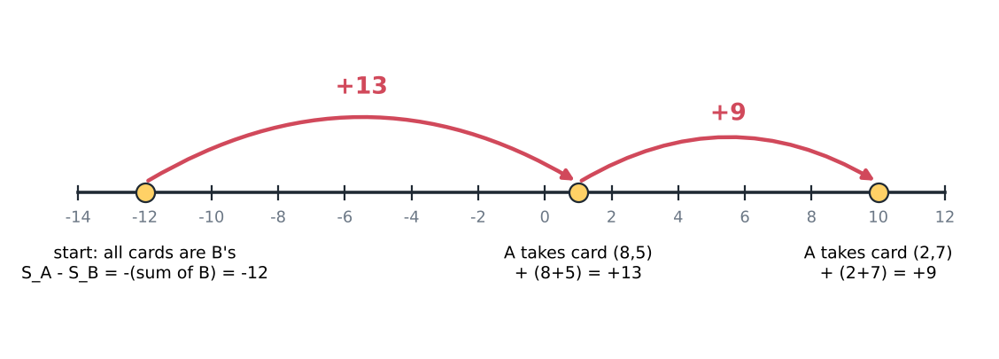

*Every card moved from B to A adds (A_j + B_j) to the difference. The cards with the biggest sums are taken first.*

Never write equality (`>=` or `<=`) in a comparator function, as explained in the sort() section above.

```cpp
// Fabricator/STL/CardGame.cpp
/*
Two players p_a and p_b play a card game. n cards, having (a_i, b_i), a_i is added to p_a's score if the card is picked by p_a, else if picked by p_b b_i is added to p_b's score.
Players play alternate, picked card is not returned to table.
At the end of game, final scores are s_a and s_b. Maximise s_a - s_b.
*/

bool cmp(const pair<int, int> &a, const pair<int, int> &b){
    return (a.first + a.second) > (b.first + b.second);
}

void solve(){
    int n;
    cin>>n;
    vector<pair<int, int>> cards(n);
    for(int i=0; i<n; i++){
        cin>>cards[i].first>>cards[i].second;
    }

    sort(cards.begin(), cards.end(), cmp);
}
```

Note: this code stops after sorting. The dealing of the cards (A takes the 1st, B takes the 2nd, ...) is:

```cpp
/*
After sorting with cmp (biggest A_i + B_i first), A takes the 1st card, B the 2nd,
A the 3rd and so on. Return S_A - S_B.
*/
long long scoreDifference(vector<pair<int, int>> cards) {
    sort(cards.begin(), cards.end(), cmp);
    long long difference = 0;
    for (size_t i = 0; i < cards.size(); i++) {
        if (i % 2 == 0) difference += cards[i].first;   // A's turn
        else difference -= cards[i].second;             // B's turn
    }
    return difference;
}
```

Tested: cards (8,5), (2,7) → `1`. Also checked against brute force (all possible plays) on 2000 random games, n ≤ 7. T.C. = O(n log n).

## Subarrays with sum = X

Question: an array arr of size n is given. The limits are -10 ≤ arr[i] ≤ 10 and -10^6 ≤ X ≤ 10^6. Find the number of subarrays with sum = X.

Example: n = 3, arr = [0, 3, 0] and X = 3.

The subarrays with sum 3 are [0,3], [3,0], [0,3,0] and [3]. So the answer is 4.

First, how many subarrays exist at all:

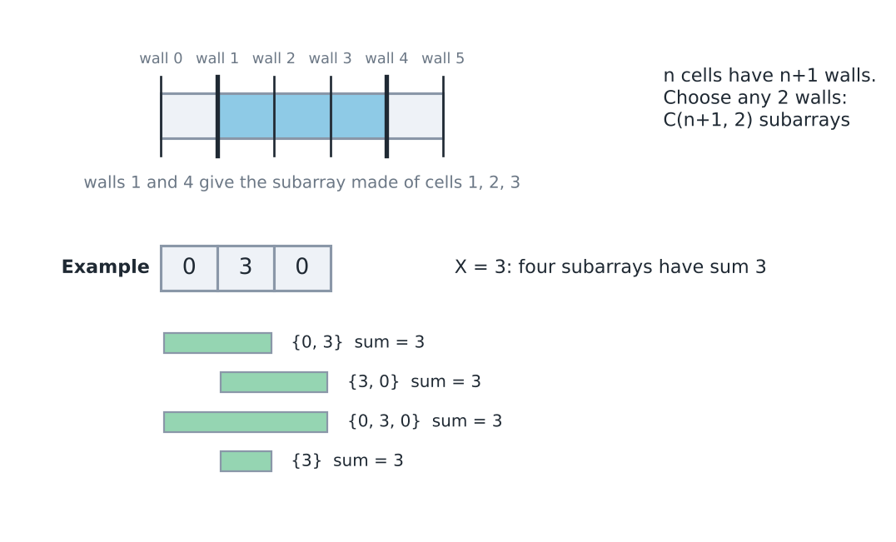

*n cells have n+1 walls. Choosing any two walls gives one subarray.*

The number of subarrays is n+1 C 2. There are n+1 walls, and if we choose any two walls, the cells between them form one subarray. So checking all of them is O(n²).

The number of subsequences is 2^n - 1.

Note: 2^n - 1 is the number of non-empty subsequences (we may pick any set of positions). The number of subarrays is n+1 C 2.

We need to count the pairs [L, R] for which

Σ (i=L to R) arr[i] = X

The sum of a block is P[R] - P[L-1], where P is the prefix sum array (P[i] = arr[1] + ... + arr[i], and P[0] = 0).

So we count the pairs (L, R) with L ≤ R such that

P[R] - P[L-1] == X, which is the same as P[L-1] == P[R] - X.

For each R, we find all the L values that satisfy P[R] - P[L-1] == X. A map from a prefix-sum value to the number of times it was seen gives this count in O(log n).

Example: arr = 2, 0, 2, 0, 2 and X = 4.

The prefix sums are P = 0, 2, 2, 4, 4, 6.

![arr = 2 0 2 0 2 and P = 0 2 2 4 4 6, four brackets P[3]-P[0], P[4]-P[0], P[5]-P[1], P[5]-P[2], each equal to 4](../../../assets/notes/0-6-stl-toolbox/fig21_prefix_pairs.png)

*The last value 6 pairs with both of the earlier 2's: 6-2=4 and 6-2=4. The total is 4 subarrays.*

```
Sum= 0
for R ∈ [1, N]
    sum += mp[P[R]-X] ──→ O(log n)        } O(nlogn).
    mp[P[R]]++;
print sum.
```

Note: before the loop, mp[P[0]] = mp[0] = 1 must be set, because the empty prefix is also a valid left end. Query first and insert after, so that L-1 &lt; R stays true. The array can contain negative numbers, so the two pointers method does not work here.

Dry run on `2 0 2 0 2`, X = 4. P = 0, 2, 2, 4, 4, 6. Start: mp = \{0: 1\}.

- R = 1, P = 2: need P = -2 → 0 matches. mp[2] = 1.
- R = 2, P = 2: need -2 → 0 matches. mp[2] = 2.
- R = 3, P = 4: need 0 → 1 match. sum = 1. mp[4] = 1.
- R = 4, P = 4: need 0 → 1 match. sum = 2. mp[4] = 2.
- R = 5, P = 6: need 2 → 2 matches. sum = 4.

Cost: checking all pairs of walls is about (10^5)² / 2 = 5 × 10^9 steps for n = 10^5. The map version does n queries of O(log n) each, about 10^5 × 17 = 1.7 × 10^6 steps. M.C. = O(n).

```cpp
// Fabricator/STL/SubArraySumEqualsK.cpp
/*
Given an array, find number of subarrays whose sum of elements is equal to X.
*/

void solve(){
    int n, x;
    cin>>n>>x;
    int arr[n];
    for(int i=0; i<n; i++) {
        cin>>arr[i];
        if(i) arr[i] += arr[i-1];
    }

    int sol = 0;
    map<int, int> mp;
    mp[0]++;
    for(int i=0; i<n; i++){
        sol += mp[arr[i] - x];
        mp[arr[i]]++;
    }

    /* To print the subarrays as well */
    // int sol = 0;
    // map<int, vector<int>> mp;
    // mp[0].push_back(-1);
    // for(int i=0; i<n; i++){
    //     sol += mp[arr[i] - x];
    //     for(auto v: mp[arr[i] - x]){
    //         cout<<v+1<<" , "<<i<<endl;
    //     }
    //     mp[arr[i]].push_back(i);
    // }

    cout<<sol<<endl;
}
```

Tested: `3 3` / `0 3 0` → `4`. `5 4` / `2 0 2 0 2` → `4`.

Note: prefix sums stored in `int` can overflow, so use long long. `unordered_map` gives O(n) on average, but some judges have anti-hash tests (inputs built to make it slow), so `map` is the safe choice.

## Top K elements in priority queue

Question: K is fixed. The data structure supports insert(x), and a query that returns the sum of the K largest elements so far.

Example with k = 2: insert(5), insert(3), insert(7), then find() returns 5 + 7 = 12.

Brute force: sort all numbers at every query. That is about n log n = 1.7 × 10^6 steps for n = 10^5, and with 10^5 queries about 1.7 × 10^11 steps, which is too slow.

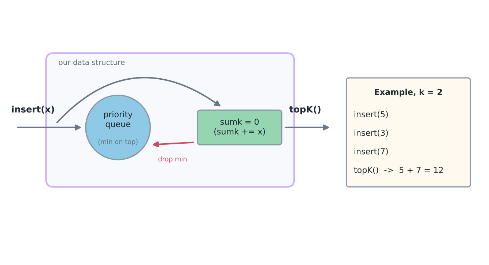

*The DS is a priority queue plus a running sum, sumk. Insert goes to both. The answer of topK() comes from sumk.*

When we insert an element into our data structure, we do two things:

- we add it to sumk, and
- we insert it into our priority queue.

If we keep inserting elements, the size of the priority queue will become greater than k. We must make sure the size of the priority queue is exactly k.

So after an insert, if the size is more than k (it will be k+1), we remove the minimum from the priority queue and subtract it from sumk.

Note: `priority_queue<int>` is a max heap (the largest element is on top). To use it as a min heap, store every element with its sign flipped.

A heap is a tree stored in an array. The children of index i are at 2i+1 and 2i+2, and in a max heap the parent is at least as large as its children.

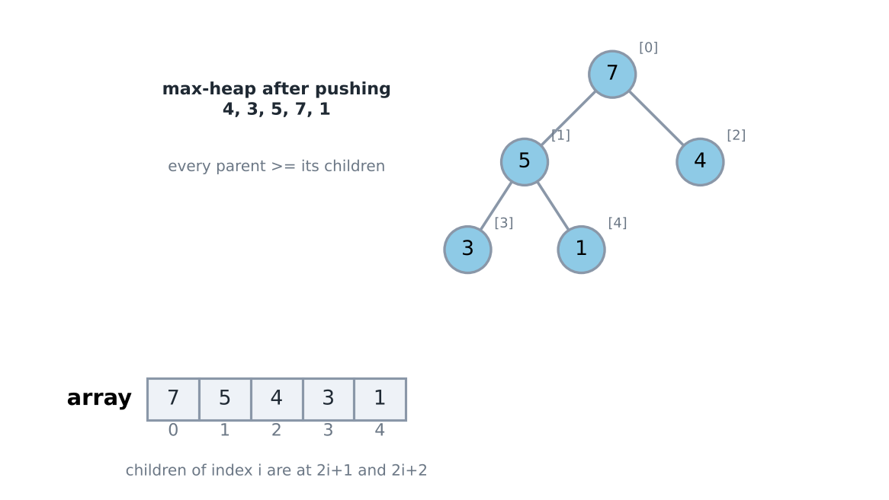

*The max heap [7 5 4 3 1] shown as an array and as a tree.*

Take the numbers [4, 3, 5, 7, 1] in this order.

A max heap pops them in the order [7, 5, 4, 3, 1].

If we push the negative of each number, the heap pops them in the order [-1, -3, -4, -5, -7].

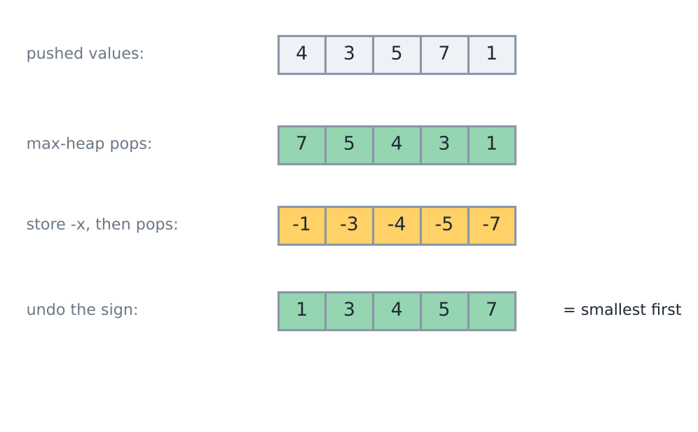

*After undoing the sign flip, -1 -3 -4 -5 -7 become 1 3 4 5 7.*

Keep the sign flip in mind: push -x, and when reading the top, change the sign back.

Why a min heap here: the top of a min heap is the smallest of the k kept numbers, and that is exactly the number to throw away when the size becomes k+1.

Another way is `priority_queue<int, vector<int>, greater<int>>` (the three parts are the value type, the storage and the comparison). This needs no sign flip.

```cpp
/*
Insert only: sum of k largest. Min heap of size k, size becomes k+1 → throw away the smallest.
*/
void insertTopKHeap(priority_queue<long long, vector<long long>, greater<long long>>& heap,
                    long long& sumK, int k, long long x) {
    heap.push(x);
    sumK += x;
    if ((int)heap.size() > k) {
        sumK -= heap.top();
        heap.pop();
    }
}
```

Tested: k = 2, insert 5, 3, 7 → `12`. T.C. = O(log k) per insert.

Question: in the previous problem, how would we also support the remove(x) operation?

Problems with the previous approach:

- If an element is thrown away, it is unrecoverable. After remove of a top element, the (k+1)th largest has to come back, but it is gone.
- Deleting any specific element is very complicated using a PQ, because a heap only gives the top.

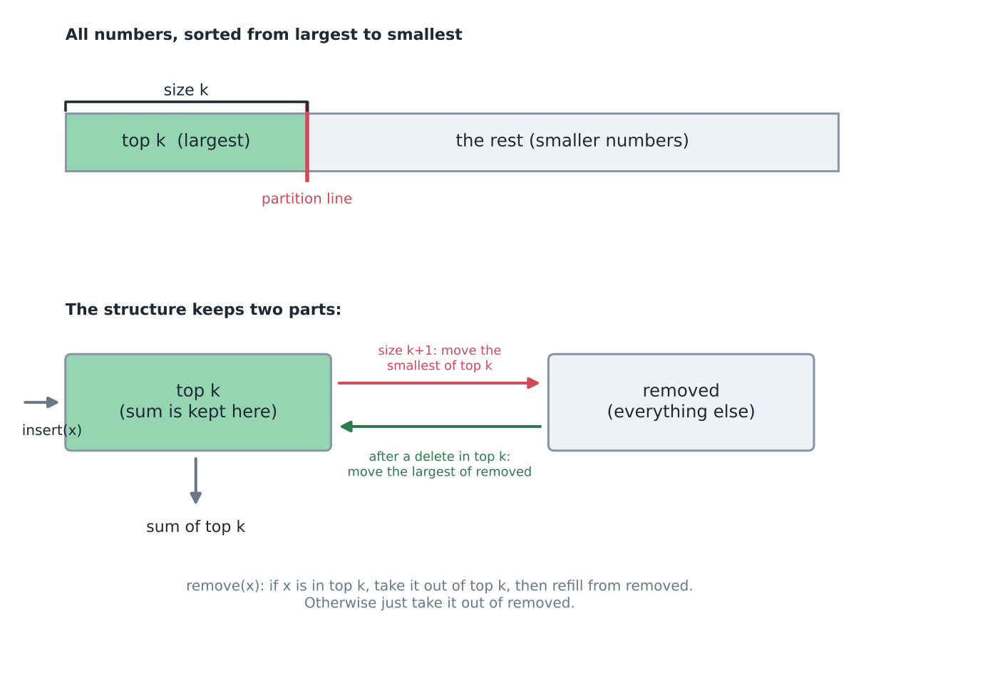

*We need some DS in which we do the operations on sorted data: a topk part and a removed part, with a partition line between them.*

An element that is removed from topk is added to the removed DS.

insert(x): store x in the topk part. If the size becomes k+1, remove the minimum and put it in the removed part.

remove(x): if x is in topk, remove it from topk (the size becomes k-1), then fetch the largest from removed and push it to topk. Else remove x from the removed part.

Observation: every element of topk is ≥ every element of removed. One insert or remove moves only one element across the line, so each operation is O(log n), and the sum is updated in O(1).

```cpp
// Fabricator/STL/TopKElements.cpp
/*
Design a data structure that takes a stream of numbers and returns the sum of top k elements.
*/

struct Bag{
    int k;
    long long sumK;
    //priority_queue<int> pq;
    multiset<int> topK, removed;

    void init(int _k){
        k = k;
        sumK = 0;
        topK.clear();
        removed.clear();
    }

    // O(log n) - Multiset
    void insert(int x){
        sumK += x;
        topK.insert(x);
        if(topK.size() > k){
            auto it = topK.begin();
            sumK -= (*it);

            removed.insert(*it);
            topK.erase(it);

            // This is a buggy code, here 'it' will become void, and nothing will be saved in removed
            // topK.erase(it);
            // removed.insert(*it);
        }
    }

    // O(log n) - PQ
    // void insert(int x){
    //     sumK += x;
    //     pq.push(-x); // O(log n)

    //     if(pq.size() > k){
    //         int t = -pq.top(); // O(1)
    //         sumK -= t;
    //         pq.pop(); // O(log n)
    //     }
    // }

    // O(log n) - Multiset
    void remove(int x){
        auto it = topK.find(x);
        if(it != topK.end()){
            sumK -= *it;
            topK.erase(it);
        }
        else{
            it = removed.find(x);
            if(it != removed.end()){
                removed.erase(it);
            }
        }

        if(topK.size() < k && !removed.empty()){
            auto itr = removed.rbegin();
            sumK += *itr;
            topK.insert(*itr);
            removed.erase(itr);
        }
    }

    // O(1)
    long long topKSum(){
        return sumK;
    }
};
```

Note: this code has two bugs. First, `k = k;` in init should be `k = _k;`. Second, `removed.erase(itr)` with a `rbegin()` reverse iterator does not compile in g++, so use `auto itr = prev(removed.end());`. The idea is completely correct, and only these two places need a fix.

Working version of both ops (same idea, free functions):

```cpp
/*
top = k largest, rest = others (every value in top >= every value in rest). sumK = sum of top.
*/
void topKInsert(multiset<long long>& top, multiset<long long>& rest, long long& sumK, int k, long long x) {
    top.insert(x);
    sumK += x;
    if ((int)top.size() > k) {  // size k+1 → move smallest of top to rest
        auto smallest = top.begin();
        sumK -= *smallest;
        rest.insert(*smallest);
        top.erase(smallest);
    }
}

void topKRemove(multiset<long long>& top, multiset<long long>& rest, long long& sumK, long long x) {
    auto it = top.find(x);
    if (it != top.end()) {
        sumK -= *it;
        top.erase(it);
        if (!rest.empty()) {  // refill top with largest of rest
            auto biggest = prev(rest.end());
            sumK += *biggest;
            top.insert(*biggest);
            rest.erase(biggest);
        }
    } else {
        rest.erase(rest.find(x));
    }
}
```

Tested: k = 2, insert 5, 3, 7 gives `12`, and then remove(7) gives `8` (5+3). 2000 random op sequences match brute force.

Trace for k = 2. insert(5): top \{5\}, sum 5. insert(3): top \{3 5\}, sum 8. insert(7): top \{3 5 7\} has size 3, so the smallest (3) moves to removed: top \{5 7\}, removed \{3\}, sum 12. remove(7): 7 is in top, so top \{5\}, sum 5. The size is 1 &lt; k, so the largest of removed (3) moves back: top \{3 5\}, sum 8.

T.C. = O(log n) per operation, M.C. = O(n) because every number is stored once. Typical mistake: remove(x) for a value that is in both parts (duplicates). Equal values are interchangeable, so removing from top first is correct.

## Median with insert and remove

Question: design a data structure that supports these operations: insert(x), remove(x) and median(). The median() operation returns the median value.

Brute force: keep a sorted vector. Every insert or remove shifts up to n elements, which is about 10^5 × 10^5 = 10^10 steps for 10^5 operations. The median itself is the middle element, so only the middle matters.

We can use the splitting strategy from the previous problem.

Maintain two partitions (halves) of the same or nearly the same size. In the low half the maximum is at its right end, and in the high half the minimum is at its left end. Either of these can be the median.

So the median is always at the border between the two halves.

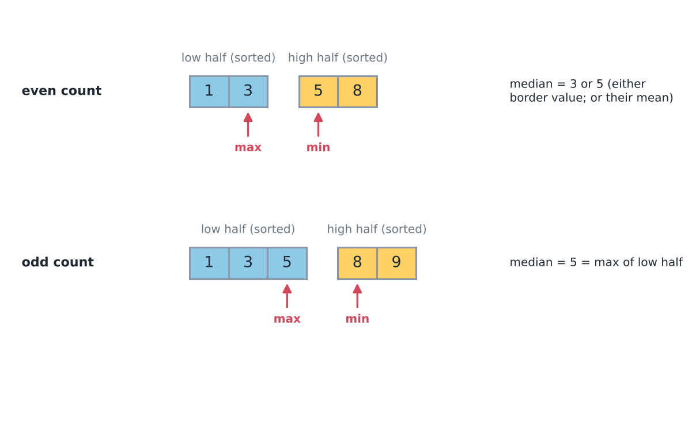

*With an even count, the median is 3 or 5 (either value at the border). With an odd count, the median is the maximum of the low half.*

```cpp
// Fabricator/STL/MedianOfChangingArray.cpp
/*
Design a data structure that provides support for insert, remove and median(returnin median of the elements).
*/

struct Bag{
    multiset<int> left, right;

    void insert(int x){
        if(!left.empty()){
            auto it = left.end();
            it--;
            auto val = *it;
            if(x <= val)
                left.insert(x);

            return;
        }

        if(!right.empty()){
            auto it = right.begin();
            auto val = *it;
            if(x >= val)
                right.insert(x);

            return;
        }

        left.insert(x);
    }

    void remove(int x){
        if(!left.empty()){
            auto it = left.end();
            it--;
            auto val = *it;
            if(x <= val)
                left.erase(left.find(x));

            return;
        }

        if(!right.empty()){
            auto it = right.begin();
            auto val = *it;
            if(x >= val)
                right.erase(right.find(x));

            return;
        }
    }

    void rebalance(){
        while(left.size() >= right.size() + 2){
            auto it = left.end();
            it--;
            auto val = *it;
            left.erase(it);
            right.insert(val);
        }

        while(right.size() > left.size()){
            auto it = right.begin();
            auto val = *it;
            left.insert(val);
            right.erase(it);
        }
    }

    int median(){
        rebalance();
        auto it = left.end();
        it--;

        return *it;
    }
};
```

Note: in insert and remove, the `return;` is outside the inner `if`. So when left is non-empty, the function returns right after the first check. A value x > max(left) is never inserted (and in remove, a value from right is never removed). Test: insert 5, 3, 8 → the median should be 5, but the code gives 3 (the 8 was dropped). rebalance and median are correct.

Fixed version:

```cpp
/*
low = smaller half, high = bigger half. Keep low.size() == high.size() or high.size() + 1.
Median (lower one if count is even) = biggest of low.
*/
void medianRebalance(multiset<int>& low, multiset<int>& high) {
    while (low.size() > high.size() + 1) {
        auto biggest = prev(low.end());
        high.insert(*biggest);
        low.erase(biggest);
    }
    while (high.size() > low.size()) {
        auto smallest = high.begin();
        low.insert(*smallest);
        high.erase(smallest);
    }
}

void medianInsert(multiset<int>& low, multiset<int>& high, int x) {
    if (low.empty() || x <= *low.rbegin()) low.insert(x);
    else high.insert(x);
    medianRebalance(low, high);
}

void medianRemove(multiset<int>& low, multiset<int>& high, int x) {
    if (!low.empty() && x <= *low.rbegin()) low.erase(low.find(x));
    else high.erase(high.find(x));
    medianRebalance(low, high);
}

int medianValue(const multiset<int>& low) {
    return *low.rbegin();
}
```

Tested: insert 5, 3, 8 → median `5`. insert(1) → (1 3 5 8) median `3`. remove(3) → (1 5 8) median `5`. 2000 random sequences match brute force.

Trace: insert(5): low \{5\}. insert(3): 3 ≤ 5, so low \{3 5\}; low is too big, so 5 moves to high: low \{3\}, high \{5\}. insert(8): 8 &gt; 3, so high \{5 8\}; high is bigger than low, so 5 moves back: low \{3 5\}, high \{8\}. The median is the biggest of low, which is 5.

T.C. = O(log n) for insert / remove (a rebalance moves at most one element), O(1) for median. Typical mistake: calling median on an empty structure (undefined behaviour). If the count is even and the average of the two middle values is needed, use `(*low.rbegin() + *high.begin()) / 2.0`.

## Range maintenance: segments covering a point

Question: N ranges [L_i, R_i] are given on the number line (from -∞ to +∞). There are Q queries. A query "? y" asks for the number of segments that cut (contain) the point y.

![Number line with segments A [3,5], B [2,9], C [0,7], D [11,13] and queries y = 1, 4, 7 with answers 1, 3, 2](../../../assets/notes/0-6-stl-toolbox/fig27_range_cover_line.png)

*The three query points y give the answers 1, 3 and 2. (The coordinates here were chosen to match these counts.)*

There are three versions of the constraints:

i) N ≤ 10^3, Q ≤ 10^3, and L_i, R_i, y ≤ 10^9.

ii) N, Q ≤ 10^5, and L_i, R_i, y ≤ 10^9.

iii) N, Q ≤ 10^5, and L_i, R_i, y ≤ 10^5. This one can be solved using partial sum.

We are solving for (i) and (ii).

Brute force approach: for each query, check which ranges include y.

This is O(Q × N). It can solve constraint (i) (10^3 × 10^3 = 10^6 steps), but for constraint (ii) it is 10^5 × 10^5 = 10^10 steps, which is too slow.

The segments that do not cover y are of two kinds: those with L_i > y (they start after y), and those with R_i &lt; y (they end before y).

These two kinds never overlap, because a segment with L_i > y and R_i &lt; y would need R_i &lt; L_i.

The number of segments covering y = N - (the number of segments not covering y).

To count them, we do two things:

i) Sort the L_i values and find the count of those greater than y.

ii) Sort the R_i values and find the count of those smaller than y.

So for a query y, the answer is N - [(the number of R_i &lt; y) + (the number of L_i > y)].

Lvec is the sorted list of the L_i values. upper_bound(y) - begin gives the number of L_i that are at most y. So the number of L_i greater than y is end - upper_bound(y).

Rvec is the sorted list of the R_i values. lower_bound(y) - begin gives the number of R_i that are smaller than y.

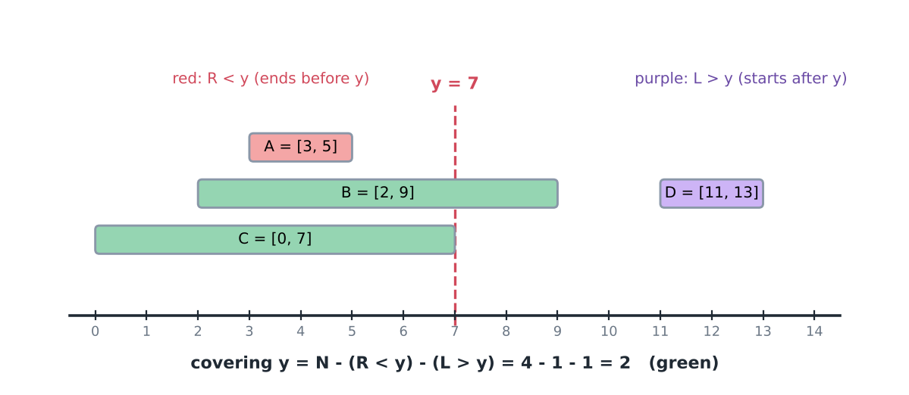

*For y = 7 the answer is 4 - 1 - 1 = 2.*

Worked check for y = 7. Lvec = 0 2 3 11, upper_bound(7) points to 11 at index 3, so 4 - 3 = 1 segment starts after 7. Rvec = 5 7 9 13, lower_bound(7) points to 7 at index 1, so 1 segment ends before 7. Answer 4 - 1 - 1 = 2. Both vectors are sorted once (O(n log n)), and each query is two binary searches (O(log n)).

The total time is O(N log N + Q log N), which is O((N+Q) log N).

```cpp
// Fabricator/STL/SegmentsCoveringElement.cpp
/*
Given n ranges [l_i, r_i], and q queries(? y), find number of segments containing y.
*/

void solve() { // O((n+q)log n)
    int n;
    cin>>n;

    vector<long long> lvec, rvec;
    for(int i=0; i<n; i++){
        long long l, r;
        cin>>l>>r;

        lvec.push_back(l);
        rvec.push_back(r);
    }

    sort(lvec.begin(), lvec.end());
    sort(rvec.begin(), rvec.end());

    int q;
    cin>>q;
    while(q){
        char c;
        long long y;
        cin>>c>>y;

        int notContainingL = lvec.end() - upper_bound(lvec.begin(), lvec.end(), y);
        int notContainingR = lower_bound(rvec.begin(), rvec.end(), y) - rvec.begin();

        cout<<n-(notContainingL + notContainingR)<<endl;
    }
}
```

Tested: segments `3 5`, `2 9`, `0 7`, `11 13`, queries `? 4`, `? 7` → `3`, `2`.

Note: in `while(q)`, q never decreases, so the loop never ends and the last answer is printed again and again. It should be `while(q--)`.

For constraint (iii) (coordinates at most 10^5) we can use partial sum, which is a prefix sum of a difference array. Add +1 where a range starts and -1 one position after its end, then take a running sum.

```cpp
/*
Ranges [l, r], coordinates <= maxCoord. For every point y, how many ranges contain y?
*/
vector<int> coverAtEveryPoint(const vector<pair<int, int>>& ranges, int maxCoord) {
    vector<int> diff(maxCoord + 2, 0);
    for (auto [l, r] : ranges) {
        diff[l]++;
        diff[r + 1]--;
    }
    for (int i = 1; i <= maxCoord; i++) diff[i] += diff[i - 1];
    return diff;
}
```

Tested: same four segments → y = 1, 4, 7 gives `1 3 2`. 500 random cases match brute force.

## Range maintenance: fill, clear, check

Question: there are multiple queries to handle. Q ≤ 10^5 and L, R, X, Y ≤ 10^9. The query types are:

- fill range [L,R]: mark the range as filled. If two ranges overlap, their union is filled.
- clear range [L,R]: remove the filled segments in this range.
- check point X: check whether X is included in some filled segment.
- check interval [X,Y]: check whether any part of it is covered by some filled segment.

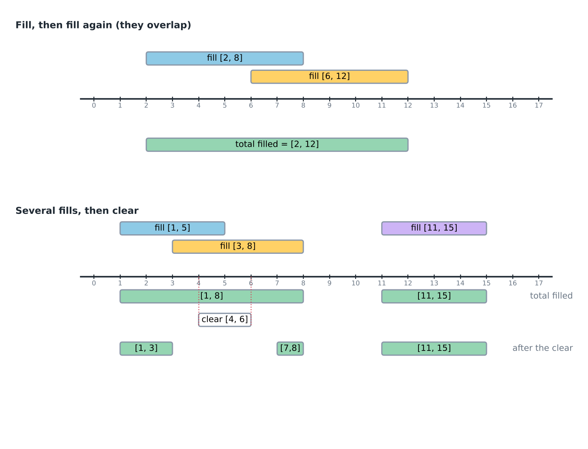

*Overlapping fills give their union as the total filled region. Clearing [4,6] makes a hole.*

![Number line with filled segments [2,6] and [10,14]; check point 8 falls in a gap (no active region); check interval [5,9] overlaps (some part active)](../../../assets/notes/0-6-stl-toolbox/fig30_check_queries.png)

*The point X = 8 is in a gap, so it is not in an active (filled) region. The interval [5,9] overlaps a filled segment, so some part of it is active.*

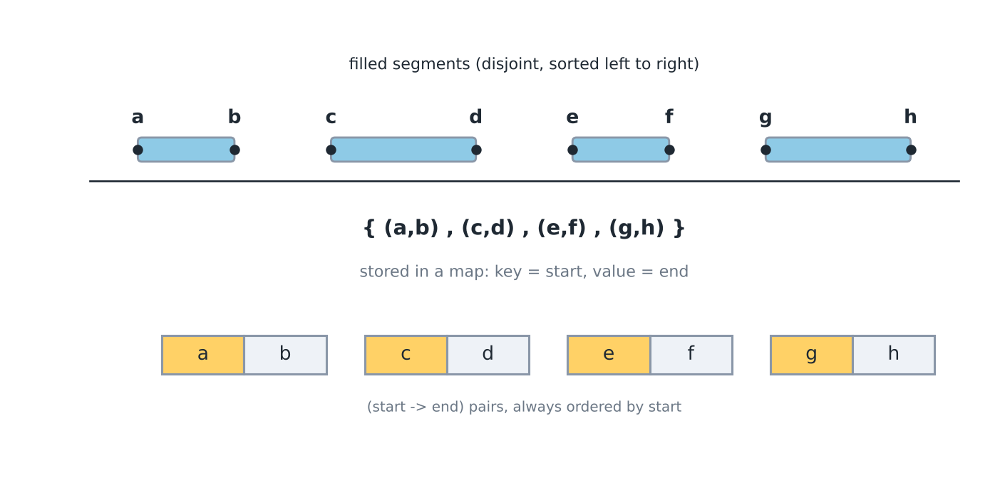

*Four disjoint segments (a,b), (c,d), (e,f) and (g,h), kept sorted by their start.*

Why not a plain array: coordinates go up to 10^9, so one cell per coordinate needs about 4 GB, and one fill can touch 10^9 cells. So only the disjoint filled segments are stored, in a sorted set or map. Each fill creates one segment, and every segment is erased at most once, so the total work is O(Q log Q).

The cases of one new range [l, r] against the stored segments, for both fill range and clear range:

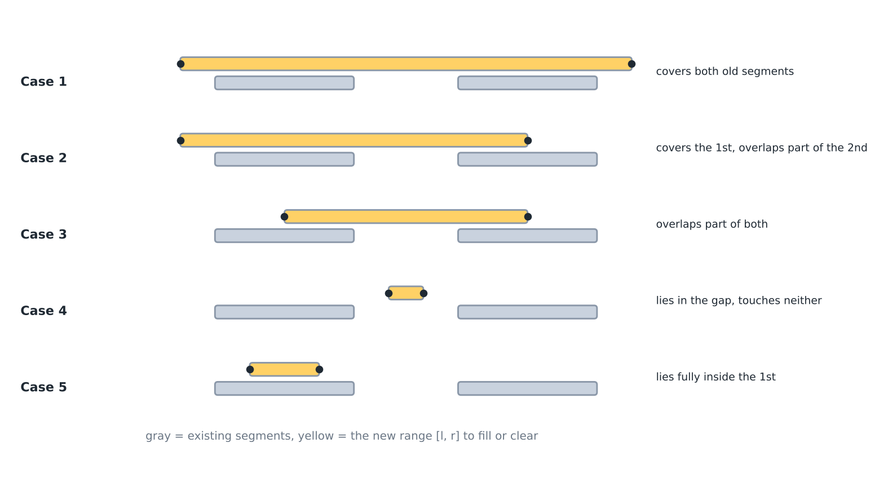

*Cases 1 to 5.*

Tip: in a test or contest, draw all the cases before coding, so that no important case is missed.

The main cases are:

![Three major cases: old segment sticks out on the left of l, old segment sticks out on the right of r, old segments fully inside [l, r]](../../../assets/notes/0-6-stl-toolbox/fig33_major_cases.png)

*These are the main cases that need handling.*

Note: there is one more case: a single old segment contains all of [l, r] (case 5). In clear, that segment breaks into 2 pieces.

```cpp
// Fabricator/STL/SegmentMaintenance.cpp
/*
On a number line following q queries can be made:
1. Fill range [l, r] -> range [l, r] is active -> If two ranges overlap thier union is active
2. Clear range [l, r] -> range [l, r] is inactive
3. Check point X -> check if X is present in any active segment
4. Check interval inside [X, Y] -> check if any part of [X, Y] is present in active segment
*/

#define F first
#define S second

struct range_maintenance{
    set<pair<int, int>> st;
    void fill_range(int l, int r){
        auto it = st.upper_bound({l, 1e9});
        if(it != st.begin()){
            it--;
            if(it->S >= l){
                l = it->F;
                r = max(r, it->S);

                st.erase(it);
            }
        }

        it = st.upper_bound({r, 1e9});
        if(it != st.begin()){
            it--;
            if(it->S >= r){
                r = it->S;
                l = min(l, it->F);

                st.erase(it);
            }
        }

        // l                 r
        // |-----------------|
        //                     |-----------|
        //                   it->f       it->s
        // Above case will trigger 'if' and call 'break'
        // Else it will delete all small segments present in [l, r]
        // l                         r
        // |-------------------------|
        //   |---|   |-----------|
        // Both small segments will be removed
        while(1){
            it = st.lower_bound({l, 0});
            if(it == st.end() || it->F > r) break;
            else{
                st.erase(it);
            }
        }

        st.insert({l, r});
    }

    void clear_range(int l, int r){
        auto it = st.upper_bound({l, 1e9});
        if(it != st.begin()){
            it--;
            if(it->S >= r){
                int l1 = it->F, r1 = l;
                int l2 = r, r2 = it->S;
                
                st.erase(it);
                st.insert({l1, r1});
                st.insert({l2, r2});
                return;
            }
            if(it->S >= l){
                int l1 = it->F, r1 = l;
                st.erase(it);
                st.insert({l1, r1});
            }
        }

        it = st.upper_bound({r, 1e9});
        if(it != st.begin()){
            it--;
            if(it->S >= r){
                int l1 = r, r1 = it->S;
                st.erase(it);
                st.insert({l1, r1});
            }
        }

        // l                 r
        // |-----------------|
        //                     |-----------|
        //                   it->f       it->s
        // Above case will trigger 'if' and call 'break'
        // Else it will delete all small segments present in [l, r]
        // l                         r
        // |-------------------------|
        //   |---|   |-----------|
        // Both small segments will be removed
        while(1){
            it = st.lower_bound({l, 0});
            if(it == st.end() || it->F >= r) break;
            else{
                st.erase(it);
            }
        }

        st.insert({l, r});
    }

    bool check_point(int x){
        auto it = st.upper_bound({x, 1e9});
        if(it == st.begin()){
            return false;
        }
        else{
            it--;
            if(it->S >= x){
                return true;
            }
            return false;
        }
    }

    bool check_range_any(int x, int y){
        // We check if any segment start after x and covers a portion of [x, y]
        auto it = st.upper_bound({x, 1e9});
        if(it != st.end()){
            if(it->F <= y){
                return true;
            }
        }

        // Else we are left with segment that start before x and cover the part of [x, y]. x must be included in that part
        return check_point(x);
    }

    bool check_range_all(int x, int y){
        // Get a segment that starts after x
        auto it = st.upper_bound({x, 1e9});
        if(it == st.begin()){
            return false;
        }
        else{
            // Must start before x
            it--;

            // Must end after y
            if(it->S >= y){
                return true;
            }
            return false;
        }
    }

    void print_state(){
        cout<<"Current State:\n";
        for(auto v: st){
            cout<<"("<<v.F<<", "<<v.S<<"), ";
        }
        cout<<endl;
    }
};
```

`#define F first` and `#define S second` are macros (text replacements), so `it->F` and `it->S` are the two members of the pair. `upper_bound({l, 1e9})` on a set of pairs returns the first segment that starts after l.

Tested: fill_range(1,5), fill_range(4,9) → `(1, 9)`. clear_range(3,4) → `(1, 3), (4, 9)`. fill_range was checked against brute force on 3000 random fill-only games, 0 mismatches.

Note: clear_range is wrong except when the cleared range is inside one segment (that case returns early). The last line `st.insert({l, r});` puts the cleared range back. fill(1,5), clear(3,8) → `(1, 3), (3, 8)`, should be just `(1, 3)`. fill(2,3), clear(1,5) → `(1, 5)`, should be empty. Removing the last line fixes it. Also the ends are shared points (clear [3,4] on [1,9] → (1,3), (4,9)), so it behaves like [l, r), but check_point counts the end as inside.

This is a version for integer points (both ends inclusive). Each segment is made once and erased once → O(Q log Q) total:

```cpp
/*
Disjoint segments of integer points in a map: start → end (both inclusive).
fill merges overlapping or touching segments, clear removes exactly the points l..r.
*/
map<long long, long long>::iterator firstReaching(map<long long, long long>& seg, long long from) {
    auto it = seg.upper_bound(from);  // first segment starting after `from`
    if (it != seg.begin()) {
        auto before = prev(it);
        if (before->second >= from) it = before;  // this one reaches `from`
    }
    return it;
}

void fillSegments(map<long long, long long>& seg, long long l, long long r) {
    auto it = firstReaching(seg, l - 1);  // l-1: also merge the one ending right before l
    while (it != seg.end() && it->first <= r + 1) {
        l = min(l, it->first);
        r = max(r, it->second);
        it = seg.erase(it);
    }
    seg[l] = r;
}

void clearSegments(map<long long, long long>& seg, long long l, long long r) {
    auto it = firstReaching(seg, l);
    while (it != seg.end() && it->first <= r) {
        long long a = it->first, b = it->second;
        it = seg.erase(it);
        if (a < l) seg[a] = l - 1;  // left leftover
        if (b > r) seg[r + 1] = b;  // right leftover
    }
}

bool checkPoint(map<long long, long long>& seg, long long x) {
    auto it = seg.upper_bound(x);
    return it != seg.begin() && prev(it)->second >= x;
}

bool checkAnyInside(map<long long, long long>& seg, long long x, long long y) {
    auto it = firstReaching(seg, x);  // first segment ending at or after x
    return it != seg.end() && it->first <= y;
}
```

Trace of this version: fill(1,5) stores 1→5. fill(4,9): firstReaching(3) finds the segment 1→5 (it ends at 5, which is ≥ 3), so it is merged into 1→9. clear(3,4): firstReaching(3) finds 1→9, which is erased, and its two leftovers 1→2 and 5→9 are stored.

Tested: fill(1,5), fill(4,9) → `[1,9]`. clear(3,4) → `[1,2] [5,9]`. checkPoint(4) false, checkPoint(6) true, checkAnyInside(3,4) false, checkAnyInside(3,5) true. 3000 random games match a plain boolean array.

## Histogram problem (Hacker Cup)

This problem is based on the previous idea. It comes from the Facebook (now Meta) Hacker Cup, a yearly programming contest.

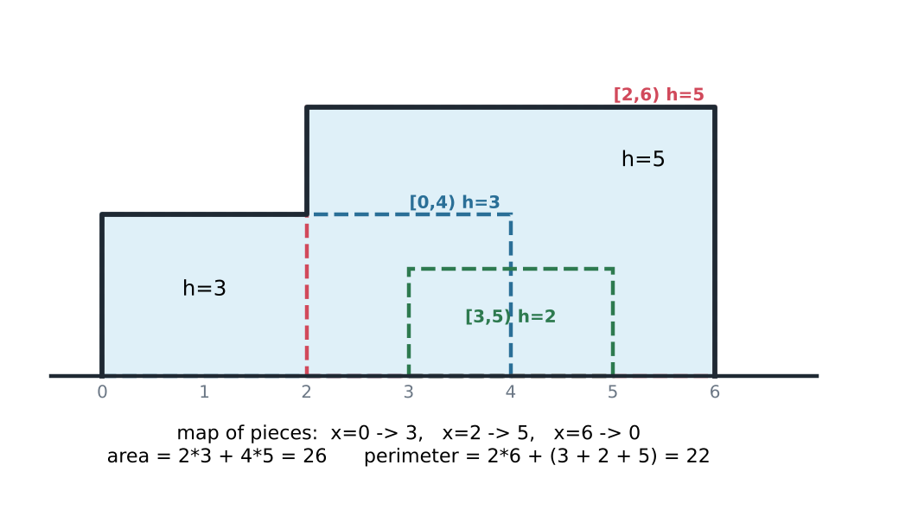

*Overlapping histograms on the number line. The outline is made of the heights of the ranges.*

Histograms (bars) are added one by one on the number line, and we have to maintain the area and the perimeter of the shape they form together.

We do this by maintaining the heights of the ranges.

Idea: in the map, key x means "from x up to the next key, the height is map[x]". To add a bar [l, r) with height h, split the pieces at l and at r, then set every piece in between to max(piece, h).

- The area is Σ (width × height) over all pieces.
- The perimeter is 2 × (covered width), which counts the top and bottom edges, plus Σ |height jump| between neighbouring pieces, which counts the vertical edges.

```cpp
/*
Bars [l, r) with height h are added one by one. After each add, find area and perimeter of the shape.
height[x] = height from x till the next key. Start with height[-big] = 0.
Walks over all pieces each time → fine for small inputs.
*/
void splitAt(map<long long, long long>& height, long long x) {  // make a piece start exactly at x
    auto it = prev(height.upper_bound(x));
    if (it->first != x) height[x] = it->second;
}

void addBar(map<long long, long long>& height, long long l, long long r, long long h) {
    splitAt(height, l);
    splitAt(height, r);
    for (auto it = height.find(l); it->first < r; ++it)
        it->second = max(it->second, h);
}

long long shapeArea(const map<long long, long long>& height) {
    long long total = 0;
    for (auto it = height.begin(); next(it) != height.end(); ++it)
        total += (next(it)->first - it->first) * it->second;
    return total;
}

long long shapePerimeter(const map<long long, long long>& height) {
    long long total = 0, before = 0;  // before = height of previous piece (0 outside)
    for (auto it = height.begin(); it != height.end(); ++it) {
        total += llabs(it->second - before);  // vertical edge
        if (next(it) != height.end() && it->second > 0)
            total += 2 * (next(it)->first - it->first);  // bottom + top edge
        before = it->second;
    }
    return total;
}
```

Trace of the example: after the first bar the map is \{-big: 0, 0: 3, 4: 0\}. For [2,6) h=5, splitting at 2 adds the key 2 with height 3 and splitting at 6 adds the key 6 with height 0, then the pieces starting at 2 and 4 are set to 5. The map is \{-big: 0, 0: 3, 2: 5, 4: 5, 6: 0\}. Area = 2×3 + 2×5 + 2×5 = 26. Perimeter = vertical edges (3 + 2 + 0 + 5 = 10) + horizontal edges (2 × width 6 = 12) = 22.

Cost: the update touches only the pieces inside [l, r), but the area and perimeter functions scan every piece, so one add is O(number of pieces). That is fine for small inputs; for large inputs the area and perimeter would be updated while the pieces inside [l, r) are changed.

Tested: add [0,4) h=3 → area 12, perimeter 14. add [2,6) h=5 → 26, 22. add [3,5) h=2 → 26, 22 (nothing changes, already inside). 2000 random games match a unit-grid brute force.

## Quick revision

- The STL has algorithms and containers. A range is [start, end). arr[i] is the same as *(arr+i).
- sort uses intro sort and costs O(n log n). A comparator must be strict (`<` or `>`), never `<=` or `>=`.
- lower_bound(x) returns the first element ≥ x. upper_bound(x) returns the first element > x. The index of upper_bound is the number of elements ≤ x.
- One type of bracket: depth stays ≥ 0 and is 0 at the end. Many types of brackets: use a stack and match the top.
- The minimum of every k-window: multiset gives O(n log k), monotone deque gives O(n). The check for removing from the window is `i-k >= 0`.
- To optimise, make an observation or share information (precompute).
- Shop: sort and buy the cheapest first. For m budgets, use a prefix sum and upper_bound.
- Stream DS: for sum or max, a variable is enough. For distinct count with remove, use a map and erase the key at 0.
- Card game: trying all orders costs n!. Sort by (A_i + B_i), biggest first. Moving a card from B to A changes S_A - S_B by A_j + B_j.
- Subarrays with sum X: count the pairs with P[L-1] = P[R] - X using a map. Set mp[0] = 1 first, and query before you insert.
- The number of subarrays is n+1 C 2. The number of non-empty subsequences is 2^n - 1.
- Top K sum: a min heap of size k. With remove, use 2 multisets (topk and removed).
- Median: keep 2 halves of about the same size, with the median at the border (the biggest of the low half). Insert and remove cost O(log n).
- Segments covering y: the answer is N - (the number of R_i &lt; y) - (the number of L_i > y), in O((N+Q) log N).
- Fill, clear and check: keep disjoint segments in a sorted set or map. Draw the cases first.
- Histograms: keep a map of heights. The area is Σ (width × height), and the perimeter is 2 × covered width + Σ |height jump|.

## Practice problems

- [Smallest String Concatenation (Codeforces 632C)](https://codeforces.com/problemset/problem/632/C)
- [Shift Right (maang.in)](https://maang.in/problems/Shift-Right-1224)
- [Three Numbers (maang.in)](https://maang.in/problems/Three-Numbers-1217)
- [Primes from 1 to n (maang.in)](https://maang.in/problems/Primes-from-1-to-n-1208)

AtCoder
- [Write and Erase](https://atcoder.jp/contests/abc073/tasks/abc073_c)
- [A+B+C](https://atcoder.jp/contests/abc344/tasks/abc344_c)
- [Unexpressed](https://atcoder.jp/contests/abc193/tasks/abc193_c)
- [Poll](https://atcoder.jp/contests/abc155/tasks/abc155_c)

### Problem ladder

<Ladder topic="0.6" />
