import TopicHeader from '../../../components/TopicHeader.astro';
import Ladder from '../../../components/Ladder.astro';

<TopicHeader topic="1.2" />

## What this note covers

Two techniques, and each one is the opposite of the other:
- Prefix Sum → answer many "sum of a range" queries on a fixed array, fast.
- Partial Sum → apply many "add a value to a range" updates, fast. (This technique is also called a difference array.)

The order of the lesson: 1D first, then 2D, then versions with an A.P. (arithmetic progression: each term is the previous term plus a fixed number) and a G.P. (geometric progression: each term is the previous term times a fixed number), and a triangle at the end.

Why learn this? Suppose an array has $10^5$ elements and we receive $10^5$ range queries. Adding up every range by hand costs up to $10^5 \times 10^5 = 10^{10}$ steps, which takes minutes. With one preparation pass of $10^5$ steps and one subtraction per query, the whole job takes about $2 \times 10^5$ steps, which takes a fraction of a second.

Terms used in this lesson:
- query → one question (or one update) asked on the array. Q = number of queries, N = size of the array.
- static array → an array that does not change between queries.
- T.C. (time complexity) → how the running time grows with the size of the input. O(N) means the work grows in step with N.
- modulo $10^9+7$ → the remainder after dividing by 1000000007. It is used when the true answer can be too large to store.
- subarray → a block of consecutive elements of an array.
- O(Q.N) → the dot is a multiplication sign, so it means O(Q × N).
- 0-indexed / 1-indexed → in a 0-indexed array the first element has position 0. In a 1-indexed array it has position 1. The lesson uses both, and each example says which one it uses.
- mark → a small value written into one cell of a helper array. A later prefix sum spreads the mark over the cells to its right.

## Table of contents

- Prefix Sum
- Partial Sum Technique
- 2D Prefix Sum
- 2D Partial Sum
- Prefix Sum AP
- Prefix Sum GP
- Partial Sum AP
- Partial Sum GP
- 2D Prefix Triangle
- Prefix sum + map, partial sum + sort (two small uses)
- Quick revision
- Practice problems

---

## Prefix Sum

Find answers to Q queries on a static array A of size N.

`? L R` → find the sum of elements in the range L to R in the array.

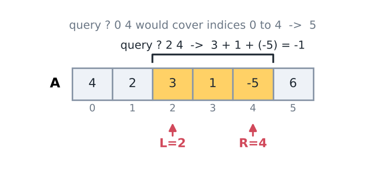

*The array A, and the range of the query `? 2 4`.*

Two sample queries on this array (0-indexed positions):

`? 2 4` → -1 (the elements are 3, 1, -5)

`? 0 4` → 5 (the elements are 4, 2, 3, 1, -5)

Brute force: for each query iterate from L to R and compute sum.

T.C. = O(Q.N).

Infeasible for Q, N ≤ 10^5 / 10^6. With Q = N = $10^5$ this is $10^5 \times 10^5 = 10^{10}$ steps. A computer does roughly $10^8$ simple steps per second, so this needs about 100 seconds, far too slow.

Observation: every query adds up many of the same elements again and again. So do the repeated work once, and keep a running total ready in advance.

Better: Create a precomputation array P such that P[i] → prefix sum of A[0..i]

(prefix sum = the sum of everything from index 0 up to index i.)

$P[i] = \sum_{j=0}^{i} A[j]$

$P[i] = A[i] + P[i-1]$

In words: each cell of P is the new element plus the prefix sum just before it.

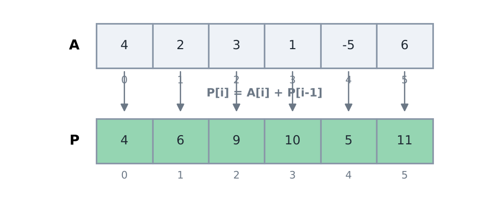

*P is built from left to right: A[i] + P[i-1].*

Dry run of building P for A = 4 2 3 1 -5 6:
- P[0] = 4
- P[1] = 2 + 4 = 6
- P[2] = 3 + 6 = 9
- P[3] = 1 + 9 = 10
- P[4] = -5 + 10 = 5
- P[5] = 6 + 5 = 11

`? 2 4` → P[R] - P[L-1] = 5-6 = -1

- P[R] → brings sum of elements from 0 - R
- P[L-1] → removes sum of elements from 0 - (L-1)

Why it works: P[R] is the sum of A[0..R]. It contains the part we want, A[L..R], and also an unwanted part in front, A[0..L-1]. P[L-1] is exactly that unwanted part, so subtracting it leaves A[L..R].

![P[4] covers indices 0 to 4, P[1] covers 0 to 1, difference is A[2..4]](../../../assets/notes/1-2-prefix-sums/fig03_range_formula.png)

*P[4] - P[1]: the front part is cut away and A[2..4] is left.*

T.C. (time complexity):
- O(N) → to generate the prefix sum array.
- O(1) → for each query.

For the example above, the cost is 6 steps to build P, and then every query is one subtraction. For $10^5$ queries on $10^5$ elements, that is about $2 \times 10^5$ steps in total instead of $10^{10}$. The extra memory is one more array of N cells.

**\*** Remember: range queries with a prefix array work only on a STATIC array.

If the array changes after P is built, P becomes wrong, because one change to A[i] changes every P[j] with j ≥ i.

Note: when L = 0, the cell P[L-1] = P[-1] does not exist. There are two common fixes. Either check `L > 0`, or store P shifted by one index, so that P[0] = 0 means "the sum of nothing". Also, a sum can reach $10^5 \times 10^9 = 10^{14}$, which does not fit in a 32-bit int (maximum about $2.1 \times 10^9$), so use long long.

Code (shifted version: `prefix_sum_arr[k]` = sum of first k elements, so L = 0 needs no special case). This version stores the sums in `int` to keep the code short, which is correct only while all sums stay below about $2 \times 10^9$. For larger values, change the types to long long.

```cpp
/*
Problem: static array, queries "? L R" (0-indexed).
Print sum of arr[L..R].
prefix_sum_arr[k] = sum of first k elements,
answer = prefix_sum_arr[R+1] - prefix_sum_arr[L].
*/
// Fabricator/Prefix-Partial-Sums/PrefixSums.cpp
void solve() {
    int n;
    cin>>n;

    vector<int> arr(n);
    for(auto &ele: arr) cin>>ele;

    // vector<int> prefix_sum_arr(n);
    // prefix_sum_arr[0] = arr[0];
    // for(int i=1; i<n; i++){
    //     prefix_sum_arr[i] = prefix_sum_arr[i-1] + arr[i];
    // }

    // This prefix array stores data in very well defined format:
    // 0th index stores sum of 0 elements
    // 1st index => sum of 1 element
    // 5th index => sum of 5 elements
    vector<int> prefix_sum_arr(n + 1, 0);
    for(int i=0; i<n; i++){
        prefix_sum_arr[i + 1] = prefix_sum_arr[i] + arr[i];
    }

    int q;
    cin>>q;

    while(q--){
        char c;
        int l, r;
        cin>>c>>l>>r;

        int range_sum = prefix_sum_arr[r+1] - prefix_sum_arr[l];

        cout<<range_sum<<endl;
    }
}
```

Trace of this code on A = 4 2 3 1 -5 6: `prefix_sum_arr` is 0 4 6 9 10 5 11 (7 cells, and the first one is the empty prefix). The query `? 2 4` gives `prefix_sum_arr[5] - prefix_sum_arr[2]` = 5 - 6 = -1. The query `? 0 4` gives `prefix_sum_arr[5] - prefix_sum_arr[0]` = 5 - 0 = 5.

The next version is the same thing with "answer modulo 10^9+7". The subtraction can produce a negative number. In C++ the result of `%` has the sign of the left side, so -3 % 7 is -3, not 4. Writing `(x + MOD) % MOD` brings the result back into the range 0 to MOD-1. One `+ MOD` is enough, because both stored values are already in the range 0 to MOD-1, so their difference is above -MOD. Here the input is 1-indexed, which is why the code uses l-2 and r-1 (index of position l is l-1, and the element before it is l-2).

```cpp
/*
Problem: given N integers and Q queries "L R" (1-indexed).
Print (A[L] + A[L+1] + ... + A[R]) % 10^9+7.
*/
// Fabricator/Prefix-Partial-Sums/LRSumQuery.cpp
const int MOD = 1000000007;   // used by the code below

void solve() {
    long long n, q;
    cin>>n>>q;

    vector<long long> arr(n);
    for(auto &ele: arr) cin>>ele;

    vector<long long> pref(n);
    pref[0] = arr[0];
    for(int i=1; i<n; i++){
        pref[i] = pref[i-1] + arr[i];

        pref[i] = (pref[i] + MOD) % MOD;
    }

    while(q--){
        int l, r;
        cin>>l>>r;

        long long ans = l == 1 ? pref[r-1] : pref[r-1] - pref[l-2];

        ans = (ans + MOD) % MOD;

        cout<<ans<<endl;
    }
}
```

Dry run: A = 4 2 3 1 -5 6, query `3 5` (1-indexed, the elements 3, 1, -5) → 10^9+6, because the true sum is -1 and -1 + (10^9+7) = 10^9+6. The query `1 5` → 5.

In general, this technique can be used for all operations that allow the removal of the contribution of an element. For example: XOR.

XOR (exclusive or, a bit-by-bit operation) has the rule x ^ x = 0, so if a value is XOR-ed twice, it disappears. This is the "removal" that the technique needs. So build a prefix XOR, and use "^" in the place of "-". An operation without such an undo step, for example the maximum, does not work this way: from max(A[0..R]) there is no way to cut away max(A[0..L-1]).

```cpp
/*
Problem: static array A, many queries "? L R": find A[L] ^ A[L+1] ^ ... ^ A[R]
(bitwise XOR). XOR undoes itself (x ^ x = 0), so the prefix idea works with ^.
*/
// X[i] = A[0] ^ ... ^ A[i-1]. X[0] = 0 means "empty prefix", so L = 0 needs no special case.
vector<int> buildPrefixXor(const vector<int>& A) {
    vector<int> X(A.size() + 1, 0);
    for (size_t i = 0; i < A.size(); i++) X[i + 1] = X[i] ^ A[i];
    return X;
}

// ^ plays the role of "-" in P[R] - P[L-1]
int rangeXor(const vector<int>& X, int L, int R) {
    return X[R + 1] ^ X[L];
}
```

Dry run: A = 4 2 3 1 5 6, `? 2 4` → 3 ^ 1 ^ 5 = 7, and whole array → 7.

Step by step: X = 0 4 6 5 4 1 7. The query `? 2 4` is X[5] ^ X[2] = 1 ^ 6 = 7. The whole array is X[6] ^ X[0] = 7 ^ 0 = 7. Build is O(N) and each query is O(1), as for sums.

Common mistakes with prefix sums:
- Mixing 0-indexed and 1-indexed positions. Decide the indexing first and keep it for the whole program.
- Using int when the sum can be large.
- Forgetting that the array must be static.
- Using the unshifted array and forgetting the case L = 0, where P[L-1] does not exist.

---

## Partial Sum Technique

Now the opposite problem. The queries change the array, and only the final array is wanted.

Given an array A of size N, initially all 0s.
There are Q queries of the form:

+ L R X → add X to all the indices in the range L to R.

After all the queries find the final array.

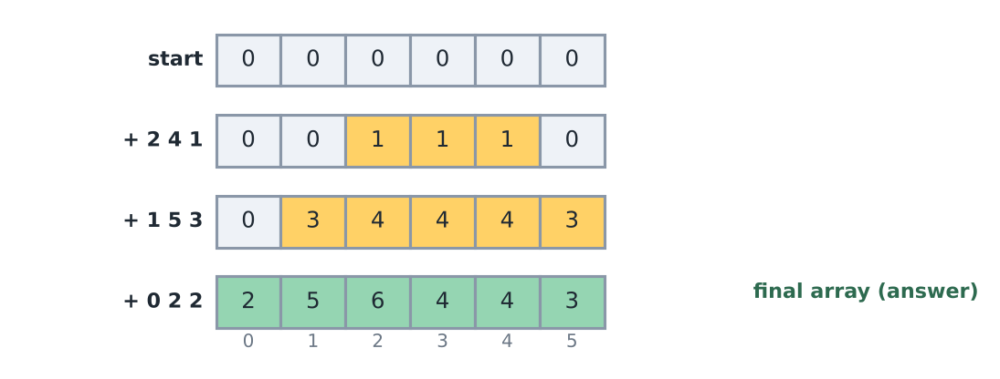

*The array after each query. The last row is the final array (ans).*

The same three queries as text:

```
A:  | 0 | 0 | 0 | 0 | 0 | 0 |

+ 2 4 1
    | 0 | 0 | 1 | 1 | 1 | 0 |

+ 1 5 3
    | 0 | 3 | 4 | 4 | 4 | 3 |
      0   1   2   3   4   5

+ 0 2 2
    | 2 | 5 | 6 | 4 | 4 | 3 |     ✓ final array
      0   1   2   3   4   5          (ans)
```

Brute force: for each query, loop from L to R and add X. T.C. = O(Q.N). This is the same problem as before: every cell inside the range has to be visited. With Q = N = $10^5$ it is again $10^{10}$ steps.

Question: can we do the work by touching only the two ends of the range? Yes.

Claim: the final array can be found with these three steps.
- Step 1: create a new array P of size N.
- Step 2: for each query `+ L R X`, do `P[L] += X` and `P[R+1] -= X`.
- Step 3: after all the queries, build the prefix sum array of P (in place). The final P is the answer.

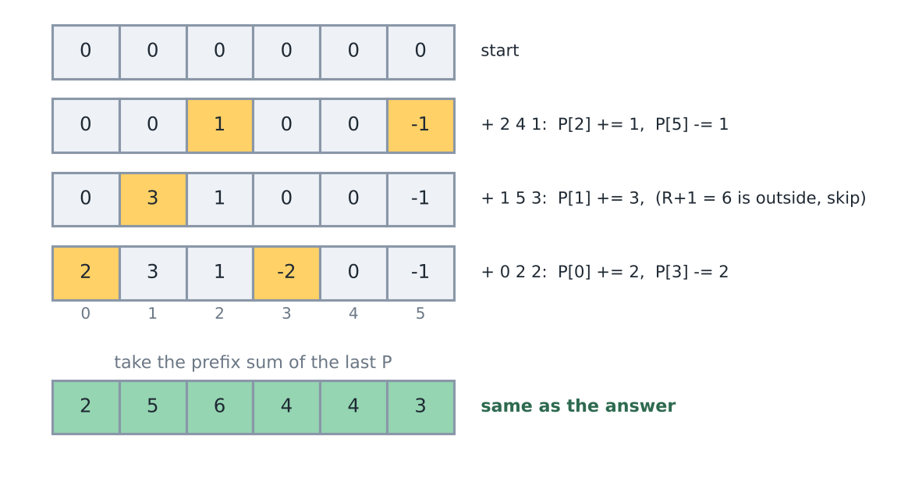

*Each query changes only 2 cells. One prefix pass at the end gives the answer (2 5 6 4 4 3).*

Note: in `+ 1 5 3` the index R+1 = 6 is outside the array. Skip that update (or keep the array one cell larger).

Why does this work?

Think of what a prefix sum does to a single `+X`: the value X is added to the running total at that cell, and the running total is carried into every cell after it.

→ The value of X is propagated till the end of the array.

Now, if a `-X` is placed further to the right, the running total drops by X there, which cancels the earlier X.

→ The value of X is propagated till the point where -X negates its presence.

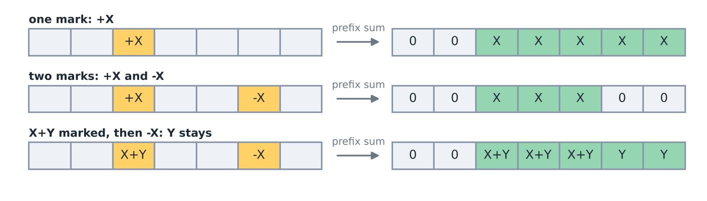

*A mark spreads to the right until another mark cancels it.*

→ A value (X+Y) propagates until something (-X) is subtracted.
→ It also shows that X and Y can be added separately to the array.

This means that the marks of two overlapping queries simply add up, and one single prefix pass handles all of them together. In the example, cell 2 is covered by all three queries, and the prefix pass adds the three amounts there on its own (1 + 3 + 2 = 6).

T.C. → O(1) per update, O(N) for the final prefix pass. Total O(Q + N). For Q = N = $10^5$ this is about $2 \times 10^5$ steps instead of $10^{10}$. The extra memory is one array of N cells.

Code: `prefix_arr` first holds the marks, and then becomes the answer. The line `if(r < n-1)` is the "skip if R+1 is outside the array" rule from the note above.

```cpp
/*
Problem: array of size n, all 0s. Queries "+ L R X":
add X to every index in L..R. Print the final array.
Mark prefix_arr[L] += X, prefix_arr[R+1] -= X,
then take one prefix sum.
*/
// Fabricator/Prefix-Partial-Sums/PartialSums.cpp
void solve() {
    int n;
    cin>>n;

    vector<int> prefix_arr(n, 0);
    int q;
    cin>>q;

    while(q--){
        char c;
        int l, r, x;
        cin>>c>>l>>r>>x;

        prefix_arr[l] += x;
        if(r < n-1){
            prefix_arr[r+1] -= x;
        }
    }

    for(int i=1; i<n; i++){
        prefix_arr[i] += prefix_arr[i-1];
    }

    for(int i=0; i<n; i++){
        cout<<prefix_arr[i]<<" ";
    }

    cout<<endl;
}
```

Dry run: n = 6, `+ 2 4 1`, `+ 1 5 3`, `+ 0 2 2` → `2 5 6 4 4 3`.

Check by hand: the marks written by the three queries are 2 at index 0 and -2 at index 3 (third query), 3 at index 1 (second query; its end mark at index 6 is outside the array and skipped), and 1 at index 2 and -1 at index 5 (first query). The mark array is 2 3 1 -2 0 -1, and its prefix sums are 2 5 6 4 4 3.

Common mistakes: writing the end mark at R instead of R+1, and forgetting that this technique gives the final array only after all updates. It cannot answer "what is the value now?" between the updates without another prefix pass. Another mistake is to read the query as 1-indexed while the array is 0-indexed. The code above reads 0-indexed positions, so the example is entered as `+ 2 4 1`, `+ 1 5 3` and `+ 0 2 2`.

---

## 2D Prefix Sum

The same idea for a grid. The queries now ask for the sum of a rectangle of cells.

Given a 2D matrix Arr[][], with values in each cell. There are Q queries of the form `? L R U D`. Find the sum of values in the rectangle formed by U ≤ i ≤ D and L ≤ j ≤ R → i is the index of the row, j is the index of the column.

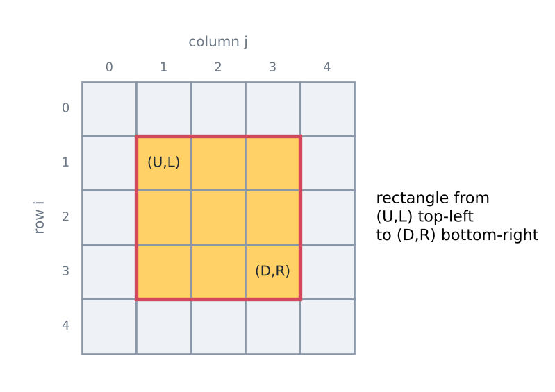

*From the Up-Left cell to the Down-Right cell.*

Brute force: iterate over all cells → O(N^2).

Note: for an N x M grid this is O(N.M) per query. For a 1000 x 1000 grid and $10^5$ queries, that is up to $10^6 \times 10^5 = 10^{11}$ steps.

Using 1D prefix sum:

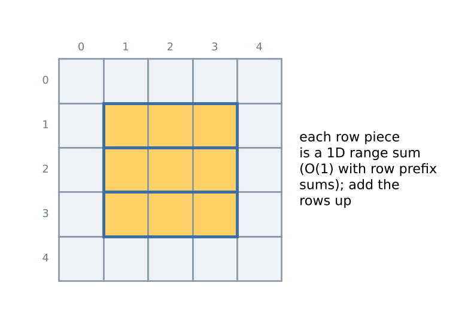

*Each row of the rectangle is a 1D range.*

Keep prefix sum of rows & find sum of cells of each row in O(1) and sum them in O(n) (here n is the number of rows of the rectangle).

This helps, but a query still loops over all rows of the rectangle, which is up to 1000 steps for a 1000 x 1000 grid. A better idea: get the whole rectangle at once, and remove the loop over rows as well.

Idea of 2D prefix sums:

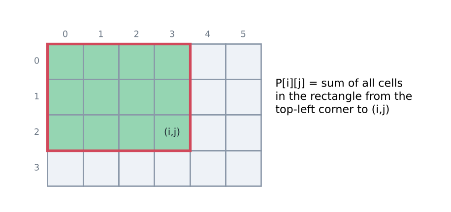

*P[i][j] → sum of the rectangle from the top left corner to (i,j).*

How to build?

Build in row major order. (row 0 from left to right, then row 1, and so on.)

P[i][j] = arr[i][j] + P[i-1][j]
                      + P[i][j-1]
                      - P[i-1][j-1]

Think of it like this: the rectangle above the cell, P[i-1][j], and the rectangle to the left of the cell, P[i][j-1], both contain the rectangle ending at (i-1, j-1). So that part is counted twice, and it is subtracted once. The cell arr[i][j] itself is in neither of them, so it is added.

![P[i-1][j], P[i][j-1], P[i-1][j-1] counted twice, and the new cell](../../../assets/notes/1-2-prefix-sums/fig10_2d_build.png)

*All three earlier values are ready when P[i][j] is computed.*

While iterating in row major order all the required values will always be present. On row 0 or column 0 the missing neighbour is treated as 0.

How do we use it?

We need to find sum of the shaded region.

```
P[D][R]
 - P[D][L-1]
 - P[U-1][R]
 + P[U-1][L-1]  → subtracted twice
```

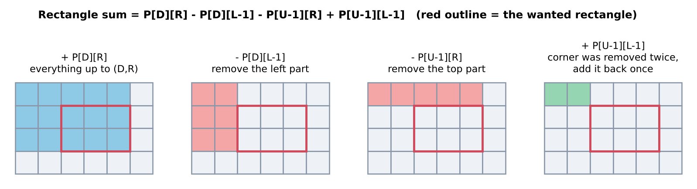

*The corner was subtracted twice, so it is added back once.*

The corner part P[U-1][L-1] lies inside both P[D][L-1] and P[U-1][R]. Subtracting both removes it two times, but it should be removed only once, so one copy is added back.

T.C. :
- Building the prefix array: O(N.M).
- Query the sum of a rectangle: O(1).

The extra memory is one more table of N.M cells.

Small example: take the matrix with rows `1 2 3`, `4 5 6`, `7 8 9`. Its prefix array has rows `1 3 6`, `5 12 21`, `12 27 45`. For example, P[1][1] = arr[1][1] + P[0][1] + P[1][0] - P[0][0] = 5 + 3 + 5 - 1 = 12. For the lower-right 2 x 2 block (U = 1, D = 2, L = 1, R = 2) the formula gives P[2][2] - P[2][0] - P[0][2] + P[0][0] = 45 - 12 - 6 + 1 = 28, and directly 5 + 6 + 8 + 9 = 28.

Example: matrix 4 x 5, P next to it. The matrix has rows `3 1 4 1 5`, `9 2 6 5 3`, `5 8 9 7 9`, `3 2 3 8 4`. Query L=1 R=3 U=1 D=2 → P[2][3] - P[2][0] - P[0][3] + P[0][0] = 60 - 17 - 9 + 3 = 37. Directly, the cells are 2 + 6 + 5 + 8 + 9 + 7 = 37.

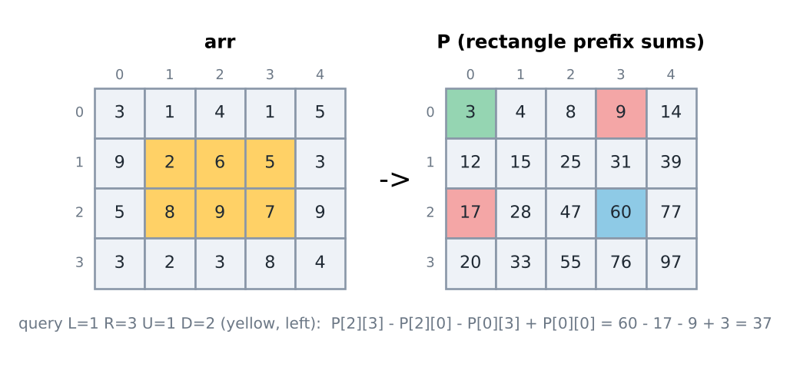

*The whole matrix gives P[3][4] = 97.*

Be careful: the query order here is `? L R U D` (columns first), but many problems give x1 y1 x2 y2 (rows first). Also, on row 0 or column 0, the values L-1 and U-1 become -1, so add a guard (a check) for them. Cell values and sums can be large: with $10^6$ cells of size $10^9$ a sum reaches $10^{15}$, so use long long. Forgetting to add the corner P[U-1][L-1] back is the most common wrong answer.

Code: the queries here are 1-indexed, which is why the code has `--u;--l;--d;--r;`. The function `norm` brings any number (negative numbers too) into the range 0 to MOD-1.

```cpp
/*
Problem: given N x M matrix and Q queries "x1 y1 x2 y2"
(top-left and bottom-right corners, 1-indexed).
Print the sum of the submatrix modulo 10^9+7.
*/
// Fabricator/Prefix-Partial-Sums/2DPrefixSums.cpp
long long norm(long long num){
    return ((num % MOD) + MOD) % MOD;
}

void solve() {
    int n, m, q;
    cin>>n>>m>>q;

    vector<vector<long long>> mat(n, vector<long long>(m));
    for(int i=0; i<n; i++){
        for(int j=0; j<m; j++){
            cin>>mat[i][j];
        }
    }

    vector<vector<long long>> pref(n, vector<long long>(m, 0));
    for(int i=0; i<n; i++){
        for(int j=0; j<m; j++){
            pref[i][j] = norm(mat[i][j]);
            if(i > 0) pref[i][j] = norm(pref[i][j] + pref[i-1][j]);
            if(j > 0) pref[i][j] = norm(pref[i][j] + pref[i][j-1]);
            if(i > 0 && j > 0) pref[i][j] = norm(pref[i][j] - pref[i-1][j-1]);
        }
    }

    while(q--){
        int u, l, d, r;
        cin>>u>>l>>d>>r;

        --u;--l;--d;--r;

        long long ans = norm(pref[d][r]);
        if(l > 0) ans = norm(ans - pref[d][l-1]);
        if(u > 0) ans = norm(ans - pref[u-1][r]);
        if(u > 0 && l > 0) ans = norm(ans + pref[u-1][l-1]);

        cout<<ans<<endl;
    }
}
```

Dry run on the 4 x 5 matrix above (the code reads 1-indexed corners `x1 y1 x2 y2`): `2 2 3 4` → 37 (the query of the figure), `1 1 4 5` → 97 (the whole matrix).

---

## 2D Partial Sum

This is the reverse of the previous section. The queries add a value to a rectangle of cells, and only the final matrix is wanted.

Given a 2D matrix arr[][], with 0 as initial value in each cell. There are Q queries of the form: `+ L R U D X`.

Add X to each cell in the rectangle formed by U ≤ i ≤ D and L ≤ j ≤ R

i → index of Row
j → index of Column.

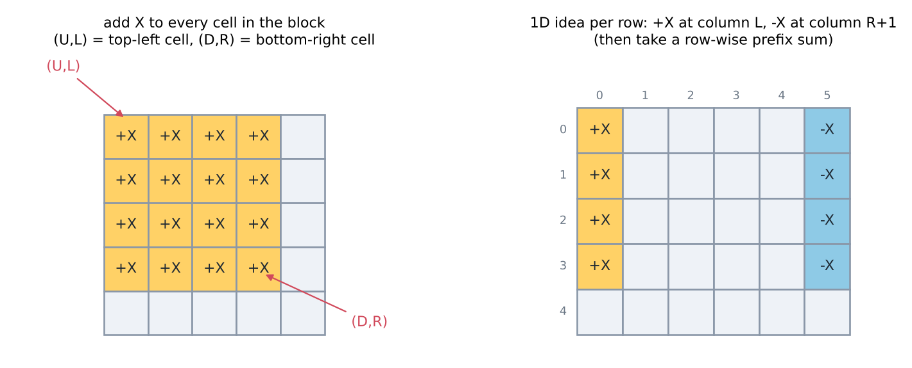

*Left: add X to all cells of the block. Right: the 1D idea in every row, +X at the start and -X after the end.*

Brute force: O(Q. N.M).

Using 1D partial sum:

→ work row wise partial sum then create prefix array

T.C.: O(N.Q).

Here each query writes 2 marks in each of its rows, so up to 2N marks, and one prefix pass over every row at the end costs O(N.M) more. For a 1000 x 1000 grid and $10^5$ queries that is about $2 \times 10^8$ marks.

Now the question: putting 2 marks in every row is still a lot of work for a tall block. Can 4 marks in total be enough for the whole rectangle?

Using 2D partial sum:
How does any value of sum propagates?

Let us say X = 1, the grid is 6 x 6, and the block is rows 1 to 3 and columns 1 to 3. A 2D prefix sum means: go down the columns first, then go right along the rows.

1. A single `+X` at (U,L) spreads X over the whole lower-right quadrant.
2. After adding `-X` at (U,R+1), X stays only in the columns L..R, but it still continues down to the bottom.
3. To stop it at the bottom, add `-X` at (D+1,L). Now the bottom-right corner region has received -X, because it was subtracted twice.
4. To fix the twice subtraction, add X at (D+1,R+1).

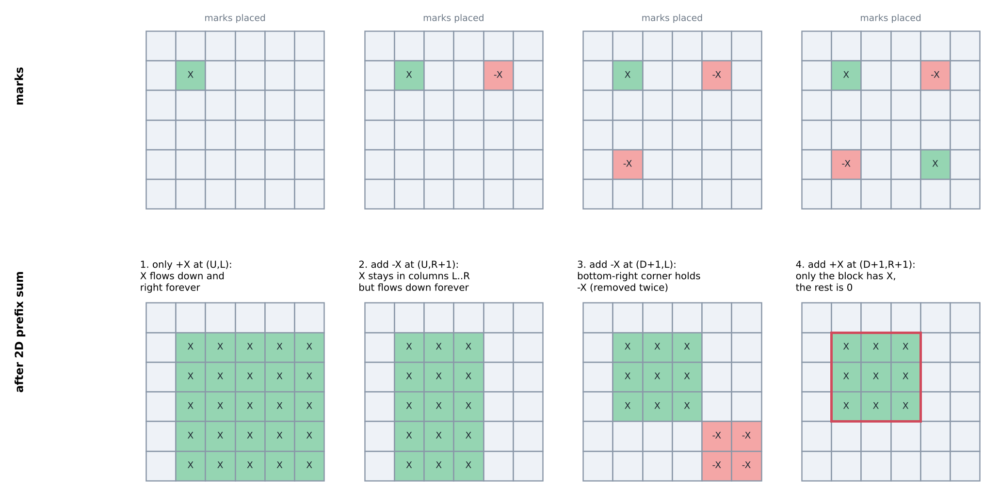

*Top: the marks. Bottom: the result after the prefix sum. After step 4, only the block holds X.*

Now X will correctly be propagated in the region, without any negative or positive leftover outside it.

In short: one mark paints the whole lower-right quadrant. The second mark cancels the part to the right of the block. The third mark cancels the part below the block. These two cancelling marks both reach the bottom-right corner region, so that region is cancelled twice, and the fourth mark gives one copy back.

So, finally for
`+ L R U D X`

```
P[U][L] += X
P[U][R+1] -= X
P[D+1][L] -= X
P[D+1][R+1] += X
```

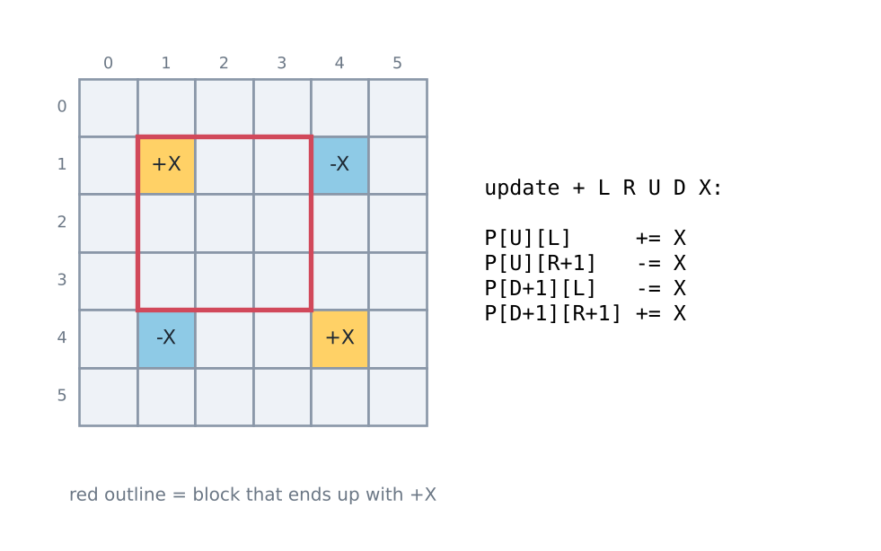

*The four corner marks: +X, -X, -X, +X.*

T. C.:
Building partial sums → O(1) per query.
Building the find array → O(N.M).

Total : O(Q + N.M).

For Q = $10^5$ updates on a 1000 x 1000 grid, brute force can touch $10^5 \times 10^6 = 10^{11}$ cells, while this method needs about $10^5 + 10^6$ steps.

Code: `if(d < n-1)` and `if(r < m-1)` skip a mark that would fall outside the grid. The double loop at the bottom is the same 2D prefix sum, done in place.

```cpp
/*
Problem: N x M matrix, all 0. Queries "+ L R U D X":
add X to every cell with U <= i <= D and L <= j <= R.
Print the final matrix.
*/
// Fabricator/Prefix-Partial-Sums/2DPartialSum.cpp
void solve() {
    int n, m;
    cin>>n>>m;

    vector<vector<int>> pref(n, vector<int>(m, 0));
    int q;
    cin>>q;
    while(q--){
        int l, r, u, d, x;
        cin>>l>>r>>u>>d>>x;

        pref[u][l] += x;
        if(d < n-1) pref[d+1][l] -= x;
        if(r < m-1) pref[u][r+1] -= x;
        if(d < n-1 && r < m-1) pref[d+1][r+1] += x;
    }

    for(int i=0; i<n; i++){
        for(int j=0; j<m; j++){
            if(i > 0) pref[i][j] += pref[i-1][j];
            if(j > 0) pref[i][j] += pref[i][j-1];
            if(i > 0 && j > 0) pref[i][j] -= pref[i-1][j-1];
        }
    }

    for(int i=0; i<n; i++){
        for(int j=0; j<m; j++){
            cout<<pref[i][j]<<"\t";
        }

        cout<<endl;
    }
}
```

Dry run: 5 x 6, `+ 1 4 1 3 1` and `+ 2 5 2 4 2`:

```
0 0 0 0 0 0
0 1 1 1 1 0
0 1 3 3 3 2
0 1 3 3 3 2
0 0 2 2 2 2
```

The cells where the two blocks overlap hold 1 + 2 = 3.

Step by step: the marks written by the two queries are +1 at (1,1), -1 at (1,5), -1 at (4,1) and +1 at (4,5) for the first query, and +2 at (2,2) for the second query. The other three marks of the second query would fall at row 5 or column 6, outside the grid, so they are skipped. The mark grid is:

```
0 0 0 0 0 0
0 1 0 0 0 -1
0 0 2 0 0 0
0 0 0 0 0 0
0 -1 0 0 0 1
```

The 2D prefix pass turns it into the grid above. Each result cell is the sum of all marks at or above it and at or to the left of it. For example, cell (4,5) is 1 - 1 - 1 + 1 + 2 = 2, which is the last number of the last row.

Common mistakes: putting the second and fourth marks at D and R instead of D+1 and R+1, writing the values in the wrong order (this code reads `L R U D X`, columns first), and using int when many large updates overlap. If the array is allocated with one extra row and one extra column, the four guards `if(d < n-1)` are not needed.

---

## Prefix Sum AP

Given a fixed array A of size N. You need to answer Q queries of the form:
? L R → find the value of the following expression modulo 10^9+7.

A[L] + A[L+1]*2 + A[L+2]*3 + ...... + A[R]*(R-L+1)

(The weights 1, 2, 3, ... form an A.P.: each weight is the previous weight plus 1.)


*? 2 4 → 9x1 + 4x2 + 1x3*

? 2 4 → 9x1 + 4x2 + 1x3
      = 9+8+3 = 20.

Brute force: O(Q.N).
  ↳ for every query loop on the range asked. For Q = N = $10^5$ this is again $10^{10}$ steps.

The difficulty is that the weight (i-L+1) depends on L, so one ready-made prefix array cannot be used directly. The fix is to split the weight into a part that depends on i and a part that depends on L. Indeed, i-L+1 = i + (1-L).

A[L] + A[L+1]*2 + A[L+2]*3 + ...... + A[R]*(R-L+1)

$\sum_{i=L}^{R} A[i]*(i-L+1)$

$= \sum A[i]\times i + (1-L)*A[i]$

$= \sum_{L}^{R} A[i]\times i + (1-L)\sum_{L}^{R} A[i]$

(under the second sum: ↳ can be easily fetched from prefix sum)

B[i] = A[i] x i

$= \sum_{L}^{R} B[i] + (1-L)\sum_{L}^{R} A[i]$

↳ can be kept in prefix array with values A[i]x i.

So we build two prefix arrays: one for A[i], and one for A[i]*i. Each query then needs two range sums and one multiplication. Query O(1). T.C. = O(N + Q).

Worked check with A = 3 2 9 4 1 -2 and the query `? 2 4` (0-indexed): the sum of A[2..4] is 9 + 4 + 1 = 14. The values A[i]*i are 0 2 18 12 4 -10, and the sum over 2..4 is 18 + 12 + 4 = 34. The answer is 34 + (1-2) * 14 = 20, which matches the direct calculation. The positions i and L must use the same indexing (here both 0-indexed). If one is 0-indexed and the other 1-indexed, the term (1-L) is off by one and the answer is wrong.

Code: `sum` → prefix of A, `wsum` (weighted sum) → prefix of A[i]*i. The answer is `ws + (1-l)*s`, and we use `norm(1 - l)` because 1-l can be negative.

```cpp
/*
Problem: fixed array A, queries "L R" (1-indexed).
Print (A[L] + A[L+1]*2 + ... + A[R]*(R-L+1)) modulo 10^9+7.
*/
// Fabricator/Prefix-Partial-Sums/APPrefixSums.cpp
long long norm(long long x) { return ((x % MOD) + MOD) % MOD; }

void solve() {
    int n, q;
    cin >> n >> q;

    vector<long long> sum(n + 1, 0), wsum(n + 1, 0);

    for (int i = 0; i < n; i++) {
        long long a;
        cin >> a;
        a = norm(a);
        sum[i + 1]  = (sum[i] + a) % MOD;
        wsum[i + 1] = (wsum[i] + a * i) % MOD;
    }

    while (q--) {
        int l, r;
        cin >> l >> r;
        --l; --r;

        long long s  = (sum[r + 1]  - sum[l]  + MOD) % MOD;
        long long ws = (wsum[r + 1] - wsum[l] + MOD) % MOD;

        cout << (ws + norm(1 - l) * s) % MOD << '\n';
    }
}
```

Dry run: A = 3 2 9 4 1 -2, `? 2 4` (0-indexed) → 20, whole array (`? 0 5`) → 43, `? 1 5` → 26. The code above reads 1-indexed positions, so these three queries are entered as `3 5`, `1 6` and `2 6` (without the question mark).

A note on the name `norm`: with `#include <bits/stdc++.h>`, the call `norm(1 - l)` can fail to compile. The argument `1 - l` is an `int`, and the compiler then prefers `std::norm` (from the header `<complex>`) over this function, so the result becomes a `double` and `%` fails. Either rename the function, or write `norm(1LL - l)` so that the argument is a long long.

---

## Prefix Sum GP

Given a fixed array A of size N, and a fixed integer K. You need to answer Q queries of the form: ? L R.

find the value of following expression:

(A[L] + A[L+1]*K^1 + A[L+2] x K^2 + ...... + A[R] x K^(R-L)) % (10^9+7)

K=2 , N= 6

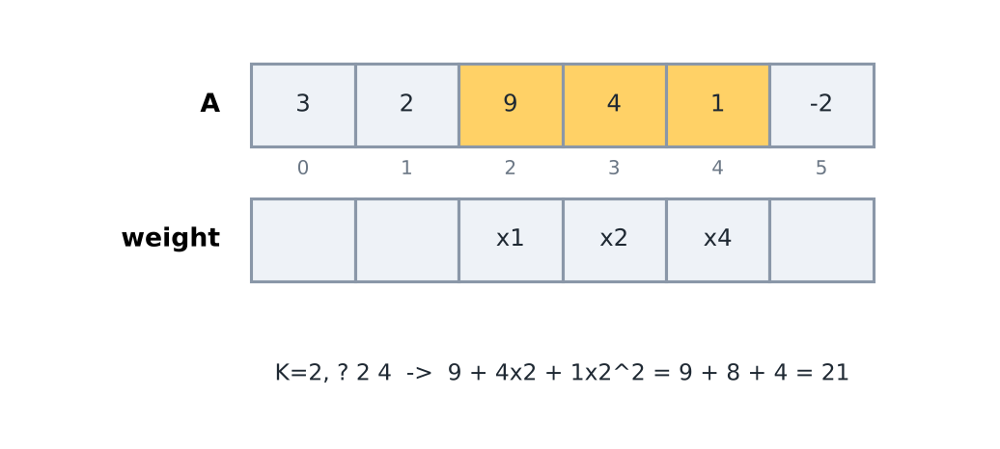

*K = 2, ? 2 4*

? 2 4 → 9 + 4x2 + 1x2^2
      = 9 + 8 + 4
      = 21

Brute force : for each query calculate the expression value iterating from L-R.
T. C. O(Q.N). For Q = N = $10^5$ this is again $10^{10}$ steps.

The trick is the same as before, but now the weight is K^(i-L). The part K^(-L) does not depend on i, so it can be taken outside the sum. In words: multiply every element by K^i once, in advance, take prefix sums of these numbers, and at query time divide the range total by K^L to get the weights K^(i-L) back.

A[L] + A[L+1] x K^1 + ...... + A[R] x K^(R-L)

$= \sum_{i=L}^{R} A[i] \times K^{(i-L)}$

$= \sum A[i] \times K^i \times K^{-L}$

$= K^{-L} \sum (A[i] \times K^i)$

$= K^{-L} \sum B[i]$ → B[i] = A[i] x K^i

- ΣB[i] → Can be kept in prefix array for quick access during query.
- K^-L → Can be calculated in log(L) for each query.

To optimise we can precalculate for each i, K^-i ✓

```
K^-1 → O(log n).
K^-1 = x
Kinv[1] = x
Kinv[2] = Kinv[1] x x

K^-m = K^-(m-1) x K^-1
```

Can be computed and saved in arr.

T.C. = O(N + Q).

Correction of one detail: the cost of K^-1 does not depend on n. The exponent is MOD-2, so fast power needs about 30 steps (O(log MOD)). Computing it once and then filling the table costs O(N) more. Without the table, each query would pay about 30 steps for K^-L, which is also fast enough for $10^5$ queries.

Note: K^-1 here is the modular inverse, that is, the number x such that K·x ≡ 1 (mod $10^9+7$). We need it because ordinary division does not work on remainders. Since MOD is a prime number, Fermat's little theorem gives K^-1 = K^(MOD-2), which is computed by fast power. This costs O(log MOD), and K must not be a multiple of MOD.

![Rows A, K^i, B[i], prefix of B; query = (91 - 7) / 4](../../../assets/notes/1-2-prefix-sums/fig18_gp_prefix_trace.png)

*K=2: B = 3 4 36 32 16 -64, prefix = 3 7 43 75 91 27. ? 2 4 → (91 - 7) / 4 = 21.*

Reading the figure: the sum of B over positions 2..4 is 91 - 7 = 84. Dividing by K^2 = 4 gives 21, the same as the direct calculation. In the program, "divide by K^2" is "multiply by Kinv[2]" modulo $10^9+7$, because the numbers are remainders.

Code: `bin_pow` is fast power (square the base and halve the exponent at every step). `inv` calls it with exponent MOD-2. `wsum` is the prefix of A[i]*K^i, and `k_inv[m]` is K^-m.

```cpp
/*
Problem: given array A, integer K and Q queries "L R" (1-indexed).
Print (A[L] + A[L+1]*K + ... + A[R]*K^(R-L)) % 10^9+7.
*/
// Fabricator/Prefix-Partial-Sums/GPPrefixSum.cpp
long long bin_pow(long long base, long long exp){
    long long val = 1;
    while(exp){
        if(exp & 1){
            val = (val * base) % MOD;
        }

        base = (base * base) % MOD;
        exp >>= 1;
    }

    return val;
}

long long inv(long long num){
    return bin_pow(num, MOD - 2);
}

long long norm(long long num){
    return ((num % MOD) + MOD) % MOD;
}

void solve() {
    int n, k, q;
    cin>>n>>q>>k;

    vector<long long> wsum(n+1, 0);
    long long k_p = 1;
    for(int i=0; i<n; i++){
        long long num;
        cin>>num;

        num = norm(num);
        wsum[i+1] = (wsum[i] + (num * k_p)) % MOD;
        k_p = (k_p * k) % MOD;
    }

    vector<long long> k_inv(n+1);
    k_inv[1] = inv(k);
    k_inv[0] = 1;
    for(int i=1; i<n; i++){
        k_inv[i + 1] = (k_inv[i] * k_inv[1]) % MOD;
    }

    while(q--){
        int l, r;
        cin>>l>>r;
        --l; --r;

        long long ans = k_inv[l] * (norm(wsum[r+1] - wsum[l])) % MOD;
        cout<<ans<<endl;
    }
}
```

Dry run: K = 2, A = 3 2 9 4 1 -2: `? 2 4` → 21, whole array → 27, `? 3 5` → 1000000005 (= -2 mod 10^9+7, because 4 + 2 - 8 = -2). These queries are 0-indexed, and the code reads 1-indexed positions, so they are entered as `3 5`, `1 6` and `4 6` (without the question mark). The input order of the code is `n q k`, then the array, then the queries.

Common mistakes: forgetting that K must not be a multiple of MOD (then K has no inverse), using K^-L with a 1-indexed L when the prefix array was built with 0-indexed powers, and multiplying two numbers that are both close to MOD in int (the product needs long long).

---

## Partial Sum AP

Given an array Arr of N integers, initially all 0s. Process Q queries of the form:

+ A D L R → add the A.P. of first term A and common difference D to the range L to R.

```
Arr[L] += A
Arr[L+1] += A+D
Arr[L+2] += A+2D
   :
Arr[R] += A + (R-L) D.
```

Find the final array after all queries modulo 10^9+7.

Brute force: add the terms of every query one by one, which is O(Q.N), again $10^{10}$ steps for Q = N = $10^5$. The plain partial sum cannot be used directly, because the amount added is not the same in every cell: it grows by D from one cell to the next.

Example:
```
+ 2 1 3 4
+ 1 2 1 5

| | | | | | |
  0 1 2 3 4 5
```

The first query `+ 2 1 3 4` has A = 2, D = 1, L = 3, R = 4, so it adds the terms 2 and 3:

* + 2 1 3 4 → Arr[3] += 2
              Arr[4] += 3

The second query `+ 1 2 1 5` has A = 1, D = 2, L = 1, R = 5, so it adds the terms 1, 3, 5, 7, 9:

```
+ 1 2 1 5
Arr[1] += 1 | Arr[2] += 3 | Arr[3] += 5
Arr[4] += 7 | Arr[5] += 9.
```

The final array is the sum of both contributions:

```
| 0 | 1 | 3 | 7 | 10 | 9 |      } final array
  0   1   2   3   4    5   (idx →)

        2   3    → first contri
    1   3   5   7   9 → second contri.
```

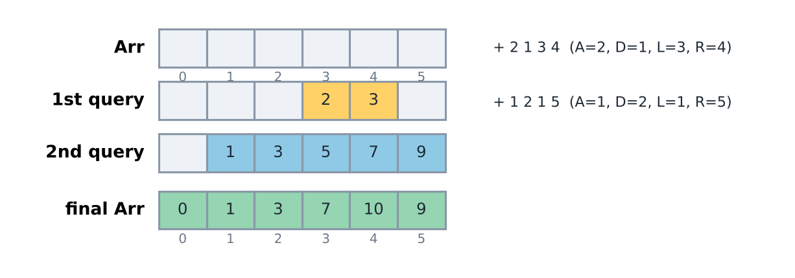

*first contri + second contri.*

Observation: for a G.P. (later in this lesson) the term cannot be split, but for an A.P. it can. Write the term as one part that depends on i and one part that does not:

```
Arr[i] += A + (i-L) x D
Arr[i] += (A - LxD) + (ixD)
           ↳ constant        ↳ dependent on pos (i)
             for a query
```

Assume Arr is composed of Arr_A & Arr_B.

Arr[i] = Arr_A[i] + Arr_B[i] x i

and we have Arr[i] += (A-LD) + (i*D)
to propagate in Arr.

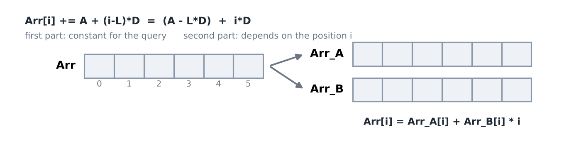

*Arr = Arr_A + Arr_B * i*

Looking closely at the two relations, we can deduce that

(A-LD) can be propagated via Arr_A & (i*D) can be propagated via Arr_B.

(A-LD) can be added to range (L,R) in Arr_A & D can be added to the range (L,R) in Arr_B.

This means that both arrays only need a simple range add, which is the ordinary partial sum.

An example with symbols: the query `+ X Y 1 4` (A = X, D = Y, L = 1, R = 4) adds X - Y + i·Y to cell i.

```
| | | | | | |      + X Y 1 4
  0 1 2 3 4 5      Arr += (X-Y+iY)
```

```
Direct (Brute)
| |  | X | X | X |  |
|   |   | Y | 2Y | 3Y |   |
  0   1   2   3    4    5
```

Adding like partial sum.
```
Arr_A  | | x-y |   |   |   | -(x-y) |
         0    1    2   3   4     5

Arr_B  | | y |   |   |   | -y |
         0   1   2   3   4    5
```

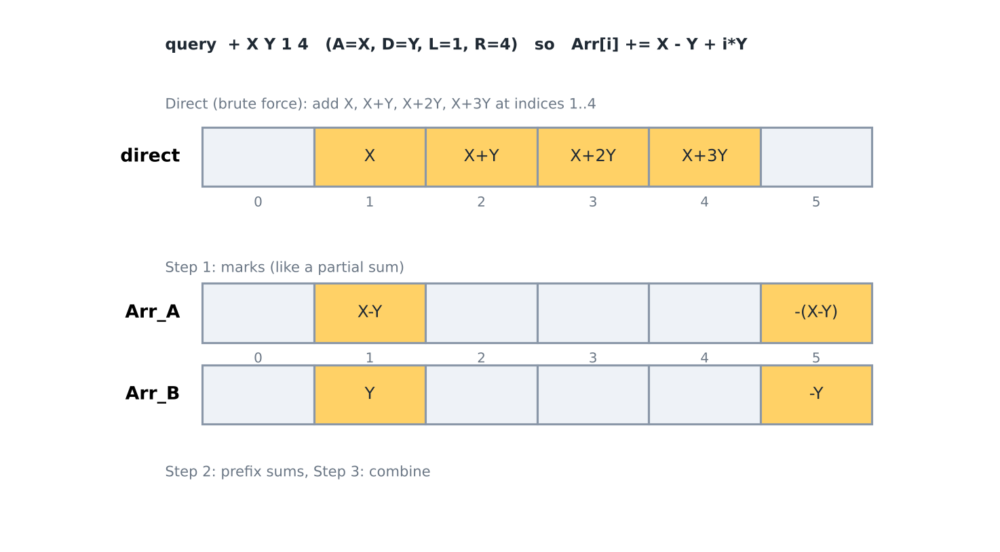

*Two arrays, and only the end marks are written.*

```
Arr_A  | | x-y | x-y | x-y | x-y | |
         0    1     2     3     4    5

Arr_B  | | y | y | y | y | |
         0   1   2   3   4  5
```

Combine using    Arr[i] = Arr_A[i] + Arr_B[i]*i

```
| |  X  | X  | X  | X  | |
|   |     | +Y | +2Y | +3Y |   |
  0   1     2    3     4    5
```
\} exactly same as Brute.

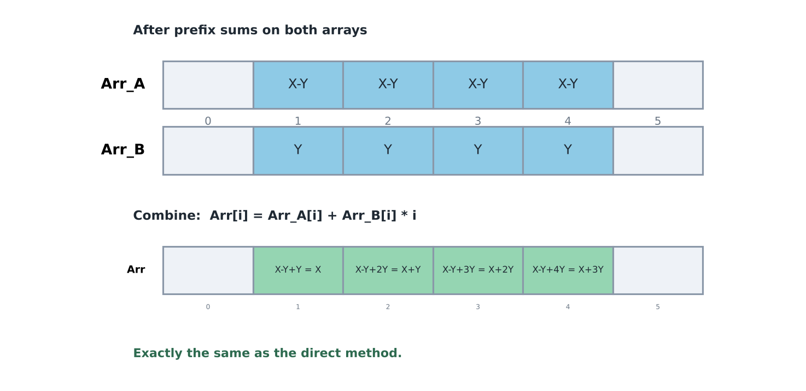

*i=1: X-Y+Y = X, i=2: X+Y, ... same as brute.*

T.C.: O(Q+N)

Each query makes 4 mark updates, and the end needs 2 prefix passes and 1 combine pass, so the total work is about 4Q + 3N steps. The extra memory is two arrays of N cells.

Code: `arr_a` and `arr_b` are the two mark arrays, and `head` = A - L*D. The input is 1-indexed, which is why the code has `--l;--r;`.

```cpp
/*
Problem: given N and Q queries "A D L R" (1-indexed). Initially all 0.
Arr[L] += A, Arr[L+1] += A+D, ..., Arr[R] += A+(R-L)*D.
Print the final array % 10^9+7.
*/
// Fabricator/Prefix-Partial-Sums/APPartialSum.cpp
long long norm(long long num){
    return ((num % MOD) + MOD) % MOD;
}

void solve() {
    int n;
    cin>>n;

    int q;
    cin>>q;

    vector<long long> arr_a(n, 0), arr_b(n, 0);

    while(q--){
        long long a, d, l, r;
        cin>>a>>d>>l>>r;
        --l;--r;

        long long head = norm(a - norm(l * d));
        if(l < n) {
            arr_a[l] = norm(arr_a[l] + head);
            arr_b[l] = norm(arr_b[l] + d);
        }

        if(r < n-1) {
            arr_a[r + 1] = norm(arr_a[r+1] - head);
            arr_b[r + 1] = norm(arr_b[r+1] - d);
        }
    }

    for(int i=1; i<n; i++){
        arr_a[i] = norm(arr_a[i] + arr_a[i-1]);
        arr_b[i] = norm(arr_b[i] + arr_b[i-1]);
    }

    vector<long long> arr(n);
    for(long long i=0; i<n; i++){
        arr[i] = norm(arr_a[i] + norm(arr_b[i] * i));
    }

    for(int i=0; i<n; i++){
        cout<<arr[i]<<" ";
    }

    cout<<endl;
}
```

Dry run: n = 6, `+ 2 1 3 4`, `+ 1 2 1 5` → `0 1 3 7 10 9`. (The example uses 0-indexed positions, as in the figure. The code reads 1-indexed positions, so the input to the code is `n q` = `6 2`, then the lines `2 1 4 5` and `1 2 2 6`, without the plus sign.)

Step by step (0-indexed): for the first query head = A - L·D = 2 - 3 = -1, so `arr_a` gets -1 at index 3 and +1 at index 5, and `arr_b` gets 1 at index 3 and -1 at index 5. For the second query head = 1 - 2 = -1, so `arr_a` gets -1 at index 1 and `arr_b` gets 2 at index 1 (the end marks at index 6 are outside the array and are skipped). After the prefix passes `arr_a` = 0 -1 -1 -2 -2 -1 and `arr_b` = 0 2 2 3 3 2. Then Arr[i] = arr_a[i] + arr_b[i]·i gives 0, -1+2 = 1, -1+4 = 3, -2+9 = 7, -2+12 = 10 and -1+10 = 9.

Common mistakes: computing head = A - L·D with a different indexing for L than for i, forgetting that head can be negative (it needs the `norm`), and putting the end marks at R instead of R+1.

---

## Partial Sum GP

Given an array Arr[] with N zeros initially. and r, the common GP ratio of all queries. find array after Q queries of the form + A L R : Add the GP with first term A and common ratio r to the range L to R.

```
Arr[L] += A
Arr[L+1] += A x r
Arr[L+2] += A x r^2
   :
Arr[R] += A x r^(R-L)
```
After performing all the queries, print the final array modulo 10^9+7.

Example: r=2 ,
```
+ 1 1 5 → 1 2 4 8 16
+ 2 3 4 → 2 4

Arr  | | | | | | |
       0 1 2 3 4 5

       1  2  4  8  16
          2  4

Arr: | 0 | 1 | 2 | 6 | 12 | 16 |
```

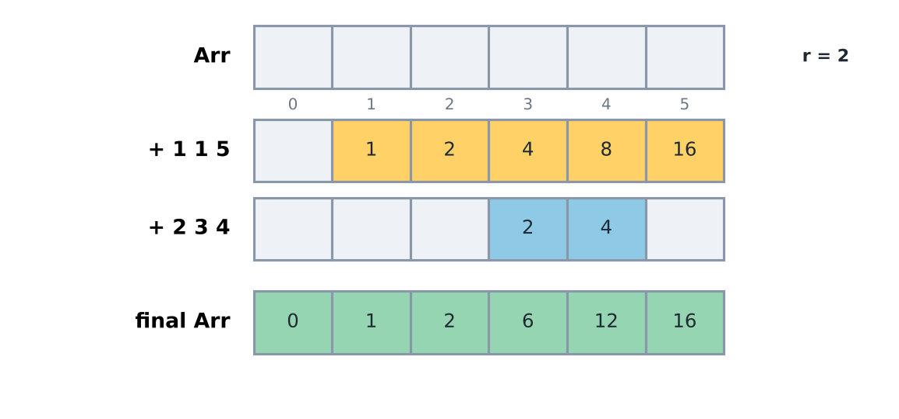

*r = 2.*

Brute force: iterate over L to R & update the values

T.C. : O(Q.N), which is $10^{10}$ steps for Q = N = $10^5$.

What general term is being added?

Arr[i] += A.r^(i-L) & cannot be separated into sums.

A.r^(i-L)
 ↳ cannot be separated into sums.

The reason: in the A.P. case the term split into "a part with i" plus "a part without i". Here i is in an exponent and the pieces are multiplied, not added, so no such split exists.

Hence the decomposition technique from the previous problem cannot be used.

Let us try to tweak the idea of prefix sum.

```
Arr  | | A | | | | |

for (int i=1; i<n; i++)
   Arr[i] += Arr[i-1] *r;
```

Using this loop (instead of the traditional prefix sum loop):

```
| | A | Ar | Ar^2 | Ar^3 | | |
```
\} the above loop gives GP contri

The ordinary prefix sum adds the previous cell. This loop multiplies the previous cell by r first, so a single value A turns into the sequence A, Ar, Ar^2, ... automatically.

So, now, for the query `+ A 1 3`, the cells 1 to 3 should hold:

```
| | A | Ar | Ar^2 | | |
  0 1   2    3      4   5
```

We need to add the following to the mark array:

```
| 0 | A |   |   | -Ar^3 | |
  0   1   2   3     4     5
```

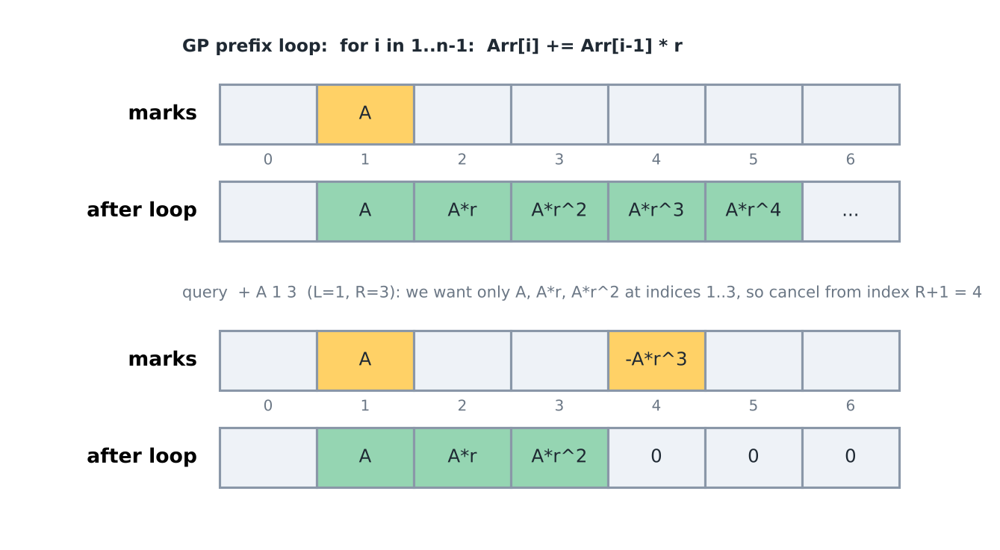

*The loop multiplies by r at every step. The mark at R+1 cancels it.*

```
Arr[L] += A;
Arr[R+1] += (-A x r^(R-L+1));
```

Why -A r^(R-L+1)? After the loop, cell R holds A r^(R-L). At cell R+1 the loop would put r times this value, which is A r^(R-L+1). Placing exactly the negative of this value at R+1 makes cell R+1 zero, and then every cell after it stays zero. Several queries are linear, so their marks just add up.

Note: the loop above has no modulo, so large values would overflow. The solution code uses `% MOD`.

Time Complexity:

A.r^(R-L+1) can take O(log n) per query.

But can optimised by precalculating powers of r. (max upto n).

```
rpow[i] = r^i
rpow[i] = r x rpow[i-1]       } precompute
```

Now, Query time reduced to O(Q).

Total T.C. = O(Q+N)

Code: `r_pow` is the table of powers of r. The marks go at L and at R+1 (skipped when outside the array), and the last loop is the G.P. prefix pass (the `* r_gp` part).

```cpp
/*
Problem: given N, Q and ratio K. Initially all 0.
Query "A L R" (1-indexed): add the GP A, A*K, A*K^2, ... to L..R.
Print the final array % 10^9+7.
*/
// Fabricator/Prefix-Partial-Sums/GPPartialSum.cpp
long long bin_pow(long long base, long long exp){
    long long ans = 1;
    while(exp){
        if(exp & 1){
            ans = (ans * base) % MOD;
        }

        base = (base * base) % MOD;
        exp >>= 1;
    }

    return ans;
}

long long norm(long long num){
    return ((num % MOD) + MOD) % MOD;
}

void solve() {
    int n, q, r_gp;
    cin>>n>>q>>r_gp;

    vector<long long> arr(n, 0), r_pow(n+1);

    r_pow[0] = 1;
    for(long long i=1; i<=n; i++){
        r_pow[i] = norm(r_gp * r_pow[i-1]);
    }

    while(q--){
        int a, l, r;
        cin>>a>>l>>r;
        --l;--r;

        if(l < n) arr[l] = norm(arr[l] + a);
        if(r < n-1) arr[r+1] = norm(arr[r+1] - norm(a * r_pow[r-l+1]));
    }

    for(int i=1; i<n; i++){
        arr[i] = norm(arr[i] + norm(arr[i-1] * r_gp));
    }

    for(int i=0; i<n; i++){
        cout<<arr[i]<<" ";
    }

    cout<<endl;
}
```

Dry run: r = 2, `+ 1 1 5`, `+ 2 3 4`, n = 6 → `0 1 2 6 12 16`.

Check by hand (positions 0-indexed, as in the figure; the code above subtracts one from its input, so it expects 1-indexed positions, and the input to the code is `n q r` = `6 2 2`, then `1 2 6` and `2 4 5`): the first query contributes 1 2 4 8 16 at indices 1 to 5, and the second contributes 2 4 at indices 3 and 4. Adding them gives 0 1 2 6 12 16.

Step by step with the marks (0-indexed): the first query writes +1 at index 1, and its end mark at index 6 is outside the array. The second query writes +2 at index 3 and -2·2^2 = -8 at index 5. The mark array is 0 1 0 2 0 -8. The loop then gives Arr[1] = 1, Arr[2] = 0 + 1·2 = 2, Arr[3] = 2 + 2·2 = 6, Arr[4] = 0 + 6·2 = 12 and Arr[5] = -8 + 12·2 = 16.

Common mistakes: using the loop `Arr[i] += Arr[i-1]` without the factor r, writing the cancelling mark as -A·r^(R-L) instead of -A·r^(R-L+1), and forgetting the modulo inside the loop. The ratio r is the same for all queries, which is what allows one loop to serve every query.

---

## 2D Prefix Triangle

The last technique changes the shape of the query. A rectangle is replaced by a triangle.

Given a 2D array of dimension NxM with initial values.

You will need to answer Q queries. In each query three integers x,y,L are given, and you have to find the sum of the triangle given as per the illustration.

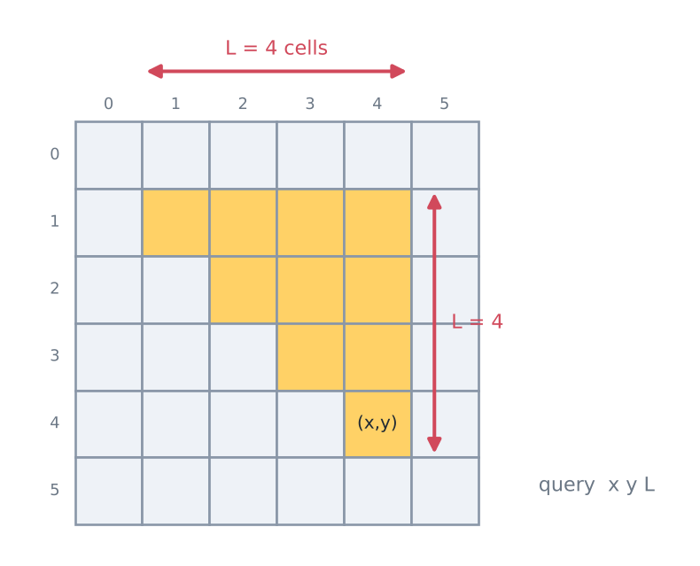

*The top edge has length L, the right edge has length L, and the bottom-right cell is (x,y). (x=4, y=4, L=4, 0-indexed.)*

Calculate all the values modulo 10^9+7.
If you go outside the cell then consider the value of the cell to be 0.

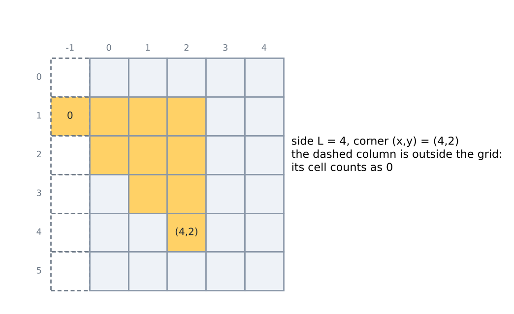

*One element is outside the grid, so its value is 0.*

Brute force: add the cells of the triangle one by one. A triangle of side L has L(L+1)/2 cells. For L = 1000 that is about $5 \times 10^5$ cells per query, and for $10^5$ queries about $5 \times 10^{10}$ steps, which is far too slow.

Now, rectangular sums were obtained using prefix sums of rectangles.
So, let us try to conquer triangles with triangular prefix sums.

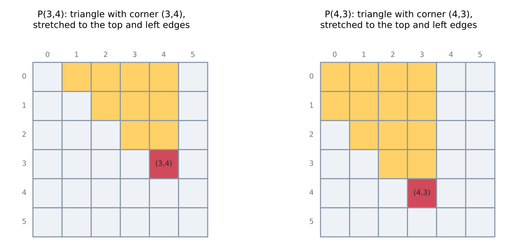

*P(3,4) → sum of the triangle formed by the shaded cells. P(4,3) → likewise.*

(Stretch the triangle up to the top edge and the left edge of the grid. It contains the cells (a,b) with a ≤ x, b ≤ y, b - a ≥ y - x.)

Calculating the triangular prefix sum. There are two ways to build P(x,y) from values that are already known.

Method 1:
Using rectangular sums

This value will already be computed (the triangle ending at (x-1, y-1)).

To find P(x,y) we just need to add the rectangular sum to the previous value (the column strip from the top till (x,y)).

Method 2:
Use only prefix sums previous values.

(The strip = tall rectangle = L-shaped staircase band = P[x-1][y] - P[x-2][y-1].)

P[i][j] = Arr[i][j] + P[i-1][j-1] + P[i-1][j] - P[i-1][j-1];

Note: the last term must be P[i-2][j-1]. Otherwise it only cancels P[i-1][j-1]. So P[i][j] = Arr[i][j] + P[i-1][j-1] + P[i-1][j] - P[i-2][j-1].

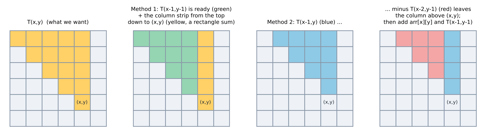

*Method 1: T(x-1,y-1) + strip. Method 2: T(x-1,y) - T(x-2,y-1).*

How does this method help us? The answer to a query is cut out of the big stretched triangle, in the same way as a rectangle is cut out of a rectangle prefix:

Ans = P[x][y] - P[x-L][y-L]
      - (R[x-L][y] - R[x-L][y-L])

R → rectangular prefix sum
P → triangular prefix sum.

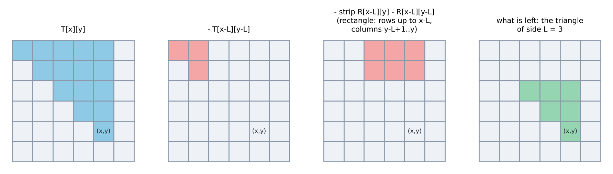

*x=4, y=4, L=3: cut away the upper part.*

In words: the big stretched triangle P[x][y] is too large. It is the wanted triangle plus everything in rows 0 to x-L. Those rows split into two pieces. The left piece (columns up to y-L) is exactly the stretched triangle P[x-L][y-L]. The right piece (columns y-L+1 to y) is a plain rectangle, because the diagonal edge of the big triangle has already passed to the left of these columns in those rows. Its sum is R[x-L][y] - R[x-L][y-L]. Removing both pieces leaves the wanted triangle.

T.C. = O(N*M + Q). The extra memory is two tables of N.M cells (P and R).

Code: `rect_pref` is R, and `tri_pref` is P. The input is 1-indexed (`--x;--y;`). The checks `x - l >= 0` apply the rule "outside the grid = 0".

```cpp
/*
Problem: N x M matrix, Q queries "x y L" (1-indexed).
Sum of the triangle of side L with bottom-right corner (x, y),
modulo 10^9+7. Cells outside the grid are 0.
*/
// Fabricator/Prefix-Partial-Sums/TriangleSumQuery.cpp
long long norm(long long num){
    return ((num % MOD) + MOD) % MOD;
}

void solve() {
    int n, m, q;
    cin>>n>>m>>q;

    vector<vector<long long>> mat(n, vector<long long>(m));
    for(int i=0; i<n; i++){
        for(int j=0; j<m; j++){
            cin>>mat[i][j];
        }
    }

    vector<vector<long long>> tri_pref(n, vector<long long>(m, 0)), rect_pref(n, vector<long long>(m, 0));
    for(int i=0; i<n; i++){
        for(int j=0; j<m; j++){
            rect_pref[i][j] = norm(mat[i][j]);
            if(i > 0) rect_pref[i][j] = norm(rect_pref[i][j] + rect_pref[i-1][j]);
            if(j > 0) rect_pref[i][j] = norm(rect_pref[i][j] + rect_pref[i][j-1]);
            if(i > 0 && j > 0) rect_pref[i][j] = norm(rect_pref[i][j] - rect_pref[i-1][j-1]);
        }
    }

    for(int i=0; i<n; i++){
        for(int j=0; j<m; j++){
            tri_pref[i][j] = norm(mat[i][j]);
            if(i > 0) tri_pref[i][j] = norm(tri_pref[i][j] + tri_pref[i-1][j]);
            if(i > 0 && j > 0) tri_pref[i][j] = norm(tri_pref[i][j] + tri_pref[i-1][j-1]);
            if(i > 1 && j > 0) tri_pref[i][j] = norm(tri_pref[i][j] - tri_pref[i-2][j-1]);
        }
    }

    while(q--){
        int x, y, l;
        cin>>x>>y>>l;
        --x;--y;

        long long ans = norm(tri_pref[x][y]);
        if(x - l >= 0 && y - l >= 0) ans = norm(ans - tri_pref[x-l][y-l]);
        long long diff = 0;
        if(x - l >= 0) diff = norm(rect_pref[x-l][y]);
        if(x - l >= 0 && y - l >= 0) diff = norm(diff - rect_pref[x-l][y-l]);

        ans = norm(ans - diff);

        cout<<ans<<endl;
    }
}
```

Dry run on a 6 x 6 grid whose rows are `1 2 3 4 5 6`, `7 8 9 10 11 12`, and so on up to `31 32 33 34 35 36` (0-indexed queries): `x=4 y=2 L=4` → 134, `x=4 y=4 L=3` → 122. The code reads 1-indexed positions, so these are entered as `5 3 4` and `5 5 3`.

Step by step for `x=4 y=4 L=3`: the stretched triangle P[4][4] is 175, the stretched triangle P[1][1] is 1 + 2 + 8 = 11, and the rectangle strip is R[1][4] - R[1][1] = 60 - 18 = 42. So the answer is 175 - 11 - 42 = 122. By hand, the triangle has the cells 29 in row 4, 22 and 23 in row 3, and 15, 16 and 17 in row 2, and 29 + 45 + 48 = 122.

Step by step for `x=4 y=2 L=4`: here y-L = -2 is outside the grid, so the stretched triangle P[x-L][y-L] and R[x-L][y-L] are 0. The stretched triangle P[4][2] is 140, and the strip is R[0][2] = 1 + 2 + 3 = 6. So the answer is 140 - 0 - 6 = 134. By hand, the cells are 27 in row 4, 20 and 21 in row 3, 13, 14 and 15 in row 2, and 7, 8 and 9 in row 1 (the leftmost cell of row 1 is outside the grid and counts as 0), and 27 + 41 + 42 + 24 = 134.

Common mistakes: using the first (wrong) version of the formula, which ends with `- P[i-1][j-1]` instead of `- P[i-2][j-1]`, forgetting the checks for cells outside the grid, and mixing up x (the row) and y (the column).

---

## Prefix sum + map, partial sum + sort

Another use of prefix sums: count the subarrays whose sum is X. (A subarray is a block of consecutive elements.)

The sum of A[i+1..j] is P[j] - P[i]. For this to be X we need P[i] = P[j] - X. So for every j, count how many earlier prefix sums are equal to P[j] - X. Keep these counts in a `map` (a container that stores a count for each key). Put P[empty] = 0 into it once at the start (`mp[0]++`), so that subarrays starting at index 0 are counted.

```cpp
/*
Problem: Given an array, find number of subarrays
whose sum of elements is equal to X.
*/
// Fabricator/STL/SubArraySumEqualsK.cpp
void solve(){
    int n, x;
    cin>>n>>x;
    int arr[n];
    for(int i=0; i<n; i++) {
        cin>>arr[i];
        if(i) arr[i] += arr[i-1];
    }

    int sol = 0;
    map<int, int> mp;
    mp[0]++;
    for(int i=0; i<n; i++){
        sol += mp[arr[i] - x];
        mp[arr[i]]++;
    }

    /* To print the subarrays as well */
    // int sol = 0;
    // map<int, vector<int>> mp;
    // mp[0].push_back(-1);
    // for(int i=0; i<n; i++){
    //     sol += mp[arr[i] - x];
    //     for(auto v: mp[arr[i] - x]){
    //         cout<<v+1<<" , "<<i<<endl;
    //     }
    //     mp[arr[i]].push_back(i);
    // }

    cout<<sol<<endl;
}
```

Dry run: `1 2 3 -1 4 1`, X = 5 → 3 (`2 3`, `1 2 3 -1`, `4 1`).

Step by step: the prefix sums are 1 3 6 5 9 10. At 6 the code looks for 6 - 5 = 1, which exists (the subarray `2 3`). At 5 it looks for 0, which is the empty prefix (the subarray `1 2 3 -1`). At 10 it looks for 5, which exists (the subarray `4 1`). The other positions find nothing, so the answer is 3. This runs in O(N log N) because of the `map`.

A use of partial sum: M ranges [l, r] are given, and the elements in all these ranges are put into one bag S. The query asks for the K-th smallest element of S. Use a partial sum to find how many times each index is covered (cnt[i]). Then sort the pairs (cnt, value) by value, take the prefix sum of cnt, and use `lower_bound` (binary search for the first position that is not smaller than the target) for K.

`cmp` tells `sort` which element goes first. `[](...) {...}` is a lambda: a small function written in place. Here it tells lower_bound how to compare a pair with K. If `it` is at the end, the answer is -1. Otherwise the answer is `it->second`.

```cpp
/*
Problem: array A and M ranges [l, r]. S = all elements of all ranges
(with repeats). For each query K print the K-th smallest
element of S, or -1 if S has fewer than K elements.
*/
// Fabricator/Prefix-Partial-Sums/KthValue.cpp
bool cmp(const pair<long long, long long> &a, const pair<long long, long long> &b){
    if(a.second < b.second) return true;
    return false;
}

void solve() {
    int n, m, q;
    cin>>n>>m>>q;

    vector<long long> arr(n);
    for(auto &ele: arr) cin>>ele;

    vector<long long> cnt(n, 0);
    while(m--){
        int l, r;
        cin>>l>>r;
        --l;--r;

        if(l < n) cnt[l] += 1;
        if(r < n-1) cnt[r+1] -= 1;
    }

    for(int i=1; i<n; i++){
        cnt[i] += cnt[i-1];
    }

    vector<pair<long long, long long>> cnt_arr;
    for(int i=0; i<n; i++){
        cnt_arr.push_back({cnt[i], arr[i]});
    }

    sort(cnt_arr.begin(), cnt_arr.end(), cmp);

    for(int i=1; i<n; i++){
        cnt_arr[i].first += cnt_arr[i-1].first;
    }

    while(q--){
        long long k;
        cin>>k;

        auto it = lower_bound(cnt_arr.begin(), cnt_arr.end(), k,
                [](const pair<long long,long long>& p, long long val) { return p.first < val; });
        if(it == cnt_arr.end()){
            cout<< (-1)<<" ";
        }
        else{
            cout<<it->second<<" ";
        }
    }

    cout<<endl;
}
```

Dry run: A = 1 3 2, ranges (1,3) (2,3) (1,1) → S sorted = 1 1 2 2 3 3 → K = 1 2 5 8 → `1 1 3 -1`.

Step by step: every index is covered twice, so the sorted pairs are (2,1) (2,2) (2,3) and the prefix counts are 2 4 6. For K = 1 and 2 the first prefix count that reaches K is 2, so the value is 1. For K = 5 it is 6, so the value is 3. For K = 8 there is no such position, so the answer is -1.

---

## Quick revision

- Prefix: P[i] = A[i] + P[i-1], range = P[R] - P[L-1]. Build O(N), query O(1). Static array only.
- For L = 0, P[-1] = 0 (store the array shifted by one). Use long long. With a modulus, fix negative values with (x + MOD) % MOD.
- Any operation that can undo a contribution works: for XOR, X[R+1] ^ X[L].
- Partial: P[L] += X, P[R+1] -= X, and one prefix pass at the end. Update O(1). If R+1 is outside the array, skip it.
- A mark spreads to the right until a mark cancels it. X and Y can be added separately.
- 2D prefix: P[i][j] = arr[i][j] + P[i-1][j] + P[i][j-1] - P[i-1][j-1].
- Rectangle = P[D][R] - P[D][L-1] - P[U-1][R] + P[U-1][L-1]. O(NM) build, O(1) query.
- 2D partial: P[U][L] += X, P[U][R+1] -= X, P[D+1][L] -= X, P[D+1][R+1] += X, then a 2D prefix. O(Q + NM).
- Prefix AP: Σ A[i]·(i-L+1) = Σ B[i] + (1-L) Σ A[i], with B[i] = A[i]·i. Keep two prefix arrays.
- Prefix GP: Σ A[i] K^(i-L) = K^(-L) Σ A[i] K^i. Precompute Kinv[m] = Kinv[m-1]·K^-1, with K^-1 = K^(MOD-2).
- Partial AP: Arr[i] += (A - LD) + iD → add (A-LD) to Arr_A and D to Arr_B on L..R. Then Arr[i] = Arr_A[i] + Arr_B[i]·i.
- Partial GP: Arr[L] += A, Arr[R+1] -= A·r^(R-L+1), then loop Arr[i] += Arr[i-1]·r. Precompute the powers of r.
- Triangle prefix: P[i][j] = Arr[i][j] + P[i-1][j-1] + P[i-1][j] - P[i-2][j-1].
- Answer = P[x][y] - P[x-L][y-L] - (R[x-L][y] - R[x-L][y-L]). Outside the grid = 0. O(NM + Q).
- Prefix + map → count the subarrays with sum X by looking up P[j] - X.

---

## Practice problems

maang.in
- [Rectangle Sum Query](https://maang.in/problems/Rectangle-Sum-Query-25)
- [LR Sum Query](https://maang.in/problems/LR-Sum-Query-18)
- [LR Power Sum Query](https://maang.in/problems/LR-Power-Sum-Query-21)
- [AP Addition](https://maang.in/problems/AP-Addition-29)
- [GP Addition](https://maang.in/problems/GP-Addition-31)
- [Triangle Sum Query](https://maang.in/problems/Triangle-Sum-Query-33)
- [Max Value in the Rectangle](https://maang.in/problems/Max-Value-in-the-Rectangle-28)
- [Kth Val](https://maang.in/problems/Kth-Val-34)
- [Good Numbers](https://maang.in/problems/Good-Numbers-23)
- [High School Maths](https://maang.in/problems/High-School-Maths-153)

### Problem ladder

<Ladder topic="1.2" />

