import TopicHeader from '../../../components/TopicHeader.astro';
import Ladder from '../../../components/Ladder.astro';

<TopicHeader topic="1.3" />

## What this note covers

This note covers two pointers (TP) and the sliding window.

Words used in this note:
- pointer = just an index in the array
- subarray = continuous part of the array, subsequence = same order but gaps allowed
- time complexity = how the number of steps grows with the input size, written with O(...)
- DS = data structure, BS = binary search, TLE = time limit exceeded, # = number of
- dry run = following the code by hand on a small input

The idea: instead of a nested loop, move two indices smartly. Neither index goes back, so the total work is O(n).

Why this matters, with numbers: suppose n = 100 000. A nested loop over all pairs of positions does about $n^2/2 = 5 \times 10^9$ steps, and a typical judge allows only about $10^8$ simple steps per second, so it gets a time limit exceeded (TLE) verdict. Two pointers does at most $2n = 200\,000$ steps for the same problem.

The sections of this note, in order:

- Two pointers: where it comes from
- Sliding window (fixed length, form 0)
- Two pointers forms
- Form 1: variable sized window
  - flips problem
  - ask, what, criteria, monotonic criteria
  - brute force → snake
  - data structure for the window
  - why head = -1
  - time complexity
  - count subarrays with distinct ≤ k
  - distinct == k and ≥ k
  - shortest subarray with distinct ≥ k
- Form 2: opposite direction
  - container with most water
  - 3-Sum
- Form 3: separate sequences
  - subsequence
  - inverted index (search)
  - matrix: minimise max - min
- Quick revision
- Practice problems

## Two Pointers

Binary search (BS) has two kinds:
- BS on Ans (binary search on the answer value)
- BS on Every start → this class of problems can be optimally solved using TP.

"BS on every start" means: for each start position L, binary search the farthest end R that is still valid. That costs O(n log n). Two pointers removes the log factor, because the answer for the next start can be built from the previous one instead of searching again.

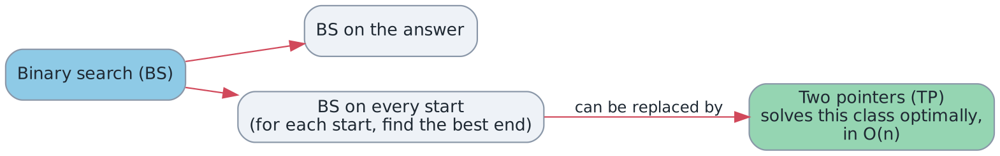

*BS on every start → TP, O(n).*

There are two patterns of TP:
- two pointers moving towards each other → classical
- two pointers moving in same direction maintaining a window → medium/hard

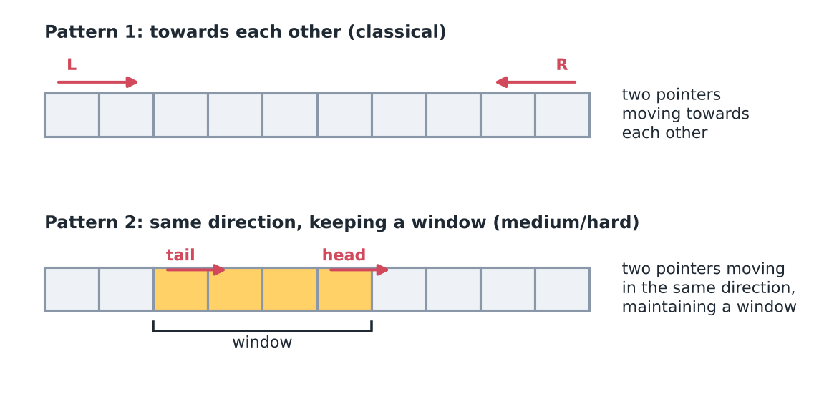

*Left: towards each other. Right: same direction with a window.*

Why is it fast? Both pointers only move forward and never go back. Each moves at most n steps → n + n = 2n → O(n).

Tiny example: n = 5. Pointer one visits positions 0 to 4 (5 steps) and pointer two visits positions 0 to 4 (5 steps). That is 10 steps in total, and a nested loop would take up to 25.

## Two pointers and sliding window

A sliding window is a part of the array that moves to the right. There are two kinds:

- fixed length window (easy)
- variable length window

A fixed length window always has the same size k. With each step to the right, the leftmost element leaves the window and one new element enters on the right. (This is the "0-form" in the repository.)

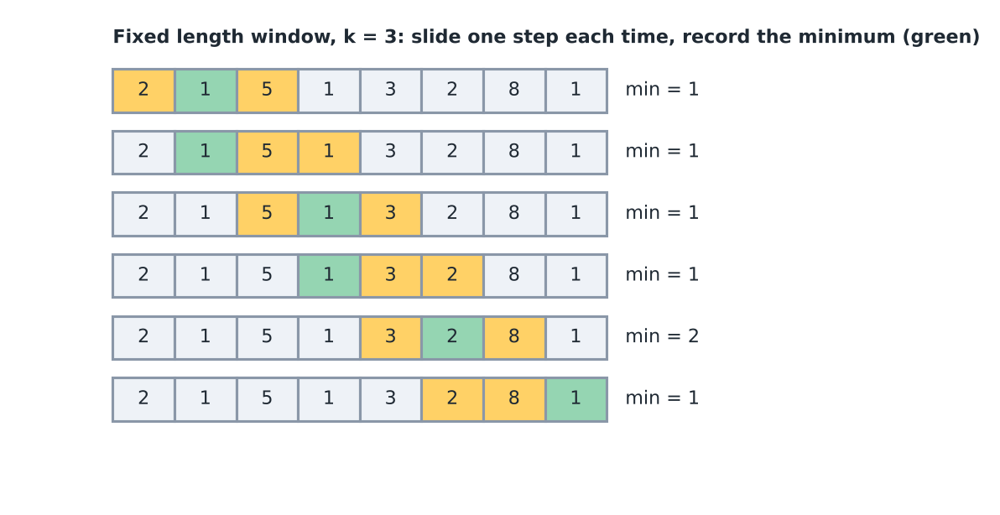

*k = 3, slide by one, min of each window in green.*

Question: given an array of size n and a window of size k. Find the minimum of all subarrays of size k.

Brute force: for every window loop k elements → O(n·k). There are n - k + 1 windows and each one is scanned in full.

With numbers: n = 100 000 and k = 50 000 gives 50 001 windows of 50 000 elements each, about $2.5 \times 10^9$ steps. Too slow.

Better: keep a data structure (DS) of the current window.
- multiset (sorted, duplicates allowed): insert new, erase the element that left, min = first. O(n log k), because the multiset holds at most k items, so each insert and erase costs O(log k).
- monotonic deque (queue we can pop from both ends): keep indices whose values are increasing, so front is always the min. Every index pushed once, popped once → O(n)

Why the deque works: suppose an older element is larger than or equal to a new element. The older one leaves the window earlier and is not smaller, so it can never be the minimum again. We can drop it safely. This is why we pop from the back while `arr[dq.back()] >= arr[i]`, and pop from the front when the index has left the window.

Memory: both versions keep at most k items, so O(k) extra memory.

Dry run with `2 1 5 1 3 2 8 1`, k = 3. There are 8 - 3 + 1 = 6 windows, so the minimums are `1 1 1 1 2 1`. Both functions give the same output.

Deque trace (the deque holds indices; the value of each index is in brackets):
- i = 0: deque `[0]`
- i = 1: value 1 is not larger than arr[0] = 2, so pop index 0 → deque `[1]`
- i = 2: 5 is larger than 1, keep → deque `[1, 2]`. The first full window is ready, min = arr[1] = 1
- i = 3: value 1 pops index 2 (5) and index 1 (1) → deque `[3]`, min = 1
- i = 4: deque `[3, 4]`, min = arr[3] = 1
- i = 5: value 2 pops index 4 (3) → deque `[3, 5]`, min = 1
- i = 6: index 3 is outside the window (3 &lt;= 6 - 3), so pop it from the front → deque `[5, 6]`, min = arr[5] = 2
- i = 7: value 1 pops indices 6 and 5 → deque `[7]`, min = 1

Common mistakes:
- Storing values instead of indices in the deque. Then we cannot tell when the front element has left the window.
- In the multiset version, writing `ms.erase(x)` removes every copy of x. To remove only the one copy that left the window, erase `ms.find(x)`, as the code below does.

```cpp
// Fabricator/TwoPointers/0-Form/SlidingWindow.cpp
/*
Given an array of size n and a window of size k.
Find minimum of all subarray of size k in the array.
*/

vector<int> minValueInKLengthWindows_UsingMonotonicDeque(vector<int> &arr, int n, int k){
    vector<int> ans;

    deque<int> dq;
    for(int i=0; i<n; i++){
        while(!dq.empty() && dq.front() <= (i-k)){
            dq.pop_front();
        }

        while(!dq.empty() && arr[dq.back()] >= arr[i]){
            dq.pop_back();
        }

        dq.push_back(i);

        if(i >= k - 1){
            ans.push_back(arr[dq.front()]);
        }
    }

    return ans;
}

vector<int> minValueInKLengthWindows(vector<int> &arr, int n, int k){
    vector<int> ans;

    multiset<int> ms;
    for(int i=0; i<n; i++){
        ms.insert(arr[i]);

        if(ms.size() > k){
            ms.erase(ms.find(arr[i - k]));
        }

        if(!ms.empty() && i >= k-1){
            ans.push_back(*(ms.begin()));
        }
    }

    return ans;
}
```

## Two pointers forms

The problems fall into three forms. The table gives the level and the idea of each form.

| Form | level | what |
|---|---|---|
| form 1 | medium/hard | maintain a variable sized window; subarray based prob, gap based prob → minimise/max gap |
| form 2 | medium | pointers moving in opposite direction |
| form 3 | easy | pointers on separate sequence moving in a direction |

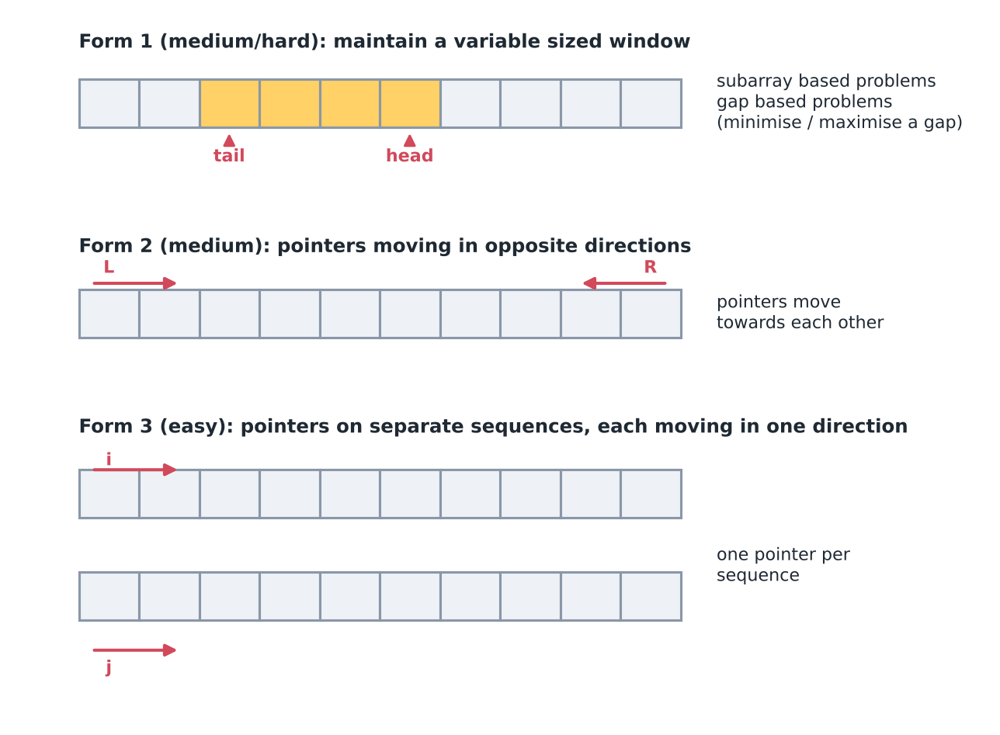

*The three forms: a window with a tail and a head, two pointers moving inward from both ends, and one pointer on each of two separate sequences.*

## Form 1: variable sized window

The standard first problem of form 1 is about flips.

Question: Given an array of 0s and 1s and k. You can flip k elements at most. Find the longest subarray of all 1s with at most k flips.

Example (indices start at 0): `[0, 1, 0, 1, 0, 0, 1, 1, 0]` | k=2

Flip the two zeros at index 4 and 5 → `[0, 1, 0, 1, 1, 1, 1, 1, 0]` → the answer is 5.

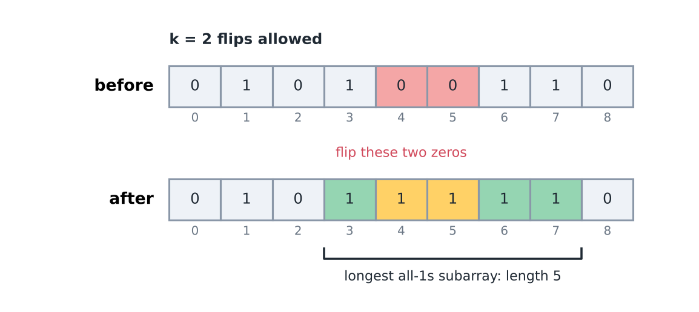

*k = 2, flip index 4 and 5, answer 5.*

Every question of this kind has 3 parts. The ask says what the answer looks like, the what says which objects we search over, and the criteria is the rule a valid object must follow.
- i) longest → ask
- ii) subarray → what
- iii) all 1s with at most k flips → criteria.

For form 1, the "what" is mostly one of two things: a subarray, or gaps (max-min).

The "ask" is one of: longest, shortest, count, sum of length.

The criteria must be a monotonic criteria.

[These will be asking for two pointers form 1.]

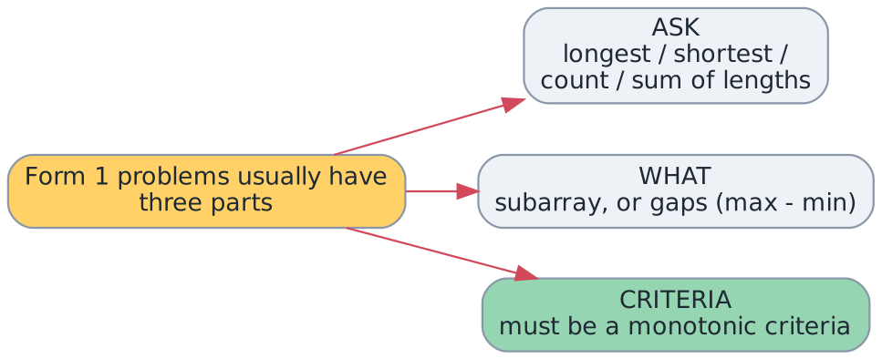

*ask / what / criteria.*

Now split the example question into its parts. In "longest subarray of all 1s with at most k flips":
- subarray → [L,R] (the subarray from index L to index R)
- all 1s with at most k flips → [# of 0s in [L,R] ≤ k]
- we have to check whether the criteria is monotonic.

What is a monotonic criteria?
- it means: if something is true for a subarray
  - it is also true for every part of that subarray.

If true for [L,R]
⇒ also true for [L+1,R] & [L,R-1]

Example: outer window has # of 0s ≤ 2 → the part inside it also has # of 0s ≤ 2.

A criteria that is not monotonic: "the sum of the subarray is at least 10". A subarray with sum 12 can have a part with sum 4, so the rule does not carry over to the parts.

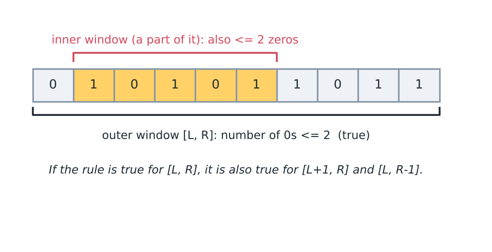

*Inner part of a good window is also good.*

Therefore the criteria is monotonic.

\*\* If the criteria is not monotonic then it can't be solved using two pointers.

Brute force: for every L, keep on trying the next points to find the optimal subarray end point. In pseudo code:

```
for (L = (0,N))                  for every L we can keep
  for (R = (L,N))                on trying next points to
    check (L,R)                  find optimal subarray
    ans = (L,R)                  end point.
                                 O(n²) → (TLE)
```
So we try checking all subarrays of the array.

Cost: for n = 100 000 there are about $n^2/2 = 5 \times 10^9$ pairs (L, R). If each check also scans the subarray, it is even worse (O(n³)). Both are far too slow.

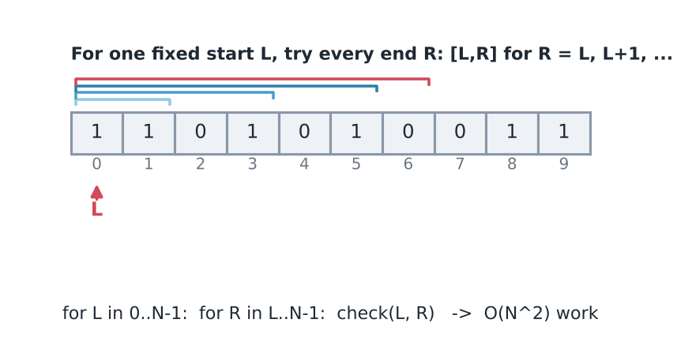

*Fixed L, try every R → O(N²).*

Example with k=2 and array `1 1 0 1 0 1 0`: start at the first 1 and end at index 5 (the last 1). This end is optimal because k=2 zeros are already used and the next element is 0.

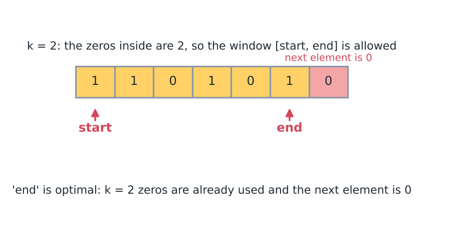

*2 zeros used, next is 0 → stop here.*

Now take the next start. Why check again from the start of the next element, when we already know that the points up to the old end will be possible?
Why not begin checking from the old 'end'?
↳ because if [start,end] → true ⇒ [start+1,end] → true.

In the example, [0,5] is valid (2 zeros), so [1,5] is valid without any check.

Observation: the head never needs to move back. When the tail moves 1 step, the window only becomes smaller (the old window was valid, and a part of a valid window is still valid). So the best head for the new tail is ≥ the old head. The head only goes right.

The pseudo code now changes: the inner loop starts from the last R instead of from L.

```
for (L: (0,N))
  for (R: (last R, N))        → start checking
    check (L,R)                  from last
    ans = (L,R).                 'end'.
```

The template of form 1 is a snake.

Think of a snake, start eating elements till the condition allows, k=2 means we can eat at most 2 zeros.

tail = back of the snake, head = front. [tail, head] = best possible length for this tail.

After this move tail one step forward. Then head again eats max elements.

We keep on doing this.
- i) Eat as many as you can
- ii) stopping, update answer.
- iii) move tail 1 step forward & repeat.

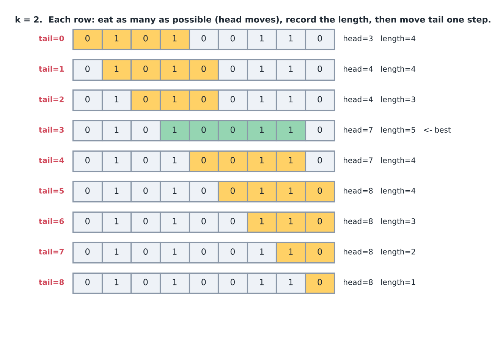

*Dry run on `0 1 0 1 0 0 1 1 0`, k=2: the best length for each tail is 4 4 3 5 4 4 3 2 1 → ans 5.*

We frequently have to check the next element after the head and decide whether to take it or not.

For this we maintain a DS for the range. It must provide these functions:
- check next
- insert
- remove

For the current question, the DS is just the frequency (count) of 0s in the window.

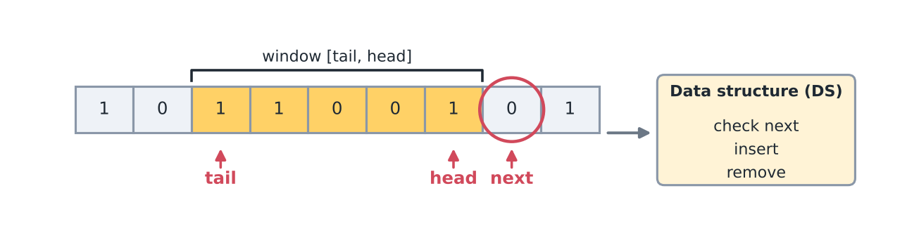

*DS answers: can the window take the next element?*

The code is in the file Subarrays With K flips.cpp (it is shown further below). First, one detail of the template. We had written `int tail =0, head = -1;`

Why head = -1 ?

Take the array `0 0 0 1` with k=0 (no flip allowed). Start with head=-1, tail=0.

head = -1 so that we try eating even the first element. ("check & proceed")

Here we can't even eat a single element, because the first element is 0 and k=0.
If head would have been 0 then it would have eaten one element which is invalid because k=0.

also, we have
ans = max (ans, head - tail +1)

head - tail +1 will give the correct length for head = -1, which is 0
⇒ we can't even create more than 0 len sub arr.

The tail is moved by this code (the part in the first branch is shown in full in the solution below):

```
if (tail <= head){
   :
}
else {
   tail++ ;
   head = (tail - 1);
}
```

The else branch will be triggered here.

tail will be 1
& head will be put at tail-1 = 0.

check length again: head - tail + 1
0 - 1 + 1 = 0
which is correct again.
because we can't even eat 1 element.

The same happens for tail = 2 (head = 1). At tail = 3 the head can eat the single 1, so the length becomes 1. This matches the dry run `0 0 0 1`, k=0 → 1 given with the code.

∴ head = -1 because we want to start with 0 length subarray.

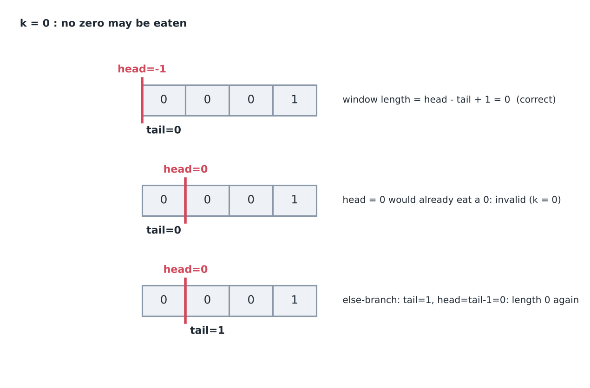

*head = -1 → empty window to start.*

Time complexity (TC): for both pointers, we perform constant work.

- head → traverses n elements
- tail → traverses n elements.

O(n) + O(n) → O(2n) → O(n).

The head also only moves forward in the else branch (it moves from tail - 1 to the new tail - 1, one step to the right).

In general the time complexity is:

O(N * (H + A + T)).

N is the size of the array and each of H, A, T is the cost of one step:

- H → complexity to check/validate & move the head.
- A → complexity to update the answer.
- T → complexity to move the tail.

Here H, A, T all O(1) → O(N).

Code. Write it in this order: first the two pointers (tp) stuff, then the answer (ans), then the data structure:

```cpp
// Fabricator/TwoPointers/1-Form/SubarraysWithKFlips.cpp
/*
Given an array of 1s and 0s and k.
In k moves you can flip one number, either 0 to 1 or 1 to 0.

Find the largest subarray you can create with all 1s with k moves.
*/

void solve() {
    int n, k;
    cin>>n>>k;

    int arr[n];
    for(auto &x: arr) cin>>x;
    
    // order of writing -> tp stuff -> ans -> data structure
    // ds - 3
    int count_of_zeros = 0;
    // ans - 2
    int ans = 0;
    // tp stuff - 1
    int tail = 0, head = -1; // set to zero length subarray
    while(tail < n){
        // keep eating as many as possible
        while((head + 1) < n && (/*can eat next elemet?*/ (count_of_zeros + 1 - arr[head + 1]) <= k)){ // also correct -> (count_of_zeros < k || (count_of_zeros == k && arr[head + 1] == 1))
            head++;

            // insert(arr[head])
            if(arr[head] == 0) count_of_zeros++;
        }

        // update answer
        ans = max(ans, head - tail + 1);
        // move tail 1 step forward
        if(tail <= head){
            // remove(arr[tail])
            if(arr[tail] == 0) count_of_zeros--;
            tail++;
        }
        else{ // tail running ahead of the head
            tail++;
            head = tail - 1; // reset to zero length subarray
        }
    }

    cout<<ans<<endl;
}
```

The check `count_of_zeros + 1 - arr[head + 1] <= k` works like this. If the next element is 1, the value is count_of_zeros, so nothing new is added. If the next element is 0, the value is count_of_zeros + 1, so one more zero is added. In both cases the result must stay within k.

Dry run: `1 0 1 0 1`, k=1 → 3. `0 1 0 1 0 0 1 1 0`, k=2 → 5. `0 0 0 1`, k=0 → 1.

Step by step for `1 0 1 0 1`, k = 1:
- tail = 0: head eats indices 0, 1, 2 (one zero is allowed). Index 3 is a second zero, so stop. Length 3. Remove arr[0], tail = 1.
- tail = 1: the window is still `0 1`, head cannot eat the zero at index 3. Length 2. Remove arr[1] (a zero, so the zero count drops to 0), tail = 2.
- tail = 2: head eats indices 3 and 4. Length 3. Then the tail keeps moving and lengths only get smaller.
- Best = 3.

Common mistakes:
- Starting with head = 0 (see "Why head = -1" above).
- Forgetting to remove arr[tail] from the data structure when the tail moves.
- Forgetting the else branch, which handles the case where the tail runs ahead of the head.
- Using a criteria that is not monotonic.

Cost: time O(n), memory O(1) (only one counter).

Note: BS on every start version is also possible here. The prefix count of zeros (zeros among the first i elements) never decreases, so for every L binary search the farthest R → O(n log n). TP does it in O(n), so TP is better.

### Distinct elements

Question: find the # of subarrays with # of distinct elements ≤ k.

How to detect that two pointers can be used:

- 1 biggest hint : subarray → might be TP.
- 2nd : count
- 3rd : criteria → # of distinct elem ≤ k.
  - check monotonicity.

If the criteria is true for (L,R), it is true for (L+1,R) ✓
Therefore the criteria is monotonic.

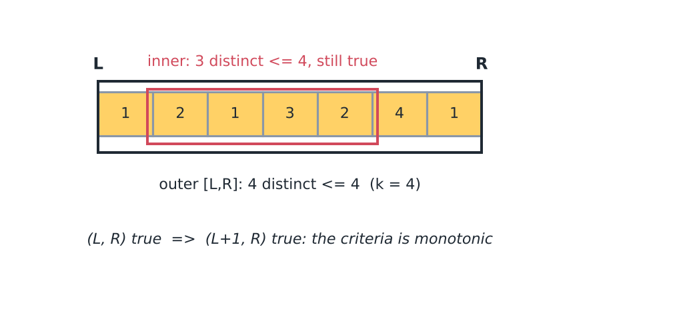

*Outer 4 ≤ 4, inner 3 ≤ 4 (k = 4).*

All three conditions fine. ⇒ TP form 1.

Next, choose the data structure (DS).

The DS must support insert(), check() and remove(). Here check(x) tells whether the window can take the next element x and still have at most k distinct values.

- set → can't remove from set. (remove one copy and it forgets how many were there)
- map → good / can be used.
- freq map + count
  - low overhead
  - faster
  - easy to handle.

For small values we can use an array as the freq (frequency) map.

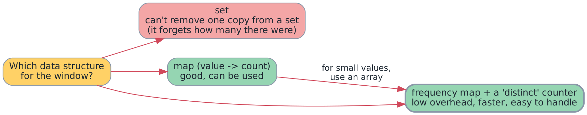

*freq map + distinct count.*

Count: the number of subarrays starting at tail = the length of the longest valid subarray starting at tail.

Reason: if the longest valid window starting at tail is [tail, head], then every shorter one [tail, tail], [tail, tail+1], ..., [tail, head] is also valid, because a part of a valid window is valid (monotonic). That gives exactly head - tail + 1 subarrays.

Example: array `1 2 1 3`, k=2. For every tail:
- tail=0 → [1 2 1] → 3
- tail=1 → [2 1] → 2
- tail=2 → [1 3] → 2
- tail=3 → [3] → 1

3+2+2+1 = 8.

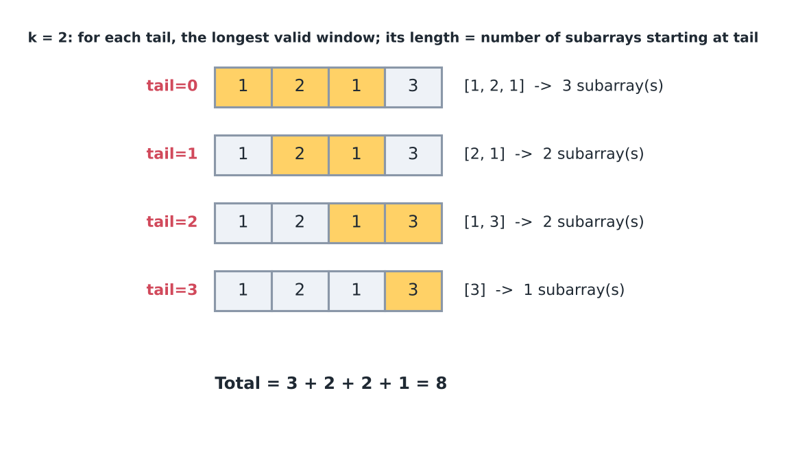

*Window length per tail, add them up → 8.*

If the question asks for the sum of the lengths instead of the count: the sum of the lengths of all subarrays starting at tail = len x (len+1) / 2, because the lengths are 1, 2, ..., len.

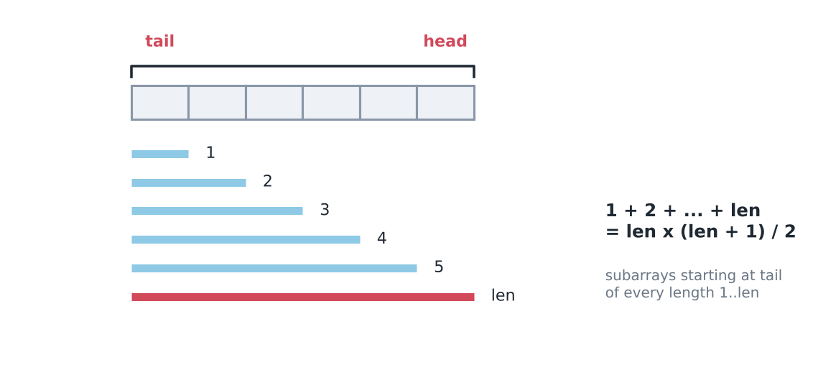

*1 + 2 + ... + len.*

Note: here we do not need the sum of lengths, only len (the count of subarrays starting at tail = len). The formula len(len+1)/2 is used only when the question asks for the "sum of lengths".

\*\* If the question is twisted, for example:
find # of subarrays such that # of distincts == k,

or

\# of distincts >= k,

then the same code is used with these formulas:

- for == k → (find for ≤ k) - (find for ≤ k-1)
- for >= k → (find for ≤ n) - (find for ≤ k-1).
  - (find for ≤ n) = n x (n+1) / 2.

Why: "at most k" includes the subarrays with exactly k distinct values and the subarrays with at most k-1, so subtracting the second group leaves exactly k. In the same way, every subarray has at most n distinct values, so (find for ≤ n) is the number of all subarrays, and removing the ones with at most k-1 leaves those with at least k.

The code below does ≤ k, == k and ≥ k. container = DS (struct = a bundle of data + functions).

```cpp
// Fabricator/TwoPointers/SubarraysWithKDistinctElements.cpp
struct container{
    int freq[100100];
    int distinct_elements;

    void init(){
        memset(freq, 0, sizeof(freq));
        distinct_elements = 0;
    }

    void insert(int x){
        if(freq[x] == 0){
            distinct_elements++;
        }

        freq[x]++;
    }

    void remove(int x){
        freq[x]--;

        if(freq[x] == 0){
            distinct_elements--;
        }
    }

    bool check(int x, int k){
        if(distinct_elements < k || (distinct_elements == k && freq[x] > 0)){
            return true;
        }
        
        return false;
    }
};

long long find_subrarrys_with_distinct_less_than(int n, int arr[], int k){
    // ds
    container ds;
    ds.init();

    // ans
    long long ans = 0;

    // tp stuff
    int tail = 0, head = -1;
    while(tail < n){
        while(head + 1 < n && ds.check(arr[head + 1], k)){
            head++;

            ds.insert(arr[head]);
        }

        ans += (head - tail + 1);

        if(tail <= head){
            ds.remove(arr[tail]);
            tail++;
        }
        else{
            tail++;
            head = tail - 1;
        }
    }

    return ans;
}

void solve() {
    int n, k;
    cin>>n>>k;

    int arr[n];
    for(auto &x: arr) cin>>x;
    
    // distincts <= k 
    cout<<find_subrarrys_with_distinct_less_than(n, arr, k)<<endl;

    // distincts == k
    cout<<find_subrarrys_with_distinct_less_than(n, arr, k) - find_subrarrys_with_distinct_less_than(n, arr, k - 1)<<endl;

    // distincts >= k
    cout<<find_subrarrys_with_distinct_less_than(n, arr, n) - find_subrarrys_with_distinct_less_than(n, arr, k - 1)<<endl;
    //cout<<n * (n + 1) / 2 - find_subrarrys_with_distinct_less_than(n, arr, k - 1)<<endl;
}
```

Reading the check: `check(x, k)` is true if the window has fewer than k distinct values (a new value fits), or exactly k and x is already inside (no new distinct value).

Dry run for ≤k: tail=0: head eats 1, 2, 1 (2 distinct), 3 would be the third value, so stop, add 3; remove arr[0], the freq of 1 drops to 1, so it stays inside. tail=1: window `2 1`, add 2; remove 2. tail=2: window `1`, head eats 3, add 2; remove 1. tail=3: window `3`, add 1. Total 3 + 2 + 2 + 1 = 8.

Dry run: `1 2 1 3`, k=2 → ≤k: 8, ==k: 4, ≥k: 6 (10 total subarrays, 4 have only 1 distinct → 10 - 4 = 6).

Cost: each call of the function is O(n), and we call it at most three times, so still O(n). Memory is O(V), where V is the largest value in the array (the frequency array here has 100 100 cells). If values can be larger, use a map or compress the values first. A value outside the array range is a common cause of crashes.

Question: find the # of subarrays with sum ≤ k (non-negative numbers). It is the same thing, and the DS is just the running sum. The criteria is monotonic because removing a number can only lower the sum (all numbers are non-negative). Note: if negative numbers are allowed, removing a number can raise the sum, so the criteria is not monotonic and TP fails.

Dry run: `1 2 3`, k = 5. Longest valid window per tail: tail 0 → `1 2` (sum 3, adding 3 would give 6) → 2; tail 1 → `2 3` (sum 5) → 2; tail 2 → `3` → 1. Total 2 + 2 + 1 = 5.

```cpp
// Fabricator/TwoPointers/SubarraysWithSumAtLeastK.cpp
/*
https://maang.in/problems/Number-of-Subarray-with-sum-at-most-K-59
Given an array of N integers, find the number of subarrays with a sum less than or equal to K.

i/p:
5
3 5
1 2 3
3 6
3 2 1
5 0
2 1 0 4 5
7 6
1 2 3 0 1 5 2
10 10
1 0 1 1 10 2 3 7 5 9

o/p:
5
6
1
18
18
*/

void solve() {
    int n, k;
    cin>>n>>k;

    vector<int> v(n);
    for(auto &x: v) cin>>x;

    long long ans = 0;
    int tail = 0, head = -1;
    long long total = 0;
    while(tail < n){
        while(head + 1 < n && (total + v[head + 1] <= k)){
            head++;

            total += v[head];
        }

        ans += (head - tail + 1);

        if(tail <= head){
            total -= v[tail];
            tail++;
        }
        else{
            tail++;
            head = tail - 1;
        }
    }

    cout<<ans<<endl;
}
```

Note: file name says "AtLeast" but code counts sum ≤ K.

Cost: time O(n), memory O(1). The running sum total is a long long, so it does not overflow when the numbers are large.

### Shortest with ≥ k distinct

Question: find the shortest subarray with # of distinct elements >= k.

Example: `[2 3 2] (5) 2`, k = 3. The window [2 3 2] has 2 distinct values and the next element 5 would make 3.

Why we use "&lt; k" instead of ">= k": if a window has at least k distinct values, a smaller part of it may not. So ">= k" is not monotonic. But "fewer than k distinct" is monotonic, so we let the window grow as long as it has fewer than k distinct values. The first element that cannot join would bring the distinct count to exactly k, so window + that element is the shortest valid subarray for this tail.

>= k is not monotonic, hence check for &lt; k (which is monotonic).
- ↳ find the largest window starting at tail with distinct &lt; k.

After this, if the next element exists and we can't pick it for &lt; k, then (head - tail + 1 + 1) is the length of a subarray with >= k distinct elements.

`{ [2 3 2] 5 }` → will be valid for >= k, `[2 3 2]` → valid part for &lt; k, that is ≤ (k-1)

The shortest subarray with >= k distinct values has exactly k distinct values, because any more would only make it longer.

For tail = 1: `2 [3 2] (5) 2` → 5 fails here for &lt; k

∴ len = head - tail + 1 + 1
= 2 - 1 + 1 + 1 = (3)

For the other tails: tail = 0 gives 2 - 0 + 1 + 1 = 4. For tail = 2 the window `2 5 2` reaches the end of the array with only 2 distinct values, so there is no next element and nothing is counted. The minimum is 3.

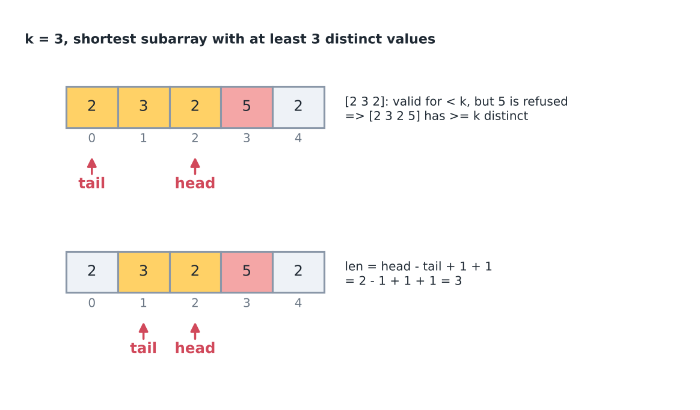

*Window + refused element = k distinct. Best = 3.*

\*\* If the question flips (for example longest becomes shortest), do not change the eating process or any other part.
- ↳ only answer updation changes
- ↳ or we can use some counting strategy like +,-
(like we used for # of subarrays with distinct == k or # distinct >= k)

For the shortest subarray we change only the answer update (this is a sketch of that part of the loop; len and ans are declared elsewhere):

```cpp
if (head+1 < n) {
    len = head - tail +1+1;
}
ans = min (ans, len);
```

```cpp
// Fabricator/TwoPointers/1-Form/ShortestSubarrayWithAtLeastK.cpp
struct container{
    int freq[100100];
    int distinct_count;

    void init(){
        distinct_count = 0;
        memset(freq, 0, sizeof(freq));
    }

    void insert(int x){
        if(freq[x] == 0){
            distinct_count++;
        }

        freq[x]++;
    }

    void remove(int x){
        freq[x]--;

        if(freq[x] == 0){
            distinct_count--;
        }
    }

    bool check(int x, int k){
        if((distinct_count < k) || (distinct_count == k && freq[x] > 0)){
            return true;
        }

        return false;
    }
};

void solve() {
    int n, k;
    cin>>n>>k;

    vector<int> arr(n);
    for(auto &x: arr) cin>>x;

    // ds
    container ds;
    ds.init();

    // ans
    int ans = 0;

    // tp stuff
    int tail = 0, head = -1;

    while(tail < n){
        // move head: eat as much as possible
        if((head + 1 < n) && ds.check(arr[head + 1], k-1)){
            cout<<tail<<"-"<<head<<endl;
            head++;
            // insert into ds
            ds.insert(arr[head]);
        }
        // update answer
        if(head + 1 < n){
            ans = max(ans, head - tail + 1 + 1);
        }
        

        // move tail by one position
        if(tail <= head){
            // remove from ds
            ds.remove(arr[tail]);
            tail++;
        }
        else{
            tail++;
            head = tail - 1;
        }
    }

    cout<<ans<<endl;
}
```

Note: this one gives 2 for `2 3 2 5 2`, k=3 (should be 3). It also prints debug lines such as `0--1`. Head move is `if`, should be `while` (eat as many as you can), and ans should start at a big value with min, not 0 with max. Working version:

```cpp
/*
  Problem: shortest subarray with at least k distinct values (-1 if none).
  Corrected version of the idea: eat while the window has fewer than k
  distinct values, then the next element (if any) completes k distinct values.
*/
int shortest_with_at_least_k_distinct(const vector<int>& a, int k) {
    int n = a.size();
    unordered_map<int, int> freq;               // value -> copies inside the window
    int distinct = 0;                           // number of values with freq > 0
    int tail = 0, head = -1;
    int ans = INT_MAX;
    while (tail < n) {
        // eat while we stay below k distinct values (a value already inside is always fine)
        while (head + 1 < n && (freq[a[head + 1]] > 0 || distinct < k - 1)) {
            head++;
            if (freq[a[head]]++ == 0) distinct++;
        }
        if (head + 1 < n) ans = min(ans, head - tail + 1 + 1);  // only the answer update changes
        if (tail <= head) {
            if (--freq[a[tail]] == 0) distinct--;
            tail++;
        } else {
            tail++;
            head = tail - 1;
        }
    }
    return ans == INT_MAX ? -1 : ans;
}
```

Dry run (checked by running the function): `2 3 2 5 2`, k=3 → 3. `1 1 1`, k=2 → -1 (none). `1 1 1 2`, k=2 → 2.

Cost: time O(n) on average (each element enters and leaves the window once, and the hash map costs O(1) on average), memory O(number of distinct values).

## Form 2:

In form 2 the two pointers start at the two ends of the array and move towards each other.

Question:
The array has N elements: [1, 8, 6, 2, 5, 4, 8, 3, 7].

f(i,j) = min (arr[i], arr[j]) * abs (i-j)

Find the maximum value of f(i,j), or find the indices.

Brute force → O(N²): try every pair (i, j). Here N = 9 gives 36 pairs, and N = 100 000 would give about $5 \times 10^9$ pairs.

Trap: looks like max of min → might think BS (binary search), but the expression isn't a minimum. it uses a min * some number.

f(i,j) = (min)( arr[i], arr[j]) * (abs(i-j))
- min → overall trying to decrease the value
- gap abs(i-j) → this will increase the value for wide selection.

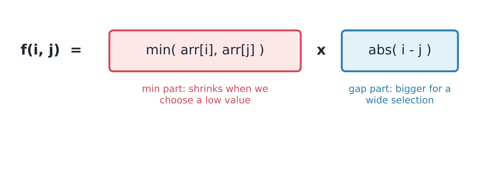

*min pulls down, gap pushes up.*

`[1, 8, 6, 2, 5, 4, 8, 3, 7]`

The gap abs(i-j) is at most 8 here (N - 1 = 8).

gap = 8 → options (i=0, j=8)
- ↳ only one option possible

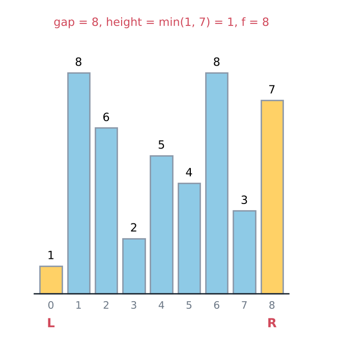

*gap = 8, only (0, 8).*

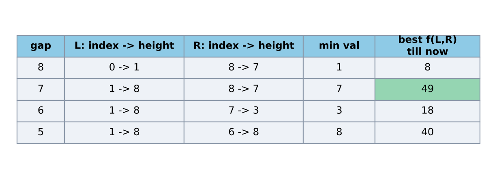

*"a → b" = index → height. min val must increase for better answer.*

Reading the table: at gap 8 the only pair has heights 1 and 7, so f = 1 × 8 = 8. At gap 7 the pair with heights 8 and 7 gives 7 × 7 = 49. At gap 6 the pair with heights 8 and 3 gives 3 × 6 = 18. At gap 5 the pair with heights 8 and 8 gives 8 × 5 = 40, which is less than 49. To beat 49 at a gap of 6 or less we would need a min height above 49 / 6 = 8.17, but the tallest bar is 8. So 49 is the answer.

At gap 5 both heights are 8, both same → can change any.

We move l, r to maximise min val.
as we are decreasing the gap we should increase the min value to achieve the largest possible function val.

The problem above is the LeetCode problem "Container With Most Water".

We start iterating from both ends using l & r and move the pointer at the smaller bar.
And, in the end, we'll have the max ans.

Why move the smaller one? Let's say the left bar is shorter. Pair it with any other right end that lies inside (closer to it): the gap becomes smaller and the height is still at most the left bar, so the result cannot be better than the current one. So the left bar is useless for ever, and we discard it by moving l. If we moved the taller bar instead, the height would still be limited by the shorter bar while the gap shrinks, so nothing can improve.

```cpp
// Fabricator/TwoPointers/2-Form/ContainerWithMostWater.cpp
/*
https://leetcode.com/problems/container-with-most-water/description/
*/

void solve() {
    int n;
    cin>>n;

    vector<int> v(n);
    for(auto &x: v) cin>>x;

    long long ans = 0;
    int l = 0, r = n - 1;
    
    while(l < r){
        long long curr_ans = min(v[l], v[r]) * (r - l);

        if(v[l] < v[r]){
            l++;
        }
        else{
            r--;
        }

        ans = max(ans, curr_ans);
    }

    cout<<ans<<endl;
}
```

Dry run: example gives 49. Time O(n), memory O(1).

Trace on `[1, 8, 6, 2, 5, 4, 8, 3, 7]`:
- l = 0 (height 1), r = 8 (height 7): area = 1 × 8 = 8. Left is smaller, so l++.
- l = 1 (8), r = 8 (7): area = 7 × 7 = 49. Right is smaller, so r--.
- l = 1 (8), r = 7 (3): area = 3 × 6 = 18. Right is smaller, so r--.
- Continuing, no pair beats 49, as shown by the table reading above. Answer 49.

The loop runs at most n - 1 times because each step moves one pointer closer.

When the two heights are equal, the code moves r. Moving l would be equally fine, because both bars are useless for any narrower pair.

Note: `min(v[l], v[r]) * (r - l)` is int * int, so it can overflow when values are large (for example heights up to $10^9$ and width up to $10^5$ give a product near $10^{14}$, which does not fit in a 32-bit int). Use 1LL * ...

### 3-Sum

Question: 3-Sum.
Given an array of n elements, and a target, T.

- find one solution
- find if a solution exists
- find all solutions
- find # of solutions.

\} such that arr[i]+arr[j] +arr[k] = T.
↳ 0 ≤ i&lt;j&lt;k&lt;n

We can sort the array because the order of the elements doesn't matter.
- ↳ O(nlogn).

(We count sets of three positions, not orderings, so sorting does not change the answer.)

Example (already sorted):

`[ 2 | 3 | 5 | 5 | 7 | 9 | 9 | 13 | 15 | 20 ]`
T = 21

Brute force solution (no sorting required) → O(n³). It tries every triple of positions, about n³/6 triples.

```
for (i → (0, n-1))
  for (j → (i+1, n-1))
    for (k → (j+1, n-1))
      if (arr[i]+arr[j]+arr[k]) cnt++;
```

Note: condition should be `arr[i]+arr[j]+arr[k] == T`.

Now iterate on the sorted array using j (the middle index). We need one value from the left of j and one value from the right of j,

such that x+y+z = T. (x = one from left, y = A[j], z = one from right)

x+z = T-y. → we need to find two values with a sum equal to (T-y)

This reduces the problem from 3-Sum → 2-Sum.

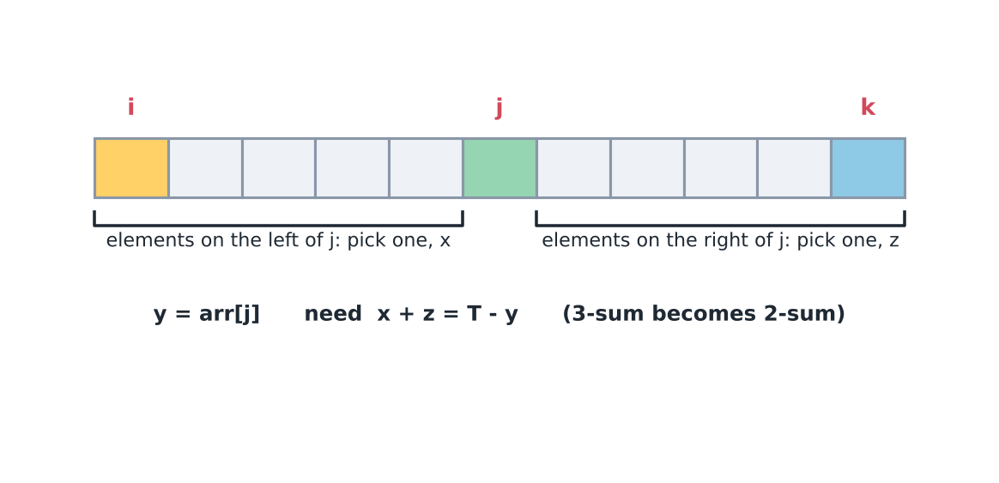

*j in the middle, x on its left, z on its right.*

Example with T = 20, and j at the value 6:

`[1 | 3 | 4 | 5 | (6) | 7 | 8 | 10 | 12 | 19]`      T = 20

At this point A[j] = 6
Now we need to find i & k such that
A[i] + A[k] = 20 - A[j] = 20 - 6 = 14.

1 + 19 = 20 > 14 ⇒ k needs to be moved.
1 + 12 = 13 &lt; 14 ⇒ i needs to be moved.
3 + 12 = 15 > 14 ⇒ k moves.
3 + 10 = 13 &lt; 14 → i moves.
4 + 10 = 14 == 14 → One solution.
- This is enough to check whether a solution exists, or to find one solution.

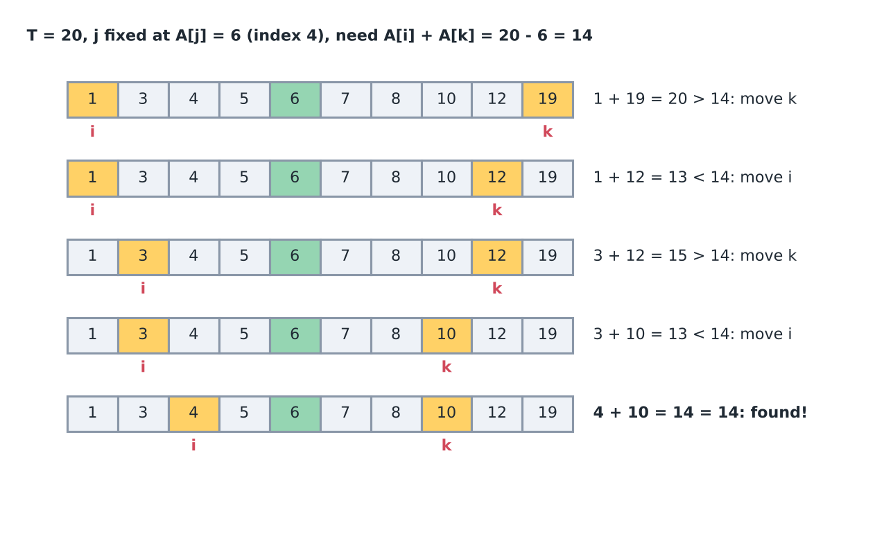

*Sum too big → k moves left, too small → i moves right.*

Why? If sum > need: the array is sorted, so pairing this k with any i further to the right gives an even bigger sum. This k is useless for this j → k--. If sum &lt; need: pairing this i with any k further to the left gives an even smaller sum. This i is useless → i++.

```
for (j → (0, n-1))                → O(n²).
  (──────────────)
      O(n) for finding i & k.
```

Cost: sorting is O(n log n), and for each j the two-pointer scan is O(n), so O(n²) in total. For n = 5000 that is about $25 \times 10^6$ steps, while the brute force would try about $n^3/6 \approx 2 \times 10^{10}$ triples. Memory is O(1) extra.

To find all solutions or to count them, we need to work more, because equal values give many triples.

`[3 | 3 | 5 | 7 | 7 | 7]` → all solutions → 6 (T = 15). Here the only value triple is (3, 5, 7), with 2 choices for the 3 and 3 choices for the 7.

But how do we move the ptrs?

Convert this → the same numbers with their frequencies (freq).

`[ (3) | (5) | (7) ]` → 2 x 1 x 3 = 6, freq (2) (1) (3), pointers i j k.

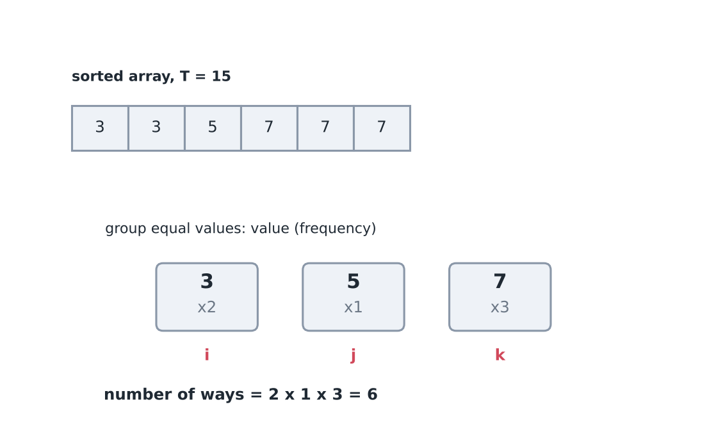

*value with freq → 2 x 1 x 3 = 6.*

we can also move i & k and count same element & calculate the count.

j is the middle index, so every triple is counted exactly once. On a match, itemp and ktemp skip over all copies of the equal values on the left and on the right. Then (itemp - i) * (k - ktemp) = left copies x right copies.

```cpp
// Fabricator/TwoPointers/2-Form/ThreeSum.cpp
void solve() {
    int n, target;
    cin>>n>>target;

    vector<int> v(n);
    for(auto &x: v) cin>>x;

    sort(v.begin(), v.end());
    int cnt = 0;

    for(int j = 0; j < n; j++){
        int i=0, k = n-1;
        while(i < j && j < k){
            int curr_total = v[i] + v[j] + v[k];
            if(curr_total == target){
                int itemp = i;
                int ktemp = k;

                while(itemp < j && v[itemp] == v[i]){
                    itemp++;
                }
                
                while(ktemp > j && v[ktemp] == v[k]){
                    ktemp--;
                }

                cnt += (itemp - i) * (k - ktemp);
                i = itemp;
                k = ktemp;
            }
            else if(curr_total < target){
                i++;
            }
            else{
                k--;
            }
        }
    }
}
```

Dry run (checked against a brute force): T=21 on the sorted example → 7. `3 3 5 7 7 7`, T=15 → 6. The `1 3 4 ... 19` array, T=20 → 5.

Note: this function never prints cnt, add `cout<<cnt<<endl;` at the end. Also cnt is int, use long long if count is big.

Variant: closest sum to target. Same loop, but we do not stop on a match. Just keep the minimum of abs(sum - target). If sum > target then k--, else i++.

```cpp
// Fabricator/TwoPointers/2-Form/ThreeSumAZ.cpp
void solve() {
    long long n, target;
    cin>>n>>target;

    vector<int> v(n);
    for(auto &x: v) cin>>x;

    sort(v.begin(), v.end());

    long long ans = INT64_MAX;

    for(int j=0; j<n; j++){
        int i = 0, k = n-1;
        while(i < j && j < k){
            long long curr_sum = 1LL * v[i] + v[j] + v[k];
            ans = min(ans, abs(curr_sum - target));
            if(curr_sum > target){
                k--;
            }
            else{
                i++;
            }
        }
    }

    cout<<ans<<endl;
}
```

Dry run: array `1 3 4 5 6 7 8 10 12 19`, T=100 → 59 (max triple sum 10+12+19 = 41, and 100 - 41 = 59). The array `2 3 5 5 7 9 9 13 15 20`, T=21 → 0. It prints the smallest distance, not the sum.

## Form 3:

In form 3 each sequence has its own pointer, and both pointers move in the same direction.

Question: Given a string s & a string t.
Check if t is a subsequence of s.

Pointer i is on s and always moves. Pointer j is on t and moves only on a match:

```
 ↓ → move always.
s = a b a c c a b a d a b a
t = b d a
    ↑ → move only if matches
```

In pseudo code:

```
while (i → (0, s.length-1) &&
       j → (0, t.length-1))
    check if s[i] == t[j] { i++ ; j++; }
    else {i++;}
```

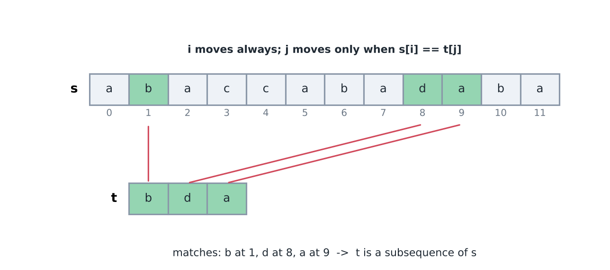

*b at 1, d at 8, a at 9 → yes subsequence.*

If all the letters of t were found (j == t.length), the answer is yes. The 3-Form folder in the repository is still empty, so here is a function:

```cpp
/*
  Problem: check whether t is a subsequence of s (t's letters appear in s in
  the same order, not necessarily next to each other).
*/
bool is_subsequence(const string& s, const string& t) {
    size_t i = 0, j = 0;
    while (i < s.size() && j < t.size()) {
        if (s[i] == t[j]) { i++; j++; }         // match: both pointers move
        else i++;                               // no match: only the pointer on s moves
    }
    return j == t.size();                       // did we match every letter of t?
}
```

Dry run: `abaccabadaba` with `bda` → true, with `dbd` → false. Time O(|s|).

Trace for `bda`: the pointer on s moves over `a` (no match), then `b` matches (j = 1). It then skips `a c c a b a` looking for `d`, which matches at index 8 (j = 2), and the next `a` matches at index 9 (j = 3 = length of t). True.

Why greedy is correct: taking the earliest possible match for each letter leaves the longest possible rest of s for the remaining letters. Time O(|s|), memory O(1).

A practical use of form 3 is information retrieval (searching documents). Suppose there are five sample documents:

- D1 = "Vivek has been coding DSA"
- D2 = "Algozenith teaches DSA and CP".
- D3 = "Algozenith also covers DEV now"
- D4 = "Vivek is the founder of Algozenith".
- D5 = "Algozenith is the best DSA cover available."

(These are sample texts. DSA = data structures and algorithms, CP = competitive programming, DEV = development.)

A query lists words, and we want the documents that contain all of them.

Query = (Vivek AND Algozenith)
Query should return D4.
Query = (DSA AND Algozenith) ⇒ D2 & D5

The problem is not very easy.
The documents can be thousands.
Document length also affects the search.
What data structure could handle this? It must have these properties:
- ↳ New documents could be added easily.
- ↳ Deletion should be easy.
- ↳ Search should be fast.

Queries are small → few words.
No. of docs can be large & docs themselves can be large.

We build an inverted index: for every word, the sorted list of the documents that contain it.

```
Vivek → [1, 4]
Algozenith → [2, 3, 4, 5]        } maintained as
DSA → [1, 2, 5].                 } skip list.
```

skip list = sorted list with extra "express" links to jump ahead, so search / insert / delete are fast.

Note: word → docs list is the inverted index. TF-IDF (term frequency - inverse document frequency) is a score to rank the docs, it sits on top of this.

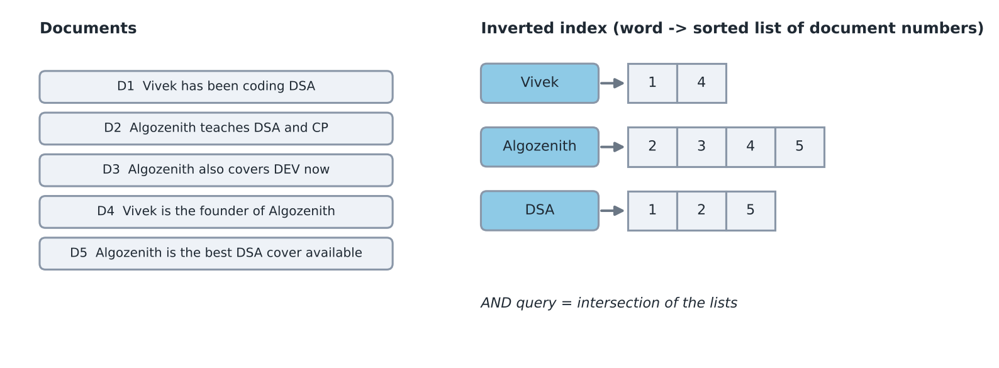

*word → sorted list of docs.*

For the query DSA AND Algozenith, we fetch both lists, of DSA and of Algozenith.

[2, 3, 4, 5] AND [1, 2, 5]: find their intersection.
(AND → intersection.)

Both lists are sorted, so: values match → take it, move both. Not matching → move the pointer at the smaller value (the larger value waits). Reason: the other list is sorted and its unvisited values are all at least the larger value, so none of them can be equal to the smaller value. The smaller value cannot appear in the other list anymore. Result [2, 5].

Trace: (2, 1): 1 is smaller, move the second pointer. (2, 2): match, take 2, move both. (3, 5): 3 is smaller, move the first pointer. (4, 5): move the first pointer. (5, 5): match, take 5. One list ends, so we stop. Each pointer moves forward only, so the time is O(a + b) for lists of sizes a and b.

![Five steps on the lists [2,3,4,5] and [1,2,5], matches at 2 and 5](../../../assets/notes/1-3-two-pointers/fig26_intersect.png)

*match (move), not matching (move smaller).*

So, this form 3 can be used to find intersection & union of two sorted lists. For the union, the same walk is used, but a value is taken whenever either pointer shows it, and equal values are taken once.

```cpp
/*
  Problem: given two sorted lists, return their intersection (the values that
  appear in both). This is what an AND query does on two posting lists.
*/
vector<int> intersect_sorted(const vector<int>& a, const vector<int>& b) {
    vector<int> out;
    size_t i = 0, j = 0;
    while (i < a.size() && j < b.size()) {
        if (a[i] == b[j]) { out.push_back(a[i]); i++; j++; }   // match: take it, move both
        else if (a[i] < b[j]) i++;              // a[i] is too small to be in b
        else j++;                               // b[j] is too small to be in a
    }
    return out;
}
```

```cpp
/*
  Problem: given two sorted lists, return their union (every value once).
  This is what an OR query does on two posting lists.
*/
vector<int> union_sorted(const vector<int>& a, const vector<int>& b) {
    vector<int> out;
    size_t i = 0, j = 0;
    while (i < a.size() || j < b.size()) {
        int x;
        if (j == b.size() || (i < a.size() && a[i] < b[j])) x = a[i++];   // a has the smaller value
        else if (i == a.size() || b[j] < a[i]) x = b[j++];                // b has the smaller value
        else { x = a[i]; i++; j++; }                                      // equal: take it once
        out.push_back(x);
    }
    return out;
}
```

Dry run: Vivek AND Algozenith → [4]. DSA AND Algozenith → [2, 5]. DSA OR Algozenith → [1, 2, 3, 4, 5]. Time O(a + b).

Question:
Given an n x m matrix, choose one element from each row and minimise the (max chosen - min chosen).

A first choice (the chosen element of each row is written on the right):

```
 | 1 | 4 | 9 | → 1
 | 2 | 4 | 7 | → 7
 | 5 | 8 | 3 | → 3
```
(max-min) = (7-1) = 6
↳ minimise this.

A better choice:

```
 | 1 |(4)| 9 | → 4
 | 2 |(4)| 7 | → 4
 | 5 | 8 |(3)| → 3
```
(max-min) = (4-3) = 1
Seems best possible.

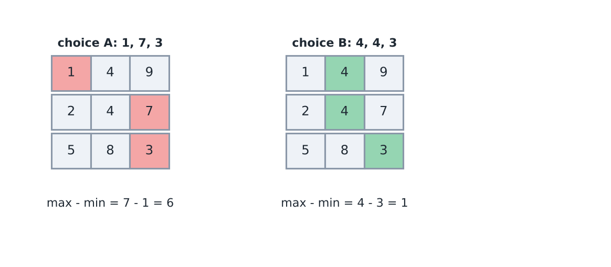

*6 vs 1.*

Sort the original matrix (each row):

```
 1  4  9
 2  4  7
 3  5  8
```

The parts of this question:

- ask → minimum
- what → max-min
- criteria → at least one element from every row (see Solution 2)

Solution 1 (SOL-1)

One pointer in every row. Choose the set → calculate the answer → move the min to its next position.

- Step 1: (1,2,3) → calculate the answer (2) → move min (1) to next pos
- Step 2: (4,2,3) → choose the set, calculate the answer (2) → move the min (2) to next pos
- Step 3: (4,4,3) → choose the set, calculate the answer (1) → then move the min (3) to next pos
- Step 4: (4,4,5) → ans 1, keep going

Keep going like this, until the pointer that has to move is already on the last column.

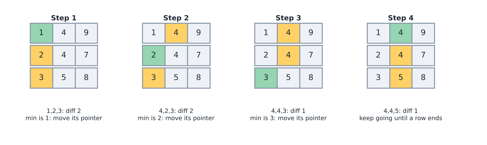

*Step 1 → 4, min pointer moves.*

Why the minimum? The range is max - min. Rows are sorted, so the maximum can never decrease when a pointer moves forward. Moving any pointer other than the minimum keeps the range the same or makes it larger. Only moving the minimum can make max - min smaller.

```cpp
/*
  Problem: choose one element from every row of an n x m matrix so that
  (largest chosen - smallest chosen) is as small as possible. Return it.
  Solution 1: one pointer per row; always move the pointer holding the minimum.
*/
int min_range_one_per_row(vector<vector<int>> g) {
    int n = g.size(), m = g[0].size();
    for (auto& row : g) sort(row.begin(), row.end());
    // a min-heap (smallest on top) of (value, row) for the current choice of every row
    priority_queue<pair<int, int>, vector<pair<int, int>>, greater<pair<int, int>>> current;
    vector<int> column(n, 0);                   // chosen column of every row
    int current_max = INT_MIN;
    for (int r = 0; r < n; r++) {
        current.push({g[r][0], r});
        current_max = max(current_max, g[r][0]);
    }
    int ans = INT_MAX;
    while (true) {
        auto [smallest, row] = current.top();   // structured binding: unpack the pair into two names
        current.pop();
        ans = min(ans, current_max - smallest);
        if (++column[row] == m) break;          // that row has no next element: no better set exists
        current.push({g[row][column[row]], row});
        current_max = max(current_max, g[row][column[row]]);
    }
    return ans;
}
```

priority_queue with `greater<...>` = min-heap (smallest on top). Dry run: example → 1 (diffs 2 2 1 1 5 4 2). `2 10 / 3 9 / 8 15` → 2. Time: the loop runs at most n·m times, each with a heap push and pop of cost O(log n) (the heap holds n items), so O(nm log n). Sorting the n rows costs O(m log m) per row, O(nm log m) in total. Memory: O(n) for the heap and the column array, plus a copy of the matrix because it is passed by value.

Solution 2 (SOL-2)

Create a vector of (value / row) pairs:

`[ (1/1) (4/1) (9/1) (2/2) (4/2) (7/2) (5/3) (8/3) (3/3) ]`

Sort it by value:

`[ (1/1) (2/2) (3/3) (4/1) (4/2) (5/3) (7/2) (8/3) (9/1) ]`

Now this is a form 1 problem.
Keep eating until we have at least one element from each row.

If tail was at (4/2), we'll have to keep eating till last to the end to have at least one element from each row. (min = 4, max = 9)

Calculate (max-min)
Move tail one step ahead.

Because the list is sorted, the min of a window is its first value and the max is its last value. The best window here is (3/3) (4/1) (4/2): it has rows 3, 1 and 2, and the range is 4 - 3 = 1.

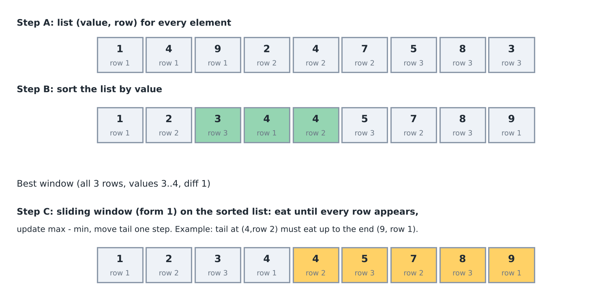

*sort (val, row), then window with all rows.*

Why is this form 1?

- ask → shortest (here it means the smallest range of values, not the fewest elements)
- what → subarray
- criteria → with at least k distinct value.
  - here value is row no.

Same trick as before: window with ≤ n-1 distinct rows, next element completes all n rows → ans = vals[head+1].first - vals[tail].first.

```cpp
// Fabricator/TwoPointers/MinimiseMaxMinDifferenceGoogleOA.cpp
/*
Given an n*m matrix, choose one element from each row such that the (max chosen element - min chosen element) is minimum.
Find the minimum value possible.

i/p:
2
3 3
1 4 9
2 4 7
5 8 3
3 2
2 10
3 9
8 15

o/p:
1
2
*/

struct container{
    int _distinct;
    map<int, int> _freq;

    void init(){
        _distinct = 0;
        _freq.clear();
    }

    bool check(int val, int k){
        return _distinct < k || ((_distinct == k) && (_freq[val] > 0));
    }

    void insert(int val){
        if(_freq[val] == 0){
            _distinct++;
        }

        _freq[val]++;
    }

    void remove(int val){
        _freq[val]--;

        if(_freq[val] == 0){
            _distinct--;
        }
    }
};

void solve() {
    int n, m;
    cin>>n>>m;

    vector<pair<int, int>> vals;
    for(int i=1; i<=n; i++){
        for(int j=0; j<m; j++){
            int x;
            cin>>x;
            vals.push_back({x, i});
        }
    }

    sort(vals.begin(), vals.end());
    
    long long tail = 0, head = -1, max_range = (1ll * n) * m;
    int ans = INT32_MAX;
    container ds;
    ds.init();

    while(tail < max_range){
        while(head + 1 < max_range && ds.check(vals[head + 1].second, n-1)){
            head++;
            ds.insert(vals[head].second);
        }

        if(head + 1 < max_range){
            ans = min(ans, vals[head + 1].first - vals[tail].first);
        }

        if(tail <= head){
            ds.remove(vals[tail].second);
            tail++;
        }
        else{
            tail++;
            head = tail - 1;
        }
    }

    cout<<ans<<endl;
}
```

Dry run: samples give 1 and 2. Time: O(nm log(nm)) for the sort, then the two pointers make O(nm) moves. Each insert, remove and check on the `map` costs O(log n), so that part is O(nm log n), which is still below the sort. Memory O(nm) for the list of (value, row) pairs.

Note: INT32_MAX needs `<cstdint>`.

## Quick revision

- Two pointers (TP) → two indices that never move back → O(n)
- Patterns → towards each other | same direction with a window
- Form 1 → ask (longest / shortest / count / sum of lengths), what (subarray / gaps), criteria (monotonic)
- Monotonic → true for [L,R] ⇒ true for [L+1,R] and [L,R-1]. If not monotonic, TP cannot be used
- Template → tail = 0, head = -1; eat as many as possible → update answer → move tail (if the window is empty: tail++, head = tail - 1)
- Data structure → check next, insert, remove. For distinct values use a frequency map plus a distinct count (a set cannot remove)
- Time complexity → O(N * (H + A + T))
- Count of subarrays starting at tail = len; sum of their lengths = len(len+1)/2
- Exactly k → f(≤k) - f(≤k-1); at least k → n(n+1)/2 - f(≤k-1)
- Shortest with at least k distinct → eat while fewer than k; if a next element exists, length = head - tail + 1 + 1
- Fixed window (form 0) → monotonic deque of indices: pop the back while arr[back] >= new value, pop the front when its index leaves the window. O(n)
- Common mistakes → head must start at -1; remove arr[tail] when the tail moves; keep the else branch; the criteria must be monotonic
- Form 2 → pointers move inward. Container → move the smaller bar (use 1LL * to avoid overflow). 3-Sum → sort, j in the middle, 2-sum with i and k (sum too big → k--, too small → i++); duplicates → product of frequencies
- Form 3 → one pointer per sequence. Subsequence: pointer on s always moves, pointer on t moves on a match. Sorted lists → intersection / union (inverted index), O(a + b)
- Matrix, minimise (max - min) → Solution 1: move the minimum pointer with a heap; Solution 2: sort (value, row) pairs, then form 1

## Practice problems

- [Container With Most Water](https://leetcode.com/problems/container-with-most-water/description/)
- [Number of Subarray with at most K distinct](https://maang.in/problems/Number-of-Subarray-with-at-most-K-distinct-60)
- [Number of Subarray with sum at most K](https://maang.in/problems/Number-of-Subarray-with-sum-at-most-K-59)

### Problem ladder

<Ladder topic="1.3" />
