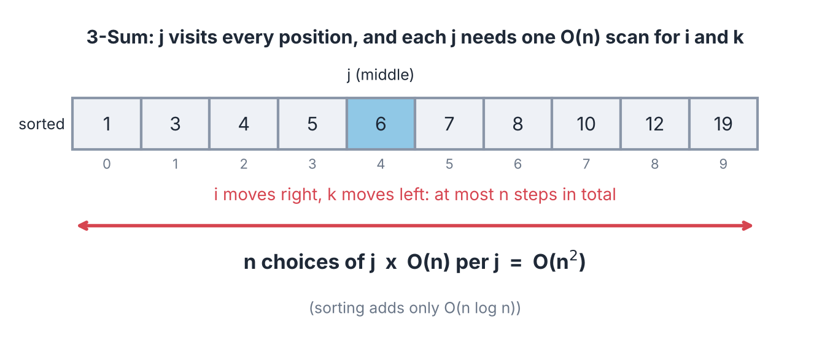

import TopicHeader from '../../../components/TopicHeader.astro';
import Ladder from '../../../components/Ladder.astro';
import TheoremCode from '../../../components/TheoremCode.astro';
import CodeSnippet from '../../../components/CodeSnippet.astro';
import WhatYouNeed from '../../../components/WhatYouNeed.astro';
import Cards from '../../../components/Cards.astro';
import Drill from '../../../components/Drill.astro';
import LookalikePairs from '../../../components/LookalikePairs.astro';
import SelfTest from '../../../components/SelfTest.astro';
import Checkpoint from '../../../components/Checkpoint.astro';
import DecisionMapUpdate from '../../../components/DecisionMapUpdate.astro';

<TopicHeader topic="1.3" />

## What this note covers

This note covers two pointers (TP) and the sliding window.

Words used in this note:
- pointer = just an index in the array
- subarray = continuous part of the array, subsequence = same order but gaps allowed
- time complexity = how the number of steps grows with the input size, written with O(...)
- DS = data structure, BS = binary search, TLE = time limit exceeded, # = number of
- dry run = following the code by hand on a small input

The idea: instead of a nested loop, move two indices smartly. Neither index goes back, so the total work is O(n).

Why this matters, with numbers: suppose n = 100 000. A nested loop over all pairs of positions does about $n^2/2 = 5 \times 10^9$ steps, and a typical judge allows only about $10^8$ simple steps per second, so it gets a time limit exceeded (TLE) verdict. Two pointers does at most $2n = 200\,000$ steps for the same problem.

A second example, with bigger numbers. You are given $n$ positive integers $a_i$ and a number $K$, with $n \le 2 \cdot 10^5$ and $a_i \le 10^9$. Find the longest run of consecutive elements whose sum is at most $K$. The direct method tries every start and every end. That is about $n^2/2 = 2 \cdot 10^{10}$ pairs. Even if every pair sum costs one step (prefix sums from topic 1.2 give each sum in one step), that is about 200 seconds at $10^8$ simple steps per second. The time limit is usually 1 or 2 seconds.

The key idea: all values are positive, so a shorter run inside a valid run is also valid. So when the end of the run moves right, the best start for the new end is never left of the best start for the old end. Both indices only move right. Each moves at most $n$ times, so the search costs about $2n$ steps instead of $n^2/2$.

This note shows that idea as proofs and templates, and then its other forms: a window of fixed length, two indices moving inwards from both ends of a sorted array, and two indices walking through two sorted lists.

### What you need

<WhatYouNeed topic="1.3" />

### What this note does not cover

- Proving that a pairing such as "heaviest with lightest" is optimal by an exchange argument. When a problem needs such a pairing, its hints give a short argument. The general method is in topic 1.5 (greedy).

### Terms used in this lesson

Indices start at 0. For an array $a$ of length $n$:

- **Window**: a subarray $[l, r]$ that we are looking at, with both ends included. Its length is $r - l + 1$. Example: in $a = [3, 1, 2]$ the window $[1, 2]$ is the values 1, 2. The **empty window** has $l = r + 1$ and length 0.
- **Validity condition**: a yes/no property of windows, such as "the sum is at most $K$". A window with the property is **valid**.
- **Sub-window** of $[l, r]$: any window $[l', r']$ with $l \le l'$ and $r' \le r$, possibly empty. Example: $[2, 3]$ is a sub-window of $[1, 4]$.
- **Closed under shrinking**: every sub-window of a valid window is valid. Example: "sum at most $K$" with positive values. Counterexample: with values $[5, -4]$ and $K = 2$, the window $[0, 1]$ has sum 1 and is valid, but its sub-window $[0, 0]$ has sum 5 and is not. So negative values break it. This is what his note calls a monotonic criteria.
- **Closed under extension**: every window that contains a valid window is valid. Example: "sum at least $S$" with positive values. A condition is closed under extension exactly when its opposite ("not valid") is closed under shrinking. For instance, "at least $k$ distinct values" is closed under extension, and "fewer than $k$ distinct values" is closed under shrinking.
- **Amortised analysis**: bounding the total cost of all steps instead of each step alone. One `while` inside a `for` can run many times for one value of `r`. But if each pass moves `l` right and `l` never passes $n$, all passes together are at most $n$.

The sections of this note, in order:

- Two pointers: where it comes from
- Sliding window (fixed length, form 0)
- Two pointers forms
- Form 1: variable sized window
  - flips problem
  - ask, what, criteria, monotonic criteria
  - brute force → snake
  - data structure for the window
  - why head = -1
  - time complexity
  - count subarrays with distinct ≤ k
  - distinct == k and ≥ k
  - shortest subarray with distinct ≥ k
- Form 2: opposite direction
  - container with most water
  - 3-Sum
- Form 3: separate sequences
  - subsequence
  - inverted index (search)
  - matrix: minimise max - min
- Theorems 1.3.1 to 1.3.6, each inside the form it proves
- Recognition cards
- Quick revision
- Check yourself (identification drill, look-alike pairs, self-test, checkpoint, decision map update)
- Practice problems

## Two Pointers

Binary search (BS) has two kinds:
- BS on Ans: binary search on the answer value.
- BS on every start: binary search for the best end of every start position. This class of problems can be solved optimally using two pointers (TP).

"BS on every start" means: for each start position L, binary search the farthest end R that is still valid. That costs O(n log n). Two pointers removes the log factor, because the answer for the next start can be built from the previous one instead of searching again.


*Binary search on every start is solved by two pointers in O(n).*

There are two patterns of TP:
- Two pointers moving towards each other. This is the classical pattern.
- Two pointers moving in the same direction while maintaining a window. This is the medium/hard pattern.


*Left: towards each other. Right: same direction with a window.*

Why is it fast? Both pointers only move forward and never go back. Each pointer moves at most n steps, so the total is n + n = 2n steps, which is O(n).

Tiny example: n = 5. Pointer one visits positions 0 to 4 (5 steps) and pointer two visits positions 0 to 4 (5 steps). That is 10 steps in total, and a nested loop would take up to 25.

## Two pointers and sliding window

A sliding window is a part of the array that moves to the right. There are two kinds:

- A fixed length window (easy).
- A variable length window.

A fixed length window always has the same size k. With each step to the right, the leftmost element leaves the window and one new element enters on the right. (This is the "0-form" in the repository.)


*The window has length k = 3 and slides by one step each time. The minimum of each window is shown in green.*

Question: given an array of size n and a window of size k. Find the minimum of all subarrays of size k.

Brute force: for every window, loop over its k elements. This costs O(n·k), because there are n - k + 1 windows and each one is scanned in full.

With numbers: n = 100 000 and k = 50 000 gives 50 001 windows of 50 000 elements each, about $2.5 \times 10^9$ steps. Too slow.

Better: keep a data structure (DS) of the current window.
- Multiset (sorted, duplicates allowed): insert the new element, erase the element that left the window, and the minimum is the first element. This is O(n log k), because the multiset holds at most k items, so each insert and erase costs O(log k).
- Monotonic deque (a queue we can pop from both ends): keep the indices whose values are increasing, so the front is always the minimum. Every index is pushed once and popped once, so the total is O(n).

Why the deque works: suppose an older element is larger than or equal to a new element. The older one leaves the window earlier and is not smaller, so it can never be the minimum again. We can drop it safely. This is why we pop from the back while `arr[dq.back()] >= arr[i]`, and pop from the front when the index has left the window.

Memory: both versions keep at most k items, so O(k) extra memory.

Dry run with `2 1 5 1 3 2 8 1`, k = 3. There are 8 - 3 + 1 = 6 windows, so the minimums are `1 1 1 1 2 1`. Both functions give the same output.

Deque trace (the deque holds indices; the value of each index is in brackets):
- i = 0: deque `[0]`
- i = 1: value 1 is not larger than arr[0] = 2, so pop index 0 → deque `[1]`
- i = 2: 5 is larger than 1, keep → deque `[1, 2]`. The first full window is ready, min = arr[1] = 1
- i = 3: value 1 pops index 2 (5) and index 1 (1) → deque `[3]`, min = 1
- i = 4: deque `[3, 4]`, min = arr[3] = 1
- i = 5: value 2 pops index 4 (3) → deque `[3, 5]`, min = 1
- i = 6: index 3 is outside the window (3 &lt;= 6 - 3), so pop it from the front → deque `[5, 6]`, min = arr[5] = 2
- i = 7: value 1 pops indices 6 and 5 → deque `[7]`, min = 1

Common mistakes:
- Storing values instead of indices in the deque. Then we cannot tell when the front element has left the window.
- In the multiset version, writing `ms.erase(x)` removes every copy of x. To remove only the one copy that left the window, erase `ms.find(x)`, as the code below does.

```cpp
// Fabricator/TwoPointers/0-Form/SlidingWindow.cpp
/*
Given an array of size n and a window of size k.
Find minimum of all subarray of size k in the array.
*/

vector<int> minValueInKLengthWindows_UsingMonotonicDeque(vector<int> &arr, int n, int k){
    vector<int> ans;

    deque<int> dq;
    for(int i=0; i<n; i++){
        while(!dq.empty() && dq.front() <= (i-k)){
            dq.pop_front();
        }

        while(!dq.empty() && arr[dq.back()] >= arr[i]){
            dq.pop_back();
        }

        dq.push_back(i);

        if(i >= k - 1){
            ans.push_back(arr[dq.front()]);
        }
    }

    return ans;
}

vector<int> minValueInKLengthWindows(vector<int> &arr, int n, int k){
    vector<int> ans;

    multiset<int> ms;
    for(int i=0; i<n; i++){
        ms.insert(arr[i]);

        if(ms.size() > k){
            ms.erase(ms.find(arr[i - k]));
        }

        if(!ms.empty() && i >= k-1){
            ans.push_back(*(ms.begin()));
        }
    }

    return ans;
}
```

### Theorem 1.3.3: the fixed window

The two functions above both follow one rule. Here it is stated once, for any summary of the window.

**Theorem 1.3.3 (fixed window).** Keep a summary of the current window (a sum, a table of counts, a multiset). It has two operations: add an element, and remove an element, where removing $x$ gives the summary of the same collection without one copy of $x$. Then this loop, at every `r` with $r \ge k - 1$, holds the summary of exactly the window $[r - k + 1, r]$:

```
for r = 0 .. n-1:
    add a[r]
    if r >= k: remove a[r - k]
    if r >= k - 1: use the summary of [r - k + 1, r]
```

Small example first: $a = (3, 1, 2, 1, 4, 1)$ and $k = 3$. The windows are $[3, 1, 2]$, $[1, 2, 1]$, $[2, 1, 4]$ and $[1, 4, 1]$. The sums are $6$, then $6 - 3 + 1 = 4$, then $4 - 1 + 4 = 7$, then $7 - 2 + 1 = 6$. Each one costs one add and one remove.

Why it works:
1. We use induction on $r$. After iteration $r$ the summary holds $a_{\max(0,\, r-k+1)}, \dots, a_r$.
2. Base case: for $r = 0$ the summary holds $a_0$.
3. Step: going from $r - 1$ to $r$ we add $a_r$. If $r \ge k$, the previous window started at $r - k$, and removing $a_{r-k}$ leaves exactly $a_{r-k+1}, \dots, a_r$.
4. If $r < k$, nothing is removed and the window still starts at 0.

This proof needs: (1) every window has the same length $k$; (2) the summary can remove one element exactly, so it can undo an add.

<TheoremCode unit="1.3/thm-3" />

Cost: $n$ adds and at most $n$ removes. That is $O(n)$ for a sum or an array of counts, and $O(n \log n)$ for a `map` or `multiset`.

When the second condition fails: a single variable holding "the maximum so far" cannot remove. Take the window $[5, 1, 2]$. The maximum is 5. After the 5 leaves, the right answer is 2, but 2 was never stored. A multiset removes one copy and `*s.rbegin()` is the maximum. That is why the multiset code above is needed.

The same loop gives other summaries. For the number of distinct values in every window of length $k$, the summary is a `map` of counts. `a[r]` enters, `a[r-k]` leaves from `r = k`, and from `r = k - 1` the value `cnt.size()` is the candidate (erase a key when its count reaches 0). Example: $a = (1, 2, 1, 3)$, $k = 3$ gives 2 distinct values for $[1, 2, 1]$ and 3 for $[2, 1, 3]$.

When the summary is only a sum, we do not even need to slide. With prefix sums $P$ (topic 1.2), the window sum is $P_{r+1} - P_{r-k+1}$ with no add or remove. Counts of distinct values have no such formula, so the slide is needed for them.

Common mistake: removing the wrong element. Writing `cnt[a[r-k+1]]--` instead of `cnt[a[r-k]]--` removes the first element of the new window. Input `6 3` and `1 2 2 2 3 2` (largest number of distinct values in a window of length 3): the wrong code gives 3, the right answer is 2, because the summary drifts away from the window. Fix: remove `a[r-k]`, and check the index on a tiny case. With $k = 3$ and $r = 3$ the window is $[1, 3]$, so index $0 = r - k$ leaves.

## Two pointers forms

The problems fall into three forms. The table gives the level and the idea of each form.

| Form | level | what |
|---|---|---|
| form 1 | medium/hard | maintain a variable sized window; problems based on subarrays, or problems based on gaps (minimise or maximise a gap) |
| form 2 | medium | pointers moving in opposite directions |
| form 3 | easy | one pointer on each of two separate sequences, moving in one direction |


*The three forms: a window with a tail and a head, two pointers moving inward from both ends, and one pointer on each of two separate sequences.*

## Form 1: variable sized window

The standard first problem of form 1 is about flips.

Question: Given an array of 0s and 1s and k. You can flip k elements at most. Find the longest subarray of all 1s with at most k flips.

Example (indices start at 0): `[0, 1, 0, 1, 0, 0, 1, 1, 0]` | k=2

Flip the two zeros at index 4 and 5 to get `[0, 1, 0, 1, 1, 1, 1, 1, 0]`. The five 1s from index 3 to index 7 make the answer 5.


*With k = 2 we flip the zeros at index 4 and 5, and the answer is 5.*

Every question of this kind has 3 parts. The ask says what the answer looks like, the what says which objects we search over, and the criteria is the rule a valid object must follow.
- i) "Longest" is the ask.
- ii) "Subarray" is the what.
- iii) "All 1s with at most k flips" is the criteria.

For form 1, the "what" is mostly one of two things: a subarray, or gaps (max-min).

The "ask" is one of: longest, shortest, count, sum of length.

The criteria must be a monotonic criteria.

Questions with this shape are asking for two pointers form 1.


*The three parts of a form 1 question: the ask, the what and the criteria.*

Now split the example question into its parts. In "longest subarray of all 1s with at most k flips":
- "Subarray" becomes [L,R], the subarray from index L to index R.
- "All 1s with at most k flips" becomes the condition that the number of 0s in [L,R] is at most k.
- We now have to check whether this criteria is monotonic.

What is a monotonic criteria?
- It means: if something is true for a subarray, it is also true for every part of that subarray.

In symbols: if it is true for [L,R], then it is also true for [L+1,R] and for [L,R-1].

Example: if the outer window has at most 2 zeros, then any part inside it also has at most 2 zeros.

A criteria that is not monotonic: "the sum of the subarray is at least 10". A subarray with sum 12 can have a part with sum 4, so the rule does not carry over to the parts.


*The inner part of a good window is also a good window.*

Therefore the criteria is monotonic.

Important: if the criteria is not monotonic, the problem cannot be solved using two pointers.

Brute force: for every L, keep trying the next points to find the optimal end point of the subarray. In pseudo code (this is O(n²) and gets a TLE, time limit exceeded):

```
for (L = (0,N))                  for every L we can keep
  for (R = (L,N))                on trying next points to
    check (L,R)                  find optimal subarray
    ans = (L,R)                  end point.
                                 O(n²) → (TLE)
```
So we try checking all subarrays of the array.

Cost: for n = 100 000 there are about $n^2/2 = 5 \times 10^9$ pairs (L, R). If each check also scans the subarray, it is even worse (O(n³)). Both are far too slow.


*For one fixed L every end R is tried, so over all L the total is O(N²).*

Example with k=2 and array `1 1 0 1 0 1 0`: start at the first 1 and end at index 5 (the last 1). This end is optimal because k=2 zeros are already used and the next element is 0.


*Both allowed zeros are used and the next element is also 0, so the window stops here.*

Now take the next start. Why should we check again from the next element, when we already know that all the points up to the old end are possible? Why not begin checking from the old end?

The reason is monotonicity: if [start,end] is valid, then [start+1,end] is also valid.

In the example, [0,5] is valid (2 zeros), so [1,5] is valid without any check.

Observation: the head never needs to move back. When the tail moves 1 step, the window only becomes smaller (the old window was valid, and a part of a valid window is still valid). So the best head for the new tail is ≥ the old head. The head only goes right.

The pseudo code now changes: the inner loop starts from the last R instead of from L.

```
for (L: (0,N))
  for (R: (last R, N))        → start checking
    check (L,R)                  from last
    ans = (L,R).                 'end'.
```

The template of form 1 is a snake.

Think of a snake that starts eating elements for as long as the condition allows. Here k=2 means the snake can eat at most 2 zeros.

The tail is the back of the snake and the head is the front. The window [tail, head] has the best possible length for this tail.

After this we move the tail one step forward. Then the head again eats as many elements as it can.

We keep on doing this.
- i) Eat as many elements as you can.
- ii) When you must stop, update the answer.
- iii) Move the tail 1 step forward and repeat.


*Dry run on `0 1 0 1 0 0 1 1 0`, k=2: the best length for each tail is 4 4 3 5 4 4 3 2 1, so the answer is 5.*

We frequently have to check the next element after the head and decide whether to take it or not.

For this we maintain a data structure (DS) for the range. It must provide these three functions:
- check next: can the window take the next element?
- insert: add an element to the window.
- remove: take an element out of the window.

For the current question, the DS is just the frequency (count) of 0s in the window.


*The DS answers one question: can the window take the next element?*

The code is in the file Subarrays With K flips.cpp (it is shown further below). First, one detail of the template. We had written `int tail =0, head = -1;`

Why head = -1 ?

Take the array `0 0 0 1` with k=0 (no flip allowed). Start with head=-1, tail=0.

We set head = -1 so that we try eating even the first element. The idea is "check, and then proceed".

Here we cannot even eat a single element, because the first element is 0 and k=0.
If head had started at 0, it would already have eaten one element, which is invalid because k=0.

Also, the answer is updated by ans = max(ans, head - tail + 1).

For head = -1 and tail = 0, head - tail + 1 gives the correct length 0. It tells us that we cannot create a subarray of length more than 0 here.

The tail is moved by this code (the part in the first branch is shown in full in the solution below):

```
if (tail <= head){
   :
}
else {
   tail++ ;
   head = (tail - 1);
}
```

The else branch is triggered here.

The tail becomes 1 and the head is put at tail - 1 = 0.

Check the length again: head - tail + 1 = 0 - 1 + 1 = 0. This is correct again, because we cannot even eat 1 element.

The same happens for tail = 2 (head = 1). At tail = 3 the head can eat the single 1, so the length becomes 1. This matches the dry run `0 0 0 1`, k=0 → 1 given with the code.

So we start with head = -1 because we want to start with a subarray of length 0.


*Starting with head = -1 gives an empty window.*

T.C. (time complexity): for both pointers, we perform constant work per move.

- The head traverses n elements.
- The tail traverses n elements.

So the total is O(n) + O(n) = O(2n) = O(n).

The head also only moves forward in the else branch (it moves from tail - 1 to the new tail - 1, one step to the right).

In general the time complexity is:

O(N * (H + A + T)).

N is the size of the array and each of H, A, T is the cost of one step:

- H is the complexity to check, validate and move the head.
- A is the complexity to update the answer.
- T is the complexity to move the tail.

Here H, A and T are all O(1), so the total is O(N).

Code. Write it in this order: first the two pointers (TP) part, then the answer (ans), then the data structure (DS):

```cpp
// Fabricator/TwoPointers/1-Form/SubarraysWithKFlips.cpp
/*
Given an array of 1s and 0s and k.
In k moves you can flip one number, either 0 to 1 or 1 to 0.

Find the largest subarray you can create with all 1s with k moves.
*/

void solve() {
    int n, k;
    cin>>n>>k;

    int arr[n];
    for(auto &x: arr) cin>>x;
    
    // order of writing -> tp stuff -> ans -> data structure
    // ds - 3
    int count_of_zeros = 0;
    // ans - 2
    int ans = 0;
    // tp stuff - 1
    int tail = 0, head = -1; // set to zero length subarray
    while(tail < n){
        // keep eating as many as possible
        while((head + 1) < n && (/*can eat next elemet?*/ (count_of_zeros + 1 - arr[head + 1]) <= k)){ // also correct -> (count_of_zeros < k || (count_of_zeros == k && arr[head + 1] == 1))
            head++;

            // insert(arr[head])
            if(arr[head] == 0) count_of_zeros++;
        }

        // update answer
        ans = max(ans, head - tail + 1);
        // move tail 1 step forward
        if(tail <= head){
            // remove(arr[tail])
            if(arr[tail] == 0) count_of_zeros--;
            tail++;
        }
        else{ // tail running ahead of the head
            tail++;
            head = tail - 1; // reset to zero length subarray
        }
    }

    cout<<ans<<endl;
}
```

The check `count_of_zeros + 1 - arr[head + 1] <= k` works like this. If the next element is 1, the value is count_of_zeros, so nothing new is added. If the next element is 0, the value is count_of_zeros + 1, so one more zero is added. In both cases the result must stay within k.

The comment above the code says one move may flip a 0 to a 1 or a 1 to a 0. Flipping a 1 to a 0 never helps when we want the longest block of 1s, so counting only the zeros in the window is enough. This gives the same answer as the version in the notebook.

Dry run: `1 0 1 0 1`, k=1 → 3. `0 1 0 1 0 0 1 1 0`, k=2 → 5. `0 0 0 1`, k=0 → 1.

Step by step for `1 0 1 0 1`, k = 1:
- tail = 0: head eats indices 0, 1, 2 (one zero is allowed). Index 3 is a second zero, so stop. Length 3. Remove arr[0], tail = 1.
- tail = 1: the window is still `0 1`, head cannot eat the zero at index 3. Length 2. Remove arr[1] (a zero, so the zero count drops to 0), tail = 2.
- tail = 2: head eats indices 3 and 4. Length 3. Then the tail keeps moving and lengths only get smaller.
- Best = 3.

Common mistakes:
- Starting with head = 0 (see "Why head = -1" above).
- Forgetting to remove arr[tail] from the data structure when the tail moves.
- Forgetting the else branch, which handles the case where the tail runs ahead of the head.
- Using a criteria that is not monotonic.

Cost: time O(n), memory O(1) (only one counter).

Note: the BS on every start version is also possible here. The prefix count of zeros (the number of zeros among the first i elements) never decreases, so for every L we can binary search the farthest R. That costs O(n log n). Two pointers does it in O(n), so two pointers is better.

Here is that slower version as a function, so the two ideas can be compared on the same input. The helper array `zeros_before[i]` holds the number of zeros among the first i elements, so the number of zeros in positions `start` to `end` is a difference of two of its values. `upper_bound` is a standard function that returns the position of the first value greater than a given value in a sorted range.

```cpp
// new function (not in Fabricator): the "BS on every start" version of the flips problem, to compare with two pointers
/*
Given an array of 0s and 1s and k.
Find the longest subarray that contains at most k zeros (the zeros are the elements we flip).
Use binary search on every start.
*/
int longest_atmost_k_zeros_binary_search(const vector<int>& a, int k) {
    int n = a.size(), ans = 0;
    vector<int> zeros_before(n + 1, 0);        // zeros_before[i] = zeros among a[0..i-1]
    for (int i = 0; i < n; i++) zeros_before[i + 1] = zeros_before[i] + (a[i] == 0);
    for (int start = 0; start < n; start++) {
        // zeros_before never decreases, so the farthest valid end can be binary searched
        int end_exclusive = upper_bound(zeros_before.begin() + start, zeros_before.end(),
                                        zeros_before[start] + k) - zeros_before.begin() - 1;
        ans = max(ans, end_exclusive - start);
    }
    return ans;
}
```

Trace on `0 1 0 1 0 0 1 1 0` with k = 2. The array `zeros_before` is `0 1 1 2 2 3 4 4 4 5`. For start = 3 we have zeros_before[3] = 2, so the window may reach the last position whose value is at most 2 + 2 = 4. The first value above 4 is at position 9, so end_exclusive = 8 and the length is 8 - 3 = 5 (positions 3 to 7). No other start gives more, so the function returns 5, the same as two pointers (checked by running it, and also against a brute force on 20 000 random arrays).

Cost: n binary searches over at most n + 1 values, so T.C. O(n log n), and the array `zeros_before` needs O(n) space. Common mistake: forgetting the `- 1` after `upper_bound`. The function returns the first position that is too big, so the last good position is one before it. Without the `- 1` the example above would give 6 instead of 5 for start = 3.

### Theorem 1.3.1: the shrinkable window

Why does the snake loop find the best window? Here it is as a theorem. One note on direction: the loop above fixes the tail and moves the head. This theorem is the mirror image. The outer loop moves the right end $r$ (the head), and the left end $l$ (the tail) shrinks. The idea is the same.

For each right end $r$, let $L(r)$ be the smallest $l$ such that the window $[l, r]$ is valid. The empty window $[r + 1, r]$ is valid (we check this in each problem), so $L(r)$ always exists and $L(r) \le r + 1$.

**Theorem 1.3.1 (shrinkable window).** Suppose the validity condition is closed under shrinking and the empty window is valid. Then:
1. $L(r) \le L(r + 1)$ for every $r$, so the best left end never moves left;
2. the loop below ends each iteration with `l` $= L(r)$, so `r - l + 1` is the length of the longest valid window ending at `r`;
3. the loop makes at most $2n$ validity checks in total.

```
l = 0
for r = 0 .. n-1:
    add a[r] to the window
    while window [l, r] is not valid:
        remove a[l] from the window; l = l + 1
    best = max(best, r - l + 1)
```

Small example first: $a = [3, 1, 2, 1, 4, 1]$, $K = 5$, condition "sum at most $K$".

| $r$ | $a_r$ | `l` before | `l` after | window sum | $r - l + 1$ | best |
|---|---|---|---|---|---|---|
| 0 | 3 | 0 | 0 | 3 | 1 | 1 |
| 1 | 1 | 0 | 0 | 4 | 2 | 2 |
| 2 | 2 | 0 | 1 | 3 | 2 | 2 |
| 3 | 1 | 1 | 1 | 4 | 3 | 3 |
| 4 | 4 | 1 | 3 | 5 | 2 | 3 |
| 5 | 1 | 3 | 4 | 5 | 2 | 3 |

At $r = 4$ the sum would be 8, so `l` moves twice (it removes 1 and 2). In total `l` moves 4 times and `r` moves 6 times. The answer is 3, the window $[1, 3]$ with values 1, 2, 1.

Why it works:
1. Part 1. The window $[L(r+1), r+1]$ is valid. Its sub-window $[L(r+1), r]$ is valid because the condition is closed under shrinking.
2. $L(r)$ is the smallest valid left end for right end $r$, so $L(r) \le L(r+1)$.
3. Part 2, by induction on $r$. Invariant: when iteration $r$ starts, `l` $\le L(r)$. For $r = 0$, `l` $= 0 \le L(0)$. For $r > 0$ the previous iteration ended with `l` $= L(r-1) \le L(r)$ by part 1.
4. Every $l' < L(r)$ makes $[l', r]$ invalid, by the definition of $L(r)$. So the `while` loop keeps moving `l` as long as `l` $< L(r)$. When `l` $= L(r)$ the window is valid and the loop stops.
5. Any valid window $[l', r]$ has $l' \ge L(r)$, so its length is at most $r - L(r) + 1$, and this length is reached.
6. Part 3. Each check either ends a `while` loop (once per $r$, so at most $n$ times) or is followed by `l = l + 1`. `l` starts at 0 and never passes $n$, so it increases at most $n$ times. In total at most $2n$ checks.

This proof needs: (1) the validity condition is closed under shrinking; (2) the empty window is valid; (3) validity can be rechecked after adding or removing one element (here by keeping a running sum or a table of counts).

<TheoremCode unit="1.3/thm-1" />

The examples: the first is the table above. In the second no window has sum at most 4, so the answer is 0 (the empty window). In the third every window is valid.

Cost: $O(n)$ checks, adds and removes. With a running sum each costs $O(1)$, so $O(n)$ in total. With a `map` of counts each costs $O(\log n)$, so $O(n \log n)$.

An alternative loop: the non-shrinking window. Replace `while (sum > K)` by `if (sum > K)`. When the window is invalid it now slides right by one place instead of shrinking, so its length never decreases. The answer is still the best length (the final `r - l + 1` is the same), but the window itself may be invalid at the end. Why it is correct: let $B(r)$ be the length of the longest valid window inside $[0, r]$. Let $w$ be the window length after iteration $r - 1$, and assume $w = B(r-1)$ (true before the first iteration, where $w = 0$). Iteration $r$ first makes the window $[r - w, r]$ of length $w + 1$.
- If it is valid, then $B(r) \ge w + 1$. Also $B(r) \le w + 1$: a valid window of length $\lambda$ ending at $r$ has a valid sub-window of length $\lambda - 1$ ending at $r - 1$, so $\lambda - 1 \le B(r-1) = w$. The window is kept, with length $w + 1 = B(r)$.
- If it is invalid, no valid window ending at $r$ has length $w + 1$ or more, because each such window contains $[r - w, r]$ and would make it valid. So $B(r) = w$, and the `if` removes one element, leaving length $w$.

The variant needs the same conditions as Theorem 1.3.1 and saves no time. You will meet it in other people's code. Changing `while` to `if` is therefore not a bug when only the length is needed. It is a bug only when the window itself must be valid, for example when you must print it.

Common mistake: recording the answer before shrinking. If `best = max(best, r - l + 1)` is written right after adding `a[r]`, the window may still be invalid. Input `6 7` and `5 9 4 4 2 2` (longest run with sum at most 7): at $r = 5$ the window is $4, 2, 2$ with sum 8, more than 7, but its length 3 is recorded before the `while` loop removes the 4. The wrong code gives 3, the right answer is 2. Fix: record the answer only after the `while` loop, because only then is the window known to be valid (Theorem 1.3.1, part 2).

Common mistake: `>=` instead of `>` in the shrink condition. With `while (sum >= K)` on input `3 2` and `2 2 2`, a window with sum exactly 2 is valid ("at most $K$") but gets removed. The wrong code gives 0, the right answer is 1. Fix: the loop condition is exactly "the window is invalid". Write the validity condition first, then negate it.

### Distinct elements

Question: find the number of subarrays with the number of distinct elements ≤ k.

How to detect that two pointers can be used:

- The biggest hint is the word "subarray", which suggests two pointers.
- The second hint is that the ask is a "count".
- The third hint is the criteria: the number of distinct elements is at most k. For this we check monotonicity.

If the criteria is true for (L,R), it is also true for (L+1,R). Therefore the criteria is monotonic.


*Here k = 4. The outer window has 4 distinct values (4 ≤ 4) and the inner window has 3 (3 ≤ 4).*

All three conditions are fine, so this is two pointers form 1.

Next, choose the data structure (DS).

The DS must support insert(), check() and remove(). Here check(x) tells whether the window can take the next element x and still have at most k distinct values.

- A set cannot be used, because we cannot remove from it properly (it does not remember how many copies were inside).
- A map is good and can be used.
- A frequency map plus a count of distinct values is the best choice. It has low overhead, it is faster, and it is easy to handle.

For small values we can use an array as the freq (frequency) map.


*The best choice is a frequency map plus a distinct count.*

Count: the number of valid subarrays starting at tail is equal to the length of the longest valid subarray starting at tail.

Reason: if the longest valid window starting at tail is [tail, head], then every shorter one [tail, tail], [tail, tail+1], ..., [tail, head] is also valid, because a part of a valid window is valid (monotonic). That gives exactly head - tail + 1 subarrays.

Example: array `1 2 1 3`, k=2. For every tail, the longest valid window is:
- tail = 0: the window [1 2 1], so the count is 3.
- tail = 1: the window [2 1], so the count is 2.
- tail = 2: the window [1 3], so the count is 2.
- tail = 3: the window [3], so the count is 1.

The total is 3 + 2 + 2 + 1 = 8.


*The window length for each tail, added up, gives 8.*

If the question asks for the sum of the lengths instead of the count: the sum of the lengths of all subarrays starting at tail = len x (len+1) / 2, because the lengths are 1, 2, ..., len.


*The lengths 1 + 2 + ... + len add up to len x (len+1) / 2.*

Note: here we do not need the sum of lengths, only len (the count of subarrays starting at tail = len). The formula len(len+1)/2 is used only when the question asks for the "sum of lengths".

Important: the question may be twisted, for example: find the number of subarrays such that the number of distinct values is exactly k, or at least k. The same code is used with these formulas:

- For exactly k: (find for ≤ k) - (find for ≤ k-1).
- For at least k: (find for ≤ n) - (find for ≤ k-1).
  - Here (find for ≤ n) = n x (n+1) / 2.

Why: "at most k" includes the subarrays with exactly k distinct values and the subarrays with at most k-1, so subtracting the second group leaves exactly k. In the same way, every subarray has at most n distinct values, so (find for ≤ n) is the number of all subarrays, and removing the ones with at most k-1 leaves those with at least k.

The code below does ≤ k, == k and ≥ k. container = DS (struct = a bundle of data + functions).

```cpp
// Fabricator/TwoPointers/SubarraysWithKDistinctElements.cpp
struct container{
    int freq[100100];
    int distinct_elements;

    void init(){
        memset(freq, 0, sizeof(freq));
        distinct_elements = 0;
    }

    void insert(int x){
        if(freq[x] == 0){
            distinct_elements++;
        }

        freq[x]++;
    }

    void remove(int x){
        freq[x]--;

        if(freq[x] == 0){
            distinct_elements--;
        }
    }

    bool check(int x, int k){
        if(distinct_elements < k || (distinct_elements == k && freq[x] > 0)){
            return true;
        }
        
        return false;
    }
};

long long find_subrarrys_with_distinct_less_than(int n, int arr[], int k){
    // ds
    container ds;
    ds.init();

    // ans
    long long ans = 0;

    // tp stuff
    int tail = 0, head = -1;
    while(tail < n){
        while(head + 1 < n && ds.check(arr[head + 1], k)){
            head++;

            ds.insert(arr[head]);
        }

        ans += (head - tail + 1);

        if(tail <= head){
            ds.remove(arr[tail]);
            tail++;
        }
        else{
            tail++;
            head = tail - 1;
        }
    }

    return ans;
}

void solve() {
    int n, k;
    cin>>n>>k;

    int arr[n];
    for(auto &x: arr) cin>>x;
    
    // distincts <= k 
    cout<<find_subrarrys_with_distinct_less_than(n, arr, k)<<endl;

    // distincts == k
    cout<<find_subrarrys_with_distinct_less_than(n, arr, k) - find_subrarrys_with_distinct_less_than(n, arr, k - 1)<<endl;

    // distincts >= k
    cout<<find_subrarrys_with_distinct_less_than(n, arr, n) - find_subrarrys_with_distinct_less_than(n, arr, k - 1)<<endl;
    //cout<<n * (n + 1) / 2 - find_subrarrys_with_distinct_less_than(n, arr, k - 1)<<endl;
}
```

Reading the check: `check(x, k)` is true if the window has fewer than k distinct values (a new value fits), or exactly k and x is already inside (no new distinct value).

Dry run for ≤k: tail=0: head eats 1, 2, 1 (2 distinct), 3 would be the third value, so stop, add 3; remove arr[0], the freq of 1 drops to 1, so it stays inside. tail=1: window `2 1`, add 2; remove 2. tail=2: window `1`, head eats 3, add 2; remove 1. tail=3: window `3`, add 1. Total 3 + 2 + 2 + 1 = 8.

Dry run: `1 2 1 3`, k=2 → ≤k: 8, ==k: 4, ≥k: 6 (10 total subarrays, 4 have only 1 distinct → 10 - 4 = 6).

Cost: each call of the function is O(n), and we call it at most three times, so still O(n). Memory is O(V), where V is the largest value in the array (the frequency array here has 100 100 cells). If values can be larger, use a map or compress the values first. A value outside the array range is a common cause of crashes.

The same counting loop is also in the file `1-Form/SubarraysWithAtmostKDistincts.cpp` (a problem from maang.in). It keeps the frequencies in a `map` instead of an array. Run on the five sample cases written in that file, it prints `5 6 0 28 46`, which are the answers written there. The time is O(n) with an array and O(n log n) with a `map`.

Question: find the number of subarrays with sum ≤ k (non-negative numbers). It is the same thing, and the DS is just the running sum. The criteria is monotonic because removing a number can only lower the sum (all numbers are non-negative). Note: if negative numbers are allowed, removing a number can raise the sum, so the criteria is not monotonic and TP fails. For "the number of subarrays with sum equal to K" with negative numbers, use prefix sums and a hash map instead (LeetCode 560, Subarray Sum Equals K).

Dry run: `1 2 3`, k = 5. Longest valid window per tail: tail 0 → `1 2` (sum 3, adding 3 would give 6) → 2; tail 1 → `2 3` (sum 5) → 2; tail 2 → `3` → 1. Total 2 + 2 + 1 = 5.

```cpp
// Fabricator/TwoPointers/SubarraysWithSumAtLeastK.cpp
/*
https://maang.in/problems/Number-of-Subarray-with-sum-at-most-K-59
Given an array of N integers, find the number of subarrays with a sum less than or equal to K.

i/p:
5
3 5
1 2 3
3 6
3 2 1
5 0
2 1 0 4 5
7 6
1 2 3 0 1 5 2
10 10
1 0 1 1 10 2 3 7 5 9

o/p:
5
6
1
18
18
*/

void solve() {
    int n, k;
    cin>>n>>k;

    vector<int> v(n);
    for(auto &x: v) cin>>x;

    long long ans = 0;
    int tail = 0, head = -1;
    long long total = 0;
    while(tail < n){
        while(head + 1 < n && (total + v[head + 1] <= k)){
            head++;

            total += v[head];
        }

        ans += (head - tail + 1);

        if(tail <= head){
            total -= v[tail];
            tail++;
        }
        else{
            tail++;
            head = tail - 1;
        }
    }

    cout<<ans<<endl;
}
```

Note: the file name says "AtLeast", but the code counts subarrays with sum ≤ K.

Cost: time O(n), memory O(1). The running sum total is a long long, so it does not overflow when the numbers are large.

#### Theorem 1.3.2: counting windows

The counting rule above, "the count for a tail is the length of its longest valid window", is a theorem. Same direction note as before: the theorem fixes the right end $r$ and uses $L(r)$ from Theorem 1.3.1, the mirror of the tail and head loop.

**Theorem 1.3.2 (counting windows).** Under the conditions of Theorem 1.3.1 (closed under shrinking, empty window valid), for each $r$ the window $[l, r]$ is valid exactly when $L(r) \le l \le r + 1$. So the number of non-empty valid windows is

$$\sum_{r=0}^{n-1} \bigl(r - L(r) + 1\bigr).$$

Small example first: on the same input as before, $a = [3, 1, 2, 1, 4, 1]$ and $K = 5$, the values of $r - L(r) + 1$ in the table are $1, 2, 2, 3, 2, 2$. So there are 12 windows with sum at most 5 (out of 21 windows in all). Counting all 21 by hand gives the same 12. When every window is valid ($K = 3$ on $1, 1, 1$) the count is $3 + 2 + 1 = 6$.

Why it works:
1. If $l < L(r)$, the window $[l, r]$ is invalid by the definition of $L(r)$.
2. If $L(r) \le l \le r + 1$, the window $[l, r]$ is a sub-window of the valid window $[L(r), r]$, so it is valid because the condition is closed under shrinking.
3. Each non-empty valid window has exactly one right end $r$, and for that $r$ the left ends are $L(r), \dots, r$. That is $r - L(r) + 1$ windows, so adding over all $r$ counts every valid window once.

This proof needs: (1) the condition is closed under shrinking; (2) the empty window is valid, so $L(r)$ exists.

Cost: the same loop as Theorem 1.3.1, adding `r - l + 1` instead of taking a maximum, so $O(n)$ checks. The count can reach $n(n+1)/2$. For $n = 2 \cdot 10^5$ that is about $2 \cdot 10^{10}$, which is far above the largest 32-bit `int` (about $2.1 \cdot 10^9$). So the count must be a `long long`.

Common mistake: leaving a count at zero instead of erasing it, when the window summary is a `map`. Input `5 2` and `-1 -3 -1 2 -2` (count windows with at most 2 distinct values): the right answer is 10. If removing an element only does `--cnt[a[l]]`, the key stays in the map with count 0. At $r = 3$ the map holds $-1, -3, 2$, so `cnt.size()` is 3. Removing elements lowers counts but never removes keys, so `cnt.size()` stays 3, the `while` loop never stops, and `l` runs past the end of the array (a crash). Fix: erase a key when its count reaches 0, so `cnt.size()` is the number of distinct values in the window. A loop that stops on a summary needs that summary to match the window exactly.

#### Worked example: Playlist

Example: [CSES 1141 Playlist](https://cses.fi/problemset/task/1141). Given $n$ song ids, find the longest run of consecutive songs in which no song repeats. Limits: $n \le 2 \cdot 10^5$, ids up to $10^9$.

The idea, in the six recognition steps.
1. Budget: checking every run is about $n^2/2 = 2 \cdot 10^{10}$ pairs, far too slow. We need about $O(n \log n)$, at most a few million steps, each possibly a `map` lookup.
2. Tools: "longest run of consecutive elements with a property" is the weak signal for a shrinkable window (Theorem 1.3.1). Other candidates: prefix sums, but the property is not a sum; or a `set` for every start, which is $O(n^2 \log n)$ in the worst case.
3. Deciding property: "no id repeats" is closed under shrinking, because removing the first or last song keeps all songs different. The empty window is valid. When song $k_r$ enters, we can recheck the window by looking at the count of $k_r$ alone, because every other song was already unique. All three conditions of Theorem 1.3.1 hold.
4. Proof for this problem: after the `while` loop for right end $r$, `l` is the smallest left end where $k_l, \dots, k_r$ are all different, so `r - l + 1` is the longest valid run ending at $r$. The loop condition `cnt[k[r]] > 1` is the same as "the window is invalid", because before $k_r$ entered, the window $[l, r-1]$ was valid. So the only possible repeat is $k_r$. Each pointer moves at most $n$ times with one `map` operation each, so the total is $O(n \log n)$.

Trace on `1 2 1 3 2 7 4 2`:
- $r = 0, 1$: ids 1 and 2 are new, the length is 2.
- $r = 2$ (id 1): its count is 2, so remove $k_0 = 1$ and `l` $= 1$. Length 2.
- $r = 3$ (id 3): length 3.
- $r = 4$ (id 2): count 2, remove $k_1 = 2$, `l` $= 2$. Length 3.
- $r = 5, 6$ (ids 7, 4): lengths 4 and 5. The window $[2, 6]$ is `1 3 2 7 4`.
- $r = 7$ (id 2): count 2, remove $k_2$, $k_3$, $k_4$, so `l` $= 5$. Length 3.
The answer is 5.

<CodeSnippet unit="1.3/example-1" />

Cost: $O(n \log n)$ time with a `map`, $O(n)$ space.

Another way: store for each id its last position, `last[id]`. When $k_r$ arrives and `last[k[r]] >= l`, jump `l` straight to `last[k[r]] + 1`, then set `last[k[r]] = r`. This is the same window with the left end moved in one step instead of one element at a time. It is correct because every left end up to the earlier copy gives an invalid window, and the window starting just after it is valid.

Common mistake: moving `l` only one step per `r` (an `if` instead of a `while`) leaves a repeat inside the window, so the length can be too big.

#### Worked example: Enough Array

Example: [AtCoder ABC130 D, Enough Array](https://atcoder.jp/contests/abc130/tasks/abc130_d). Given $N$ positive integers and $K$, count the subarrays whose sum is at least $K$. Limits: $N \le 10^5$, $a_i \le 10^5$, $K \le 10^{10}$.

The idea, in the six recognition steps.
1. Budget: there are about $5 \cdot 10^9$ subarrays, so they cannot be listed one by one. The answer can be that large, so it needs `long long`. We need $O(N)$ or $O(N \log N)$.
2. Tools: "count the subarrays that satisfy a condition" is the weak signal for counting windows (Theorem 1.3.2). Prefix sums give each sum in $O(1)$ but still leave $5 \cdot 10^9$ subarrays to check. The shrinkable window of Theorem 1.3.1 finds one best window, not a count.
3. Deciding property: "sum at least $K$" is closed under extension, not under shrinking, because removing an element of a valid window can drop its sum below $K$. Its opposite, "sum less than $K$", is closed under shrinking since all values are positive. The empty window has sum 0, which is less than $K$ because $K \ge 1$. So Theorem 1.3.2 counts the windows with sum less than $K$.
4. Proof for this problem: after the `while` loop for right end $r$, the windows ending at $r$ with sum less than $K$ are exactly those starting at $L(r), \dots, r$, so `r - l + 1` of them. Adding over all $r$ counts every window with sum less than $K$ once. Every one of the $N(N+1)/2$ non-empty windows has sum either less than $K$ or at least $K$, so the answer is $N(N+1)/2$ minus that count. The loop is $O(N)$.

Trace on $a = [3, 1, 2, 1]$, $K = 4$ ($N = 4$, so 10 windows):
- $r = 0$: sum 3, `l` $= 0$, add 1. Below $= 1$.
- $r = 1$: sum 4 is not below 4, so remove 3, `l` $= 1$, sum 1. Add 1. Below $= 2$.
- $r = 2$: sum 3, add 2 (windows $[1,2]$ and $[2,2]$). Below $= 4$.
- $r = 3$: sum 4, remove 1, `l` $= 2$, sum 3. Add 2. Below $= 6$.
The answer is $10 - 6 = 4$ (the windows $[3,1]$, $[3,1,2]$, $[3,1,2,1]$ and $[1,2,1]$).

<CodeSnippet unit="1.3/example-2" />

Cost: $O(N)$ time, $O(1)$ extra space.

Another way: count the valid windows directly. For each right end $r$, let $g(r)$ be the largest left end with $a_{g(r)} + \dots + a_r \ge K$, if any. Because the condition is closed under extension, every left end $0, \dots, g(r)$ works, giving $g(r) + 1$ windows, and $g(r)$ never decreases as $r$ grows. In code: after adding $a_r$, move `l` right while the window without $a_l$ still reaches $K$. Then, if the window reaches $K$, add `l + 1`. Both versions are $O(N)$. The complement version is easier to get right because its loop is the plain template.

Common mistake: counting "at least" with the "at most" loop. For $a = [3, 1, 2, 1, 4, 1]$ there are 11 windows with sum at least 5 and 12 with sum at most 5, and the "at most" loop answers 12. Fix: subtract the opposite count from $N(N+1)/2$.

### Shortest with ≥ k distinct

Question: find the shortest subarray with the number of distinct elements >= k.

Example: `[2 3 2] (5) 2`, k = 3. The window [2 3 2] has 2 distinct values, and the next element 5 would make it 3.

Why we use "&lt; k" instead of ">= k": if a window has at least k distinct values, a smaller part of it may not. So ">= k" is not monotonic. But "fewer than k distinct" is monotonic, so we let the window grow as long as it has fewer than k distinct values. The first element that cannot join would bring the distinct count to exactly k, so window + that element is the shortest valid subarray for this tail.

>= k is not monotonic, hence we check for &lt; k, which is monotonic. So we find the largest window starting at tail with distinct &lt; k.

After this, if the next element exists and we cannot pick it for &lt; k, then (head - tail + 1 + 1) is the length of a subarray with >= k distinct elements.

In `{ [2 3 2] 5 }` the whole group is valid for >= k, and `[2 3 2]` is the valid part for &lt; k, that is, at most k-1 distinct values.

The shortest subarray with >= k distinct values has exactly k distinct values, because any more would only make it longer.

For tail = 1: `2 [3 2] (5) 2`. The element 5 fails here for &lt; k.

So len = head - tail + 1 + 1 = 2 - 1 + 1 + 1 = 3.

For the other tails: tail = 0 gives 2 - 0 + 1 + 1 = 4. For tail = 2 the window `2 5 2` reaches the end of the array with only 2 distinct values, so there is no next element and nothing is counted. The minimum is 3.


*The window plus the refused element has k distinct values. The best length is 3.*

Important: if the question flips (for example, longest becomes shortest), do not change the eating process or any other part. Only the answer update changes. Or we can use a counting strategy with + and - (as we used for the number of subarrays with distinct == k or distinct >= k).

For the shortest subarray we change only the answer update (this is a sketch of that part of the loop; len and ans are declared elsewhere):

```cpp
if (head+1 < n) {
    len = head - tail +1+1;
}
ans = min (ans, len);
```

```cpp
// Fabricator/TwoPointers/1-Form/ShortestSubarrayWithAtLeastK.cpp
struct container{
    int freq[100100];
    int distinct_count;

    void init(){
        distinct_count = 0;
        memset(freq, 0, sizeof(freq));
    }

    void insert(int x){
        if(freq[x] == 0){
            distinct_count++;
        }

        freq[x]++;
    }

    void remove(int x){
        freq[x]--;

        if(freq[x] == 0){
            distinct_count--;
        }
    }

    bool check(int x, int k){
        if((distinct_count < k) || (distinct_count == k && freq[x] > 0)){
            return true;
        }

        return false;
    }
};

void solve() {
    int n, k;
    cin>>n>>k;

    vector<int> arr(n);
    for(auto &x: arr) cin>>x;

    // ds
    container ds;
    ds.init();

    // ans
    int ans = 0;

    // tp stuff
    int tail = 0, head = -1;

    while(tail < n){
        // move head: eat as much as possible
        if((head + 1 < n) && ds.check(arr[head + 1], k-1)){
            cout<<tail<<"-"<<head<<endl;
            head++;
            // insert into ds
            ds.insert(arr[head]);
        }
        // update answer
        if(head + 1 < n){
            ans = max(ans, head - tail + 1 + 1);
        }
        

        // move tail by one position
        if(tail <= head){
            // remove from ds
            ds.remove(arr[tail]);
            tail++;
        }
        else{
            tail++;
            head = tail - 1;
        }
    }

    cout<<ans<<endl;
}
```

Note: this one gives 2 for `2 3 2 5 2`, k=3, but the correct answer is 3. It also prints debug lines such as `0--1`. The head move is written with `if`, but it should be `while` (eat as many elements as you can). Also, ans should start at a big value and use min, not start at 0 and use max. Here is a working version:

```cpp
/*
  Problem: shortest subarray with at least k distinct values (-1 if none).
  Corrected version of the idea: eat while the window has fewer than k
  distinct values, then the next element (if any) completes k distinct values.
*/
int shortest_with_at_least_k_distinct(const vector<int>& a, int k) {
    int n = a.size();
    unordered_map<int, int> freq;               // value -> copies inside the window
    int distinct = 0;                           // number of values with freq > 0
    int tail = 0, head = -1;
    int ans = INT_MAX;
    while (tail < n) {
        // eat while we stay below k distinct values (a value already inside is always fine)
        while (head + 1 < n && (freq[a[head + 1]] > 0 || distinct < k - 1)) {
            head++;
            if (freq[a[head]]++ == 0) distinct++;
        }
        if (head + 1 < n) ans = min(ans, head - tail + 1 + 1);  // only the answer update changes
        if (tail <= head) {
            if (--freq[a[tail]] == 0) distinct--;
            tail++;
        } else {
            tail++;
            head = tail - 1;
        }
    }
    return ans == INT_MAX ? -1 : ans;
}
```

Dry run (checked by running the function): `2 3 2 5 2`, k=3 → 3. `1 1 1`, k=2 → -1 (none). `1 1 1 2`, k=2 → 2.

Cost: time O(n) on average (each element enters and leaves the window once, and the hash map costs O(1) on average), memory O(number of distinct values).

#### Shortest window with sum at least S

The same trick works for sums. Question: the shortest window of positive numbers with sum at least $S$, where $S \ge 1$.

"Sum at least $S$" is closed under extension, not under shrinking. Its opposite, "sum less than $S$", is closed under shrinking, and the empty window has sum $0 < S$ because $S > 0$. So Theorem 1.3.1 applies to the opposite condition. After the `while` loop, `l` $= L(r)$ is the smallest left end whose window is below $S$. If `l` $> 0$, the window $[L(r) - 1, r]$ is the shortest window ending at $r$ with sum at least $S$. This is the same idea as "window plus the refused element" above.

In code it is usually written the other way round: move `l` right while the window still reaches $S$, and record the length before each move. After adding $a_r$, each pass of the `while` records a window ending at `r` that reaches $S$ and then removes $a_l$. When the loop stops, the sum is below $S$. The last recorded length belongs to the window starting at `l - 1`, the shortest one ending at `r`. `best` starts at $n + 1$, a value no real answer has, so "none found" can be told apart.

<CodeSnippet unit="1.3/shortest-window" />

Trace on $a = [3, 1, 2, 1, 4, 1]$, $S = 7$:
- $r = 3$: sum $3 + 1 + 2 + 1 = 7$. Record 4, remove 3, sum 4.
- $r = 4$: sum 8. Record 4, remove 1, sum 7. Record 3 (the window $2, 1, 4$), remove 2, sum 5.
- $r = 5$: sum 6, below 7. Nothing is recorded.
The answer is 3.

Cost: $O(n)$ time, $O(1)$ space.

Another way: keep the window valid with `while (sum - a[l] >= S)`, which drops the first element only while the rest still reaches $S$. Then record `r - l + 1` if `sum >= S`. Both forms are correct by the same theorem. A one-element window is never dropped, because then `sum - a[l]` is 0, which is less than $S \ge 1$.

Common mistake: starting `best` at 0 and using `max`. For the shortest window we need a large start value and `min`.

## Form 2:

In form 2 the two pointers start at the two ends of the array and move towards each other.

Question: the array has N elements: [1, 8, 6, 2, 5, 4, 8, 3, 7].

f(i,j) = min (arr[i], arr[j]) * abs (i-j)

Find the maximum value of f(i,j), or find the indices that give it.

Brute force is O(N²): try every pair (i, j). Here N = 9 gives 36 pairs, and N = 100 000 would give about $5 \times 10^9$ pairs.

Trap: it looks like "maximise a minimum", so we might think of binary search (BS). But the expression is not just a minimum. It is a minimum multiplied by another number.

f(i,j) = (min)( arr[i], arr[j]) * (abs(i-j))
- The min part is overall trying to decrease the value.
- The gap abs(i-j) increases the value when the selection is wide.


*The min part pulls the value down and the gap part pushes it up.*

`[1, 8, 6, 2, 5, 4, 8, 3, 7]`

The gap abs(i-j) is at most 8 here (N - 1 = 8).

For gap = 8 the only option is (i=0, j=8), so only one option is possible.


*For gap = 8 there is only one pair, (0, 8).*


*In the table, "a → b" means the index moves from a to b, and the height is the value at the index. The min value must increase to get a better answer.*

Reading the table: at gap 8 the only pair has heights 1 and 7, so f = 1 × 8 = 8. At gap 7 the pair with heights 8 and 7 gives 7 × 7 = 49. At gap 6 the pair with heights 8 and 3 gives 3 × 6 = 18. At gap 5 the pair with heights 8 and 8 gives 8 × 5 = 40, which is less than 49. To beat 49 at a gap of 6 or less we would need a min height above 49 / 6 = 8.17, but the tallest bar is 8. So 49 is the answer.

At gap 5 both heights are 8. Since both are the same, either pointer can be changed.

We move l and r to maximise the min value. As we are decreasing the gap, we should increase the min value to achieve the largest possible value of the function.

The problem above is the LeetCode problem "Container With Most Water".

We start iterating from both ends using l and r, and we move the pointer at the smaller bar. In the end, we will have the maximum answer.

Why move the smaller one? Let's say the left bar is shorter. Pair it with any other right end that lies inside (closer to it): the gap becomes smaller and the height is still at most the left bar, so the result cannot be better than the current one. So the left bar is useless for ever, and we discard it by moving l. If we moved the taller bar instead, the height would still be limited by the shorter bar while the gap shrinks, so nothing can improve.

```cpp
// Fabricator/TwoPointers/2-Form/ContainerWithMostWater.cpp
/*
https://leetcode.com/problems/container-with-most-water/description/
*/

void solve() {
    int n;
    cin>>n;

    vector<int> v(n);
    for(auto &x: v) cin>>x;

    long long ans = 0;
    int l = 0, r = n - 1;
    
    while(l < r){
        long long curr_ans = min(v[l], v[r]) * (r - l);

        if(v[l] < v[r]){
            l++;
        }
        else{
            r--;
        }

        ans = max(ans, curr_ans);
    }

    cout<<ans<<endl;
}
```

Dry run: the example gives 49. The time is O(n) and the memory is O(1).

Trace on `[1, 8, 6, 2, 5, 4, 8, 3, 7]`:
- l = 0 (height 1), r = 8 (height 7): area = 1 × 8 = 8. Left is smaller, so l++.
- l = 1 (8), r = 8 (7): area = 7 × 7 = 49. Right is smaller, so r--.
- l = 1 (8), r = 7 (3): area = 3 × 6 = 18. Right is smaller, so r--.
- Continuing, no pair beats 49, as shown by the table reading above. Answer 49.

The loop runs at most n - 1 times because each step moves one pointer closer.

When the two heights are equal, the code moves r. Moving l would be equally fine, because both bars are useless for any narrower pair.

Note: `min(v[l], v[r]) * (r - l)` is int * int, so it can overflow when values are large (for example heights up to $10^9$ and width up to $10^5$ give a product near $10^{14}$, which does not fit in a 32-bit int). Use 1LL * ...

#### Container with most water: budget, tools and the invariant

The same problem in the six recognition steps.
1. Budget: in the LeetCode version $n \le 10^5$ and heights are up to $10^4$. All pairs is about $5 \cdot 10^9$, too slow, so we need $O(n)$ or $O(n \log n)$. The largest area is at most $10^5 \cdot 10^4 = 10^9$, which fits in `int`, but only just. With larger heights, use `long long` as above.
2. Tools: "best pair of positions" suggests opposite ends. A sliding window is rejected, because the two chosen lines are the two ends of the container, not a window with a property. Sorting by height is a possible tool, because the shorter line decides the height (see the other way below).
3. Deciding property: the array is not sorted and sorting would destroy the positions that give the width, so a sorted-array theorem does not apply as stated. But we can check its discard property directly. Suppose $h_l \le h_r$. Any container that uses line $l$ with another line $j$, $l < j < r$, has width $j - l < r - l$ and height $\min(h_l, h_j) \le h_l = \min(h_l, h_r)$. So it is no better than $(l, r)$, which we just measured, and line $l$ can be discarded. The mirror argument discards $r$ when $h_r < h_l$.
4. Proof: the invariant is "some optimal pair has already been measured, or lies inside $[l, r]$". It holds at the start. In each step we measure $(l, r)$ and discard the shorter end. Every pair that uses the discarded end inside $[l, r]$ is no better than the measured $(l, r)$, so the invariant holds after the step. When $l = r$ no pair is left inside, so the best measured area is optimal. There are $n - 1$ steps, so $O(n)$.

Another way: sort the positions by height, tallest first, and keep the smallest and largest position seen so far. When position $p$ is processed, every line seen is at least as tall. If $p$ is the shorter line of the best container, its partner is the seen position farthest from $p$, which is the smallest or the largest. So the area is $h_p \cdot \max(p - \text{smallest}, \text{largest} - p)$. On `[1, 8, 6, 2, 5, 4, 8, 3, 7]` the order is the heights 8 (position 1), 8 (6), 7 (8), and so on. At position 6 the best is $8 \cdot 5 = 40$. At position 8 it is $7 \cdot \max(8 - 1, 6 - 8) = 49$, the same answer. Cost: $O(n \log n)$ for the sort. It is correct, but longer than the two-pointer version.

### 3-Sum

Question: 3-Sum. Given an array of n elements and a target T, the task can be any one of these:

- Find one solution.
- Find whether a solution exists.
- Find all solutions.
- Find the number of solutions.

A solution is a triple with arr[i] + arr[j] + arr[k] = T, where 0 ≤ i &lt; j &lt; k &lt; n.

We can sort the array because the order of the elements does not matter. Sorting costs O(n log n).

(We count sets of three positions, not orderings, so sorting does not change the answer.)

Example (already sorted):

`[ 2 | 3 | 5 | 5 | 7 | 9 | 9 | 13 | 15 | 20 ]`
T = 21

The brute force solution (no sorting required) is O(n³). It tries every triple of positions, about n³/6 triples.

```
for (i → (0, n-1))
  for (j → (i+1, n-1))
    for (k → (j+1, n-1))
      if (arr[i]+arr[j]+arr[k]) cnt++;
```

Note: the condition should be `arr[i]+arr[j]+arr[k] == T`.

Now iterate on the sorted array using j (the middle index). We need one value from the left of j and one value from the right of j, such that x + y + z = T. Here x is the one from the left, y = A[j], and z is the one from the right.

So x + z = T - y. We need to find two values whose sum is equal to (T - y).

This reduces the problem from 3-Sum to 2-Sum.


*The index j is in the middle, x is taken from its left and z from its right.*

Example with T = 20, and j at the value 6:

`[1 | 3 | 4 | 5 | (6) | 7 | 8 | 10 | 12 | 19]`      T = 20

At this point A[j] = 6. Now we need to find i and k such that A[i] + A[k] = 20 - A[j] = 20 - 6 = 14.

- 1 + 19 = 20 > 14, so k needs to be moved.
- 1 + 12 = 13 &lt; 14, so i needs to be moved.
- 3 + 12 = 15 > 14, so k moves.
- 3 + 10 = 13 &lt; 14, so i moves.
- 4 + 10 = 14, which is equal to 14, so this is one solution.

This is enough to check whether a solution exists, or to find one solution.


*If the sum is too big, k moves left. If the sum is too small, i moves right.*

Why? If the sum is bigger than needed: the array is sorted, so pairing this k with any i further to the right gives an even bigger sum. This k is useless for this j, so we do k--. If the sum is smaller than needed: pairing this i with any k further to the left gives an even smaller sum. This i is useless, so we do i++.

Looping j over all positions, with an O(n) scan for i and k for each j, gives O(n²) in total. In his pseudo code:

```
for (j → (0, n-1))                → O(n²).
  (──────────────)
      O(n) for finding i & k.
```



*Every j needs one O(n) scan for i and k, so the loop costs O(n²).*

Cost: sorting is O(n log n), and for each j the two-pointer scan is O(n), so O(n²) in total. For n = 5000 that is about $25 \times 10^6$ steps, while the brute force would try about $n^3/6 \approx 2 \times 10^{10}$ triples. Memory is O(1) extra.

To find all solutions or to count them, we need to work more, because equal values give many triples.

For `[3 | 3 | 5 | 7 | 7 | 7]` with T = 15, the number of solutions is 6. Here the only value triple is (3, 5, 7), with 2 choices for the 3 and 3 choices for the 7.

But how do we move the pointers?

Convert the array into the same numbers with their frequencies (freq): `[ (3) | (5) | (7) ]` with freq (2) (1) (3) and pointers i, j, k. The number of solutions is 2 x 1 x 3 = 6.


*Each value with its frequency: 2 x 1 x 3 = 6.*

We can also move i and k over the equal elements, count them, and calculate the count from those counts.

j is the middle index, so every triple is counted exactly once. On a match, itemp and ktemp skip over all copies of the equal values on the left and on the right. Then (itemp - i) * (k - ktemp) = left copies x right copies.

```cpp
// Fabricator/TwoPointers/2-Form/ThreeSum.cpp
void solve() {
    int n, target;
    cin>>n>>target;

    vector<int> v(n);
    for(auto &x: v) cin>>x;

    sort(v.begin(), v.end());
    int cnt = 0;

    for(int j = 0; j < n; j++){
        int i=0, k = n-1;
        while(i < j && j < k){
            int curr_total = v[i] + v[j] + v[k];
            if(curr_total == target){
                int itemp = i;
                int ktemp = k;

                while(itemp < j && v[itemp] == v[i]){
                    itemp++;
                }
                
                while(ktemp > j && v[ktemp] == v[k]){
                    ktemp--;
                }

                cnt += (itemp - i) * (k - ktemp);
                i = itemp;
                k = ktemp;
            }
            else if(curr_total < target){
                i++;
            }
            else{
                k--;
            }
        }
    }
}
```

Dry run (checked against a brute force): T=21 on the sorted example → 7. `3 3 5 7 7 7`, T=15 → 6. The `1 3 4 ... 19` array, T=20 → 5.

Note: this function never prints cnt, so add `cout<<cnt<<endl;` at the end. Also cnt is an int, so use long long if the count can be big.

If the question asks only for one solution (or whether a solution exists), we can stop at the first match. Here is that as a function. It tries each j as the middle and runs the walk with i and k from above. It returns false when there is no triple.

```cpp
// new function (not in Fabricator): "find one solution" version of 3-Sum, stops at the first match
/*
Given a sorted array and a target T, find positions i < j < k with a[i] + a[j] + a[k] == T.
Return false if there is none.
*/
bool find_one_triple(const vector<int>& a, int T, int& i_out, int& j_out, int& k_out) {
    int n = a.size();
    for (int j = 1; j + 1 < n; j++) {
        int need = T - a[j];                    // 3-sum became 2-sum: a[i] + a[k] == need
        int i = 0, k = n - 1;
        while (i < j && k > j) {
            int sum = a[i] + a[k];
            if (sum == need) { i_out = i; j_out = j; k_out = k; return true; }
            if (sum > need) k--;                // too big: only a smaller right value can help
            else i++;                           // too small: only a bigger left value can help
        }
    }
    return false;
}
```

Trace on the sorted array `1 3 4 5 6 7 8 10 12 19` with T = 20. For j = 1 (value 3) we need 17: the pair 1 + 19 is too big (k moves), 1 + 12 is too small (i moves), and i reaches j, so we go on. For j = 2 (value 4) we need 16: the same thing happens. For j = 3 (value 5) we need 15: 1 + 19 is too big, 1 + 12 = 13 is too small, and 3 + 12 = 15 matches. The function returns the positions 1, 3, 8, which is 3 + 5 + 12 = 20. This is a different valid triple from the hand trace above, because the hand trace fixed j at the value 6 and this loop meets the value 5 first. With T = 100 it returns false. Both results were checked by running the function, and it matched a brute force on 20 000 random sorted arrays.

Cost: T.C. O(n²) in the worst case and O(1) extra space. Common mistake: calling it on an array that is not sorted, because the moves of i and k depend on the order.

Variant: the closest sum to the target. It uses the same loop, but we do not stop on a match. We just keep the minimum of abs(sum - target). If sum > target we do k--, otherwise i++.

```cpp
// Fabricator/TwoPointers/2-Form/ThreeSumAZ.cpp
void solve() {
    long long n, target;
    cin>>n>>target;

    vector<int> v(n);
    for(auto &x: v) cin>>x;

    sort(v.begin(), v.end());

    long long ans = INT64_MAX;

    for(int j=0; j<n; j++){
        int i = 0, k = n-1;
        while(i < j && j < k){
            long long curr_sum = 1LL * v[i] + v[j] + v[k];
            ans = min(ans, abs(curr_sum - target));
            if(curr_sum > target){
                k--;
            }
            else{
                i++;
            }
        }
    }

    cout<<ans<<endl;
}
```

Dry run: array `1 3 4 5 6 7 8 10 12 19`, T=100 → 59 (max triple sum 10+12+19 = 41, and 100 - 41 = 59). The array `2 3 5 5 7 9 9 13 15 20`, T=21 → 0. It prints the smallest distance, not the sum.

#### Theorem 1.3.4: the pair walk on a sorted array

The inner walk of 3-Sum is a theorem of its own, for one pair.

**Theorem 1.3.4 (opposite ends).** Let $a_0 \le a_1 \le \dots \le a_{n-1}$ be sorted and let $T$ be a target. This loop finds a pair $i < j$ with $a_i + a_j = T$ if one exists:

```
l = 0, r = n - 1
while l < r:
    if a[l] + a[r] == T: report (l, r); stop
    if a[l] + a[r] <  T: l = l + 1
    else:                r = r - 1
report "none"
```

Small example first: $a = [1, 2, 4, 6, 9]$ and $T = 8$. Start with $(l, r) = (0, 4)$: $1 + 9 = 10 > 8$, so $r$ becomes 3. Then $(0, 3)$: $1 + 6 = 7 < 8$, so $l$ becomes 1. Then $(1, 3)$: $2 + 6 = 8$, found.

Why it works:
1. Invariant: if some pair $(i, j)$ with $i < j$ and $a_i + a_j = T$ exists, then one exists with $l \le i < j \le r$. It holds at the start.
2. Suppose it holds and $a_l + a_r < T$. For every $j$ with $l < j \le r$ we have $a_l + a_j \le a_l + a_r < T$, because the array is sorted. So no solution inside $[l, r]$ uses index $l$, and moving `l` keeps the invariant.
3. The case $a_l + a_r > T$ is the mirror. For every $i$ with $l \le i < r$, $a_i + a_r \ge a_l + a_r > T$, so no solution uses $r$.
4. When $l \ge r$ no pair is left inside $[l, r]$, so by the invariant no pair exists at all.

This proof needs: (1) the array is sorted, so the pair value is monotone in each pointer; (2) at every step one end can be shown to belong to no remaining solution, so it can be discarded.

<TheoremCode unit="1.3/thm-4" />

Cost: each iteration moves one pointer, so there are at most $n - 1$ iterations. That is $O(n)$ after an $O(n \log n)$ sort.

Counting pairs with $a_i + a_j \le T$ in a sorted array uses the same discard reasoning. If $a_l + a_r \le T$, then $a_l$ plus every element between them is also at most $T$, so all $r - l$ pairs $(l, j)$ with $l < j \le r$ count, and `l` is finished: add $r - l$ and move `l`. Otherwise $a_r$ plus even the smallest remaining element is too big, so `r` is finished: move `r`. Each pair is counted once, when its left index is finished. On $[1, 2, 4, 6, 9]$ with $T = 8$: $(0, 4)$ is too big, so $r = 3$. Then $(0, 3)$ gives $1 + 6 = 7$, add 3 and $l = 1$. Then $(1, 3)$ gives 8, add 2 and $l = 2$. Then $(2, 3)$ gives 10, so $r = 2$ and the loop stops. The total is 5, the pairs $(1,2)$, $(1,4)$, $(1,6)$, $(2,4)$, $(2,6)$ by value.

The same count can be written differently: for each $i$, count the elements at most $T - a_i$, with a second pointer that walks down as $a_i$ grows, and keep only the partners with index above $i$. On the same array: $i = 0$ gives 3 partners, $i = 1$ gives 2, $i = 2$ gives 0, total 5. It is the same loop in other clothes.

Another way for one pair with a given sum: scan once and keep a `set` of the values seen. For each $a_j$, the answer is yes if $T - a_j$ is already in the set. A pair $i < j$ is found exactly when $a_j$ is scanned. It costs $O(n \log n)$, needs no sort, and also works when the original positions must be reported. The two-pointer version needs only $O(1)$ extra memory after the sort.

Common mistake: letting the pointers meet, `while (l <= r)`. Input `1 -4` and `-2` (one element, target $-4$): with $l = r = 0$ we get $a_0 + a_0 = -4$, which matches the target, so the wrong code says YES. The right answer is NO, because a pair needs two different positions. Fix: `while (l < r)`. In Theorem 1.3.4 the range $[l, r]$ holds a pair only while it has at least two indices.

## Form 3:

In form 3 each sequence has its own pointer, and both pointers move in the same direction.

Question: given a string s and a string t, check whether t is a subsequence of s.

Take s = `a b a c c a b a d a b a` and t = `b d a`. Pointer i is on s and always moves. Pointer j is on t and moves only when the letters match.

In pseudo code:

```
while (i → (0, s.length-1) &&
       j → (0, t.length-1))
    check if s[i] == t[j] { i++ ; j++; }
    else {i++;}
```


*The letters b, d, a are found at positions 1, 8 and 9 of s, so t is a subsequence of s.*

If all the letters of t were found (j == t.length), the answer is yes. The 3-Form folder in the repository is still empty, so here is a function:

```cpp
/*
  Problem: check whether t is a subsequence of s (t's letters appear in s in
  the same order, not necessarily next to each other).
*/
bool is_subsequence(const string& s, const string& t) {
    size_t i = 0, j = 0;
    while (i < s.size() && j < t.size()) {
        if (s[i] == t[j]) { i++; j++; }         // match: both pointers move
        else i++;                               // no match: only the pointer on s moves
    }
    return j == t.size();                       // did we match every letter of t?
}
```

Dry run: `abaccabadaba` with `bda` gives true, and with `dbd` gives false. The time is O(|s|).

Trace for `bda`: the pointer on s moves over `a` (no match), then `b` matches (j = 1). It then skips `a c c a b a` looking for `d`, which matches at index 8 (j = 2), and the next `a` matches at index 9 (j = 3 = length of t). True.

Why greedy is correct: taking the earliest possible match for each letter leaves the longest possible rest of s for the remaining letters. Time O(|s|), memory O(1).

A practical use of form 3 is information retrieval (searching documents). Suppose there are five sample documents:

- D1 = "Vivek has been coding DSA"
- D2 = "Algozenith teaches DSA and CP".
- D3 = "Algozenith also covers DEV now"
- D4 = "Vivek is the founder of Algozenith".
- D5 = "Algozenith is the best DSA cover available."

(These are sample texts. DSA = data structures and algorithms, CP = competitive programming, DEV = development.)

A query lists words, and we want the documents that contain all of them.

Query = (Vivek AND Algozenith). This query should return D4.

Query = (DSA AND Algozenith). This query should return D2 and D5.

The problem is not very easy. There can be thousands of documents, and the length of a document also affects the search. What data structure could handle this? It must have these properties:
- New documents can be added easily.
- Deletion is easy.
- Search is fast.

Queries are small, with only a few words. But the number of documents can be large, and the documents themselves can be large.

We build an inverted index: for every word, the sorted list of the documents that contain it.

```
Vivek → [1, 4]
Algozenith → [2, 3, 4, 5]        } maintained as
DSA → [1, 2, 5].                 } skip list.
```

A skip list is a sorted list with extra "express" links to jump ahead, so search, insert and delete are all fast.

Note: the mapping from a word to its list of documents is the inverted index. TF-IDF (term frequency - inverse document frequency) is a score used to rank the documents, and it sits on top of the inverted index.


*Each word maps to a sorted list of the documents that contain it.*

For the query DSA AND Algozenith, we fetch both lists, of DSA and of Algozenith.

We need [2, 3, 4, 5] AND [1, 2, 5], which means we find their intersection (AND means intersection).

Both lists are sorted, so we walk them with one pointer each. If the values match, we take the value and move both pointers. If they do not match, we move the pointer at the smaller value, and the larger value waits. The reason is this: the other list is sorted and its unvisited values are all at least the larger value, so none of them can be equal to the smaller value. The smaller value cannot appear in the other list anymore. Result [2, 5].

Trace: (2, 1): 1 is smaller, move the second pointer. (2, 2): match, take 2, move both. (3, 5): 3 is smaller, move the first pointer. (4, 5): move the first pointer. (5, 5): match, take 5. One list ends, so we stop. Each pointer moves forward only, so the time is O(a + b) for lists of sizes a and b.

![Five steps on the lists [2,3,4,5] and [1,2,5], matches at 2 and 5](../../../assets/notes/1-3-two-pointers/fig26_intersect.png)

*If the values match, both pointers move. If they do not match, the pointer at the smaller value moves.*

So form 3 can be used to find the intersection and the union of two sorted lists. For the union, the same walk is used, but a value is taken whenever either pointer shows it, and equal values are taken once.

```cpp
/*
  Problem: given two sorted lists, return their intersection (the values that
  appear in both). This is what an AND query does on two posting lists.
*/
vector<int> intersect_sorted(const vector<int>& a, const vector<int>& b) {
    vector<int> out;
    size_t i = 0, j = 0;
    while (i < a.size() && j < b.size()) {
        if (a[i] == b[j]) { out.push_back(a[i]); i++; j++; }   // match: take it, move both
        else if (a[i] < b[j]) i++;              // a[i] is too small to be in b
        else j++;                               // b[j] is too small to be in a
    }
    return out;
}
```

```cpp
/*
  Problem: given two sorted lists, return their union (every value once).
  This is what an OR query does on two posting lists.
*/
vector<int> union_sorted(const vector<int>& a, const vector<int>& b) {
    vector<int> out;
    size_t i = 0, j = 0;
    while (i < a.size() || j < b.size()) {
        int x;
        if (j == b.size() || (i < a.size() && a[i] < b[j])) x = a[i++];   // a has the smaller value
        else if (i == a.size() || b[j] < a[i]) x = b[j++];                // b has the smaller value
        else { x = a[i]; i++; j++; }                                      // equal: take it once
        out.push_back(x);
    }
    return out;
}
```

Dry run: Vivek AND Algozenith gives [4]. DSA AND Algozenith gives [2, 5]. DSA OR Algozenith gives [1, 2, 3, 4, 5]. The time is O(a + b).

Question: given an n x m matrix, choose one element from each row and minimise (max chosen - min chosen).

A first choice (the chosen element of each row is written on the right):

```
 | 1 | 4 | 9 | → 1
 | 2 | 4 | 7 | → 7
 | 5 | 8 | 3 | → 3
```
Here max - min = 7 - 1 = 6, and we want to minimise this.

A better choice:

```
 | 1 |(4)| 9 | → 4
 | 2 |(4)| 7 | → 4
 | 5 | 8 |(3)| → 3
```
Here max - min = 4 - 3 = 1, which seems to be the best possible.


*The first choice gives a difference of 6, the better choice gives 1.*

Sort each row of the original matrix:

```
 1  4  9
 2  4  7
 3  5  8
```

The parts of this question:

- The ask is the minimum.
- The what is max - min.
- The criteria is to take at least one element from every row (see Solution 2).

Solution 1 (SOL-1)

Keep one pointer in every row. Choose the set of elements, calculate the answer, and then move the minimum to its next position.

- Step 1: the set is (1, 2, 3). The answer is 2. Move the minimum (1) to its next position.
- Step 2: the set is (4, 2, 3). The answer is 2. Move the minimum (2) to its next position.
- Step 3: the set is (4, 4, 3). The answer is 1. Then move the minimum (3) to its next position.
- Step 4: the set is (4, 4, 5). The answer is 1. Keep going.

Keep going like this, until the pointer that has to move is already on the last column.


*The four steps, each with the chosen element per row. The pointer on the minimum moves.*

Why the minimum? The range is max - min. Rows are sorted, so the maximum can never decrease when a pointer moves forward. Moving any pointer other than the minimum keeps the range the same or makes it larger. Only moving the minimum can make max - min smaller.

```cpp
/*
  Problem: choose one element from every row of an n x m matrix so that
  (largest chosen - smallest chosen) is as small as possible. Return it.
  Solution 1: one pointer per row; always move the pointer holding the minimum.
*/
int min_range_one_per_row(vector<vector<int>> g) {
    int n = g.size(), m = g[0].size();
    for (auto& row : g) sort(row.begin(), row.end());
    // a min-heap (smallest on top) of (value, row) for the current choice of every row
    priority_queue<pair<int, int>, vector<pair<int, int>>, greater<pair<int, int>>> current;
    vector<int> column(n, 0);                   // chosen column of every row
    int current_max = INT_MIN;
    for (int r = 0; r < n; r++) {
        current.push({g[r][0], r});
        current_max = max(current_max, g[r][0]);
    }
    int ans = INT_MAX;
    while (true) {
        auto [smallest, row] = current.top();   // structured binding: unpack the pair into two names
        current.pop();
        ans = min(ans, current_max - smallest);
        if (++column[row] == m) break;          // that row has no next element: no better set exists
        current.push({g[row][column[row]], row});
        current_max = max(current_max, g[row][column[row]]);
    }
    return ans;
}
```

A priority_queue with `greater<...>` is a min-heap (the smallest element is on top). Dry run: the example gives 1 (the differences are 2 2 1 1 5 4 2). `2 10 / 3 9 / 8 15` → 2. Time: the loop runs at most n·m times, each with a heap push and pop of cost O(log n) (the heap holds n items), so O(nm log n). Sorting the n rows costs O(m log m) per row, O(nm log m) in total. Memory: O(n) for the heap and the column array, plus a copy of the matrix because it is passed by value.

Solution 2 (SOL-2)

Create a vector of (value / row) pairs, where each element is written as value / row number:

`[ (1/1) (4/1) (9/1) (2/2) (4/2) (7/2) (5/3) (8/3) (3/3) ]`

Sort it by value:

`[ (1/1) (2/2) (3/3) (4/1) (4/2) (5/3) (7/2) (8/3) (9/1) ]`

Now this is a form 1 problem. Keep eating until we have at least one element from each row.

If the tail is at (4/2), we have to keep eating all the way to the end to have at least one element from each row. Here min = 4 and max = 9.

Then calculate max - min, and move the tail one step ahead.

Because the list is sorted, the min of a window is its first value and the max is its last value. The best window here is (3/3) (4/1) (4/2): it has rows 3, 1 and 2, and the range is 4 - 3 = 1.


*Sort the (value, row) pairs, then look for the window that contains every row.*

Why is this form 1?

- The ask is "shortest". Here it means the smallest range of values, not the fewest elements.
- The what is a subarray.
- The criteria is at least k distinct values. Here the "value" is the row number.

It is the same trick as before: take the window that has at most n-1 distinct rows. The next element then completes all n rows, so the answer is vals[head+1].first - vals[tail].first.

```cpp
// Fabricator/TwoPointers/MinimiseMaxMinDifferenceGoogleOA.cpp
/*
Given an n*m matrix, choose one element from each row such that the (max chosen element - min chosen element) is minimum.
Find the minimum value possible.

i/p:
2
3 3
1 4 9
2 4 7
5 8 3
3 2
2 10
3 9
8 15

o/p:
1
2
*/

struct container{
    int _distinct;
    map<int, int> _freq;

    void init(){
        _distinct = 0;
        _freq.clear();
    }

    bool check(int val, int k){
        return _distinct < k || ((_distinct == k) && (_freq[val] > 0));
    }

    void insert(int val){
        if(_freq[val] == 0){
            _distinct++;
        }

        _freq[val]++;
    }

    void remove(int val){
        _freq[val]--;

        if(_freq[val] == 0){
            _distinct--;
        }
    }
};

void solve() {
    int n, m;
    cin>>n>>m;

    vector<pair<int, int>> vals;
    for(int i=1; i<=n; i++){
        for(int j=0; j<m; j++){
            int x;
            cin>>x;
            vals.push_back({x, i});
        }
    }

    sort(vals.begin(), vals.end());
    
    long long tail = 0, head = -1, max_range = (1ll * n) * m;
    int ans = INT32_MAX;
    container ds;
    ds.init();

    while(tail < max_range){
        while(head + 1 < max_range && ds.check(vals[head + 1].second, n-1)){
            head++;
            ds.insert(vals[head].second);
        }

        if(head + 1 < max_range){
            ans = min(ans, vals[head + 1].first - vals[tail].first);
        }

        if(tail <= head){
            ds.remove(vals[tail].second);
            tail++;
        }
        else{
            tail++;
            head = tail - 1;
        }
    }

    cout<<ans<<endl;
}
```

Dry run: samples give 1 and 2. Time: O(nm log(nm)) for the sort, then the two pointers make O(nm) moves. Each insert, remove and check on the `map` costs O(log n), so that part is O(nm log n), which is still below the sort. Memory O(nm) for the list of (value, row) pairs.

Note: INT32_MAX needs `<cstdint>`.

### Theorem 1.3.5: walking two sorted lists

The intersection walk above counts something simple: how far into the second list each element of the first list reaches. Here is that as a theorem.

A term first. A function $f$ on indices is **non-decreasing** if $i < j$ implies $f(i) \le f(j)$. For example, $f = (1, 2, 2, 4)$ is non-decreasing.

**Theorem 1.3.5 (forward-only walk).** Let $a_0 \le \dots \le a_{n-1}$ and $b_0 \le \dots \le b_{m-1}$ be sorted. For each $i$ let $p(i)$ be the number of elements of $b$ that are strictly less than $a_i$. Then $p$ is non-decreasing, and this loop computes every $p(i)$ with at most $n + m$ pointer moves:

```
j = 0
for i = 0 .. n-1:
    while j < m and b[j] < a[i]: j = j + 1
    p[i] = j
```

Small example first: $a = (2, 5, 5, 9)$ and $b = (1, 3, 5, 7)$. After the four iterations `j` is $1, 2, 2, 4$, so $p = (1, 2, 2, 4)$. It moved 4 times in all and never back. Second case: if $b = (5, 6, 7)$ is above all of $a = (1, 2)$, the pointer stays at 0 and $p = (0, 0)$.

Why it works:
1. Because $b$ is sorted, the elements below $a_i$ are exactly $b_0, \dots, b_{p(i)-1}$, a prefix.
2. If $i < i'$ then $a_i \le a_{i'}$, so every $b$ below $a_i$ is also below $a_{i'}$. So $p(i) \le p(i')$.
3. By induction, when iteration $i$ starts, `j` $= p(i-1) \le p(i)$ (and `j` $= 0$ for $i = 0$). All of $b_j, \dots, b_{p(i)-1}$ are below $a_i$, so the loop advances to $p(i)$ and stops at $b_{p(i)} \ge a_i$ (or at $m$).
4. `j` only increases and stays at most $m$, so the `while` loop advances at most $m$ times over the whole run. The `for` loop runs $n$ times.

This proof needs: (1) both sequences are sorted in the same direction; (2) what each element of $a$ needs from $b$ is a prefix of $b$ (or the element just after it), so an element of $b$ that has been passed is never needed again.

<TheoremCode unit="1.3/thm-5" />

Cost: $O(n + m)$ after sorting. The same walk has other uses. The number of pairs $(a_i, b_j)$ with $b_j < a_i$ is the sum of all $p(i)$. The closest element of $b$ to $a_i$ is either `b[j]` (the first that is at least $a_i$) or `b[j - 1]` (the last below it), whichever exists. For $a_i = 5$ in the example, `j` $= 2$, so we compare $b_2 = 5$ and $b_1 = 3$, and the closest is 5. Merging two sorted lists into one is the same walk with output.

Another way for the closest pair across two lists: merge both into one sorted list, remembering which list each value came from. The closest cross pair is then adjacent in the merged order. It is the same forward-only walk, with output.

Common mistake: walking past equal values, `while (j < m && b[j] <= a[i]) j++`. Input `1 4`, then `1`, then `0 0 1 1`: the count of $b$ strictly below $a_0 = 1$ is 2, but the wrong loop also counts the two 1s and gives 4. The closest distance is still right (0), which is why a test that checks only one output line can miss the bug. Fix: use the strict comparison that matches the definition of $p(i)$. When a problem says "at most" or "less than", decide which one before writing the loop.

### Theorem 1.3.6: the subsequence check

**Theorem 1.3.6 (subsequence check).** A string $t$ is a subsequence of a string $s$ if and only if this walk ends with `j` $= |t|$:

```
j = 0
for i = 0 .. |s|-1:
    if j < |t| and s[i] == t[j]: j = j + 1
```

Small example first: $s =$ `abcde` and $t =$ `ace`. The walk matches `a` at position 0, `c` at 2 and `e` at 4, so `j` ends at 3, which is $|t|$. For $t =$ `aec`: `a` at 0, `e` at 4, and `c` never appears after it, so `j` ends at 2.

Why it works:
1. If the walk ends with `j` $= |t|$, the positions where `j` increased spell out $t$ in order, so $t$ is a subsequence.
2. Conversely, suppose $t$ is a subsequence, matched at positions $q_0 < q_1 < \dots < q_{|t|-1}$ of $s$. Let $g_k$ be the position where the walk matches $t_k$. We show $g_k \le q_k$ by induction.
3. Base case: the walk matches $t_0$ at the first $i$ with $s_i = t_0$, and $s_{q_0} = t_0$, so $g_0 \le q_0$.
4. Step: if $g_k \le q_k$, then $q_{k+1} > q_k \ge g_k$ and $s_{q_{k+1}} = t_{k+1}$. The walk looks for $t_{k+1}$ from $g_k + 1$ on, so it finds it at some $g_{k+1} \le q_{k+1}$. So all $|t|$ characters get matched, and `j` ends at $|t|$.

This proof needs: matching each character of $t$ at its earliest possible position never hurts later characters, because later characters only need positions further right.

Edge case: the empty string is a subsequence of every string, because `j` $= 0 = |t|$ from the start.

Cost: one pass over $s$, so $O(|s|)$. The function `is_subsequence` above is this walk.

For many queries $t$ against one fixed $s$ there is a faster way: store for each letter the sorted list of its positions in $s$ and jump to the next position. It needs binary search, so it is left to topic 1.4.

### The common thread of the forms

In all six theorems, an index that the answer depends on moves in only one direction as the loop advances. In Theorems 1.3.1 and 1.3.2 it is $L(r)$, the best left end. In Theorem 1.3.3 it is the left end of the window. In Theorem 1.3.4 it is the two ends. In Theorem 1.3.5 it is $p(i)$, and in Theorem 1.3.6 it is the match position. Each index moves at most $n$ times, so the total work is linear even though the loops look nested.

## Recognition cards

Each card names one form of the method. The decisive property is the condition of the card's theorem, written in problem language. Check it before writing code. Weak signals are surface features that make the card worth a look. Kill signals rule it out.

<Cards topic="1.3" />

## Quick revision

- Two pointers (TP): two indices that never move back, so the total work is O(n)
- Patterns: two pointers moving towards each other, or moving in the same direction with a window
- Form 1: ask (longest / shortest / count / sum of lengths), what (subarray / gaps), criteria (monotonic)
- Monotonic: true for [L,R] implies true for [L+1,R] and [L,R-1]. If the criteria is not monotonic, TP cannot be used
- Template: start with tail = 0 and head = -1, eat as many elements as possible, update the answer, then move the tail (if the window is empty: tail++ and head = tail - 1)
- Data structure: check next, insert, remove. For distinct values use a frequency map plus a distinct count (a set cannot remove)
- Time complexity: O(N * (H + A + T))
- The count of valid subarrays starting at tail is len; the sum of their lengths is len(len+1)/2
- Exactly k: f(≤k) - f(≤k-1). At least k: n(n+1)/2 - f(≤k-1)
- Shortest with at least k distinct: eat while there are fewer than k distinct values; if a next element exists, the length is head - tail + 1 + 1
- Fixed window (form 0): monotonic deque of indices: pop the back while arr[back] >= new value, pop the front when its index leaves the window. O(n)
- Common mistakes: head must start at -1; remove arr[tail] when the tail moves; keep the else branch; the criteria must be monotonic
- Form 2: pointers move inward. Container: move the smaller bar (use 1LL * to avoid overflow). 3-Sum: sort, put j in the middle, and solve 2-sum with i and k (sum too big: k--, sum too small: i++); for duplicates, multiply the frequencies
- Form 3: one pointer per sequence. Subsequence: pointer on s always moves, pointer on t moves on a match. For sorted lists, intersection and union (inverted index) take O(a + b)
- "BS on every start" also works (prefix count of zeros plus `upper_bound`, O(n log n)), but two pointers is O(n)
- 3-Sum, one solution: sort, loop j as the middle, run the i and k walk, stop at the first match
- Matrix, minimise (max - min): Solution 1 moves the minimum pointer using a heap; Solution 2 sorts the (value, row) pairs and then uses form 1
- Theorem 1.3.1: if validity is closed under shrinking and the empty window is valid, $L(r) \le L(r+1)$, the loop ends each step with `l` $= L(r)$, and there are at most $2n$ checks
- Theorem 1.3.2: the valid left ends for each $r$ are $L(r), \dots, r$, so the count is $\sum (r - L(r) + 1)$; it can reach about $2 \cdot 10^{10}$, so use `long long`
- Theorem 1.3.3: fixed window, add `a[r]`, remove `a[r-k]` from `r = k`, use the summary from `r = k-1`; the summary must be able to remove (a single maximum cannot, a multiset can)
- Theorem 1.3.4: on a sorted array, a sum that is too small rules out the left end and one that is too big rules out the right end; loop while `l < r`; pairs with sum at most $T$ add $r - l$ and move `l`
- Theorem 1.3.5: for sorted lists, $p(i)$ = the number of elements of $b$ strictly below $a_i$ is non-decreasing, so one pointer walks forward, $n + m$ moves
- Theorem 1.3.6: $t$ is a subsequence of $s$ exactly when matching each character at its earliest position ends with `j` $= |t|$; the empty string always matches
- Sum at least $S$ (shortest): use the opposite, sum less than $S$; or record the length before each move of `l`, with `best` starting at $n + 1$

## Check yourself

### Identification drill

Each item names a problem without saying which tool it needs. Pick a card, write the property you checked, then reveal the answer. Some items only look like windows.

<Drill topic="1.3" />

### Look-alike pairs

Two problems that read almost the same but need different tools. The flipping difference is the one detail that changes the answer.

<LookalikePairs topic="1.3" />

### Self-test

Answer each question on paper before opening its answer. No code is needed.

<SelfTest topic="1.3" />

### Checkpoint

Three problems in 90 minutes. Pass rule: solve at least 2 of 3 in time and choose the right card on at least 8 drill items. Then review after 3, 14 and 60 days.

<Checkpoint topic="1.3" />

### Decision map update

How this topic's cards are chosen against the tools you already have.

<DecisionMapUpdate topic="1.3" />

## Practice problems

- [Container With Most Water](https://leetcode.com/problems/container-with-most-water/description/)
- [Number of Subarray with at most K distinct](https://maang.in/problems/Number-of-Subarray-with-at-most-K-distinct-60)
- [Number of Subarray with sum at most K](https://maang.in/problems/Number-of-Subarray-with-sum-at-most-K-59)
- [Sliding Window Maximum](https://leetcode.com/problems/sliding-window-maximum/) (fixed window)
- [Maximum Average Subarray I](https://leetcode.com/problems/maximum-average-subarray-i/) (fixed window)
- [Max Consecutive Ones III](https://leetcode.com/problems/max-consecutive-ones-iii/) (the flips problem)
- [Longest Substring Without Repeating Characters](https://leetcode.com/problems/longest-substring-without-repeating-characters/)
- [Fruit Into Baskets](https://leetcode.com/problems/fruit-into-baskets/)
- [Minimum Size Subarray Sum](https://leetcode.com/problems/minimum-size-subarray-sum/)
- [Subarray Product Less Than K](https://leetcode.com/problems/subarray-product-less-than-k/)
- [Subarrays with K Different Integers](https://leetcode.com/problems/subarrays-with-k-different-integers/) (the "exactly k" twist)
- [Minimum Window Substring](https://leetcode.com/problems/minimum-window-substring/)
- [Two Sum II - Input Array Is Sorted](https://leetcode.com/problems/two-sum-ii-input-array-is-sorted/)
- [Trapping Rain Water](https://leetcode.com/problems/trapping-rain-water/)
- [3Sum](https://leetcode.com/problems/3sum/)
- [3Sum Closest](https://leetcode.com/problems/3sum-closest/)
- [4Sum](https://leetcode.com/problems/4sum/)
- [Is Subsequence](https://leetcode.com/problems/is-subsequence/)
- [Interval List Intersections](https://leetcode.com/problems/interval-list-intersections/)
- [Merge Sorted Array](https://leetcode.com/problems/merge-sorted-array/)
- [Smallest Range Covering Elements from K Lists](https://leetcode.com/problems/smallest-range-covering-elements-from-k-lists/) (the matrix problem)
- [Subarray Sum Equals K](https://leetcode.com/problems/subarray-sum-equals-k/) (negative numbers: prefix sums, not two pointers)

### Problem ladder

<Ladder topic="1.3" />
