import TopicHeader from '../../../components/TopicHeader.astro';
import Ladder from '../../../components/Ladder.astro';

<TopicHeader topic="1.4" />

## What this note covers

BS (Binary Search) from the basic "search an element" to BS on answer, BS on real numbers and ternary search. Idea is always same: make a yes/no check → convert it to `0 0 0 1 1 1` → find the first 1.

Why it matters: a sorted list of 1,000,000 numbers needs up to 1,000,000 comparisons with a linear scan, but only about 20 with binary search. When the search range is as large as 10^18, a linear scan is impossible, while binary search needs about 60 steps.

Terms used in this lesson:
- search space = the set of values where the answer can still be
- monotonic = changes in only one direction, i.e. `0 0 0 1 1 1` (a pattern like `0 1 0` never happens)
- T.C. = time complexity, how time grows with input size
- check function = takes a value, returns 1 (yes) or 0 (no)

## Table of contents

- Recognize binary search
- Search an element
- Finding first 1 (template problem)
- lower_bound and upper_bound
- Rotated sorted array
- Peak element
- Binary Search forms
- Painter problem
- Patterns: sweep, atomic items, 2D variations
- Ques: place points, minimize the max separation
- Ques: kth smallest of A[i] + B[j]
- Binary Search on every start
- Count subarrays with at most k flips
- HW: distinct elements
- Binary Search on real domain
- Ternary Search
- Ques: AtCoder Freefall
- Quick revision
- Practice problems

## Binary Search: Recognize

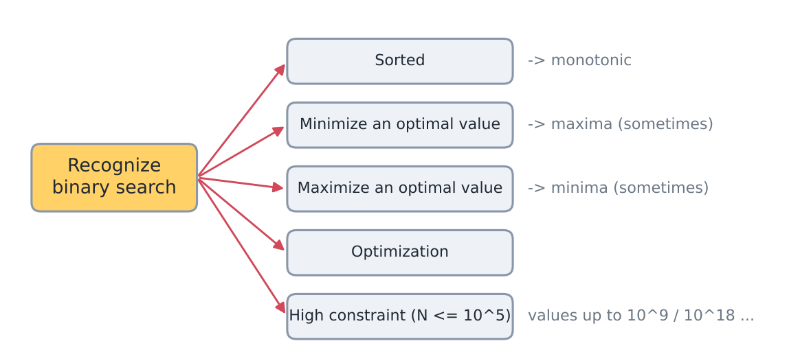

*Recognize: when to use binary search.*

- Sorted → monotonic
- minimize optimal val → maxima (sometimes)
- maximize optimal val → minima (sometimes)
- optimization
- high constraint (N ≤ 10^5), value 10^9 | 10^18 ...

Observation: binary search needs only one thing, a yes/no strip that flips exactly once. A sorted array gives this for free. In "minimize the best value" problems we search over the answer itself, and the question "will x be enough?" is usually monotonic: if x works, a larger x also works. If a limit such as 10^18 appears, binary search is very likely the intended method, because 10^18 needs only about 60 checks (2^60 ≈ 10^18).

| What the problem shows | What to try |
|---|---|
| Sorted array, value or position | plain BS, lower_bound, upper_bound |
| minimize the maximum / maximize the minimum | BS on answer |
| answer up to 10^18 | BS on answer |
| a curve with one top or one bottom | ternary search / BS on slope |
| decimal answer, some error allowed | BS on real domain |

## Designing check functions

# Search an element:

[1, 5, 10, 15, 19, 21, 35, 100]

Find if 17, 35 are present.

Linear search: iterate over all elements one by one & check if the asked elements are there. → O(n).

Select the middle element.

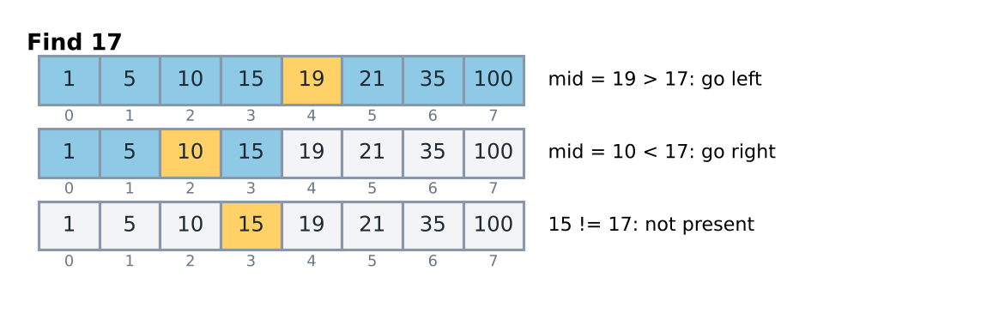

*Searching 17: half of the search space is removed in each row.*

19 → middle element. ⇒ 17 must lie in first half of the array. (19 is larger than 17)

[1, 5, 10, 15]: 10 → smaller than 17 ⇒ 17 must lie in second half.

[15] ≠ 17 ⇒ 17 is not present.

finding 35

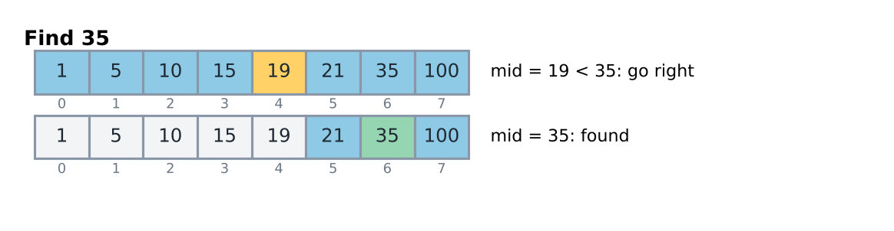

*Searching 35: found in 2 checks.*

19 ⇒ middle element, less than 35 ⇒ 35 must be in second half of the array.

[21, 35, 100]: 35 ⇒ middle element == 35 ⇒ 35 found in the array.

Time complexity — O(Logn)

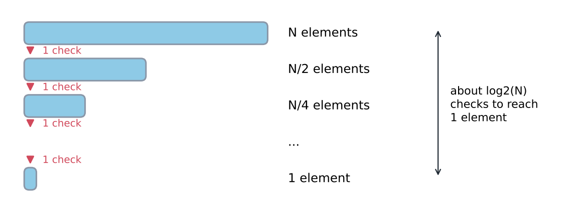

*Each check halves the space: log n checks.*

On each check we are discarding half of the array i.e. halving the search space.

Let's say N = 10^6. 10^6 → 5·10^5 → 2.5·10^5 → ... → 1. How many halvings does this take? 2^20 ≈ 10^6, so about 20 checks. Linear search would need up to 10^6 checks, which is 50,000 times more.

```cpp
// Fabricator/BinarySearch/BitonicArraySearchElement.cpp
int binary_search(vector<int> &arr, int x){
    int lo = 0, hi = arr.size() - 1, ans = -1;
    while(lo <= hi){
        int mid = lo + (hi - lo)/2;
        if(arr[mid] == x){
            ans = mid;
            break;
        }
        else if(arr[mid] > x){
            hi = mid - 1;
        }
        else{
            lo = mid + 1;
        }
    }
    return ans;
}
```

This code takes the lower middle (the index (lo+hi)/2, rounded down). For 17 it looks at 15, 21, 19 and returns -1. For 35 it looks at 15, 21, 35 and returns index 6. The manual walk above took the upper middle; both choices work.

## Finding first 1

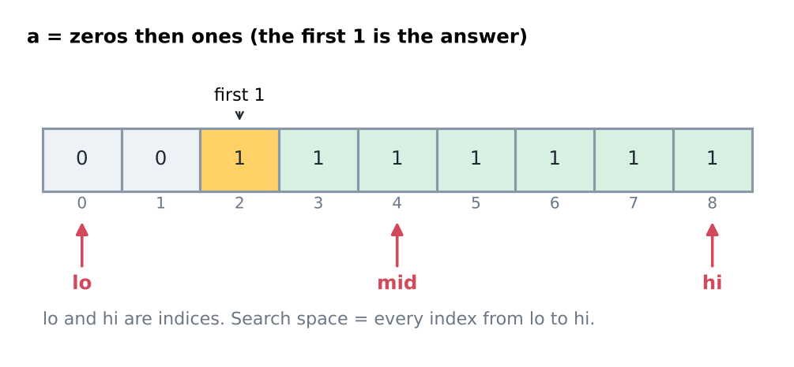

*a = zeros then ones. lo, mid, hi.*

find the first occurrence of 1 (one)

[0, 0, 1, 1, 1, 1, 1, 1, 1] (indices 0 to 8), lo at index 0 and hi at index 8.

lo & hi represent the index (asked in problem). search space is [lo, hi].

Never include the mid back to the search space. → it can cause buggy code.

Why: if we write `lo = mid` and hi = lo + 1, then mid = lo + 0 = lo again, so the space does not shrink and the loop never ends. Always use mid+1 or mid-1.

Always maintain 4 variables.

lo, hi, mid, ans. Start: lo = 0, hi = 8, mid = lo + (hi-lo)/2 = 4, ans = 4 (a 1 is found at mid).

lo + (hi-lo)/2 doesn't cause overflow.

$\lfloor \frac{lo+hi}{2} \rfloor$ → may cause overflow.

Example: lo = 2·10^9, hi = 2.1·10^9 (both fit in an int, whose maximum is 2,147,483,647). lo+hi = 4.1·10^9 overflows, and mid becomes negative (-97483648). lo + (hi-lo)/2 = 2·10^9 + 5·10^7 = 2.05·10^9, which is correct, because hi-lo is never larger than hi.

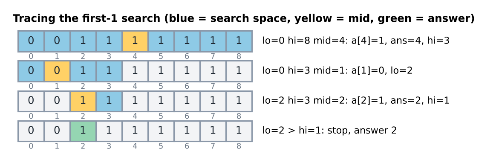

*Trace: blue = search space, yellow = mid, green = ans.*

| lo | hi | mid | ans. |
|----|----|-----|------|
| 0 | 8 | 4 | 4 |
| 0 | 3 | 1 | 4 |
| 2 | 3 | 2 | 2 |
| 2 | 1 | X | |

1 found at 4 hence ans is 4 (for now). At the end lo > hi, so stop. Final ans = 2.

```cpp
while (lo <= hi) {
    mid = lo + (hi-lo)/2

    if (arr[mid] == 1) {
        ans = mid;
        hi = mid - 1;
    }
    else {
        lo = mid + 1;
    }
}
cout << ans << endl;
```

Note: this is only a fragment. `mid` needs a `;` after it and a declaration `int mid`, and before the loop we must set `lo = 0, hi = n-1, ans = -1`.

arr [0 0 0 0 0 0 1 1]
      0 1 2 3 4 5 6 7

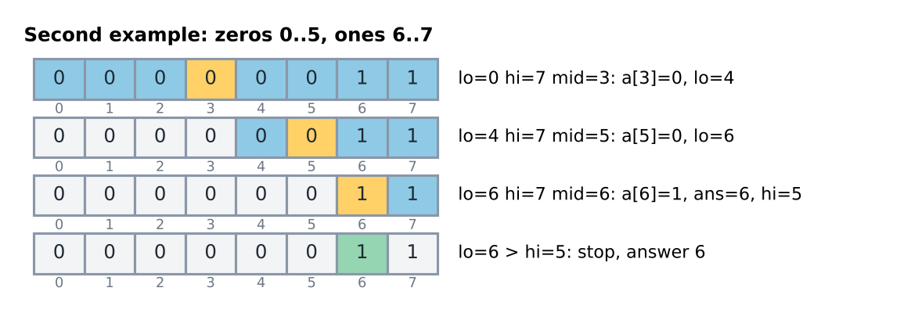

*Second example, ans = 6.*

| lo | hi | mid | ans |
|----|----|-----|-----|
| 0 | 7 | 3 | -1 |
| 4 | 7 | 5 | -1 |
| 6 | 7 | 6 | 6 |
| 6 | 5 | X | |

This problem is a template problem of binary search, all problems can be reduced to this format.

```cpp
// Fabricator/BinarySearch/FirstOne.cpp
/*
Given an array of 0s and 1s, with all the 0s and 1s bunched together.
Find the occurence of first 1.
*/
bool check(int mid, vector<int> &arr){
    return arr[mid] == 1;
}

int binary_search(vector<int> &arr){
    int lo=0, hi=arr.size(), ans = -1;

    while(lo <= hi){
        int mid = lo + (hi-lo)/2;
        if(check(mid, arr)){
            ans = mid;
            hi = mid - 1;
        }
        else{
            lo = mid + 1;
        }
    }

    return ans;
}
```

Note: here `hi=arr.size()`, so when mid = n the code reads `arr[n]`, which is out of bounds (for example on \{0,0,0\}). It should be `hi = arr.size() - 1`.

# lower_bound / upper_bound

Find x0 where f(x) maximise.
Find optimal x0 wrt to some condition.
Find x0 → f(x) minimises.

Check function

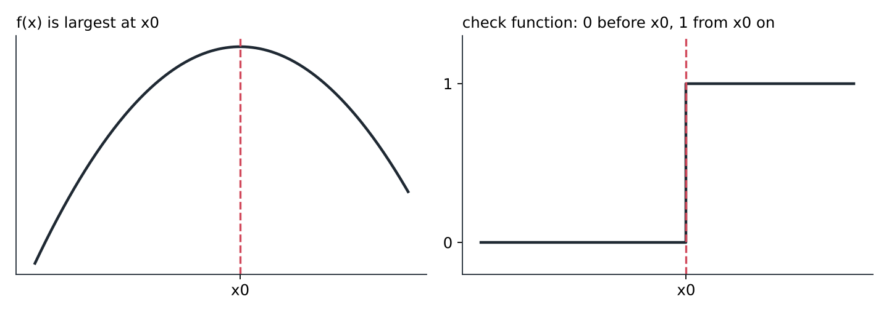

*The peak of the hill ↔ the 0/1 step.*

We design a check function which gives zero before x0 & 1 for all values greater than x0.

This now reduces to the template problem.

Values before x0 are all zero.
Values after x0 are all one.

lower_bound (arr, x)
 ↳ first elem ≥ x
 ↳ # of elem &lt; x

upper_bound (arr, x)
 ↳ first elem > x
 ↳ # of elem ≤ x.

arr → [1, 3, 5, 5, 5, 7, 7, 9] (indices 0 to 7, index 8 = last + 1)

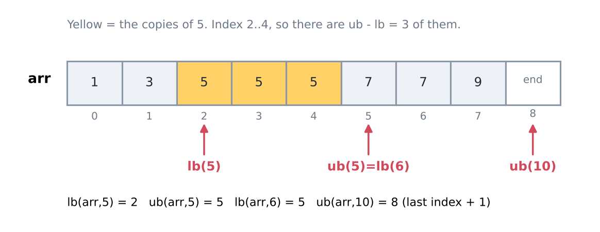

*lb / ub positions. Index 8 = last + 1.*

lb (arr,5) → 2                    ub (arr,5) → 5

lb (arr,6) → 5                    ub (arr,10) → last +1

Look: ub(5) - lb(5) = 5 - 2 = 3 → 5 appears three times. (Count of x = ub - lb.)

# Find first elem ≥ x. [lower_bound].

arr → [1, 5, 10, 31, 33, 33, 35, 100]

f (index) = \{ 1  if arr[index] ≥ x
            \{ 0  otherwise.

(this takes O(N))

arr becomes → [0, 0, 0, 1, 1, 1, 1, 1] (for x = 33)

Do not create the array, convert the elements on demand.

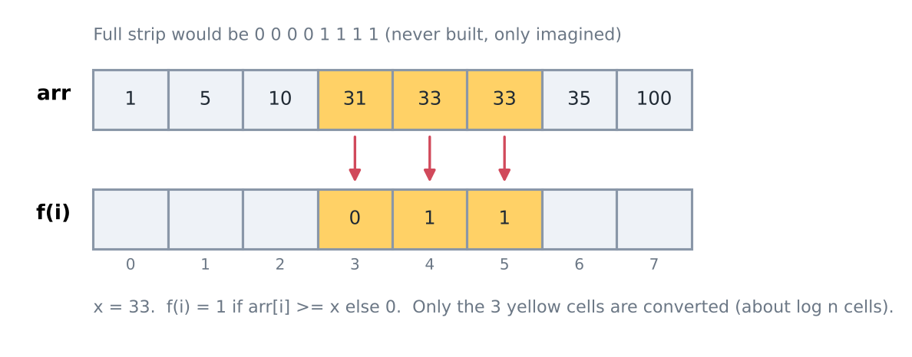

*Only the cells that the binary search looks at are converted.*

[1, 5, 10, (31), (33), (33), 35, 100] → [ , , , 0, 1, 1, , ] (indices 0 to 7)

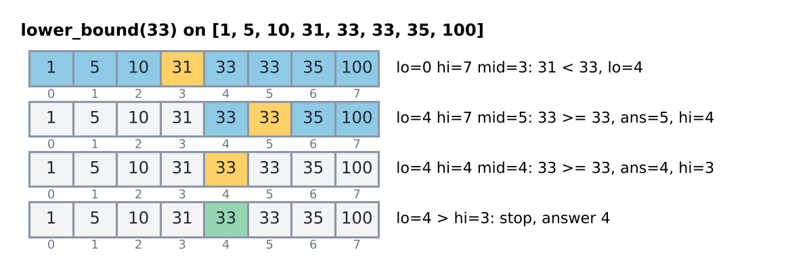

*lower_bound(33): ans = 4.*

| lo | hi | mid | ans. |
|----|----|-----|------|
| 0 | 7 | 3 | |
| 4 | 7 | 5 | 5 |
| 4 | 4 | 4 | 4 |
| 4 | 3 | X | |

log n no. of elements will be transformed.

# find elem > x (upper_bound).
Only the check function changes.

f (index) = \{ 1, arr[index] > x
            \{ 0, otherwise.

```cpp
int check_lb(int index)
{
    if (arr[index] >= x)
        return 1;
    return 0;
}
```

```cpp
int check_ub(int index)
{
    if (arr[index] > x)
        return 1;
    return 0;
}
```

```cpp
void binary_search (int * arr, int n) {
    int lo = 0, hi = n-1, ans = n;

    while (lo <= hi) {
        int mid = lo + (hi-lo)/2;

        if (check_lb(mid)) {
            ans = mid;
            hi = mid - 1;
        }
        else {
            lo = mid + 1;
        }
    }
    return ans;
}
```

Note: the return type must be `int`; `return ans` is not allowed in a `void` function. `ans = n` means that no element qualifies.

```cpp
// Fabricator/BinarySearch/LowerBound.cpp
/*
Implement lower bound function, lower bound of x means first number greater than or equal to x.
*/
bool check(int mid, vector<int> &arr, int &x){
    return arr[mid] >= x;
}

int binary_search(vector<int> &arr, int &x){
    int lo = 0, hi = arr.size() - 1, ans = -1;

    while(lo <= hi){
        int mid = lo + (hi - lo)/2;
        if(check(mid, arr, x)){
            ans = mid;
            hi = mid - 1;
        }
        else{
            lo = mid + 1;
        }
    }

    return ans;
}
```

```cpp
// Fabricator/BinarySearch/UpperBound.cpp
/*
Implement upper bound function, upper bound of x means first number greater than x.
*/
bool check(vector<int> &arr, int mid, int x){
    if(arr[mid] > x){
        return true;
    }

    return false;
}

int binary_search(vector<int> &arr, int x){
    int lo=0, hi=arr.size() - 1, ans = -1;

    while(lo <= hi){
        int mid = lo + (hi-lo)/2;

        if(check(arr, mid, x)){
            ans = mid;
            hi = mid - 1;
        }
        else{
            lo = mid + 1;
        }
    }

    return ans;
}
```

Note: both start with `ans = -1`, so they return -1 when no element qualifies. The STL (Standard Template Library) `std::lower_bound` returns the end (index n) instead, like `ans = n` above. Both were compared with the STL on arr = [1,3,5,5,5,7,7,9]: x = 5 → 2, 5. x = 6 → 5, 5. x = 10 → -1 (STL: 8).

## Search elem in rotated sorted array:

Find no. of rotations

```
[1, 2, 3, 5, 9]
rotate ↳ [9, 1, 2, 3, 5]
rotate ↳ [5, 9, 1, 2, 3]
rotate ↳ [3, 5, 9, 1, 2]
```

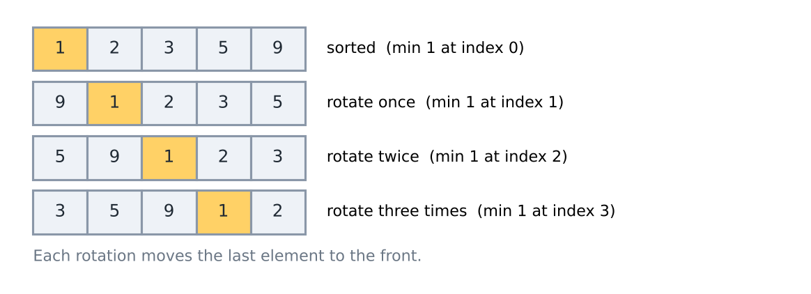

*In each rotation the last element moves to the front. Index of 1 = no. of rotations.*

[5, 9, 3, 4]  → ans: 2.
 0  1  (2) 3

idx of min value is the answer.

↳ We need a check function that converts to
[0, 0, 1, 1]

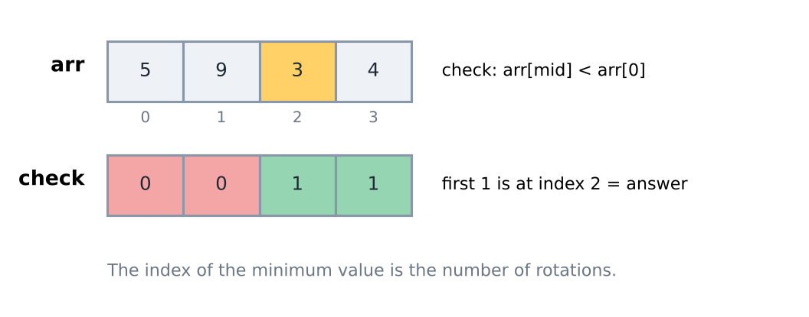

*arr[mid] &lt; arr[0] → 0 0 1 1.*

Check function:   arr[mid] &lt; arr[0]

default ans = 0.    | arr[mid] ≤ arr [n-1]

Note: both checks work only when all elements are distinct. With duplicates the minimum may not be found.

Idea of searching x: first find the index of the minimum (as above). The array is now two sorted pieces: [0, idx-1] and [idx, n-1]. If x ≤ arr[n-1], run BS on the right piece, otherwise on the left piece. Example: [5, 9, 3, 4], idx = 2. Searching 4: 4 ≤ arr[3] = 4, so search [2, 3]. Searching 9: 9 > 4, so search [0, 1].

```cpp
// Fabricator/BinarySearch/RotatedArray.cpp
/*
Given a rotated sorted array, find the number of rotations it has gone through.
*/
bool check(vector<int> &arr, int mid){
    if(arr[mid] <= arr[arr.size() - 1]){
        return true;
    }

    return false;
}

int binary_search(vector<int> &arr){
    int lo=0, hi=arr.size() - 1, ans = -1;

    while(lo <= hi){
        int mid = lo + (hi - lo)/2;
        if(check(arr, mid)){
            ans = mid;
            hi = mid - 1;
        }
        else{
            lo = mid + 1;
        }
    }

    return ans;
}
```

[1 2 3 5 9] → 0, [9 1 2 3 5] → 1, [5 9 1 2 3] → 2, [3 5 9 1 2] → 3, [5 9 3 4] → 2.

# find peak element:

Given a bitonic array, find the peak element.
 ↳ elements are increasing then decreasing.

arr = [1, 5, 9, 11, 9, 2, 1]
       0  1  2  3   4  5  6
 ↳ [0, 0, 0, 1, 1, 1, 1]

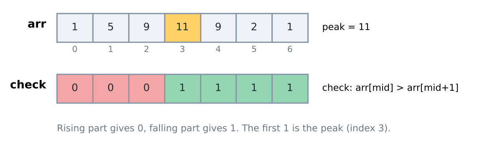

*Going up gives 0, going down gives 1. The first 1 is the peak.*

Check function:   arr [mid] > arr [mid +1]

```cpp
int check (int mid) {
    if (mid == n-1) return 1;
    else if (arr [mid] > arr [mid+1]) return 1;
    return 0;
}
```

Why `mid == n-1`: the last element has no right neighbour, so we treat it as "going down".

```cpp
// Fabricator/BinarySearch/BitonicArray.cpp
bool check(int mid, vector<int> &arr){
    if(mid == arr.size() - 1) return true;
    if(arr[mid] >= arr[mid + 1]){
        return true;
    }

    return false;
}

int binary_search(vector<int> &arr){
    int lo = 0, hi = arr.size() - 1, ans = -1;

    while(lo <= hi){
        int mid = lo + (hi - lo)/2;
        if(check(mid, arr)){
            ans = mid;
            hi = mid - 1;
        }
        else{
            lo = mid + 1;
        }
    }

    return ans;
}
```

Note: this version uses `>=` (equal neighbours also count as "down"). [1 5 9 11 9 2 1] → 3. The array must be strictly increasing and then strictly decreasing; otherwise a flat part can give a wrong answer.

## Binary Search forms:

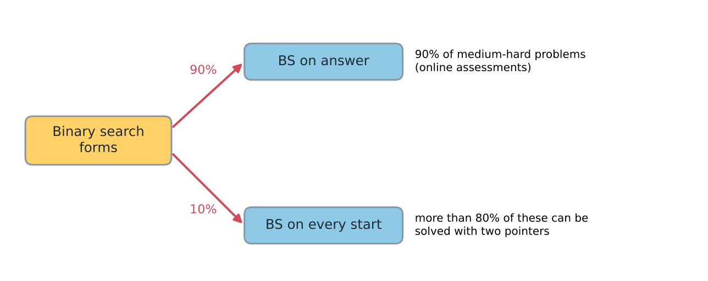

*The 2 forms of BS.*

- 90% → BS on answer (90% into medium-hard problems (OAs, i.e. online assessments))
- 10% → BS on every start → more than 80% of these type of problems can be solved using two pointers.

BS on answer

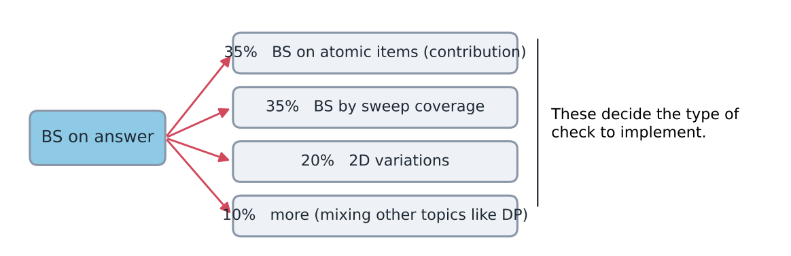

*Types of BS on answer. They decide how the check is built.*

- 35% → BS on atomic items [contribution]
- 35% → BS by sweep coverage
- 20% → 2D variations
- 10% → more (mixing other topics like DP, i.e. dynamic programming)

These decide the type of check to implement.

# Painter Problem:

N → walls , K → painters.          | Painters can paint continuous walls.
Arr → [1, 3, 8, 7, 2, 5] → Time taken to complete the i^th wall.

[1, 3, 8, 7, 2, 5] split as [1, 3] = 4, [8] = 8, [7, 2, 5] = 14.

3 painters can paint in above three chunks.

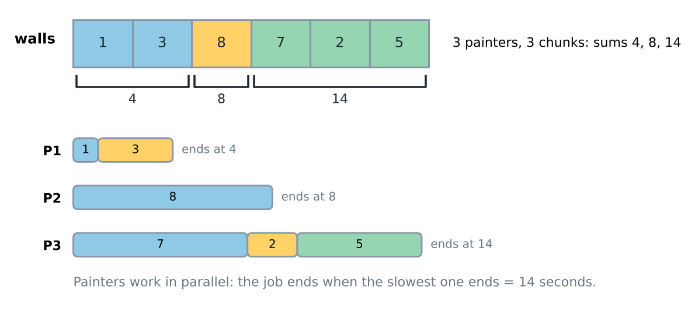

*3 painters, chunks 4 / 8 / 14. Time = 14.*

Painters can work parallely.
Time taken = 14 sec

How to divide the walls so that time taken is minimum?
Painters can paint only continuous chunk.

[1, 3, 8, 7, 2, 5] split as [1, 3, 8] = 12, [7] = 7, [2, 5] = 7.

Time = 12.

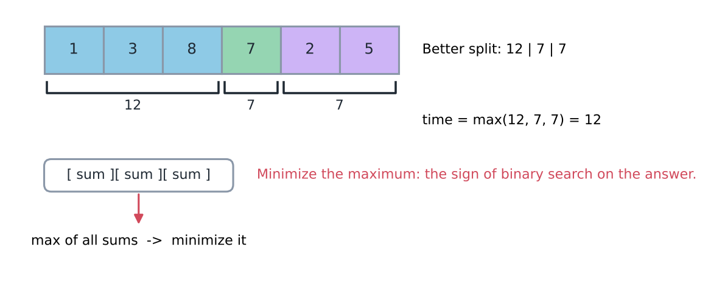

*The maximum of the group sums is the time. This is what we minimize.*

[ ____ | ____ | ____ ]
  sum     sum    sum
(max of all sums) → minimize → Indicator of BS on Ans.

minimize the maximum  \}
maximize the minimum  \} Most probably B.S.

Brute force: try every way to cut the array into k parts → exponential (6 walls into 3 parts already has 10 ways, and N = 10^5 has astronomically many). Better: search the time itself.

BS on ans → answer here is time.
time → [0, ....., sum (A_i)]  \} answer lies in this.

check (mid) → can we complete painting in ≤ mid secs using ≤ K painters.

previously we had following problem.
Find min secs in which we can complete using ≤ k painters.

BS on ans converts this type of question to yes/no question.

[1, 3, 8, 7, 2, 5]      k = 2   → min = 14

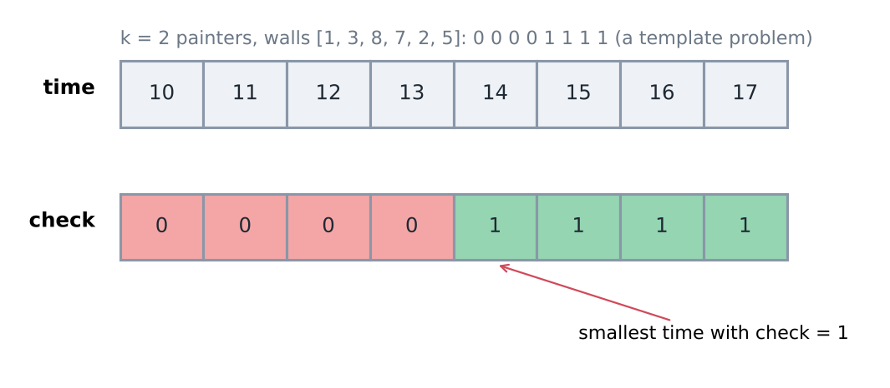

*k = 2: check strip. First 1 at time 14.*

check() ... 0   0   0   1   1   1   1 ...
time    ... 12  13 (14)  15  16

↳ converted to template problem.

for k = 3

Timeleft —  12   9   1  |  6   4  |  8
           [ 1,  3,  8, |  7,  2, |  5 ]
              P1           P2        P3

Check if work can be completed in 13 secs.

for k = 3 , check for 11 secs.

  10  7  | 3   | 4  2  |
[ 1,  3, | 8 , | 7, 2, | (5) ]
                          ↳ last wall will be left.

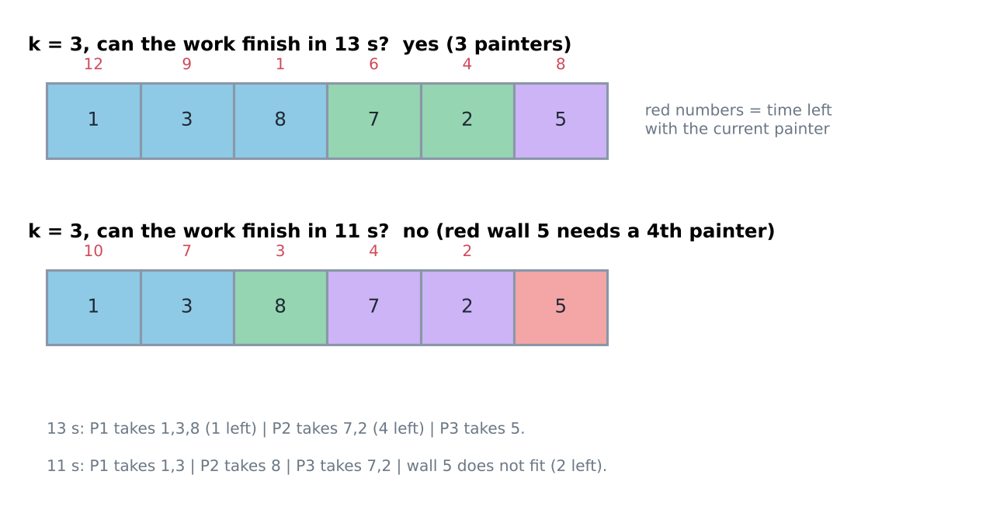

*Finished in 13 s. With 11 s the last wall is left over, so a 4th painter is needed.*

Time complexity — O( log ( Search space ) * check() )

O ( log ( Σ A_i ) * N ).

Example of the cost: N = 10^5 walls with times up to 10^9 gives Σ A_i up to 10^14. That is about log2(10^14) ≈ 47 checks of N = 10^5 steps each, about 4.7·10^6 operations in total.

```cpp
int check (int mid , int *arr, int n, int k) {
    int last_painter_time_left = 0;
    int num_painter_spawned = 0;

    for (int i=0; i<n; i++) {
        if (last_painter_time_left >= arr[i]) {
            last_painter_time_left -= arr[i];
        } else {
            num_painter_spawned++;
            if (num_painter_spawned > k) return 0;
            last_painter_time_left = mid;
            if (last_painter_time_left >= arr[i])
                last_painter_time_left -= arr[i];
            else return 0;
        }
    }
    return 1; }
```

Idea of the check: go from left to right. If the current painter has enough time left, this painter paints the wall. Otherwise a new painter starts. If more than k painters are needed, or a single wall is longer than mid, return 0.

Dry run for A = [1, 3, 8, 7, 2, 5], k = 3, mid = 13: painter 1 takes 1, 3, 8 (12 used, 1 left). Wall 7 does not fit, so painter 2 takes 7, 2 (9 used, 4 left). Wall 5 does not fit, so painter 3 takes 5. Three painters are enough → 1. For mid = 11 a 4th painter is needed → 0.

Note: sums in `int` can overflow; use `long long` for large inputs.

The search space [max(A_i), Σ A_i] also works (the time can never be smaller than the longest wall). k = 1 → 26 (Σ), k ≥ N → 8 (max wall).

```cpp
// Fabricator/BinarySearch/ArrayDivision.cpp
/*
You are given an array containing n positive integers.
Your task is to divide the array into k subarrays so that the maximum sum in a subarray is as small as possible.
*/
bool check(int *arr, int &n, int &k, long long &mid){
    long long sum_of_subarray = 0;
    int subarrays_created = 0;
    for(int i=0; i<n; i++){
        if(sum_of_subarray >= arr[i]){
            sum_of_subarray -= arr[i];
        }
        else{
            subarrays_created += 1;
            if(subarrays_created > k){
                return false;
            }

            sum_of_subarray = mid;
            if(sum_of_subarray >= arr[i]){
                sum_of_subarray -= arr[i];
            }
            else{
                return false;
            }
        }
    }

    return true;
}

long long binary_search(int *arr, int &n, int &k, long long &sumOfAll){
    long long lo = 0, hi = sumOfAll, ans = 0;

    while(lo <= hi){
        long long mid = lo + (hi - lo)/2;
        
        if(check(arr, n, k, mid)){
            ans = mid;
            hi = mid - 1;
        }
        else{
            lo = mid + 1;
        }
    }

    return ans;
}
```

This is the same painter problem (CSES 1085; CSES is a problem set website). [2 4 7 3 5], k = 3 → 8.

Now the "maximize the minimum" form: the same BS, but in the opposite direction. The check is true for small mid and false for large mid (a larger minimum distance is harder to achieve), so we want the LAST true: on true set `lo = mid + 1`.

```cpp
// Fabricator/BinarySearch/ClassRoom.cpp
/*
Vivek has built a new classroom with N seats. The seats are located along a straight line at positions
x_1, x_2,…,x_N. Vivek has to assign seats to K students such that a seat can be assigned to at most 1 student
and the minimum distance between any two students is as large as possible. Find the largest minimum distance possible.
*/
bool check(long long mid, vector<int> &seats, int k){
    int placed = 1;
    int last_seated = seats[0];
    for(int i = 1; i < seats.size(); i++){
        if(seats[i] - last_seated >= mid){
            last_seated = seats[i];
            placed += 1;
        }
    }

    return placed >= k;
}

long long binary_search(vector<int> &seats, int k){
    long long lo = 0, hi = seats[seats.size() - 1] - seats[0], ans = -1;
    while(lo <= hi){
        long long mid = lo + (hi - lo)/2;
        if(check(mid, seats, k)){
            ans = mid;
            lo = mid + 1;
        }
        else{
            hi = mid - 1;
        }
    }

    return ans;
}
```

Seats 1 2 4 8 9, k = 3 → 3 (seats 1, 4, 8 or 1, 4, 9). The seats must be sorted first. Dry run: mid = 3 places students at 1, 4, 8 → 3 students ≥ k, so true. mid = 4 places students at 1, 8 only → 2 &lt; 3, so false.

# Patterns:

i) Sweep:

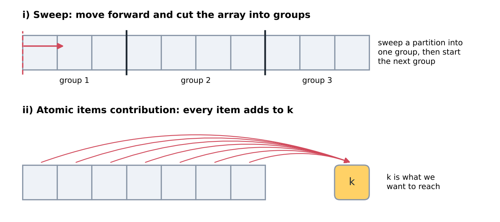

*Sweep: build groups. Atomic: every item adds to k.*

We are moving forward in an array and grouping the elements.

* creating partitions over array.
* we simply sweep a partition into one group. and we create multiple groups based on the constraints given.

(Painter is an example of this pattern.)

ii) Atomic Items contribution:

every item from the array contributes to k.

k is something we want to achieve.

[Factory Machines — (CSES, a problem set website)]

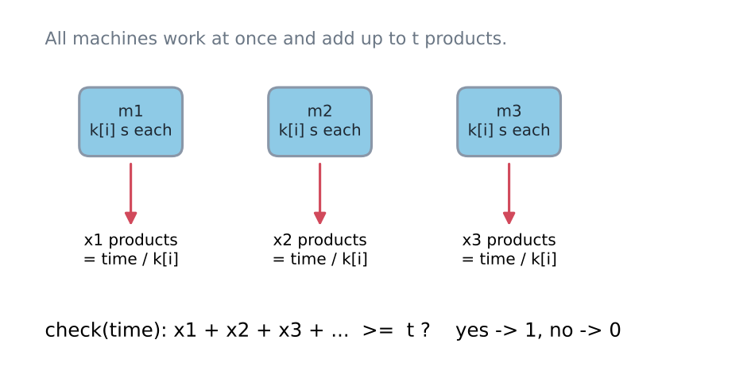

*All machines contribute to reaching the target t.*

check (mid) → time

All machines are contributing to achieve t.
m1 produces x1 products
m2 → x2

x1 + x2 + x3 ... ≥ t  → yes: 1 / no: 0

∴ Every item is contributing individually.

lo = 0, hi = t * arr[0] ; ans = -1

(arr[0] is the time one machine needs for one product. That machine alone makes t products in t * arr[0] seconds, so this is a valid upper bound. Using the fastest machine gives a tighter bound.)

* mostly optimization type problem use binary search

```cpp
// Fabricator/BinarySearch/FactoryMachines.cpp
/*
A factory has n machines which can be used to make products.
Your goal is to make a total of t products.
For each machine, you know the number of seconds it needs to make a single product.
The machines can work simultaneously.
What is the shortest time needed to make t products?
*/
bool check(long long mid, long long t, long long n, long long *arr){
    long long machines_produced = 0;
    for(int i=0; i<n; i++){
        machines_produced += mid/arr[i];

        if(machines_produced >= t) return true;
    }

    return machines_produced >= t;
}

long long binary_search(long long n, long long t, long long *arr){
    long long lo = 0, hi = t * arr[0], ans = 0;

    while(lo <= hi){
        long long mid = lo + (hi - lo)/2;
        if(check(mid, t, n, arr)){
            ans = mid;
            hi = mid - 1;
        }
        else{
            lo = mid + 1;
        }
    }

    return ans;
}
```

machines 3 2 5, t = 7 → 8 (in 8 sec: 2 + 4 + 1 = 7 products; in 7 sec only 6). The early return `if (machines_produced >= t) return true;` is there so the sum does not overflow. Cost: log2(t · arr[0]) checks of n steps each.

iii) 2D Variations:

[Multiplication Table - (CSES)]

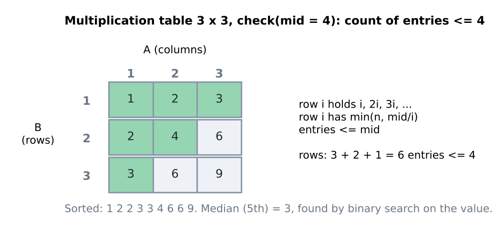

*Row i holds i, 2i, 3i ... so the entries ≤ mid in that row number min(n, mid/i).*

→ The elements of this matrix are formed by doing some operation on two arrays A & B.

Problems on this are mostly like put all elements of the matrix in an array, sort the array & find k^th element.

check (mid) = are there greater than k elements in ≤ mid - in table total.

Note: it is "at least k" (≥ k), not "greater than k". The k-th smallest is the first mid whose count is ≥ k.

```cpp
// Fabricator/BinarySearch/MultiplicationTable.cpp
/*
Find the middle element when the numbers in an n x n multiplication table are sorted in increasing order.
It is assumed that n is odd. Called with k = (n * n) / 2 + 1.
*/
bool check(long long mid, long long n, long long k){
    long long cnt = 0;
    for(int i=1; i<=n; i++){
        long long residue = mid / i;

        cnt += min(n, residue); // count: <= residue
    }

    return cnt >= k;
}

long long binary_search(long long n, long long k){
    long long lo = 1, hi = n * n, ans = -1;

    while(lo <= hi){
        long long mid = lo + (hi - lo) / 2;
        if(check(mid, n, k)){
            ans = mid;
            hi = mid - 1;
        }
        else{
            lo = mid + 1;
        }
    }

    return ans;
}
```

n = 3 → 3, n = 5 → 8. Counting is O(n), so T.C. is O(n log(n^2)).

Dry run for n = 3 (the table is 1 2 3 / 2 4 6 / 3 6 9) and k = 5: count(≤ 3) = min(3,3) + min(3,1) + min(3,1) = 5 ≥ 5 → true. count(≤ 2) = 2 + 1 + 0 = 3 &lt; 5 → false. So the answer is 3.

Same idea ("put all elements in one array, sort, take the k-th or the median"): the median of subarray sums. There are O(N^2) sums, so the array cannot be built. Instead, BS on the sum, and count the subarrays with sum ≤ mid using two pointers.

```cpp
// Fabricator/BinarySearch/MedianOfSubarraySum.cpp
/*
Given an array A of N integers. The score of a subarray is the sum of all elements in that subarray.
Find the median of the array containing the scores of all N * (N + 1) / 2 subarrays.
If the length is even, the median is the smaller of the two middle values.
*/
long long subArraysWithSumAtMostMid(vector<long long> &a, long long mid){
    int left = 0;
    long long cnt = 0, curr_sum = 0;

    for(int right = 0; right < a.size(); right++){
        curr_sum += a[right];

        while(curr_sum > mid && left <= right){
            curr_sum -= a[left];
            left++;
        }

        cnt += (right - left + 1);
    }

    return cnt;
}

bool check(vector<long long> &a, long long mid){
    long long count_of_subarrays = a.size() * (a.size() + 1)/2, smaller = 0;

    smaller = subArraysWithSumAtMostMid(a, mid);
    
    return smaller >= (count_of_subarrays + 1) / 2;
}

long long binary_search(vector<long long> &a, long long total){
    long long lo = 0, hi = total, ans = -1;

    while(lo <= hi){
        long long mid = lo + (hi - lo) / 2;
        if(check(a, mid)){
            ans = mid;
            hi = mid - 1;
        }
        else{
            lo = mid + 1;
        }
    }

    return ans;
}
```

[1 2 3] → 3, [5] → 5, [1 5] → 5 (sums 1, 5, 6). The array must be positive (needed for two pointers).

Ques:

Given n points on a number line, place at most k additional points on the line to minimize the maximum separation b/w any two consecutive points.

x1 x2 x3 x4 x5 on a number line.

for every point p , we will calculate distance of immediate neighbour d1 & d2.

minimise (max neighbour distance).

ans → we have to minimise this (the biggest gap).

n=3, k=1: points 0, 100, 150.

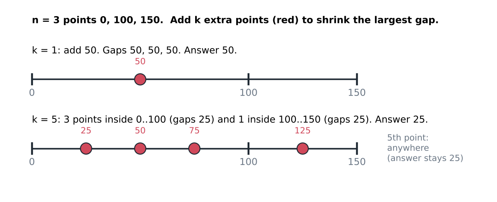

*k = 1 → 50. k = 5 → 25.*

we should place here (50).

ans = 50

n=3, k=5

the 5th one can be placed anywhere ⇒ the ans will remain 25.

Process:

take max distance divide it into 2.
 ↳ place one k in b/w them.
keep on doing

Will give WA (wrong answer)

Is this process legit/correct? — NO ↴

 100 , 50 → 50, 50, 50           │  k=2
 100, 100 → 100, 51, 50          │  100 → 50, 50
                                 │      ↓
 2, 2, (3)                       │      X 50, 25, 25
   2, 1                          │  100 → 33, 33, 34

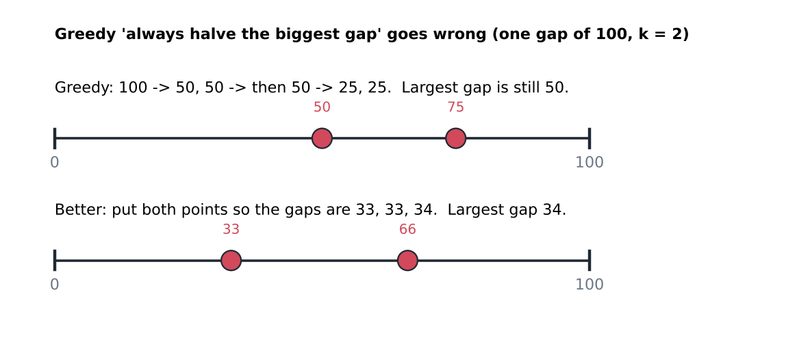

*Greedy: 50, 25, 25 → max 50. Better: 33, 33, 34 → max 34.*

Answere here is max neighbour distance.

lo / min = 0
hi / max = max distance between two points in input.

Note: with lo = 0 the check would divide by 0 (it divides by x). Start from lo = 1. Also, the answer here is an integer and the points are at integer positions (so 34, not 33.33).

check (mid) → can we place ≤ k points to make answer ≤ x.

≤ k instead of == k → we can place multiple pts on same pt.
≤ x instead of == x. → very difficult to check == x.
also == x might not be monotone.

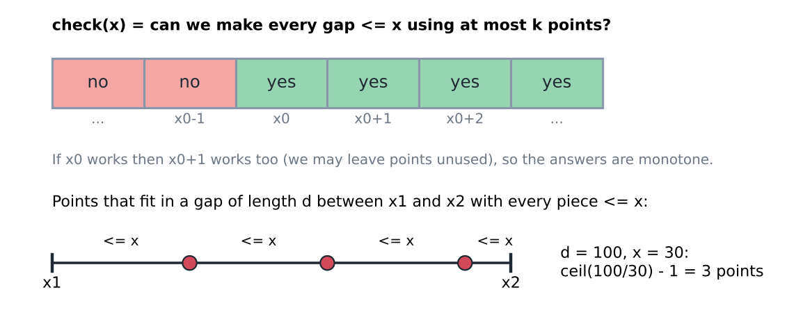

*If x0 works, x0+1 also works. Splitting a gap d into pieces of at most x needs ceil(d/x) - 1 points.*

x0 is ≤
∴ x0+1 is also ≤
. . . . .

→ meaning we can avoid using all points.

Now, we need to place pts such that max dist. b/w two neighbours is ≤ x.

# of points that can be placed b/w x1 & x2. = ⌈d/x⌉ - 1

\*\* Note:

$\lceil \frac{d}{x} \rceil - 1 = \lfloor \frac{d+x-1}{x} \rfloor - 1$

Look: d = 100, x = 30: ceil(100/30) - 1 = 4 - 1 = 3 points (30, 60, 90 → pieces 30, 30, 30, 10).

```cpp
// Fabricator/BinarySearch/MinimiseMaxDiff.cpp
/*
You are given N distinct points on the number line in a sorted array A.
You can place at most K more points on the line (integer coordinates only).
You have to make the maximum separation between any two consecutive points in the final configuration as minimum as possible.
Output this minimal value.
*/
bool check(int *arr, int &n, int &k, int &mid){
    long long num_of_points_placed = 0;

    for(int i=1; i<n; i++){
        if(arr[i] - arr[i-1] >= mid && mid > 0){
            num_of_points_placed += ((arr[i] - arr[i-1] + mid - 1)/mid - 1);
        }
    }

    return num_of_points_placed <= k;
}

int binary_search(int *arr, int &n, int &k){
    int lo = 1, hi = arr[n-1] - arr[0], ans = 0;

    while(lo <= hi){
        int mid = lo + (hi - lo)/2;
        if(check(arr, n, k, mid)){
            ans = mid;
            hi = mid - 1;
        }
        else{
            lo = mid + 1;
        }
    }

    return ans;
}
```

Samples: (1 2 3 4 5, k=5) → 1, (2 5 7 8 10, k=0) → 3, (100 200 230, k=2) → 34, (1 3 5 7 9 11, k=5) → 1, (1 4 8 13 19 26, k=4) → 4. Points 0 100 150: k = 1 → 50, k = 5 → 25.

Ques:
Given arrays A → N size
            B → M size.

Create array C → N*M  with elements A[i] + B[j]   | 1 ≤ i ≤ N
                                                  | 1 ≤ j ≤ M
find Kth smallest element in array C.

A → [1 2 3]
B → [4 5 6]

C → [5, 6, 7, 6, 7, 8, 7, 8, 9]

Sorted C → [5, 6, 6, 7, 7, 7, 8, 8, 9]
                          ↑
                         6^th

check (x) → (# of elements in C, ≤ x) ≥ k.

A → 3, 5
B → 2, 3, 4          k=3

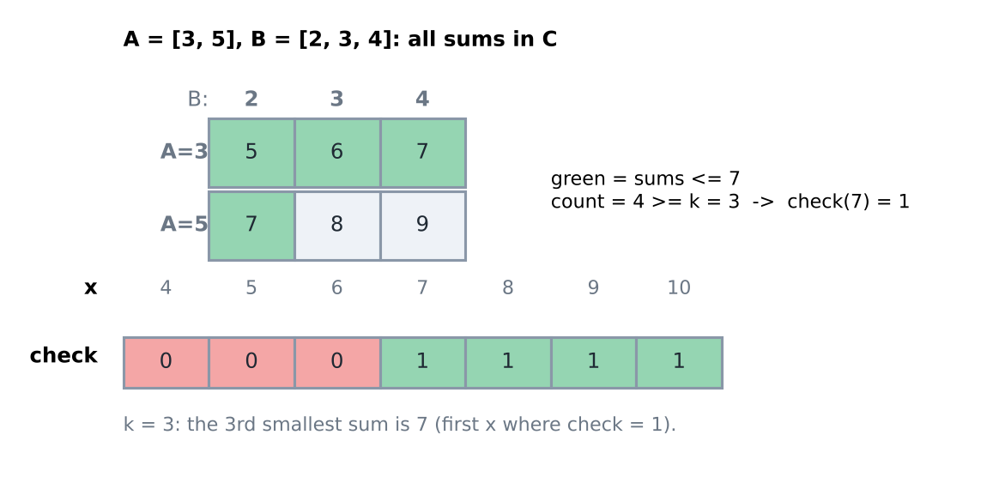

*All the sums, and the check for each x. The first 1 is at 7.*

check (7) → 5, 6, 7, 7   k' = 4 ≥ k  ⇒ True
check (8) → 5, 6, 7, 7, 8   k' = 5 ≥ k  ⇒ True.

  0   0   0   1   1   1   1
  4   5   6   7   8   9   10

So, we sort both A & B and perform check using binary search.

```cpp
check (int mid) {
    int num_items = 0;
    for (int i=0; i<n; i++) {
        num_items += (upper_bound (B.begin(),
                       B.end(), mid-A[i])
                       - B.begin());
    }
    return num_items >= k;
}
```

Note: for no. of items ≤ x we have used upper bound function

After sorting A & B, we can decide hi & lo easily.

lo = A[0] + B[0]
hi = A.last() + B.last().  or A[n-1] + B[m-1]

Note: this is a fragment (no return type). Keep the count and mid in `long long`.

```cpp
// Fabricator/BinarySearch/KthSumValue.cpp
/*
Given two arrays A of size N and B of size M and an integer K.
Create a new array C of size N x M consisting of A[i]+B[j].
Find the Kth smallest element in the array C.
Both arrays are sorted before the call.
*/
bool check(vector<int> &a, vector<int> &b, int &n, int &m, long long &k, long long &mid){
    long long num_items = 0;

    for(int i=0; i<n; i++){
        num_items += (upper_bound(b.begin(), b.end(), mid - a[i]) - b.begin());
    }

    return num_items >= k;
}

int binary_search(vector<int> &a, vector<int> &b, int &n, int &m, long long &k){
    long long lo = a[0] + b[0], hi = a[n-1] + b[m-1], ans = 0;

    while(lo <= hi){
        long long mid = lo + (hi - lo)/2;
        if(check(a, b, n, m, k, mid)){
            ans = mid;
            hi = mid - 1;
        }
        else{
            lo = mid + 1;
        }
    }

    return ans;
}
```

A = 1 2 3, B = 4 5 6, k = 6 → 7. A = 3 5, B = 2 3 4, k = 3 → 7. T.C. O(N log M · log(range)).

→ Binary Search on every step:

N, arr of 0s & 1s.

K → # of flips that we can make. (at most).

find max. length subarray that can be created with all 1s. by flipping ≤ k moves.

→ for k=2

[1|0|0|1|1|0|1|1|1|0|1|1|1]

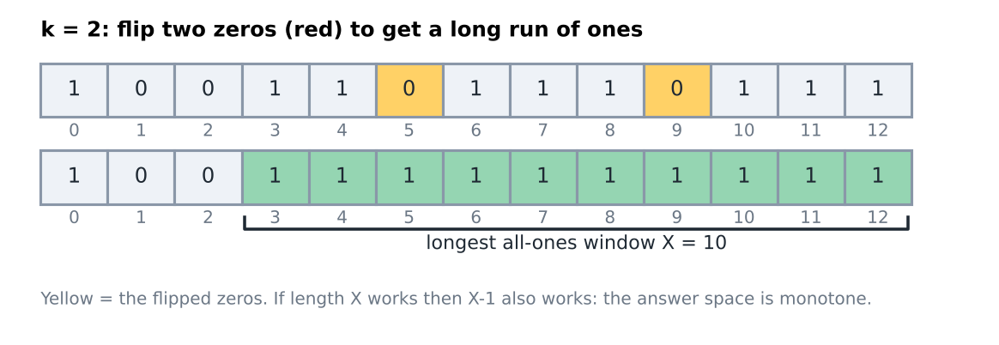

*k = 2: two zeros are flipped, cells 3..12 are all 1.*

[1|0|0|1|1|1|1|1|1|1|1|1|1]  → X = longest window.

Note: in this array X = 10 (cells 3 to 12).

∴ X-1 is also possible.

ans ≥ x → monotonic space.

① So, we need to find a subarray/window of size X that can be all 1s.
We can iterate through all subarrays of size X in the arr and check.

A prefix sum array (of ones) gives the number of ones in a window in O(1):

 1 2 3 4 4 5 5 5 6 7     ← prefix sum array.
[1|1|1|1|0|1|0|0|1|1]
     └──── X ────┘

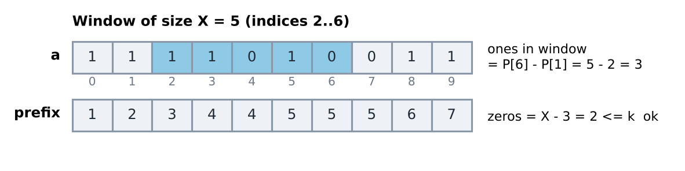

*Window [2..6]: ones = 5 - 2 = 3.*

O(1) \{ No. of zeros = X - (5-2) = 5 - 3 = (2)
     \{ we check if no. of zeros ≤ k. ✓

\*\* So, to count no. of elements in subarray, prefix sums can work sometimes.

No. of windows = N-X+1.

check → O(N-X+1). O(1).

② Using Binary Search → O (log N) x O(N)

③ A prefix array is not needed either: slide the window.

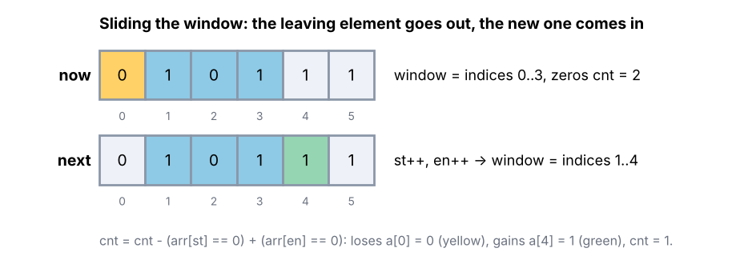

*One cell leaves, one cell enters.*

if we computed in this.
# of 0s = 2 = cnt

O ( logn x O(N) ).

we slide the window. 0 outgoes 1 incomes.
# of 0s = cnt - (arr[st] == 0) + (arr[en] == 0);
in new window.

st++ ; end++;

Note: the incoming element is `arr[en]` (with the value of en before it is incremented); after that both pointers move forward.

Brute force: count the zeros for every (l, r) → O(N^3). With prefix sums → O(N^2). BS on length + prefix → O(N log N). Two pointers (move r forward; when zeros > k, move l forward) → O(N). This is why more than 80% of the "BS on every start" problems can be solved with two pointers.

```cpp
// Fabricator/BinarySearch/ConsecutiveOnes.cpp
/*
Given a binary array of length N and an integer K, the score of an array is defined as the length of the longest
continuous subsegment consisting only of 1's. Determine the maximum score possible if you are allowed to
change (flip) at most K elements of the array.
p is the prefix sum array of the ones, st is the start index.
*/
int num_zero(int *p, int l, int r){
    return (r - l + 1) - (p[r] - (l > 0 ? p[l-1]: 0));
}

bool check(int *p, int st, int en, int k){
    return num_zero(p, st, en) <= k;
}

int binary_search(int *p, int n, int k, int st){
    int lo = st, hi = n-1, ans = st - 1;

    while(lo <= hi){
        int mid = lo + (hi - lo)/2;
        if(check(p, st, mid, k)){
            ans = mid;
            lo = mid + 1;
        }
        else{
            hi = mid - 1;
        }
    }

    return ans;
}
```

For every start this finds the farthest valid end (BS on every start). Samples: 7 4 8 10 7. On the 13-cell array above with k = 2 → 10.

Ques: find the # of subarrays that you can make all 1s by ≤ k flips.

 1 0 1 0 1           N, arr, k.
                     N ≤ 10^5

k = 1

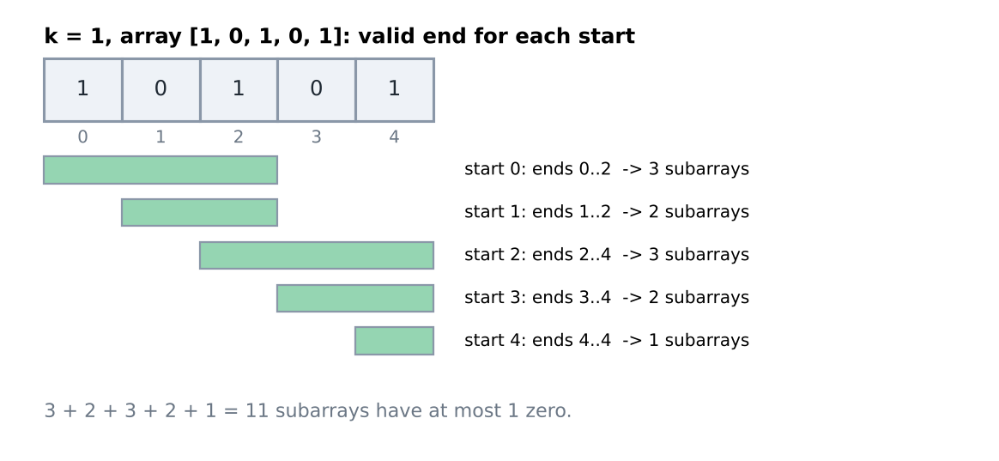


*The farthest valid end for each start.*

5 + 3 + 2 + 1 = 11

Note: counted by start: 3 + 2 + 3 + 2 + 1 = 11 (counted by length: 5 + 4 + 2 = 11).

k=2
[1|0|1|0|1|1|0|1]
 0 1 2 3 4 5 6 7

for l=0  r can be max at 5 beyond that 3^rd 0 will be added but k=2.

l=0 , r=5 will be true in monotone space
      r>5 will be false

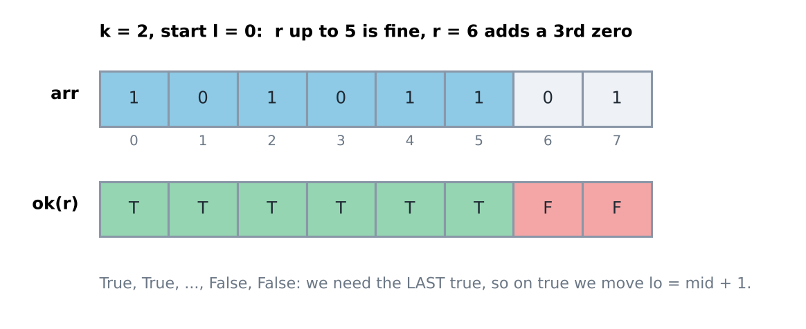

*l = 0: T T T T T T F F. We want the last true.*

 T T T T T T F F
 0 1 2 3 4 5 6 7

for every l there is a monotone space on the right.

for every l (start) we can find the ending index , 'r'.

No. of subarrays b/w l & r = (r-l+1).
We can use prefix array again.
(# of 0's (l,r) ≤ k)

For each start, l → O(logn) → one BS.
For all start → n x O(logn) → O(nlogn).

```cpp
for (int st=0; st<n; st++) {
    int lo= st;
    int hi = n-1;
    int ans = st-1;   // ans=0 is wrong!!
    while { int mid= (lo+hi)/2
        if (check(mid)) {
            ans = mid;
            hi= mid-1;
        } else { lo= mid+1;}
    }
    sol += (ans - st+1)
}
```

ans=0 is wrong!!
For eg:
arr = 0, 1, 0, 1, 0
k = 0
0^th idx will contribute 1 to the ans while it should see 0.

this will give 1 for 0^th idx & 0 value. which is wrong.

sol += (ans - st +1)
   ↓
sol += (ans - (st-1))
To make this zero → ans = st-1;

Note: two points. The loop must be `while (lo <= hi)`. And since the strip is T T T F F, we need the LAST true: on true set `lo = mid+1`, on false `hi = mid-1`. The `hi = mid-1` on true shown above is the first-true form, so it is wrong here (for 1 0 1 0 1 with k = 1 it gives 5, but 11 is needed).

```cpp
// Fabricator/BinarySearch/SubarraysWithKFlips.cpp
/*
Given an array of 1s and 0s and k.
In k moves you can flip one number.
Find the number of subarrays you can create with all 1s with k moves.
p is the prefix sum array of the input, st is the start index.
*/
int num_zero(int *p, int l, int r){
    return (r - l + 1) - (p[r] - (l > 0 ? p[l-1] : 0));
}

bool check(int *p, int &k, int &mid, int &st){
    return num_zero(p, st, mid) <= k;
}

/*
CAUTION: lookout that the position of hi and lo in check-if-else block is reversed as we're traversing in non-increasing monotonic array
Like in 1 1 1 1 1 0 0 0 0
In this we are fethcing the last one.
*/
int binary_search(int &n, int &k, int &st, int *p){
    int lo = st, hi = n-1, ans = st-1;

    while(lo <= hi){
        int mid = lo + (hi - lo) / 2;
        if(check(p, k, mid, st)){
            ans = mid;
            lo = mid + 1;
        }
        else{
            hi = mid - 1;
        }
    }

    return ans;
}
```

Add up `binary_search(...) - st + 1` over every st: [1 0 1 0 1], k = 1 → 11. [1 0 1 0 1 1 0 1], k = 2 → 32. [0 1 0 1 0], k = 0 → 2.

Another example of "BS from every start": minimum size subarray with sum ≥ target (prefix sums; search for the end).

```cpp
// Fabricator/BinarySearch/MinimumSizeSubarraySum.cpp
bool check(int mid, int st, vector<int> &nums, int target){
    if(st == 0) return nums[mid] >= target;
    
    return (nums[mid] - nums[st - 1]) >= target;
}

int binary_search(int target, vector<int>& nums){
    int sol = INT32_MAX;
    for(int st = 0; st < nums.size(); st++){
        int lo = st, hi = nums.size() - 1, ans = INT32_MAX;
        while(lo <= hi){
            int mid = lo + (hi - lo) / 2;
            if(check(mid, st, nums, target)){
                ans = mid - st + 1;
                hi = mid - 1;
            }
            else{
                lo = mid + 1;
            }
        }

        sol = min(sol, ans);
    }

    return sol == INT32_MAX ? 0 : sol;
}
```

(here `nums` is the prefix array.) [2 3 1 2 4 3], target = 7 → 2.

HW
Ques: Find # of subarrays such that # of distinct element ≤ k.

Eg:-
 1 2 3 2       k=2        N ≤ 10^5.

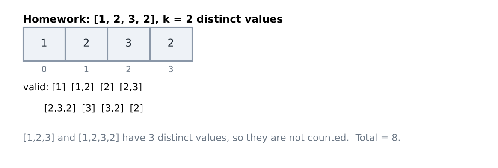

*k = 2: 8 subarrays valid.*

Valid: [1], [1,2], [2], [2,3], [2,3,2], [3], [3,2], [2] → 8.

Hint: the number of distinct values in a window cannot be read from prefix sums; keep a frequency map. Observation: for each r, the smallest valid l only moves forward → two pointers.

→ Binary Search of Real Domain:

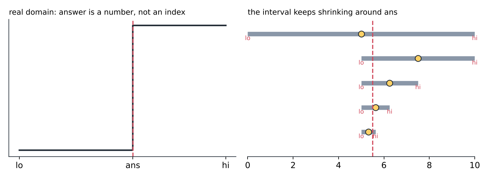

*Real domain: the answer is a number, not an index. The interval closes in on the answer.*

```cpp
long double lo= 0, hi= n;
while ( abs (hi-lo)>= EPS){
    long double mid = (lo+hi)/2;

    if (check (mid)) {
        hi= mid;
    } else {
        lo= mid;
    }
}
long double ans = (lo+hi)/2;
```

EPS → epsilon
 ↳ 10^-9
 ↳ 10^-12

we keep getting closer to ans.

We try to go as close to ans as possible.
So in ques → it'll ask to do some rounding off
          → or some margin of error is allowed.

. Ideally keep epsilon 100 times more than what is asked in question.

Note: use an epsilon that is 100 times tighter (smaller) than the error the question allows.

\* If the data type is not optimal and we're keep EPS tight on that, then the BS might not converge.
  ↳ Always use a bit bigger data type
  ↳ long double.

Example sqrt(2): check(x) = x*x ≥ 2. lo = 0, hi = 2. With EPS = 1e-9 the loop stops after 31 rounds (2/2^31 ≈ 9.3·10^-10 &lt; 10^-9) and gives ans 1.414213561919. The true value is 1.414213562373.

\* Better Alternative:

Do the iteration for fixed no. of times.

```cpp
long double lo= 0, hi= n;
for (int i= 0 ; i<40; i++){
    long double mid = (lo+hi)/2;
    if (check(mid)) {
        hi= mid;
    } else {
        lo= mid;
    }
}
long double ans = (lo+hi)/2;
```

(40 iterations.)

We do perfect BS → mid will be exact in middle.

n → n/2 →(40)→ n/2^40

2^40 ~ 10^12
   ↳ will work for 10^9 types requirement.

Note: if n = 10^9, then 10^9/2^40 ≈ 9·10^-4 remains, not 10^-9. Rounds = ⌈log2(n/eps)⌉. For n = 10^9, eps = 10^-9 → 60.

Although for larger n, we can increase the iterations easily. → may be to 60, 80.

\* Use iterative for very tight questions in which precision is highly tight requirement.
  ↳ for others classical style will work.

Example of fixed iterations from the repository: maximize (Σ A_i) / (Σ B_i) over K chosen indices. Check(mid): do K items exist with Σ(A_i - mid·B_i) ≥ 0? If yes, a ratio ≥ mid is possible → lo = mid.

```cpp
// Fabricator/BinarySearch/MaximizeFraction.cpp
/*
Given two arrays A and B of size N, and an integer K.
You have to select K indices i1, i2, ..., iK such that
(A[i1] + A[i2] + ... + A[iK]) / (B[i1] + B[i2] + ... + B[iK]) is maximized.
Return the maximum possible value of this ratio.
*/
int n, k;
vector<long double> a, b;

bool check(long double mid){
    vector<long double> c(n);
    for(int i=0; i<n; i++){
        c[i] = (long double)a[i] - mid * (long double)b[i];
    }

    sort(c.begin(), c.end());

    long double curr_sum = 0.0;

    for(int i=n-1; i>=(n - k); i--){
        curr_sum += c[i];
    }

    return curr_sum >= 0.0;
}

long double binary_search(){
    long double lo = 0.0, hi = 1e5, ans = 0.0;

    for(int i=0; i<60; i++){
        long double mid = lo + (hi - lo) / 2;
        if(check(mid)){
            ans = mid;
            lo = mid;
        }
        else{
            hi = mid;
        }
    }

    return ans;
}
```

a = \{3, 1, 4, 1\}, b = \{2, 5, 3, 1\}, k = 2 → 1.4 (indices 0 and 2: (3+4)/(2+3)).

→ Ternary Search:

Used to find minima/maxima of convex up/down function. (works only on below type functions).

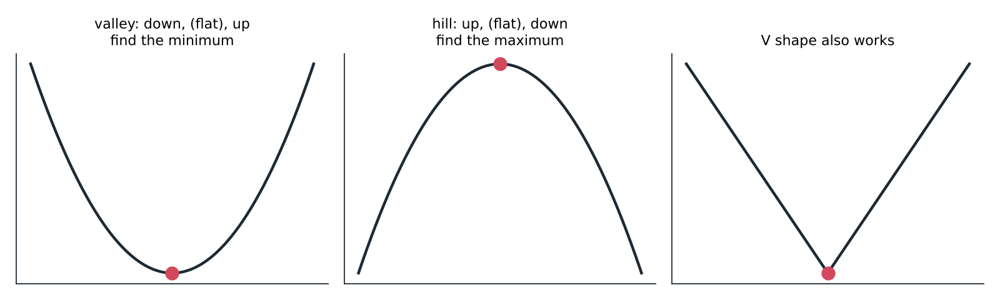

*Valley (minimum) and hill (maximum). A V shape also works.*

Strictly decreasing then zero then strictly increasing. | Strictly increasing then zero then strictly decreasing.

(V shape with point at bottom, inverted V with point at top.)

Note: "zero" (flat) is allowed only exactly at the top or bottom. If a flat part appears in the middle, ternary search fails.

m1 = lo + (hi-lo)/3   |   m2 = m1 x 2.

Note: m2 = lo + 2·(hi-lo)/3 (= hi - (hi-lo)/3), not the double of m1.

TS divides the search space into 3 parts.

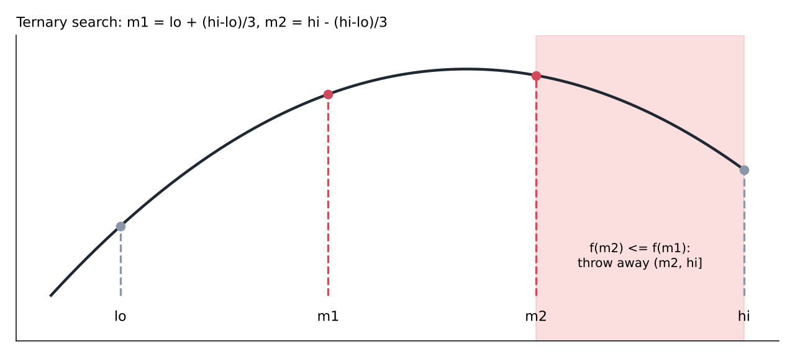

*f(m2) ≤ f(m1) → the part (m2, hi] is removed.*

f (m1) > f(lo) && f(m2) ≤ f(m1)

We can eliminate hi → search space reduces to (lo, m2).
 ↳ 1/3^rd of search space is eliminated.

If f(m2) == f(m1) → then also hi can be eliminated

The other case, f(m1) &lt; f(m2): lo up to m1 is removed (the peak is to the right of m1).

Can be solved using BS also.
We find mid & mid+δ
We can calculate slope b/w mid & mid+δ.

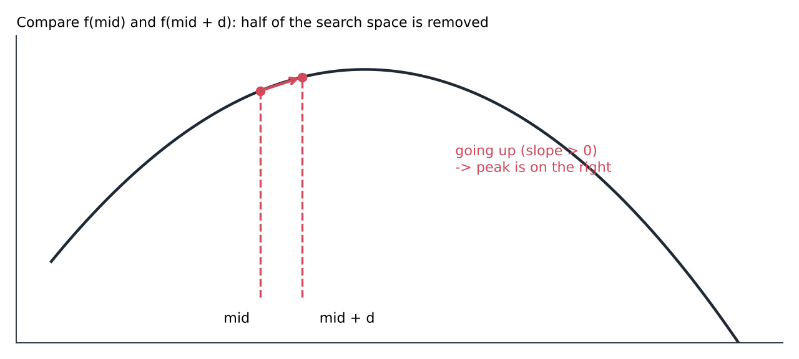

*mid → mid+δ goes up → the maximum is on the right.*

\{ If slope increases then max is on right.
\{ If slope decreases then max is on left.

↳ Half of search space is eliminated
   ↳ Better than ternary search.

Note: "slope increases" means f(mid+δ) > f(mid), i.e. the function is going up (it does not mean that the value of the slope grows).

Why it is better: ternary search makes 2 calls of f and removes 1/3 per round → ≈ 2·log_\{1.5\}(n) ≈ 3.4·log2(n) calls. Slope search makes 2 calls and removes 1/2 → 2·log2(n) calls.

\* Above BS works really well with integer values.
   mid is int & δ is int.

For floating pts or real numbers, ternary works better

Ques: Atcoder — freefall.

A/√g time to fall (g = gravity).

B time taken to get g += 1.

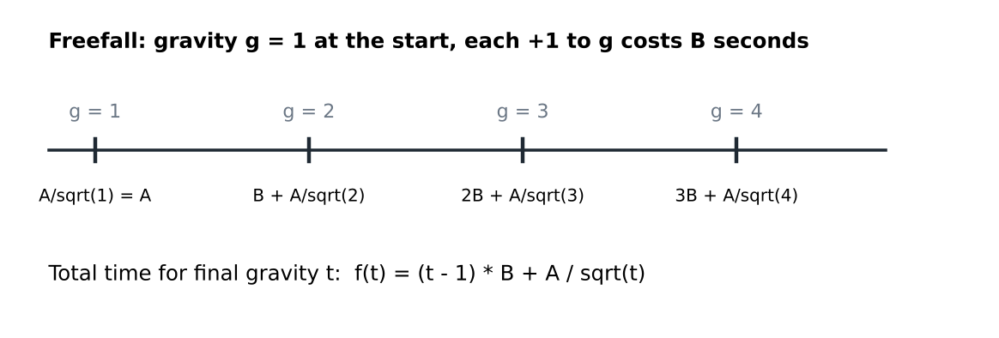

*g = 1 → A, g = 2 → B + A/√2, g = 3 → 2B + A/√3, g = 4 → 3B + A/√4.*

A/√1 = A | B + A/√2 | 2B + A/√3 |  → 3B + A/√4.

f (t) = (t-1) B + A/√t   → we need to find minima of this.

f'(t) = B - 1/2 x A/t^\{3/2\} = 0
⇒ t^\{3/2\} = A/2B
⇒ t = (A/2B)^\{2/3\}

Using differentiation.

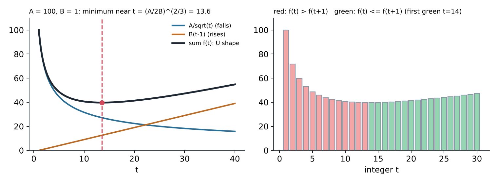

*A/√x falls, B(x-1) rises, the sum is a U shape. Right: at whole numbers t, f(t) > f(t+1) (red) / ≤ (green).*

effective curve (U shape, ek minimum).

We'll use ternary operations to find this.

lo= 0,  hi= a/b

b·t ≤ a  \}  raising gravity should not take more than a seconds in total.
t ≤ a/b.

∴ hi = a/b → is good estimate.

b(t-1) + a/√t = b(a/b - 1) + a/√(a/b)
  = a - b + √(ab)

a - b → Large.
√(ab) → very small

f(mid) &lt;= f(mid+1)  |  f(mid) >= f(mid+1)
hi= mid             |  ∴ lo = mid.

Note: on whole numbers `lo = mid` gives an infinite loop → use `lo = mid + 1`. Also t = 0 is not allowed (A/√0), so start with lo = 1. Example A = 100, B = 1: the real minimum is at t = 50^\{2/3\} ≈ 13.57. On integers f(13) > f(14) and f(14) ≤ f(15) → t = 14.

```cpp
// Fabricator/BinarySearch/Freefall-Ternary.cpp
/*
https://atcoder.jp/contests/abc279/tasks/abc279_d
Here op = t - 1, i.e. no. of times gravity is raised.
*/
long double a, b;

long double val(long long op){
    return op * b + (a/sqrt(op + 1));
}

long double ternary_search(){
    long long lo = 0, hi = a/b;

    while(hi - lo >= 3){
        long long mid1 = (lo * 2 + hi)/3;
        long long mid2 = (lo + 2 * hi)/3;

        if(val(mid1) > val(mid2)){
            lo = mid1;
        }
        else{
            hi = mid2;
        }
    }

    long double ans = a;
    for(long long i=lo; i<=hi; i++){
        ans = min(ans, val(i));
    }

    return ans;
}

long double binary_search(){
    long long lo = 0, hi = a/b, ans = 0;

    while(lo <= hi){
        long long mid = lo + (hi - lo)/2;
        if(val(mid) <= val(mid + 1)){
            ans = mid;
            hi = mid - 1;
        }
        else{
            lo = mid + 1;
        }
    }

    return val(ans);
}
```

A = 10, B = 1 → 7.7735026919 (both binary_search and ternary_search). A = 5, B = 10 → 5.0000000000.

## Quick revision

- BS needs a monotonic strip: `0 0 0 1 1 1` (find the first true) or `1 1 1 0 0 0` (find the last true)
- mid = lo + (hi-lo)/2 → no overflow
- Loop `while (lo &lt;= hi)`; never put mid back into the space → use mid+1 / mid-1
- 4 variables: lo, hi, mid, ans
- First true: ans = mid; hi = mid-1. Last true: ans = mid; lo = mid+1
- lower_bound = first ≥ x (# elem &lt; x). upper_bound = first > x (# elem ≤ x). Count of x = ub - lb
- Do not convert the array to 0/1; convert the cells on demand
- Rotated array: index of the minimum = no. of rotations (check arr[mid] ≤ arr[n-1])
- Peak: check arr[mid] > arr[mid+1]; mid == n-1 → 1
- Minimize the max / maximize the min → BS on answer; check = "will x be enough?"
- T.C. = O(log(search space) * check())
- Painter: left→right sweep. Factory: Σ mid/k_i. Multiplication table: Σ min(n, mid/i). Kth sum: Σ upper_bound
- Points: ⌈d/x⌉ - 1 = ⌊(d+x-1)/x⌋ - 1. Greedy halving is wrong. Use ≤, not ==
- Flips: if X is possible then X-1 is possible. zeros = X - ones. For each start take the LAST valid end, ans = st-1, sol += ans-st+1
- Real domain: EPS about 100x tighter than the question asks, use long double, or a fixed number of rounds ⌈log2(n/eps)⌉
- Ternary: the function must be strictly up-down or down-up. m1 = lo+(hi-lo)/3, m2 = hi-(hi-lo)/3. On integers, slope BS is better
- Freefall: f(t) = (t-1)B + A/√t, minimum near (A/2B)^\{2/3\}
- freefall: f(t) = (t-1)B + A/√t, min near (A/2B)^\{2/3\}

## Practice problems

**maang.in**
- [Famous Painter Partition Problem](https://maang.in/problems/Famous-Painter-Partition-Problem-472)
- [Consecutive One](https://maang.in/problems/Consecutive-one-44)
- [Kth Sum Value](https://maang.in/problems/Kth-Sum-Value-102)
- [Minimise Max Diff](https://maang.in/problems/Minimise-Max-Diff-46)
- [Maximise the Fraction](https://maang.in/problems/Maximise-the-fraction-105)
- [Median of Subarray Sum](https://maang.in/problems/Median-of-Subarray-Sum-45)
- [Number Sum of Digit](https://maang.in/problems/Number-Sum-of-Digit-26)
- [Good Pairs](https://maang.in/problems/Good-Pairs-AZ101-377)
- [Bitonic Array](https://maang.in/problems/Bitonic-Array-107)

**CSES**
- [Array Division (1085)](https://cses.fi/problemset/task/1085)
- [Factory Machines (1620)](https://cses.fi/problemset/task/1620/)
- [Multiplication Table (2422)](https://cses.fi/problemset/task/2422/)

**AtCoder**
- [ABC279 D Freefall](https://atcoder.jp/contests/abc279/tasks/abc279_d)

**Codeforces**
- [1177B Digits Sequence (Hard Edition)](https://codeforces.com/problemset/problem/1177/B)

**SPOJ**
- [AGGRCOW Aggressive Cows](https://www.spoj.com/problems/AGGRCOW/)

**LeetCode**
- [Minimum Size Subarray Sum](https://leetcode.com/problems/minimum-size-subarray-sum/description/)
- [Ugly Number III](https://leetcode.com/problems/ugly-number-iii/description/)

### Problem ladder

<Ladder topic="1.4" />
