import TopicHeader from '../../../components/TopicHeader.astro';
import Ladder from '../../../components/Ladder.astro';
import { Code } from '@astrojs/starlight/components';
import TheoremCode from '../../../components/TheoremCode.astro';
import CodeSnippet from '../../../components/CodeSnippet.astro';
import WhatYouNeed from '../../../components/WhatYouNeed.astro';
import Cards from '../../../components/Cards.astro';
import Drill from '../../../components/Drill.astro';
import LookalikePairs from '../../../components/LookalikePairs.astro';
import SelfTest from '../../../components/SelfTest.astro';
import Checkpoint from '../../../components/Checkpoint.astro';
import DecisionMapUpdate from '../../../components/DecisionMapUpdate.astro';

<TopicHeader topic="1.5" />

## What this note covers

- Greedy: sorting + exchange argument, operation decoding (reverse thinking), mixed/fused thinking, bit thinking
- Pigeonhole principle, fraction ideas
- Sweepline: coverage, events, probabilities, top k in segments

Short forms used: T.C. = time complexity, CP = competitive programming, DS = data structure, CF = Codeforces, bit man = bit manipulation, DP = dynamic programming, I/P = input, O/P = output.

Here is a small problem to show why this topic exists. A festival shows $n = 2 \cdot 10^5$ films, each with a start time and an end time. You want to watch as many complete films as possible, one at a time. Trying every subset of films is $2^n$ choices, which is hopeless beyond $n \approx 25$ (topic 0.5). A rule that picks the films one by one would cost only $O(n \log n)$, but which rule?

"Shortest film first" fails on the films $[1, 5]$, $[4, 7]$, $[6, 10]$. It picks $[4, 7]$, which overlaps both others, so it watches one film where two are possible. "Earliest start first" fails on $[1, 10]$, $[2, 3]$, $[4, 5]$. It picks $[1, 10]$ and then nothing else fits, although $[2, 3]$ and $[4, 5]$ are two films. "Earliest end first" turns out to be always right, and the section "Earliest end first: intervals (Theorem 1.5.2)" proves it.

So most plausible greedy rules are wrong. This topic teaches two standard ways to prove a rule (the exchange argument and "greedy stays ahead"), the five shapes in which correct greedy rules usually appear, and the habit of testing every rule against a brute force before trusting it. The five shapes are: an order found by an exchange, earliest end first, the most extreme items first, matching two sorted lists, and left-to-right choices that dominate.

### What you need

<WhatYouNeed topic="1.5" />

### What this topic does not cover

- Problems where no greedy rule is correct and all choices must be combined, such as choosing items of given weights and values that cannot be split (knapsack, dynamic programming). That is topic 3.3.
- Greedy rules on graphs. Shortest paths (Dijkstra's algorithm, topic 4.3) and minimum spanning trees (topic 4.4) have their own proofs.
- Greedy algorithms that later take back an earlier choice using a priority queue (regret greedy). That is topic 7.4.

### Terms used in this lesson

- A **greedy algorithm** builds a solution by a sequence of choices. Each choice is made by a fixed rule from the current situation, and no choice is ever revised. Example: "repeatedly watch the film that ends first among those starting after the last film watched".
- A **counterexample** to a rule is a concrete input on which the rule gives a wrong answer. Example: $[1, 10]$, $[2, 3]$, $[4, 5]$ for "earliest start first".
- An **exchange argument** proves a greedy rule by taking any optimal solution and changing it step by step, never making it worse, until it becomes the greedy solution.
- For an order of items and a key, an **inversion** is a pair of items where the one with the larger key comes first. Example: in the key order $(3, 1, 2)$ there are two inversions, $(3, 1)$ and $(3, 2)$.
- **Greedy stays ahead** is a proof method. By induction, after each step the greedy solution is at least as good, in a measured sense, as any other solution after the same number of steps.
- A state $A$ **dominates** a state $B$ if every way to finish from $B$ can also be used from $A$, with a result at least as good. Example: "covered up to 9" dominates "covered up to 7".

## Table of contents

- Greedy
  - what makes a greedy rule safe
  - testing a greedy rule
  - earliest end first: intervals
  - taking the most extreme items
- Sorting → exchange argument
  - min dot product
  - CF contest with decay
  - adjacent exchanges in general
  - matching two sorted lists
- Operation decoding
- Mixed / fused thinking
  - train with fuel
  - hiring k students
  - median (version 1, version 2)
  - dominating choices
  - covering a segment from left to right
  - example: Blue Spring
  - example: Missing Coin Sum
- Bit thinking
- Manhattan meeting point
- Pigeonhole principle
- Fraction ideas
  - equal ratio pairs
  - line with max points
- Sweepline
  - length covered by ≥ k intervals
  - probability of exactly 1 cover
  - top k in segments
- Recognition cards
- Quick revision
- Check yourself
- Practice problems

## Greedy

The first topic is greedy.

A greedy algorithm always does the thing that feels optimal at the moment.

The notebook groups greedy problems into three kinds. The figure below lists them, with the ideas that belong to each:

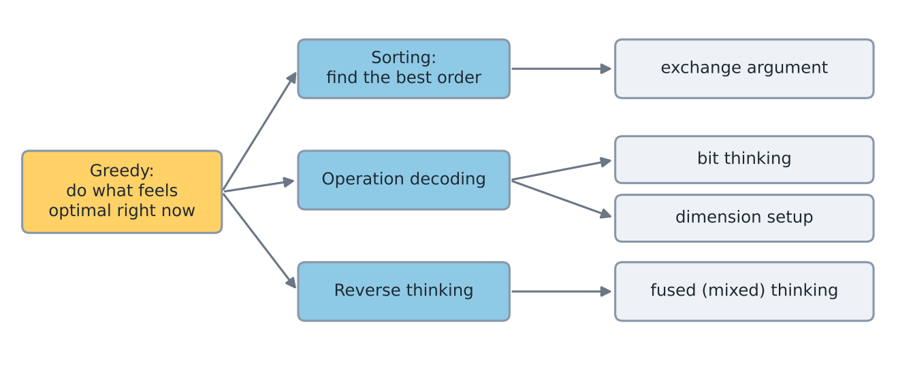

*The three greedy categories.*

The idea is to do what feels best now, hoping that this leads to the optimal solution. Greedy needs proofs and structured thinking.

Feeling that it looks right is not enough: a proof is needed. Example: coins of value 1, 3, 4 and the amount 6. Taking the largest coin first gives 4 + 1 + 1 = 3 coins, but 3 + 3 = 2 coins is better. So we must know when a greedy choice is safe.

The most common proof technique is the exchange argument (explained below).

A second tool is the counter-example search. Before trusting a rule, try it on tiny inputs by hand, or with a slow brute-force program, and compare the answers. The coin example above is a counter-example found in this way.
### What makes a greedy rule safe

A greedy algorithm, to say it exactly, makes a sequence of choices. Each choice comes from a fixed rule applied to the current situation, and no choice is revised later. Example: "repeatedly watch the film that ends first among those that start after the last film watched". The rule is the easy part. The work is the proof that it is safe.

There are two standard proofs. The exchange argument (next section) takes an optimal answer and changes it step by step into the greedy one. The second is **greedy stays ahead**: show by induction that after every step the greedy solution is at least as good as any other solution after the same number of steps. For films, the measure is the end time. After $j$ films the greedy has finished no later than any other schedule that watched $j$ films. So when the other schedule picks its next film, the greedy could pick it as well, and it is never behind.

When a process goes from left to right and only a small state matters, the measure is dominance. A state $A$ dominates a state $B$ if every way to finish from $B$ can also be used from $A$, with a result at least as good. Example: when covering a line from the left, "covered up to 9" dominates "covered up to 7", because every segment that can continue from 7 can also continue from 9. Then "stays ahead" says that after every step the greedy state dominates the state of any other choice. Theorem 1.5.5, in the section "Dominating choices (Theorem 1.5.5)", makes this exact.

### Testing a greedy rule

A greedy rule without a proof is a guess. Before relying on one, write a slow brute force that tries everything (topic 0.5). Then run both programs on thousands of small random inputs with `scripts/stress.sh`. A wrong rule usually fails quickly, and the failing input is a counterexample that also shows why the rule is wrong. Both wrong rules from the start of this note are caught this way: random films with $n \le 4$ soon contain a triple like $[1, 5]$, $[4, 7]$, $[6, 10]$.

Passing the tests is evidence, not proof. A rule that agrees with the brute force on 5000 random inputs may still fail on an input shape the generator never produces. The proof is what tells you the rule is right for all inputs, and the tests are the quick check that stops you from trying to prove a false rule.

### Earliest end first: intervals (Theorem 1.5.2)

The film problem from the start of this note is the model. Two intervals are compatible if they do not overlap, and we want the most pairwise compatible intervals. A second question has the same answer: the fewest points that hit every interval.

**Theorem 1.5.2 (earliest end first).** Given intervals $[s_i, e_i]$, call two of them compatible if they do not overlap.

1. Choosing repeatedly, among the intervals compatible with all chosen ones, the one that ends first, selects the largest possible number of pairwise compatible intervals.
2. The smallest number of points that hit every interval equals that largest number, and the points can be the ends of the intervals chosen in part 1.

In plain words: to choose as many non-overlapping intervals as possible, always take the one that ends first among those still allowed. The greedy choices end no later than any other choice at every step, so it never falls behind. Its ends are also the fewest points that hit every interval.

Small example first. Take the intervals $[1, 4]$, $[3, 5]$, $[0, 6]$, $[5, 7]$, $[3, 9]$, $[5, 9]$, $[6, 10]$, $[8, 11]$, where sharing a point counts as overlapping. Sorted by end they are in the order just listed. Take $[1, 4]$. Skip $[3, 5]$ and $[0, 6]$, which start at 3 and 0, not after 4. Take $[5, 7]$, which starts after 4. Skip $[3, 9]$, $[5, 9]$ and $[6, 10]$, which start at or before 7. Take $[8, 11]$, which starts after 7. That is three intervals, and the points 4, 7, 11 hit all eight intervals.

Why it works:
1. Part 1. Let the greedy choices be $g_1, \dots, g_m$, and let $o_1, \dots, o_k$ be any compatible selection, both listed by end. We claim $e(g_j) \le e(o_j)$ for every $j \le \min(m, k)$.
2. For $j = 1$ this is true, because $g_1$ ends first among all intervals.
3. Suppose $e(g_{j-1}) \le e(o_{j-1})$. The interval $o_j$ starts after $o_{j-1}$ ends, so after $g_{j-1}$ ends. So $o_j$ is compatible with $g_1, \dots, g_{j-1}$, and it was available at step $j$. The greedy took an interval ending no later than any available one, so $e(g_j) \le e(o_j)$.
4. Suppose $k > m$. The interval $o_{m+1}$ starts after $e(o_m) \ge e(g_m)$, so it was still available after step $m$, and the greedy would not have stopped. So $k \le m$.
5. Part 2. Any set of points that hits all intervals must hit the $m$ pairwise disjoint intervals $g_1, \dots, g_m$ with different points. So at least $m$ points are needed.
6. The points $e(g_1), \dots, e(g_m)$ are enough. Each $g_j$ contains its own end. Take an interval $I$ that was not chosen, and let $g_j$ be the first chosen interval that overlaps it. One exists, because otherwise $I$ would still be available after the last step.
7. $I$ is compatible with $g_1, \dots, g_{j-1}$, so it was available at step $j$, and the greedy preferred $g_j$. So $e(I) \ge e(g_j)$. Since $I$ overlaps $g_j$ and ends no earlier, it starts no later than $e(g_j)$. So the point $e(g_j)$ lies inside $I$.

This proof needs: (1) every chosen interval counts the same, because we maximise a number and not a total length or weight; (2) "compatible" is the statement's definition, and whether intervals that touch at one point overlap decides whether the next start must be $> e$ or $\ge e$; (3) a sort by end and then one scan that keeps the end of the last chosen interval, which costs $O(n \log n)$.

<TheoremCode unit="1.5/thm-2" />

The first line lists the chosen ends, which are also the points that hit all eight intervals. In the second example the three intervals $[1, 3]$, $[2, 4]$, $[3, 5]$ share the point 3, so only one can be chosen.

The template that solves the problem sorts by end, and then scans once. Store each interval as (end, start), so that the default pair order sorts by end. The scan keeps `lastEnd`, the end of the last chosen interval. An interval is compatible exactly when it starts after `lastEnd`, because here intervals that share a point overlap, and the first compatible interval in end order is the one that ends first. By part 2 of the theorem, the same count is the fewest hitting points, and the points are the ends of the chosen intervals. Dry run on the example above: `lastEnd` starts below every start, then becomes 4, then 7, then 11, and the count ends at 3. T.C. is $O(n \log n)$ for the sort and $O(n)$ for the scan. S.C. is $O(1)$ extra.

Alternative formulation: sort by start and scan from the right, always taking the compatible interval that starts last. This is the same rule in a mirror, and it is equally correct.

Common mistake: earliest start first. For the intervals $[4, 7]$, $[1, 8]$, $[2, 3]$, sorting by start takes $[1, 8]$, which overlaps both others, so the answer is 1 where the correct answer is 2 ($[2, 3]$ and $[4, 7]$). The fix is to sort by end. The proof of Theorem 1.5.2 compares where intervals end, and nothing in it works for starts.

Common mistake: treating touching intervals as compatible. For $[3, 6]$ and $[6, 7]$ the test `s >= lastEnd` gives 2, but in a statement where sharing a point is an overlap the answer is 1, because both contain 6. The fix is to follow the statement: here the next start must be strictly greater than `lastEnd`. Other statements use half-open intervals, where `>=` is right (Theorem 1.5.2, condition 2).

### Taking the most extreme items (Theorem 1.5.3)

Question: from the numbers $(5, 1, 4, 2)$, what is the fewest number of items whose sum reaches 9? Trying every subset costs $2^n$. But if only the number of items is limited, the biggest numbers must be the best ones.

**Theorem 1.5.3 (extreme first).**

1. Among all choices of $k$ items from a list of numbers, the $k$ largest have the largest sum. So the fewest items whose sum reaches a target $T$ are found by taking the largest items first.
2. Items that can be split: item $i$ has $a_i$ units, each worth $v_i$, and at most $W$ units can be taken in total. Taking units in decreasing order of $v_i$ maximises the total value.

In plain words: when items count independently and only the number taken is limited, the $k$ largest items give the largest total, and taking the largest first reaches a target with the fewest items. The same holds for splittable goods, taking the most valuable units first.

Small example first. For the values $(5, 1, 4, 2)$ and the target 9, the largest two items give $5 + 4 = 9$, and no single value reaches 9. For units, take at most $W = 5$ units of goods (value 3, 4 units) and (value 5, 2 units). Take the 2 units worth 5, then 3 units worth 3, for a total of $10 + 9 = 19$.

Why it works:
1. Part 1. List the chosen items in decreasing order, and list the $k$ largest items in decreasing order. The $j$-th chosen item is at most the $j$-th largest item, because the first $j$ chosen items are $j$ items that are all at least as large as it.
2. Summing over $j$ gives the claim. For a target: if some $t$ items reach $T$, then the $t$ largest items reach it too, so the greedy uses at most $t$ items.
3. Part 2. Take any optimal selection of units. Suppose it takes a unit of item $j$ while a unit of some item $i$ with $v_i > v_j$ is left over. Replacing the first by the second keeps the count at most $W$ and does not lower the value.
4. Repeating this, the selection becomes "the most valuable units first", which is the greedy selection. Its value is at least the optimum.

This proof needs: (1) every item or unit contributes independently, so its value does not depend on which others are taken; (2) the only limit is a count of items or units. If items have different sizes and cannot be split, the largest-first rule fails.

Counterexample for that failing case: capacity 10, one item of size 6 with value 7, and two items of size 5 with value 5 each. The best value per size belongs to the first item, which leaves room for nothing else, so the total is 7. Taking the two items of size 5 gives 10.

<TheoremCode unit="1.5/thm-3" />

The examples are the instance above: the targets 9, 11 and 13 need 2 items, 3 items, and are impossible.

The two templates follow the two parts. For the fewest items, sort from largest to smallest and keep a running sum. The first $k$ for which the running sum reaches $T$ is the fewest possible, and if even all items fall short, no choice reaches $T$. Dry run: the sorted values are $5, 4, 2, 1$, the running sums are $5, 9$, so the answer is 2 for $T = 9$. `nth_element` can place the $k$ largest first without sorting the rest, but $k$ is not known in advance here, so a full sort is the simplest. For splittable goods, sort by value per unit, most valuable first, and take as many units of each good as still fit. Dry run: the goods (value, units) sorted are $(5, 2)$ and $(3, 4)$. Take 2 units, so $W$ drops to 3 and the total is 10. Then take 3 units of the second good, and the total is 19. An alternative formulation keeps the running number of units taken and stops at the good where it would pass $W$. T.C. is $O(n \log n)$ for the sort in both. Use `long long` for the sums: with $n = 2 \cdot 10^5$ items of value $10^9$ the sum is $2 \cdot 10^{14}$.

Common mistake: smallest first when looking for the fewest items. For the items $4, 1$ and the target 3, taking the small item first uses 2 items, but the item 4 alone reaches 3, so the correct answer is 1. The fix is to take the largest first (Theorem 1.5.3, part 1).

Common mistake: most units first instead of value per unit for splittable goods. Take the goods (units, value per unit) $(1, 3)$ and $(4, 1)$ with $W = 4$. Filling the capacity with the 4 cheap units gives 4, but the right choice takes the valuable unit and 3 cheap ones, and gives $3 + 3 = 6$. The fix is to sort by value per unit (Theorem 1.5.3, part 2). Only the value of a unit decides which unit to take.


## Sorting → exchange argument

The exchange argument works like this. Take an order that is claimed to be the best. Pick two items whose places can be swapped. Write the answer before and after the swap. If the swap can never make the answer better, then the claimed order is at least as good as any order that differs from it. The inequality "answer before ≤ answer after" then tells us which order the sorting must follow.

### Question: min dot product

Question: two vectors of size n are given.

A = ⟨ a₁, a₂, a₃ ..... aₙ ⟩ is fixed.

B = ⟨ b₁, b₂, b₃ ..... bₙ ⟩ can be reordered.

Reorder B so that the dot product A·B is as small as possible, and print that minimum value.

The dot product multiplies the elements with the same index and adds the results: a₁b₁ + a₂b₂ + ... + aₙbₙ.

Brute force would try every order of B. There are n! orders, and already for n = 20 that is about 2.4·10¹⁸, so a rule is needed.

A first idea is to map the largest value of B to the largest of A, and the smallest to the smallest as well.

Test the idea on A = (3 1 5) and B = (2 3 4). The notebook tries two reorderings of B, namely (3 2 4) and (3 4 2), and says that either of them could be the better one. The dot product of each reordering is calculated side by side in the figure:

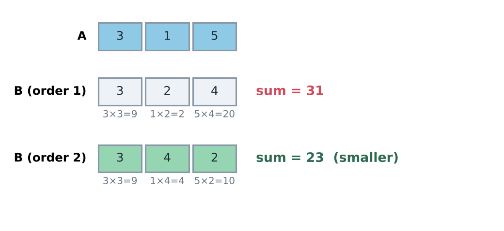

*31 against 23. The second order gives the smaller value.*

So the first idea was wrong. The notebook corrects itself here: the idea should probably be to map the largest value of B to the smallest value of A (the word "smallest" was crossed out in the notebook).

Tip:

- Do not write code or find a solution on the basis of a test case, because it will mostly fail on submit.
- Write code and solve based on the problem statement.

Next comes a simplification. Take A = (3 1 5). If we sort it, then B must be reordered along with it. Will this change the answer? No, because at the end we match the elements one by one anyway.

The answer depends only on which pairs are formed, not on the order in which the pairs are listed. So sorting A (and moving B along with it) does not change the answer.

Now the exchange argument is used. A is sorted in increasing order (a₁ &lt; a₂ &lt; ... &lt; aₙ), and two positions i &lt; j are looked at in B:

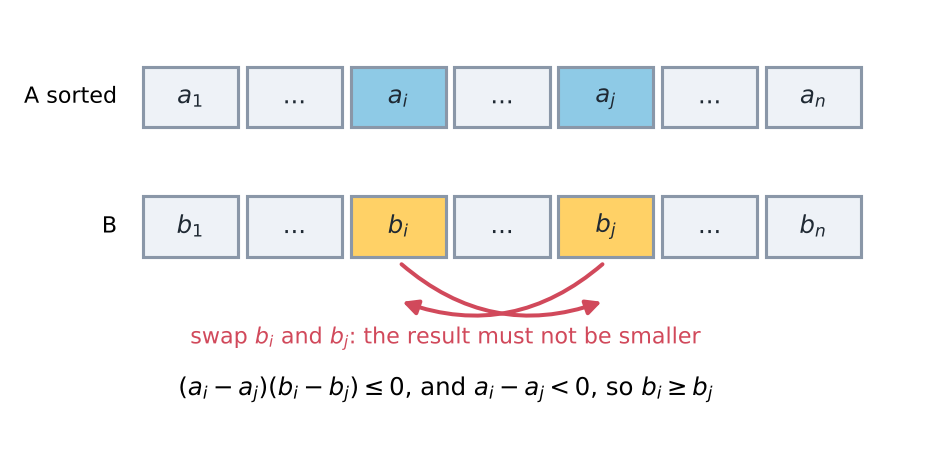

*Swap bᵢ and bⱼ: the answer should not get better.*

If the current order is optimal, then swapping (exchanging) bᵢ and bⱼ must give a worse answer or an equal one, because the original already gave the optimal answer.

Mathematically, this should be true:

( rest + aᵢbᵢ + aⱼbⱼ ≤ rest + aᵢbⱼ + aⱼbᵢ )

aᵢbᵢ − aᵢbⱼ + aⱼbⱼ − aⱼbᵢ ≤ 0

aᵢ(bᵢ − bⱼ) − aⱼ(bᵢ − bⱼ) ≤ 0

(aᵢ − aⱼ)(bᵢ − bⱼ) ≤ 0

This is the condition because A is sorted. Since A is sorted and i &lt; j, the factor (aᵢ − aⱼ) is negative (equal values of A give no condition, and either order of B is fine). A negative number times another number is ≤ 0 only when the other factor is positive or zero. So (bᵢ − bⱼ) must be positive or zero.

Therefore bᵢ − bⱼ ≥ 0, which means bᵢ ≥ bⱼ.

So if A is sorted, then B is sorted in reverse (decreasing) order. This is how we derived the sorting order of B.

Observation: swapping bᵢ and bⱼ changes only two pairs. The "rest" of the sum stays the same, so only these two pairs need to be compared.

Why one swap is enough for the whole argument: take any order of B. If two positions i &lt; j have bᵢ &lt; bⱼ, then swapping them does not make the sum larger, by the algebra above. Each such swap removes one out-of-order pair, so after a finite number of swaps B is in reverse sorted order, and the sum was never made worse on the way. So the reverse sorted order is at least as good as every other order.

Dry run: A = (3 1 5), B = (2 3 4). Sort A → (1 3 5), reverse sort B → (4 3 2). 1×4 + 3×3 + 5×2 = 4 + 9 + 10 = 23 ✓ (same as second order above).

T.C. = O(n log n) for sorting, and O(n) memory. Use long long for the sum: one product of two values near 10⁹ is already about 10¹⁸, and the sum of many such products can be even larger, so check the limits of the problem. The typical mistake is to keep both arrays in the same direction, or to test the idea only on the sample. Sorting both arrays in the same direction gives the maximum dot product, not the minimum.

```cpp
// Fabricator/Greedy-Sweepline/MinDotProduct.cpp
/*
Given two arrays, a and b, of size n.
Reorder array b such that the a[dot]b (dot product) is minimun.

Print the min value.
*/

void solve() {
    int n;
    cin>>n;

    int a[n], b[n];
    for(auto &x: a) cin>>x;
    for(auto &x: b) cin>>x;

    // Using exchange argument we derive that
    // if a is sorted in a way
    // then b is reverse sorted

    sort(a, a + n);
    sort(b, b + n, greater<int>());

    long long ans = 0;
    for(int i=0; i<n; i++){
        ans += (1ll * a[i]) * (1ll * b[i]);
    }

    cout<<ans<<endl;
}
```

(`endl` here is a macro, a name the compiler replaces with other text. The template has `#define endl "\n"`, so it only prints a newline.)

Input: `3` / `3 1 5` / `2 3 4` → output `23`. (This program first reads the number of test cases, so a `1` must be typed before this input.)

Note: the arrays are read as `int` and the sum is kept in `long long`. If the values can go above about 2·10⁹, read them as `long long` as well.

### Question: CF contest with decay

Question: A CF (Codeforces) contest is running and there are n questions. Question i has three properties: its score Sᵢ, its decay dᵢ, and the time tᵢ needed to solve it.

Decay means that as time passes in the contest, the score Sᵢ reduces by dᵢ in every time unit.

All n questions are solved one after another, starting at time 0. A question that is finished at time T gives the score Sᵢ − dᵢ·T.

| time | score |
|---|---|
| 0 | Sᵢ |
| 1 | Sᵢ − dᵢ |
| 2 | Sᵢ − 2dᵢ |

Find the order in which to solve the questions so that the total score is the maximum. The score of a question can be negative too.

Brute force would try every order, which is n! orders (about 2.4·10¹⁸ for n = 20), so a sorting rule is needed.

Example with 2 questions:

|   | ① | ② |
|---|---|---|
| S (score) | 10 | 20 |
| d (decay) | 3 | 2 |
| t (time to solve) | 3 | 10 |

If ① is solved first, it is finished at time 3, so its score is 10 − 3×3 = 1. Then ② is finished at time 13, so its score is 20 − 2×13 = −6. The total is 1 + (−6) = −5.

If ② is solved first, the total is (20 − 2×10) + (10 − 3×13) = 0 + (−29) = −29.

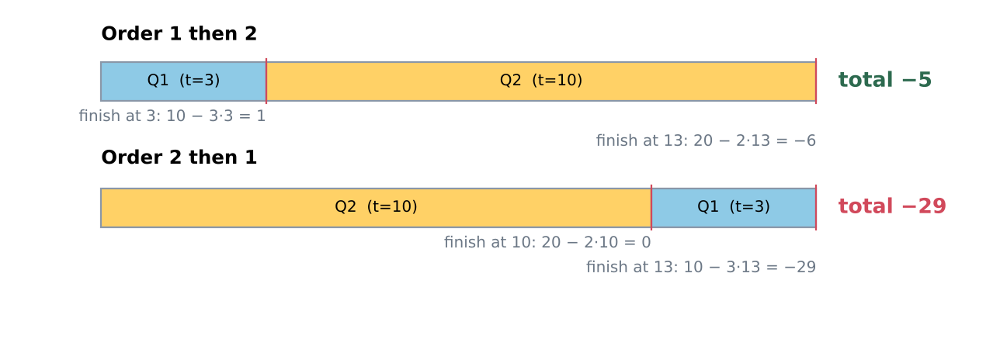

*score = S − d × (finish time). Question 1 before 2 gives −5, and question 2 before 1 gives −29.*

So solving question 1 before question 2 is better.

Now the exchange argument is used. Take two neighbouring questions i and j in the order. Each one has its three numbers (sᵢ, dᵢ, tᵢ) and (sⱼ, dⱼ, tⱼ).

If solving the iᵗʰ question first gives a better solution, then the following must hold (the crossed-out terms are the ones that appear on both sides and cancel):

(~~sᵢ~~ − dᵢtᵢ) + ~~sⱼ~~ − dⱼ(tᵢ+tⱼ) > ~~sᵢ~~ − dᵢ(tᵢ+tⱼ) + ~~sⱼ~~ − dⱼtⱼ

−~~dᵢtᵢ~~ − dⱼtᵢ − ~~dⱼtⱼ~~ > −~~dᵢtᵢ~~ − dᵢtⱼ − ~~dⱼtⱼ~~

dᵢtⱼ > dⱼtᵢ

dᵢ/tᵢ > dⱼ/tⱼ

This is the sorting criterion: question i goes before question j when dᵢ/tᵢ > dⱼ/tⱼ.

Notice that the other questions do not matter. Together, i and j always take tᵢ + tⱼ time, so every other question finishes at the same time in both orders. Comparing only two neighbouring questions is enough.

The rule can also be read as a loss. If i is solved first, then j is delayed by tᵢ, and this costs dⱼ·tᵢ. If j is solved first, then i is delayed by tⱼ, and this costs dᵢ·tⱼ. The order with the smaller loss is better, and the condition dᵢtⱼ > dⱼtᵢ says exactly that the loss of "i first" (dⱼtᵢ) is the smaller one. So a question that loses a lot of score for each unit of time spent on it (large d, small t) must go first.

Dry run: the ratios d/t are 3/3 = 1 for ① and 2/10 = 0.2 for ②. The larger ratio goes first, so ① goes first ✓.

Note: do not divide, because decimals are inexact. Compare `dᵢ·tⱼ > dⱼ·tᵢ` instead. This also works when d is negative, because t > 0.

T.C. = O(n log n) for the sort, O(n) memory. The comparison must be strict (`>`, not `>=`), because `std::sort` can crash with a comparison that says "true" for two equal items.

Common mistake: sorting by d alone or by t alone. Both are wrong, and you need the ratio. Example with (s, d, t): question 1 is (14, 2, 1) and question 2 is (6, 5, 5). Sorting by the larger d puts question 2 first. It finishes at time 5 and scores 6 − 5×5 = −19, then question 1 finishes at time 6 and scores 14 − 2×6 = 2, so the total is −17. The ratio rule puts question 1 first, because 2/1 > 5/5. It scores 14 − 2×1 = 12, and then question 2 finishes at time 6 and scores 6 − 5×6 = −24, so the total is −12, which is better. Sorting by t alone fails in the same way: for (19, 3, 4) and (6, 2, 3), the shorter question first gives −2 and the ratio rule gives −1.

If two ratios are equal, then dᵢtⱼ = dⱼtᵢ, so both losses are the same and either order gives the same total. Also remember that this is the version where every question must be solved. If you may skip questions, it becomes a different and harder problem.

```cpp
// Fabricator/Greedy-Sweepline/OrderProblems.cpp
/*
Given that in a contest, n problems are given.
Their score, decay and time taken to solve are provided.

Find the maximum score you can achieve by solving all problems.
*/

struct prob{
    int s, d, t;
};

bool cmp(prob pi, prob pj){
    return pi.d * pj.t > pi.t * pj.d;
}

void solve() {
    int n;
    cin>>n;

    vector<prob> p(n);
    for(int i=0; i<n; i++){
        prob temp;
        cin >> temp.s >> temp.d >> temp.t;
        p[i] = temp;
    }

    sort(p.begin(), p.end(), cmp);

    long long curr_time = 0;
    long long ans = 0;
    for(auto pi: p){
        curr_time += pi.t;

        ans += (pi.s - curr_time * pi.d);
    }

    cout<<ans<<endl;
}
```

Input: `2` / `10 3 3` / `20 2 10` → output `-5`.

Note: `pi.d * pj.t` is multiplied in `int`. If d and t are around 10⁹, the product overflows (it is larger than the `int` limit of about 2.1·10⁹). Make the fields `long long`.

So, whenever we have to find an optimal ordering, it might be an exchange argument problem.
### Adjacent exchanges in general (Theorem 1.5.1)

The two questions above use the same method, so here is the general statement. First one word. In an order of items with a key, an inversion is a pair where the item with the larger key comes first. In the key order $(3, 1, 2)$ the inversions are $(3, 1)$ and $(3, 2)$. A sorted order has none.

**Theorem 1.5.1 (adjacent exchanges).** Let the cost of an order of $n$ items be a number to minimise, and let each item have a key. Suppose that for every order and every two adjacent items $x$ before $y$ with $\text{key}(x) \ge \text{key}(y)$, swapping $x$ and $y$ does not increase the cost. Then every order sorted by key (non-decreasing) is optimal.

In plain words: compare $x$ then $y$ with $y$ then $x$. If the swap never makes the cost worse when the larger key comes first, then sorting the items by that key gives an optimal order.

Small example first. Tasks with durations $a_i$ are done one after another from time 0, and we minimise the sum of the finishing times. For adjacent $x$, $y$ starting at time $t$, the order $x, y$ finishes them at $t + a_x$ and $t + a_x + a_y$. The order $y, x$ finishes them at $t + a_y$ and $t + a_x + a_y$. Everything else is unchanged. So the swap changes the sum by $a_y - a_x$, which is at most 0 when $a_x \ge a_y$. By Theorem 1.5.1, shortest task first is optimal. For durations $(3, 1, 2)$ the order $1, 2, 3$ finishes at $1, 3, 6$ with sum 10, while the input order finishes at $3, 4, 6$ with sum 13.

Why it works:
1. Start from an optimal order. While it is not sorted by key, some adjacent pair $x$, $y$ has $\text{key}(x) > \text{key}(y)$. If every adjacent pair were in order, the whole order would be sorted, because each key is at most the next one.
2. Swap that pair. The cost does not increase. The number of inversions drops by exactly one, because only the relative order of $x$ and $y$ changed.
3. An order has at most $n(n-1)/2$ inversions, so after finitely many swaps the order is sorted. Its cost is at most the optimal cost, so it is optimal.
4. Two sorted orders differ only inside blocks of equal keys. Adjacent equal keys can be swapped in both directions without increasing the cost, so both swaps leave the cost equal, and the two sorted orders cost the same. So every sorted order is optimal.

This proof needs: (1) the effect of swapping two adjacent items depends only on those two items (and possibly on what comes before them), and it can be computed; (2) that effect is never an increase when the larger key comes first, so it is enough to compare $x$ then $y$ against $y$ then $x$; (3) the comparison gives a key, or at least a strict weak ordering (Theorem 1.1.3), so that "sorted" is well defined.

<TheoremCode unit="1.5/thm-1" />

The first example is the instance above. For $(5, 5, 1)$ the shortest-first order finishes at $1, 6, 11$, sum 18, against 26 for the input order.

Now the weighted form. Jobs have durations $t_i$ and weights $w_i$, and we minimise the sum of $w_i$ times the finishing time of job $i$. For adjacent jobs $x$, $y$ starting at time $t$, the order $x, y$ contributes $w_x (t + t_x) + w_y (t + t_x + t_y)$, and $y, x$ contributes $w_y (t + t_y) + w_x (t + t_x + t_y)$. The difference is

$$(y, x) - (x, y) = w_x t_y - w_y t_x.$$

It does not depend on $t$ or on the other jobs. It is at least 0 exactly when $t_x / w_x \le t_y / w_y$. So by Theorem 1.5.1 we sort by the ratio $t / w$. The comparator compares the ratios exactly by cross-multiplication, $t_x w_y < t_y w_x$, and then one pass adds up the weighted finishing times.

<CodeSnippet unit="1.5/weighted-order" />

Dry run: the jobs $(t, w) = (2, 1)$ and $(1, 3)$ have ratios 2 and $1/3$, so $(1, 3)$ goes first. It finishes at 1 and costs 3, then the other finishes at 3 and costs 3, total 6. The other order costs $1 \cdot 2 + 3 \cdot 3 = 11$. T.C. is $O(n \log n)$, S.C. is $O(1)$ extra, and the total can reach about $4 \cdot 10^{18}$, so `long long` is tight. Two special cases: with all weights equal to 1 the rule becomes "shortest job first", and with all durations equal it becomes "heaviest job first".

Common mistake: shortest job first when weights exist. Take the jobs $(t, w) = (2, 1)$ and $(2, 3)$. Both take 2, so "shortest first" sees a tie and keeps the input order, giving $1 \cdot 2 + 3 \cdot 4 = 14$. Doing the heavy job first gives $3 \cdot 2 + 1 \cdot 4 = 10$. The fix is to derive the key from the swap, $t_x w_y$ against $t_y w_x$. A key that merely looks reasonable is not a proof.

Common mistake: rounding the ratio with integer division. For the jobs $(2, 3)$ and $(1, 2)$, both ratios $2/3$ and $1/2$ become 0 in integer division, so the jobs look equal, and the input order gives $3 \cdot 2 + 2 \cdot 3 = 12$. The correct order puts $(1, 2)$ first and gives $2 \cdot 1 + 3 \cdot 3 = 11$. The fix is to compare by cross-multiplication in `long long`.

### Matching two sorted lists (Theorem 1.5.4)

Question: children have greed values $g_1 \le \dots \le g_n$ and cookies have sizes $c_1 \le \dots \le c_m$. A child is satisfied by one cookie of size at least its greed, and each cookie goes to at most one child. Satisfy as many children as possible. Trying every assignment is far too many for $n = 2 \cdot 10^5$, so we need a rule.

**Theorem 1.5.4 (smallest sufficient partner).** Go through the children in increasing greed, and give each the smallest unused cookie that satisfies it, skipping the child if none does. This satisfies the largest possible number of children.

In plain words: when a cookie works for a child exactly when it is big enough, give each child, from the least greedy up, the smallest cookie that is big enough. A larger cookie would only be more useful to someone else.

Small example first. Greed $(1, 2)$ and cookies $(1, 2, 3)$: the child with greed 1 gets cookie 1, the child with greed 2 gets cookie 2, and cookie 3 is left over. Two children are satisfied.

Why it works:
1. If no cookie is at least $g_1$, then no cookie satisfies any child, because every greed is at least $g_1$. The greedy answer 0 is optimal.
2. Otherwise the greedy gives $g_1$ the smallest cookie $c \ge g_1$. Take an optimal assignment $M$. We change it so that $g_1$ gets $c$, without lowering the number of satisfied children.
3. Suppose $g_1$ gets a cookie $d \ne c$ in $M$. Then $d \ge g_1$, so $d \ge c$. If $c$ is unused in $M$, give $g_1$ the cookie $c$ instead of $d$.
4. If $c$ belongs to a child $h$, swap the two cookies. The greed of $h$ is at most $c \le d$, so $h$ is still satisfied, now by $d$.
5. Suppose $g_1$ gets nothing in $M$. Then $c$ must be used, because otherwise giving $c$ to $g_1$ would beat the optimum. Say $h$ uses it. Move it from $h$ to $g_1$. The count is unchanged.
6. Now the changed $M$ is optimal and agrees with the greedy on $g_1$. Remove $g_1$ and $c$. What is left is the same kind of problem, and $M$ is a valid assignment on it with one child fewer. By induction the greedy satisfies at least as many there.

This proof needs: (1) whether a child accepts a cookie is a threshold in one sorted order ("size at least greed"), so a smaller sufficient cookie is never more useful to the others than a larger one; (2) each child and each cookie is used at most once; (3) both lists sorted and then one walk with two indices (topic 1.3), which costs $O(n \log n + m \log m)$.

<TheoremCode unit="1.5/thm-4" />

In the first example the cookies of size 1 can only satisfy the child with greed 1. In the third example no cookie is big enough, so the answer is 0.

The template is that walk. Children go in increasing greed. For each child the index `j` skips the cookies that are too small. They are too small for every later child as well, since greed only grows. The first cookie left is the smallest sufficient one, and it is given to the child, so `j` moves past it. When no cookie is left, the remaining children cannot be satisfied. Dry run for greed $(1, 2)$ and cookies $(1, 2, 3)$: `j` is 0, child 1 takes cookie 1, `j` is 1, child 2 takes cookie 2, `j` is 2, and the count is 2. Alternative formulation: go through the cookies in increasing size and give each to the least greedy unsatisfied child it can satisfy. The same exchange argument proves it.

Common mistake: giving the same cookie twice. Remove the `j++` after a satisfied child, and take the greeds $5, 2$ with the single cookie 5. The child with greed 2 gets cookie 5, `j` still points at it, and the child with greed 5 gets the same cookie. The output is 2 where the correct answer is 1. The fix is to move past a cookie once it is given (condition 2 of the proof).


## Operation decoding

The next idea is operation decoding: look at what the allowed operations do, and then decide the order of the steps.

Question: If you are at position x, then you have two options:

- i) → go to x−1
- ii) → go to 2x

You are at position A and you have to go to position B. Find the minimum number of steps needed.

A search over positions (BFS) needs memory about the size of B, and B can be about 10¹⁸. So a rule is needed.

Example: A = 5 and B = 11.

At first it looks like the answer is 11 − 5 = 6. But there is no +1 option, so this is wrong. The actual answer is 5, which is the best route drawn in green in the figure.

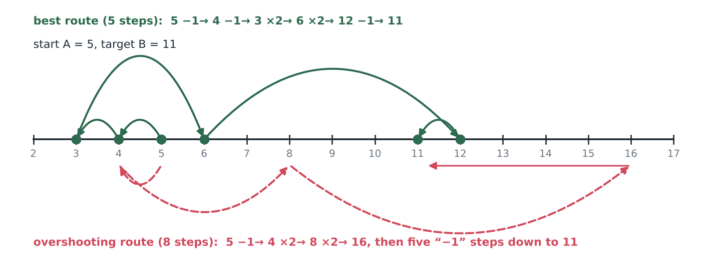

*Green is the best route (5 steps). Red goes up to 16 and then walks down.*

On the number line, a bad route is 5 → 4 → 8 → 16, which is 3 steps, and then 16 → 11 takes 5 more steps. That is 3 + 5 = 8 steps in total, not 5. So we cannot go up with 2x and then come back.

Another example: A = 3 and B = 8. The route 3 → 2 → 4 → 8 takes 3 steps (the drawing marks the points 2, 3, 4, 6, 8 and 12 on the number line).

Now look at one position y. We can arrive at y from two positions: from y+1 (by the step x−1) and from y/2 (by the step 2x, only when y is even).

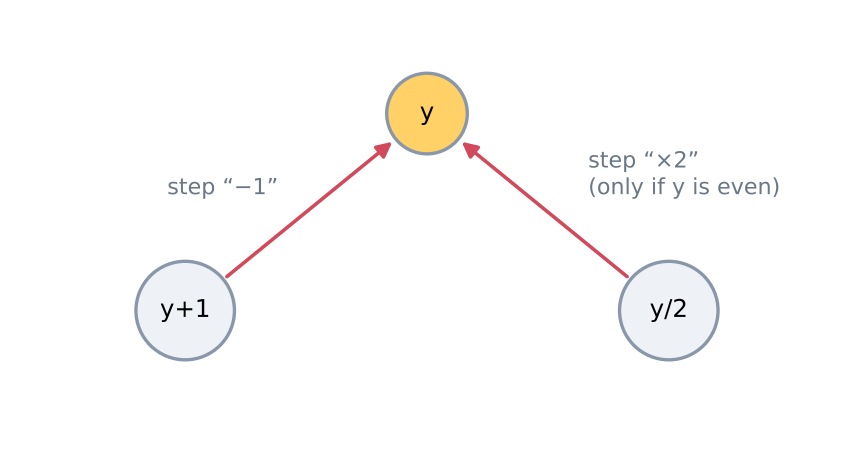

*Two ways to arrive at y.*

Now think in reverse, that is, from B back towards A.

If A > B, we can go from A to B by repeating the operation x−1, which takes A − B steps. The difficult case is A &lt; B.

For A &lt; B, the figure shows the positions A, B/2, B and B+1 on the number line. One arc goes from B/2 to B (the step 2x), and the other arc connects B and B+1:

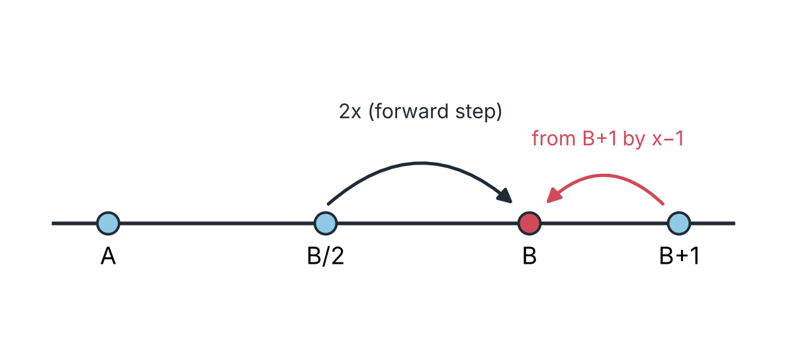

*The two ways to land on B: from B/2 by the step 2x, or from B+1 by the step x−1.*

The notebook first writes that we can arrive at B from (B−1) or from (B/2). It then corrects this: it should be (B+1) or (B/2). The forward operation is x−1, so the only way to land on B by an x−1 step is from B+1.

If B is odd, we can arrive at it only from B+1.
If B is even, both cases are possible.

Suppose B is even. The figure below compares the two choices in reverse. The first chain goes up from B and then halves. The second chain halves at once:

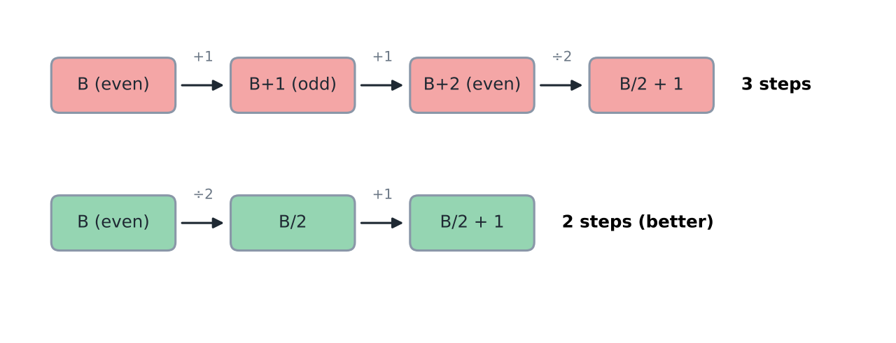

*Going up first takes 3 steps, halving directly takes 2 steps.*

The reason is simple. Going up from an even B must pass through B+1 (odd) and then B+2 (even) before it can halve, so it reaches B/2 + 1 after 3 steps. Halving first reaches B/2 after 1 step and B/2 + 1 after 2 steps. Going up never helps.

So if B is even and we only need to decrease, we can always go directly to B/2. If we have to halve, it is always optimal to halve now.

In forward thinking it is not easy to decide whether we should go from A to A−1 or to 2A, so forward thinking cannot choose greedily. In reverse thinking the choice can be made greedily.

Dry run: A = 5, B = 11. B is odd, so it becomes 12 (1 step). 12 is even, so it becomes 6 (2 steps). 6 is even, so it becomes 3 (3 steps). Now 3 ≤ A, so we need A − 3 = 2 more steps (in the forward direction these are −1, −1). Total 3 + 2 = 5 ✓.

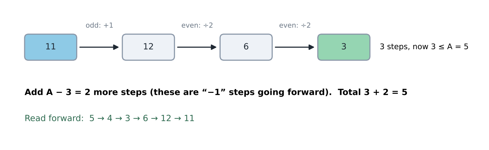

*Reverse trace for A = 5, B = 11: 5 steps.*

The code below is the reverse loop. T.C. = O(log B), because every even step halves B and an odd step is always followed by an even step. So there are at most 2 steps for each halving, which is about 2 × 60 = 120 steps for B near 10¹⁸. Memory is O(1). Edge cases: if A ≥ B the loop does not run and the answer is A − B at once. The loop condition is `B > A`, not `B != A`, because halving can jump over A. In the example above B goes from 6 to 3 and skips A = 5.

```cpp
// not in Fabricator (new function)
/*
  Problem: You stand at position x. In one step you can go to x-1 or to 2x.
  You start at A and want to reach B. Find the minimum number of steps.
*/

// Think backwards from B to A. The reverse of "x-1" is "+1", the reverse of "2x" is "/2".
long long minSteps(long long A, long long B) {
    long long steps = 0;
    while (B > A) {
        if (B % 2 == 1) B += 1;  // odd: it can only have come from B+1 (by a "-1" step)
        else B /= 2;             // even: halving now is always at least as good
        steps++;
    }
    // Now B <= A: from A we just walk down with "-1" steps.
    return steps + (A - B);
}
```

`minSteps(5, 11)` = 5, `minSteps(3, 8)` = 3, `minSteps(10, 4)` = 6. These also match a BFS (breadth-first search, which tries all routes level by level) for all A, B ≤ 70.

Typical mistakes: forgetting the final `A - B` walk, using `int` when B is about 10¹⁸, and treating a B larger than A as "B − A steps" (there is no +1 step).

How do we know whether a problem is greedy?

- Think of greedy as a last resort.
- If the constraints are large (about 10¹⁸), the solution is likely math, greedy or bit man (bit manipulation). A loop over the values cannot finish, because about 10⁸ simple steps take one second. So the answer must come from a formula, a greedy rule or the bits of the number.

## Mixed / fused thinking

The next idea is mixed (fused) thinking: two ideas are combined in one solution. In the first problem below, a greedy choice is combined with the contribution technique (count how much each part adds to the final answer).

### Train with fuel

Question: A train has a fuel tank of infinite capacity.

The figure below shows the train line from station 1 to station N. Pᵢ is written between stations, and Cᵢ below a station:

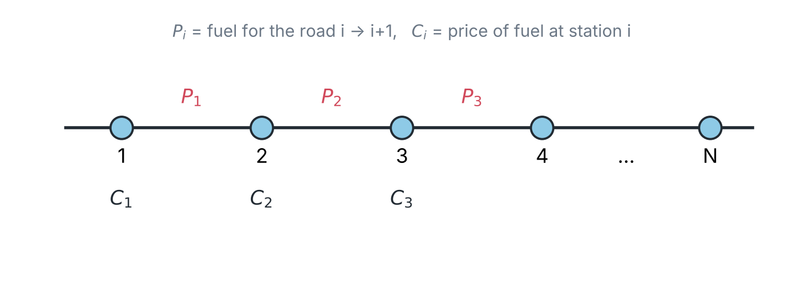

*The train line. P_i is the fuel for the road from station i to station i+1, and C_i is the price at station i.*

The train goes from station 1 to station N. Here Pᵢ is the petrol (fuel) needed to move from station i to station i+1, and Cᵢ is the cost of petrol at the iᵗʰ station. You have to go from station 1 to station N with the minimum total cost.

Brute force would decide at every station how much fuel to buy. A DP (dynamic programming) over (station, fuel in the tank) has N × (total fuel) states, and that is too many when the fuel amounts are large.

The figure below shows one road, from station X to the next one. The fuel Pₓ for this road can be bought at any station from 1 to X:

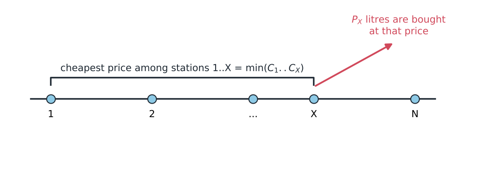

*Where to buy the fuel for Pₓ: at the cheapest station among 1..X.*

To travel from station X onwards, we can buy the Pₓ amount of petrol at any station up to X, so we buy it at the cheapest price min(Cᵢ) among them.

So the answer is:

C₁ × P₁ + P₂ × min(C₁, C₂) + P₃ × min(C₁, C₂, C₃) + . . . . .

This is a type of contribution technique (extending the answer step by step). The figure below shows the answer built so far (the oval) being extended to the next point:

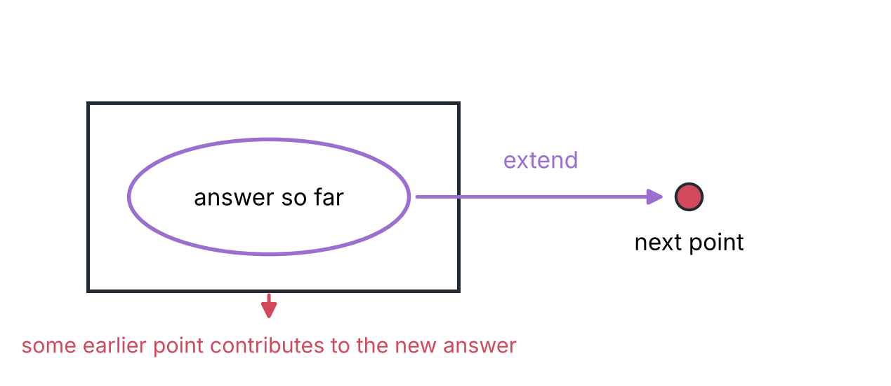

*The answer built so far is extended to the next point, and some earlier point contributes to it.*

Which earlier point contributes? Greedily, the one with the minimum Cᵢ.

The question to answer is: who will cover Pₓ? This is the way of thinking: do not ask "what to buy at each station", ask "where is the fuel of each road bought".

Why is this safe? The tank is infinite. If the fuel for Pₓ was bought at an expensive station, buying it at a cheaper earlier station instead never makes the cost larger. So buying every Pₓ at the running minimum price is best.

Dry run: N = 5, P = (2, 3, 1, 4), C = (5, 3, 4, 2, 9). The running minimum prices are 5, 3, 3, 2. So the cost is 2×5 + 3×3 + 1×3 + 4×2 = 10 + 9 + 3 + 8 = 30.

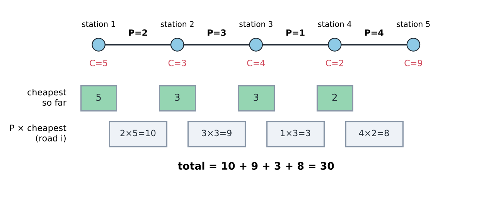

*Running minimum price times P gives the total 30.*

T.C. = O(N), one pass, and O(1) extra memory. Use `long long`: the total can be far larger than the `int` limit. The price of the last station (9 in this example) is never used, because no road starts there. A typical mistake is to buy fuel only at the station where it is needed instead of at the cheapest earlier one. This rule needs the tank to be infinite. If the tank had a limit, fuel bought early might not fit in it, and another method would be needed. (Related practice: LeetCode 134, Gas Station, a different question on the same theme.)

```cpp
// not in Fabricator (new function)
/*
  Problem: A train goes from station 1 to station N. The fuel tank can hold any amount.
  P[i] = fuel needed to travel from station i to station i+1.
  C[i] = price of one unit of fuel at station i.
  Find the minimum total cost of fuel for the whole trip.
*/

// petrol has N-1 values (one per road), cost has N values (one per station), 0-based.
long long minFuelCost(const vector<long long>& petrol, const vector<long long>& cost) {
    long long cheapest = LLONG_MAX;  // cheapest price seen so far
    long long total = 0;
    for (size_t i = 0; i < petrol.size(); i++) {
        cheapest = min(cheapest, cost[i]);  // best place to buy the fuel for road i
        total += petrol[i] * cheapest;
    }
    return total;
}
```

Output `30`. The result matches a slow DP (dynamic programming) solution.

### Hiring k students

Question: You are the HR (human resources) manager of a company called AZ. You need to hire k students from a college that has N students. Each student has two scores, speed and impact. The pair (Sᵢ, Iᵢ) is given for every student, where Sᵢ is the speed and Iᵢ is the impact of the student's work.

The efficiency of a team is (sum of the impacts) × (minimum speed of any person in the team).

Choose k students out of N students to maximise the efficiency.

Example: N = 3, k = 2.

|   |   |   |   |
|---|---|---|---|
| S (speed) | 3 | 1 | 5 |
| I (impact) | 1 | 10 | 3 |

The limits are N, K ≤ 10⁵ and S, I ≤ 10⁹.

The best team here is the students with impacts 10 and 3. Their minimum speed is 1, so the efficiency is (10 + 3) × 1 = 13 ✓.

The other two teams are worse: students 1 and 2 give (1 + 10) × 1 = 11, and students 1 and 3 give (1 + 3) × 3 = 12.

Brute force would try every group of k students. The number of groups is huge: already for N = 40 and k = 20 there are about 1.4·10¹¹ groups, and N is up to 10⁵.

This cannot be solved using the exchange argument. We cannot think of any expression to write, and the minimum speed (and so the efficiency) can change when we swap a student.

The order of the students does not matter.

Picture five students P₁ to P₅ in a row. In the top row of the figure, the circled students are in the team, and the arrow marks the slowest member of the team:

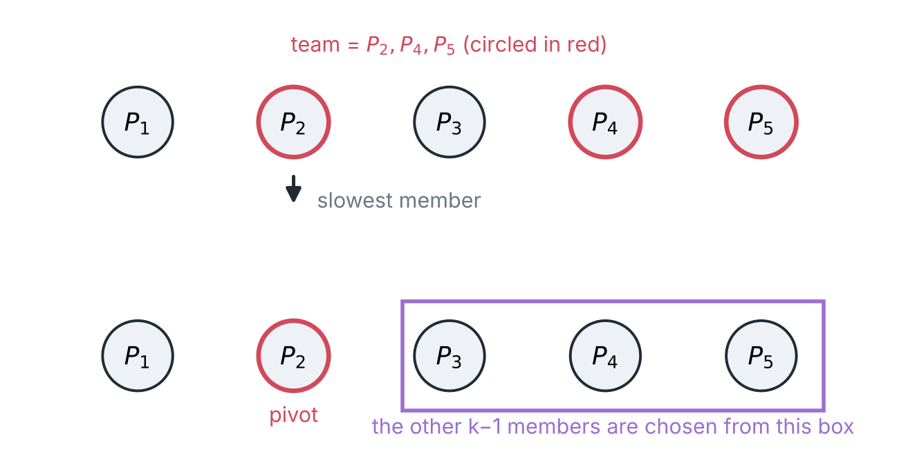

*Top: a team of three, with P2 as its slowest member. Bottom: with P2 as the pivot, the other k−1 members come from the box on the right.*

The answer depends on the minimum speed. So we can use the slowest student as a pivot and apply the contribution technique. (The pivot is the student we fix as the "slowest" one in the chosen team.)

Once the pivot is fixed, the other k−1 members must be at least as fast as the pivot. Among them, the best choice is simply the ones with the highest impact. In the bottom row of the figure, they are chosen from the box on the right.

The efficiency then has the form: (speed of the pivot) × [ I₁ + ( I₂ + ... + Iₖ ) ], where I₁ is the impact of the pivot, which is fixed, and I₂ ... Iₖ are the highest k−1 impacts that we can choose from the faster students.

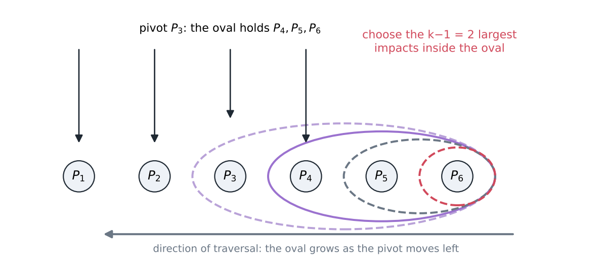

*All students to the right of the pivot are inside the oval. The oval grows as the pivot moves.*

For every pivot, find the 2 highest impacts (the drawing has k = 3, so k−1 = 2 more students are chosen). So for every pivot we maintain a DS (data structure) over the students inside the oval that gives the top 2 impacts.

Which data structure? A min-heap (a priority queue with the smallest element on top). Keep its size at k. If the size becomes larger than k, remove the smallest element. Maintain the sum together with it.

Sort by speed (fastest first). The student we are standing on is the slowest one seen so far, so this student is the pivot. Faster students can join the team without lowering the minimum speed. The heap holds the k largest impacts seen so far, so the candidate answer = pivot speed × heap sum.

Why a heap? Trying every group of k students out of N = 10⁵ is impossible. With the heap, each student is pushed once and popped at most once: O(log N) each.

One detail: when the pivot has the smallest impact among the k + 1 values, it is the one removed, so the team in the heap does not contain the pivot. Then "pivot speed × sum" is smaller than or equal to the real efficiency of that team (its real minimum speed is higher). That team is also counted when its real slowest member is the pivot, so the maximum over all pivots is still correct. Before k students have been seen, no team exists, so the candidate must be skipped.

Dry run (k = 2): the students sorted by speed, as (speed, impact), are (5,3), (3,1), (1,10).

- Pivot 5: the heap is \{3\}. Its size is less than k, so we skip.
- Pivot 3: the heap is \{3,1\} with sum 4, so the candidate is 4 × 3 = 12.
- Pivot 1: the heap becomes \{3,1,10\}. The smallest impact (1) is removed, so the heap is \{3,10\} with sum 13, and the candidate is 13 × 1 = 13. This is the best.

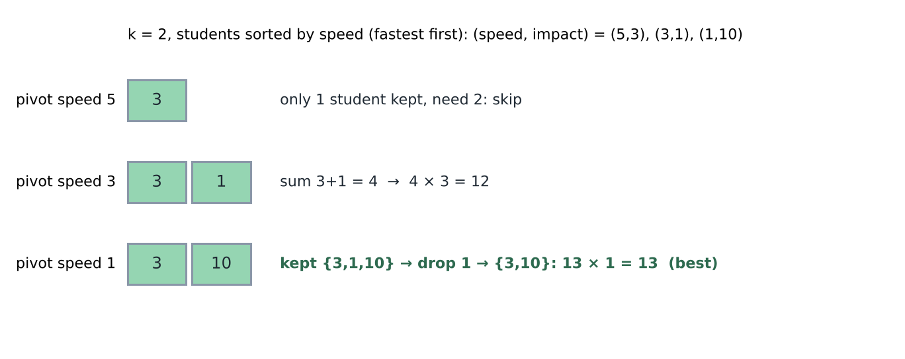

*The heap after each pivot.*

T.C. = O(N log N) (sorting, and a heap of size k). Memory = O(N).

```cpp
// Fabricator/Greedy-Sweepline/StudentSelection.cpp
/*
Assume that you're an HR, and you need to hire, k out of n students
based on their speed and impact. You're given the (s, i) of all students.

Efficiency = (sum of k students) * (min speed of k students)

Find the maximum efficiency you can achieve after hiring k students.
*/

void solve() {
    int n, k;
    cin>>n>>k;

    // first = speed, second = efficiency
    vector<pair<int, int>> arr(n);
    for(int i=0; i<n; i++){
        cin>>arr[i].first>>arr[i].second;
    }

    sort(arr.begin(), arr.end());
    reverse(arr.begin(), arr.end());

    priority_queue<int> pq; // min pq: we'll use negative value trick to create min priority queue
    int top_k_sum = 0;
    int best_team_score = 0;
    for(int i=0; i<n; i++){
        pq.push(-arr[i].second);

        top_k_sum += arr[i].second;
        if(pq.size() > k){
            int x = -pq.top();
            pq.pop();

            top_k_sum -= x;
        }

        if(pq.size() == k){
            best_team_score = max(best_team_score, arr[i].first * top_k_sum);
        }
    }

    cout<<best_team_score<<endl;
}
```

Input: `3 2` / `3 1` / `1 10` / `5 3` → output `13`.

(`priority_queue<int>` is a max-heap by default, so negative values are stored. This turns it into a min-heap.)

Note: `top_k_sum` and the product are `int`. With N, K ≤ 10⁵ and S, I ≤ 10⁹ the answer can reach about 10²³ (10⁵ × 10⁹ × 10⁹), which does not fit even in `long long` (about 9.2·10¹⁸). Use `__int128` (a 128-bit integer type of the GCC compiler) or the modulus given in the problem.

Another common mistake is the sort direction. If the students are sorted by speed in increasing order, the students already seen are slower than the current one, so the current speed is no longer the minimum of the team and the product `pivot speed × sum` can be larger than the true efficiency.

### Median

Question: Given n points on a line (the figure shows five of them, x₁ to x₅):

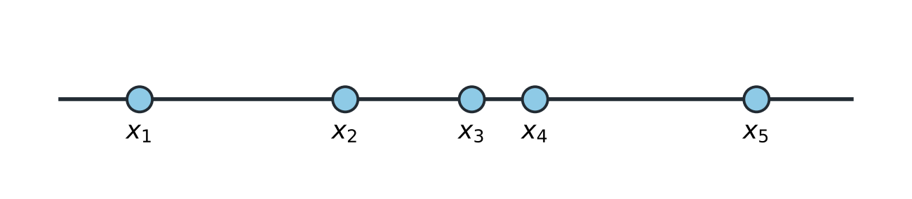

*Five points on a line.*

Version 1: find a point x such that the sum Σ |x−xᵢ| is minimum.

Brute force would try every x. Coordinates can be up to 10⁹, so there are too many candidates, and every candidate costs O(n) to check.

Let us try some points. The given points are 1, 3, 7, 8, 17.

Trial ①, x = 5: |1−5| + |3−5| + |5−7| + |5−8| + |5−17| = 4 + 2 + 2 + 3 + 12 = 23.

Trial ②, x = 8: |1−8| + |3−8| + |8−7| + |8−8| + |17−8| = 7 + 5 + 1 + 0 + 9 = 22.

Trial ③, x = 7: 6 + 4 + 0 + 1 + 10 = 21. This is the smallest.

Trial ④, x = 6: 5 + 3 + 1 + 2 + 11 = 22.

Trial ⑤, x = 9: 8 + 6 + 2 + 1 + 8 = 25.

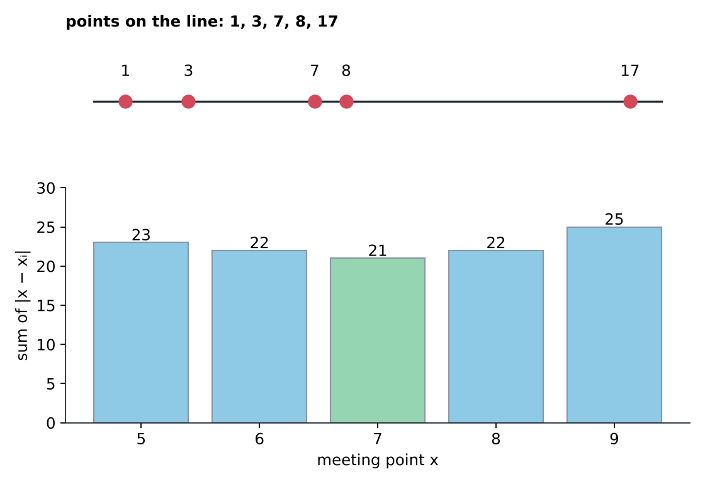

*The sums are 23, 22, 21, 22, 25. The minimum is at x = 7.*

Fact: the sum Σ|x−xᵢ| is minimum at x = median. (The median is the middle element after sorting.)

Why? Take a first choice P₀. The distances from P₀ to all the points are drawn as lines.

When P₀ moves to a new place P₁, some distances are reduced and some distances are increased. In the figure below, 3 distances shrink and 2 distances grow.

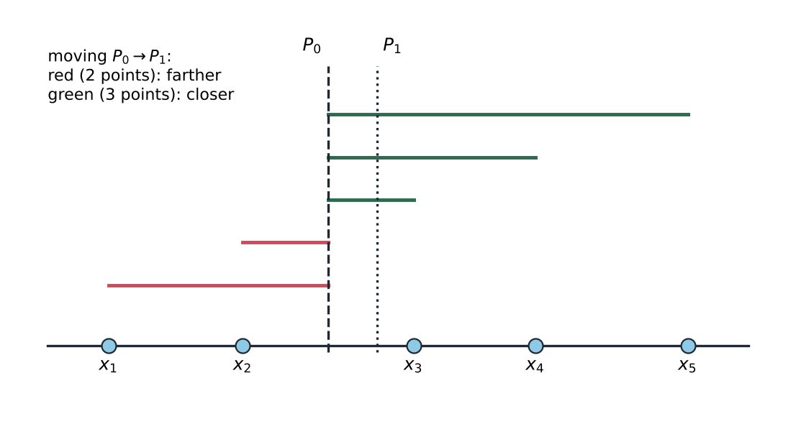

*Moving right: 3 distances shrink and 2 grow, so moving is profitable.*

Intuition: moving x one step to the right makes the distance to every point on its right smaller by 1 and the distance to every point on its left larger by 1. With 3 points on the right and 2 on the left, moving saves 3 and costs 2, so it is worth it. This stops being true exactly when both sides have the same number of points, which is the median.

So on reaching the median we get the optimal answer.

Check with the function f(x) = |x−1| + |x−3| + |x−7|, drawn below. Its kinks are at 1, 3 and 7, and f(1) = 8, f(3) = 6, f(7) = 10. The minimum is at x = 3, which is the median of 1, 3, 7:

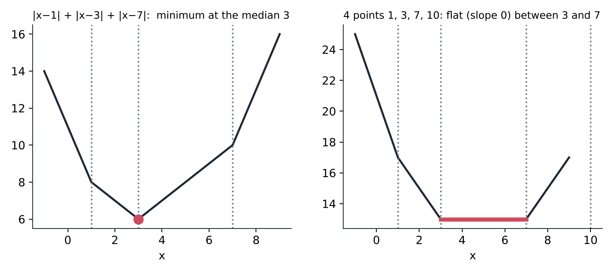

*Left: 3 points, the minimum is at 3 (optimal). Right: 4 points, the bottom is flat.*

For 4 values the bottom of the graph is flat, which means the slope there is zero. So any x between the two middle points is optimal. For example, for the points 1, 3, 7, 8, the sum is 11 for x = 3, x = 5 and x = 7, but it is 13 for x = 2 and for x = 8.

Version 2: the points have some weight associated with them. That is, each point moves towards the optimal point with some cost. We want the minimum of Σ( kᵢ |x−xᵢ| ).

Example with three points. The positions are xᵢ = [1, 3, 7] and the weights are kᵢ = [1, 1, 3].

For x = 7, the sum is (7−7) × 3 + 4×1 + 6×1 = 10.

The expression is |x−1| + |x−3| + 3|x−7|. It can be written as |x−1| + |x−3| + |x−7| + |x−7| + |x−7|. Now we can easily see the answer: it is the median of the expanded list 1, 3, 7, 7, 7, which is 7.

Second example: the positions are xᵢ = [1, 3, 5, 9] and the weights are kᵢ = [3, 1, 2, 3].

The position of the middle element in the expanded list is (Σ kᵢ + 1) / 2 = (9+1)/2 = 5.

The 5ᵗʰ element in the expanded list will be the answer.

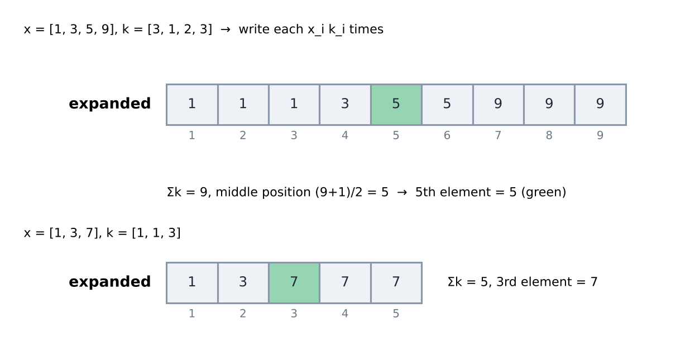

*Expand the list: the 5th element is 5. (Σk = 9 is odd, so only the 5th element matters.)*

Actually, there is no need to build the list (kᵢ can be 10⁹). Sort by x and keep adding the weights. The first x where the running sum reaches (Σk+1)/2 or more is the answer.

T.C. = O(n log n) for the sort, and O(n) memory. Typical mistakes: using the average instead of the median, and keeping the sum in `int` (with weights up to 10⁹ and distances up to 10⁹ the sum does not fit even in `long long` for large n, so check the limits).

```cpp
// not in Fabricator (new function)
/*
  Problem 1: Given n points x_1..x_n on a line, find x that minimises sum |x - x_i|.
  Problem 2 (weighted): point x_i has weight k_i. Minimise sum k_i * |x - x_i|.
*/

// Version 1: the median. Returns {best x, minimum sum}.
pair<long long, long long> bestMeetingPoint(vector<long long> xs) {
    sort(xs.begin(), xs.end());
    long long median = xs[xs.size() / 2];  // for an even count the other middle value gives the same sum
    long long sum = 0;
    for (long long x : xs) sum += llabs(x - median);
    return {median, sum};
}

// Version 2: the weighted median. Think of every point x_i written k_i times and take the
// middle element, but never build that long list: just add up the weights.
pair<long long, long long> bestWeightedPoint(vector<pair<long long, long long>> pts) {  // pts = {x_i, k_i}
    sort(pts.begin(), pts.end());
    long long totalWeight = 0;
    for (auto& p : pts) totalWeight += p.second;
    long long need = (totalWeight + 1) / 2;  // position of the middle element in the long list (1-based)
    long long running = 0, best = pts[0].first;
    for (auto& p : pts) {
        running += p.second;
        if (running >= need) { best = p.first; break; }
    }
    long long sum = 0;
    for (auto& p : pts) sum += p.second * llabs(best - p.first);
    return {best, sum};
}
```

Output: `x = 7, sum = 21` / `x = 7, sum = 10` / `x = 5, sum = 26`. These match a brute force that tries every x.
### Dominating choices (Theorem 1.5.5)

Many greedy problems go from left to right and make one choice at each position. What can be done next depends only on a small state, such as "how far is covered". The proof idea is "stays ahead" with dominating states.

**Theorem 1.5.5 (dominating choices).** A process makes a choice at each of the positions $1, 2, \dots$ in order, and only the current state matters for what can be done next. If at every position the greedy choice leads to a state that dominates the state reached by any other choice, then the greedy result is at least as good as any other.

In plain words: if the greedy choice at each position reaches a state at least as good as any other choice's state, then the greedy result is at least as good as any other result.

Small example first. Cover the segment $[0, L]$ with as few of the given intervals as possible. Scan from the left. The state is how far the chosen intervals reach without a gap. Among the intervals that start at or before the current reach, take the one that ends farthest. A state that reaches farther dominates one that reaches less, because any interval usable from the shorter reach is usable from the longer one. The greedy choice maximises the reach after each step, so by Theorem 1.5.5 it uses the fewest intervals.

Why it works:
1. By induction on the positions: after $j$ steps the greedy state dominates the state of any other sequence of choices after $j$ steps. For $j = 0$ the states are equal.
2. Suppose the greedy state $A_j$ dominates another sequence's state $B_j$. Then the other sequence's next choice from $B_j$ can also be made from $A_j$, or something at least as good can. The greedy choice from $A_j$ is at least as good again. So $A_{j+1}$ dominates $B_{j+1}$.
3. At the end, "dominates" means "at least as good", so the greedy result is at least as good as any other.

This proof needs: (1) what can be done later depends only on a small state (such as "how far is already covered" or "which coins are in the till"), not on the full history; (2) a precise comparison of states, and a proof that the greedy choice always reaches the best one.

<TheoremCode unit="1.5/thm-5" />

In the third example the reach stops at 2 and no segment starts at or before it, so the answer is a gap.

### Covering a segment from left to right

Here is the template for covering $[0, L]$ with the fewest given segments. Treat the segments as real intervals, so $[0, 2]$ and $[3, 5]$ leave a gap. The variable `reach` is how far $[0, \text{reach}]$ is covered. Every segment that starts at or before `reach` can continue the cover. Among them, take the one that ends farthest. A larger reach dominates a smaller one, so by Theorem 1.5.5 this uses the fewest segments. If no segment extends the reach, there is a gap and the answer is $-1$.

Dry run: segments $[0, 3]$, $[2, 5]$, $[4, 8]$ and $L = 8$. The reach is 0, and the only segment starting at 0 is $[0, 3]$, so the reach becomes 3 with 1 segment used. Segments starting at or before 3 add $[2, 5]$, so the reach becomes 5 with 2 used. Then $[4, 8]$ starts at 4, which is at most 5, so the reach becomes 8 with 3 used. Answer 3. For $[0, 2]$ and $[3, 5]$ with $L = 5$ the reach stops at 2, nothing starts at or before 2, and the answer is $-1$. T.C. is $O(n \log n)$ for sorting by left end and then one pass. The code is the function in the Theorem 1.5.5 block above.

Alternative formulation: for every left end compute the farthest right end of a segment starting there, then walk over the positions like the Jump Game. It is the same rule organised by position instead of by segment.

Common mistake: taking the first segment that helps. Take $L = 4$ and the segments $[0, 2]$ and $[0, 5]$. If the inner loop stops at the first segment that extends the reach, it takes $[0, 2]$ and then still needs $[0, 5]$, so the answer is 2. But $[0, 5]$ covers everything alone, so the correct answer is 1. The fix is to take, among all segments starting inside the covered part, the one that reaches farthest. That choice dominates every other.

### Example: Blue Spring

[AtCoder Beginner Contest (ABC) 318, problem C: Blue Spring](https://atcoder.jp/contests/abc318/tasks/abc318_c). In short: a trip of $N$ days ($N \le 2 \cdot 10^5$) with a fare $F_i$ for each day. One-day passes are sold only in batches of $D$ for $P$ yen. A pass can be used on any day, and leftovers are allowed. Print the least total cost.

The idea, in the six questions we always ask. Budget: $N = 2 \cdot 10^5$ allows $O(N \log N)$. The cost can reach $2 \cdot 10^5 \cdot 10^9 = 2 \cdot 10^{14}$, so `long long`. Tools: a brute force over which days to cover is $2^N$ choices (topic 0.5). Two decisions are hidden in the problem: how many batches to buy, and which days to cover with them. For the second, the "Most extreme first" card suggests covering the most expensive days.

The deciding property: with $k$ batches, the covered days save their fares. The saving is a sum of independent values, limited only by a count ($kD$ days). So the best days to cover are the $kD$ most expensive (Theorem 1.5.3, part 1). Sort the fares in decreasing order and cut them into blocks of $D$. Buying $k$ batches covers the first $k$ blocks. Each block either gets a batch (cost $P$) or not (cost its sum). So the decision is: sort, cut into blocks, and add $\min(\text{block sum}, P)$ for every block.

Why this is right. Sort so that $f_1 \ge f_2 \ge \dots \ge f_N$, and let $S_0, S_1, \dots$ be the sums of the consecutive blocks of $D$ (the last block may be shorter). Every element of block $j$ is at least every element of block $j + 1$, and block $j$ has at least as many elements, so $S_j \ge S_{j+1}$. With $k$ batches the best cost is $kP$ plus the fares outside the first $k$ blocks, that is $\sum_{j < k} P + \sum_{j \ge k} S_j$. Each term is at least $\min(P, S_j)$, so every $k$ costs at least $\sum_j \min(P, S_j)$. That sum is reached: the blocks with $S_j > P$ form a prefix, because block sums only decrease, and taking $k$ equal to the length of that prefix gives exactly $\sum_j \min(P, S_j)$.

Trace: $N = 5$, $D = 2$, $P = 10$, fares $7, 1, 6, 3, 6$. Sorted: $7, 6, 6, 3, 1$. Blocks: $7 + 6 = 13$, $6 + 3 = 9$, $1$. The block costs are $\min(13, 10) = 10$, $\min(9, 10) = 9$, $\min(1, 10) = 1$, total 20. Checking by $k$: no batch costs 23, one batch costs $10 + 10 = 20$, two batches cost $20 + 1 = 21$.

<CodeSnippet unit="1.5/example-1" />

Cost: T.C. is $O(N \log N)$ for the sort and $O(N)$ for the blocks, S.C. is $O(N)$. An alternative approach tries every number of batches $k$ from 0 to $\lceil N / D \rceil$ and computes $kP$ plus the fares outside the first $kD$ sorted days with prefix sums (topic 1.2), taking the minimum. It needs the same sort and the same "take the extreme first" argument, but no argument about blocks.

Common mistake: comparing only "a pass for every day" with "no pass at all". For $D = 2$, $P = 10$ and the fares $50, 1, 1, 1$, that gives $\min(20, 53) = 20$, but one batch on the two most expensive days costs $10 + 1 + 1 = 12$. Another mistake is `int` for the total, which overflows near $2 \cdot 10^{14}$.

### Example: Missing Coin Sum

[CSES 2183 Missing Coin Sum](https://cses.fi/problemset/task/2183) (CSES is the Code Submission Evaluation System problem set). In short: $n \le 2 \cdot 10^5$ coins with values up to $10^9$. Print the smallest positive sum that no subset of the coins makes.

The idea, in the six questions. Budget: subsets are $2^n$, so listing all possible sums is hopeless, and we need $O(n \log n)$. The sums reach $2 \cdot 10^{14}$, so `long long`. Tools: a brute force over subsets (topic 0.5) works only for tiny $n$. The question is order-free, since any subset counts, so the coins can be sorted (topic 1.1). Processing them from the smallest, a left-to-right scan with a small state (Theorem 1.5.5) is a candidate. The state is "every sum from 0 to $r$ can be made".

The deciding property: suppose the coins seen so far make exactly every sum $0..r$ (and nothing above, since they add up to $r$). A new coin $x$ adds the sums $x..x + r$. If $x \le r + 1$, these join with $0..r$ without a gap, and now every sum $0..r + x$ is made. If $x > r + 1$, nothing can ever make $r + 1$: the coins seen add up to only $r$, and every other coin is at least $x > r + 1$ because they come in increasing order. So sort, scan, and stop at the first coin larger than $r + 1$.

Why this is right. The invariant is: after processing the $j$ smallest coins without stopping, $r$ is their sum and every integer from 0 to $r$ is a subset sum of them. It holds for $j = 0$ with $r = 0$. Suppose the next coin $x$ satisfies $x \le r + 1$. A sum $s \le r$ is made as before. A sum $s$ with $r < s \le r + x$ is $x$ plus the sum $s - x$, which lies in $0..r$ because $s - x \le r$ and $s - x \ge r + 1 - x \ge 0$. So the invariant holds with $r + x$. If the scan stops at a coin $x > r + 1$, or runs out of coins, then $r + 1$ is missing. A subset using only the processed coins sums to at most $r$, and a subset using any other coin sums to at least $x > r + 1$. So the answer is $r + 1$.

Trace: coins $2, 9, 1, 2, 7$, sorted $1, 2, 2, 7, 9$. Start with $r = 0$. The coin 1 is at most 1, so $r = 1$. The coin 2 is at most 2, so $r = 3$. The next coin 2 is at most 4, so $r = 5$. The coin 7 is more than 6, so we stop, and the answer is 6.

<CodeSnippet unit="1.5/example-2" />

Cost: T.C. is $O(n \log n)$ for the sort and $O(n)$ for the scan, S.C. is $O(n)$ for the copy. There is no natural second approach here. Tracking every reachable sum in a table needs memory proportional to the total value, which is up to $2 \cdot 10^{14}$. The invariant is what makes the problem small.

Common mistake: scanning without sorting. For the coins $2, 1$ the scan sees 2 first, and $2 > 0 + 1$, so it answers 1. The coins make 1, 2 and 3, so the correct answer is 4. The fix is to sort first, because the argument that no later coin can make $r + 1$ uses that later coins are at least $x$.


## Bit thinking

The next idea is bit thinking: write the numbers in binary and see what the operations do to the bits.

Question: At a number x we can do the following two operations:

- i) change x to 4x
- ii) change x to 2x+1

Check on Codeforces: contest 1635 (problem D, "Infinite Set").

In that problem, n different numbers are given, and the two operations can be used any number of times on any number that is already in the set. The task is to count the numbers that are less than 2ᵖ (numbers with at most p bits) in the final infinite set, modulo 10⁹+7. The set is infinite, and p can be 2·10⁵, so numbers with 200000 bits cannot be listed one by one. The binary form shows a way to count them.

Example: x = 10101 (in binary).

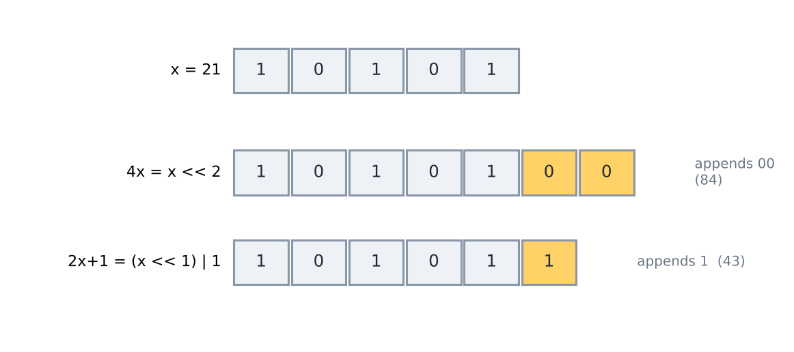

*For 4x, "00" is appended at the end. For 2x+1, "1" is appended at the end.*

In code, 4x is written as (x &lt;&lt; 2), and 2x+1 is written as (x &lt;&lt; 1) | 1.

(The symbol `<<` shifts the bits to the left. `x << 2` appends two zeros at the end, and `| 1` sets the last bit to 1.)

Observation: both operations only append something to the end of the binary string: "00" or "1". So a number can have only one parent. If its last bit is 1, it came from 2y+1. If its last two bits are 00, it came from 4y. If its last two bits are 10, it came from no number at all. This means: if another given number appears in the parent chain of a, then a is redundant. What remains is counting bit strings: appending 1 bit or 2 bits at a time gives a Fibonacci-like count. (CF 1635 is based on this.)

The steps in detail:

1. Remove the redundant numbers. Go through the given numbers from small to large. For each number, walk up its parent chain (drop the last bit if it is 1, drop the last two bits if they are 00, stop otherwise). If a number that is already kept is met, the current number is redundant.
2. A kept number with b bits creates every number that is made by appending "1" (1 bit) or "00" (2 bits) to it, as long as the total length is at most p. The parent of a number is unique, so different appended strings give different numbers.
3. Two different kept numbers never create the same number. If they did, both would be in the one parent chain of that number, and then one of them would be redundant.
4. Let f(L) be the count of strings with total appended length exactly L. The last piece is "1" or "00", so f(L) = f(L−1) + f(L−2), with f(0) = 1 and f(1) = 1. This gives 1, 1, 2, 3, 5, 8, ... (Fibonacci numbers).
5. A kept number with b bits adds f(0) + f(1) + ... + f(p−b) to the answer, if b ≤ p.

Dry run with n = 2, p = 4, numbers 6 and 1. The number 6 is 110 in binary. It ends with "10", so it has no parent, and it is kept. The number 1 is kept too. The number 1 has 1 bit, so it adds f(0) + f(1) + f(2) + f(3) = 1 + 1 + 2 + 3 = 7 numbers: 1, 3, 4, 7, 9, 12, 15. The number 6 has 3 bits, so it adds f(0) + f(1) = 2 numbers: 6 and 13. The answer is 7 + 2 = 9, and the full set below 16 is 1, 3, 4, 6, 7, 9, 12, 13, 15.

T.C. = O(n log n log A) for the parent walks (each walk has at most about 30 steps and uses a set lookup, A = the largest given number), plus O(p) for the counts. Memory = O(n + p). The typical mistakes are counting a redundant number (the same numbers get counted twice) and forgetting the modulus.

```cpp
// not in Fabricator (new function), used in "Bit thinking" (Codeforces 1635D)
/*
  Problem: n different positive numbers a are given and a number p. The set S contains
  every a, and if y is in S then 2y+1 and 4y are in S too. Count the numbers of S
  that are less than 2^p, modulo 1e9+7.
*/

long long countGenerated(vector<long long> a, int p) {
    const long long MOD = 1000000007;
    sort(a.begin(), a.end());

    // Step 1: keep a number only if none of its parents is already kept.
    set<long long> kept;
    for (long long v : a) {
        long long y = v;
        bool redundant = false;
        while (y > 0) {
            if (y % 2 == 1) y = (y - 1) / 2;   // last bit is 1: parent is (y-1)/2
            else if (y % 4 == 0) y /= 4;       // last two bits are 00: parent is y/4
            else break;                        // last two bits are 10: no parent
            if (kept.count(y)) { redundant = true; break; }
        }
        if (!redundant) kept.insert(v);
    }

    // ways[L] = number of strings of total length L made of "1" (length 1) and "00" (length 2).
    // prefix[L] = ways[0] + ... + ways[L].
    vector<long long> ways(p + 1), prefix(p + 1);
    ways[0] = 1;
    if (p >= 1) ways[1] = 1;
    for (int len = 2; len <= p; len++) ways[len] = (ways[len - 1] + ways[len - 2]) % MOD;
    prefix[0] = ways[0];
    for (int len = 1; len <= p; len++) prefix[len] = (prefix[len - 1] + ways[len]) % MOD;

    long long answer = 0;
    for (long long v : kept) {
        int bits = 64 - __builtin_clzll(v);  // number of bits of v (clzll counts the leading zero bits)
        if (bits <= p) answer = (answer + prefix[p - bits]) % MOD;
    }
    return answer;
}
```

`countGenerated({6, 1}, 4)` = 9, and `countGenerated({1}, 4)` = 7. The function also matches a brute force that builds the set for 3000 random small inputs.

## Manhattan meeting point

Question: the figure shows three points on a plane and a meeting point marked with a cross:

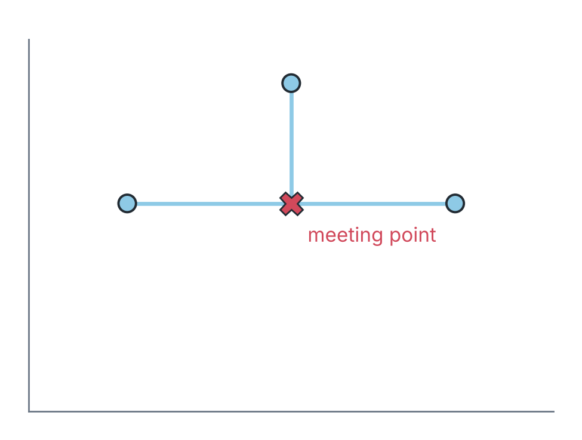

*Three points walk horizontally and vertically to one meeting point.*

Given points on a plane, we want to make them meet at some point such that the total Manhattan distance is minimum.

(Manhattan distance = |x₁−x₂| + |y₁−y₂|. Movement is only up, down, left or right.)

We have to find three things:

- i) where to meet,
- ii) the minimum number of moves,
- iii) the number of solutions.

Brute force would try every meeting point in the bounding box of the points. With coordinates up to 10⁹ that is up to 10¹⁸ points, so the structure of the cost is needed.

Example: the points (1,1), (2,2), (3,3), with the meeting point (2,2):

Moving (3,3) to (2,2) costs 2. Moving (1,1) to (2,2) costs 2. The total cost is 4.

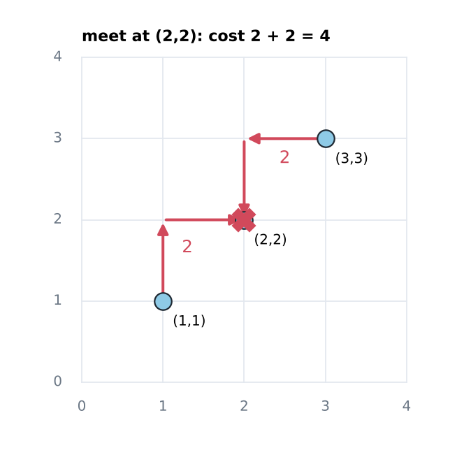

*Meeting at (2,2) costs 2 + 2 = 4.*

In general, every point walks horizontally and vertically to the meeting point (x,y):

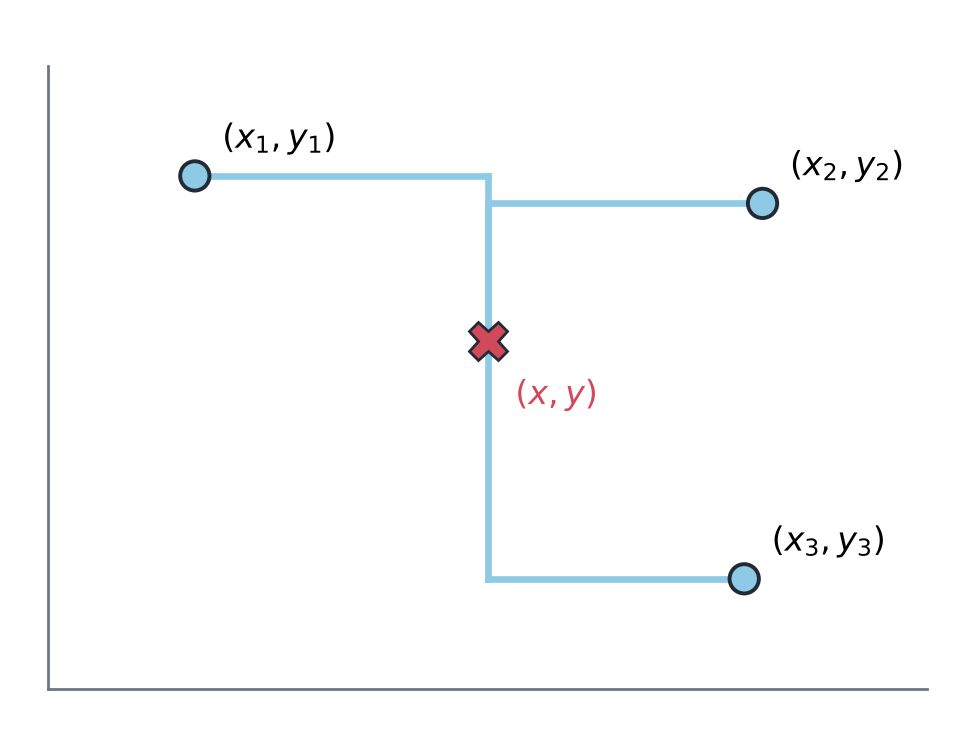

*Every point walks horizontally and vertically to the meeting point (x, y).*

The cost is Σᵢ₌₁ⁿ ( |x−xᵢ| + |y−yᵢ| ), and we have to minimise it.

This splits into two sums:

Cost = ( Σᵢ₌₁ⁿ |x−xᵢ| ) + ( Σᵢ₌₁ⁿ |y−yᵢ| )

This is called axis independence. Each sum is minimum at the median of its own coordinate.

The x part does not depend on y, and the y part does not depend on x. So the two medians can be found separately, and then put together:

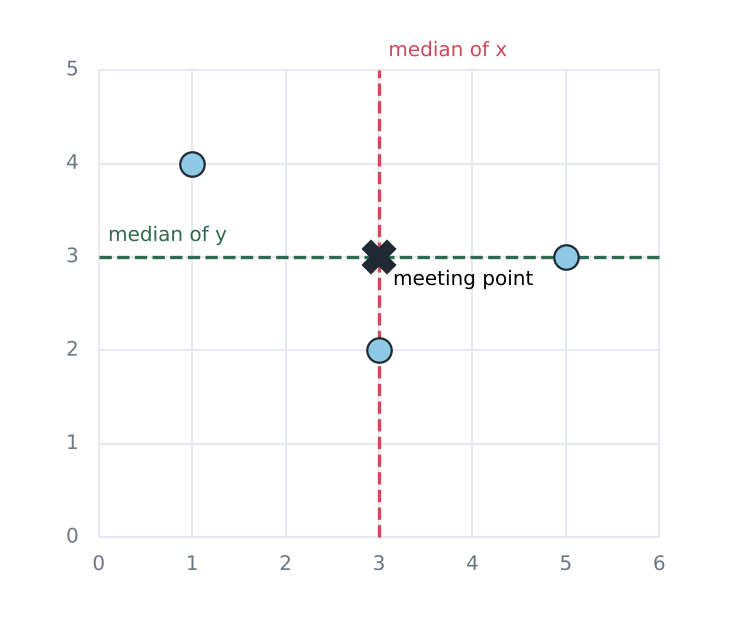

*The median for x and the median for y cross at the cross mark, which is the resulting answer.*

For an even number of points, the two middle values of x form a range, and so do the two middle values of y:

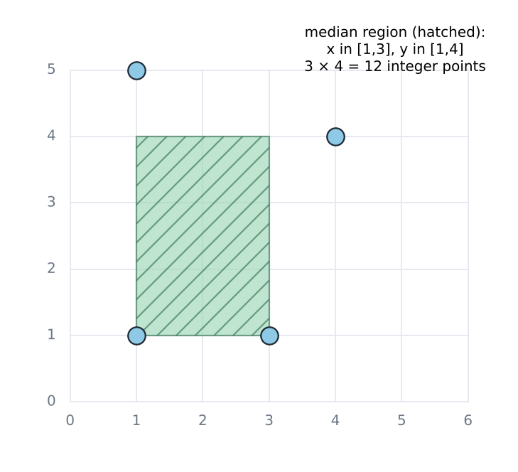

*The median region for x times the median region for y.*

This whole region is optimal, so the number of solutions can be easily calculated. We count the integer points in it: (x_hi − x_lo + 1) × (y_hi − y_lo + 1). For an odd number of points this is always 1 × 1 = 1.

Example: the points are (1,1), (3,1), (1,5), (4,4). The sorted x values are 1, 1, 3, 4, so x can be anywhere in [1,3]. The sorted y values are 1, 1, 4, 5, so y can be anywhere in [1,4]. The number of solutions is 3 × 4 = 12, and the minimum cost is 12.

Check of the cost: for x = 3 the x part is 2 + 0 + 2 + 1 = 5, and for y = 4 the y part is 3 + 3 + 0 + 1 = 7, so the cost is 5 + 7 = 12. Any other x in [1,3] gives the same x part 5 (for x = 1 it is 0 + 2 + 0 + 3 = 5).

T.C. = O(n log n) for the sorts, and O(n) memory. This idea works because the Manhattan distance is a sum of one x part and one y part. For the straight-line (Euclidean) distance the two coordinates are not independent, and the medians are not the answer. Only integer meeting points are counted here.

```cpp
// not in Fabricator (new function)
/*
  Problem: n points (x_i, y_i) lie on a plane. They must all move to one common point.
  One move shifts a point by 1 in x or in y. Find
    (i)   where to meet,
    (ii)  the minimum number of moves,
    (iii) how many integer meeting points reach that minimum.
*/

struct Meeting {
    long long cost;
    long long xLow, xHigh, yLow, yHigh;  // every integer point in this rectangle is optimal
    long long ways;
};

Meeting bestMeeting(const vector<pair<long long, long long>>& pts) {
    int n = pts.size();
    vector<long long> xs, ys;
    for (auto& p : pts) { xs.push_back(p.first); ys.push_back(p.second); }
    sort(xs.begin(), xs.end());
    sort(ys.begin(), ys.end());

    Meeting m;
    m.xLow = xs[(n - 1) / 2];  m.xHigh = xs[n / 2];  // equal when n is odd
    m.yLow = ys[(n - 1) / 2];  m.yHigh = ys[n / 2];
    m.cost = 0;                                      // x and y are independent: use each median
    for (long long x : xs) m.cost += llabs(x - xs[n / 2]);
    for (long long y : ys) m.cost += llabs(y - ys[n / 2]);
    m.ways = (m.xHigh - m.xLow + 1) * (m.yHigh - m.yLow + 1);
    return m;
}

void show(const vector<pair<long long, long long>>& pts) {
    Meeting m = bestMeeting(pts);
    cout << "cost " << m.cost << ", x in [" << m.xLow << "," << m.xHigh << "], y in ["
         << m.yLow << "," << m.yHigh << "], ways " << m.ways << "\n";
}
```

Output: `cost 4, x in [2,2], y in [2,2], ways 1` and `cost 12, x in [1,3], y in [1,4], ways 12`. These match a grid brute force.

## Pigeonhole principle

The next idea is the pigeonhole principle.

(With n pigeons and n−1 holes, some hole must contain two pigeons. That is the whole principle.)

Question: an array arr = [a₁, a₂, ..... aₙ] has n items. Print a non-empty subset whose sum of elements gives (sum % n) == 0 if one is present, else print −1.

Example: n = 5 and arr = [1 2 3 4 5].

The valid subsets are \{1,4\}, \{2,3\}, \{5\}, \{1,2,3,4\}, \{1,2,3,4,5\}, \{2,3,5\}, \{1,4,5\}.

There are two versions of the problem:

- P1 (problem 1): N ≤ 20 and aᵢ ≤ 10⁹.
- P2 (problem 2): N ≤ 10⁵ and aᵢ ≤ 10⁹.

For P1, a simple brute force will work: create all subsets and check each one. Every element has 2 choices: take it, or do not take it. The T.C. (time complexity) is O(2ⁿ · n).

For n = 20 this is 2²⁰ ≈ 10⁶ subsets, and about 2·10⁷ steps in total, which is fine. For n = 10⁵ it is impossible, so P2 needs an idea.

A subarray is a block of neighbouring elements, and it is also a subset. So an easier question is asked first: is there a subarray with (sum % n) == 0?

Try to create an array for which we would have to print −1. This is never possible. The next lines show why.

There are n prefix sums. (The prefix sum Sᵢ is the sum of the first i elements.)

S₁ = a₁, S₂ = a₁+a₂, ......, Sₙ = a₁+a₂+.....+aₙ

If we divide the prefix sums by n, the possible remainders are 0, 1, 2, ........, n−1.

Case 1: if any prefix sum has (sum % n) == 0, that prefix is the solution.

Case 2: if none has remainder 0, then only the n−1 remainders 1, 2, ..., n−1 are left for n prefix sums. By the Pigeonhole Principle, at least one remainder is repeated when the n prefix sums are divided by n.

So for some i &lt; j we have Sⱼ ≡ Sᵢ (mod n), which means (Sⱼ − Sᵢ) ≡ 0 (mod n).

Now Sⱼ − Sᵢ = aᵢ₊₁ + aᵢ₊₂ + ...... + aⱼ, which is the sum of the elements of the subarray (i, j]. So the block [i+1, j] is an answer.

A subarray is also a subset, hence we have our answer.

Example with n = 6 and the array 2 3 1 2 1 3. Its prefix sums are 0, 2, 5, 6, 8, 9, 12 (the first 0 is the empty prefix). Their remainders when divided by 6 are 0, 2, 5, 0, 2, 3, 0. Seven values share six possible remainders (0 to 5), so a repeat must happen. The equal remainders give these blocks:

2+3+1 = 6 and 6 % 6 == 0; 8−2 = 6 and 6 % 6 == 0; 12−6 = 6 and 6 % 6 == 0.

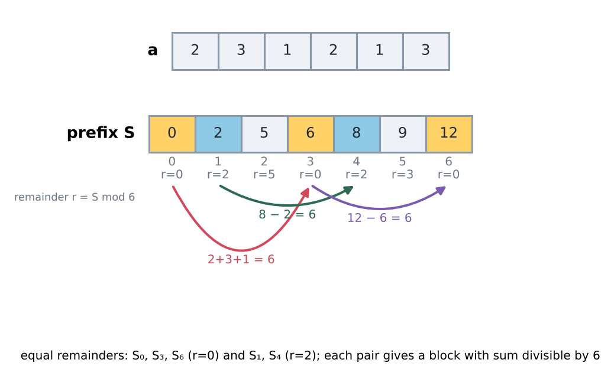

*Equal remainders mean that the block between them has a sum divisible by 6.*

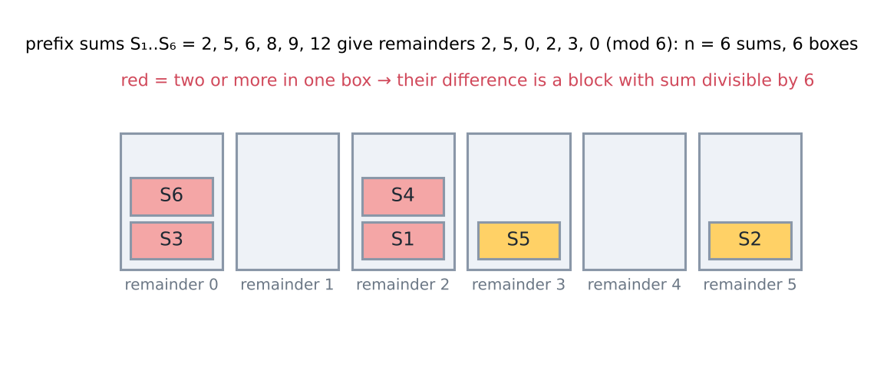

*6 prefix sums and 6 boxes. Where two meet, there is the answer.*

The main problem (finding a subset) was difficult, so we moved on to a similar but easier problem (finding a subarray), whose solution is also a solution of the main problem.

In code, S₀ = 0 is also included (firstSeen[0] = 0). This merges Case 1 and Case 2 into one check: n + 1 values and only n remainders. T.C. = O(n), and memory is O(n). Typical mistakes: forgetting S₀ (then Case 1 needs a separate check), and keeping the prefix sums without taking the remainder (they reach about 10¹⁴, which is fine for `long long`, but the remainder must still be used as the index).

```cpp
// not in Fabricator (new function)
/*
  Problem: An array a has n numbers. Print a non-empty subset whose sum is divisible
  by n (sum % n == 0). If there is none print -1.
  Version 1: n <= 20.  Version 2: n <= 1e5.
*/

// Version 1: try every subset. Each element is "taken" or "not taken": 2^n subsets.
// bit i of `mask` tells whether element i is taken.
bool bruteForceSubset(const vector<long long>& a, vector<int>& chosenIdx) {
    int n = a.size();
    for (int mask = 1; mask < (1 << n); mask++) {
        long long sum = 0;
        for (int i = 0; i < n; i++)
            if (mask >> i & 1) sum += a[i];
        if (sum % n == 0) {
            chosenIdx.clear();
            for (int i = 0; i < n; i++)
                if (mask >> i & 1) chosenIdx.push_back(i + 1);
            return true;
        }
    }
    return false;
}

// Version 2: a subarray (a block of neighbours) is also a subset, and one always exists.
// Two equal prefix-sum remainders S_i and S_j (i < j) mean a[i+1..j] has a sum divisible by n.
pair<int, int> divisibleSubarray(const vector<long long>& a) {  // returns 1-based {left, right}
    int n = a.size();
    vector<int> firstSeen(n, -1);  // firstSeen[r] = first prefix index with remainder r
    firstSeen[0] = 0;              // the empty prefix S_0 = 0 has remainder 0
    long long remainder = 0;
    for (int i = 1; i <= n; i++) {
        remainder = (remainder + a[i - 1]) % n;
        if (firstSeen[remainder] != -1) return {firstSeen[remainder] + 1, i};
        firstSeen[remainder] = i;
    }
    return {-1, -1};  // never happens (pigeonhole principle)
}
```

`[1,2,3,4,5]` → `[2, 3]` (2 + 3 = 5). `[2,3,1,2,1,3]` → `[1, 3]` (2 + 3 + 1 = 6). Random arrays were also checked.

## Fraction ideas

The next idea is about fractions. Two ratios are compared exactly by keeping each one as a pair of integers.

### equal ratio pairs

Question: Given an array A of size N, with A[i] ≤ 10¹⁸ and N ≤ 10⁵.

Find the number of pairs (i, j) such that:

- i) i &lt; j
- ii) A[i] * j = A[j] * i

Brute force checks all pairs: N = 10⁵ gives about 5·10⁹ pairs, which is too slow. The product A[i] * j can be as large as 10¹⁸ × 10⁵ = 10²³, which does not fit in `long long` either.

Divide both sides by i·j. The condition becomes A[i]/i = A[j]/j. Let B[i] = A[i]/i. Then we need to find the pairs with B[i] = B[j].

Now, B[i] is a float, and comparing floats for equality is unreliable because of precision. A map⟨double, int⟩ named freq could have been used to count the duplicates and hence the answer, but we would get a wrong answer due to decimal (floating point) precision.

(Example: A = [400000000000000001, 800000000000000003]. B = ...001 and ...001.5, so they are different. But a double keeps only about 15-16 digits, so both look equal.)

Instead, let us keep each fraction p/q as a pair (p, q) in its lowest form, such that p and q are coprime. (Coprime means the gcd, the greatest common divisor, of p and q is 1. Divide both by their gcd to get the lowest form.)

Two fractions are equal exactly when their lowest forms are the same pair, because the lowest form is unique. So we can use a map⟨pair⟨int, int⟩, int⟩. (A[i] is up to 10¹⁸, so the code below uses `long long` inside the pair.)

Counting: at each index, first look in the map for how many equal fractions came earlier (that many new pairs are formed), then add the current fraction to the map.

Dry run: A = [3, 6, 9, 2, 5] (1-indexed). The fractions A[i]/i are 3/1, 6/2, 9/3, 2/4, 5/5, which equal 3, 3, 3, 1/2, 1. Three values are equal, so there are 3 pairs.

T.C. = O(N log N), because of the map, plus one gcd per element (about 60 steps for values near 10¹⁸). Memory is O(N).

```cpp
// Fabricator/Greedy-Sweepline/CountEqualRatioPairs.cpp
pair<long long, long long> get_reduced_fraction(long long num, long long den){
    if(num == 0 && den == 0) return {0, 0};
    if(num == 0) return {0, 1};
    if(den == 0) return {1, 0};

    long long gcd_of_num_den = gcd(num, den);

    return make_pair(num / gcd_of_num_den, den / gcd_of_num_den);
}

void solve() {
    int n;
    cin>>n;

    map<pair<long long, long long>, long long> mp;
    long long ans = 0;
    vector<long long> arr(n);
    for(int i=0; i<n; i++){
        cin>>arr[i];
        ans += mp[get_reduced_fraction(arr[i], i)];
        mp[get_reduced_fraction(arr[i], i)]++;
    }

    cout<<ans<<endl;
}
```

Input (note the extra 0 at the front, see the note below): `6` / `0 3 6 9 2 5` → output `3`. (This program first reads the number of test cases, so a `1` must be typed before this input.)

Note: this code uses the index `i` starting from 0 (the first element is divided by 0), but the problem is 1-indexed. That is why a 0 was added at the front of the input above. Alternatively, use `get_reduced_fraction(arr[i], i + 1)`.

To see the danger of doubles, here is the tempting but wrong way as a function. It stores every fraction A[i]/i as a `double` and counts equal keys, with the position counted from 1.

```cpp
// new function (not in Fabricator): the wrong "map of doubles" way, shown only to compare with the exact way
/*
Count pairs i < j with A[i] / i == A[j] / j (positions from 1), by storing the fractions as doubles.
This is wrong for big numbers: a double keeps only about 15 to 16 digits.
*/
long long countPairsWithDouble(const vector<long long>& A) {
    map<double, long long> seen;
    long long pairs = 0;
    for (size_t idx = 0; idx < A.size(); idx++) {
        double v = (double)A[idx] / (double)(idx + 1);
        pairs += seen[v];
        seen[v]++;
    }
    return pairs;
}
```

Trace for A = [400000000000000001, 800000000000000003]. The true fractions are 400000000000000001 and 400000000000000001.5, so they are different and the answer is 0. In a `double` both values are rounded to 400000000000000000, so the function sees two equal keys and returns 1. The function that keeps the reduced pair (the code above, run with the extra 0 in front of the input) prints 0 for this input. On the small example [3, 6, 9, 2, 5] both ways print 3, so the double version only fails on big numbers, which is why a sample test does not catch it. All of these results were checked by running the code.

Cost: the same as the exact way, T.C. O(N log N) and O(N) space. The speed is not the problem, the exactness is.

### line with max points

Question: Given n points (xᵢ,yᵢ). Find a line which passes through the maximum number of points.

Brute force would take every pair of points as a line and count the points on it: O(n²) lines times O(n) points = O(n³). For n = 1000 that is about 10⁹ steps. The pivot idea below needs only O(n² log n).

The figure shows an example where the best line has 4 points:

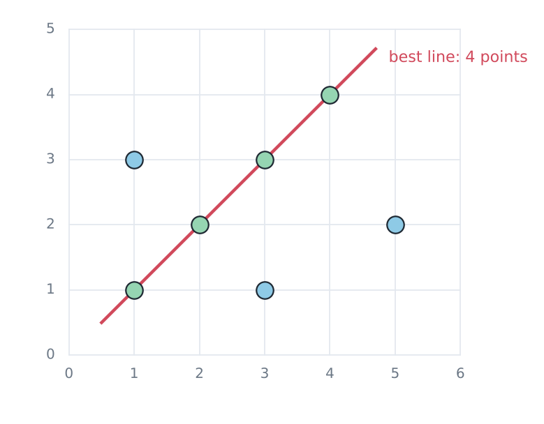

*This line has 4 points.*

For a pivot point, we calculate the slope from the pivot to all other points. Points that can possibly be on the same line will have the same slope. The reason is that all these lines start at the same pivot point, so two points with the same slope from the pivot lie on one line through the pivot.

We take every point as the pivot in turn and repeat. The slope that has the highest frequency gives the answer: its number of points plus the pivot itself.

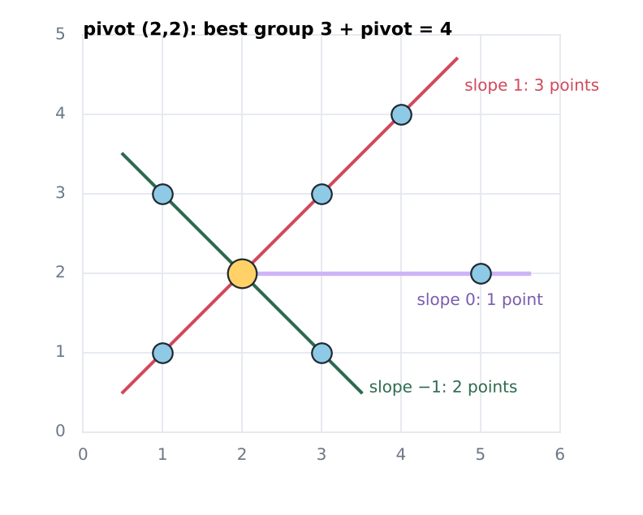

*Pivot (2,2): slope 1 has 3 points, slope −1 has 2 points, slope 0 has 1 point. The best is 3 + the pivot = 4.*

The slope is also a fraction (dy/dx), so we have the same problem as before: do not use floats, and keep the reduced pair (dy, dx). A vertical line has dx = 0 and needs separate handling.

T.C. = O(n² log n): n pivots, and n map updates for each pivot. Memory is O(n) for one pivot.

```cpp
// Fabricator/Greedy-Sweepline/LineWithMaxPoints.cpp
pair<long long, long long> get_reduced_fraction(long long num, long long den){
    if(num == 0 && den == 0) return {0, 0};
    if(num == 0) return {0, 1};
    if(den == 0) return {1, 0};

    // Handling negative number
    int neg = 1;
    if(num < 0){
        neg *= -1;
        num *= -1;
    }

    if(den < 0){
        neg *= -1;
        den *= -1;
    }

    long long gcd_of_num_den = gcd(num, den);

    return make_pair(neg * num / gcd_of_num_den, den / gcd_of_num_den);
}

void solve() {
    int n;
    cin>>n;

    long long x[n], y[n];
    for(int i=0; i<n; i++){
        cin>>x[i]>>y[i];
    }

    int ans = 0;
    for(int i=0; i<n; i++){
        map<pair<long long, long long>, int> mp;
        int same = 0;
        for(int j=0; j<n; j++){
            if(x[i] != x[j] || y[i] != y[j]){
                mp[get_reduced_fraction(y[i] - y[j], x[i] - x[j])]++;
            }
            else{
                same++;
            }
        }

        for(auto v: mp){
            ans = max(ans, same + v.second);
        }
    }

    cout<<ans<<endl;
}
```

Input: `7` / `1 1` / `2 2` / `3 3` / `4 4` / `1 3` / `3 1` / `5 2` → output `4`.

(`same` counts the points identical to the pivot, so duplicate points are handled. `get_reduced_fraction` returns \{1, 0\} for a vertical line and \{0, 1\} for a horizontal line.)

Correction for an edge case: if every point is identical to the pivot (for example n = 1, or three equal points), the map stays empty, the loop over the map never runs, and the program prints 0. The right answer is `same` (1 for n = 1, and 3 for three equal points). The fix is to add `ans = max(ans, same);` right after the inner loop over j, before the loop over the map. With this line the two inputs `1` / `5 5` and `3` / `1 1` / `1 1` / `1 1` give 1 and 3.

## Sweepline

The next idea is the sweepline: a line moves over the number line from left to right, and the answer is updated at special points.

Question: Given n intervals [Lᵢ, Rᵢ] on a number line, find the length of the number line that is covered by at least k intervals (≥ k intervals). Do this for every k = 1, ....., n, so print n numbers with the coverage.

The limits are n ≤ 10⁵ and L, R ≤ 10⁹.

Brute force would mark every unit of the number line for every interval. With L, R up to 10⁹ and n up to 10⁵, that is up to 10¹⁴ marks, and an array of 10⁹ cells is also too large.

An example input (n = 3, then one interval per line):

```
 3
 1 5
 2 7
 6 8
```

The three intervals are drawn on the number line in the first figure below.

The answers for this example, for k = 1, 2, 3:

- Covered by ≥ 1 interval: length 7, which is the whole range [1, 8].
- Covered by ≥ 2 intervals: length 4, which is [2,5] ∪ [6,7].
- Covered by ≥ 3 intervals: length 0.

A second example. The input is n = 2 with the intervals [1,3] and [7,8], and the output is 3 for ≥ 1 and 0 for ≥ 2:

```
I/P: 2
     1 3
     7 8

O/P: 3 → ≥1
     0 → ≥2
```

![Intervals [1,5], [2,7], [6,8] with coverage 1 2 1 2 1 and the answers 7, 4, 0](../../../assets/notes/1-5-greedy-1/fig25_sweep_example.png)

*The answers are 7 for ≥ 1, 4 for ≥ 2 and 0 for ≥ 3.*

![Intervals [1,3] and [7,8]](../../../assets/notes/1-5-greedy-1/fig26_sweep_example2.png)

*2 + 1 = 3 for ≥ 1. Nothing is covered twice, so the answer for ≥ 2 is 0.*

Sweepline is used to solve interval problems. (The notebook also writes "1900 ranges" next to this line. Its meaning is not clear from the notes, so it is only recorded here.)

The intervals divide (partition) the number line into regions: (−∞,1), (1,2), (2,5), and so on. The coverage by intervals changes from one region to another.

- B and A lie in different regions, hence their coverage by intervals is different.
- A and C lie in the same region, so their coverage by intervals is the same.

The figure shows the end points as dotted lines, with three points B, A and C on the line:

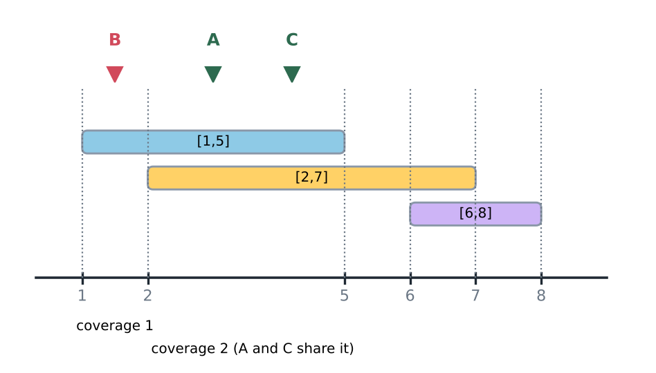

*B is in a different region. A and C are in the same region.*

The coverage changes only after the end points of an interval (in other words, the region changes there). If we find which region is covered by how many intervals, then the problem is essentially solved. The end points of the intervals are called key points or event points.

For any interval (L,R), the coverage increases by 1 after L and decreases by 1 after R.

Let S be a line that sweeps over the number line and calculates the coverage change at each event point. The coverage starts at 0. For the example above, S moves like this:

- S moves to 1: coverage increases by 1, so it is 1.
- S moves to 2: coverage increases by 1, so it is 2.
- S moves to 5: coverage decreases by 1, so it is 1.
- S moves to 6: coverage increases by 1, so it is 2.
- S moves to 7: coverage decreases by 1, so it is 1.
- S moves to 8: coverage decreases by 1, so it is 0.

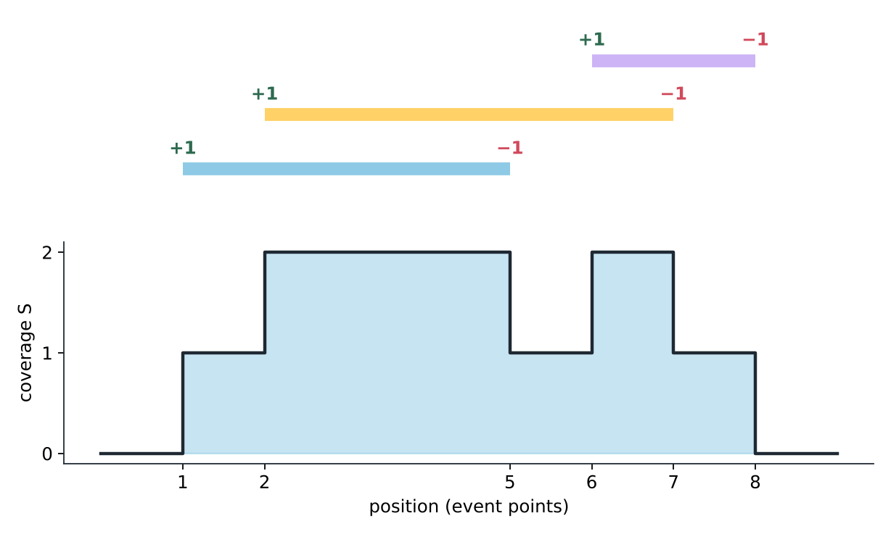

*The events (+1, −1) and the coverage counter.*

Why not mark every unit of the number line? L and R go up to 10⁹, so such an array is too large. Only the 2n event points matter.

How do we get the answer? Between two neighbouring event points the coverage stays the same. So add the length of that gap to bucket[current coverage]. This gives the length covered by exactly c intervals. We need "≥ k", so take a suffix sum of the buckets (add from the back).

Dry run: the events are 1+, 2+, 5−, 6+, 7−, 8−. The gaps between them are: [1,2] with coverage 1 has length 1; [2,5] with coverage 2 has length 3; [5,6] with coverage 1 has length 1; [6,7] with coverage 2 has length 1; [7,8] with coverage 1 has length 1. So the length covered by exactly 1 interval is 3, by exactly 2 is 4, and by exactly 3 is 0. The suffix sums give ≥ 3 is 0, ≥ 2 is 4, and ≥ 1 is 7 ✓.

T.C. = O(n log n) (sorting 2n events), and O(n) memory. The gaps of all buckets together add up to at most the length of the whole line, which is at most 10⁹ here, so `int` is enough. Use `long long` when the coordinates can be larger or negative.

Common mistake: printing only the "exactly c" buckets and forgetting the suffix sums. The question asks for "at least k", and "exactly" is not the same as "at least". In the first example the length covered by exactly 1 interval is 3, but by at least 1 interval it is 7.

```cpp
// Fabricator/Greedy-Sweepline/Sweepline.cpp
void solve() {
    int n;
    cin>>n;

    vector<pair<int, int>> events;
    for(int i=0; i<n; i++){
        int l, r;
        cin>>l>>r;
        events.push_back({l, +1});
        events.push_back({r, -1});
    }

    // This is piece of code is sweep line. Here we're creating an array,
    // which stores how much length of array is covered by number of segments
    sort(events.begin(), events.end());
    int cnt = 0;
    vector<int> covered_by(n + 1, 0);
    for(int i=0; i<events.size(); i++){
        cnt += events[i].second;

        if(i+1 < events.size()){
            int len = events[i + 1].first - events[i].first;
            covered_by[cnt] += len;
        }
    }

    // printing
    for(int i=1; i<=n; i++){
        cout<<i<<" "<<covered_by[i]<<endl;
    }

    // From above piece of code we got length of array covered by exactly number of segments
    // But our original problem needs to compute length covered by >= k segments
    // Hence we build a suffix array
    for(int i=n-1; i>=0; i--){
        covered_by[i] += covered_by[i+1];
    }

    for(int i=1; i<=n; i++){
        cout<<i<<" "<<covered_by[i]<<endl;
    }
}
```

Input: `3` / `1 5` / `2 7` / `6 8`. The output first shows the "exactly" block (`1 3`, `2 4`, `3 0`) and then the "at least" block (`1 7`, `2 4`, `3 0`). For the input `2` / `1 3` / `7 8` the second block is `1 3`, `2 0`.

Note: if an interval has L = R, the −1 event can be sorted before the +1 event, so `cnt` becomes −1 (`covered_by[-1]`). With L &lt; R there is no problem. (At the same position the pair (position, −1) is sorted before (position, +1), so an interval that ends at a point and another that starts at the same point do not overlap. This does not change the covered length.)

The same sweep can also find the maximum overlap (the moment when the coverage is largest). Example: the maximum population year problem, which asks in which year the most people are alive. Just note the year whenever the coverage reaches a new maximum.

In this problem a person is alive from the birth year up to, but not including, the death year. So a death event at year y must be handled before a birth event at the same year y, and this is exactly what the sort order −1 before +1 gives. The first year that reaches the maximum is printed, because the check is `curr_ans > ans` (strictly greater).

```cpp
// Fabricator/Greedy-Sweepline/MaxPopulationYear.cpp
/*
https://leetcode.com/problems/maximum-population-year/description/
*/

void solve() {
    int n;
    cin>>n;
    vector<pair<int, int>> events;
    for(int i=0; i<n; i++){
        int x, y;
        cin>>x>>y;
        events.push_back({x, 1});
        events.push_back({y, -1});
    }

    sort(events.begin(), events.end());

    int ans = 0, curr_ans = 0, year = -1;
    for(int i=0; i<events.size(); i++){
        curr_ans += events[i].second;
        if(curr_ans > ans){
            year = events[i].first;
            ans = curr_ans;
        }
    }

    cout<<year<<endl;
}
```

Input: `3` / `1993 1999` / `2000 2010` / `1995 2005` → `1995`. Input `2` / `1950 1961` / `1960 1971` → `1960`.

Dry run of the first input: the sorted events are 1993 +1, 1995 +1, 1999 −1, 2000 +1, 2005 −1, 2010 −1. The counter goes 1, 2, 1, 2, 1, 0. The maximum 2 is reached first at 1995, and the later 2 (in 2000) is not strictly greater, so the answer stays 1995. T.C. = O(n log n), memory O(n).

### probability of exactly 1 cover

Question: this is a changed version of the CF problem /problemset/problem/2125/D, "Segments Covering". We need to find P(i) for the iᵗʰ cell, where P(i) is the probability that the iᵗʰ cell is covered by exactly 1 interval. For every i, print P(i).

(Each interval is present independently with probability x = p/q. The cells are 1, 2, ..., m.)

Brute force would, for every cell, go over all intervals that contain the cell and add up the cases "exactly one is present". With n intervals and m cells that is about n × m steps, which is too slow for large n and m. The sweepline gives the intervals of the current cell as a set that changes only at event points.

The figure shows two intervals with probabilities x₁ and x₂. The cells below are marked with the probability that exactly one interval covers them:

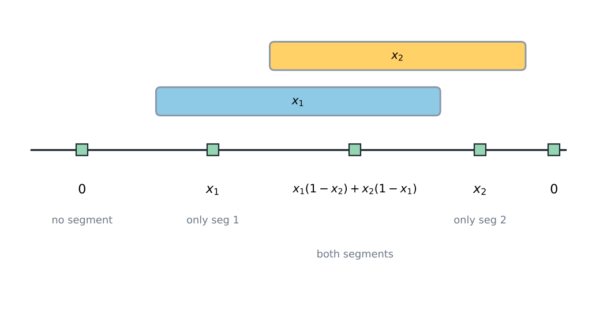

*The probabilities of the cells are 0, x₁, (the cell covered by both intervals), x₂, 0.*

For a cell covered by both intervals, there are four cases (with p/q = x). The first two columns tell whether interval 1 and interval 2 are present, and the last column says whether the case is desirable:

| Interval 1 | Interval 2 | Number present | Desirable? |
|---|---|---|---|
| (1−x₁) | (1−x₂) | 0 | No, because both are absent |
| x₁ | (1−x₂) | 1 | Yes, only interval 1 is present |
| (1−x₁) | x₂ | 1 | Yes, only interval 2 is present |
| x₁ | x₂ | 2 | No, because both are present |

The probabilities are independent. So the desirable probabilities are (1−x₁)x₂ and x₁(1−x₂), and their sum is the total:

(1−x₁)x₂ + x₁(1−x₂)

For 3 intervals x₁, x₂, x₃, exactly one is present and the other two are absent:

P[i] = x₁(1−x₂)(1−x₃) + x₂(1−x₁)(1−x₃) + x₃(1−x₁)(1−x₂)

Writing all the terms for every cell is too slow, because a cell can be covered by many intervals. So P[i] is rewritten: multiply and divide each term by its missing factor, so that every term has the full product.

The first term becomes x₁(1−x₂)(1−x₃)(1−x₁) divided by (1−x₁). The second term becomes (1−x₁)x₂(1−x₃)(1−x₂) divided by (1−x₂). The third term becomes (1−x₁)(1−x₂)x₃(1−x₃) divided by (1−x₃). Taking the full product out gives:

P[i] = (1−x₁)(1−x₂)(1−x₃) [ x₁/(1−x₁) + x₂/(1−x₂) + x₃/(1−x₃) ]

We maintain two things:

- product = (1−x₁)(1−x₂)(1−x₃)
- sum = [ x₁/(1−x₁) + x₂/(1−x₂) + x₃/(1−x₃) ]

On every event the product and the sum change. On a +1 event (an interval starts) its values are added into the product and the sum. On a −1 event (an interval ends) its values are removed.

The figure shows three intervals with x = 1/2, 1/3 and 1/4. The numbers below each region are checked with the formula. For the region with all three intervals: product = (1/2)(2/3)(3/4) = 1/4, sum = 1 + 1/2 + 1/3 = 11/6, so P = 1/4 × 11/6 = 11/24.

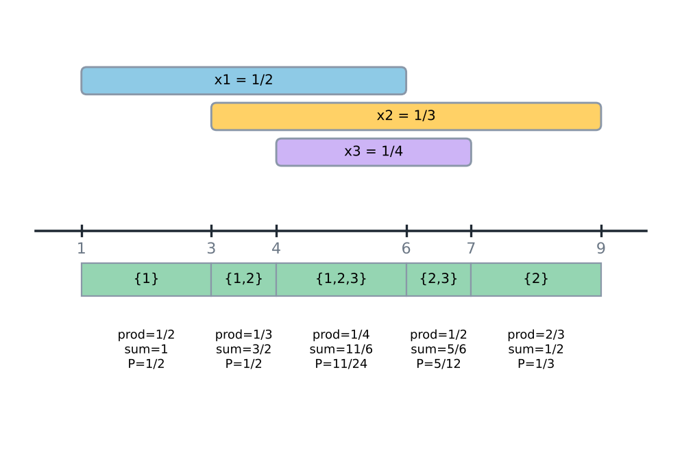

*The product, the sum, and P = product × sum for every region.*

An advantage of the sweepline is that it lets us maintain any data structure for the points inside a segment, by updating it when a segment starts or ends.

Removing means dividing the product by (1−x). Division under a modulus (the remainder after dividing by a fixed number, here 10⁹+7) is multiplication by the modular inverse: p/q is written as p × inverse(q). That is why the code has `inv()`. The inverse of q is q raised to the power (10⁹+7) − 2, computed by fast power in about 30 steps (this uses the fact that 10⁹+7 is a prime number).

Dry run: m = 6 cells, interval [1,4] with x = 1/2, interval [3,6] with x = 1/3. Cells 1 and 2 are covered only by the first interval, so P = 1/2. Cells 3 and 4 are covered by both intervals, so P = (1/2)(2/3) + (1/2)(1/3) = 1/3 + 1/6 = 1/2. Cells 5 and 6 are covered only by the second interval, so P = 1/3.

The same numbers come from the product and sum. For cells 3 and 4: product = (1/2)(2/3) = 1/3, sum = (1/2)/(1/2) + (1/3)/(2/3) = 1 + 1/2 = 3/2, so P = 1/3 × 3/2 = 1/2 ✓.

T.C. = O((n + m) log MOD), because every event needs a few modular inverses of about 30 multiplications each. Memory = O(n + m).

```cpp
// Fabricator/Greedy-Sweepline/SegmentsCovering_Easy.cpp
long long inv(long long n) {
    return mpow(n, MOD - 2);
}

void solve() {
    int m, n;
    cin>>m>>n;

    vector<pair<int, int>> events[m+2];

    for(int i=0; i<n; i++){
        int l, r, p, q;
        cin>>l>>r>>p>>q;
        events[l].push_back({1, p * inv(q)});
        events[r+1].push_back({-1, p * inv(q)});
    }

    long long sum = 0;
    long long prod = 1;
    long long ans[m+2];
    for(int i=1; i<=m; i++){
        for(auto event: events[i]){
            long long x = event.second;
            long long comp = (1 - x + MOD) % MOD;
            long long term = (x * inv(comp)) % MOD;
            
            if(event.first == 1){
                sum = (sum + term) % MOD;
                prod = (prod * comp) % MOD;
            }
            else{
                sum = (sum - term + MOD) % MOD;
                prod = (prod * inv(comp)) % MOD;
            }
        }

        ans[i] = (sum * prod) % MOD;
    }

    for(auto sol : ans){
        cout<<sol<<endl;
    }
}
```

Input: `6 2` / `1 4 1 2` / `3 6 1 3` (modulo 10⁹+7). (This program first reads the number of test cases, so a `1` must be typed before this input.) The output has m + 2 numbers; the first and the last are unused. The 6 in the middle are `500000004` ×4 and `333333336` ×2, which mean 1/2 ×4 and 1/3 ×2 ✓.

Note: (1) `ans[0]` and `ans[m+1]` are never set but are still printed. (2) If some interval has x = 1, then 1−x = 0 has no inverse, and the code gives 0 although the true value should be 1 (tried with the input `2 1` / `1 2 1 1`). Fix idea: keep a separate count of intervals with x = 1. With 2 or more of them the answer is 0. With exactly 1 the answer is the product of (1−x) of all the others. With 0 the answer is product × sum. (3) `p * inv(q)` is stored in an `int` without `% MOD`. This is a real bug, not only a safety matter: the product can be larger than the `int` limit, and then the stored value is wrong. For the input `1 1` / `1 1 5 10` (x = 5/10 = 1/2) the middle printed number is −794967271, but the right answer is 500000004 (1/2 under the modulus). With `(p * inv(q)) % MOD` in both places the output is correct. In 300 random small tests the original code was wrong in 65 when q was at most 10 and in 269 when q was at most 100 (the larger the numbers, the more often the product overflows), and the fixed code was wrong in none.

### top k in segments

Question: Given n intervals and a value k. Each interval has the ends Lᵢ and Rᵢ and a value Xᵢ (the value of the segment). Given Q queries, each with a position y, print the sum of the top k values Xᵢ among the segments that cover y.

The limits are n ≤ 10⁵, k ≤ 10⁵, Lᵢ, Rᵢ, Xᵢ ≤ 10⁹, Q ≤ 10⁵ and yᵢ ≤ 10⁹.

Brute force would go over all n segments for every query and pick the top k: n × Q = 10¹⁰ steps, which is too slow.

For the figure, take k = 2. The answers for the three queries are:

- For y = 2, the answer is 1, because only one segment (value 1) covers it.
- For y = 4, the answer is 1 + 3 = 4, from the top 2 values 1 and 3.
- For y = 6, the answer is 2 + 3 = 5, from the top 2 values 2 and 3.

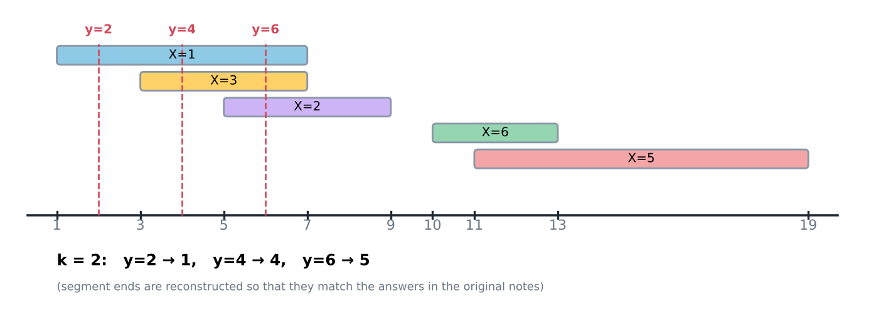

*For k = 2 the answers are 1, 4, 5. (The segment ends were drawn to fit these answers.)*

Harder version: what if k is given in each query? The input format is:

```
 n
 L₁  R₁  X₁
 ⋮
 Lₙ  Rₙ  Xₙ
 Q
 y₁  k₁
 y₂  k₂
 ⋮
 y_Q  k_Q
```

Here every k ≤ 10.

Example (n = 2 segments, then Q = 3 queries, each with its answer on the right):

```
 2
 1  10  1
 5  15  2
 3
 7  3  → 2+1 = 3
 12 2  → 2 = 2
 2  1  → 1 = 1
```

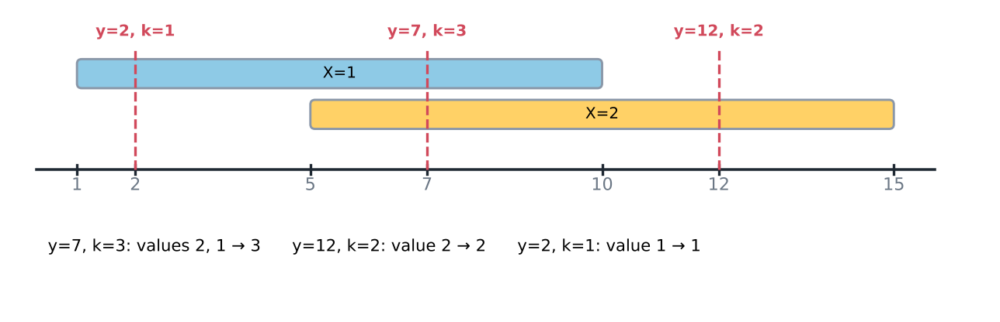

*The answers are 3, 2, 1.*

The answers have to be printed in this order.

We can use offlining of queries (answering the queries in another order than the input order). Since the queries do not change the input in any way, we can use this. The figure below shows the queries of the example with their index, sorted by the first number y:

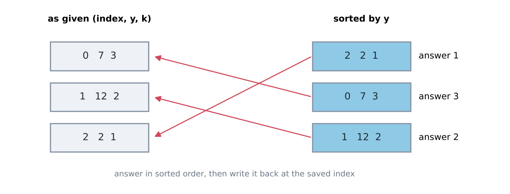

*Sort by y, remember the index, and write the answer back at that index.*

We calculate the answers in the sorted order, and then print them in the original order of the queries.

Now, to solve the problem we can maintain a multiset (a sorted container that allows repeated values):

- Insert the value when an interval starts.
- Remove the value when an interval ends.
- Iterate over the top k values to calculate the answer for a query.

The sweep goes over the sorted positions from left to right. At a query position y, the multiset holds exactly the values of the segments that cover y.

Observation: at one position x, a segment may start, a query may occur and another segment may end. The query must count both segments (the segments are closed). So the order at the same position is start → query → end. Sorting the pairs (position, type) does this, with type 0 = start, 1 = query, 2 = end.

Note: `mt.erase(mt.find(v))` removes one copy only. `mt.erase(v)` would remove all copies.

T.C. = O((n + Q) log (n + Q) + Q·k) with k ≤ 10: sorting the 2n + Q events, one multiset insert or erase for each segment, and a walk over at most k values for each query. Memory = O(n + Q).

```cpp
// Fabricator/Greedy-Sweepline/TopKInSegments.cpp
using event = pair<pair<int, int>, pair<int, int>>;

/*
event = pair<pair<int,                 int>, pair<int,   int>>;
                  pos(query & segment) type       value  pos(not useful for segment, only query position is stored)
0 -> start
1 -> query
2 -> end

WHY??

This handles the boundary condition, if at any point x, there is starting segment, and an ending segment
then to include those values in the calculation. Because when we sort, the sorting is done by position and then type

For any arbitrary position x we'll have following sorted pairs:
 -> x, start
 -> x, query
 -> x, end

1 10 1
5 15 2

*/

void solve() {
    int n;
    cin>>n;

    vector<event> events;
    for(int i=0; i<n; i++){
        int l, r, x;
        cin>>l>>r>>x;

        events.push_back({
            {l, 0},
            {x, 0}
        });
        events.push_back({
            {r, 2},
            {x, 0}
        });
    }

    int q;
    cin>>q;

    for(int i=0; i<q; i++){
        int y, k;
        cin>>y>>k;
        events.push_back({
            {y, 1},
            {k, i}
        });
    }

    sort(events.begin(), events.end());
    int ans[q];
    multiset<int> mt;
    for(auto v: events){
        if(v.first.second == 0){
            mt.insert(v.second.first);
        }
        else if(v.first.second == 2){
            mt.erase(mt.find(v.second.first));
        }
        else{
            int sum_val = 0;
            for(auto [cnt, it] = make_pair(0, mt.rbegin()); cnt < v.second.first && it != mt.rend(); it++, cnt++){
                sum_val += *it;
            }

            ans[v.second.second] = sum_val;
        }
    }

    for(int i=0; i<q; i++){
        cout<<ans[i]<<endl;
    }
}
```

Input: `2` / `1 10 1` / `5 15 2` / `3` / `7 3` / `12 2` / `2 1` → output `3`, `2`, `1`.

Dry run on the example: sorted events are 1 start(1), 2 query(k=1), 5 start(2), 7 query(k=3), 10 end(1), 12 query(k=2), 15 end(2). At y = 2 the multiset is \{1\} → 1. At y = 7 it is \{1,2\} → top 3 gives 3. At y = 12 it is \{2\} → 2. Printed in the original query order: 3, 2, 1 ✓.

If k is large (10⁵), walking over the top k for every query is too slow: Q × k = 10¹⁰ steps. Then keep two multisets, `top` (the k largest) and `rest`, and maintain the sum of `top`. When a value is inserted, put it into `top`; if `top` has more than k values, move its smallest value to `rest`. When a value is erased, remove it from the set that holds it; if it was in `top`, move the largest value of `rest` into `top`. A query then just reads the stored sum, so each event costs O(log n).

Here is that idea as code. `TopKSet` keeps the two multisets and the sum. `topKSumsFixed` is the same sweep as above, with the event type stored as a number (0 start, 1 query, 2 end).

```cpp
// new function (not in Fabricator): the fixed large k version, with two multisets and a stored sum
/*
n segments [L_i, R_i] carry values X_i. The number k is the same for all queries (k up to 1e5).
For each query position y, print the sum of the k largest values among the segments that cover y.
*/
struct Segment { long long l, r, value; };

// `top` holds the k largest values and `rest` holds the others. topSum is the sum of `top`.
struct TopKSet {
    size_t k;
    multiset<long long> top, rest;
    long long topSum = 0;
    explicit TopKSet(size_t k) : k(k) {}

    void insert(long long v) {
        top.insert(v);
        topSum += v;
        if (top.size() > k) {                       // too many: demote the smallest of top
            long long smallest = *top.begin();
            top.erase(top.begin());
            topSum -= smallest;
            rest.insert(smallest);
        }
    }
    void erase(long long v) {
        auto inRest = rest.find(v);
        if (inRest != rest.end()) { rest.erase(inRest); return; }
        top.erase(top.find(v));
        topSum -= v;
        if (!rest.empty()) {                        // refill top with the largest of rest
            auto largest = prev(rest.end());
            top.insert(*largest);
            topSum += *largest;
            rest.erase(largest);
        }
    }
};

vector<long long> topKSumsFixed(const vector<Segment>& segs, const vector<long long>& ys, size_t k) {
    vector<tuple<long long, int, int>> events;  // {position, type, index}: 0 start, 1 query, 2 end
    for (int i = 0; i < (int)segs.size(); i++) {
        events.push_back({segs[i].l, 0, i});
        events.push_back({segs[i].r, 2, i});
    }
    for (int i = 0; i < (int)ys.size(); i++) events.push_back({ys[i], 1, i});
    sort(events.begin(), events.end());

    TopKSet active(k);
    vector<long long> answer(ys.size(), 0);
    for (auto [position, type, idx] : events) {
        if (type == 0) active.insert(segs[idx].value);
        else if (type == 2) active.erase(segs[idx].value);
        else answer[idx] = active.topSum;
    }
    return answer;
}
```

Trace on the segments of the figure above, written as [L, R] with value X: [1,7] with 1, [3,7] with 3, [5,9] with 2, [10,13] with 6 and [11,19] with 5, and k = 2. The queries are y = 2, 4, 6. At position 1 the value 1 enters `top`. The query at 2 reads the sum 1. At position 3 the value 3 enters, so `top` is \{1, 3\} with sum 4, and the query at 4 reads 4. At position 5 the value 2 enters. Now `top` would hold three values, so its smallest value 1 moves to `rest`, `top` is \{2, 3\} with sum 5, and the query at 6 reads 5. The function returns `1 4 5`, the same as the answers in the figure. It also matched a brute force (sort the covering values for every query) on 20 000 random inputs.

Cost: T.C. O((n + Q) log (n + Q)) for the sort and O(log n) for each insert or erase, and O(n + Q) space. Common mistakes: removing the segment at R + 1 instead of at R for closed segments (the event order start, query, end already handles the end point), using `erase(value)` on a multiset (it removes every copy), and forgetting that `erase` must also look in `rest` first, because the value may not be in `top`.

## Recognition cards

A recognition card is a short test for one technique. It gives the property that decides it, how to check that property, what the limits look like, the signals that suggest it and the ones that rule it out, a worked case and the look-alikes. The five cards of this topic are the five shapes named at the start.

<Cards topic="1.5" />

## Quick revision

- Greedy → take the best choice now, and prove it is safe (exchange argument). Coins 1, 3, 4 and amount 6: the largest-first rule gives 3 coins, but 3 + 3 = 2 coins is better.
- Best ordering → compare two neighbouring items i and j, write "i first is better", simplify → sorting rule.
- min dot product → A sort ↑, B sort ↓. Example: 23. T.C. = O(n log n), long long for the sum.
- decay contest → sort by dᵢ/tᵢ ↓, compare `dᵢ·tⱼ > dⱼ·tᵢ` (strict, no division). Example: −5.
- x−1 / 2x: think in reverse, from B to A. B odd → B+1, B even → B/2. When B ≤ A → add A − B. T.C. = O(log B). Example: A = 5, B = 11 → 5 steps.
- Constraints ~10¹⁸ → math / greedy / bit man (bit manipulation).
- Fuel: Σ Pᵢ · min(C₁..Cᵢ). Who covers Pₓ? Example: 30. T.C. = O(N).
- Hire k: sort by speed ↓, treat each student as the pivot, keep a min-heap of the top k impacts, answer = max(speed × sum). Example: 13. T.C. = O(N log N). Watch the overflow (10²³).
- Median → minimises Σ|x−xᵢ|. Even count → any point between the two middle points is optimal. Weighted → write each point kᵢ times, take position (Σk+1)/2. Example: x = 7, sum 21.
- Manhattan: x, y independent → use the median of each. Number of solutions = (xhi−xlo+1)(yhi−ylo+1). Example: cost 12, 12 solutions.
- Bits: 4x = x &lt;&lt; 2, 2x+1 = (x &lt;&lt; 1) | 1. Both append bits at the end ("00", "1"), so every number has one parent. Remove the redundant numbers, then count strings with Fibonacci-like counts: f(L) = f(L−1) + f(L−2).
- Pigeonhole: among n numbers there is always a subarray with sum % n == 0. Take prefix sums mod n (include the empty prefix); equal remainders give such a block. T.C. = O(n).
- Ratio equality → store the lowest-form pair in a map, never a double. Use `long long`.
- Max points on a line → fix a pivot, count reduced slopes in a map, answer = max frequency + pivot. T.C. = O(n² log n). Edge case: all points equal to the pivot (the map is empty), use `max(ans, same)`.
- Sweepline → events (+1 at L, −1 at R), sort, add the gap length to bucket[coverage], suffix sum for ≥ k. T.C. = O(n log n).
- Same position: start → query → end.
- Sweepline can maintain a data structure: product + sum (probability, with modular inverses), multiset (top k).
- Probability code: reduce `p * inv(q)` with `% MOD`, and handle x = 1 separately.
- Offline queries: sort by y, save the index, print the answers in the original order.
- Top k with a large fixed k: two multisets (`top` and `rest`) and a stored sum, so a query reads the sum in O(1)
- Exchange argument in one line: a swap of an out-of-order pair never makes the answer worse, so after finitely many swaps the sorted order is optimal. A counter-example search on tiny inputs is the quick check before trusting a rule
- Theorem 1.5.1: if swapping adjacent $x$ before $y$ with $\text{key}(x) \ge \text{key}(y)$ never raises the cost, every order sorted by key is optimal. Weighted jobs: key $t / w$, compared as $t_x w_y < t_y w_x$. Durations 3, 1, 2 give 10 against 13.
- Theorem 1.5.2: earliest end first keeps the most pairwise disjoint intervals, and the same ends are the fewest hitting points. Touching ends: follow the statement (start $>$ `lastEnd` when a shared point overlaps).
- Theorem 1.5.3: the $k$ largest items have the largest sum, so the fewest items reaching T are the largest first. Splittable units go by value per unit. It fails for non-splittable items of different sizes.
- Theorem 1.5.4: each child by increasing greed gets the smallest unused sufficient cookie. Move past a cookie once it is given.
- Theorem 1.5.5: if the greedy state after every step dominates any other state, greedy is at least as good. Cover a segment by the farthest reach, and Missing Coin Sum by the reach $r$ with the test $x \le r + 1$.

## Check yourself

### Identification drill

Each item names a problem without saying which card decides it. Choose a card (the list includes earlier topics' cards), write the property you checked, then open the answer. Do not solve the problems here: deciding is the exercise. Three items are answered by topic 1.4's cards.

<Drill topic="1.5" />

### Look-alike pairs

Two problems that read almost the same but need different tools. The flipping difference is the one detail that changes the decision.

<LookalikePairs topic="1.5" />

### Self-test

Answer each question on paper before opening its answer.

<SelfTest topic="1.5" />

### Checkpoint

Three problems in 90 minutes. To pass, solve at least 2 of 3 in time and choose the right card on at least 8 of the 11 drill items. After passing, three review sets become due: after 3 days, 14 days and 60 days.

<Checkpoint topic="1.5" />

### Decision map update

How this topic's cards are chosen against the tools you already have.

<DecisionMapUpdate topic="1.5" />

## Practice problems

- [Codeforces contest 1635](https://codeforces.com/contest/1635)
- [Codeforces 2125D Segments Covering](https://codeforces.com/problemset/problem/2125/D)
- [LeetCode Maximum Population Year](https://leetcode.com/problems/maximum-population-year/description/)
- [LeetCode Minimize Product Sum of Two Arrays](https://leetcode.com/problems/minimize-product-sum-of-two-arrays/) (the min dot product problem)
- [LeetCode Largest Number](https://leetcode.com/problems/largest-number/) (a sorting rule found by an exchange argument)
- [LeetCode Minimum Initial Energy to Finish Tasks](https://leetcode.com/problems/minimum-initial-energy-to-finish-tasks/)
- [LeetCode Two City Scheduling](https://leetcode.com/problems/two-city-scheduling/)
- [Codeforces 520B Two Buttons](https://codeforces.com/problemset/problem/520/B) (the x-1 and 2x idea)
- [LeetCode Broken Calculator](https://leetcode.com/problems/broken-calculator/)
- [LeetCode Gas Station](https://leetcode.com/problems/gas-station/)
- [LeetCode Maximum Performance of a Team](https://leetcode.com/problems/maximum-performance-of-a-team/) (hiring k students)
- [LeetCode Maximum Subsequence Score](https://leetcode.com/problems/maximum-subsequence-score/)
- [LeetCode Minimum Moves to Equal Array Elements II](https://leetcode.com/problems/minimum-moves-to-equal-array-elements-ii/) (the median)
- [LeetCode Minimum Cost to Make Array Equal](https://leetcode.com/problems/minimum-cost-to-make-array-equal/) (the weighted median)
- [LeetCode Subarray Sums Divisible by K](https://leetcode.com/problems/subarray-sums-divisible-by-k/)
- [LeetCode Continuous Subarray Sum](https://leetcode.com/problems/continuous-subarray-sum/)
- [CSES 1662 Subarray Divisibility](https://cses.fi/problemset/task/1662)
- [LeetCode Max Points on a Line](https://leetcode.com/problems/max-points-on-a-line/)
- [CSES 1619 Restaurant Customers](https://cses.fi/problemset/task/1619)
- [LeetCode My Calendar III](https://leetcode.com/problems/my-calendar-iii/)
- [LeetCode The Skyline Problem](https://leetcode.com/problems/the-skyline-problem/)
- [LeetCode Minimum Interval to Include Each Query](https://leetcode.com/problems/minimum-interval-to-include-each-query/) (offline queries with a sweep)

### Problem ladder

<Ladder topic="1.5" />
